

<a href="https://github.com/AlexGalhardo/stuarty" target="_blank" rel="noopener noreferrer">
  <picture>
    <source media="(prefers-color-scheme: dark)" srcset="site/public/logo-wordmark-dark.png">
    
  </picture>
</a>

 

 

### Create, edit, manage and publish your audiovisual and text content in one place

 

 

## Introduction

**Why use so many tools to create your content, when you can focus on one tool and connect to other tools and services when needed? This is why Stuarty exists.**

Stuarty is an open source (MIT), self-hosted studio for video, images and text, on the web and on your desktop. Your AI agent works beside you, and nothing is published until you say yes. Files, tokens and credentials stay on your machine or on your own server.

## How it works

Every project follows one path, from the idea to the post, and the home shows which step is done and which is next.

### 1. Open the home

The home shows the project to continue, the step it is on, what waits for you and all your projects, each with its kind.

  <picture>
    <source media="(prefers-color-scheme: dark)" srcset="site/public/landing/dashboard-960.webp">
    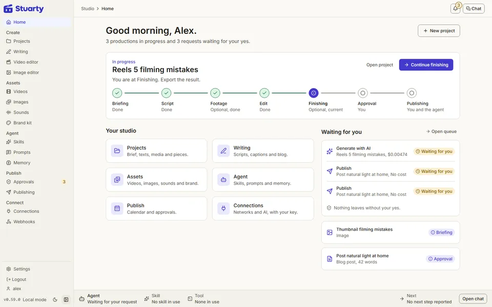
  </picture>

Read more: [dashboard and projects](https://stuarty.com/docs/guide/dashboard/).

### 2. Start a project

A project is one production. Name it and pick what it is: a text, a video, an image, or decide later. It keeps its brief, its media, its texts and its exports together.

  <picture>
    <source media="(prefers-color-scheme: dark)" srcset="site/public/landing/projects-960.webp">
    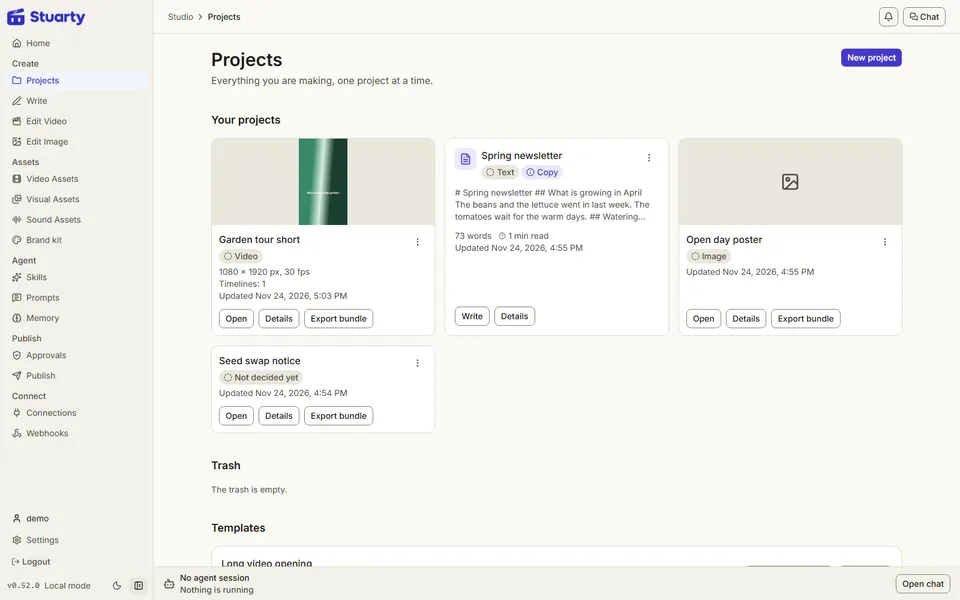
  </picture>

Read more: [dashboard and projects](https://stuarty.com/docs/guide/dashboard/).

### 3. Answer the brief

Describe the project and set its goal and due date. The guided briefing asks who it is for, where it goes, how long and in which tone, and your answers become the brief your agent reads.

  <picture>
    <source media="(prefers-color-scheme: dark)" srcset="site/public/landing/project-brief-960.webp">
    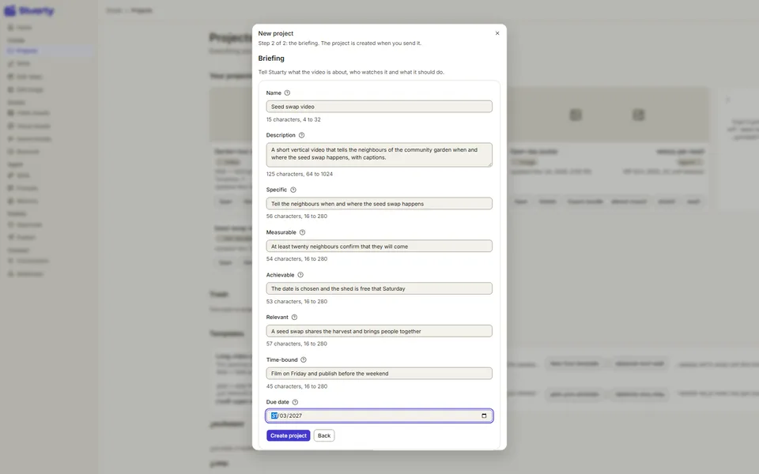
  </picture>

Read more: [quick start](https://stuarty.com/docs/quick-start/).

### 4. Write the script

Scripts, copy, captions and blog posts. Every save is a revision you can compare or restore, and a script shows how long it takes read aloud. A text is a complete project on its own: no footage needed.

  <picture>
    <source media="(prefers-color-scheme: dark)" srcset="site/public/landing/writing-960.webp">
    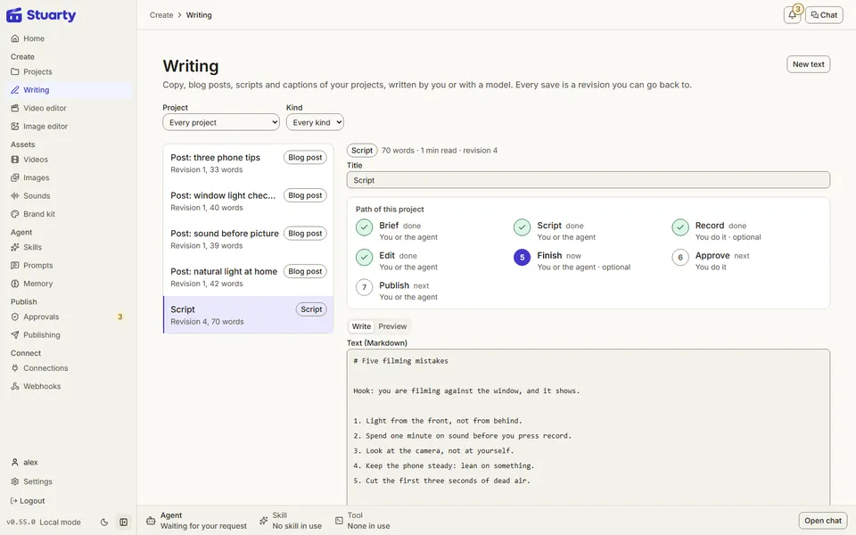
  </picture>

Read more: [writing](https://stuarty.com/docs/guide/writing/), [blog posts](https://stuarty.com/docs/guide/blog-posts/).

### 5. Bring in your media

Import footage, music and voice-overs once and reuse them in any project. The library records where each file came from, its rights and where it is used, so you find it again in seconds.

  <picture>
    <source media="(prefers-color-scheme: dark)" srcset="site/public/landing/video-assets-960.webp">
    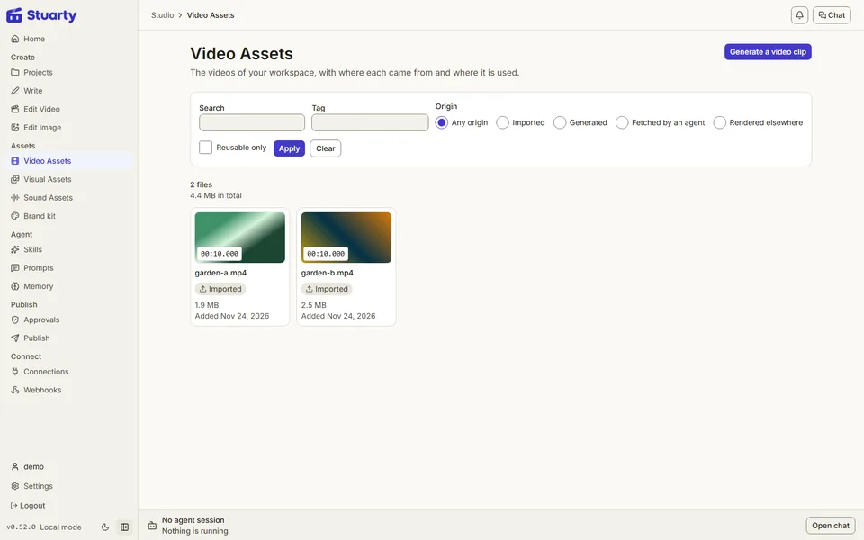
  </picture>

Read more: [media library](https://stuarty.com/docs/guide/media-library/), [asset library](https://stuarty.com/docs/guide/asset-library/).

### 6. Cut and caption

A multi-track timeline with transitions, colour and keyframes. Transcribe, cut by editing the transcript, remove silences and filler words, style the captions, blur what must stay private and clean the voice. Export a checked MP4, vertical or not.

  <picture>
    <source media="(prefers-color-scheme: dark)" srcset="site/public/landing/video-editor-960.webp">
    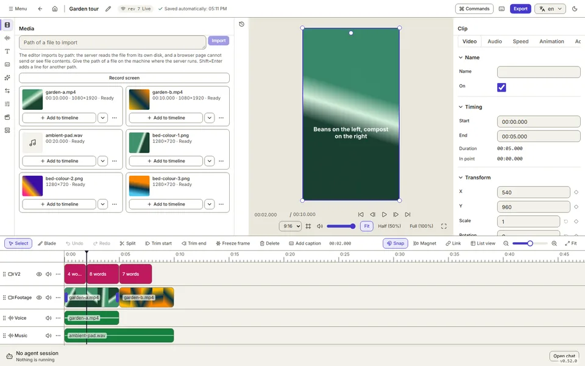
  </picture>

Read more: [timeline](https://stuarty.com/docs/guide/timeline/), [text and captions](https://stuarty.com/docs/guide/text-and-captions/), [transcription](https://stuarty.com/docs/guide/transcription/), [silence removal](https://stuarty.com/docs/guide/silence-removal/), [exporting](https://stuarty.com/docs/guide/exporting/), and the tutorial [your first vertical short](https://stuarty.com/docs/guide/tutorial-vertical-short/).

### 7. Make the thumbnail

Layers, text, masks, looks and templates for thumbnails, covers and posters, with the same undo and history as the video editor. The brand kit keeps your colours, fonts and logos in every project.

  <picture>
    <source media="(prefers-color-scheme: dark)" srcset="site/public/landing/image-editor-960.webp">
    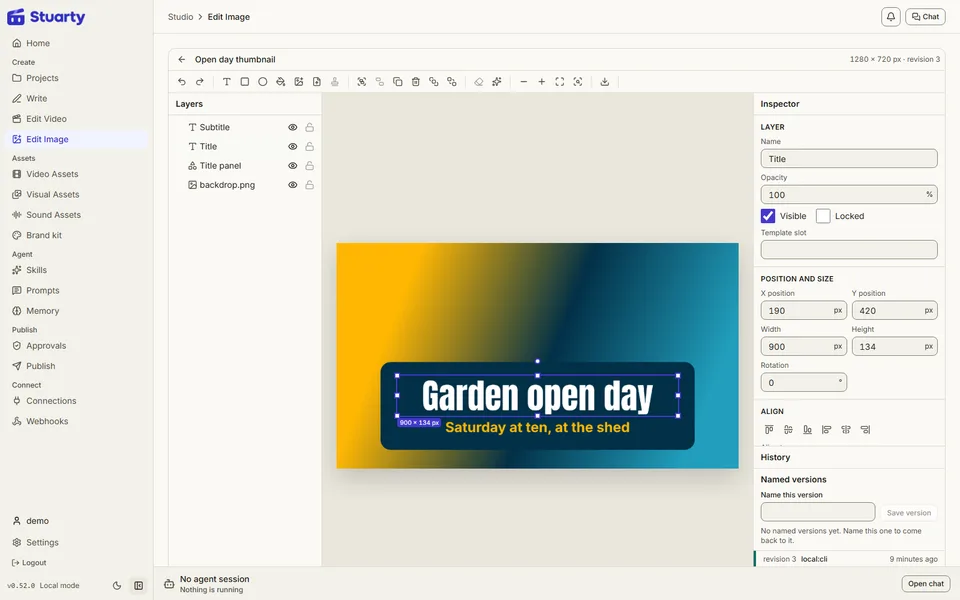
  </picture>

Read more: [image editor](https://stuarty.com/docs/guide/image-editor/), [brand kit](https://stuarty.com/docs/guide/brand-kit/), [templates](https://stuarty.com/docs/guide/templates/).

### 8. Work with your agent

Claude Code, Codex, OpenCode or Gemini CLI, signed in with your own account, or your own API key, work in the chat beside the project. You see the skill it loaded and the tool it is using, and every change it makes is signed in the history and can be undone.

  <picture>
    <source media="(prefers-color-scheme: dark)" srcset="site/public/landing/agent-chat-960.webp">
    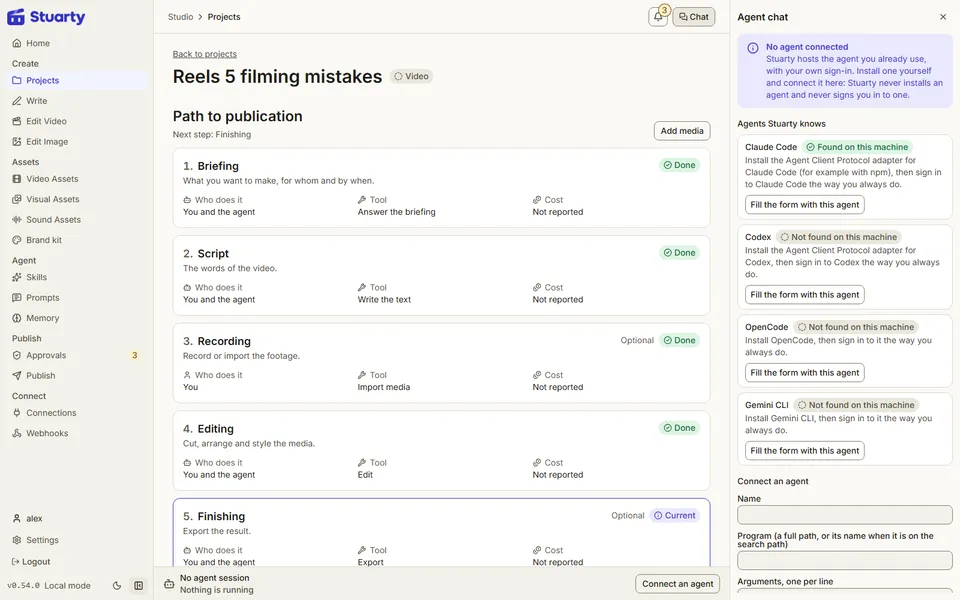
  </picture>

Read more: [agent chat](https://stuarty.com/docs/guide/agent-chat/), [AI providers](https://stuarty.com/docs/guide/ai-providers/), [undo and history](https://stuarty.com/docs/guide/undo-and-history/), and the tutorial [edit a video with an agent](https://stuarty.com/docs/guide/tutorial-agent-edit/).

### 9. Teach it how you work

Skills are procedures you review, prompts are texts with variables, and memory holds the facts your agents read. All of them stay as plain files you own.

  <picture>
    <source media="(prefers-color-scheme: dark)" srcset="site/public/landing/skills-960.webp">
    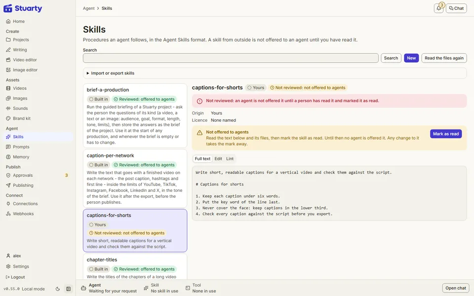
  </picture>

Read more: [memory, skills and prompts](https://stuarty.com/docs/guide/memory-skills-prompts/).

### 10. Approve

A publication or a paid generation waits in one queue until a person approves it. An agent can prepare it, but it cannot approve its own request or raise a cost ceiling; only you, or a rule you wrote, can.

  <picture>
    <source media="(prefers-color-scheme: dark)" srcset="site/public/landing/approvals-960.webp">
    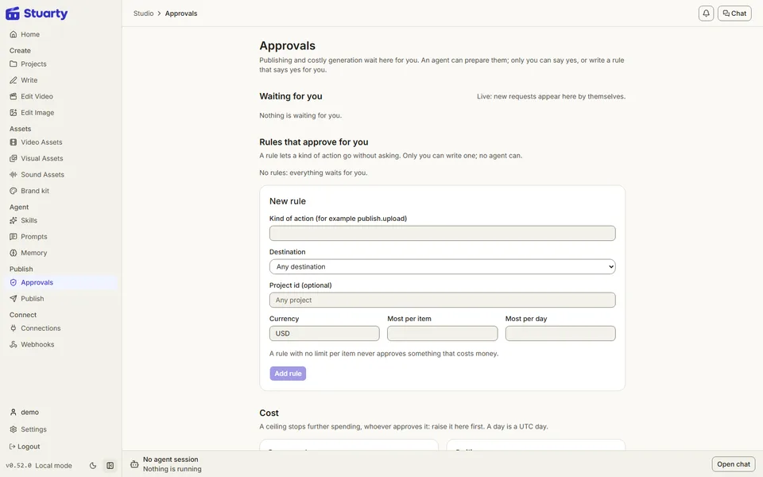
  </picture>

Read more: [approvals](https://stuarty.com/docs/guide/approvals/), [agent safety](https://stuarty.com/docs/agents/safety/).

### 11. Publish

Plan each post on a calendar for YouTube, Instagram, Facebook, X, TikTok or your own blog, through your own developer apps. It goes out only after you approve it.

  <picture>
    <source media="(prefers-color-scheme: dark)" srcset="site/public/landing/publish-calendar-960.webp">
    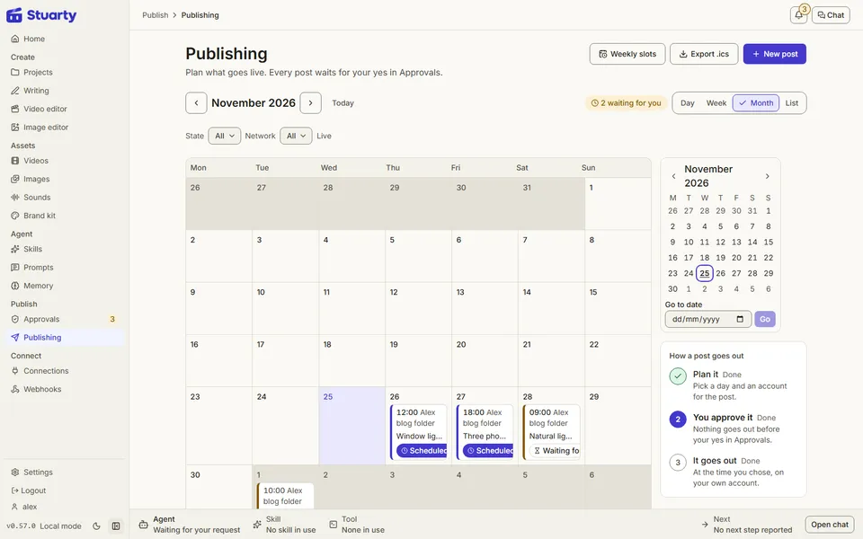
  </picture>

Read more: [publishing calendar](https://stuarty.com/docs/guide/publishing-calendar/).

### 12. Connect only what you choose

With nothing connected, Stuarty opens no outbound connection and sends no telemetry. Each AI provider or account you add uses your own key, kept in a local encrypted vault.

  <picture>
    <source media="(prefers-color-scheme: dark)" srcset="site/public/landing/connections-960.webp">
    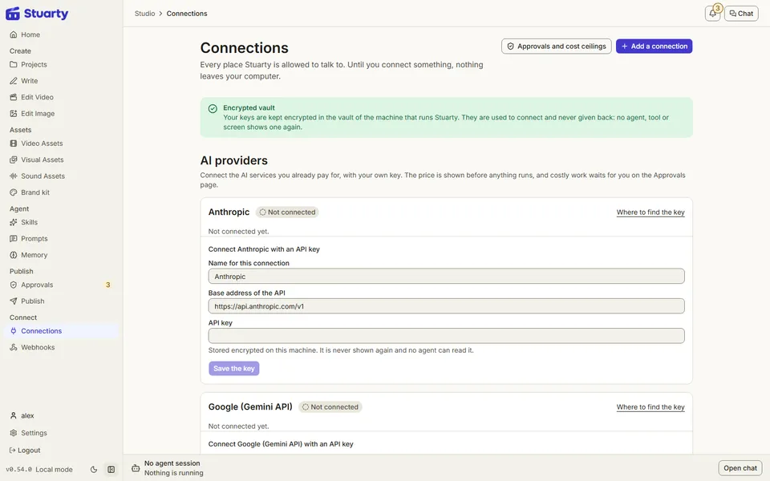
  </picture>

Read more: [what leaves your machine](https://stuarty.com/docs/what-leaves-your-machine/), [security](https://stuarty.com/docs/self-hosting/security/), [privacy](https://stuarty.com/docs/self-hosting/privacy/).

### Everything an agent can do too

Everything you do in the UI, an agent can do through the [CLI](https://stuarty.com/docs/agents/cli/), the [HTTP API](https://stuarty.com/docs/api/overview/) or the [MCP server](https://stuarty.com/docs/mcp/overview/). They are thin adapters over one command core, and a parity test keeps them equal. See the [agents overview](https://stuarty.com/docs/agents/overview/).

## Install

Stuarty is in alpha: expect rough edges. Install it as a [desktop app](https://stuarty.com/docs/guide/desktop/), a [single binary](https://stuarty.com/docs/self-hosting/binary/) or with [Docker](https://stuarty.com/docs/self-hosting/docker/) on a [VPS](https://stuarty.com/docs/self-hosting/vps/). See the [installation guide](https://stuarty.com/docs/installation/) and [backups and upgrades](https://stuarty.com/docs/self-hosting/backups-and-upgrades/).

New here? Start with the [introduction](https://stuarty.com/docs/introduction/) and the [quick start](https://stuarty.com/docs/quick-start/).

## Stability

Versions follow SemVer. Stuarty is in `0.x`: a minor release may break. A project or a workspace saved by a released version opens in every later one. See the [changelog](CHANGELOG.md).

## Contributing

To build from source you need Go (see `go.mod`) and Bun for `web/`. The task runner is [Task](https://taskfile.dev): `task lint` and `task test`. Read the [contribution guide](.github/CONTRIBUTING.md) to get started and [`AGENTS.md`](AGENTS.md) for how the team of agents works. The planning documents (requirements, decisions, specifications and epics) are in [docs/](docs/README.md).

## Code of conduct

To keep the community welcoming to everyone, please review and follow the [Code of Conduct](.github/CODE_OF_CONDUCT.md).

## Security vulnerabilities

If you discover a security vulnerability, please follow the [security policy](.github/SECURITY.md) instead of opening a public issue.

## License

Stuarty is open-source software licensed under the [MIT license](LICENSE.md).
