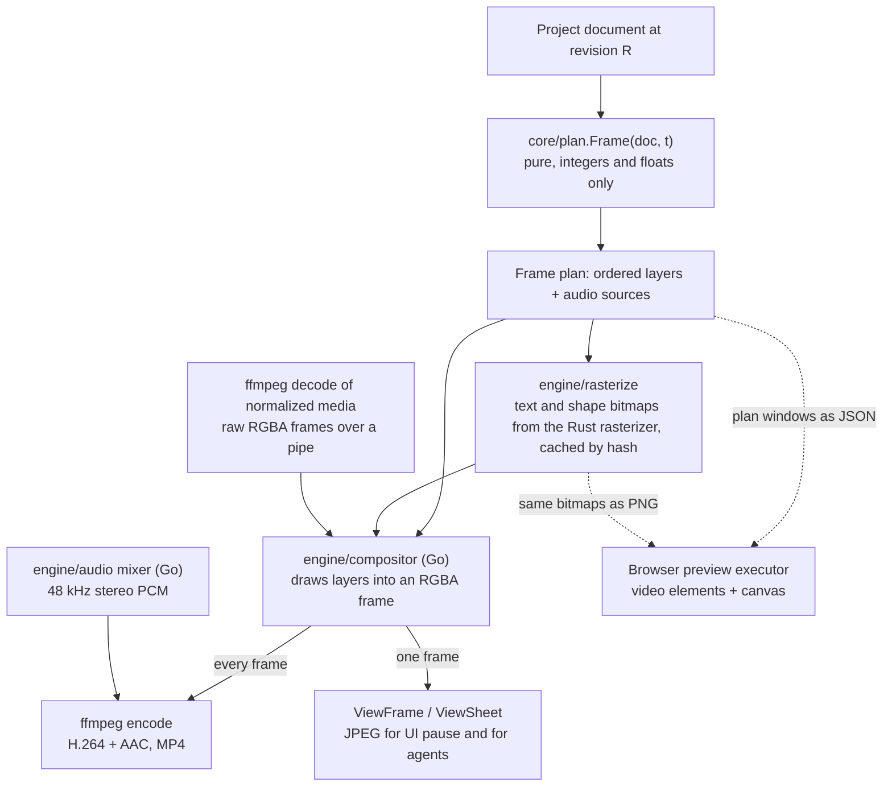

# SDD-004: Render pipeline and source of truth

- Status: Draft (2026-11-14). The compositor design depends on the measurement of `spikes/go-compositor`; see section 12.
- Depends on: ADR-0003 (one plan, two executors), ADR-0004 (time), ADR-0010 (ingest), ADR-0011 (FFmpeg and codecs), ADR-0012 (rasterizer), ADR-0013 (browser), SDD-000, SDD-001, SDD-011 (ingest profiles)
- Implements: RF-015, RF-020 to RF-026, RF-030 to RF-032, RF-035, RF-040 to RF-042, RF-060 to RF-063, RF-087 to RF-089, RF-109, NFR-003, NFR-004, NFR-006, NFR-007, NFR-010, NFR-011, NFR-022, NFR-023
- Owner area: senior-b (render, ingest and media), with `core/plan` owned by senior-a

## Contents

1. Overview
2. The frame plan
3. Evaluating an item at a frame
4. Layout of text, captions and shapes
5. The rasterizer
6. The compositor
7. Audio
8. Export
9. Frames for people and agents
10. The preview executor
11. Tolerance and reference tests
12. Performance design and its open measurement
13. Acceptance

## 1. Overview

> ADR-0029 replaces the executors of sections 6 and 10 by one renderer in Rust. [SDD-013](013-renderer.md) is its contract: the plan as the renderer reads it (§2 there is this section's `FramePlan` as JSON), the pixel contract (restating section 6 as exact arithmetic), the module and its hosts, and the errors. Until the stages of ADR-0029 pass their gates, this SDD stays the specification of the pixels.



Three rules hold everywhere:

1. `core/plan` decides what a frame contains. Nothing else interpolates, picks a source frame or lays out a caption.
2. The Rust rasterizer (`renderer/stuarty-renderer-text`, run by the renderer module and reached from Go through `engine/rasterize`) is the only code that draws text and shapes. Both executors use its bitmaps.
3. The Go compositor is the **export executor** and the truth. FFmpeg decodes media into raw frames and encodes the composed frames; it places nothing. This removes dependence on FFmpeg filters that are GPL-only (`eq`, `boxblur`) and on filter behaviour that the first spike showed is not pixel-stable (the same scene placed through `overlay` expressions differed from the piped version in 630 of 900 frames).

## 2. The frame plan

```go
package plan

// Frame returns what frame t of the document contains. It is pure.
func Frame(doc *timeline.Document, t int) FramePlan

// Window returns the plans of frames [from, to) in the compact form of section 10.
func Window(doc *timeline.Document, from, to int) WindowPlan

// Audio returns every audio source that sounds in frames [from, to).
func Audio(doc *timeline.Document, from, to int) []AudioSource

type FramePlan struct {
    Frame         int
    Width, Height int
    Background    Color
    Layers        []Layer // bottom first
}

type Layer struct {
    ItemID string
    Kind   LayerKind // Media or Bitmap

    // Media layers (clip items)
    AssetID     string
    AssetKind   string  // "video" or "image"
    SourceFrame int     // frame index in the normalized media; 0 for images
    Crop        Rect    // in source pixels after the item's crop fractions
    ColorMatrix *[12]float64 // nil when brightness, contrast and saturation are neutral
    Filter      *[12]float64 // both kinds: the filter matrix of section 3.6; nil for none
    Blur        float64      // both kinds: blur radius in frame pixels; 0 for none

    // Bitmap layers (text, caption, shape items)
    Bitmap BitmapSpec // what to rasterize; section 5

    // Placement, valid for both kinds
    CX, CY   float64 // centre in frame pixels
    W, H     float64 // drawn size before rotation, in frame pixels
    Rotation float64 // degrees clockwise
    Scale    float64 // effective scale, evaluated as section 3.1 (keyframes or the static value, transitions do not change it); W and H already include it
    Opacity  float64 // 0..1
}
```

**Layer order.** Tracks are taken in descending `order` (SDD-001 §3.3.1), so the bottom track comes first. Hidden tracks are skipped. Within a track at most one item is active at a frame. Audio tracks produce no layer.

**Active item.** An item is active at `t` when `start <= t < start + duration`.

**Stability.** All floating-point results in a plan are rounded to 3 decimal places.

**How `core/plan` implements this section (P1-ENG-003).**

- `core/` cannot lay text out, so the natural size of a text or caption bitmap comes from a `plan.Measurer` (the rasterizer, `rasterize.Measure` in `engine/rasterize`) passed in `plan.Options`. `FrameWith(doc, t, opts)` and `WindowWith(doc, from, to, opts)` take it; `Frame` and `Window` are the same with no Measurer, which gives bitmap layers size 0 and anchors a bottom or top caption by its centre on the edge. A caption at `bottom` or `top` is placed with its scaled box's edge on the safe area's edge.
- `BitmapSpec`, `ResolvedStyle` and `ShapeSpec` are defined in `core/plan`, not in the rasterizer, so that the plan, the rasterizer and the browser name one thing. `BitmapSpec.Key()` is the SHA-256 of the JSON of the spec plus `plan.BitmapVersion` (2 since the Rust rasterizer became the reference, §5.1 item 1).
- `SafeArea(width, height)` returns a `Rect` rounded to whole pixels: `{65, 269, 950, 979}` for 1080×1920. `Layer.Bitmap` is a pointer and `Layer.Crop` a value, so a media layer has no bitmap and a bitmap layer no crop.
- `WindowPlan.Revision` is set by the caller. `Window` cuts a window to 300 frames. The per-frame arrays of §10 are `plan.Series`, which encodes as one number when constant. `bitmaps.index` is chosen by the active word, the only thing that changes a bitmap between frames of one item. `audio.gain` is one value per frame.
- `Audio(doc, from, to)` clips each source to the frames asked for. The gain envelope has a point at each volume keyframe and fade edge, eight straight segments inside a curved easing, and a point one sample before the next keyframe for `hold`. Gain points count output samples from the start of the clipped range.

## 3. Evaluating an item at a frame

An item with `disabled` (SDD-001 §3.4) is not planned at all: `Frame` and `Window` give it no layer and `Audio` gives it no source, as if it were not on its track. The project length (`endFrame`) still counts it.

Let `r = t - start` (0-based frame inside the item) and `D = duration`.

### 3.1 Animated properties

For each of `x`, `y`, `scale`, `rotation`, `opacity`, `volume`: if the item has keyframes for the property, its value is given by them; otherwise it is the item's static field (or the default of SDD-001).

With keyframes `k0..kn` sorted by `t`:

- `r <= k0.t`: value is `k0.value`.
- `r >= kn.t`: value is `kn.value`.
- otherwise find `i` with `ki.t <= r < k(i+1).t`, let `u = (r - ki.t) / (k(i+1).t - ki.t)` and `v = ki.value + (k(i+1).value - ki.value) × e(u)`, where `e` is the easing of `ki`:

| Easing | `e(u)` |
| --- | --- |
| `linear` | `u` |
| `ease_in` | `u³` |
| `ease_out` | `1 - (1 - u)³` |
| `ease_in_out` | `4u³` when `u < 0.5`, else `1 - (-2u + 2)³ / 2` |
| `hold` | `0` |
| `bezier` | `y` of the cubic Bezier curve through (0, 0), (`x1`, `y1`), (`x2`, `y2`) and (1, 1) at the point whose `x` is `u` (epic 31) |

**The `bezier` arithmetic is fixed-point, so every platform gets the same numbers.** The four control numbers and `u` are converted to Q30 integers (`round(v × 2^30)`). The parameter `s` with `x(s) = u`, where `x(s) = 3(1-s)²s·x1 + 3(1-s)s²·x2 + s³`, is found by bisection on the integers `0` to `2^30` in exactly 30 steps (`x` is non-decreasing because `x1` and `x2` are from 0 to 1); then `e(u) = y(s)` with the same polynomial in `y1` and `y2`, computed with 64-bit integers and a right shift of 30 after each product, and the result is divided by `2^30`. `e(0)` is exactly 0 and `e(1)` exactly 1 (those two are not iterated). The value is then rounded to 3 decimals like every sampled value.

**Range.** A curve can overshoot, so after interpolation the plan keeps the value of `scale` from 0.001 to 20, of `opacity` from 0 to 1, of `volume` from 0 to 4, and of a colour, mask or crop property inside the range of its static field (SDD-001 §3.5, §3.4); `x`, `y` and `rotation` are not limited. Mask and crop were already kept inside their item (§3.4, §3.9).

The golden cases `easing-bezier-scale`, `crop-animated-bezier` and `mask-animated-bezier` (SDD-008 §4) hold frames in the middle of a Bezier segment, where an eased value differs from a linear one; the preview of the renderer and the export are compared on them like on every other case.

Rotation interpolates as a plain number; there is no shortest-path wrapping.

### 3.2 Transitions

Transitions modify the animated values; they never change the document.

- `transition_in` of duration `T` applies while `r < T`, with progress `p = (r + 1) / (T + 1)`, so `p` is strictly between 0 and 1.
- `transition_out` of duration `T` applies while `r >= D - T`, with progress `p = (D - r) / (T + 1)`.

| Kind | Effect with progress `p` |
| --- | --- |
| `fade` | `opacity = opacity × p` |
| `slide_left` | `x = x - (1 - s(p)) × Width` |
| `slide_right` | `x = x + (1 - s(p)) × Width` |
| `slide_up` | `y = y - (1 - s(p)) × Height` |
| `slide_down` | `y = y + (1 - s(p)) × Height` |
| `zoom` | `scale = scale × (1 + (1 - s(p)) / 2)` and `opacity = opacity × p`: the item settles from 1.5 times its size, fading in (in) or grows to 1.5 times while it fades out (out) |
| `spin` | `rotation = rotation + (1 - s(p)) × 90` degrees and `opacity = opacity × p`: the item turns a quarter turn into place while it fades in (in), or turns away while it fades out (out). Added by TASK-0254, NEW-16; a value of the animated item, no new pixels |
| `shrink` | `scale = scale × (0.5 + 0.5 s(p))` and `opacity = opacity × p`: the item grows from half its size, fading in (in) or shrinks to half while it fades out (out). Added with `spin` |
| `grow` | `scale = scale × (0.001 + 0.999 s(p))`: the item grows from a point (in) or shrinks to a point (out), opacity unchanged. Added with `spin` |
| `whip` | a slide with `s5(p) = 1 - (1 - p)^5` in place of `s(p)`, in the `direction` (default `left`) with the naming of the slides: `left` is `x = x - (1 - s5(p)) × Width`, `right` `x + ...`, `up` `y - (1 - s5(p)) × Height`, `down` `y + ...`; and a directional blur along the same axis (below) |
| `dip` | the layer is mixed with a solid colour (below): its own pixels at `p`, the colour at `1 - p` |
| `wipe` | the layer is revealed by a hard edge that crosses it in the `direction` (below) |

`s(p) = 1 - (1 - p)³`. For `transition_in` the name says where the item comes from; for `transition_out`, where it goes. `Width` and `Height` are the frame size.

**Whip, dip and wipe change pixels** (TASK-0278). `zoom` and the slide of a `whip` are values of the animated item, evaluated above; the rest of the three kinds is drawn by the executors and the plan carries it as `Layer.Transition` (`kind`, `edge` `in` or `out`, `p`, `color`, `direction`; the window carries one entry per frame, `null` where there is none). `p` there is the progress of the formula above as 16.16 fixed point, `P = (n × 65536 + m / 2) / m` (integer division) with `n = r + 1` and `m = T + 1` for `transition_in`, `n = D - r` and `m = T + 1` for `transition_out`, so `P` is strictly between 0 and 65536. `color` is the `#RRGGBB` of the dip (black when absent; a template colour reference is resolved by the planner), `direction` is `left`, `right`, `up` or `down` (`left` when absent). The pixels, on the layer's premultiplied 8-bit pixels `(r, g, b, a)` with `div255` of section 3.8 and the local position `(lx, ly)`, `wq`, `hq` (24.8 fixed point, the layer's `w` and `h` times 256) of section 3.9 step 1, in integer arithmetic only:

- **Whip blur.** A directional box blur as `motion_blur` of section 3.13 with the angle 0 for `left` and `right` and 90 for `up` and `down`, and the length `len = ((((65536 - P) × size) >> 4) + 32768) >> 16` in frame pixels, with `size` the frame `Width` for `left` and `right` and `Height` for `up` and `down` (`len` is at most one sixteenth of the frame; the formula had one parenthesis too many until TASK-0279). It is applied after the effects of section 3.13 and, like them, with the length converted to the pixels of the bitmap (`px(len)` of section 3.13), so `n = px(len)` is the `n` of `motion_blur` and an `n` under 2 changes nothing. The frame size is the project's (`FramePlan.Width` and `Height`), not the output's: the output scale enters once, in `px`.
- **Dip.** With `pq = (P × 255 + 32768) >> 16` and `K` a channel of the colour (0 to 255), each premultiplied channel becomes `c' = div255(c × pq) + div255(div255(K × a) × (255 - pq))`; alpha is not changed. At `pq = 255` the layer is untouched, at `pq = 0` it is the colour inside its own shape. It is applied after the whip blur and before the mask.
- **Wipe.** A coverage `cov` of 255 or 0 (a hard edge), multiplied with the mask coverage as `div255(cov_mask × cov_wipe)` and applied where the mask is, before the opacity. With `R = (P × size_q + 32768) >> 16` where `size_q` is `wq` for `left` and `right` and `hq` for `up` and `down`: `left` covers `lx < R`, `right` covers `lx >= wq - R`, `up` covers `ly < R`, `down` covers `ly >= hq - R`. For `transition_out` the same formulas run with the `P` of that edge (which falls from near 65536 to near 0), so the out transition is the in transition played backwards: `left` leaves towards the left edge.

Golden cases for the executors (`engine/export/testdata/golden/transition-zoom`, `-whip` (direction right), `-dip` (orange), `-wipe-left` and `-wipe-up`, each on the entry and on the exit of a clip, frames 0, 4, 7, 22, 26 and 29): 0 differing bytes between 1 and 8 bands, and the same bytes from the Go compositor and the Rust renderer (`TestRustCPUPathEqualsGoCompositor`).

Boundary frames that `core/plan` tests pin (`TestTransitionFactors`, `TestSlideLeftOffset`, opacity rounded to 3 decimals):

| Case | `r` | Factor |
| --- | --- | --- |
| `fade` in, `T = 10` | 0 | 0.091 (`1/11`) |
| `fade` in, `T = 10` | 9 | 0.909 (`10/11`) |
| `fade` in, `T = 10` | 10 | not applied (1) |
| `fade` out, `D = 100`, `T = 10` | 89 | not applied (1) |
| `fade` out, `D = 100`, `T = 10` | 90 | 0.909 |
| `fade` out, `D = 100`, `T = 10` | 99 | 0.091 |
| `slide_left` in, `T = 10`, width 1080 | 0 | `x` offset `-(1 - s(1/11)) × 1080` |

### 3.3 Source frame of a clip

```text
pos         = source_in + floor(r × speed.num / speed.den)            (project frames on the asset's time axis)
SourceFrame = floor(pos × fps.den × frame_rate.num / (fps.num × frame_rate.den))
SourceFrame = min(SourceFrame, frame_count - 1)
```

All integer arithmetic, with 64-bit intermediates. This is the only place a source frame is chosen. For an item with a `speed_curve` (SDD-001 section 3.5) the term `floor(r x speed.num / speed.den)` is `CurveOffset(r)` of section 3.11; and for a `reverse` item the term is replaced as in section 3.12; everything else in the formula is unchanged.

**Animated image (RF-028).** A still image has source frame 0. An animated image (`image` asset with `frame_delays`, SDD-001 section 3.2) shows frame `AnimImageSourceFrame(frame_delays, fps, r)` at frame `r` of its item, where `r` counts from the item's start and `speed` and `source_in` do not apply:

```text
ms    = floor((2 x r x 1000 x fps.den + fps.num) / (2 x fps.num))     (the frame's time in ms, rounded to the nearest, halves up)
pos   = ms mod sum(frame_delays)                                       (the animation loops for as long as the item lasts)
frame = the first i with pos < frame_delays[0] + ... + frame_delays[i]
```

The delays are whole milliseconds, so the rounding to the nearest millisecond is what makes delays recorded as 67, 33 and 100 ms (2, 1 and 3 frames at 30 fps) select frames 0, 0, 1, 2, 2, 2, 0 for item frames 0 to 6 (`TestAnimImageSourceFrame`). There is no hold-at-the-last-frame mode: the animation always loops, and a shorter item is a trim. In the window format an animated image layer has `source_frames`, one image frame index per frame from `first` to `last` (absent for video and still images; `source_seconds` is 0 for an image). The compositor draws the named frame like any image layer, alpha included, so a sticker composes as any other image layer.

### 3.4 Size of a media layer

Let `sw × sh` be the asset's size after removing the crop fractions (`sw = width × (1 - crop.left - crop.right)`, likewise `sh`), and `Fw × Fh` the frame.

| `fit` | Base scale `b` |
| --- | --- |
| `cover` | `max(Fw / sw, Fh / sh)` |
| `contain` | `min(Fw / sw, Fh / sh)` |
| `none` | `1` |

`W = sw × b × scale`, `H = sh × b × scale`. `CX = x`, `CY = y`, where a missing static `x`, `y` means the frame centre.

### 3.5 Colour adjustment

With brightness `β`, contrast `κ` and saturation `σ`, the layer's colour matrix applied to non-linear RGB values in 0..1 is the product `S × C`, with:

```text
C: r' = (r - 0.5) × κ + 0.5 + β          (same for g, b)
S: l  = 0.2126 r' + 0.7152 g' + 0.0722 b'
   r'' = l + (r' - l) × σ                (same for g, b)
```

expressed as one 3×4 matrix in `ColorMatrix`, results clamped to 0..1. Neutral values (`β = 0`, `κ = 1`, `σ = 1`) give `nil`.

Added by TASK-0233: with temperature `τ`, tint `θ` and hue `h` (degrees) the matrix is `H × S × C × G`. `G` is applied to the input before `C`: `r1 = r × (1 + 0.25 τ)`, `g1 = g × (1 - 0.25 θ)`, `b1 = b × (1 - 0.25 τ)`; it scales the columns of `S × C`, not the offset. `H` is applied last: with `c = cos h` and `s = sin h` its rows are `0.213 + 0.787c - 0.213s, 0.715 - 0.715c - 0.715s, 0.072 - 0.072c + 0.928s` / `0.213 - 0.213c + 0.143s, 0.715 + 0.285c + 0.140s, 0.072 - 0.072c - 0.283s` / `0.213 - 0.213c - 0.787s, 0.715 - 0.715c + 0.715s, 0.072 + 0.928c + 0.072s` (the hue rotation of the W3C filter effects). Every row of `H` sums to 1, so the offset of `S × C` passes through unchanged. The product is rounded to 3 decimals; `τ = θ = h = 0` leave the matrix of the previous paragraph. The layer still carries one `ColorMatrix`, so no executor changes.

**Animated colour (TASK-0254, NEW-15).** `brightness`, `contrast`, `saturation`, `temperature`, `tint` and `hue` can have keyframes (SDD-001 §3.8, interpolated as every property, SDD-005). At frame `r` of the item the planner uses the interpolated value of each in place of the static one and builds the matrix above, so every `Layer.ColorMatrix` is the one of its own frame. In a window, `color_matrix` stays the matrix of the first frame; when the matrix changes during the window the layer also carries `color_matrices`, one entry per frame (a matrix or null), and the executors read that entry per frame instead of `color_matrix`. A layer with no animated colour has no `color_matrices`. Rounding is the one of the matrix (3 decimals), so two frames with the same animated value have equal matrices. The export and the Rust renderer draw one frame plan per frame, and its `color_matrix` is already the matrix of that frame, so they need no `color_matrices`; only a reader of a window (the preview) does. `TestColourKeyframesWindowEqualsFramePlans` pins that the two name the same matrix at every frame, and the golden case `color-keyframes` (brightness, saturation and hue animated on one clip, frames 0, 10, 20 and 29) holds the pixels, the same bytes from the Go compositor and the Rust renderer.

### 3.6 Filters and blur

An item carries `filter`, `filter_amount` and `blur` (SDD-001 §3.4). They are constant over the item (not keyframeable) and apply to every visual item.

**Filter.** The filter is a 3×4 matrix `F` in the same form as section 3.5, applied to non-linear RGB values in 0..1 after the colour adjustment of section 3.5 (with the result of that step clamped to 0..1) and before the blur. The layer carries `FilterMatrix(filter, amount) = (1 - amount) × I + amount × F`, rounded to 3 decimals, where `I` is the identity; it is nil when `filter` is `none` or `amount` is 0. Results are clamped to 0..1. The matrices (rows are `r' g' b'`, columns `r g b offset`):

| Filter | Matrix |
| --- | --- |
| `grayscale` | each row `0.2126 0.7152 0.0722 0` (the luma of section 3.5) |
| `sepia` | `0.393 0.769 0.189 0` / `0.349 0.686 0.168 0` / `0.272 0.534 0.131 0` |
| `invert` | `-1 0 0 1` / `0 -1 0 1` / `0 0 -1 1` |
| `warm` | `1.1 0 0 0` / `0 1 0 0` / `0 0 0.9 0` |
| `cool` | `0.9 0 0 0` / `0 1 0 0` / `0 0 1.1 0` |

**Lookup table (TASK-0254).** A clip with `lut` (SDD-001 §3.5, `{asset, intensity}`) has `Layer.Lut` (`{asset, intensity}`; the window carries it once per layer, `lut`; a plan has none when the intensity is 0). The table is the `.cube` file of a `lut` asset, read by the engine (`engine/lut`) and drawn between the grade of section 3.14 and the filter: colour matrix, grade, lookup table, filter, blur. The file is untrusted (SDD-007): at most 16 MiB, lines of at most 512 bytes, `LUT_3D_SIZE` from 2 to 65, `TITLE` and comments ignored, `DOMAIN_MIN 0 0 0` and `DOMAIN_MAX 1 1 1` accepted and any other domain, a 1D table (`LUT_1D_SIZE`), an input range or any other keyword refused, exactly `size^3` data lines of three finite decimal numbers (no `nan`, no infinity, no hexadecimal float), red varying fastest; a value outside 0 to 1 is held to it. Each value is kept as `round_half_away(v x 65535)`, a 16-bit integer, so the renderers parse no text and `engine/lut` is the only parser (`FuzzCubeParse` covers it). An error never repeats the content of the file.

On a straight pixel `(r, g, b)` (unpremultiplied as the colour matrix does, alpha untouched, premultiplied again), with `n` the size of the table: for a channel `v`, `p = v x (n - 1)`, the index below is `i0 = p / 255`, the one above `i1 = min(i0 + 1, n - 1)` and the weight of the one above `f = p mod 255` (out of 255). The eight entries around the pixel are weighted by the products of the three weights (`255 - f` for the index below, `f` for the one above, so the weights sum to `255^3`), each output channel is `v = (sum(weight x entry) + D / 2) / D` with `D = 255^3 x 257` (the 16-bit entries are `255 x 257` per level), in `i64`, and the intensity `m = round_half_away(clamp(intensity x 1000, 0, 1000))` mixes it with the pixel: `out = (in x (1000 - m) + v x m + 500) / 1000`. An intensity that rounds to 0 draws nothing, and the table is not needed. The renderers must have the table before drawing: the Go compositor asks `Compositor.LUTs` for the asset, the Rust module is given it by `vr_put_lut` (SDD-013 §4.2); a layer whose table is missing is an error (`missing_texture` for the module), never a layer drawn without it. The export reads the normalized artifact `normalized-1.cube` of the asset (`engine/export/lut.go`).

**The form served to the preview (TASK-0254).** The browser parses no `.cube` text. `GET /api/v1/projects/{id}/media/{asset_id}/lut` (SDD-003 §6.5) returns the table already parsed by `engine/lut` with the limits above, as `application/octet-stream`: the magic `VLUT` (4 bytes), the version (`u8`, 1), the size `N` (`u16`, little endian), then `N^3` entries of red, green and blue, each a `u16` little endian (the 16-bit values of `engine/lut`, `Table.Bytes`), the red index varying fastest, so the entry of `(r, g, b)` starts at byte `7 + 6 x (r + N x (g + N x b))`. The length is `7 + 6 x N^3`; a client that reads another magic, version or length refuses the table. The preview draws it with the same integer arithmetic as above, so it has the bytes of the export. The route answers 404 `E_NOT_FOUND` for an asset that is not a `lut` or whose table cannot be read.

Golden cases `lut-warm` (a 17 point table at full intensity), `lut-teal-half` (a 9 point table that mixes the channels, at 0.5) and `lut-with-grade` (the table at 0.8 under the grade and a warm filter), each on a layer that stays and on a picture in picture that slides and rotates, and the vectors `lut-5`, `lut-17-mixed` and `lut-stacked` hold the pixels; the Go compositor and the Rust renderer draw them with the same bytes.

The alpha channel is not touched. The filters are implemented in Go by the compositor (`engine/export`, ROADMAP task P3-RND-003), never by an FFmpeg filter, so the preview executor and the export draw the same thing (ADR-0011 item 6: no GPL-only filter).

**Blur.** `Blur` is the standard deviation of a Gaussian blur, in frame pixels at project resolution (multiplied by `outScale` like any size). It blurs the layer's own pixels, premultiplied, with the kernel cut at 3 standard deviations and pixels outside the layer counted as transparent, so the blurred layer grows softly past its edge; it is applied to the layer before the placement of section 6 step 2.3. Opacity and transitions are applied after it.

**Implementation (P3-RND-003, `engine/compositor/blur.go`).** The Gaussian is three box blurs along x and three along y, in integer arithmetic that rounds half up at every pass, the method of the rasterizer for shadows (section 5.1 item 5). Three boxes of width 2r+1 have the variance r(r+1), so the radius is `r = round((sqrt(4σ² + 1) - 1) / 2)` with σ = `Blur × outScale` taken in the pixels of the source, from the scale at which the source is drawn (a source drawn at half its size has twice the radius). The reach is 3r, which is the cut at 3 standard deviations; the layer is padded by 3r on every side with transparent pixels, blurred, and drawn with a placement that grows by the same amount around the same centre. A σ under about 0.8 pixel gives r = 0 and no blur. The radius is capped at 128 source pixels so that the sum of a window fits a 16-bit lane (255 × 257 = 65535); the cap is reached only by a source drawn much smaller than it is stored, or by an export above twice the project size with `blur` above 64 (a σ of 129 pixels or more is drawn as 128). The rows (then the columns) are independent, so the bytes do not depend on the number of bands (`TestCompositorBandsEqualBlurAndFilter`: 0 differing bytes between 1 and 8 bands).

**Filters in the compositor.** A layer with `Filter` has the 3×4 matrix applied by the same integer routine as the colour matrix (16.16 fixed point, straight RGB, results clamped to 0..1, alpha untouched), after the colour matrix and before the blur. The five filters are golden cases `filter-grayscale`, `filter-sepia`, `filter-invert`, `filter-warm` and `filter-cool`, each on a layer that stays and on a picture in picture that slides; `blur-2`, `blur-6` and `blur-16` blur a sliding layer and `blur-still` a still one (`testdata/golden/`).

### 3.7 Chroma key

Added by VV-015. An item with `chroma_key` (SDD-001 §3.4) gives its layer a `ChromaKey` (`color` resolved to `#RRGGBB` or `#RRGGBBAA`, `similarity`, `smoothness` and `spill`, rounded to 3 decimals); the field is absent when the item has no key. It is constant over the item and, like the colour matrix, serialized once per layer in the window (`chroma_key`). The compositor applies it to the item's own pixels before the colour adjustment of section 3.5: it turns alpha down for the pixels near `color` and removes `color` from the others. The pixels are these, in integer arithmetic only (`engine/compositor/chroma.go`), so they are the same on every system and in every band:

1. **Settings.** `color` is read as `#RRGGBB` (an alpha is ignored). `t0 = round(similarity x 32768)` and `t1 = round(smoothness x 32768)` (half away from zero), the distance, in 1/256 of an 8-bit chroma unit, that a similarity or a smoothness of 1 stands for (128 units). `spill` becomes `q = round(spill x 65536)` in 16.16.
2. **Distance.** The BT.601 chroma of a straight colour is `Cb = -43 r - 85 g + 128 b` and `Cr = 128 r - 107 g - 21 b` (in 1/256 of a unit). A pixel's distance `d` is the integer square root (the largest `x` with `x x <= n`) of the squared Cb and Cr difference from the key colour. The luma plays no part, so a lit and a shaded green are the same green.
3. **Opacity kept.** The pixels of a layer are premultiplied; a pixel with `a = 0` is copied, any other is returned to straight colour (`min((c x 255 + a / 2) / a, 255)`). `f = 0` when `d <= t0`; `f = 255` when `d >= t0 + t1`; else `f = ((d - t0) x 255 + t1 / 2) / t1`. `f = 0` makes the pixel `(0, 0, 0, 0)`.
4. **Spill.** For the pixels that stay, when the key colour has a channel strictly above both others (a green screen: green), that channel `c` is pulled towards the mean `m = (c1 + c2) / 2` of the two others: if `c > m`, `c = c - ((c - m) x q + 32768 >> 16)`. A key colour with no such channel (grey, white, black) has nothing to despill.
5. **Result.** The new alpha is `a' = div255(a x f)` and each colour channel is premultiplied again with it, `div255(c x a')`. The keyed pixels are never `opaque`: the copy path of section 6 blends them.

The key is applied to a layer's own pixels after the box-filter of a large bitmap and before the colour matrix (section 3.5), the filter matrix and the blur (section 3.6), so a filter acts on what the key left. Golden case `chroma-key` (`engine/export/testdata/golden/chroma-key`) and `TestCompositorBandsEqualBlurAndFilter` (it matches `chroma-`) hold it to 0 differing bytes between 1 and 8 bands.

### 3.8 Blend modes

Added by VV-015. An item with `blend` (SDD-001 §3.4) gives its layer a `Blend` (`multiply`, `screen`, `overlay` or `add`); the field is absent for `normal`, and the window carries it once per layer (`blend`). It is constant over the item. It changes only the last step of drawing a layer (section 6 rule 2.3), the mix of the source pixel with the destination pixel; the sampling, the opacity and the quadrilateral are the same as for `normal`. The mixing is per pixel, per channel, on 8-bit non-linear values, in integer arithmetic only, so the Go compositor, the Rust renderer and the preview give the same bytes.

The destination is always opaque (`dst` starts as the opaque background and stays opaque, section 6), so `da = 255`, and it is never changed. Let `d` be a destination channel (`r`, `g` or `b`, 0 to 255). The source pixel is premultiplied and already has the layer opacity applied (SDD-013 §3.7: `op` 0 to 255, `a = div255(a x op)`, `c = div255(c x op)`); `c` is one of its premultiplied channels and `a` its alpha. If `a == 0` nothing is drawn. Let `ia = 255 - a` and `div255(x) = ((x + 128) + ((x + 128) >> 8)) >> 8` (exact for `x` from 0 to 65535). Each destination channel becomes `min(v, 255)` with `v` as follows, evaluated from the destination value before the draw:

| Mode | `v` |
| --- | --- |
| `normal` | `c + div255(d x ia)`. This is the source-over of section 6; an opaque source with `op == 255` replaces the pixel |
| `multiply` | `div255(d x (c + ia))` |
| `screen` | `c + d - div255(c x d)` |
| `overlay`, `d <= 127` | `div255(d x (2 x c + ia))` |
| `overlay`, `d >= 128` | `c + div255(d x ia + (2 x d - 255) x (a - c))` |
| `add` | `c + d` |

These are the W3C compositing formulas with the blend function `B(Cs, Cd)` (`Cs = c / a` the straight source, `Cd = d / 255`: multiply `Cs Cd`; screen `Cs + Cd - Cs Cd`; overlay is hard light with the two exchanged, so the test is on `Cd`: `2 Cs Cd` when `Cd <= 0.5`, else the screen of `Cs` and `2 Cd - 1`; add `min(Cs + Cd, 1)`) on an opaque destination, multiplied out by the source alpha so that no division by `a` is needed, and with one `div255` per channel (the single rounding is part of the contract). `add` is the plain sum of the premultiplied source and the destination, clamped (the clamp of `B` before the alpha is not applied). Every sum and product fits in `u32` (the largest is 65025); the `min` only guards the `add` mode and rounding. For a source with `a == 255` the results are `multiply`: `div255(d x c)`, `screen`: `c + d - div255(c x d)`, `overlay`: `div255(2 x c x d)` for `d <= 127` and `c + div255((2 x d - 255) x (255 - c))` for `d >= 128`, and `add`: `min(c + d, 255)`.

A layer with a blend mode is never drawn by the opaque copy that skips blending (section 6 rule 3): the mix reads the destination. Golden cases (`engine/export/testdata/golden/blend-multiply`, `blend-screen`, `blend-overlay`, `blend-add`, each a clip over another clip with opacity 255 and one with opacity 128) must give 0 differing bytes between 1 and 8 bands and between the Go compositor and the Rust renderer.

### 3.9 Masks

Added by VV-015. An item with `mask` (SDD-001 §3.4) gives its layer a `Mask` (`shape` `rect` or `ellipse`, `x`, `y`, `width`, `height` rounded to 3 decimals, `feather` in project pixels, `invert`); the field is absent when the item has none, and the window carries it once per layer (`mask`). It is constant over the item unless a mask property is animated (VV-120, next paragraph). The mask is in the item's own frame: the unrotated `w x h` rectangle of the layer (the plan's `W` and `H` times `outScale`, scale included, section 6 rule 2.3; the placement before a blur grows it, so a blur never moves the mask), so it follows the item's position, scale and rotation, and `x`, `y`, `width` and `height` are fractions of that rectangle measured from its top-left corner. The Go compositor (`engine/compositor/mask.go`) draws it as this section says.

**Animated mask and crop (VV-120).** `mask_x`, `mask_y`, `mask_width`, `mask_height` and `mask_feather` (an item with a mask) and `crop_left`, `crop_top`, `crop_right` and `crop_bottom` (a clip) can have keyframes (SDD-001 §3.8, interpolated as every property, SDD-005). At frame `r` of the item the planner takes the interpolated value of each in place of the static one, so `Layer.Mask` and `Layer.Crop` are those of their own frame; the shape and `invert` are the item's. The planner keeps the result inside the item: `x` and `y` are held to 0 to 0.999, `width` and `height` to 0.001 up to what is left (`1 - x`, `1 - y`), the feather is rounded to a whole number from 0 to 200, and each crop side is held to 0 to 0.999 with the opposite side at most `0.999` minus the first, so the cropped rectangle is never empty. Rounding is 3 decimals. In a window, `mask` and `crop` stay those of the first frame; when a mask property (a crop side) is animated the layer also carries `masks` (`crops`), one entry per frame from `first` to `last` (a mask object or null; `[x, y, w, h]` of the crop in source pixels), and the executors read that entry per frame instead of `mask` (`crop`). A layer with no animated mask property has no `masks`, one with no animated crop side has no `crops`. The export and the Rust renderer draw one frame plan per frame, so they read that frame's `Mask` and need no series (`mask-animated`). A changing `Crop` is not one rectangle for the item: `scanLayers` records it like a changing size and the decoder delivers the whole frame so each frame is cropped in Go (section 6, `crop-animated`, `crop-still`). A static crop stays in the decoder filter.

For every destination pixel that rule 2.3 draws, a coverage `cov` from 0 to 255 is computed in integer arithmetic only, from the position of the pixel centre inside the layer's rectangle:

1. **Position.** `(lx, ly)` is the pixel centre in 24.8 fixed point (1/256 of an output pixel) from the top-left corner of the rectangle. On the copy path (SDD-013 §3.6), `lx = ((x - left) x 256) + 128` and `ly = ((y - top) x 256) + 128` with `left` and `top` the rounded corner (`round(cx - w / 2)`, `round(cy - h / 2)`) of the layer's placement before any blur grows it, which is the corner of the copy when there is no blur. On the sampling path it is the transform of SDD-013 §3.6 steps 3 and 4 with `kx = ky = 1` (the rectangle in place of the source): `u = bx x y + ox + ax x x` and `v = by x y + oy + ay x x` in 32.32, then `lx = (u + 2^23) >> 24` and `ly = (v + 2^23) >> 24` (arithmetic shifts). All of the following is `i64`.
2. **Shape in 24.8.** `wq = round_half_away(mul(w, 256))` and `hq = round_half_away(mul(h, 256))`; `xm`, `ym`, `wm`, `hm` are `x`, `y`, `width`, `height` times 1000 (whole numbers). `L = (xm x wq + 500) / 1000`, `T = (ym x hq + 500) / 1000`, half-extents `a = max(1, (wm x wq + 1000) / 2000)` and `b = max(1, (hm x hq + 1000) / 2000)`, `R = L + 2a`, `B = T + 2b` (integer divisions of non-negative numbers).
3. **Signed distance `d`** (24.8, positive inside, zero on the edge, about the distance to the nearest edge in pixels):
   - `rect`: `d = min(lx - L, R - lx, ly - T, B - ly)`.
   - `ellipse`, centre `(L + a, T + b)`: `qx = min((|lx - (L + a)| << 16) / a, 2^22)` and `qy = min((|ly - (T + b)| << 16) / b, 2^22)` (16.16, the offset in half-extents); `r = isqrt(qx x qx + qy x qy)` (the largest integer whose square is at most the argument), 16.16; `d = ((65536 - r) x min(a, b)) >> 16` (arithmetic shift). On a circle it is exactly the distance to the circle; on an ellipse it is that distance scaled by the shorter half-extent, the same on every executor.
4. **Feather.** `fq = round_half_away(mul(mul(feather, outScale), 256))`. The soft edge is centred on the shape's edge. With `fq == 0`: `cov = 255` when `d >= 0`, else `0`. Otherwise `t = clamp(2 x d + fq, 0, 2 x fq)` and `cov = (255 x t + fq) / (2 x fq)` (integer division): 0 at `d <= -fq / 2`, 255 at `d >= fq / 2`, linear between.
5. **Invert.** With `invert`, `cov = 255 - cov`.

A plan that core accepts never reaches a limit, but the executors hold the arithmetic to one for the sake of a plan that is not: `wq`, `hq` and `fq` are clamped to 0 through 2^32 (a NaN is 0), `xm`, `ym`, `wm` and `hm` to 0 through 1000, and `lx` and `ly` to plus or minus 2^40. A value inside the limits is never changed.

The coverage multiplies the pixel as the very last step of the layer's own pixels, before opacity and blend: a source pixel with premultiplied channels `(r, g, b, a)` becomes `(div255(r x cov), div255(g x cov), div255(b x cov), div255(a x cov))` with `div255` of section 3.8; `cov == 255` leaves it unchanged and `cov == 0` draws nothing. The order of everything done to a layer is therefore: chroma key (section 3.7), colour matrix (3.5), filter matrix and blur (3.6), the pixel effects and the pixel part of a transition (3.13, 3.2), the shadow and the outline (3.15), mask (this section), the wipe coverage (3.2), opacity (SDD-013 §3.7), then the draw, `normal` or the blend mode (3.8). The mask is applied after the blur so that the feather is the only soft edge (a blur halo outside the rectangle is cut unless `invert`), and its coverage is multiplied into the alpha before the opacity, with one `div255` for each of the two, so a layer with a mask is never drawn by the opaque copy that skips blending (section 6 rule 3). The GPU path computes the same `d` and `cov` in floating point (SDD-013 §3.8) and is held to this section by the tolerance of that section.

Golden cases (`engine/export/testdata/golden/mask-rect`, `mask-ellipse-feather`, `mask-invert-rotated`: a clip over another clip, with a hard rectangle, with a feathered ellipse, and inverted on a layer rotated by 20 degrees with scale 0.8) must give 0 differing bytes between 1 and 8 bands and between the Go compositor and the Rust renderer.

### 3.10 Flip

Added by TASK-0233. An item with `flip_x` or `flip_y` (SDD-001 §3.4) gives its layer `FlipX` or `FlipY` (absent when false; the window carries them once per layer, `flip_x` and `flip_y`). Both are constant over the item. A flip mirrors the picture of the layer inside its own unrotated `w x h` rectangle: with `FlipX` the pixel at the local position `(lx, ly)` takes what the unflipped layer has at `(w - lx, ly)`, with `FlipY` the one at `(lx, h - ly)`. The quadrilateral (`CX`, `CY`, `W`, `H`, `Rotation`) is the same, so the item stays where it is and turns around its own axes; rotation is applied after the mirror, as for any layer. The mask (section 3.9) and the chroma key keep the item's frame and are not mirrored. The arithmetic is a permutation, with no new rounding. After the chroma key, the colour matrix, the filter matrix and the blur of sections 3.5 to 3.7 have produced the layer's pixels (all of them symmetric operations, so the order with the flip does not matter) and before the draw of section 6, the pixel image of `sw x sh` is mirrored: with `FlipX` the pixel at column `x` of row `y` becomes the one at column `sw - 1 - x` of that row, with `FlipY` the one at row `sh - 1 - y`, with both the two. The result is then drawn by the copy of section 6 rule 3 or by the sampler of SDD-013 §3.6 exactly as an unflipped layer, with the same quadrilateral, the same transform and the same weights: a bilinear sample of the mirrored image at a position equals the bilinear sample of the original at the mirrored position (`sw - u`), the four weights are exchanged in pairs, so the 8-bit rounding of the sampler is the same on both sides. The mask coverage of section 3.9 is computed from the destination pixel and the placement, never from the source, so it is not mirrored, and a flip never changes the opacity or the blend. A layer with a flip but no mask, no opacity under 255 and no blend still takes the opaque copy. Golden cases `flip-x`, `flip-y` and `flip-rotated-masked` (both flips on a layer rotated by 20 degrees with scale 0.8 and a feathered rectangle mask) must give 0 differing bytes between 1 and 8 bands and between the Go compositor and the Rust renderer.

### 3.11 Speed curve

Added by TASK-0275. A clip or audio item with `speed_curve`, 2 to 8 points `(t[i], s[i])`, has a speed that changes with its position in the item. Let `D` be the duration of the item in frames and `u = r / D` the position of item frame `r` (`0 <= r <= D`). With `T[i] = 1000 x t[i]` and `S[i] = 1000 x s[i]` (whole numbers: the points are multiples of 0.001), the speed at `u` is the linear interpolation of the neighbouring points and the number of source frames read before frame `r` is

```text
Offset(r) = floor( D x integral from 0 to r/D of speed(u) du )
```

evaluated exactly, with no floating point. For each segment `i` that starts before `r` (`lo = T[i] x D`, `hi = T[i+1] x D`, `v = min(1000 x r, hi) - lo`, `dT = T[i+1] - T[i]`, `dS = S[i+1] - S[i]`) its contribution to `D x integral` is the rational

```text
(2 x dT x D x S[i] x v + dS x v x v) / (2 x dT x D x 1,000,000)
```

and `Offset(r)` is the floor of the sum of the contributions of the segments in order. The numerators reach about 2^67 (`dS` up to 3,750, `v` up to 1.08e8), so an implementation uses 128-bit or arbitrary precision integers: `timeline.CurveOffset` uses `math/big`. For a constant curve (`S[i]` all equal to `1000 x n/d`) this is `floor(r x n / d)`, the same as section 3.3 without a curve. `Offset` is non-decreasing, `Offset(0) = 0`, and its steps are at most 4.

**Mean speed and duration.** The mean speed over the item is `M = sum of dT x (S[i] + S[i+1]) / 2,000,000` over the segments, an exact rational (the trapezoids); the item reads `D x M` source frames, `ceil(D x M)` counted as in SDD-001 section 3.5, and the stored `speed` field is `M` in lowest terms. So every rule that needs only the whole source range (R9, the fit fix, `slot.fill`, the snap limits) uses `speed` as before. `clip.set_speed` keeps the source range `D x M` unchanged when it changes `M`: the new duration is `ceil(D x M_old / M_new)` (SDD-002 C.25).

**Interaction with the rest of the item.** The curve is over output time. Keyframes, transitions, fades, the volume envelope and `markers` are in item frames and are not remapped by the curve; `clip.set_speed` rescales them by `M_old / M_new` only when the duration changes. A transition at the edge of the item runs over its own item frames and reads the frames the curve gives it, so the slow-motion or fast-forward under a dissolve is the one at that point of the curve. `item.trim` of the end edge stretches the curve over the new duration (the points are fractions); `item.split` and the trim of the start edge are refused (SDD-002 C.25 postcondition 7). With `ripple: "track"` the later items move by the change in duration as for a constant speed.

**What the plan carries.** The frame plan needs nothing more than `SourceFrame` of section 3.3 per frame. The audio plan carries, besides `Speed` (the mean), `speed_curve` with the `points`, `item_frames` (`D`) and `first_frame` (the item frame at which the window starts), so that an executor can compute the source position of any later frame by the formula above. The audio source position of the first sample of the window is `source_in + Offset(first_frame)` in project frames, and the speed over output frame `r` is the segment speed at `(r + 1/2) / D`; how the export follows it is in section 7 (TASK-0279): the video needs nothing more than the `SourceFrame` of each plan frame (a decoder that is asked for an earlier frame restarts, section 6, so a reversed clip costs one decoder start per frame), and the audio is resampled by linear interpolation between the source positions of the frame boundaries.

**Examples.** `D = 4` and the curve `(0, 1x), (1, 3x)`: `T = 0, 1000`, `S = 1000, 3000`, one segment with `dT = 1000`, `dS = 2000`; `Offset(r) = floor(r + r x r / 4)`, that is 0, 1, 3, 5, 8 for `r = 0..4`, and `M = 1000 x (1000 + 3000) / 2,000,000 = 2`, so the item reads exactly `D x M = 8` source frames. `D = 100` and `(0, 1x), (0.5, 3x), (1, 1x)`: `M = 2`, `Offset(100) = 200`, `Offset(50) = 100 x integral from 0 to 1/2 of (1 + 4u) du = 100`.

### 3.12 Reverse

Added by TASK-0276. An item with `reverse` reads the source range it would read forwards, `[source_in, source_in + C)` with `C = ceil(D x speed.num / speed.den)` (`speed` is the mean for a curve), from its last frame to its first. Let `Offset(r)` be the forward offset of item frame `r` (`floor(r x num / den)`, or `CurveOffset` of section 3.11), for `0 <= r < D`. Then

```text
pos = source_in + (C - 1 - Offset(r))        (replaces  source_in + Offset(r)  in section 3.3)
```

`Offset(r) <= C - 1` for `r < D`, so `pos` stays inside the range. Everything after `pos` in section 3.3 is unchanged. Keyframes, transitions, fades and markers are in item frames and are not reversed: a fade-in is still at the start of what is seen.

**Audio.** `AudioSource.Reverse` and `WindowAudio.reverse` are true for a reversed item. `SourceStart` is the first sample of source frame `pos` of the first frame of the window (computed with the reversed `pos`), and a reversed source is read backwards from the **end** of that frame: output sample `j` of the window reads the source at `SourceStart + frameSamples - 1 - j x speed` (constant speed; with a curve, from the position the ramp gives), samples inside a frame also reversed. The export plays it as section 7 says (TASK-0279).

**Examples.** `source_in = 20`, `D = 4`, speed 2: `C = 8`, forward offsets 0, 2, 4, 6, reversed positions 27, 25, 23, 21. With the curve `(0, 1x), (1, 3x)` of section 3.11 (`C = 8`, offsets 0, 1, 3, 5): positions 27, 26, 24, 22.

### 3.12.1 Freeze frame

Added by TASK-0254. An item with `freeze` (SDD-001 §3.5, made by `item.freeze_frame`) shows one source frame for its whole duration: for every local frame `r`, `pos = source_in` in section 3.3, whatever `Offset(r)` is (it is 0). Speed is 1, there is no curve and no reverse, so `C = 1`. Everything after `pos` in section 3.3 is unchanged: the picture is that frame decoded once and drawn at each frame of the item with the item's own transform, colour, filter and effects. The item has no sound: `item.freeze_frame` sets `audio_muted`, and an audio source of a muted item is silence. `timeline.SourceOffset` and `SourceSpan` (1) implement it, so the plan needs no other rule.

### 3.13 Effects

Added by TASK-0278. An item with `effects` (SDD-001 §3.4, set by `clip.set_effects`) carries up to six effects, each kind at most once, with every parameter filled in. The effects are constant over the item (not keyframeable). Five of them change the pixels of the layer and the plan lists them in `Layer.Effects` (the window carries the list once per layer, `effects`) in the order of the item; **shake** moves the layer and the planner applies it to `CX`, `CY` and `Rotation` of every frame, so it is not in the list and the executors know nothing of it. The Go compositor (`engine/compositor/effects.go`) and the Rust renderer (`renderer/stuarty-renderer/src/effects.rs`) draw the five pixel effects as this section says, the same bytes (TASK-0279); the GPU path receives the pixels they prepare (SDD-013 §3.8), and the preview gives the same picture under the SSIM rule of section 11 where a platform cannot do integer arithmetic.

**Notation.** Pixels are premultiplied 8-bit `(r, g, b, a)`, `div255` is that of section 3.8 and `isqrt` that of section 3.9. A parameter `x` in thousandths is `xm = round_half_away(x × 1000)`. `(lx, ly)` is the pixel centre in 24.8 fixed point from the top-left corner of the layer's rectangle (section 3.9 step 1) and `wq`, `hq` are its `w` and `h` in 24.8. A length in frame pixels at project resolution becomes `px(len)`, the length in pixels of the layer's own bitmap, exactly as the blur `σ` of section 3.6: times `outScale`, divided by the scale at which the bitmap is drawn, rounded half up. All arithmetic is `i64` unless a `u32` is named. `src(x, y)` is the pixel of the effect's input at an integer position, transparent `(0, 0, 0, 0)` outside the layer; every effect that reads around a pixel pads the layer with transparent pixels by what it reads, so the layer grows like a blurred one, and the placement grows by the same amount around the same centre (section 3.6).

**Where they sit.** Per layer, in this order: chroma key (3.7), colour adjustment (3.5), filter and blur (3.6), the flip (3.10), the pixel effects of this section in list order, the whip blur and the dip mix of a transition (3.2), the mask (3.9), the coverage of a wipe (3.2), opacity, then the draw (3.8). The flip comes before the effects, so an `angle` is a direction on the screen whatever the mirror; the flip commutes with everything before it.

**Where the pixels are (TASK-0279).** The effects, the whip blur and the dip work on the layer's own bitmap, before it is drawn, like the blur of section 3.6: the draw then places the result by the copy or the sampler of section 6. So `src(x, y)` is a pixel of that bitmap and `(lx, ly)` is the position, in the layer's rectangle, of the centre of the bitmap's pixel `(x, y)`: the bitmap that started as `sw` by `sh` pixels (after the shrink of a large bitmap, before the blur) fills the rectangle of `wq` by `hq` (24.8, the placement before any growth, as the mask), and a bitmap grown by padding (the blur, an effect that pads) has its first pixel at `(offx, offy)` in it, so `lx = ((2 (x - offx) + 1) × wq) / (2 sw)` and `ly = ((2 (y - offy) + 1) × hq) / (2 sh)` (integer division, truncating). In a copy of a layer that has no padding `lx = 256 x + 128` is the position the mask uses; a pixel of the padding has a position outside `0 .. wq` and so has the grain cell below zero, the vignette ring beyond the corner, and so on, by the same formulas. `px(len)` is taken at the scale `p.w / src.w` of the bitmap at the start of the effects, and is held to 256, so a source drawn much smaller than it is stored cannot ask for an unbounded padding; the radius of a glow keeps the 128 of the blur. Padding is added on every side, and the placement grows by it around the same centre (`w' = w × (sw + 2 pad) / sw`), the rule of the blur.

**Ranges.** The renderers hold every parameter to the range of SDD-001 §3.4 (a NaN is the low end), the progress `P` to 0..65536 and the frame size the whip reads to 2^20, so a plan that core accepts is never touched by it and an absurd one cannot overflow; the Rust decoder refuses a `p` outside 0..65536 and an unknown effect kind.

**The grain frame.** The `r` of the grain is the `Frame` of the frame plan (the timeline frame, `FramePlan.Frame`; the window carries it per frame) and not the frame inside the item, because the layer does not carry the item's start and the grain only needs a pattern that changes every frame; the executors read the same number, so they agree. (The first form of this section said "the frame inside the item".) A cell below zero is `floor((lx >> 8) / sz)` and the three arguments of `hash3` are the low 32 bits of `cx + (seed << 16)`, of `cy` and of the frame.

**Angles.** `angle` is in degrees, 0 to the right and positive clockwise on the screen (y grows downwards). It is rounded half away from zero to a whole degree `a`, reduced to the range -180 to 180, and `C` and `S` (the cosine and sine times 1024) are read from the table `T` below: let `q = |a| mod 180`, `u = q` if `q <= 90` else `180 - q`, `s = T[u]` and `c = T[90 - u]`; then `S = s` if `a >= 0` else `-s`, and `C = c` if `|a| <= 90` else `-c`. `T[d] = round_half_up(1024 × sin(d degrees))`, a table of 91 whole numbers (no value is within 0.0001 of a tie):

| `d` | `T[d]` for `d`, `d + 1`, ... |
| --- | --- |
| 0 to 9 | 0, 18, 36, 54, 71, 89, 107, 125, 143, 160 |
| 10 to 19 | 178, 195, 213, 230, 248, 265, 282, 299, 316, 333 |
| 20 to 29 | 350, 367, 384, 400, 416, 433, 449, 465, 481, 496 |
| 30 to 39 | 512, 527, 543, 558, 573, 587, 602, 616, 630, 644 |
| 40 to 49 | 658, 672, 685, 698, 711, 724, 737, 749, 761, 773 |
| 50 to 59 | 784, 796, 807, 818, 828, 839, 849, 859, 868, 878 |
| 60 to 69 | 887, 896, 904, 912, 920, 928, 935, 943, 949, 956 |
| 70 to 79 | 962, 968, 974, 979, 984, 989, 994, 998, 1002, 1005 |
| 80 to 89 | 1008, 1011, 1014, 1016, 1018, 1020, 1022, 1023, 1023, 1024 |
| 90 to 99 | 1024 |

A shift by `k` along the angle is `(round_half_away(k × C / 1024), round_half_away(k × S / 1024))`.

**Hash.** `mix(x)` on `u32` with wrapping multiplication: `x ^= x >> 16; x *= 0x7feb352d; x ^= x >> 15; x *= 0x846ca68b; x ^= x >> 16`. `hash3(a, b, c) = mix(a + mix(b + mix(c + 0x9e3779b9)))` with the additions wrapping, `a`, `b` and `c` non-negative whole numbers below 2^32. `plan.Hash3` is the Go form; tests pin `hash3(0, 0, 0) = 2488251732`, `hash3(1, 2, 3) = 3114175480` and `hash3(65535, 100, 2) = 3848593025`.

| Kind | Parameters (range, default) | Pixels |
| --- | --- | --- |
| `motion_blur` | `amount` (0 to 1, 0.5), `angle` (-180 to 180, 0) | **Directional box blur.** `n = px(amount × 60)`; with `n < 2` nothing changes. `h = n / 2` (integer division), the taps are the `2h + 1` shifts `k = -h` to `h` along the angle, and each channel of the output pixel is `(sum of src(x + dx_k, y + dy_k) + (2h + 1) / 2) / (2h + 1)` (integer division, rounding half up), alpha included. The padding is `h` pixels |
| `glow` | `amount` (0 to 1, 0.5), `radius` (1 to 100, 12), `threshold` (0 to 1, 0.6) | **Bright pass, blur, add.** `Y = (54 r + 183 g + 19 b + 128) >> 8` of the premultiplied pixel and `t = round(threshold × 255)`. The gain `k` is 0 when `t >= 255` or `Y <= t`, else `min(255, ((Y - t) × 255 + (255 - t) / 2) / (255 - t))`; the bright pixel is `div255(c × k)` for all four channels. It is blurred with the Gaussian of section 3.6 with `σ = radius` (frame pixels, converted as there). With `aq = round(amount × 255)` each channel of the result is `min(255, c + div255(blurred c × aq))`, alpha included |
| `vignette` | `amount` (0 to 1, 0.5), `softness` (0 to 1, 0.5) | **Radial darkening.** With `nx = min((\|lx - wq / 2\| << 16) / (wq / 2), 2^22)` and `ny` likewise with `hq`, `r = isqrt(nx × nx + ny × ny)` (16.16, 65536 at the middle of an edge). `r1 = 92682` (the corner) and `r0 = r1 - (r1 × softness_m + 500) / 1000`; `f = 65536` if `r >= r1`, 0 if `r <= r0`, else `(r - r0) × 65536 / (r1 - r0)`; `f2 = (f × f + 32768) >> 16`; `m = 255 - ((f2 × round(amount × 255) + 32768) >> 16)`. Each of `r`, `g`, `b` becomes `div255(c × m)`; alpha is unchanged |
| `grain` | `amount` (0 to 1, 0.3), `size` (1 to 8, 1), `seed` (0 to 65535, 0) | **Film grain, the same on `r`, `g` and `b`.** `sz = max(1, round_half_up(size × outScale))` output pixels. The cell of the pixel is `(cx, cy) = ((lx >> 8) / sz, (ly >> 8) / sz)`; `v = hash3(cx + (seed << 16), cy, r) >> 24` with `r` the frame of the plan (below), so the grain changes every frame; `d = v - 128`; `amq = (amount_m × 64 + 500) / 1000`; `delta = (d × amq + 64) >> 7` (arithmetic shift) and `dl = sgn(delta) × ((\|delta\| × a + 127) / 255)`. Each of `r`, `g`, `b` becomes `clamp(c + dl, 0, a)`; alpha is unchanged. No padding |
| `rgb_split` | `amount` (0 to 1, 0.3), `angle` (-180 to 180, 0) | **Channel offset.** `d = px(amount × 24)` and `(dx, dy)` the shift of `d` along the angle. The red channel is `src(x - dx, y - dy).r`, the blue channel `src(x + dx, y + dy).b`, the green channel `src(x, y).g`, and alpha is the largest of the alphas of the three positions. The padding is `\|dx\|` and `\|dy\|` |
| `shake` | `amount` (0 to 1, 0.3), `speed` (1 to 30, 8), `seed` (0 to 65535, 0) | **Displacement of the layer, by the planner.** At item frame `r` with the project frame rate `fps`: `u = r × speed × fps.den`, `j = u / fps.num`, `f = (u mod fps.num) × 256 / fps.num` (integer divisions), and for `k` = 0, 1, 2 the value `v(k) = (h(j, k) × (256 - f) + h(j + 1, k) × f) >> 8` with `h(j, k) = (hash3(seed, j, k) >> 16) - 32768`. With `Fw` and `Fh` the frame size: `mx = (amount_m × Fw × 30 + 500000) / 1000000`, `my = (amount_m × Fh × 30 + 500000) / 1000000`, `dx = (v(0) × mx + 16384) >> 15`, `dy = (v(1) × my + 16384) >> 15` (frame pixels) and `rot = (v(2) × amount_m × 2 + 16384) >> 15` (thousandths of a degree). `CX += dx`, `CY += dy` and `Rotation += rot / 1000`, both rounded to 3 decimals, after the transitions and the caption anchoring. The offsets are at most 3% of the frame and 2 degrees. It moves the layer only: the mask and the transitions move with it. `plan.ShakeOffset` is the Go form and `TestShakeOffsetVectors` pins the values computed by an independent implementation |

Pinned values of the shake (project 1080 by 1920 at 30 fps): `amount 0.3, speed 8, seed 0` at frame 0 gives `(dx, dy, rot) = (2, 11, -438)`; `amount 1, speed 8, seed 5` at frame 7 gives `(-23, -31, 1265)`; `amount 0.5, speed 30, seed 65535` at frame 100 gives `(-5, 24, 792)`.

Golden cases for the five pixel effects (`engine/export/testdata/golden/effect-motion-blur`, `-glow`, `-vignette`, `-grain`, `-rgb-split`, each on a layer that stays and on a picture in picture that slides and rotates, frames 0, 15 and 29) and `effects-combined` (the five effects and a shake on one flipped, masked item with a whip in and a dip out): 0 differing bytes between 1 and 8 bands, and the same bytes from the Go compositor and the Rust renderer.

### 3.14 Advanced colour

Added by TASK-0254, NEW-09b. A clip with `hsl`, `wheels` or `curves` (SDD-001 §3.5, set by `clip.set_color`) has them in `Layer.Grade` (`{hsl, wheels, curves}`, each omitted when absent; the window carries it once per layer, `grade`, because it is constant over the item and not keyframeable). Core stores, validates and plans them; it does not compute pixels, and the integer form that the renderers draw is the last part of this section. A plan with no `grade` is drawn exactly as before.

**Where it sits.** Per layer, right after the colour matrix of section 3.5 and before the lookup table, the filter and the blur (section 3.6): colour matrix, then HSL bands, then wheels, then curves, then the filter. Defaults (no band, no wheel, no curve) are the identity: nothing changes a pixel.

**HSL bands.** The 8 ranges are centred on the hues 0 (red), 30 (orange), 60 (yellow), 120 (green), 180 (cyan), 240 (blue), 275 (purple) and 320 (magenta) degrees. The weight of a band at a pixel is 1 at its centre and falls linearly to 0 at the centre of each neighbour range (a triangle over the hue circle), scaled by the pixel's saturation so that greys are untouched. The pixel moves its hue by `weight × hue × 30` degrees, its saturation by the factor `1 + weight × saturation` (limited to 0) and its lightness by `weight × lightness` of the way to white (positive) or black (negative).

**Wheels.** The tonal weights of a pixel with luma `Y` (0 to 1) are `shadows = (1 - Y)^2`, `highlights = Y^2` and `midtones = 1 - shadows - highlights` (clamped to 0). A wheel adds to the RGB of the pixel `weight × amount × tint(hue)`, the tint being the unit RGB offset of that hue minus its mean (so it has no luma), and `weight × luma × 0.25` to every channel.

**Curves.** `master` is applied to each channel, then `red`, `green` and `blue` to their channel. A curve is the monotone cubic (Fritsch-Carlson) through its points, held flat before the first point and after the last one, evaluated on a 256 entry table per channel.

**Integer form (TASK-0254).** The renderers (`engine/compositor/grade.go`, `renderer/stuarty-renderer/src/grade.rs`) draw the grade in `i64` arithmetic on the straight colour `(r, g, b)` of a pixel, unpremultiplied as the colour matrix does (a pixel with alpha 0 is copied, alpha is unchanged, the result is premultiplied again), so that both give the same bytes. `>>` is arithmetic, `/` truncates toward zero, and a parameter that is NaN is 0. A parameter `p` in -1..1 is `p1024 = round_half_away(clamp(p x 1024, -1024, 1024))`. The three steps run in this order, each only when the layer has it, and a grade that changes no pixel is not applied.

1. **HSL bands.** The ranges are the centres `c = (0, 32768, 65536, 131072, 196608, 262144, 300373, 349525, 393216)` in 65536ths of 60 degrees (the hues of the paragraph above, `floor(degrees x 65536 / 60)`, then red again a turn later); a range the layer does not list has the bands 0, 0, 0. With `mx`, `mn` the largest and smallest of `r, g, b`, `d = mx - mn` (a pixel with `d = 0` is grey and is not touched) and `sum = mx + mn`: `sat = d x 65536 / den` with `den = sum` if `sum <= 255` else `510 - sum`; the hue `h` is `(g - b) x 65536 / d` (plus 393216 when negative) if `mx = r`, `(b - r) x 65536 / d + 131072` if `mx = g`, else `(r - g) x 65536 / d + 262144`. With `i` the range with `c[i] <= h < c[i + 1]` and `t = (h - c[i]) x 65536 / (c[i + 1] - c[i])` the two weights are `wa = ((65536 - t) x sat) >> 16` for range `i` and `wb = (t x sat) >> 16` for range `(i + 1) mod 8`. With the bands `a` and `b` of those ranges: `hs = (wa x a.hue + wb x b.hue) / 2048`, `ds = (wa x a.sat + wb x b.sat) / 1024` and `dl = (wa x a.light + wb x b.light) / 1024` (the 1/1024 parameters); when all three are 0 the pixel is left as it is. Else `h' = ((h + hs) mod 393216 + 393216) mod 393216`, `s' = clamp((sat x (65536 + ds)) >> 16, 0, 65536)`, `l = (sum x 65536 + 255) / 510` and `l' = l + (((65536 - l) x dl) >> 16)` for `dl >= 0`, `l - ((l x -dl) >> 16)` otherwise. The colour is `c = ((65536 - |2 l' - 65536|) x s') >> 16`, `sector = h' / 65536`, `f = h' mod 65536`, `x = (c x f) >> 16` for an even sector and `(c x (65536 - f)) >> 16` for an odd one, `m = l' - (c >> 1)`, and `(r, g, b)` before `m` is `(c, x, 0)`, `(x, c, 0)`, `(0, c, x)`, `(0, x, c)`, `(x, 0, c)`, `(c, 0, x)` for the sectors 0 to 5; each channel is `clamp(((v + m) x 255 + 32768) >> 16, 0, 255)`.
2. **Wheels.** `Y = (54 r + 183 g + 19 b + 128) >> 8` (the luma of the effects), `s = (255 - Y)^2`, `hi = Y^2`, and the weights of the shadows, the midtones and the highlights are `s`, `65025 - s - hi` and `hi`, each turned into 16.16 as `(w x 65536 + 32512) / 65025`. The tint of a wheel is the colour of its hue at full saturation and value minus the mean of its three channels, in 16.16: with `hq = round_half_away(clamp(hue x 1000, 0, 360000)) mod 360000`, `h6 = hq x 6`, `sector = h6 / 360000`, `f = (h6 mod 360000) x 65536 / 360000` the colour is `(65536, f, 0)`, `(65536 - f, 65536, 0)`, `(0, 65536, f)`, `(0, 65536 - f, 65536)`, `(f, 0, 65536)`, `(65536, 0, 65536 - f)` for the sectors 0 to 5 and the mean is `(r + g + b) / 3`. With the amount and the luma in 1/1024, a wheel adds to channel `k` the amount `B[k] = amount x tint[k] x 4 + luma x 65536` (a wheel with both 0 is left out); the pixel's channel becomes `clamp(c + ((255 x sum(weight x B[k]) + 2^43) >> 44), 0, 255)`, the sum over the wheels.
3. **Curves.** A point is `(round_half_away(x x 65536), round_half_away(y x 65536))` clamped to 0..65536, and a point whose x is not above that of the one before is dropped. With `dx` the distance of two x and `dy` of two y, the secants are `delta = (dy << 16) / dx`; the tangent of an end point is its secant and that of an inner point is `(delta before + delta after) / 2` when both have the same sign and 0 otherwise; for each segment a tangent that has not the sign of the secant (or whose secant is 0) is 0 and one above three times the secant in absolute value is cut to it; every tangent is held to `+-2^26`. The entry for the value `v` is the Hermite cubic at `X = (v x 65536 + 127) / 255` (the point's y before the first point and after the last): `u = (X - x0) x 65536 / dx`, `u2 = (u x u) >> 16`, `u3 = (u2 x u) >> 16`, and `y = (h00 y0 + h01 y1 + h10 ((dx x m0) >> 16) + h11 ((dx x m1) >> 16) + 32768) >> 16` with `h00 = 2 u3 - 3 u2 + 65536`, `h10 = u3 - 2 u2 + u`, `h01 = -2 u3 + 3 u2`, `h11 = u3 - u2`, clamped to 0..65536 and turned into a byte as `(y x 255 + 32768) >> 16`. The table of a channel is its own table applied after the `master` table.

Golden cases `grade-hsl`, `grade-wheels`, `grade-curves` and `grade-all` (`testdata/golden/`) and the vectors of the same names hold the pixels; the Go compositor and the Rust renderer draw them with the same bytes. The GPU path receives the pixels the CPU prepares (SDD-013 section 3.8), so it needs no shader.

### 3.15 Drop shadow and outline

Added by VV-122. A clip with `shadow` or `outline` (SDD-001 §3.5, set by `clip.set_shadow` and `clip.set_outline`) has `Layer.Shadow` (`{color, opacity, dx, dy, blur}`) and `Layer.Outline` (`{color, width}`), colours resolved by the planner to `#RRGGBB` or `#RRGGBBAA`, numbers rounded to 3 decimals; each is absent when the clip has none, and the window carries each once per layer (`shadow`, `outline`) because they are constant over the item. Lengths are project pixels, like a mask feather: an executor multiplies them by `outScale`.

The silhouette of a layer is its alpha after the crop, the chroma key and the flip, so a keyed subject casts the shadow of the subject and a still image with transparency the shadow of its opaque part. The **outline** is the silhouette dilated by `width` (a disc of that radius), painted in `color`, drawn below the picture and above the shadow. The **shadow** is the silhouette of the picture together with its outline, moved by (`dx`, `dy`), blurred like section 3.6 with `σ = blur / 2`, multiplied by `opacity` (and by the alpha of an 8-digit colour) and painted in `color`, drawn below the outline. Both stay under the picture, so the picture is never tinted. They come after the pixel effects and before the mask of section 3.9 and the opacity, so the mask, a transition's coverage and the opacity cut the picture, its outline and its shadow together. The mask's rectangle stays the placement from before the blur (section 3.9), which is also before this pad, so a shadow that reaches past that rectangle is cut with the picture.

**Integer form.** The Go compositor (`engine/compositor/shadow.go`) and the Rust renderer (`renderer/stuarty-renderer/src/compose.rs`) draw both with the arithmetic below, so they give the same bytes. The GPU path receives the pixels the CPU prepares (SDD-013 §3.8). `round_half_up(v)` is `floor(v + 0.5)` (the `round` of section 6; a negative half goes toward +∞, so -1.5 is -1). `round_half_away` is `math.Round` (half away from zero), the opacity rounding. `div255(x) = (x + 128 + ((x + 128) >> 8)) >> 8`. `mul` is the product of section 6, taken once so a fused multiply-add cannot change it. A colour is `#RRGGBB` (alpha 255) or `#RRGGBBAA`; anything else is opaque black. A length in source pixels is `round_half_up(length × outScale × src / drawn)`, where `src` is the source width or height and `drawn` is the placement's `w` or `h` in output pixels. A result that is not positive is 0 for a radius. The outline radii are capped at 256. The offset is signed and is not capped.

An outline whose colour alpha is 0 is not drawn and its radii stay 0, so it does not grow the layer. The shadow factor is `f = div255(round_half_away(clamp(opacity, 0, 1) × 255) × colourAlpha)`. `f = 0` draws no shadow and adds no offset and no blur pad, whatever `dx`, `dy` and `blur` say. When `f = 0` and both outline radii are 0 the source is returned unchanged (same placement, so a rotated layer is sampled as it was). Otherwise the canvas is the source grown by `padX = ox + 3 rx + |dx|` and `padY = oy + 3 ry + |dy|` on every side (`ox`, `oy` the outline radii). The centre and the rotation stay. The new `w` is `mul(w, canvasW) / srcW` and the same for `h`. `rx` and `ry` are `blurRadius` of section 3.6 on `σ × src / drawn` with `σ = mul(blur, outScale) / 2`, the picture's radius, capped at 128 inside `blurRadius`.

The outline image is the source grown by `ox` and `oy` on every side. Each pixel stores, in the alpha, the largest source alpha inside the disc centred on the source pixel it covers; a sample outside the source is 0. The disc is inclusive and the products are `int64`: both radii 0 is only `(0, 0)`; a zero `ox` allows only `dx = 0` and `dy² <= oy²` (and the swap); otherwise `dx² × oy² + dy² × ox² <= ox² × oy²`. The picture is copied at `(padX, padY)`. The outline is painted at `(padX - ox, padY - oy)`. The shadow silhouette is the picture's alpha when both outline radii are 0. When either is positive it is the picture source-over the dilated outline, `ap + div255(ao × (255 - ap))`, so an opaque pixel stays 255 and a translucent pixel is not raised to the outline. That alpha, RGB 0, is blurred by the three box passes of section 3.6. The placement passed to the blur has `w` and `h` scaled by the silhouette size over the source size, so the radius stays the picture's; the blur pad actually used is `(blurredW - silW) / 2` (3r for this radius). The shadow is painted at `(padX - ox - blurPadX + dx, padY - oy - blurPadY + dy)`. The pad includes `|dx|` and `|dy|`, so that origin is never negative. Painting is premultiplied source-over (the `over` of section 3.8, which updates the destination alpha), shadow, then outline, then picture. A shadow pixel has alpha `div255(blurredAlpha × f)` and channels `div255(colour × alpha)`. An outline pixel uses the colour alpha as its factor and has no separate opacity.

Golden cases `shadow` and `outline` (`testdata/golden/`, one frame of a still with alpha on an opaque background) hold the pixels: 0 differing bytes between 1 and 8 bands and between the Go compositor and the Rust renderer. A plan that carries `shadow` or `outline` does not use the visible-window shortcut of section 6, even when this section draws nothing, because that shortcut copies a window with no room for the pad.

### 3.16 Nested compositions (epic 32, RF-083)

A `composition` item (SDD-001 §3.5.1) puts another timeline of the same production in the plan. The planner is pure, so the caller supplies the nested timelines: `plan.Options.Nested` is a function from a timeline id to its document (nil answers "not found"). With no resolver, or an id it cannot resolve, the item makes no layer and no sound, like a clip whose asset is missing. A timeline of the production that the document names is resolved once per plan; the chain is at most 4 deep and a cycle cannot exist (SDD-001 §3.5.1), and the planner also stops at depth 4 and at a timeline it is already inside, so a document edited by hand cannot make it loop.

**The nested frame.** At frame `r` inside the item, the nested timeline is planned at its own frame `cf` (nearest the same moment, by the rule of §3.3 with the nested `fps` as the asset's frame rate: `cf = floor((source_in + offset(r)) × nested.fps.num × fps.den / (nested.fps.den × fps.num))`, never past the last frame of the nested timeline; at or after its end frame the item makes no layer). Its layers are those of `Frame(nested, cf)` with the nested document's own width and height, its background **ignored** (the nested frame is transparent where nothing is drawn), and `Transparent` true.

**Flattening.** When the item draws exactly as its nested timeline would on its own, the nested layers are put in the parent's plan in place of the item, bottom first, and **no group exists**. That is when all of these hold for the whole item (they are checked on the stored item, never per frame, so the layers of one item are all flat or all grouped): `opacity` 1; no `keyframes`, `transition_in`, `transition_out`, `mask`, `effects`, `shadow`, `outline`, `blur`, `filter`, `flip_x`, `flip_y` or `blend`; `scale` 1; `rotation` 0; no `x` and no `y`; and the nested `width` and `height` equal the document's. The layers keep their placement unchanged, because the nested frame lands on the parent's frame pixel for pixel, and the part of a nested layer outside the nested frame is outside the parent's frame too. Their `item` is `<composition item id>/<nested item id>` (a path, so the same timeline used twice gives distinct layers, and every executor keys its pixels by it); their `asset` is the nested document's asset id, which the caller resolves (the export merges the assets of the nested timelines into the document it reads from, and refuses two different files under one asset id). `core/plan` has a property test that flattening equals inlining the nested items on the parent.

**The group.** Any other composition is one layer of kind `group` (`plan.Group`):

```go
type GroupSpec struct {
    Width, Height int     // the nested frame in its own pixels
    Layers        []Layer // the nested frame's layers, bottom first; they can be groups
}
```

The layer has the placement, opacity, blend, mask, filter, blur, flip, shadow, outline, effects and transition of a **media layer of a picture of `Width` by `Height` pixels**: `Crop` is `{0, 0, Width, Height}`, `W` and `H` are `Width × b × scale` and `Height × b × scale` with `b` the fit factor of §3.4 (`cover`, `contain` or `1` for `none`, against the document's frame), and `CX` and `CY` its centre. It has no colour matrix, grade, LUT, chroma key or tone: a composition has none of those (SDD-001 §3.5.1). Opacity, blend, mask and the rest apply to the nested picture **as one unit**, after it is composed, which is the point of a group: a 50 % composition does not show its own layers through each other.

**Drawing a group** (SDD-013 §3.12 has the exact pixels). The executor draws the nested layers of the group, in order, on a transparent surface of its own, and then draws that surface as it would draw the pixels of a media layer of the same placement. The nested layers are placed by their own `CX`, `CY`, `W`, `H` in the nested frame, scaled by the same factor as the surface. A group inside a group draws its surface into the surface of the group that holds it.

**Window plan** (§10). A group layer is a window layer of kind `group` with the series of a media layer (no `source_seconds`), and a `group` member `{width, height, layers}` whose `layers` are the window layers of its nested frame, bottom first (by the track order of the item and of each composition item above it), each with the series of the frames of the window in which it is present; a nested layer is present on contiguous frames, so its series have one value per frame between its `first` and `last`. A flat composition adds only its path-named layers to the parent's list.

**Revision.** The plan of a parent depends on the revision of every timeline it nests. The service keys its caches by the revision of the parent and those of the nested timelines it read, and a commit of a nested timeline emits `nested.updated` on the stream of every timeline that uses it, at any depth (SDD-006 section 3.3.1), so a preview that holds a parent plan asks again.

## 4. Layout of text, captions and shapes

### 4.1 Safe area

```go
func SafeArea(width, height int) Rect
```

- When `width / height <= 0.6` (vertical video): top 14%, bottom 35%, left 6%, right 6% of the frame are outside the safe area. These are the only margins found in an official source (Meta's ads guide for Reels; see research note `features-20-80` §5).
- Otherwise: 5% on every side.

The safe area is used for the default position of captions and by the lint rule for text outside it. It is a single function so the two cannot disagree.

### 4.2 Text and shape items

A text item's bitmap has a natural size `nw × nh` given by the rasterizer for its content and style. `W = nw × scale`, `H = nh × scale`, `CX = x`, `CY = y`, default centre of the frame. Shapes: `W = width × scale`, `H = height × scale`.

### 4.3 Caption items

The effective style is resolved as in SDD-001 §3.7. With `position`:

| `position` | Placement of the caption block |
| --- | --- |
| `bottom` | horizontally centred; its bottom edge on the safe area's bottom edge |
| `top` | horizontally centred; its top edge on the safe area's top edge |
| `middle` | centred in the frame |
| `custom` | `CX = x`, `CY = y` |

With `highlight: "word"`, the active word at frame `r` is the last word whose `start <= r`, while `r < start + duration` of that word; between words and before the first word no word is active. The plan's `BitmapSpec` carries the index of the active word, or -1, so the rasterizer produces one bitmap per state.

## 5. The rasterizer

```go
package rasterize // engine/rasterize, the Go client of renderer/stuarty-renderer-text

type BitmapSpec struct {
    Kind        string  // "text", "caption", "shape"
    Text        string  // text items; captions: the words joined by spaces with forced breaks as "\n"
    Words       []string // captions only
    Breaks      []int
    ActiveWord  int     // captions with highlight; -1 for none
    Style       ResolvedStyle // every field explicit, colours resolved
    Shape       *ShapeSpec
    PixelScale  float64 // oversampling factor, section 5.3
}

// Key is the SHA-256 of the canonical JSON of the spec plus Version.
func (s BitmapSpec) Key() string

// Render draws the bitmap. It is deterministic: same spec, same bytes.
func Render(spec BitmapSpec, fonts *FontSet) (Bitmap, error)

type Bitmap struct {
    Pix            []byte // RGBA, 8 bits, straight (non-premultiplied) alpha
    Width, Height  int    // pixels of Pix
    NaturalW, NaturalH float64 // size at PixelScale 1, in frame pixels
    CenterDX, CenterDY float64 // offset at PixelScale 1 from the centre of the bitmap to the centre of the text block (item 6 of 5.1)
    WordBoxes      []Rect // captions: box of each word at PixelScale 1, in bitmap coordinates, for the lint and the UI
}

// plan.BitmapVersion is bumped on any change that alters output bytes
```

As built (P1-RND-003, aligned with `core/plan` by the follow-up): `BitmapSpec`, `ResolvedStyle` and `ShapeSpec` are defined in `core/plan` (`plan.BitmapSpec` and so on), so the plan, the rasterizer and the browser name one type, and `Key` is `plan.BitmapSpec.Key()`. The version in the key is `plan.BitmapVersion`. Colours in the spec are strings, `"#RRGGBB"` or `"#RRGGBBAA"`; an empty `BackgroundColor` or `HighlightBackground` means none; a `Highlight` of `"none"` draws the active word like the others. `Kind` is `"text"`, `"caption"` or `"shape"`; for a caption `Text` is ignored and the text is `Words` joined by one space, with a line break before every index of `Breaks`. `Measure(fonts)` is the `plan.Measurer`: it lays the text out and returns exactly the `NaturalW` and `NaturalH` that `Render` gives the same spec, without drawing, and 0 by 0 for a spec `Render` would refuse (a test compares the two for every golden case). `Render` returns `ErrInvalidSpec` for a colour that is not hex, a pixel scale outside (0, 8], a non-positive size, line height or width, a caption with no words or an active word out of range, an unknown kind or shape, and a bitmap over `MaxPixels` (33.5 million). `Render` returns a `*FontError` with `Code` `E_FONT_UNKNOWN` and the weights that exist for a family or weight the set does not have. `Bitmap.PNG()` encodes the bitmap as a PNG with straight alpha; the encoding is deterministic. `Cache` (`NewCache(fonts, bytes)`, `Get(spec)`) is the in-process layer of §5.4: an LRU over the pixels, default budget 64 MiB, safe for concurrent use.

### 5.1 Layout rules

1. Shaping with `harfrust` (HarfBuzz) in the Rust rasterizer `renderer/stuarty-renderer-text`, using the font file of the style's family and weight (a variable font at its `wght`). The kerning, the ligatures and the other GPOS features of the font apply, so the pairs of Inter, Montserrat and Playfair Display (`Wo`, `VA`, `To`, `LT`) are kerned as the font says. Text direction per paragraph follows the Unicode bidirectional algorithm. **Reference (TASK-0220, decision of the author, 2026-11-16):** the bytes this rasterizer draws are the reference of every golden, cache and export since `BitmapVersion` 2. The Go rasterizer it replaced (go-text) missed the kerning of most pairs of the variable fonts, truncated a GPOS value where HarfBuzz rounds and computed the points of a variable glyph in `float32`; correct kerning was judged worth invalidating every cached bitmap (the key holds the version), and a document that kept its words now draws a few pixels narrower or wider lines in the variable fonts. Static fonts (Anton, Bebas Neue) and shapes are unchanged byte for byte.

2. Lines break at the positions given by the library's line segmenter so that no line is wider than `max_width`; forced breaks always break. A single word wider than `max_width` stays on its own line and overflows. The plan then scales the layer of a bitmap that is wider than `max_width` plus the extents it is grown by down to that width (`fitToMaxWidth`), so a long word never leaves the frame; the rasterizer itself does not change.
3. Line height is `size × line_height`. The block height is the number of lines times the line height.
4. Lines are aligned inside the block's width (the widest line) by `align`.
5. Drawing order, back to front: background box (block grown by `background_padding`, corners rounded by `background_radius`), shadow (the glyphs and stroke filled with `shadow_color`, offset by `shadow_dx`, `shadow_dy`, blurred with a box blur of radius `shadow_blur` applied three times), stroke (outline of width `stroke_width` centred on the glyph edge, joined round), fill.
6. The bitmap is the block grown by the largest of padding, stroke and shadow extents, so nothing is clipped. `NaturalW` and `NaturalH` describe that grown size; the block is centred in it: when a shadow or a highlight box reaches further on one side, the bitmap is grown on the other side as well, so that its centre is within half a pixel of the block's centre (`CenterDX` and `CenterDY` are at most 0.5 / `PixelScale` in size, and 0 for most bitmaps). The plan places the block's centre and the preview executor draws a bitmap by its own centre, so the two agree without the executor knowing the offsets; the compositor still subtracts them (section 6 item 1).
7. `uppercase` converts with Unicode upper-casing before shaping.
8. Caption highlight: the active word is filled with `highlight_color`; with `highlight_background` a rounded box is drawn behind that word.
9. A glyph missing from the font is drawn with the font's `.notdef` glyph. There is no fallback to another font. The lint reports text containing characters the font lacks. `FontSet.Missing(family, weight, text)` returns the runes the family lacks (control and format characters excluded), for the lint and the UI.

Details fixed by the implementation, where the items above leave room (P1-RND-003):

- **Breaking.** The library's line breaker runs with the policy `Never`, so a word wider than `max_width` is never cut (item 2). An empty line (two forced breaks in a row, or a break at the end) is a line. Trailing spaces of a line do not count in its width.
- **Runs.** Each paragraph (the text between forced breaks) is split into runs by the bidirectional algorithm and then by script; a run is shaped with the language `en`. Spaces, digits, punctuation and combining marks join the script next to them.
- **Vertical layout.** The line box is `size × line_height` high; the font's ascender and descender (hhea or OS/2 as the library reads them) are centred in it, and the baseline is placed accordingly.
- **Upper case** (item 7) is the one-to-one Unicode simple mapping (`unicode.ToUpper`): `ß` stays `ß`. It keeps the number of runes, so word ranges and boxes survive it.
- **Stroke** (item 5) is the union of a rectangle along every segment of the flattened glyph outline and a round join on the outer side of every turn, so no gap or spike appears; it is drawn under the fill, which hides its inner half, so the visible width outside the glyph is `stroke_width / 2`. For a **shape** the stroke is drawn over the fill and is visible on both sides of the edge.
- **Shadow** is not drawn when `shadow_dx`, `shadow_dy` and `shadow_blur` are all 0 (it would only darken the antialiased edge). The box blur radius is `ceil(shadow_blur × PixelScale)` and the blur is integer arithmetic that rounds half up at every pass.
- **Highlight box** (item 8) is the word's box (a full line high) grown by `0.1 × size` on the left and on the right, with corner radius `max(background_radius, 0.15 × size)`.
- **Word box** is the horizontal extent of the glyphs of the word and the height of the line box; the box of a word with no glyph is empty.
- **Margins.** The bitmap is the union of everything drawn, with one clear pixel on every side, so the antialiased edge never touches the border of the bitmap. `NaturalW` and `NaturalH` include that pixel.
- **Curves** are flattened to within 0.1 pixel (`flatTolerance`) before filling and stroking. Geometry that adds a product avoids the fused multiply-add the compiler may use on arm64 (`mul` in `geom.go`), and `golang.org/x/image/vector` disables it itself, so the bytes are equal on every architecture.
- **Same bytes on every architecture (found by the first macOS arm64 run, P1-RND-003).** Three things differed and each is closed: (1) `golang.org/x/image/vector` sums the float32 areas with SSE4.1 on amd64 and with a Go loop elsewhere, in a different order, so a coverage near an 8-bit rounding changes a pixel; the package draws with `engine/raster/internal/scan`, a copy of the portable floating-point path of that module (BSD-3, licence file beside it), always in floating point and always with the Go loop, and a test forbids importing the original. (2) The standard library's `Sin`, `Cos`, `Atan2`, `Hypot` and `Acos` are written in Go on arm64, where the compiler fuses multiply-adds, and `Hypot` is assembly on amd64; the geometry uses `sincos`, `atan2` and `hypot` of `detmath.go`, which use only exactly rounded operations. (3) The points of a variable font at a given weight come out of float32 arithmetic in the shaping library, whose last bit depends on fusion; every outline point is rounded to a whole font unit, as the points of a static font are (error at most half a font unit, 0.016 pixel at 64 px), which absorbs that bit. The goldens pass on amd64 with the default build, with `-tags noasm` (which makes x/image use the portable path, as arm64 does) and with `GOAMD64=v3` (which makes the compiler fuse multiply-adds, as arm64 does). A coordinate that lands within a float32 ulp of a half font unit could still differ; CI on macOS arm64 is the proof.
- **Variable fonts.** The bundled families are the Google Fonts distribution of the upstream projects (`fonts/FONTS.md`): Inter, Montserrat, Playfair Display and JetBrains Mono are variable fonts, so one file serves every weight of its range; Anton and Bebas Neue have one weight, 400.

### 5.2 Fonts

Fonts come only from the bundled set, embedded in the renderer module from `renderer/fonts/` (the files, their weights, sources and checksums are in `FONTS.md` there, the licences in `licenses/fonts/`), and from the project's `fonts` map , whose files the host reads by hash and hands to the module (SDD-013 §4.2.1). A missing family, weight or file is `E_FONT_UNKNOWN` data (`*rasterize.FontError`). System fonts are never read.

### 5.3 Oversampling

`PixelScale` is chosen by the plan so that scaling up never blurs: the largest `scale` the item reaches over its duration (static value or largest keyframe value), multiplied by the output scale of the request (1 for export; `width / project width` for a reduced frame), rounded up to the next quarter and clamped to 0.25..4. All frames of an item at the same output scale share one `PixelScale`, so the cache holds one bitmap per state. Scaling up never blurs up to an effective pixel scale of 4; beyond it the bitmap is upscaled and softens.

### 5.4 Cache

Bitmaps are stored under `<workspace>/bitmaps/<key>.png`. The export reads them from disk or from memory; the browser fetches them by key at `GET /api/v1/bitmaps/{key}.png` with an immutable cache header.

## 6. The compositor

```go
package compositor

// Compose draws one frame plan into dst (RGBA, 8 bits, no stride padding), at the given output scale.
func (c *Compositor) Compose(dst *image.RGBA, fp plan.FramePlan, outScale float64) error

// The pixels of a layer come from two functions the caller sets: those of a media layer, and the
// bitmap of a text, caption or shape layer.
type MediaSource func(l *plan.Layer) (Image, error)
type BitmapSource func(spec plan.BitmapSpec) (bitmap.Bitmap, error)
```

The compositor is `engine/compositor` (pure Go, no I/O, no FFmpeg); `engine/export` owns the decoders that feed it. An `Image` is RGBA with premultiplied alpha and an `Opaque` flag that lets a copy skip blending (a decoded video frame). The frame of a video asset with `has_alpha` (SDD-001 3.2) is not opaque: the decoder reads it as RGBA and premultiplies each frame as it arrives, so it is composed over the layers below (VV-013). `dst` is the project's frame: it is filled with the background first. When the plan is `transparent` the fill is that colour with alpha 0, so a pixel no layer covers stays transparent (VV-172). Otherwise the fill is opaque and the frame stays opaque, which is what every golden built before that flag shows.

Rules, applied in this order for each frame:

1. Fill `dst` with the project background. A `transparent` plan fills with alpha 0 (the planner still names `#000000`, so an executor that ignores the flag paints black). Any other plan fills with the opaque colour.
2. For each layer, bottom first:
   1. Obtain the source pixels: a decoded video frame, a decoded image, or a bitmap from the rasterizer. A bitmap is premultiplied once per key, and drawn with its own centre at the layer's centre minus the rasterizer's `CenterDX`, `CenterDY` (scaled), because the plan places the centre of the text block and the bitmap reaches further on the side of a shadow.
   2. If the layer has a colour matrix, apply it to the source pixels. Then, if it has a filter matrix, apply that (section 3.6), then blur the layer by `Blur × outScale`. The shadow and the outline of section 3.15 are drawn after the pixel effects and before the mask and the opacity, so the mask, a transition's coverage and the opacity cut the picture, the outline and the shadow together. The mask of section 3.9 is applied per destination pixel in step 3, after all of this.
   3. Draw the source into the quadrilateral given by `CX, CY, W, H, Rotation` (all multiplied by `outScale`) with opacity `Opacity`, using source-over blending on premultiplied alpha, or the mix of the layer's `Blend` (section 3.8) when it has one; with a `Mask` each pixel is first multiplied by its coverage (section 3.9). A destination pixel is drawn when its centre is inside the quadrilateral: the edges of a rotated layer are not smoothed.
3. Sampling: when `Rotation` is 0 and the source's pixel size equals the destination rectangle's rounded size, pixels are copied one to one at integer offsets (the rectangle's top-left corner rounded half up). Otherwise the source is sampled with bilinear interpolation through the inverse affine transform, in 32.32 fixed point with 8-bit weights: the transform is computed once per layer in floating point (every product rounded before it is added, with a sine and cosine that use only exactly rounded operations, because arm64 fuses `a*b+c` and its `math.Sin`), and every per-pixel step is integer arithmetic. The result is the same on every architecture and for every number of bands.
4. Blending uses 8-bit channels with rounding to nearest. Blending is done on non-linear values (no gamma linearization), which is what browsers do by default and keeps the two executors close.

**Decoded frames.** The compositor asks a `FrameSource` for `(asset, source frame, delivered size, crop)`. The source is an FFmpeg process per active clip:

```text
ffmpeg -nostdin -protocol_whitelist file,pipe -ss <time of first needed frame> -i <normalized media>
       -vf "crop=<crop>,scale=<w>:<h>:flags=bicubic+accurate_rnd+full_chroma_int,format=rgba"
       -f rawvideo -pix_fmt rgba pipe:1
```

- **Pre-scaling.** When a layer's crop, `W`, `H` and rotation are constant over the clip and rotation is 0, the decoder delivers frames already cropped and scaled to the rounded destination size, so the compositor copies. When the crop changes across the item, the decoder delivers the whole frame and each frame is cropped in Go (the next bullet). When size or rotation is animated, or rotation is not 0, and the crop is static, the decoder delivers frames at the cropped native size and the compositor samples.
- The pre-scaling decision is made by a pre-pass that plans every frame once and records, per item, whether its drawn size, rotation and crop never change (`scanLayers` in `engine/export`). A changing crop is recorded like a changing size: the layer is not pre-scaled and the visible-window shortcut below is not used. The decoder then delivers the whole frame and each frame is cropped in Go to that frame's `Crop`, in source pixels, which is what the preview does to a decoded picture (`crop-animated`, `crop-still`). A static crop stays in the decoder (`crop=<w>:<h>:<x>:<y>:exact=1` in whole pixels, left out when it is the whole frame; with an odd `x` or `y` it is preceded by `format=yuv444p`, because the chroma of a 4:2:0 clip is cut on its own half-resolution grid even with `exact=1` and the colour would end one source pixel off the picture, which the preview, cropping the decoded picture, does not do); a constant, unrotated layer with that static crop is also scaled to its rounded drawn size, and any other static crop is delivered at the cropped native size. The bytes of a static crop are the ones the existing goldens were built from. When such a layer also keeps its centre for the whole item, has no flip, blur, mask, effect, transition, shadow or outline, and more than a fifth of its drawn size lies outside the frame (a cover fit of a landscape clip in a portrait frame is 2.5 times the frame), the decoder crops the source to the part under the frame before it scales (`compositor.Image.FullW`, a window the compositor copies at its offset), so the scaler works on the visible pixels only: the export of a 16:9 clip into 1080x1920 took 3.1 times the time of 1920x1080 (VV-162) and takes the same order now. The window is scaled from its own source pixels, so its bytes differ from scaling the whole layer and cutting it by the sub-pixel phase of the scaler; the Rust and GPU renderers take the whole layer.
- Conversion from the normalized media's BT.709 limited-range YUV to RGB is done by FFmpeg with explicit `in_color_matrix=bt709:in_range=tv` on the scale filter.
- Frames are read in order, from the first needed frame, by a goroutine that keeps three buffers ahead so that decoding overlaps composing. For speeds above 1 the frames not needed are read and dropped; for speeds below 1 a frame is reused; a frame asked past the end of the media repeats the last one. A request for an earlier frame, or one more than 120 frames ahead, restarts the process at that frame (a seek). A decoder is stopped as soon as its clip is not drawn in a frame, so the processes alive are the clips active at that frame.
- Images are decoded once by Go's image decoders from the normalized PNG produced at ingest, cropped for the rectangle of the frame (the cache key is the item, that crop and the delivered size, so a static crop is one picture and a changing crop is not the first rectangle), and scaled by `compositor.Resize` when the layer is constant and unrotated: a source at least twice the target is first halved by averaging 2x2 blocks (bilinear alone would point-sample a photo shrunk to a frame), then sampled by the compositor's sampler. An animated layer samples the cropped image every frame. The frames of an animated image  are read from the `frames-1.anim` sequence of ingest (SDD-011 §4.7) by the index the plan names, one PNG decode each, converted to the premultiplied image of a still by the same conversion, cropped and scaled like a still (the cache key adds the source frame index to the crop and the delivered size), and kept in a cache of at most 128 MiB per renderer; the index comes from the plan alone, so a preview, an export and any number of bands give the same pixels (`sticker-png` and `sticker-anim` in section 11).

**Choice of renderer.** `STUARTY_EXPORT_RENDERER` (SDD-000 §10) selects what places the pixels of an exported frame: `go`, the compositor of this section (the default), or `rust`, the renderer of `renderer/` run as WebAssembly under `wazero` by `engine/renderhost` (SDD-013 §4.6). Decoding, the plan, the bitmap cache and the frames handed over are the same for both (`rustRenderer` in `engine/export` uses the Go path's `frameSource` and `raster.Cache`), and `TestRustCPUPathEqualsGoCompositor` holds the two to the same bytes on every golden frame, so the choice never changes an exported file (`TestExportWithTheRustRenderer` compares the two MP4s). The Rust path runs one instance per band, each drawing its rows. The default changes to `rust` only when the gate of SDD-013 §3.10 passes on Linux, macOS and Windows.

**The GPU host.** With `gpu` (and a path to `stuarty-render` in `Job.GPUHost`), `rustRenderer` starts the child process of SDD-013 §4.9 before the first frame through `engine/gpuhost`, under the process policy of SDD-007 §6.10, and draws every frame of the export there: the same `frameSource` and `raster.Cache` hand it the textures and bitmaps, it draws the whole frame (no bands) and the frames come back through its standard output. The choice is made once per export: no `Job.GPUHost`, a single frame of the editor, a runner inside the `bwrap` sandbox, a missing or relative path, a child that exits (no adapter, `stuarty-render --probe` exits 3) or that does not answer the init all give the `rust` path, so the frames of one file never mix both. The GPU frames are held to the CPU path by SSIM 0.99 (SDD-013 §3.8), not byte for byte, so a GPU export is not byte-identical to the others (`TestGPUHostIsHeldToTheCPUPath`, `TestExportWithTheGPUHost`). A child that fails after the first frame (a lost device, a crash, the deadline) fails the export with `E_EXPORT_FAILED`, reason `render_failed`, like a trap of the module: there is no switch to the CPU path half way.

**Determinism.** For a fixed FFmpeg build, the composed frames are a function of the document and the media only. Compose never reads the clock, and goroutines used to split a frame into bands write disjoint rows.

## 7. Audio

`plan.Audio(doc, from, to)` returns, for every `clip` with audio that is not `audio_muted` and every enabled (not `disabled`) `audio` item, on tracks that are not `muted` and, when any track is `solo`, are soloed (`Document.TrackSounds`), and with the gain times the `volume` of the track, except an item whose `asset` is `ast_placeholder` (the unfilled optional slot of a template instance, SDD-001 section 3.10), which is skipped like a missing media layer:

```go
type AudioSource struct {
    ItemID      string
    AssetID     string
    StartSample int64     // position on the output, at 48 kHz
    SourceStart int64     // first sample of the asset's normalized audio
    Samples     int64     // output samples
    Speed       Rational
    Gain        []GainPoint // piecewise-linear envelope in output samples: volume or its keyframes, times the fades
    Denoise     float64     // noise reduction strength 0 to 1 (SDD-001 §3.5), rounded to 3 decimals; absent when 0
    Voice       string      // voice preset (SDD-001 §3.5): clear, warm, deep, bright or radio; absent when none
}
```

`Denoise` (added by TASK-0233) is constant over the item and the window carries it once per audio entry (`denoise`). It asks the export to clean the decoded source before the tempo change and the envelope: the decoder of the source (the FFmpeg process of section 7 that decodes the normalized media of the asset) gets the filter `afftdn=nr=NR:nf=-45.00:tn=1` first in its `-af` chain, with `NR = round(30 x denoise, 2 decimals)` dB (`engine/audio.DenoiseParams`; 0.01 to 30, so it only grows with the strength) and a noise floor fixed at -45 dBFS. A `denoise` of 0, or one so small that `NR` rounds to under 0.01, adds no filter, so the bytes are those of a source without the field. The floor is fixed because `afftdn` attenuates what lies near its assumed floor and lets through what is well above it: raising the floor with the strength made the strongest setting the weakest on a noise below it, and the ingest brings every source to about -23 LUFS, which puts the noise of a typical recording near -45 dBFS; a louder noise is reduced less. The filter is part of the argv grammar (SDD-007 FF-10, `afftdn` with `nr` 0.01 to 97, `nf` -80 to -20 and `tn=1` only). `TestAudioDenoiseQuietsANoisyTone` measures a second of white noise followed by a tone: the noise falls by 7.2 dB at 0.4 and 8.6 dB at 1 (it must fall by 3 dB at 0.4 and a further 0.5 dB at 1), and the tone changes by less than 1 dB.

`Voice` (added by TASK-0254) is the voice preset of the item, constant over the item; the window carries it once per audio entry (`voice`). It asks the export to shape the decoded source after the noise reduction and before the tempo change and the envelope. The presets are `clear` (presence and de-essing for speech), `warm` (low-mid body), `deep` (lower pitch and body), `bright` (high-shelf air) and `radio` (band-limited, compressed). The plan carries the name and nothing more: the filter chain of each preset, with its golden measurements, is defined with the engine change, as `afftdn` was for `denoise`; until then no executor uses the value and an item with a voice exports like one without.

**Compositions (epic 32).** A `composition` item (SDD-001 §3.5.1) sounds as the mix of its nested timeline, treated as the item's own audio: `plan.AudioWith(doc, from, to, opts)` (the same as `Audio` when `opts.Nested` is nil) replaces the item, if it is not `audio_muted`, not disabled and on a track that sounds, by the sources of the nested timeline for the nested frames the item shows in `[from, to)`: the frames from `ceil((source_in + cs - start) × nested fps ÷ fps)` to the same for `ce`, where `cs` and `ce` are the first frame and the end of the item inside the window, so a nested source starts at the first nested frame at or after the item's start (nested sources are those of `Audio(nested, ...)`, recursively to depth 4). Each is moved to the item's place on the output (nested sample `ns` becomes `sample(start) + ns - sample(source_in)`, time being the same in both timelines), cut at the end of the item and of the window (a start that falls before the window by the rounding of a sample is cut too, for a source that plays forwards at a constant speed, and dropped for a source with a curve or reversed), given the id `<composition item id>/<nested item id>`, and its gain points are multiplied by the gain envelope of the composition (its `volume` and keyframes, its fades and the volume of its track, the same `envelope` as for an item). The nested track volumes, mutes and solos apply inside the nested timeline. The mixer sums float32 sources linearly and applies one loudness gain to the whole project, so summing the nested sources each scaled by the bus gain gives the same samples as mixing the nested timeline to a bus first and scaling the bus: there is no separate bus in `engine/audio`, and `TestNestedMix` checks the equality on the samples. The nested timeline's own `loudness_target` is ignored. The asset of a nested source is resolved in the nested document, so the caller merges the assets as for the pictures (§3.16).

Conversions: output sample of timeline frame `t` is `t × 48000 × fps.den / fps.num` (integer division, floor); the last sample of an item is the first sample of the frame after it, minus one. Fades are linear ramps over their frame ranges.

The mixer, in `engine/export`:

1. For each source, FFmpeg decodes the needed range of the normalized audio to 48 kHz stereo signed 16-bit PCM over a pipe (`-f s16le`: the argument grammar of FF-13 has no float raw format, and the normalized audio is 16-bit, so nothing is lost). The input seeks to a whole millisecond (48 samples), which FFmpeg does to the sample, and at speed 1 the Go side drops the few samples before the wanted one. With `Speed` other than 1 the decode command adds `-af atempo=<speed>` (chained when outside 0.5..2), which changes tempo without changing pitch, and the seek is not sample exact. A decoder that fails is an error, not silence.

   **A speed curve or reverse (TASK-0279).** A source with `Reverse` or with a `Curve` is not decoded with `atempo` over its whole range; FFmpeg decodes a plain range (the same command, speed 1 or the constant speed) and `engine/export/audio_shaped.go` shapes it in integer arithmetic, so no filter is added to the argument grammar. A reversed source of constant speed `n/d` decodes forwards, with its `atempo`, the range `[SourceStart + frameSamples - need, SourceStart + frameSamples)` with `need = ceil(Samples x n / d)` (silence where the range starts before the media) and writes its samples in the opposite order: output sample `j` reads the source at `SourceStart + frameSamples - 1 - j x speed`, as section 3.12 says. A source with a curve decodes the range it spans at speed 1 and reads it at the positions the curve gives to the boundaries of the item's frames: with `off(r)` the source samples of `timeline.CurveOffset` frame `r` (`samplesAt`, relative to the first frame of the window), output sample `j` of frame `r` reads the source at `SourceStart + off(r) + (off(r + 1) - off(r)) x (j - b(r)) / (b(r + 1) - b(r))`, with `b(r)` the first output sample of frame `r`, in 16.16 fixed point, taking the value between the two nearest samples by linear interpolation (a reversed curve reads at `SourceStart + frameSamples - 1` minus that offset). So the sound is on the frame boundaries the video is on, and its pitch follows the speed, like a tape, where a constant speed keeps its pitch with `atempo`: a curve cannot keep it without a filter whose output length depends on the input, which a pipe of fixed duration does not allow. Memory is the decoded range of the item. `TestReversedAudioPlaysTheSourceBackwards` and `TestSpeedCurveMovesTheSoundWithTheFrames` (a click in a file of silence: the click comes where the formulas say, to the sample at speed 1 and within two frames on a ramp) and `TestSpeedCurveAndReverseDecodeTheRightSourceFrames` (the frames of a shaped clip are, byte for byte, those of the plain clip at the source frames of sections 3.11 and 3.12) measure it.
2. Go multiplies each source by its envelope, pads or truncates it to exactly `Samples`, and sums the sources into the output at `StartSample`, in blocks of one second so that memory does not depend on the length of the project. The envelope is linear between its points, flat before the first and after the last, and a step where two points share a sample. Sources are summed in the order of `plan.Audio`, in 32-bit float with every product rounded before it is added, so the mix is the same on every architecture. The blocks are written to a 32-bit float WAV in the job's temporary directory.
3. Loudness: the integrated loudness and true peak of the mix are measured by running FFmpeg's `ebur128` filter over it. One gain is applied to the whole mix so that integrated loudness reaches the project's `loudness_target`. When that gain would take the true peak above -1.5 dBTP, a look-ahead peak limiter (5 ms) holds every sample under -2.5 dBFS instead of the gain being reduced; the limiter takes at most 12 dB off a peak, so the gain is capped at the peak headroom plus 12 dB. A limited mix is measured again after the limiter and the gain is raised once to make up the loudness the limiter took; `Loudness` then carries `limited`, `output_lufs` and `shortfall_db` (how far the file stays under the target, 0 when it reached it). If the mix is silent or shorter than 0.4 s, no gain is applied.

The check of the result (`TestLoudnessTarget`) measures the normalized mix again with `ebur128`: it is within 1.0 LU of the target when the peak ceiling does not come first. Measured on a six second mix of tone bursts with pauses (the level pattern of speech): -14.00 LUFS after a gain of -13.90 dB, true peak -10.80 dBTP; the tolerance of 1.0 LU stays. A mix of 0.3 s gets a gain of 0.
4. The float WAV is read back, multiplied by the gain, rounded to nearest and clamped into a 48 kHz stereo 16-bit WAV in the job's temporary directory, which is the audio input of the encoder. `engine/audio` holds the mixer, the WAV writers and `GainDB`.

A project with no audio source exports a silent stereo track, so the file always has an audio stream.

## 8. Export

`engine/export.Run(ctx, job)`:

1. **Check.** Run the lint; findings marked blocking stop the export with `E_LINT_BLOCKING`. An empty timeline is blocking. Total frames `N` is the end of the last item, or `End - Start` when the job carries a range `[Start, End)` of timeline frames (`Job.Start`, `Job.End`; `End` 0 is the end of the last item): export frame `i` draws timeline frame `Start + i`, the audio mix is the `plan.Audio(Start, End)` window moved to sample 0, and a range outside the timeline is `E_EXPORT_FAILED`.
2. **Encoder.** Pick the H.264 encoder (or the one of the codec of section 8.3) from the detection result (ADR-0011 item 5), or the one forced by `STUARTY_ENCODER`. None available: `E_NO_ENCODER`.
3. **Audio.** Mix as in section 7.
4. **Video.** Start the encoder process and write `N` composed frames to its standard input. `Request.Stdin` of `engine/ffmpeg` is the child's standard input through `contrib/engine` `Tool.RunWith` (v0.2.0); only a run inside bubblewrap (Linux, `STUARTY_SANDBOX=bwrap`) starts its wrapper with the product's own `exec` (`sandbox_run_linux.go`), because `RunWith` starts only the tool it resolved. A `pipe:0` argv without a `Stdin` is still refused with `E_INTERNAL` `stdin_unsupported`. The frames go through an `os.Pipe` whose read end is the child's standard input, from a writer goroutine fed by two buffers, so composing the next frame overlaps the encoder reading the last. The partial file is written inside the job's run directory `tmp/<job id>/` (the only place the argument grammar lets an output go), not under `exports/`, and renamed to `exports/<project>/<job>.mp4` after verification (a copy and a rename when the two are on different volumes).

```text
ffmpeg -nostdin -protocol_whitelist file,pipe
       -f rawvideo -pix_fmt rgba -s <W>x<H> -framerate <fps.num>/<fps.den> -i pipe:0
       -i <mix.wav>
       -vf "scale=out_color_matrix=bt709:out_range=tv,format=yuv420p"
       -c:v <encoder> <encoder options> -g <ceil(fps / 2)> -bf 2
       -colorspace bt709 -color_primaries bt709 -color_trc bt709 -color_range tv
       -c:a aac -b:a 192k -ar 48000 -ac 2
       -movflags +faststart -shortest <tmp/<job id>/<job id>.partial.mp4>
```

| Encoder | Options |
| --- | --- |
| `h264_nvenc`, `h264_qsv`, `h264_amf`, `h264_videotoolbox`, `h264_vaapi` | `-b:v 8M` up to 30 fps, `-b:v 12M` above; High profile. The input arguments and the final filter differ per encoder (`h264_vaapi` needs a device and `hwupload`; plain `format=yuv420p` fails there): the export uses the `INPUT_ARGS` and `FILTER` that encoder detection recorded for the chosen encoder (SDD-011 §8.4) |
| `h264_mf` | `-b:v 12M` up to 30 fps, `-b:v 16M` above, because its software encoder measured lower quality at equal bitrate |
| `libopenh264` | `-b:v 8M` up to 30 fps, `-b:v 12M` above; `-profile:v high` when accepted, else the encoder's default; no `-bf` |
| `libx264` (user's own FFmpeg, opt-in) | `-crf 18 -preset medium -profile:v high` |

For sizes other than 1080p the bitrate scales with the pixel count relative to 1080×1920 (`base × w × h / (1080 × 1920)`), with a floor of 2M. `-bf` is omitted for `libopenh264`, which rejects it. The rate is given in `k` (`8000k`), and `-fflags +bitexact -flags +bitexact` are on, so two runs of the same plan with the same build give the same file. The video filter is `scale=out_color_matrix=bt709:out_range=tv` followed by the filter that encoder detection recorded.

5. **Progress.** After every frame written the job's progress is `frames written / N`, published at most 4 times per second.
6. **Cancellation.** Cancelling the context closes the pipes and kills both process trees; the partial file is deleted; the job ends `cancelled`.
7. **Verification.** `ffprobe` the partial file and require: one video stream of the codec that was written (`h264`, or `hevc` or `av1` under section 8.3) and one AAC audio stream; width and height equal to the project's; pixel format `yuv420p`; a nominal video rate (`r_frame_rate`) equal to `fps`; duration within one frame of `N / fps` for both streams; the `moov` atom before `mdat`. It also requires exactly `N` video packets (`ffprobe -count_packets`) and top-level boxes that fill the file exactly: a file cut short has an `mdat` that claims more than it holds, which ffprobe does not report when `moov` is first, so the box walk is what catches truncation. The rate is the nominal one and not `avg_frame_rate`, which divides the packet count by the stream duration: `h264_videotoolbox` with B-frames ends that duration one frame early, so a correct 30 fps file of 30 frames reads `460800/14849` (31.03); the packet count and the durations are checked on their own. Any failure: delete the file and end `failed` with `E_VERIFY_FAILED` and `details.checks`, the list of failed checks, each with `name`, `expected` and `got`.
8. **Publish.** The destination is only `exports/<project id>/<job id>.mp4`, made by the engine from two identifiers that match `^[A-Za-z0-9][A-Za-z0-9_-]{0,63}$` (`Job.ExportsDir`, `Job.ProjectID`, `Job.JobID`): there is no destination argument, and the name of a project is never part of a path. The verified file is copied into the project folder (mode 0700) and renamed to `<job id>.mp4`, every step through `os.Root`, so a reader never sees half of it. A file larger than `STUARTY_MAX_EXPORT_BYTES` (`Job.MaxBytes`) is deleted and the job ends `failed` with `E_EXPORT_FAILED`, `details.reason = "size_limit"` (the size watchdog polls the partial file every 2 s; the check after verification catches the rest). `Job.OutPath` stays until the service passes `ExportsDir`. The job ends `succeeded` with the path, size, duration, encoder used and the loudness measured.

Temporary files live in a per-job directory under the workspace and are removed in every outcome.

### 8.1 Formats (P3-RND-002, RF-064)

`Job.Format` selects what the export writes; the zero value is `mp4`. The steps above are those of `mp4`; the other formats take the steps that apply to them, and every one is verified before it is published.

| Format | Extension | What it is | Needs an encoder |
| --- | --- | --- | --- |
| `mp4` | `.mp4` | H.264 and AAC as described above | yes (ADR-0011 item 5) |
| `gif` | `.gif` | the composed frames, written by the engine | no |
| `wav` | `.wav` | the mix of section 7 as 16-bit PCM, 48 kHz, stereo, the file the encoder reads | no |
| `aac` | `.m4a` | the same mix, AAC 192k in an MP4 container with `+faststart` | no (the `aac` audio encoder is in every build, SDD-011 §8.3) |

**60 fps and 4K.** They are project settings (SDD-001), not presets, so no name is added to SDD-000. The ceilings of SDD-007 §9.1 (4096 pixels per side, 120 fps) are checked again before any work (`reason = "unsupported_size"`). A project larger than 1080x1920 or faster than 30 fps gets one more test encode before the first frame is composed: the detection encode of SDD-011 §8.4 repeated at the project's size and rate on the encoder that was chosen (`Runner.TestEncoderAt`, 15 frames, the 15 packets are counted), cached for the life of the runner. **A hardware encoder that cannot do the size (D-034):** when that test fails on the chosen encoder, the export tries the next working candidate of the detection order, down to the software encoder, and uses the first that passes (`Runner.EncoderForSize`); a forced encoder (`STUARTY_ENCODER`) is never replaced. When none passes the export ends `failed` with `E_EXPORT_FAILED`, `details.reason = "unsupported_size"`, message `The encoder <name> on this machine cannot encode <w>x<h> at <fps> fps.` and the hint to lower the size or rate or to install a build with an encoder that supports it. The bitrate rule of the table above already covers both: the base rate above 30 fps, scaled by the pixel count with the 2M floor (3840x2160 at 60 fps with the hardware encoders: 12M x 4.32 = 51.8M). Verification adds `avg_frame_rate` equal to the project's rate (as fractions) to the checks of step 7.

**GIF.** The engine writes it (the GIF muxer and the `palettegen` filter are not used; no FFmpeg process runs for this format apart from the decoders of the clips). A GIF is small by default (VV-056: a 1080p GIF of 15 s was 200 MB): its frame rate is the project's, divided by the smallest whole number that brings it to 15 or less (30 fps gives 15, 60 fps gives 15, 24 fps gives 12), and a project wider than 480 pixels is composed at 480 pixels wide with the height rounded to the same aspect (720x1280 gives 480x853); a project of 480 pixels or less keeps its size. The delays are in hundredths of a second, so 15 fps alternates 6 and 7 and never goes below 2, which browsers would show as 10. The job result reports the real pixel size in `Width` and `Height`, and the `dimensions` check says that the file was reduced and by what rule; there is no option to lift the cap yet. GIF frame `j` is timeline frame `j x step` and its delay is `round(100 x end) - round(100 x start)` of its span, never below 2, so the total stays within one hundredth of the timeline. The palette is fixed and the same for every frame and every project: a 6x6x6 colour cube (216 of the 256 entries, the rest black) with Floyd-Steinberg error diffusion in integer arithmetic, left to right, so the same frames give the same bytes (NFR-010) and a still area does not flicker. When the plan is `transparent` (VV-172), a pixel of alpha 0 is written as palette index 255, the transparent index: the graphic control is disposal 2 with the transparent flag (`0x09`), so a later frame does not keep the previous picture in a hole, and the header background index is 255. Those pixels are not dithered. Every other pixel is dithered as before. A plan that is not transparent writes today's opaque frames (disposal 1, no transparent index, background index 0). The loop is infinite (NETSCAPE 2.0 with count 0), and they are streamed through `compress/lzw`, so the memory is one frame, not the animation. The size cap is checked as the file grows, and a GIF over `STUARTY_MAX_EXPORT_BYTES` ends `size_limit` at once. Verification walks the blocks of the file without decoding the pixels: the width and height of the cap above, one frame for each planned delay with that delay, the infinite loop, a total within one frame (at least 0.02 s) of `N / fps`, no local colour table, and the trailer as the last byte. A later quality step (an adaptive palette, frame differences) changes the bytes and needs a note here.

**Audio only.** The mix, the loudness gain and the measurement are those of section 7; no frame is composed. `wav` is the mix file itself. `aac` is `ffmpeg -i mix.wav -vn -c:a aac -b:a 192k -ar 48000 -ac 2 -movflags +faststart -f mp4`, with the bit-exact flags of the video export. Verification requires exactly one stream, of codec `pcm_s16le` (`wav`) or `aac`, 48000 Hz and 2 channels, a container duration within one frame of `N / fps`, and a whole file: for `wav` the RIFF and data sizes of the 44 byte header equal the file's, for `aac` the box walk of step 7 (`moov` before `mdat`, boxes that fill the file). A project with no audio exports a silent file of the right length. `Result.Format` and `Result.Encoder` (`gif`, `pcm_s16le`, `aac`) say what was written.

**What needs the own build (P3-RND-001).** Nothing in this section does: the formats are written by Go, or use the `aac` and `pcm_s16le` encoders and the `mp4` and `wav` muxers of the pinned build, all inside the output allowlist of SDD-007 FF-13 (no format is added). 4K and 60 fps depend on the encoder the machine has: the pinned build has `libopenh264` (software, passes the test encode at 3840x2160 and at 60 fps on the Windows runner), `h264_mf` and the hardware encoders where present. The own build changes which software encoder is there, not the rules here; re-run `TestFormat4K` and `TestFormat60FPS` against it.

### 8.2 Presets per platform (RF-087, D-067)

A preset is data in `core/export`: what a network asks of a video, so that a creator picks "TikTok" instead of guessing numbers. It carries an `id`, the network and placement, the container (always `mp4`), the codec preference order, the recommended size, the limits (frame rate, duration, size, resolution, aspect ratio), the video and audio targets and the **source page and the date its limits were read**. A limit that was not read on an official page is not in the table (`0` means "the page states none"), and a test refuses a preset with no source or no date. `ExportPresetList` returns the table; `ExportCheck` and the export read the same one, and the connectors of epics 18 to 22 validate against it, so a limit lives once.

A preset **does not resize or retime** the project: the size and the frame rate are project settings (section 8.1), and a preset reports when they do not fit (`ExportCheck`). What a preset changes in the export is the codec (the first of its preference list that this machine can encode, section 8.3), the video bit rate and the audio bit rate. Its `format` is always `mp4`; a preset with another format is `E_VALIDATION`.

All limits were read on 2026-11-19.

| Preset id | Placement | Codecs (in order) | Limits the check enforces | Targets | Source (read 2026-11-19) |
| --- | --- | --- | --- | --- | --- |
| `youtube-shorts` | YouTube Shorts | `h264` | duration at most 180 s; aspect ratio square or vertical (width not greater than height) | 1080x1920, 8000 kbit/s (12000 above 30 fps), AAC-LC 48 kHz stereo 384 kbit/s | `https://support.google.com/youtube/answer/15424877` (length, aspect ratio); `https://support.google.com/youtube/answer/1722171` (H.264, MP4 with `moov` first, AAC-LC, 8 Mbit/s at 1080p up to 30 fps and 12 Mbit/s above, 384 kbit/s stereo audio). Neither page states a file size limit |
| `instagram-reels` | Instagram Reels | `hevc`, `h264` | duration 3 s to 900 s; frame rate 23 to 60; width at most 1920; aspect ratio 0.01:1 to 10:1; file at most 300 MB (300,000,000 bytes); video at most 25 Mbit/s | 1080x1920, 8000 kbit/s, AAC 48 kHz stereo 128 kbit/s | `https://developers.facebook.com/documentation/instagram-platform/instagram-graph-api/reference/ig-user/media` (section Reel Specifications: MOV or MP4, HEVC or H.264, AAC at most 48 kHz mono or stereo, 23 to 60 fps, VBR 25 Mbit/s, 128 kbit/s audio, 3 s to 15 min, 300 MB, `moov` first, 4:2:0, closed GOP; 9:16 recommended) |
| `facebook-reels` | Facebook Reels | `hevc`, `h264` | duration 3 s to 90 s; frame rate 24 to 60; aspect ratio 9:16 (1% tolerance); at least 540x960 | 1080x1920, 8000 kbit/s, AAC-LC 48 kHz stereo 192 kbit/s | `https://developers.facebook.com/docs/video-api/guides/reels-publishing/` (`.mp4`, H.264 or H.265, 24 to 60 fps, 9x16, 1080x1920 recommended and 540x960 minimum, 3 to 90 s, AAC-LC 48 kHz stereo 128 kbit/s or more, closed GOP of 2 to 5 s). The page states no file size or video bit rate |
| `tiktok` | TikTok | `hevc`, `h264` | duration at most 600 s; frame rate 23 to 60; each side 360 to 4096 pixels; file at most 4 GB (4,000,000,000 bytes) | 1080x1920, 8000 kbit/s, AAC 48 kHz stereo 192 kbit/s | `https://developers.tiktok.com/doc/content-posting-api-media-transfer-guide` (MP4, WebM or MOV; H.264 recommended, H.265 supported; 23 to 60 fps; 360 to 4096 pixels per side; 4 GB; at most 10 minutes through the upload endpoint, less for many accounts). The page states no audio setting |
| `x-video` | X (post video) | `h264` | duration 0.5 s to 1200 s; frame rate at most 60; aspect ratio 1:3 to 3:1; file at most 8 GB (8,000,000,000 bytes) | 720x1280, 5000 kbit/s, AAC-LC 48 kHz stereo 128 kbit/s | `https://docs.x.com/x-api/media/quickstart/best-practices.md` (H.264 High, 4:2:0, progressive, AAC-LC, at most 60 fps, aspect ratio 1:3 to 3:1, 5,000 kbit/s video and 128 kbit/s audio recommended minimums) and `https://docs.x.com/x-api/media/quickstart/media-upload-chunked` (20 minutes and 8 GB by default for a post video). The best-practices page also says dimensions must lie between 32x32 and 1280x1024 while recommending 720x1280 and saying subscribers may upload 1080p; that limit contradicts itself and is **not enforced** |

The bit rate of a preset is given for its recommended size and scales with the pixel count as in section 8 (floor 1000 kbit/s); above 30 fps it is multiplied by 1.5 (YouTube asks 12 against 8 Mbit/s); the video rate of a preset with a ceiling never exceeds it; `hevc` takes 0.6 of the `h264` rate and `av1` 0.5 (a product choice for equal quality, to be tuned by measurement, never a promise). With the user's own `libx264` the encoder keeps `-crf 18` and the preset's rate is not used.

**`ExportCheck(project, preset, range)`** runs before any encoding and reports every finding with the exact limit: `X_DURATION_TOO_LONG`, `X_DURATION_TOO_SHORT`, `X_FPS_TOO_HIGH`, `X_FPS_TOO_LOW`, `X_ASPECT_RATIO`, `X_RESOLUTION_TOO_SMALL`, `X_RESOLUTION_TOO_LARGE`, `X_SIZE_TOO_LARGE`. Each has a `severity` (`error`), the `message`, `limit` and `got`, as numbers and units in the text. The size is **estimated** from the video and audio targets and the duration (`(video + audio) x seconds / 8`) and is reported as an error only when the estimate is over the limit. The service refuses an export with a preset whose check has errors with `E_VALIDATION`, `details.reason = "preset_mismatch"` and `details.findings` (an agent shortens the range or the edit, then asks again). **After the encode**, verification applies the same function to the real file (its duration, size, frame rate and pixels): a failure is `E_VERIFY_FAILED` with checks named `preset_<finding>` and the file is deleted.

### 8.3 HEVC and AV1 (RF-089, D-067)

The product does not ship a software encoder for these codecs. It uses what the FFmpeg build exposes (ADR-0011, ADR-0003: only LGPL FFmpeg, as a separate process).

| Codec | Allowed encoders, in the order tried |
| --- | --- |
| `hevc` | `hevc_videotoolbox` (macOS), `hevc_nvenc`, `hevc_qsv`, `hevc_amf`, `hevc_mf` (Windows), `hevc_vaapi` (Linux) |
| `av1` | `av1_nvenc`, `av1_qsv`, `av1_amf`, `av1_vaapi`, then the permissively licensed software encoders `libsvtav1` and `libaom-av1` |

`libx265` and every other GPL or nonfree encoder are **refused even when present** in the user's FFmpeg: they are not in the allow list, the argument grammar (SDD-007 §6, `-c:v`) does not accept their names, and a user's own build changes nothing (`libx264` stays H.264 only, with `STUARTY_ALLOW_USER_X264`). A codec is **offered** only when the encoder passes a test encode of 15 frames, counted with `ffprobe` as the packets of that codec (as SDD-011 §8.4 does for H.264); the result is cached for the life of the runner. When no encoder of a codec passes, the codec is `unavailable` with the reason of each candidate.

An export with a preset takes the first codec of its list that is offered, and when none is the export **falls back to `h264`**, says so in the job result (`video_codec` is what was written, `codec_fallback` is the codec that was wanted, and a note in `notes`) and does not fail. An export that asks for a codec by name (`codec`) and cannot have it fails with `E_NO_ENCODER` and `details.codec`, `details.reason = "codec_unavailable"` and `details.candidates`: never a crash, never a silent change. The output keeps the project's size, `yuv420p` and the colour tags of section 8; HEVC in MP4 is tagged `hvc1` so that Apple players open it. The verification of step 7 requires the codec that was written (`h264`, `hevc` or `av1`) and its packet count. Hardware encoders run under the runner without the address space limit, as the H.264 ones do (SDD-007 §6.5). `ExportPresetList` also reports which codecs this machine offers.

### 8.4 The batch (RF-088)

`ExportBatch(project, items)` takes up to 12 items, each `{preset?, format?, codec?, start?, end?}`, and creates one **parent job** of kind `export_batch`. The project is read once and pinned: every item exports the same revision. The parent runs one item at a time: it creates a child `export` job for the item through the same limit as `JobStart` (and waits and tries again while the exports of the server are all busy, instead of refusing, which is what the editor needs), runs it, and goes to the next. The start refuses an item that cannot be an export (an unknown preset or codec, a bad range, a `png`); whether the project fits an item's preset is checked when its child starts, as `JobStart` does, so an item that does not fit fails alone with `preset_mismatch`. So the encodes stay inside the existing ceilings: one child at a time, and the exports of other callers still count (`STUARTY_MAX_EXPORTS`). A failed child never stops the others. The parent reports `items`, one entry per item with the child `job_id`, its state, progress, preset, codec and result or error, and its own `progress` is the share of finished items plus the running child's progress. It ends `succeeded` when every child succeeded, `cancelled` when it was cancelled, and `failed` otherwise, with the **error of the first failed child** (its code, message and hint) and `details.batch = {total, succeeded, failed, cancelled}`: the files of the others are in `items`. Cancelling the parent cancels the running child and leaves the rest `cancelled`. After a restart a running parent starts again and skips the items whose child already exists. A batch needs the scope `render`. It spends no heavy-call token (it makes one job; its children pass through the export limit), and at most 3 batches per caller and 8 in all wait or run at once (`E_QUEUE_FULL` beyond). One project per batch; to export several projects, start several batches. Each finished file is recorded with its preset and its checks in the child's result; filing it as an `output` item of its project waits for epic 06.

## 9. Frames for people and agents

Both operations use the compositor, so they show what the export produces.

**Implementation (P1-RND-005).** `engine/frame` has `ImageSize`, `Tokens`, `Frame`, `Sheet` and `SheetTimes`; `engine/export` has `Renderer`, which composes one frame through the same renderer as the export (`NewRenderer`, `Render(ctx, t, outScale)`, `Close`); the plan of each frame is made with that `outScale` as `Options.OutputScale`, so text and captions are rasterized at the oversampling of section 5.3 for the size they are drawn at, as in the plan the preview executor gets for the same width. A renderer is made per request and owns a work directory and the decoders. Because only one frame is asked for, every unrotated layer is treated as constant: the decoder crops and scales it to the drawn size, as in the export. `ImageSize` rounds the short edge to the nearest even number (halves up), which is what makes every number of the table in SDD-003 section 3.11 come out (582, 804, 694, 820). A bitmap at least twice as large as its drawn size is box-filtered down before it is sampled, so text on a 384 wide frame is not point-sampled (`TestSmallFrameMatchesTheDownscaledFullFrame`: SSIM against the downscaled full frame is at least 0.93). The label of a sheet cell reads `<index> <seconds>s f<frame>`, the index counted from 1 and the seconds with at most two decimals. The cache is `engine/cache`: one byte cap for `frames/` and `bitmaps/`, least recently used first, keys that cannot leave the root; a sheet is `sheet-<12 hex>-<width>.jpg` in the folder of the revision. **Cold frame at the editor width (NFR-004, P2 measurement).** A single frame used to wait for its decoder to be killed after the frame was read: `taskkill` costs about 150 ms on Windows, and it sat on the critical path of every uncached request (a 1080x1920 clip at width 540: median 232 ms, 95th percentile 294 ms). The decoder of a single frame now has `-frames:v 1`, ends by itself, and is given 300 ms to do so before the kill: median 92 ms, 95th percentile 108 ms (`BenchmarkViewFrameCold`; `TestViewFrameColdP95` gates 350 ms). The rest of a cold frame is the process start and one decode (about 80 ms), the JPEG (10 ms) and the removal of the work folders (20 ms). A pause that took 400 to 1600 ms in the end-to-end measurement has the HTTP, service and browser steps on top of this; they are not the engine's. Measured earlier on the Windows machine of section 12: a frame 0.2 s cold and 0.5 ms from the cache, a nine-cell sheet of the reference clip 0.28 s.

**`ViewFrame(project, at, width)`.** Composes one frame at `outScale = width / project width` and returns a JPEG (quality 80, 4:2:0). The sizes for agents are those of SDD-003 §3.11, which is the authority for the numbers in this section: an agent asks for a token budget (`max_tokens`, default 800, maximum 1,568) and the service derives the size with `ImageSize`, so a 9:16 project gives 582×1036 (777 image tokens, within the 800 of NFR-022). `width` (CLI and HTTP only) defaults to 540 for the UI's paused frame; it is exclusive with `max_tokens`. Maximum 1080. Only the current revision is rendered; the `rev` query parameter, when given, must be the current revision (SDD-003 §6.3). For each media layer one FFmpeg process decodes exactly one frame with `-ss` before `-i` and `-frames:v 1`. Results are cached at `frames/<project>/<revision>/<frame>-<width>.jpg`; a new revision uses a new directory, and directories of revisions older than the previous 5 are deleted.

**`ViewSheet(project, from, to, count, cols)`.** Composes `count` frames (default 9, maximum 16) evenly spaced from `from` to `to`, both ends included (default the whole timeline: `0s` to the last frame), arranged in `cols` columns (default `ceil(sqrt(count))`, so 3 for 9 cells; `cols` is CLI and HTTP only). The canvas is sized by `ImageSize` with the sheet budget (`max_tokens`, default 1,500, maximum 1,568), so a 9:16 project gives a 804×1428 canvas (1,479 image tokens, within the 1,600 of NFR-022), with a 2-pixel gutter. The frame's time is drawn by the rasterizer in the top-left corner of each cell, in white (bundled font Inter, weight 700) on a black box at 70% opacity, as `<index> <seconds>s f<frame>` (for example `3 1s f30`). The JPEG has quality 80. Returns one JPEG. The response also lists the frame and time of each cell as text.

**A frame of an asset** is not offered: `view` and the HTTP frame and sheet routes render the timeline only (VV-019); the `asset_id` member was removed because it could only answer "not available". Details of the sizes, the label and the cache keys are in SDD-003 §3.11.

## 10. The preview executor

The browser never evaluates the document. It asks for plan windows:

`GET /api/v1/projects/{id}/plan?from=<frame>&until=<frame>&rev=<revision>&width=<pixels>` returns the plan below. The optional `width` is the width in pixels at which the preview draws the frame (16 to 4096; absent is the project width). The service passes `width / project width` as `Options.OutputScale`, so the `pixel_scale` of every bitmap, and therefore its key and its pixels, are those that `ViewFrame` at the same width produces (section 5.3, section 9): the preview scales a bitmap by 1 instead of by a factor and text lines up with the export. The scale is part of the bitmap spec, so it is part of the key, and one project can hold bitmaps of several widths side by side. Plans of one window at two widths hand out different keys for bitmap layers whose `pixel_scale` differs.

```json
{
  "revision": 42, "from": 0, "to": 60, "end_frame": 1800, "width": 1080, "height": 1920, "background": "#000000",
  "safe_area": [65, 269, 950, 979],
  "layers": [
    {
      "item": "itm_m1n2p3q4r5", "kind": "media", "asset": "ast_3c5v8n2w6d", "asset_kind": "video",
      "first": 0, "last": 59,
      "source_seconds": [2.0, 2.033, 2.067],
      "crop": [0, 0, 1080, 1920],
      "cx": 540, "cy": 960, "w": 1080, "h": 1920, "rotation": 0, "scale": 1, "opacity": 1,
      "color_matrix": null,
      "filter": [0.393, 0.769, 0.189, 0, 0.349, 0.686, 0.168, 0, 0.272, 0.534, 0.131, 0], "blur": 4
    },
    {
      "item": "itm_s6t7v8w9x0", "kind": "bitmap", "first": 12, "last": 59,
      "bitmaps": {"keys": ["9c1f...", "a7b2..."], "index": [0, 0, 0, 1, 1]},
      "natural": [640, 96],
      "cx": 540, "cy": 1180, "w": 640, "h": 96, "rotation": 0, "scale": 1, "opacity": [0.2, 0.4, 0.6, 0.8, 1]
    }
  ],
  "audio": [{"item": "itm_m1n2p3q4r5", "asset": "ast_3c5v8n2w6d", "first": 0, "last": 59, "source_seconds": 2.0, "speed": 1, "gain": 1}]
}
```

Rules of the format: `end_frame` is the end of the project at that revision, the largest `start + duration` over all items (0 for an empty project), computed by the core; the UI shows it as the total and stops playback there, and never derives it itself. `first` and `last` are the frames of the window in which the layer is active. Each of `cx`, `cy`, `w`, `h`, `rotation`, `scale`, `opacity`, `gain` is a single number when constant over those frames, or an array with one value per frame from `first` to `last`. `source_seconds` has one value per frame: the time in the proxy at which the frame to show starts. `bitmaps.index` has one entry per frame, selecting a key. `safe_area` is the rectangle `[x, y, w, h]` of §4.1 in project pixels, so the browser draws the guide without knowing the percentages. Windows are at most 300 frames. The response is cacheable by `(project, revision, from, to)`.

The executor, in `web/resources/js/editor/preview/`:

1. Keeps plan windows for the playhead and the next window.
2. For each media layer keeps a `<video>` element on the asset's proxy (`GET /api/v1/projects/{id}/media/{asset_id}/proxy`, served with Range; SDD-000 §1; an asset with `has_alpha` has a WebM proxy with an alpha plane, `Content-Type: video/webm`, which the element draws with its alpha so the sprite shows the layers below it, SDD-011 §4.3.5, and has no chunk index). During playback it lets the element play and corrects its `currentTime` when it drifts more than 2 frames from `source_seconds`; when paused or scrubbing it seeks to the value.
3. Draws each layer as a sprite on the canvas with exactly the plan's centre, size, rotation, opacity, colour matrix, filter matrix and blur, in plan order. Bitmaps are fetched by key with `GET /api/v1/projects/{id}/bitmaps/{key}`; the server serves only keys that a plan window of that same project handed out (another project's key, or one forgotten at a restart, is 404, and the client reads the plan again).
4. Plays audio through the same video elements and, for audio items, audio elements on the proxy, with gain from the plan. The master clock during playback is the audio clock; the playhead frame is `floor(clock × fps)`.
5. At most `MAX_VIDEO_LAYERS` video elements decode at once (initial value 4, confirmed by measurement); further media layers show their thumbnail still.
6. **Truth on pause.** 150 ms after playback stops or a seek ends, it requests `ViewFrame` at the canvas width and draws that image over the canvas. Any change of playhead or revision removes the overlay.

## 11. Tolerance and reference tests

| Comparison | Requirement | Test |
| --- | --- | --- |
| Compositor against stored reference frames, same pinned FFmpeg | identical bytes of the composed RGBA frame | `engine/export` golden test: for each case in `engine/export/testdata/golden/<case>/` (a document, tiny media fixtures and `frame-<n>.png` references), compose the listed frames and compare SHA-256 |
| Compositor on two runs | identical | the same test run twice in one process and across two processes |
| Compositor with a different FFmpeg build | PSNR at least 50 dB per frame | a CI job that runs the golden cases with the PATH FFmpeg when it differs from the pinned one; reported, not blocking |
| Rasterizer | identical bytes | `engine/rasterize/testdata/golden/<case>.png`, one per layout rule of section 5.1, plus right-to-left text, an emoji sequence and a missing glyph (15 cases in `golden_test.go`). The test compares the decoded pixel bytes, not the PNG bytes, because the compressor may change between Go versions; regenerate with `go test ./engine/rasterize -run Golden -update` (reviewed: a regeneration is a change of output and of `plan.BitmapVersion`) |
| Preview executor against compositor, during playback | SSIM at least 0.97 on luma per frame at preview resolution; no layer centre displaced by more than 1 pixel | Playwright test: load each golden case in the editor, step the preview to the listed frames without the truth-on-pause overlay, capture the canvas, compare with `ViewFrame` at the same width |
| Exported file | passes the verification of section 8 step 7; its frames, decoded, have SSIM at least 0.95 against the composed frames | `TestExportReferenceScenes`: each of the three reference scenes with `libopenh264` (`engine/export/testdata/scenes/<name>/` holds the document and the description of the generated media; the golden hashes of 30 frames per scene are in `testdata/golden/<name>.json`) |
| Audio mix | sample-exact for cases without speed change; within 1 dB RMS per 100 ms window for cases with `atempo` | `engine/audio`: the float WAV of a three-source case with envelopes is pinned by SHA-256 (`TestMixEqualsItsGoldenHash`), the same claim as a stored WAV without committing one; the `atempo` clip is exercised by the `two-clips-cut` export |

Golden cases required at minimum: a single clip with cover fit; contain fit with background; crop; picture in picture with opacity; rotation; each transition kind at the first, middle and last frame; keyframed scale with each easing; a caption with word highlight at three words; text with stroke, shadow and background; a shape; colour adjustment at three settings; speed 0.5 and 2; a 30000/1001 project; a source at a different frame rate from the project; a PNG sticker with alpha over a clip (`sticker-png`) and an animated GIF sticker with keyframed scale over the frame indexes of `AnimImageSourceFrame` across loops (`sticker-anim`), both identical between runs and between 1 and 8 bands; a clip keyed on its green over another clip (`chroma-key`, section 3.7), identical between 1 and 8 bands; a clip drawn with each blend mode of section 3.8 over another clip (`blend-multiply`, `blend-screen`, `blend-overlay`, `blend-add`), identical between 1 and 8 bands; a clip drawn through a mask of section 3.9 (`mask-rect`, `mask-ellipse-feather`, `mask-invert-rotated`), identical between 1 and 8 bands. A frozen clip whose crop slides (`crop-animated`) and a still whose crop slides (`crop-still`), and a frozen clip whose mask slides (`mask-animated`): the two frames differ, and each is identical between 1 and 8 bands and between the Go compositor and the Rust renderer. A still with a drop shadow (`shadow`) and one with an outline (`outline`), each one frame on an opaque background: the same bytes between 1 and 8 bands and between the Go compositor and the Rust renderer. A landscape clip contained in the portrait frame, on a transparent project (`transparent`), leaves the uncovered corner at alpha 0, and the same clip on an opaque background (`opaque-control`) leaves that corner opaque: the same bytes between 1 and 8 bands and between the Go compositor and the Rust renderer.

**Implementation (P2-RND-004).** `engine/export/golden_alpha_test.go` builds the cases and `requiredCases` lists them (the test fails when a folder or a name is missing): `contain-background`, `crop`, `pip-opacity`, `rotation`, `transition-fade`, `transition-slide-left`, `transition-slide-right`, `transition-slide-up`, `transition-slide-down`, `scale-linear`, `scale-ease-in`, `scale-ease-out`, `scale-ease-in-out`, `scale-hold`, `caption-highlight`, `text-style`, `shape`, `color-adjust`, `speed-half`, `speed-double`, `fps-30000-1001`, `source-fps-24`, `crop-animated`, `crop-still`, `mask-animated`, `shadow`, `outline`, `transparent`, `opaque-control`. Each folder of `testdata/golden/<case>/` holds `project.json`, `fixtures.json` (the generated media, 180x320 at most), `frames.json` and `frame-<n>.png`; the test compares the SHA-256 of the composed pixels with that of the decoded PNG (the compressor may change). `go test -tags pathffmpeg -run Golden ./engine/export` composes the cases with the FFmpeg of the PATH and fails a frame below 50 dB PSNR (the CI job that calls it does not block). `TestExportAlphaCases` exports each case with `libopenh264` and requires SSIM at least 0.95 on the listed frames.

References are regenerated only by an explicit command (`go test ./engine/export -update`) and every regeneration is a reviewed change.

## 12. Performance design and measurements

The compositor moves 8.3 MB per 1080×1920 frame in and out. The design keeps the common case cheap: one full-frame video delivered pre-scaled (a copy) plus small bitmaps. Slow paths (animated size, rotation, colour matrix) cost a per-pixel loop and are split across goroutines by horizontal bands.

`spikes/go-compositor` measured the design on the reference machine (Ryzen 7 5700X3D, Windows 11; 30 seconds of 1080×1920 at 30 fps; two runs per configuration; details and limits in research note `spikes`):

| Case | Target | Measured, times real time | Verdict |
| --- | --- | --- | --- |
| One full-frame video plus text | at least 1.5 | 1.59 to 2.36 single-threaded, typical 2.1 to 2.4 | met |
| Two video layers, the second scaled by its decoder, plus text | at least 1 | 1.87 to 2.41 | met |
| A colour matrix on every pixel | at least 1 | 1.76 to 2.03 single-threaded, 1.88 to 2.54 in 8 bands | met |
| Two video layers, the second scaled and rotated in Go every frame | at least 1 | 0.31 to 0.36 with `x/image/draw.BiLinear`; 1.15 to 1.90 with `ApproxBiLinear`; 0.93 to 1.10 with `BiLinear` in 8 bands | met only with a fast sampler |

Composing the common case costs about 2 seconds for 30 seconds of video. The limit is FFmpeg decoding plus its conversion to RGBA (11 to 17 of the 12 to 19 seconds of a run); the encoder barely matters. Memory of the Go process peaked at 93 to 134 MB.

Rules that follow from the measurements:

1. A layer whose size is constant over its item is scaled by its decoder process, never in Go.
2. `x/image/draw.BiLinear.Transform` is not used on the per-frame path. Rotation and animated scaling use a bilinear sampler written for the purpose, with fixed-point arithmetic, that samples each output pixel from the whole source. A test measures its speed and compares its output with `draw.BiLinear` on the reference scenes.
3. **Bands must not change pixels.** In the spike, a transform applied per band on sub-images changed 2 of 900 frames. The sampler of rule 2 has no state that depends on the band, and the test `TestCompositorBandsEqual` renders every reference scene with 1 band and with 8 and fails on any differing byte.
4. Bands are used for per-pixel work (colour matrix, transforms, blending large layers). A plain copy is not banded.
5. The number of bands is the number of physical cores, at most 8.

Fallback, kept in reserve and not needed so far: exchange frames with FFmpeg as YUV 4:2:0 instead of RGBA (halving the bytes moved and removing the conversion that dominates), with bitmaps blended in YUV; then let FFmpeg overlay a cropped bitmap region for unanimated full-frame clips, the path the first spike proved identical frame by frame to full-frame piping. Either fallback changes only `engine/export`; the plan, the rasterizer and every contract in this document stay.

Rasterizer (P1-RND-003, measured on the Go rasterizer that the Rust one replaced, same machine, Go 1.27.4, `go test -bench Caption`; the Rust rasterizer under `wazero` is measured again on an idle machine, TASK-0226): the caption of the reference scene (six words on two lines, Inter 700 at 64 px, stroke 5, shadow blur 6, one highlighted word with its box, 1080 wide frame) takes **3.7 ms** on a cache miss (4.9 ms with one core, 10.8 ms at `PixelScale` 2) and **6 µs** on a hit (hashing the spec and finding the bitmap). The budgets are 5 ms and 0.1 ms. The Linux and macOS numbers are recorded here after the first CI run of the benchmark.

The measurements came from one Windows machine with other processes running. The first row is to be repeated on the Linux and macOS runners and the numbers recorded here; the first row is also a benchmark in CI (`BenchmarkExportCommonCase`) that fails below 1.5 times real time on the reference runner, `ubuntu-latest` (the job sets `STUARTY_BENCH_MIN_RT=1.5` there; the Windows and macOS runners only report their number, since the Windows runner measured 1.10 times on the same build in the first run of release v0.21.0).

**Regression guard (TASK-0136).** The budgets above are guarded in CI by `scripts/bench-gate.sh` against `.github/bench-limits.txt`. A limit is the slowest value measured on `ubuntu-latest` (the reference runner; no other runner has limits) worsened by the 20 percent of SDD-008 section 7 (the same margin as `perfreport`), and never looser than the requirement it belongs to. A speed floor is the measure times 0.8, a time, a size or a token count the measure times 1.2. The measures are those of the nightly run `133226885991` and the CI run `133561986165` (2026-11-16). The `pr` profile runs in the `export-1` Linux shard of the Go tests job (about 40 s); the `nightly` profile checks every limit on the output of the long benchmarks.

| Benchmark (unit) | Measured on ubuntu-latest | Limit | Profile |
| --- | --- | --- | --- |
| `BenchmarkExportCommonCase` (times real time) | 1.92 on the AMD EPYC runner of CI (Windows runner 1.77), 1.43 on the Intel Xeon runner of the nightly job | CI: 1.5 (the floor of this section, `STUARTY_BENCH_MIN_RT`); nightly: 1.14 | pr (existing step), nightly |
| `BenchmarkComposeRotated`, `ComposeColorMatrix`, `ComposeFilter`, `ComposeBlur` (times real time) | 1.70, 3.25, 3.02, 0.92 | at least 1.36, 2.60, 2.42, 0.74 | pr |
| `BenchmarkComposeBlur8Bands`, `SampleRotatedFullFrame8Bands`, `CopyFullFrame` | 0.91 times real time, 21.0 ms, 1.42 ms | at least 0.73, at most 25.1 ms, 1.7 ms | nightly |
| `BenchmarkCaptionMiss`, `BenchmarkCaptionHit` | 7.35 ms, 17 us | at most 8.8 ms, 20.6 us | pr |
| `BenchmarkCommit200Items` p95, `BenchmarkRoundTrip200Items` p95 (NFR-001, 50 ms) | 13.7 ms, 16.5 ms | at most 16.4 ms, 19.8 ms | pr, nightly |
| `BenchmarkExport60s` (NFR-006, NFR-007) | 41.7 s, 106 MB | at most 50.1 s, 127 MB | nightly |
| `BenchmarkExportScale60s` | 42.7 s (1.41 times real time), 122 MB | at most 51.2 s, 147 MB | nightly |
| `BenchmarkReleaseFPS60`, `FourK`, `GIF`, `AnimatedImage` (times real time; FourK peak) | 12.8, 0.119, 26.9, 6.24; FourK 384 MB | at least 10.2, 0.095, 21.5, 4.98; FourK at most 461 MB | nightly |
| `BenchmarkViewFrameColdScale` p95 UI540 / Agent384 (NFR-004, NFR-023) | 79 ms, 75 ms | at most 95 ms, 90 ms | nightly |
| `BenchmarkViewSheet9Scale` (NFR-022) | 1,479 tokens, 581 ms | at most 1,600 tokens, 700 ms | nightly |
| `BenchmarkIngest60s` (NFR-005) | 20.5 s | at most 24.6 s | nightly |

Two numbers on the reference runner are over a budget that was set on Windows: the caption cache miss (7.35 ms against 5 ms) and `BenchmarkComposeBlur` (0.92 against 1 time real time). The limit guards the runner, not the budget; they stay open until the Linux numbers of this section are re-measured. The runners of `ubuntu-latest` are not one machine (the Intel Xeon 8573C and the AMD EPYC 9V45 differ by 34 percent on `BenchmarkExportCommonCase`); a job that fails by less than the margin on a Xeon run is a runner draw, to be confirmed by running the job again before it is read as a regression. After an intended change, set the limits again from a fresh run on the same runner.

**First measurements** (P1-RND-004, `engine/compositor` and `engine/export`; Ryzen 7 5700X3D, Windows 11, Go 1.27.4, the pinned LGPL FFmpeg, `libopenh264`, a 1080×1920 clip of the project's size plus a six-word caption):

| What | Measured |
| --- | --- |
| `BenchmarkExportCommonCase`, 30 s (`go test ./engine/export -run XXX -bench ExportCommonCase -benchtime=3x`) | 2.14 to 2.72 times real time (four runs: 2.27, 2.35, 2.14, 2.72) |
| The 60 s export of the same project (`TestExportSixtySecondsStaysUnder500MB`) | 20.1 to 23.4 s, 2.56 to 2.98 times real time (two runs); the Go process peaked at 110 and 112 MB (`Sys` minus `HeapReleased`, sampled every 50 ms, after handing back what earlier tests left), under the 500 MB of NFR-007; the file is 57 MB. Under the race detector the process holds about 1 GB, so the test and the benchmark do not measure there |
| A full 1080×1920 layer rotated by 3 degrees through the sampler (`BenchmarkSampleRotatedFullFrame*`) | 38 ms in 1 band (0.88 times real time at 30 fps, against 0.31 to 0.36 for `draw.BiLinear` in the spike), 8 ms in 8 bands (4 times real time) |
| The same layer as a copy (`BenchmarkCopyFullFrame`) | 0.8 ms |
| The rotated layer against `x/image/draw.BiLinear` (`TestSamplerAgreesWithXImageBiLinear`) | mean absolute error per channel 0.10, 0.11 and 0.07 levels over the whole frame (limit 0.5), border pixels included; only the border of the rotated rectangle differs by more than 2 |
| A second 1080x1920 layer scaled and rotated every frame, over a full-frame copy (`go test -bench ComposeRotated ./engine/export`) | 7.9 ms per frame, 4.2 times real time at 30 fps (8 bands, Windows) |
| The same layer with a colour matrix on every pixel (`-bench ComposeColorMatrix`) | 3.9 ms per frame, 8.6 times real time (8 bands, Windows) |
| The same layer blurred with σ = 12 pixels (`-bench ComposeBlur`, P3-RND-003) | 25 ms per frame at best, 1.3 times real time at 30 fps (8 bands, Windows, other processes running; 16.6 ms and 2.0 times for the single layer in `BenchmarkComposeBlur8Bands` on a quiet machine); 102 ms in 1 band (`BenchmarkComposeBlur1Band`) |
| The same layer with a filter matrix (`-bench ComposeFilter`) | 7 ms per frame at best, 4.7 times real time (8 bands, Windows, other processes running) |

`go run ./internal/tools/perfreport -write` measures NFR-001, NFR-005, NFR-006, NFR-007 and NFR-023 and writes the table `docs/perf/<date>-<goos>.md` (first one: `2026-11-14-windows.md`: commit round trip 15.1 ms p95, ingest of 60 s 1080p 8.5 s, 60 s export 23.9 s with `h264_nvenc` at 2.64 times real time, Go process 110 MB, agent frame 174 ms cold, nine-cell sheet 229 ms, every limit met). The Linux and macOS tables are added after the first CI run of the tool on those runners, and the three tables are the numbers of the three runners. The encoder this machine detects is `h264_nvenc`; the numbers above are with `libopenh264`, the encoder of the bundled build, because that is the one a clean machine has.

**Benchmarks on the project of NFR-009 (P2-RND-014).** `engine/export/bench_alpha_test.go` and `engine/frame/bench_scale_test.go` run on the 5 minute, 200 item, 2,040 word project that `go generate ./core/command` writes (the music item is dropped and the items are cut to the first minute, the length of the 60 s clip that is ingested for it). Windows 11, Ryzen 7 5700X3D, `h264_nvenc`, a machine that was also running other builds (CPU load 56 to 60 percent), one run each:

| Benchmark | Measured | Limit |
| --- | --- | --- |
| `BenchmarkPlanWindow300Scale` (plan of 300 frames with measured text) | 183 ms | none (reported) |
| `BenchmarkExportScale60s` (60 s of the project) | 38.5 s (1.56 times real time), resident peak 128 MB sampled every 250 ms | 60 s, 500 MB |
| `BenchmarkViewFrameColdScale/UI540` | p50 89 ms, p95 102 ms (the gate test over 20 frames: p95 143 ms) | 500 ms (NFR-004) |
| `BenchmarkViewFrameColdScale/Agent384` | p50 85 ms, p95 102 ms (gate test: p95 123 ms) | 2 s (NFR-023) |
| `BenchmarkViewSheet9Scale` | 1.01 s, 1,479 tokens (an agent frame is 350 tokens) | 1,600 tokens (NFR-022) |

`TestScaleProjectViewGates` fails above those limits; `TestScaleProjectComposesTheSameTwice` is NFR-010 on the big project. The Linux and macOS tables of `BenchmarkExportCommonCase` come from the first CI run on those runners and are not in this table.

**Cold frame profile and the start of the decoders (NFR-004).** Phases of a cold frame at the UI width of the 1080x1920 phone clip (`engine/frame`, 20 frames, one run, Windows, CPU at 50 to 85 percent from other builds): create the renderer 2 ms, `Render` 205 ms, JPEG encode 17 ms, `Close` 25 ms. `Render` is dominated by one FFmpeg process: `ffmpeg -version` alone takes 61 ms at best and 82 ms median here (60 to 80 ms with nothing else running), and the decode of the 1080x1920 `mpeg4` frames between the last keyframe (a keyframe every 15 frames, SDD-011 section 3) and the wanted one takes the rest; the seek is already `-ss` before `-i` with `-frames:v 1`, so nothing before the keyframe is read. Two changes, both without a change of pixels: (1) a frame of two or more video layers (a picture in picture, a transition) starts every decoder before the first is read, so the process starts overlap instead of following one another (`prestart` in `engine/export/media.go`); (2) the work folder of the renderer is removed while the JPEG is encoded, not after it. Measured on a picture in picture of two 1080x1920 clips (`BenchmarkViewFrameColdPiP`, 40 frames, three runs each, same machine under the same load): p50 363 to 493 ms and p95 527 to 976 ms before, p50 176 to 220 ms and p95 244 to 457 ms after. A frame of one clip has one process and gains only the overlapped `Close` (about 15 ms). Ruled out: `-lowres 1` (decodes at half size, 130 ms against 157 ms in the best runs, but the pixels differ from the full decode and the exact frame is the truth of NFR-004), `-threads 1` and `-noaccurate_seek` (no gain or a wrong frame), and a warm decoder (a process of ffmpeg cannot seek after it started, and a pause lands on a frame nobody decoded). On a quiet machine the engine gate is p50 89 ms and p95 102 to 143 ms (table above); `TestViewFrameColdP95` and `TestScaleProjectViewGates` pass alone and failed under load because they timed a process start and a few decoded frames while other builds held the CPU. They now measure the median of five `ffmpeg -version` runs (`busyStartLimit`, 150 ms) and, when a timing is over its limit and the machine is busy, report it without judging it; on a quiet machine the limits are the ones of the requirements and are not loosened. The end-to-end figure of SDD-012 section 19 is to be measured again on a quiet machine.

**Why `BenchmarkExport60s` gave 46.9 s on one run and 23.9 s in the first table.** It is the same benchmark; the export is bound by the Go compositor (1,800 frames of 1080x1920 compose in about 37 s on a machine at 56 percent load, measured with a 600 frame loop), and the encoder is not the limit. Run back to back on the same busy machine, the commit of the first table (`d342d2c`) gave 38.8 s and the current code gave 42.6 s: the difference with the table is the load of the other agents building and testing at the same time, and the difference between the two commits is within the noise of that load. Treat the 23.9 s as the number of an idle machine and re-measure there before reading a regression into any other number.

**Release review on Windows (P4-RND-001, 2026-11-15; Linux and macOS are for the CI runners).** Code at commit `390a3409` of `feat/eng-hw-encoders` (the engine code is that of `6f7850ee`, later commits only touch tests), Windows 11, Ryzen 7 5700X3D (8 cores, 16 threads), Go 1.27.4, the pinned LGPL FFmpeg `n9.0.2-39-g7adfbe40dc`, detected encoder `h264_nvenc`. **These are not final numbers.** The machine was shared with other agents' builds and tests during the whole session: the CPU load measured with `Win32_Processor.LoadPercentage` before and after each run was 75 to 100 percent and never fell below 70 in 25 minutes of waiting, so every time-bound row is two to four times slower than the table of `2026-11-14-windows.md` (measured at 56 percent load) and the table of this date was not written to `docs/perf/` (it would become a wrong baseline for the 20 percent regression check). Rerun `go run ./internal/tools/perfreport -write` and the benchmarks below on a quiet machine before the release; the rows that do not depend on the load are final.

| What | Measured at 75 to 100 percent load | Limit | Verdict |
| --- | --- | --- | --- |
| `BenchmarkCommit200Items` p95 | 36.2 ms | 50 ms (NFR-001) | pass, load bound |
| `BenchmarkIngest60s` | 29.19 s | 30 s (NFR-005) | pass by 0.8 s, load bound: 8.5 s on 2026-11-14 |
| `BenchmarkExport60s` | 102.5 s, resident peak 110 MB | 60 s, 500 MB (NFR-006, NFR-007) | time not valid under this load (23.9 s on 2026-11-14); memory final |
| `BenchmarkExportCommonCase` | 0.61 times real time | 1.5 times | not valid under this load (2.64 on 2026-11-14) |
| `BenchmarkExportScale60s` (NFR-009 project) | 86.0 s, resident peak 129 MB | 60 s, 500 MB | time not valid under this load (38.5 s at 56 to 60 percent); memory final |
| `BenchmarkViewFrame` / `BenchmarkViewSheet9` | 501.5 ms / 652.4 ms | 1 s / 2 s | pass, load bound |
| `BenchmarkViewFrameColdScale` UI width / agent width | p50 215 ms, p95 382 ms / p50 408 ms, p95 583 ms | 500 ms (NFR-004) / 2 s (NFR-023) | pass, load bound |
| `BenchmarkViewSheet9Scale` | 1,479 tokens (3.5 s) | 1,600 tokens (NFR-022) | tokens final, pass |
| `BenchmarkComposeRotated` / `ColorMatrix` / `Blur` / `Filter` | 14.2 / 9.3 / 26.7 / 7.6 ms per frame (2.35 / 3.59 / 1.25 / 4.36 times real time) | 1 time real time | pass |

The later scenes are new benchmarks in `engine/export/bench_release_test.go` (`go test ./engine/export -run XXX -bench BenchmarkRelease -benchtime=3x`), each with the detected encoder; the range is over four runs (the first one includes the encoder detection) at 75 to 100 percent load:

| Scene | Frames | Measured | Peak |
| --- | --- | --- | --- |
| `BenchmarkReleaseFPS60` (1080x1920 at 60 fps, 5 s) | 300 | 2.2 to 9.4 s (1.2 to 2.2 times real time at best) | 14 to 17 MB |
| `BenchmarkReleaseFourK` (3840x2160 at 30 fps) | 15 | 15.6 to 35.5 s | 379 MB |
| `BenchmarkReleaseGIF` (2 s, the GIF encoder of SDD-004 §8.1) | 60 | 0.2 to 3.9 s | 13 to 16 MB |
| `BenchmarkReleaseAnimatedImage` (the animated sticker of the golden scenes) | 30 | 2.6 to 23.1 s | 16 to 19 MB |

4K was the open point and is settled: 15 frames took 1 to 2 seconds each in every run, and the cause was neither the load nor the pipe size but how the decoder pipe was read. The benchmark clip is a 1080x1920 portrait fixture that covers a 3840x2160 canvas, so the decoder delivers 3840x6827 frames of 105 MB, and `io.ReadFull` into a whole frame buffer on the 4 KiB anonymous pipe of Windows is slow (every 4 KiB that arrives costs a call that handles the entire buffer). The decoder reader now fills the frame 64 KiB at a time (`readFrame`, `engine/export/media.go`). Measured back to back on the same machine at 94 to 100 percent load, `BenchmarkReleaseFourK` with one iteration: the wait for the decoder fell from 12.7 and 13.2 s to 6.5 and 6.6 s over 15 frames, the export from 18.4 and 20.5 s to 11.4 and 15.4 s; a standalone reader of the same pipe measured 15.0 s for whole-frame reads and 2.5 s for 32 KiB reads. The rest is the scaler on one thread (`-filter_threads 1`, 7.6 s for 15 frames of this size with FFmpeg alone writing to NUL, 1.9 s with 8 threads); the output of the `accurate_rnd+full_chroma_int` scale was byte-identical for 1, 2, 3, 5 and 16 filter threads over twelve size and source combinations, so raising the thread count is possible but changes the rule of SDD-011 §1.3 and is left to the author. The CPU profile of Go on Windows counts blocked threads as busy and cannot tell these apart; the timings above are the evidence. A 4K export of a minute is not an NFR (NFR-006 is the 1080x1920 project). The end-to-end wall time of metric 4 (import, `small` transcription, captions, export) was not run: it needs the model and a quiet machine. The regression guard of the CI is owned by the release track and is not part of this measurement. Blur at the project scale is `BenchmarkComposeBlur` above, which is 1.25 times real time at this load.

## 13. Acceptance

1. `go test ./core/plan/...` passes with at least 90% statement coverage, including table tests for every formula of section 3 at the boundary frames (first, last, and the frames around each keyframe and transition edge).
2. `go test ./engine/rasterize/...` passes; every golden bitmap matches byte for byte on Linux, macOS and Windows runners.
3. `go test ./engine/export/...` passes the golden frame, audio and export tests of section 11 with the pinned FFmpeg.
4. The Playwright preview comparison passes for every golden case.
5. An export of the 60 s reference project completes within NFR-006 and the process stays within NFR-007, measured by the benchmark `go test -bench Export ./engine/export` on the reference machine and recorded in the pull request.
6. `ViewFrame` returns within 350 ms at the 95th percentile (UI width) on a cold cache, so that pause to truth shown stays within the 500 ms of NFR-004 with the 150 ms delay of §10 (the end-to-end measurement is `play-pause-truth` of SDD-012), and within NFR-023 (agent width), measured by a benchmark.
7. `grep -rn "drawtext\|subtitles=\|ass=" engine/` finds nothing, and no FFmpeg command line built by `engine/` contains `overlay`, `eq` or `boxblur`.
8. Cancelling an export leaves no FFmpeg process and no partial file; a test asserts both.
