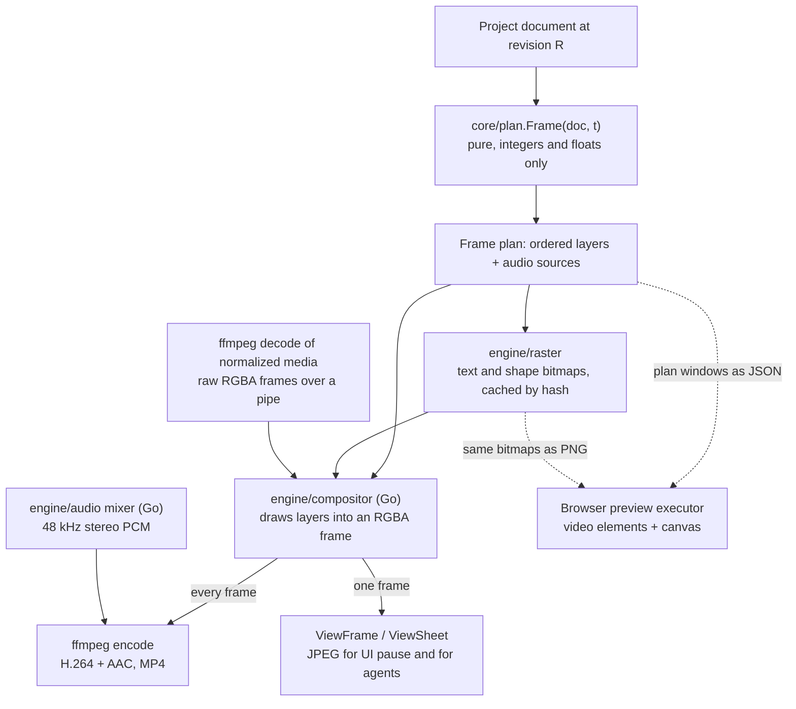

# SDD-004: Render pipeline and source of truth

- Status: Draft (2026-11-14). The compositor design depends on the measurement of `spikes/go-compositor`; see section 12.
- Depends on: ADR-0003 (one plan, two executors), ADR-0004 (time), ADR-0010 (ingest), ADR-0011 (FFmpeg and codecs), ADR-0012 (rasterizer), ADR-0013 (browser), SDD-000, SDD-001, SDD-011 (ingest profiles)
- Implements: RF-015, RF-020 to RF-026, RF-030 to RF-032, RF-035, RF-040 to RF-042, RF-060 to RF-063, RF-109, NFR-003, NFR-004, NFR-006, NFR-007, NFR-010, NFR-011, NFR-022, NFR-023
- Owner area: senior-b (render, ingest and media), with `core/plan` owned by senior-a

## Contents

1. Overview
2. The frame plan
3. Evaluating an item at a frame
4. Layout of text, captions and shapes
5. The rasterizer
6. The compositor
7. Audio
8. Export
9. Frames for people and agents
10. The preview executor
11. Tolerance and reference tests
12. Performance design and its open measurement
13. Acceptance

## 1. Overview



Three rules hold everywhere:

1. `core/plan` decides what a frame contains. Nothing else interpolates, picks a source frame or lays out a caption.
2. `engine/raster` is the only code that draws text and shapes. Both executors use its bitmaps.
3. The Go compositor is the **export executor** and the truth. FFmpeg decodes media into raw frames and encodes the composed frames; it places nothing. This removes dependence on FFmpeg filters that are GPL-only (`eq`, `boxblur`) and on filter behaviour that the first spike showed is not pixel-stable (the same scene placed through `overlay` expressions differed from the piped version in 630 of 900 frames).

## 2. The frame plan

```go
package plan

// Frame returns what frame t of the document contains. It is pure.
func Frame(doc *timeline.Document, t int) FramePlan

// Window returns the plans of frames [from, to) in the compact form of section 10.
func Window(doc *timeline.Document, from, to int) WindowPlan

// Audio returns every audio source that sounds in frames [from, to).
func Audio(doc *timeline.Document, from, to int) []AudioSource

type FramePlan struct {
    Frame         int
    Width, Height int
    Background    Color
    Layers        []Layer // bottom first
}

type Layer struct {
    ItemID string
    Kind   LayerKind // Media or Bitmap

    // Media layers (clip items)
    AssetID     string
    AssetKind   string  // "video" or "image"
    SourceFrame int     // frame index in the normalized media; 0 for images
    Crop        Rect    // in source pixels after the item's crop fractions
    ColorMatrix *[12]float64 // nil when brightness, contrast and saturation are neutral
    Filter      *[12]float64 // BETA, both kinds: the filter matrix of section 3.6; nil for none
    Blur        float64      // BETA, both kinds: blur radius in frame pixels; 0 for none

    // Bitmap layers (text, caption, shape items)
    Bitmap BitmapSpec // what to rasterize; section 5

    // Placement, valid for both kinds
    CX, CY   float64 // centre in frame pixels
    W, H     float64 // drawn size before rotation, in frame pixels
    Rotation float64 // degrees clockwise
    Scale    float64 // effective scale, evaluated as section 3.1 (keyframes or the static value, transitions do not change it); W and H already include it
    Opacity  float64 // 0..1
}
```

**Layer order.** Tracks are taken in descending `order` (SDD-001 §3.3.1), so the bottom track comes first. Hidden tracks are skipped. Within a track at most one item is active at a frame. Audio tracks produce no layer.

**Active item.** An item is active at `t` when `start <= t < start + duration`.

**Stability.** All floating-point results in a plan are rounded to 3 decimal places.

**How `core/plan` implements this section (P1-ENG-003).**

- `core/` cannot lay text out, so the natural size of a text or caption bitmap comes from a `plan.Measurer` (the rasterizer, in `engine/raster`) passed in `plan.Options`. `FrameWith(doc, t, opts)` and `WindowWith(doc, from, to, opts)` take it; `Frame` and `Window` are the same with no Measurer, which gives bitmap layers size 0 and anchors a bottom or top caption by its centre on the edge. A caption at `bottom` or `top` is placed with its scaled box's edge on the safe area's edge.
- `BitmapSpec`, `ResolvedStyle` and `ShapeSpec` are defined in `core/plan`, not in `engine/raster`, so that the plan, the rasterizer and the browser name one thing. `BitmapSpec.Key()` is the SHA-256 of the JSON of the spec plus `plan.BitmapVersion`, which `raster.Version` of §5 must equal.
- `SafeArea(width, height)` returns a `Rect` rounded to whole pixels: `{65, 269, 950, 979}` for 1080×1920. `Layer.Bitmap` is a pointer and `Layer.Crop` a value, so a media layer has no bitmap and a bitmap layer no crop.
- `WindowPlan.Revision` is set by the caller. `Window` cuts a window to 300 frames. The per-frame arrays of §10 are `plan.Series`, which encodes as one number when constant. `bitmaps.index` is chosen by the active word, the only thing that changes a bitmap between frames of one item. `audio.gain` is one value per frame.
- `Audio(doc, from, to)` clips each source to the frames asked for. The gain envelope has a point at each volume keyframe and fade edge, eight straight segments inside a curved easing, and a point one sample before the next keyframe for `hold`. Gain points count output samples from the start of the clipped range.

## 3. Evaluating an item at a frame

Let `r = t - start` (0-based frame inside the item) and `D = duration`.

### 3.1 Animated properties

For each of `x`, `y`, `scale`, `rotation`, `opacity`, `volume`: if the item has keyframes for the property, its value is given by them; otherwise it is the item's static field (or the default of SDD-001).

With keyframes `k0..kn` sorted by `t`:

- `r <= k0.t`: value is `k0.value`.
- `r >= kn.t`: value is `kn.value`.
- otherwise find `i` with `ki.t <= r < k(i+1).t`, let `u = (r - ki.t) / (k(i+1).t - ki.t)` and `v = ki.value + (k(i+1).value - ki.value) × e(u)`, where `e` is the easing of `ki`:

| Easing | `e(u)` |
| --- | --- |
| `linear` | `u` |
| `ease_in` | `u³` |
| `ease_out` | `1 - (1 - u)³` |
| `ease_in_out` | `4u³` when `u < 0.5`, else `1 - (-2u + 2)³ / 2` |
| `hold` | `0` |

Rotation interpolates as a plain number; there is no shortest-path wrapping.

### 3.2 Transitions

Transitions modify the animated values; they never change the document.

- `transition_in` of duration `T` applies while `r < T`, with progress `p = (r + 1) / (T + 1)`, so `p` is strictly between 0 and 1.
- `transition_out` of duration `T` applies while `r >= D - T`, with progress `p = (D - r) / (T + 1)`.

| Kind | Effect with progress `p` |
| --- | --- |
| `fade` | `opacity = opacity × p` |
| `slide_left` | `x = x - (1 - s(p)) × Width` |
| `slide_right` | `x = x + (1 - s(p)) × Width` |
| `slide_up` | `y = y - (1 - s(p)) × Height` |
| `slide_down` | `y = y + (1 - s(p)) × Height` |

`s(p) = 1 - (1 - p)³`. For `transition_in` the name says where the item comes from; for `transition_out`, where it goes. `Width` and `Height` are the frame size.

Boundary frames that `core/plan` tests pin (`TestTransitionFactors`, `TestSlideLeftOffset`, opacity rounded to 3 decimals):

| Case | `r` | Factor |
| --- | --- | --- |
| `fade` in, `T = 10` | 0 | 0.091 (`1/11`) |
| `fade` in, `T = 10` | 9 | 0.909 (`10/11`) |
| `fade` in, `T = 10` | 10 | not applied (1) |
| `fade` out, `D = 100`, `T = 10` | 89 | not applied (1) |
| `fade` out, `D = 100`, `T = 10` | 90 | 0.909 |
| `fade` out, `D = 100`, `T = 10` | 99 | 0.091 |
| `slide_left` in, `T = 10`, width 1080 | 0 | `x` offset `-(1 - s(1/11)) × 1080` |

### 3.3 Source frame of a clip

```text
pos         = source_in + floor(r × speed.num / speed.den)            (project frames on the asset's time axis)
SourceFrame = floor(pos × fps.den × frame_rate.num / (fps.num × frame_rate.den))
SourceFrame = min(SourceFrame, frame_count - 1)
```

All integer arithmetic, with 64-bit intermediates. This is the only place a source frame is chosen.

**Animated image (BETA, RF-028).** A still image has source frame 0. An animated image (`image` asset with `frame_delays`, SDD-001 section 3.2) shows frame `AnimImageSourceFrame(frame_delays, fps, r)` at frame `r` of its item, where `r` counts from the item's start and `speed` and `source_in` do not apply:

```text
ms    = floor((2 x r x 1000 x fps.den + fps.num) / (2 x fps.num))     (the frame's time in ms, rounded to the nearest, halves up)
pos   = ms mod sum(frame_delays)                                       (the animation loops for as long as the item lasts)
frame = the first i with pos < frame_delays[0] + ... + frame_delays[i]
```

The delays are whole milliseconds, so the rounding to the nearest millisecond is what makes delays recorded as 67, 33 and 100 ms (2, 1 and 3 frames at 30 fps) select frames 0, 0, 1, 2, 2, 2, 0 for item frames 0 to 6 (`TestAnimImageSourceFrame`). There is no hold-at-the-last-frame mode: the animation always loops, and a shorter item is a trim. In the window format an animated image layer has `source_frames`, one image frame index per frame from `first` to `last` (absent for video and still images; `source_seconds` is 0 for an image). The compositor draws the named frame like any image layer, alpha included, so a sticker composes as any other image layer.

### 3.4 Size of a media layer

Let `sw × sh` be the asset's size after removing the crop fractions (`sw = width × (1 - crop.left - crop.right)`, likewise `sh`), and `Fw × Fh` the frame.

| `fit` | Base scale `b` |
| --- | --- |
| `cover` | `max(Fw / sw, Fh / sh)` |
| `contain` | `min(Fw / sw, Fh / sh)` |
| `none` | `1` |

`W = sw × b × scale`, `H = sh × b × scale`. `CX = x`, `CY = y`, where a missing static `x`, `y` means the frame centre.

### 3.5 Colour adjustment

With brightness `β`, contrast `κ` and saturation `σ`, the layer's colour matrix applied to non-linear RGB values in 0..1 is the product `S × C`, with:

```text
C: r' = (r - 0.5) × κ + 0.5 + β          (same for g, b)
S: l  = 0.2126 r' + 0.7152 g' + 0.0722 b'
   r'' = l + (r' - l) × σ                (same for g, b)
```

expressed as one 3×4 matrix in `ColorMatrix`, results clamped to 0..1. Neutral values (`β = 0`, `κ = 1`, `σ = 1`) give `nil`.

### 3.6 Filters and blur

BETA (RF-027). An item carries `filter`, `filter_amount` and `blur` (SDD-001 §3.4). They are constant over the item (not keyframeable) and apply to every visual item.

**Filter.** The filter is a 3×4 matrix `F` in the same form as section 3.5, applied to non-linear RGB values in 0..1 after the colour adjustment of section 3.5 (with the result of that step clamped to 0..1) and before the blur. The layer carries `FilterMatrix(filter, amount) = (1 - amount) × I + amount × F`, rounded to 3 decimals, where `I` is the identity; it is nil when `filter` is `none` or `amount` is 0. Results are clamped to 0..1. The matrices (rows are `r' g' b'`, columns `r g b offset`):

| Filter | Matrix |
| --- | --- |
| `grayscale` | each row `0.2126 0.7152 0.0722 0` (the luma of section 3.5) |
| `sepia` | `0.393 0.769 0.189 0` / `0.349 0.686 0.168 0` / `0.272 0.534 0.131 0` |
| `invert` | `-1 0 0 1` / `0 -1 0 1` / `0 0 -1 1` |
| `warm` | `1.1 0 0 0` / `0 1 0 0` / `0 0 0.9 0` |
| `cool` | `0.9 0 0 0` / `0 1 0 0` / `0 0 1.1 0` |

The alpha channel is not touched. The filters are implemented in Go by the compositor (`engine/export`, ROADMAP task P3-RND-003), never by an FFmpeg filter, so the preview executor and the export draw the same thing (ADR-0011 item 6: no GPL-only filter).

**Blur.** `Blur` is the standard deviation of a Gaussian blur, in frame pixels at project resolution (multiplied by `outScale` like any size). It blurs the layer's own pixels, premultiplied, with the kernel cut at 3 standard deviations and pixels outside the layer counted as transparent, so the blurred layer grows softly past its edge; it is applied to the layer before the placement of section 6 step 2.3. Opacity and transitions are applied after it.

**Implementation (P3-RND-003, `engine/compositor/blur.go`).** The Gaussian is three box blurs along x and three along y, in integer arithmetic that rounds half up at every pass, the method of the rasterizer for shadows (section 5.1 item 5). Three boxes of width 2r+1 have the variance r(r+1), so the radius is `r = round((sqrt(4σ² + 1) - 1) / 2)` with σ = `Blur × outScale` taken in the pixels of the source, from the scale at which the source is drawn (a source drawn at half its size has twice the radius). The reach is 3r, which is the cut at 3 standard deviations; the layer is padded by 3r on every side with transparent pixels, blurred, and drawn with a placement that grows by the same amount around the same centre. A σ under about 0.8 pixel gives r = 0 and no blur. The radius is capped at 128 source pixels so that the sum of a window fits a 16-bit lane (255 × 257 = 65535); the cap is reached only by a source drawn much smaller than it is stored, or by an export above twice the project size with `blur` above 64 (a σ of 129 pixels or more is drawn as 128). The rows (then the columns) are independent, so the bytes do not depend on the number of bands (`TestCompositorBandsEqualBlurAndFilter`: 0 differing bytes between 1 and 8 bands).

**Filters in the compositor.** A layer with `Filter` has the 3×4 matrix applied by the same integer routine as the colour matrix (16.16 fixed point, straight RGB, results clamped to 0..1, alpha untouched), after the colour matrix and before the blur. The five filters are golden cases `filter-grayscale`, `filter-sepia`, `filter-invert`, `filter-warm` and `filter-cool`, each on a layer that stays and on a picture in picture that slides; `blur-2`, `blur-6` and `blur-16` blur a sliding layer and `blur-still` a still one (`testdata/golden/`).

## 4. Layout of text, captions and shapes

### 4.1 Safe area

```go
func SafeArea(width, height int) Rect
```

- When `width / height <= 0.6` (vertical video): top 14%, bottom 35%, left 6%, right 6% of the frame are outside the safe area. These are the only margins found in an official source (Meta's ads guide for Reels; see `search/features-20-80.md` §5).
- Otherwise: 5% on every side.

The safe area is used for the default position of captions and by the lint rule for text outside it. It is a single function so the two cannot disagree.

### 4.2 Text and shape items

A text item's bitmap has a natural size `nw × nh` given by the rasterizer for its content and style. `W = nw × scale`, `H = nh × scale`, `CX = x`, `CY = y`, default centre of the frame. Shapes: `W = width × scale`, `H = height × scale`.

### 4.3 Caption items

The effective style is resolved as in SDD-001 §3.7. With `position`:

| `position` | Placement of the caption block |
| --- | --- |
| `bottom` | horizontally centred; its bottom edge on the safe area's bottom edge |
| `top` | horizontally centred; its top edge on the safe area's top edge |
| `middle` | centred in the frame |
| `custom` | `CX = x`, `CY = y` |

With `highlight: "word"`, the active word at frame `r` is the last word whose `start <= r`, while `r < start + duration` of that word; between words and before the first word no word is active. The plan's `BitmapSpec` carries the index of the active word, or -1, so the rasterizer produces one bitmap per state.

## 5. The rasterizer

```go
package raster

type BitmapSpec struct {
    Kind        string  // "text", "caption", "shape"
    Text        string  // text items; captions: the words joined by spaces with forced breaks as "\n"
    Words       []string // captions only
    Breaks      []int
    ActiveWord  int     // captions with highlight; -1 for none
    Style       ResolvedStyle // every field explicit, colours resolved
    Shape       *ShapeSpec
    PixelScale  float64 // oversampling factor, section 5.3
}

// Key is the SHA-256 of the canonical JSON of the spec plus Version.
func (s BitmapSpec) Key() string

// Render draws the bitmap. It is deterministic: same spec, same bytes.
func Render(spec BitmapSpec, fonts *FontSet) (Bitmap, error)

type Bitmap struct {
    Pix            []byte // RGBA, 8 bits, straight (non-premultiplied) alpha
    Width, Height  int    // pixels of Pix
    NaturalW, NaturalH float64 // size at PixelScale 1, in frame pixels
    CenterDX, CenterDY float64 // offset at PixelScale 1 from the centre of the bitmap to the centre of the text block (item 6 of 5.1)
    WordBoxes      []Rect // captions: box of each word at PixelScale 1, in bitmap coordinates, for the lint and the UI
}

const Version = 1 // bumped on any change that alters output bytes
```

As built (P1-RND-003, aligned with `core/plan` by the follow-up): `BitmapSpec`, `ResolvedStyle` and `ShapeSpec` are defined in `core/plan` (`plan.BitmapSpec` and so on), so the plan, the rasterizer and the browser name one type, and `Key` is `plan.BitmapSpec.Key()`. `raster.Version` must equal `plan.BitmapVersion`; a test fails when they differ. Colours in the spec are strings, `"#RRGGBB"` or `"#RRGGBBAA"`; an empty `BackgroundColor` or `HighlightBackground` means none; a `Highlight` of `"none"` draws the active word like the others. `Kind` is `"text"`, `"caption"` or `"shape"`; for a caption `Text` is ignored and the text is `Words` joined by one space, with a line break before every index of `Breaks`. `Measure(fonts)` is the `plan.Measurer`: it lays the text out and returns exactly the `NaturalW` and `NaturalH` that `Render` gives the same spec, without drawing, and 0 by 0 for a spec `Render` would refuse (a test compares the two for every golden case). `Render` returns `ErrInvalidSpec` for a colour that is not hex, a pixel scale outside (0, 8], a non-positive size, line height or width, a caption with no words or an active word out of range, an unknown kind or shape, and a bitmap over `MaxPixels` (33.5 million). `FontSet.Lookup(family, weight)` returns a `*FontError` with `Code` `E_FONT_UNKNOWN` and the weights that exist. `Bitmap.PNG()` encodes the bitmap as a PNG with straight alpha; the encoding is deterministic. `Cache` (`NewCache(fonts, bytes)`, `Get(spec)`) is the in-process layer of §5.4: an LRU over the pixels, default budget 64 MiB, safe for concurrent use.

### 5.1 Layout rules

1. Shaping with `go-text/typesetting` using the font file of the style's family and weight. Text direction per paragraph follows the Unicode bidirectional algorithm.
2. Lines break at the positions given by the library's line segmenter so that no line is wider than `max_width`; forced breaks always break. A single word wider than `max_width` stays on its own line and overflows.
3. Line height is `size × line_height`. The block height is the number of lines times the line height.
4. Lines are aligned inside the block's width (the widest line) by `align`.
5. Drawing order, back to front: background box (block grown by `background_padding`, corners rounded by `background_radius`), shadow (the glyphs and stroke filled with `shadow_color`, offset by `shadow_dx`, `shadow_dy`, blurred with a box blur of radius `shadow_blur` applied three times), stroke (outline of width `stroke_width` centred on the glyph edge, joined round), fill.
6. The bitmap is the block grown by the largest of padding, stroke and shadow extents, so nothing is clipped. `NaturalW` and `NaturalH` describe that grown size; the block is centred in it: when a shadow or a highlight box reaches further on one side, the bitmap is grown on the other side as well, so that its centre is within half a pixel of the block's centre (`CenterDX` and `CenterDY` are at most 0.5 / `PixelScale` in size, and 0 for most bitmaps). The plan places the block's centre and the preview executor draws a bitmap by its own centre, so the two agree without the executor knowing the offsets; the compositor still subtracts them (section 6 item 1).
7. `uppercase` converts with Unicode upper-casing before shaping.
8. Caption highlight: the active word is filled with `highlight_color`; with `highlight_background` a rounded box is drawn behind that word.
9. A glyph missing from the font is drawn with the font's `.notdef` glyph. There is no fallback to another font. The lint reports text containing characters the font lacks. `FontSet.Missing(family, weight, text)` returns the runes the family lacks (control and format characters excluded), for the lint and the UI.

Details fixed by the implementation, where the items above leave room (P1-RND-003):

- **Breaking.** The library's line breaker runs with the policy `Never`, so a word wider than `max_width` is never cut (item 2). An empty line (two forced breaks in a row, or a break at the end) is a line. Trailing spaces of a line do not count in its width.
- **Runs.** Each paragraph (the text between forced breaks) is split into runs by the bidirectional algorithm and then by script; a run is shaped with the language `en`. Spaces, digits, punctuation and combining marks join the script next to them.
- **Vertical layout.** The line box is `size × line_height` high; the font's ascender and descender (hhea or OS/2 as the library reads them) are centred in it, and the baseline is placed accordingly.
- **Upper case** (item 7) is the one-to-one Unicode simple mapping (`unicode.ToUpper`): `ß` stays `ß`. It keeps the number of runes, so word ranges and boxes survive it.
- **Stroke** (item 5) is the union of a rectangle along every segment of the flattened glyph outline and a round join on the outer side of every turn, so no gap or spike appears; it is drawn under the fill, which hides its inner half, so the visible width outside the glyph is `stroke_width / 2`. For a **shape** the stroke is drawn over the fill and is visible on both sides of the edge.
- **Shadow** is not drawn when `shadow_dx`, `shadow_dy` and `shadow_blur` are all 0 (it would only darken the antialiased edge). The box blur radius is `ceil(shadow_blur × PixelScale)` and the blur is integer arithmetic that rounds half up at every pass.
- **Highlight box** (item 8) is the word's box (a full line high) grown by `0.1 × size` on the left and on the right, with corner radius `max(background_radius, 0.15 × size)`.
- **Word box** is the horizontal extent of the glyphs of the word and the height of the line box; the box of a word with no glyph is empty.
- **Margins.** The bitmap is the union of everything drawn, with one clear pixel on every side, so the antialiased edge never touches the border of the bitmap. `NaturalW` and `NaturalH` include that pixel.
- **Curves** are flattened to within 0.1 pixel (`flatTolerance`) before filling and stroking. Geometry that adds a product avoids the fused multiply-add the compiler may use on arm64 (`mul` in `geom.go`), and `golang.org/x/image/vector` disables it itself, so the bytes are equal on every architecture.
- **Same bytes on every architecture (found by the first macOS arm64 run, P1-RND-003).** Three things differed and each is closed: (1) `golang.org/x/image/vector` sums the float32 areas with SSE4.1 on amd64 and with a Go loop elsewhere, in a different order, so a coverage near an 8-bit rounding changes a pixel; the package draws with `engine/raster/internal/scan`, a copy of the portable floating-point path of that module (BSD-3, licence file beside it), always in floating point and always with the Go loop, and a test forbids importing the original. (2) The standard library's `Sin`, `Cos`, `Atan2`, `Hypot` and `Acos` are written in Go on arm64, where the compiler fuses multiply-adds, and `Hypot` is assembly on amd64; the geometry uses `sincos`, `atan2` and `hypot` of `detmath.go`, which use only exactly rounded operations. (3) The points of a variable font at a given weight come out of float32 arithmetic in the shaping library, whose last bit depends on fusion; every outline point is rounded to a whole font unit, as the points of a static font are (error at most half a font unit, 0.016 pixel at 64 px), which absorbs that bit. The goldens pass on amd64 with the default build, with `-tags noasm` (which makes x/image use the portable path, as arm64 does) and with `GOAMD64=v3` (which makes the compiler fuse multiply-adds, as arm64 does). A coordinate that lands within a float32 ulp of a half font unit could still differ; CI on macOS arm64 is the proof.
- **Variable fonts.** The bundled families are the Google Fonts distribution of the upstream projects (`fonts/FONTS.md`): Inter, Montserrat, Playfair Display and JetBrains Mono are variable fonts, so one file serves every weight of its range; Anton and Bebas Neue have one weight, 400.

### 5.2 Fonts

Fonts come only from the bundled set, embedded in the binary under `engine/raster/fonts/` (the files, their weights, sources and checksums are in `FONTS.md` there, the licences in `licenses/fonts/`), and from the project's `fonts` map (BETA). `FontSet.Lookup(family, weight)` returns `E_FONT_UNKNOWN` data for a missing pair. System fonts are never read.

### 5.3 Oversampling

`PixelScale` is chosen by the plan so that scaling up never blurs: the largest `scale` the item reaches over its duration (static value or largest keyframe value), multiplied by the output scale of the request (1 for export; `width / project width` for a reduced frame), rounded up to the next quarter and clamped to 0.25..4. All frames of an item at the same output scale share one `PixelScale`, so the cache holds one bitmap per state. Scaling up never blurs up to an effective pixel scale of 4; beyond it the bitmap is upscaled and softens.

### 5.4 Cache

Bitmaps are stored under `<workspace>/bitmaps/<key>.png`. The export reads them from disk or from memory; the browser fetches them by key at `GET /api/v1/bitmaps/{key}.png` with an immutable cache header.

## 6. The compositor

```go
package compositor

// Compose draws one frame plan into dst (RGBA, 8 bits, no stride padding), at the given output scale.
func (c *Compositor) Compose(dst *image.RGBA, fp plan.FramePlan, outScale float64) error

// The pixels of a layer come from two functions the caller sets: those of a media layer, and the
// bitmap of a text, caption or shape layer.
type MediaSource func(l *plan.Layer) (Image, error)
type BitmapSource func(spec plan.BitmapSpec) (raster.Bitmap, error)
```

The compositor is `engine/compositor` (pure Go, no I/O, no FFmpeg); `engine/export` owns the decoders that feed it. An `Image` is RGBA with premultiplied alpha and an `Opaque` flag that lets a copy skip blending (a decoded video frame). The frame of a video asset with `has_alpha` (SDD-001 3.2) is not opaque: the decoder reads it as RGBA and premultiplies each frame as it arrives, so it is composed over the layers below (VV-013). `dst` is the project's frame: it is filled with the opaque background first, so it stays opaque.

Rules, applied in this order for each frame:

1. Fill `dst` with the project background.
2. For each layer, bottom first:
   1. Obtain the source pixels: a decoded video frame, a decoded image, or a bitmap from the rasterizer. A bitmap is premultiplied once per key, and drawn with its own centre at the layer's centre minus the rasterizer's `CenterDX`, `CenterDY` (scaled), because the plan places the centre of the text block and the bitmap reaches further on the side of a shadow.
   2. If the layer has a colour matrix, apply it to the source pixels. Then, if it has a filter matrix, apply that (section 3.6), then blur the layer by `Blur × outScale`.
   3. Draw the source into the quadrilateral given by `CX, CY, W, H, Rotation` (all multiplied by `outScale`) with opacity `Opacity`, using source-over blending on premultiplied alpha. A destination pixel is drawn when its centre is inside the quadrilateral: the edges of a rotated layer are not smoothed.
3. Sampling: when `Rotation` is 0 and the source's pixel size equals the destination rectangle's rounded size, pixels are copied one to one at integer offsets (the rectangle's top-left corner rounded half up). Otherwise the source is sampled with bilinear interpolation through the inverse affine transform, in 32.32 fixed point with 8-bit weights: the transform is computed once per layer in floating point (every product rounded before it is added, with a sine and cosine that use only exactly rounded operations, because arm64 fuses `a*b+c` and its `math.Sin`), and every per-pixel step is integer arithmetic. The result is the same on every architecture and for every number of bands.
4. Blending uses 8-bit channels with rounding to nearest. Blending is done on non-linear values (no gamma linearization), which is what browsers do by default and keeps the two executors close.

**Decoded frames.** The compositor asks a `FrameSource` for `(asset, source frame, delivered size, crop)`. The source is an FFmpeg process per active clip:

```text
ffmpeg -nostdin -protocol_whitelist file,pipe -ss <time of first needed frame> -i <normalized media>
       -vf "crop=<crop>,scale=<w>:<h>:flags=bicubic+accurate_rnd+full_chroma_int,format=rgba"
       -f rawvideo -pix_fmt rgba pipe:1
```

- **Pre-scaling.** When a layer's crop, `W`, `H` and rotation are constant over the clip and rotation is 0, the decoder delivers frames already cropped and scaled to the rounded destination size, so the compositor copies. When size or rotation is animated, or rotation is not 0, the decoder delivers frames at the cropped native size and the compositor samples.
- The pre-scaling decision is made by a pre-pass that plans every frame once and records, per item, whether its drawn size and rotation never change (`scanLayers` in `engine/export`). The crop of an item is static, so the decoder always applies it (`crop=<w>:<h>:<x>:<y>:exact=1` in whole pixels, left out when it is the whole frame; with an odd `x` or `y` it is preceded by `format=yuv444p`, because the chroma of a 4:2:0 clip is cut on its own half-resolution grid even with `exact=1` and the colour would end one source pixel off the picture, which the preview, cropping the decoded picture, does not do); a constant, unrotated layer is also scaled to its rounded drawn size, and any other is delivered at the cropped native size.
- Conversion from the normalized media's BT.709 limited-range YUV to RGB is done by FFmpeg with explicit `in_color_matrix=bt709:in_range=tv` on the scale filter.
- Frames are read in order, from the first needed frame, by a goroutine that keeps three buffers ahead so that decoding overlaps composing. For speeds above 1 the frames not needed are read and dropped; for speeds below 1 a frame is reused; a frame asked past the end of the media repeats the last one. A request for an earlier frame, or one more than 120 frames ahead, restarts the process at that frame (a seek). A decoder is stopped as soon as its clip is not drawn in a frame, so the processes alive are the clips active at that frame.
- Images are decoded once by Go's image decoders from the normalized PNG produced at ingest, cropped, and scaled once by `compositor.Resize` when the layer is constant and unrotated: a source at least twice the target is first halved by averaging 2x2 blocks (bilinear alone would point-sample a photo shrunk to a frame), then sampled by the compositor's sampler. An animated layer samples the cropped image every frame. The frames of an animated image (BETA) are read from the `frames-1.anim` sequence of ingest (SDD-011 §4.7) by the index the plan names, one PNG decode each, converted to the premultiplied image of a still by the same conversion, cropped and scaled like a still, and kept in a cache of at most 128 MiB per renderer; the index comes from the plan alone, so a preview, an export and any number of bands give the same pixels (`sticker-png` and `sticker-anim` in section 11).

**Determinism.** For a fixed FFmpeg build, the composed frames are a function of the document and the media only. Compose never reads the clock, and goroutines used to split a frame into bands write disjoint rows.

## 7. Audio

`plan.Audio(doc, from, to)` returns, for every `clip` with audio that is not `audio_muted` and every `audio` item, on tracks that are not `muted`, except an item whose `asset` is `ast_placeholder` (the unfilled optional slot of a template instance, SDD-001 section 3.10), which is skipped like a missing media layer:

```go
type AudioSource struct {
    ItemID      string
    AssetID     string
    StartSample int64     // position on the output, at 48 kHz
    SourceStart int64     // first sample of the asset's normalized audio
    Samples     int64     // output samples
    Speed       Rational
    Gain        []GainPoint // piecewise-linear envelope in output samples: volume or its keyframes, times the fades
}
```

Conversions: output sample of timeline frame `t` is `t × 48000 × fps.den / fps.num` (integer division, floor); the last sample of an item is the first sample of the frame after it, minus one. Fades are linear ramps over their frame ranges.

The mixer, in `engine/export`:

1. For each source, FFmpeg decodes the needed range of the normalized audio to 48 kHz stereo signed 16-bit PCM over a pipe (`-f s16le`: the argument grammar of FF-13 has no float raw format, and the normalized audio is 16-bit, so nothing is lost). The input seeks to a whole millisecond (48 samples), which FFmpeg does to the sample, and at speed 1 the Go side drops the few samples before the wanted one. With `Speed` other than 1 the decode command adds `-af atempo=<speed>` (chained when outside 0.5..2), which changes tempo without changing pitch, and the seek is not sample exact. A decoder that fails is an error, not silence.
2. Go multiplies each source by its envelope, pads or truncates it to exactly `Samples`, and sums the sources into the output at `StartSample`, in blocks of one second so that memory does not depend on the length of the project. The envelope is linear between its points, flat before the first and after the last, and a step where two points share a sample. Sources are summed in the order of `plan.Audio`, in 32-bit float with every product rounded before it is added, so the mix is the same on every architecture. The blocks are written to a 32-bit float WAV in the job's temporary directory.
3. Loudness: the integrated loudness and true peak of the mix are measured by running FFmpeg's `ebur128` filter over it. One gain is applied to the whole mix so that integrated loudness reaches the project's `loudness_target`, reduced if needed so that true peak does not exceed -1.5 dBTP. If the mix is silent or shorter than 0.4 s, no gain is applied.

The check of the result (`TestLoudnessTarget`) measures the normalized mix again with `ebur128`: it is within 1.0 LU of the target when the peak ceiling does not come first. Measured on a six second mix of tone bursts with pauses (the level pattern of speech): -14.00 LUFS after a gain of -13.90 dB, true peak -10.80 dBTP; the tolerance of 1.0 LU stays. A mix of 0.3 s gets a gain of 0.
4. The float WAV is read back, multiplied by the gain, rounded to nearest and clamped into a 48 kHz stereo 16-bit WAV in the job's temporary directory, which is the audio input of the encoder. `engine/audio` holds the mixer, the WAV writers and `GainDB`.

A project with no audio source exports a silent stereo track, so the file always has an audio stream.

## 8. Export

`engine/export.Run(ctx, job)`:

1. **Check.** Run the lint; findings marked blocking stop the export with `E_LINT_BLOCKING`. An empty timeline is blocking. Total frames `N` is the end of the last item.
2. **Encoder.** Pick the H.264 encoder from the detection result (ADR-0011 item 5), or the one forced by `VUKEM_VIDEO_ENCODER`. None available: `E_NO_ENCODER`.
3. **Audio.** Mix as in section 7.
4. **Video.** Start the encoder process and write `N` composed frames to its standard input. `Request.Stdin` of `engine/ffmpeg` is the child's standard input through `contrib/engine` `Tool.RunWith` (v0.2.0); only a run inside bubblewrap (Linux, `VUKEM_VIDEO_SANDBOX=bwrap`) starts its wrapper with the product's own `exec` (`sandbox_run_linux.go`), because `RunWith` starts only the tool it resolved. A `pipe:0` argv without a `Stdin` is still refused with `E_INTERNAL` `stdin_unsupported`. The frames go through an `os.Pipe` whose read end is the child's standard input, from a writer goroutine fed by two buffers, so composing the next frame overlaps the encoder reading the last. The partial file is written inside the job's run directory `tmp/<job id>/` (the only place the argument grammar lets an output go), not under `exports/`, and renamed to `exports/<project>/<job>.mp4` after verification (a copy and a rename when the two are on different volumes).

```text
ffmpeg -nostdin -protocol_whitelist file,pipe
       -f rawvideo -pix_fmt rgba -s <W>x<H> -framerate <fps.num>/<fps.den> -i pipe:0
       -i <mix.wav>
       -vf "scale=out_color_matrix=bt709:out_range=tv,format=yuv420p"
       -c:v <encoder> <encoder options> -g <ceil(fps / 2)> -bf 2
       -colorspace bt709 -color_primaries bt709 -color_trc bt709 -color_range tv
       -c:a aac -b:a 192k -ar 48000 -ac 2
       -movflags +faststart -shortest <tmp/<job id>/<job id>.partial.mp4>
```

| Encoder | Options |
| --- | --- |
| `h264_nvenc`, `h264_qsv`, `h264_amf`, `h264_videotoolbox`, `h264_vaapi` | `-b:v 8M` up to 30 fps, `-b:v 12M` above; High profile. The input arguments and the final filter differ per encoder (`h264_vaapi` needs a device and `hwupload`; plain `format=yuv420p` fails there): the export uses the `INPUT_ARGS` and `FILTER` that encoder detection recorded for the chosen encoder (SDD-011 §8.4) |
| `h264_mf` | `-b:v 12M` up to 30 fps, `-b:v 16M` above, because its software encoder measured lower quality at equal bitrate |
| `libopenh264` | `-b:v 8M` up to 30 fps, `-b:v 12M` above; `-profile:v high` when accepted, else the encoder's default; no `-bf` |
| `libx264` (user's own FFmpeg, opt-in) | `-crf 18 -preset medium -profile:v high` |

For sizes other than 1080p the bitrate scales with the pixel count relative to 1080×1920 (`base × w × h / (1080 × 1920)`), with a floor of 2M. `-bf` is omitted for `libopenh264`, which rejects it. The rate is given in `k` (`8000k`), and `-fflags +bitexact -flags +bitexact` are on, so two runs of the same plan with the same build give the same file. The video filter is `scale=out_color_matrix=bt709:out_range=tv` followed by the filter that encoder detection recorded.

5. **Progress.** After every frame written the job's progress is `frames written / N`, published at most 4 times per second.
6. **Cancellation.** Cancelling the context closes the pipes and kills both process trees; the partial file is deleted; the job ends `cancelled`.
7. **Verification.** `ffprobe` the partial file and require: one H.264 video stream and one AAC audio stream; width and height equal to the project's; pixel format `yuv420p`; duration within one frame of `N / fps` for both streams; the `moov` atom before `mdat`. It also requires exactly `N` video packets (`ffprobe -count_packets`) and top-level boxes that fill the file exactly: a file cut short has an `mdat` that claims more than it holds, which ffprobe does not report when `moov` is first, so the box walk is what catches truncation. Any failure: delete the file and end `failed` with `E_VERIFY_FAILED` and `details.checks`, the list of failed checks, each with `name`, `expected` and `got`.
8. **Publish.** The destination is only `exports/<project id>/<job id>.mp4`, made by the engine from two identifiers that match `^[A-Za-z0-9][A-Za-z0-9_-]{0,63}$` (`Job.ExportsDir`, `Job.ProjectID`, `Job.JobID`): there is no destination argument, and the name of a project is never part of a path. The verified file is copied into the project folder (mode 0700) and renamed to `<job id>.mp4`, every step through `os.Root`, so a reader never sees half of it. A file larger than `VUKEM_VIDEO_MAX_EXPORT_BYTES` (`Job.MaxBytes`) is deleted and the job ends `failed` with `E_EXPORT_FAILED`, `details.reason = "size_limit"` (the size watchdog polls the partial file every 2 s; the check after verification catches the rest). `Job.OutPath` stays until the service passes `ExportsDir`. The job ends `succeeded` with the path, size, duration, encoder used and the loudness measured.

Temporary files live in a per-job directory under the workspace and are removed in every outcome.

### 8.1 Formats (P3-RND-002, RF-064)

`Job.Format` selects what the export writes; the zero value is `mp4`. The steps above are those of `mp4`; the other formats take the steps that apply to them, and every one is verified before it is published.

| Format | Extension | What it is | Needs an encoder |
| --- | --- | --- | --- |
| `mp4` | `.mp4` | H.264 and AAC as described above | yes (ADR-0011 item 5) |
| `gif` | `.gif` | the composed frames, written by the engine | no |
| `wav` | `.wav` | the mix of section 7 as 16-bit PCM, 48 kHz, stereo, the file the encoder reads | no |
| `aac` | `.m4a` | the same mix, AAC 192k in an MP4 container with `+faststart` | no (the `aac` audio encoder is in every build, SDD-011 §8.3) |

**60 fps and 4K.** They are project settings (SDD-001), not presets, so no name is added to SDD-000. The ceilings of SDD-007 §9.1 (4096 pixels per side, 120 fps) are checked again before any work (`reason = "unsupported_size"`). A project larger than 1080x1920 or faster than 30 fps gets one more test encode before the first frame is composed: the detection encode of SDD-011 §8.4 repeated at the project's size and rate on the encoder that was chosen (`Runner.TestEncoderAt`, 15 frames, the 15 packets are counted), cached for the life of the runner. **A hardware encoder that cannot do the size (D-034):** when that test fails on the chosen encoder, the export tries the next working candidate of the detection order, down to the software encoder, and uses the first that passes (`Runner.EncoderForSize`); a forced encoder (`VUKEM_VIDEO_ENCODER`) is never replaced. When none passes the export ends `failed` with `E_EXPORT_FAILED`, `details.reason = "unsupported_size"`, message `The encoder <name> on this machine cannot encode <w>x<h> at <fps> fps.` and the hint to lower the size or rate or to install a build with an encoder that supports it. The bitrate rule of the table above already covers both: the base rate above 30 fps, scaled by the pixel count with the 2M floor (3840x2160 at 60 fps with the hardware encoders: 12M x 4.32 = 51.8M). Verification adds `avg_frame_rate` equal to the project's rate (as fractions) to the checks of step 7.

**GIF.** The engine writes it (the GIF muxer and the `palettegen` filter are not used; no FFmpeg process runs for this format apart from the decoders of the clips). A GIF is small by default (VV-056: a 1080p GIF of 15 s was 200 MB): its frame rate is the project's, divided by the smallest whole number that brings it to 15 or less (30 fps gives 15, 60 fps gives 15, 24 fps gives 12), and a project wider than 480 pixels is composed at 480 pixels wide with the height rounded to the same aspect (720x1280 gives 480x853); a project of 480 pixels or less keeps its size. The delays are in hundredths of a second, so 15 fps alternates 6 and 7 and never goes below 2, which browsers would show as 10. The job result reports the real pixel size in `Width` and `Height`, and the `dimensions` check says that the file was reduced and by what rule; there is no option to lift the cap yet. GIF frame `j` is timeline frame `j x step` and its delay is `round(100 x end) - round(100 x start)` of its span, never below 2, so the total stays within one hundredth of the timeline. The palette is fixed and the same for every frame and every project: a 6x6x6 colour cube (216 of the 256 entries, the rest black and unused) with Floyd-Steinberg error diffusion in integer arithmetic, left to right, so the same frames give the same bytes (NFR-010) and a still area does not flicker. Frames are full frames without transparency, the loop is infinite (NETSCAPE 2.0 with count 0), and they are streamed through `compress/lzw`, so the memory is one frame, not the animation. The size cap is checked as the file grows, and a GIF over `VUKEM_VIDEO_MAX_EXPORT_BYTES` ends `size_limit` at once. Verification walks the blocks of the file without decoding the pixels: the width and height of the cap above, one frame for each planned delay with that delay, the infinite loop, a total within one frame (at least 0.02 s) of `N / fps`, no local colour table, and the trailer as the last byte. A later quality step (an adaptive palette, frame differences) changes the bytes and needs a note here.

**Audio only.** The mix, the loudness gain and the measurement are those of section 7; no frame is composed. `wav` is the mix file itself. `aac` is `ffmpeg -i mix.wav -vn -c:a aac -b:a 192k -ar 48000 -ac 2 -movflags +faststart -f mp4`, with the bit-exact flags of the video export. Verification requires exactly one stream, of codec `pcm_s16le` (`wav`) or `aac`, 48000 Hz and 2 channels, a container duration within one frame of `N / fps`, and a whole file: for `wav` the RIFF and data sizes of the 44 byte header equal the file's, for `aac` the box walk of step 7 (`moov` before `mdat`, boxes that fill the file). A project with no audio exports a silent file of the right length. `Result.Format` and `Result.Encoder` (`gif`, `pcm_s16le`, `aac`) say what was written.

**What needs the own build (P3-RND-001).** Nothing in this section does: the formats are written by Go, or use the `aac` and `pcm_s16le` encoders and the `mp4` and `wav` muxers of the pinned build, all inside the output allowlist of SDD-007 FF-13 (no format is added). 4K and 60 fps depend on the encoder the machine has: the pinned build has `libopenh264` (software, passes the test encode at 3840x2160 and at 60 fps on the Windows runner), `h264_mf` and the hardware encoders where present. The own build changes which software encoder is there, not the rules here; re-run `TestFormat4K` and `TestFormat60FPS` against it.

## 9. Frames for people and agents

Both operations use the compositor, so they show what the export produces.

**Implementation (P1-RND-005).** `engine/frame` has `ImageSize`, `Tokens`, `Frame`, `Sheet` and `SheetTimes`; `engine/export` has `Renderer`, which composes one frame through the same renderer as the export (`NewRenderer`, `Render(ctx, t, outScale)`, `Close`); the plan of each frame is made with that `outScale` as `Options.OutputScale`, so text and captions are rasterized at the oversampling of section 5.3 for the size they are drawn at, as in the plan the preview executor gets for the same width. A renderer is made per request and owns a work directory and the decoders. Because only one frame is asked for, every unrotated layer is treated as constant: the decoder crops and scales it to the drawn size, as in the export. `ImageSize` rounds the short edge to the nearest even number (halves up), which is what makes every number of the table in SDD-003 section 3.11 come out (582, 804, 694, 820). A bitmap at least twice as large as its drawn size is box-filtered down before it is sampled, so text on a 384 wide frame is not point-sampled (`TestSmallFrameMatchesTheDownscaledFullFrame`: SSIM against the downscaled full frame is at least 0.93). The label of a sheet cell reads `<index> <seconds>s f<frame>`, the index counted from 1 and the seconds with at most two decimals. The cache is `engine/cache`: one byte cap for `frames/` and `bitmaps/`, least recently used first, keys that cannot leave the root; a sheet is `sheet-<12 hex>-<width>.jpg` in the folder of the revision. **Cold frame at the editor width (NFR-004, P2 measurement).** A single frame used to wait for its decoder to be killed after the frame was read: `taskkill` costs about 150 ms on Windows, and it sat on the critical path of every uncached request (a 1080x1920 clip at width 540: median 232 ms, 95th percentile 294 ms). The decoder of a single frame now has `-frames:v 1`, ends by itself, and is given 300 ms to do so before the kill: median 92 ms, 95th percentile 108 ms (`BenchmarkViewFrameCold`; `TestViewFrameColdP95` gates 350 ms). The rest of a cold frame is the process start and one decode (about 80 ms), the JPEG (10 ms) and the removal of the work folders (20 ms). A pause that took 400 to 1600 ms in the end-to-end measurement has the HTTP, service and browser steps on top of this; they are not the engine's. Measured earlier on the Windows machine of section 12: a frame 0.2 s cold and 0.5 ms from the cache, a nine-cell sheet of the reference clip 0.28 s.

**`ViewFrame(project, at, width)`.** Composes one frame at `outScale = width / project width` and returns a JPEG (quality 80, 4:2:0). The sizes for agents are those of SDD-003 §3.11, which is the authority for the numbers in this section: an agent asks for a token budget (`max_tokens`, default 800, maximum 1,568) and the service derives the size with `ImageSize`, so a 9:16 project gives 582×1036 (777 image tokens, within the 800 of NFR-022). `width` (CLI and HTTP only) defaults to 540 for the UI's paused frame; it is exclusive with `max_tokens`. Maximum 1080. Only the current revision is rendered in the MVP; the `rev` query parameter, when given, must be the current revision (SDD-003 §6.3). For each media layer one FFmpeg process decodes exactly one frame with `-ss` before `-i` and `-frames:v 1`. Results are cached at `frames/<project>/<revision>/<frame>-<width>.jpg`; a new revision uses a new directory, and directories of revisions older than the previous 5 are deleted.

**`ViewSheet(project, from, to, count, cols)`.** Composes `count` frames (default 9, maximum 16) evenly spaced from `from` to `to`, both ends included (default the whole timeline: `0s` to the last frame), arranged in `cols` columns (default `ceil(sqrt(count))`, so 3 for 9 cells; `cols` is CLI and HTTP only). The canvas is sized by `ImageSize` with the sheet budget (`max_tokens`, default 1,500, maximum 1,568), so a 9:16 project gives a 804×1428 canvas (1,479 image tokens, within the 1,600 of NFR-022), with a 2-pixel gutter. The frame's time is drawn by the rasterizer in the top-left corner of each cell, in white (bundled font Inter, weight 700) on a black box at 70% opacity, as `<index> <seconds>s f<frame>` (for example `3 1s f30`). The JPEG has quality 80. Returns one JPEG. The response also lists the frame and time of each cell as text.

**A frame of an asset** is the `asset_id` member of `view` (and of the HTTP frame and sheet routes), not a `MediaInspect` option: it returns a frame of the normalized media, uncomposed, with the same sizes. Details of the sizes, the label and the cache keys are in SDD-003 §3.11.

## 10. The preview executor

The browser never evaluates the document. It asks for plan windows:

`GET /api/v1/projects/{id}/plan?from=<frame>&until=<frame>&rev=<revision>&width=<pixels>` returns the plan below. The optional `width` is the width in pixels at which the preview draws the frame (16 to 4096; absent is the project width). The service passes `width / project width` as `Options.OutputScale`, so the `pixel_scale` of every bitmap, and therefore its key and its pixels, are those that `ViewFrame` at the same width produces (section 5.3, section 9): the preview scales a bitmap by 1 instead of by a factor and text lines up with the export. The scale is part of the bitmap spec, so it is part of the key, and one project can hold bitmaps of several widths side by side. Plans of one window at two widths hand out different keys for bitmap layers whose `pixel_scale` differs.

```json
{
  "revision": 42, "from": 0, "to": 60, "end_frame": 1800, "width": 1080, "height": 1920, "background": "#000000",
  "safe_area": [65, 269, 950, 979],
  "layers": [
    {
      "item": "itm_m1n2p3q4r5", "kind": "media", "asset": "ast_3c5v8n2w6d", "asset_kind": "video",
      "first": 0, "last": 59,
      "source_seconds": [2.0, 2.033, 2.067],
      "crop": [0, 0, 1080, 1920],
      "cx": 540, "cy": 960, "w": 1080, "h": 1920, "rotation": 0, "scale": 1, "opacity": 1,
      "color_matrix": null,
      "filter": [0.393, 0.769, 0.189, 0, 0.349, 0.686, 0.168, 0, 0.272, 0.534, 0.131, 0], "blur": 4
    },
    {
      "item": "itm_s6t7v8w9x0", "kind": "bitmap", "first": 12, "last": 59,
      "bitmaps": {"keys": ["9c1f...", "a7b2..."], "index": [0, 0, 0, 1, 1]},
      "natural": [640, 96],
      "cx": 540, "cy": 1180, "w": 640, "h": 96, "rotation": 0, "scale": 1, "opacity": [0.2, 0.4, 0.6, 0.8, 1]
    }
  ],
  "audio": [{"item": "itm_m1n2p3q4r5", "asset": "ast_3c5v8n2w6d", "first": 0, "last": 59, "source_seconds": 2.0, "speed": 1, "gain": 1}]
}
```

Rules of the format: `end_frame` is the end of the project at that revision, the largest `start + duration` over all items (0 for an empty project), computed by the core; the UI shows it as the total and stops playback there, and never derives it itself. `first` and `last` are the frames of the window in which the layer is active. Each of `cx`, `cy`, `w`, `h`, `rotation`, `scale`, `opacity`, `gain` is a single number when constant over those frames, or an array with one value per frame from `first` to `last`. `source_seconds` has one value per frame: the time in the proxy at which the frame to show starts. `bitmaps.index` has one entry per frame, selecting a key. `safe_area` is the rectangle `[x, y, w, h]` of §4.1 in project pixels, so the browser draws the guide without knowing the percentages. Windows are at most 300 frames. The response is cacheable by `(project, revision, from, to)`.

The executor, in `web/resources/js/editor/preview/`:

1. Keeps plan windows for the playhead and the next window.
2. For each media layer keeps a `<video>` element on the asset's proxy (`GET /api/v1/projects/{id}/media/{asset_id}/proxy`, served with Range; SDD-000 §1). During playback it lets the element play and corrects its `currentTime` when it drifts more than 2 frames from `source_seconds`; when paused or scrubbing it seeks to the value.
3. Draws each layer as a sprite on the canvas with exactly the plan's centre, size, rotation, opacity, colour matrix, filter matrix and blur, in plan order. Bitmaps are fetched by key with `GET /api/v1/projects/{id}/bitmaps/{key}`; the server serves only keys that a plan window of that same project handed out (another project's key, or one forgotten at a restart, is 404, and the client reads the plan again).
4. Plays audio through the same video elements and, for audio items, audio elements on the proxy, with gain from the plan. The master clock during playback is the audio clock; the playhead frame is `floor(clock × fps)`.
5. At most `MAX_VIDEO_LAYERS` video elements decode at once (initial value 4, confirmed by measurement); further media layers show their thumbnail still.
6. **Truth on pause.** 150 ms after playback stops or a seek ends, it requests `ViewFrame` at the canvas width and draws that image over the canvas. Any change of playhead or revision removes the overlay.

## 11. Tolerance and reference tests

| Comparison | Requirement | Test |
| --- | --- | --- |
| Compositor against stored reference frames, same pinned FFmpeg | identical bytes of the composed RGBA frame | `engine/export` golden test: for each case in `engine/export/testdata/golden/<case>/` (a document, tiny media fixtures and `frame-<n>.png` references), compose the listed frames and compare SHA-256 |
| Compositor on two runs | identical | the same test run twice in one process and across two processes |
| Compositor with a different FFmpeg build | PSNR at least 50 dB per frame | a CI job that runs the golden cases with the PATH FFmpeg when it differs from the pinned one; reported, not blocking |
| Rasterizer | identical bytes | `engine/raster/testdata/golden/<case>.png`, one per layout rule of section 5.1, plus right-to-left text, an emoji sequence and a missing glyph (15 cases in `golden_test.go`). The test compares the decoded pixel bytes, not the PNG bytes, because the compressor may change between Go versions; regenerate with `go test ./engine/raster -run Golden -update` |
| Preview executor against compositor, during playback | SSIM at least 0.97 on luma per frame at preview resolution; no layer centre displaced by more than 1 pixel | Playwright test: load each golden case in the editor, step the preview to the listed frames without the truth-on-pause overlay, capture the canvas, compare with `ViewFrame` at the same width |
| Exported file | passes the verification of section 8 step 7; its frames, decoded, have SSIM at least 0.95 against the composed frames | `TestExportReferenceScenes`: each of the three reference scenes with `libopenh264` (`engine/export/testdata/scenes/<name>/` holds the document and the description of the generated media; the golden hashes of 30 frames per scene are in `testdata/golden/<name>.json`) |
| Audio mix | sample-exact for cases without speed change; within 1 dB RMS per 100 ms window for cases with `atempo` | `engine/audio`: the float WAV of a three-source case with envelopes is pinned by SHA-256 (`TestMixEqualsItsGoldenHash`), the same claim as a stored WAV without committing one; the `atempo` clip is exercised by the `two-clips-cut` export |

Golden cases required at minimum: a single clip with cover fit; contain fit with background; crop; picture in picture with opacity; rotation; each transition kind at the first, middle and last frame; keyframed scale with each easing; a caption with word highlight at three words; text with stroke, shadow and background; a shape; colour adjustment at three settings; speed 0.5 and 2; a 30000/1001 project; a source at a different frame rate from the project; BETA: a PNG sticker with alpha over a clip (`sticker-png`) and an animated GIF sticker with keyframed scale over the frame indexes of `AnimImageSourceFrame` across loops (`sticker-anim`), both identical between runs and between 1 and 8 bands.

**Implementation (P2-RND-004).** `engine/export/golden_alpha_test.go` builds the cases and `requiredCases` lists them (the test fails when a folder or a name is missing): `contain-background`, `crop`, `pip-opacity`, `rotation`, `transition-fade`, `transition-slide-left`, `transition-slide-right`, `transition-slide-up`, `transition-slide-down`, `scale-linear`, `scale-ease-in`, `scale-ease-out`, `scale-ease-in-out`, `scale-hold`, `caption-highlight`, `text-style`, `shape`, `color-adjust`, `speed-half`, `speed-double`, `fps-30000-1001`, `source-fps-24`. Each folder of `testdata/golden/<case>/` holds `project.json`, `fixtures.json` (the generated media, 180x320 at most), `frames.json` and `frame-<n>.png`; the test compares the SHA-256 of the composed pixels with that of the decoded PNG (the compressor may change). `go test -tags pathffmpeg -run Golden ./engine/export` composes the cases with the FFmpeg of the PATH and fails a frame below 50 dB PSNR (the CI job that calls it does not block). `TestExportAlphaCases` exports each case with `libopenh264` and requires SSIM at least 0.95 on the listed frames.

References are regenerated only by an explicit command (`go test ./engine/export -update`) and every regeneration is a reviewed change.

## 12. Performance design and measurements

The compositor moves 8.3 MB per 1080×1920 frame in and out. The design keeps the common case cheap: one full-frame video delivered pre-scaled (a copy) plus small bitmaps. Slow paths (animated size, rotation, colour matrix) cost a per-pixel loop and are split across goroutines by horizontal bands.

`spikes/go-compositor` measured the design on the reference machine (Ryzen 7 5700X3D, Windows 11; 30 seconds of 1080×1920 at 30 fps; two runs per configuration; details and limits in `search/spikes.md`):

| Case | Target | Measured, times real time | Verdict |
| --- | --- | --- | --- |
| One full-frame video plus text | at least 1.5 | 1.59 to 2.36 single-threaded, typical 2.1 to 2.4 | met |
| Two video layers, the second scaled by its decoder, plus text | at least 1 | 1.87 to 2.41 | met |
| A colour matrix on every pixel | at least 1 | 1.76 to 2.03 single-threaded, 1.88 to 2.54 in 8 bands | met |
| Two video layers, the second scaled and rotated in Go every frame | at least 1 | 0.31 to 0.36 with `x/image/draw.BiLinear`; 1.15 to 1.90 with `ApproxBiLinear`; 0.93 to 1.10 with `BiLinear` in 8 bands | met only with a fast sampler |

Composing the common case costs about 2 seconds for 30 seconds of video. The limit is FFmpeg decoding plus its conversion to RGBA (11 to 17 of the 12 to 19 seconds of a run); the encoder barely matters. Memory of the Go process peaked at 93 to 134 MB.

Rules that follow from the measurements:

1. A layer whose size is constant over its item is scaled by its decoder process, never in Go.
2. `x/image/draw.BiLinear.Transform` is not used on the per-frame path. Rotation and animated scaling use a bilinear sampler written for the purpose, with fixed-point arithmetic, that samples each output pixel from the whole source. The Prototype measures its speed and compares its output with `draw.BiLinear` on the reference scenes.
3. **Bands must not change pixels.** In the spike, a transform applied per band on sub-images changed 2 of 900 frames. The sampler of rule 2 has no state that depends on the band, and the test `TestCompositorBandsEqual` renders every reference scene with 1 band and with 8 and fails on any differing byte.
4. Bands are used for per-pixel work (colour matrix, transforms, blending large layers). A plain copy is not banded.
5. The number of bands is the number of physical cores, at most 8.

Fallback, kept in reserve and not needed for the Prototype: exchange frames with FFmpeg as YUV 4:2:0 instead of RGBA (halving the bytes moved and removing the conversion that dominates), with bitmaps blended in YUV; then let FFmpeg overlay a cropped bitmap region for unanimated full-frame clips, the path the first spike proved identical frame by frame to full-frame piping. Either fallback changes only `engine/export`; the plan, the rasterizer and every contract in this document stay.

Rasterizer (P1-RND-003, `engine/raster`, same machine, Go 1.27.4, `go test -bench Caption`): the caption of the reference scene (six words on two lines, Inter 700 at 64 px, stroke 5, shadow blur 6, one highlighted word with its box, 1080 wide frame) takes **3.7 ms** on a cache miss (4.9 ms with one core, 10.8 ms at `PixelScale` 2) and **6 µs** on a hit (hashing the spec and finding the bitmap). The budgets are 5 ms and 0.1 ms. The Linux and macOS numbers are recorded here after the first CI run of the benchmark.

The measurements came from one Windows machine with other processes running. The Prototype repeats the first row on the Linux and macOS runners and records the numbers here; the first row is also a benchmark in CI (`BenchmarkExportCommonCase`) that fails below 1.5 times real time on the reference runner (the job sets `VUKEM_VIDEO_BENCH_MIN_RT=1.5`).

**Prototype measurements** (P1-RND-004, `engine/compositor` and `engine/export`; Ryzen 7 5700X3D, Windows 11, Go 1.27.4, the pinned LGPL FFmpeg, `libopenh264`, a 1080×1920 clip of the project's size plus a six-word caption):

| What | Measured |
| --- | --- |
| `BenchmarkExportCommonCase`, 30 s (`go test ./engine/export -run XXX -bench ExportCommonCase -benchtime=3x`) | 2.14 to 2.72 times real time (four runs: 2.27, 2.35, 2.14, 2.72) |
| The 60 s export of the same project (`TestExportSixtySecondsStaysUnder500MB`) | 20.1 to 23.4 s, 2.56 to 2.98 times real time (two runs); the Go process peaked at 110 and 112 MB (`Sys` minus `HeapReleased`, sampled every 50 ms, after handing back what earlier tests left), under the 500 MB of NFR-007; the file is 57 MB. Under the race detector the process holds about 1 GB, so the test and the benchmark do not measure there |
| A full 1080×1920 layer rotated by 3 degrees through the sampler (`BenchmarkSampleRotatedFullFrame*`) | 38 ms in 1 band (0.88 times real time at 30 fps, against 0.31 to 0.36 for `draw.BiLinear` in the spike), 8 ms in 8 bands (4 times real time) |
| The same layer as a copy (`BenchmarkCopyFullFrame`) | 0.8 ms |
| The rotated layer against `x/image/draw.BiLinear` (`TestSamplerAgreesWithXImageBiLinear`) | mean absolute error per channel 0.10, 0.11 and 0.07 levels over the whole frame (limit 0.5), border pixels included; only the border of the rotated rectangle differs by more than 2 |
| A second 1080x1920 layer scaled and rotated every frame, over a full-frame copy (`go test -bench ComposeRotated ./engine/export`) | 7.9 ms per frame, 4.2 times real time at 30 fps (8 bands, Windows) |
| The same layer with a colour matrix on every pixel (`-bench ComposeColorMatrix`) | 3.9 ms per frame, 8.6 times real time (8 bands, Windows) |
| The same layer blurred with σ = 12 pixels (`-bench ComposeBlur`, P3-RND-003) | 25 ms per frame at best, 1.3 times real time at 30 fps (8 bands, Windows, other processes running; 16.6 ms and 2.0 times for the single layer in `BenchmarkComposeBlur8Bands` on a quiet machine); 102 ms in 1 band (`BenchmarkComposeBlur1Band`) |
| The same layer with a filter matrix (`-bench ComposeFilter`) | 7 ms per frame at best, 4.7 times real time (8 bands, Windows, other processes running) |

`go run ./internal/tools/perfreport -write` measures NFR-001, NFR-005, NFR-006, NFR-007 and NFR-023 and writes the table `docs/perf/<date>-<goos>.md` (first one: `2026-11-14-windows.md`: commit round trip 15.1 ms p95, ingest of 60 s 1080p 8.5 s, 60 s export 23.9 s with `h264_nvenc` at 2.64 times real time, Go process 110 MB, agent frame 174 ms cold, nine-cell sheet 229 ms, every limit met). The Linux and macOS tables are added after the first CI run of the tool on those runners, and the three tables are the numbers of the three runners. The encoder this machine detects is `h264_nvenc`; the numbers above are with `libopenh264`, the encoder of the bundled build, because that is the one a clean machine has.

**ALPHA benchmarks on the project of NFR-009 (P2-RND-014).** `engine/export/bench_alpha_test.go` and `engine/frame/bench_scale_test.go` run on the 5 minute, 200 item, 2,040 word project that `go generate ./core/command` writes (the music item is dropped and the items are cut to the first minute, the length of the 60 s clip that is ingested for it). Windows 11, Ryzen 7 5700X3D, `h264_nvenc`, a machine that was also running other builds (CPU load 56 to 60 percent), one run each:

| Benchmark | Measured | Limit |
| --- | --- | --- |
| `BenchmarkPlanWindow300Scale` (plan of 300 frames with measured text) | 183 ms | none (reported) |
| `BenchmarkExportScale60s` (60 s of the project) | 38.5 s (1.56 times real time), resident peak 128 MB sampled every 250 ms | 60 s, 500 MB |
| `BenchmarkViewFrameColdScale/UI540` | p50 89 ms, p95 102 ms (the gate test over 20 frames: p95 143 ms) | 500 ms (NFR-004) |
| `BenchmarkViewFrameColdScale/Agent384` | p50 85 ms, p95 102 ms (gate test: p95 123 ms) | 2 s (NFR-023) |
| `BenchmarkViewSheet9Scale` | 1.01 s, 1,479 tokens (an agent frame is 350 tokens) | 1,600 tokens (NFR-022) |

`TestScaleProjectViewGates` fails above those limits; `TestScaleProjectComposesTheSameTwice` is NFR-010 on the big project. The Linux and macOS tables of `BenchmarkExportCommonCase` come from the first CI run on those runners and are not in this table.

**Cold frame profile and the start of the decoders (NFR-004).** Phases of a cold frame at the UI width of the 1080x1920 phone clip (`engine/frame`, 20 frames, one run, Windows, CPU at 50 to 85 percent from other builds): create the renderer 2 ms, `Render` 205 ms, JPEG encode 17 ms, `Close` 25 ms. `Render` is dominated by one FFmpeg process: `ffmpeg -version` alone takes 61 ms at best and 82 ms median here (60 to 80 ms with nothing else running), and the decode of the 1080x1920 `mpeg4` frames between the last keyframe (a keyframe every 15 frames, SDD-011 section 3) and the wanted one takes the rest; the seek is already `-ss` before `-i` with `-frames:v 1`, so nothing before the keyframe is read. Two changes, both without a change of pixels: (1) a frame of two or more video layers (a picture in picture, a transition) starts every decoder before the first is read, so the process starts overlap instead of following one another (`prestart` in `engine/export/media.go`); (2) the work folder of the renderer is removed while the JPEG is encoded, not after it. Measured on a picture in picture of two 1080x1920 clips (`BenchmarkViewFrameColdPiP`, 40 frames, three runs each, same machine under the same load): p50 363 to 493 ms and p95 527 to 976 ms before, p50 176 to 220 ms and p95 244 to 457 ms after. A frame of one clip has one process and gains only the overlapped `Close` (about 15 ms). Ruled out: `-lowres 1` (decodes at half size, 130 ms against 157 ms in the best runs, but the pixels differ from the full decode and the exact frame is the truth of NFR-004), `-threads 1` and `-noaccurate_seek` (no gain or a wrong frame), and a warm decoder (a process of ffmpeg cannot seek after it started, and a pause lands on a frame nobody decoded). On a quiet machine the engine gate is p50 89 ms and p95 102 to 143 ms (table above); `TestViewFrameColdP95` and `TestScaleProjectViewGates` pass alone and failed under load because they timed a process start and a few decoded frames while other builds held the CPU. They now measure the median of five `ffmpeg -version` runs (`busyStartLimit`, 150 ms) and, when a timing is over its limit and the machine is busy, report it without judging it; on a quiet machine the limits are the ones of the requirements and are not loosened. The end-to-end figure of SDD-012 section 19 is to be measured again on a quiet machine.

**Why `BenchmarkExport60s` gave 46.9 s on one run and 23.9 s in the first table.** It is the same benchmark; the export is bound by the Go compositor (1,800 frames of 1080x1920 compose in about 37 s on a machine at 56 percent load, measured with a 600 frame loop), and the encoder is not the limit. Run back to back on the same busy machine, the commit of the first table (`d342d2c`) gave 38.8 s and the current code gave 42.6 s: the difference with the table is the load of the other agents building and testing at the same time, and the difference between the two commits is within the noise of that load. Treat the 23.9 s as the number of an idle machine and re-measure there before reading a regression into any other number.

**Release review on Windows (P4-RND-001, 2026-11-15; Linux and macOS are for the CI runners).** Code at commit `390a3409` of `feat/eng-hw-encoders` (the engine code is that of `6f7850ee`, later commits only touch tests), Windows 11, Ryzen 7 5700X3D (8 cores, 16 threads), Go 1.27.4, the pinned LGPL FFmpeg `n9.0.2-39-g7adfbe40dc`, detected encoder `h264_nvenc`. **These are not final numbers.** The machine was shared with other agents' builds and tests during the whole session: the CPU load measured with `Win32_Processor.LoadPercentage` before and after each run was 75 to 100 percent and never fell below 70 in 25 minutes of waiting, so every time-bound row is two to four times slower than the table of `2026-11-14-windows.md` (measured at 56 percent load) and the table of this date was not written to `docs/perf/` (it would become a wrong baseline for the 20 percent regression check). Rerun `go run ./internal/tools/perfreport -write` and the benchmarks below on a quiet machine before the release; the rows that do not depend on the load are final.

| What | Measured at 75 to 100 percent load | Limit | Verdict |
| --- | --- | --- | --- |
| `BenchmarkCommit200Items` p95 | 36.2 ms | 50 ms (NFR-001) | pass, load bound |
| `BenchmarkIngest60s` | 29.19 s | 30 s (NFR-005) | pass by 0.8 s, load bound: 8.5 s on 2026-11-14 |
| `BenchmarkExport60s` | 102.5 s, resident peak 110 MB | 60 s, 500 MB (NFR-006, NFR-007) | time not valid under this load (23.9 s on 2026-11-14); memory final |
| `BenchmarkExportCommonCase` | 0.61 times real time | 1.5 times | not valid under this load (2.64 on 2026-11-14) |
| `BenchmarkExportScale60s` (NFR-009 project) | 86.0 s, resident peak 129 MB | 60 s, 500 MB | time not valid under this load (38.5 s at 56 to 60 percent); memory final |
| `BenchmarkViewFrame` / `BenchmarkViewSheet9` | 501.5 ms / 652.4 ms | 1 s / 2 s | pass, load bound |
| `BenchmarkViewFrameColdScale` UI width / agent width | p50 215 ms, p95 382 ms / p50 408 ms, p95 583 ms | 500 ms (NFR-004) / 2 s (NFR-023) | pass, load bound |
| `BenchmarkViewSheet9Scale` | 1,479 tokens (3.5 s) | 1,600 tokens (NFR-022) | tokens final, pass |
| `BenchmarkComposeRotated` / `ColorMatrix` / `Blur` / `Filter` | 14.2 / 9.3 / 26.7 / 7.6 ms per frame (2.35 / 3.59 / 1.25 / 4.36 times real time) | 1 time real time | pass |

The BETA scenes are new benchmarks in `engine/export/bench_release_test.go` (`go test ./engine/export -run XXX -bench BenchmarkRelease -benchtime=3x`), each with the detected encoder; the range is over four runs (the first one includes the encoder detection) at 75 to 100 percent load:

| Scene | Frames | Measured | Peak |
| --- | --- | --- | --- |
| `BenchmarkReleaseFPS60` (1080x1920 at 60 fps, 5 s) | 300 | 2.2 to 9.4 s (1.2 to 2.2 times real time at best) | 14 to 17 MB |
| `BenchmarkReleaseFourK` (3840x2160 at 30 fps) | 15 | 15.6 to 35.5 s | 379 MB |
| `BenchmarkReleaseGIF` (2 s, the GIF encoder of SDD-004 §8.1) | 60 | 0.2 to 3.9 s | 13 to 16 MB |
| `BenchmarkReleaseAnimatedImage` (the animated sticker of the golden scenes) | 30 | 2.6 to 23.1 s | 16 to 19 MB |

4K was the open point and is settled: 15 frames took 1 to 2 seconds each in every run, and the cause was neither the load nor the pipe size but how the decoder pipe was read. The benchmark clip is a 1080x1920 portrait fixture that covers a 3840x2160 canvas, so the decoder delivers 3840x6827 frames of 105 MB, and `io.ReadFull` into a whole frame buffer on the 4 KiB anonymous pipe of Windows is slow (every 4 KiB that arrives costs a call that handles the entire buffer). The decoder reader now fills the frame 64 KiB at a time (`readFrame`, `engine/export/media.go`). Measured back to back on the same machine at 94 to 100 percent load, `BenchmarkReleaseFourK` with one iteration: the wait for the decoder fell from 12.7 and 13.2 s to 6.5 and 6.6 s over 15 frames, the export from 18.4 and 20.5 s to 11.4 and 15.4 s; a standalone reader of the same pipe measured 15.0 s for whole-frame reads and 2.5 s for 32 KiB reads. The rest is the scaler on one thread (`-filter_threads 1`, 7.6 s for 15 frames of this size with FFmpeg alone writing to NUL, 1.9 s with 8 threads); the output of the `accurate_rnd+full_chroma_int` scale was byte-identical for 1, 2, 3, 5 and 16 filter threads over twelve size and source combinations, so raising the thread count is possible but changes the rule of SDD-011 §1.3 and is left to the author. The CPU profile of Go on Windows counts blocked threads as busy and cannot tell these apart; the timings above are the evidence. A 4K export of a minute is not an NFR (NFR-006 is the 1080x1920 project). The end-to-end wall time of metric 4 (import, `small` transcription, captions, export) was not run: it needs the model and a quiet machine. The regression guard of the CI is owned by the release track and is not part of this measurement. Blur at the project scale is `BenchmarkComposeBlur` above, which is 1.25 times real time at this load.

## 13. Acceptance

1. `go test ./core/plan/...` passes with at least 90% statement coverage, including table tests for every formula of section 3 at the boundary frames (first, last, and the frames around each keyframe and transition edge).
2. `go test ./engine/raster/...` passes; every golden bitmap matches byte for byte on Linux, macOS and Windows runners.
3. `go test ./engine/export/...` passes the golden frame, audio and export tests of section 11 with the pinned FFmpeg.
4. The Playwright preview comparison passes for every golden case.
5. An export of the 60 s reference project completes within NFR-006 and the process stays within NFR-007, measured by the benchmark `go test -bench Export ./engine/export` on the reference machine and recorded in the pull request.
6. `ViewFrame` returns within 350 ms at the 95th percentile (UI width) on a cold cache, so that pause to truth shown stays within the 500 ms of NFR-004 with the 150 ms delay of §10 (the end-to-end measurement is `play-pause-truth` of SDD-012), and within NFR-023 (agent width), measured by a benchmark.
7. `grep -rn "drawtext\|subtitles=\|ass=" engine/` finds nothing, and no FFmpeg command line built by `engine/` contains `overlay`, `eq` or `boxblur`.
8. Cancelling an export leaves no FFmpeg process and no partial file; a test asserts both.
