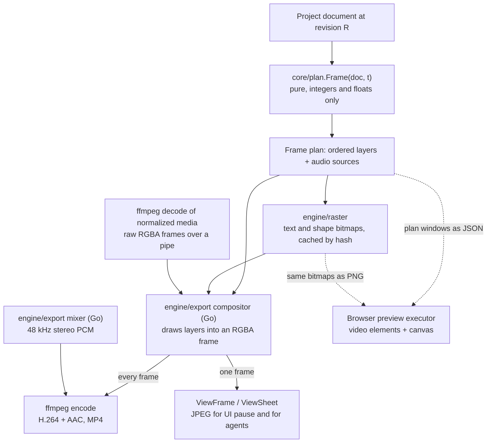

# SDD-004: Render pipeline and source of truth

- Status: Draft (2026-11-14). The compositor design depends on the measurement of `spikes/go-compositor`; see section 12.
- Depends on: ADR-0003 (one plan, two executors), ADR-0004 (time), ADR-0010 (ingest), ADR-0011 (FFmpeg and codecs), ADR-0012 (rasterizer), ADR-0013 (browser), SDD-000, SDD-001, SDD-011 (ingest profiles)
- Implements: RF-015, RF-020 to RF-026, RF-030 to RF-032, RF-035, RF-040 to RF-042, RF-060 to RF-063, RF-109, NFR-003, NFR-004, NFR-006, NFR-007, NFR-010, NFR-011, NFR-022, NFR-023
- Owner area: senior-b (render, ingest and media), with `core/plan` owned by senior-a

## Contents

1. Overview
2. The frame plan
3. Evaluating an item at a frame
4. Layout of text, captions and shapes
5. The rasterizer
6. The compositor
7. Audio
8. Export
9. Frames for people and agents
10. The preview executor
11. Tolerance and reference tests
12. Performance design and its open measurement
13. Acceptance

## 1. Overview



Three rules hold everywhere:

1. `core/plan` decides what a frame contains. Nothing else interpolates, picks a source frame or lays out a caption.
2. `engine/raster` is the only code that draws text and shapes. Both executors use its bitmaps.
3. The Go compositor is the **export executor** and the truth. FFmpeg decodes media into raw frames and encodes the composed frames; it places nothing. This removes dependence on FFmpeg filters that are GPL-only (`eq`, `boxblur`) and on filter behaviour that the first spike showed is not pixel-stable (the same scene placed through `overlay` expressions differed from the piped version in 630 of 900 frames).

## 2. The frame plan

```go
package plan

// Frame returns what frame t of the document contains. It is pure.
func Frame(doc *timeline.Document, t int) FramePlan

// Window returns the plans of frames [from, to) in the compact form of section 10.
func Window(doc *timeline.Document, from, to int) WindowPlan

// Audio returns every audio source that sounds in frames [from, to).
func Audio(doc *timeline.Document, from, to int) []AudioSource

type FramePlan struct {
    Frame         int
    Width, Height int
    Background    Color
    Layers        []Layer // bottom first
}

type Layer struct {
    ItemID string
    Kind   LayerKind // Media or Bitmap

    // Media layers (clip items)
    AssetID     string
    AssetKind   string  // "video" or "image"
    SourceFrame int     // frame index in the normalized media; 0 for images
    Crop        Rect    // in source pixels after the item's crop fractions
    ColorMatrix *[12]float64 // nil when brightness, contrast and saturation are neutral

    // Bitmap layers (text, caption, shape items)
    Bitmap BitmapSpec // what to rasterize; section 5

    // Placement, valid for both kinds
    CX, CY   float64 // centre in frame pixels
    W, H     float64 // drawn size before rotation, in frame pixels
    Rotation float64 // degrees clockwise
    Opacity  float64 // 0..1
}
```

**Layer order.** Tracks are taken in descending `order` (SDD-001 §3.3.1), so the bottom track comes first. Hidden tracks are skipped. Within a track at most one item is active at a frame. Audio tracks produce no layer.

**Active item.** An item is active at `t` when `start <= t < start + duration`.

**Stability.** All floating-point results in a plan are rounded to 3 decimal places.

**How `core/plan` implements this section (P1-ENG-003).**

- `core/` cannot lay text out, so the natural size of a text or caption bitmap comes from a `plan.Measurer` (the rasterizer, in `engine/raster`) passed in `plan.Options`. `FrameWith(doc, t, opts)` and `WindowWith(doc, from, to, opts)` take it; `Frame` and `Window` are the same with no Measurer, which gives bitmap layers size 0 and anchors a bottom or top caption by its centre on the edge. A caption at `bottom` or `top` is placed with its scaled box's edge on the safe area's edge.
- `BitmapSpec`, `ResolvedStyle` and `ShapeSpec` are defined in `core/plan`, not in `engine/raster`, so that the plan, the rasterizer and the browser name one thing. `BitmapSpec.Key()` is the SHA-256 of the JSON of the spec plus `plan.BitmapVersion`, which `raster.Version` of §5 must equal.
- `SafeArea(width, height)` returns a `Rect` rounded to whole pixels: `{65, 269, 950, 979}` for 1080×1920. `Layer.Bitmap` is a pointer and `Layer.Crop` a value, so a media layer has no bitmap and a bitmap layer no crop.
- `WindowPlan.Revision` is set by the caller. `Window` cuts a window to 300 frames. The per-frame arrays of §10 are `plan.Series`, which encodes as one number when constant. `bitmaps.index` is chosen by the active word, the only thing that changes a bitmap between frames of one item. `audio.gain` is one value per frame.
- `Audio(doc, from, to)` clips each source to the frames asked for. The gain envelope has a point at each volume keyframe and fade edge, eight straight segments inside a curved easing, and a point one sample before the next keyframe for `hold`. Gain points count output samples from the start of the clipped range.

## 3. Evaluating an item at a frame

Let `r = t - start` (0-based frame inside the item) and `D = duration`.

### 3.1 Animated properties

For each of `x`, `y`, `scale`, `rotation`, `opacity`, `volume`: if the item has keyframes for the property, its value is given by them; otherwise it is the item's static field (or the default of SDD-001).

With keyframes `k0..kn` sorted by `t`:

- `r <= k0.t`: value is `k0.value`.
- `r >= kn.t`: value is `kn.value`.
- otherwise find `i` with `ki.t <= r < k(i+1).t`, let `u = (r - ki.t) / (k(i+1).t - ki.t)` and `v = ki.value + (k(i+1).value - ki.value) × e(u)`, where `e` is the easing of `ki`:

| Easing | `e(u)` |
| --- | --- |
| `linear` | `u` |
| `ease_in` | `u³` |
| `ease_out` | `1 - (1 - u)³` |
| `ease_in_out` | `4u³` when `u < 0.5`, else `1 - (-2u + 2)³ / 2` |
| `hold` | `0` |

Rotation interpolates as a plain number; there is no shortest-path wrapping.

### 3.2 Transitions

Transitions modify the animated values; they never change the document.

- `transition_in` of duration `T` applies while `r < T`, with progress `p = (r + 1) / (T + 1)`, so `p` is strictly between 0 and 1.
- `transition_out` of duration `T` applies while `r >= D - T`, with progress `p = (D - r) / (T + 1)`.

| Kind | Effect with progress `p` |
| --- | --- |
| `fade` | `opacity = opacity × p` |
| `slide_left` | `x = x - (1 - s(p)) × Width` |
| `slide_right` | `x = x + (1 - s(p)) × Width` |
| `slide_up` | `y = y - (1 - s(p)) × Height` |
| `slide_down` | `y = y + (1 - s(p)) × Height` |

`s(p) = 1 - (1 - p)³`. For `transition_in` the name says where the item comes from; for `transition_out`, where it goes. `Width` and `Height` are the frame size.

### 3.3 Source frame of a clip

```text
pos         = source_in + floor(r × speed.num / speed.den)            (project frames on the asset's time axis)
SourceFrame = floor(pos × fps.den × frame_rate.num / (fps.num × frame_rate.den))
SourceFrame = min(SourceFrame, frame_count - 1)
```

All integer arithmetic, with 64-bit intermediates. This is the only place a source frame is chosen.

### 3.4 Size of a media layer

Let `sw × sh` be the asset's size after removing the crop fractions (`sw = width × (1 - crop.left - crop.right)`, likewise `sh`), and `Fw × Fh` the frame.

| `fit` | Base scale `b` |
| --- | --- |
| `cover` | `max(Fw / sw, Fh / sh)` |
| `contain` | `min(Fw / sw, Fh / sh)` |
| `none` | `1` |

`W = sw × b × scale`, `H = sh × b × scale`. `CX = x`, `CY = y`, where a missing static `x`, `y` means the frame centre.

### 3.5 Colour adjustment

With brightness `β`, contrast `κ` and saturation `σ`, the layer's colour matrix applied to non-linear RGB values in 0..1 is the product `S × C`, with:

```text
C: r' = (r - 0.5) × κ + 0.5 + β          (same for g, b)
S: l  = 0.2126 r' + 0.7152 g' + 0.0722 b'
   r'' = l + (r' - l) × σ                (same for g, b)
```

expressed as one 3×4 matrix in `ColorMatrix`, results clamped to 0..1. Neutral values (`β = 0`, `κ = 1`, `σ = 1`) give `nil`.

## 4. Layout of text, captions and shapes

### 4.1 Safe area

```go
func SafeArea(width, height int) Rect
```

- When `width / height <= 0.6` (vertical video): top 14%, bottom 35%, left 6%, right 6% of the frame are outside the safe area. These are the only margins found in an official source (Meta's ads guide for Reels; see `search/features-20-80.md` §5).
- Otherwise: 5% on every side.

The safe area is used for the default position of captions and by the lint rule for text outside it. It is a single function so the two cannot disagree.

### 4.2 Text and shape items

A text item's bitmap has a natural size `nw × nh` given by the rasterizer for its content and style. `W = nw × scale`, `H = nh × scale`, `CX = x`, `CY = y`, default centre of the frame. Shapes: `W = width × scale`, `H = height × scale`.

### 4.3 Caption items

The effective style is resolved as in SDD-001 §3.7. With `position`:

| `position` | Placement of the caption block |
| --- | --- |
| `bottom` | horizontally centred; its bottom edge on the safe area's bottom edge |
| `top` | horizontally centred; its top edge on the safe area's top edge |
| `middle` | centred in the frame |
| `custom` | `CX = x`, `CY = y` |

With `highlight: "word"`, the active word at frame `r` is the last word whose `start <= r`, while `r < start + duration` of that word; between words and before the first word no word is active. The plan's `BitmapSpec` carries the index of the active word, or -1, so the rasterizer produces one bitmap per state.

## 5. The rasterizer

```go
package raster

type BitmapSpec struct {
    Kind        string  // "text", "caption", "shape"
    Text        string  // text items; captions: the words joined by spaces with forced breaks as "\n"
    Words       []string // captions only
    Breaks      []int
    ActiveWord  int     // captions with highlight; -1 for none
    Style       ResolvedStyle // every field explicit, colours resolved
    Shape       *ShapeSpec
    PixelScale  float64 // oversampling factor, section 5.3
}

// Key is the SHA-256 of the canonical JSON of the spec plus Version.
func (s BitmapSpec) Key() string

// Render draws the bitmap. It is deterministic: same spec, same bytes.
func Render(spec BitmapSpec, fonts *FontSet) (Bitmap, error)

type Bitmap struct {
    Pix            []byte // RGBA, 8 bits, straight (non-premultiplied) alpha
    Width, Height  int    // pixels of Pix
    NaturalW, NaturalH float64 // size at PixelScale 1, in frame pixels
    CenterDX, CenterDY float64 // offset at PixelScale 1 from the centre of the bitmap to the centre of the text block (item 6 of 5.1)
    WordBoxes      []Rect // captions: box of each word at PixelScale 1, in bitmap coordinates, for the lint and the UI
}

const Version = 1 // bumped on any change that alters output bytes
```

As built (P1-RND-003): `Kind` is `"text"`, `"caption"` or `"shape"`; for a caption `Text` is ignored and the text is `Words` joined by one space, with a line break before every index of `Breaks`. `Colour` is straight RGBA and marshals as `"#RRGGBBAA"`. `ResolvedStyle` has the fields of SDD-001 §3.6 and §3.7 with the colours resolved, `BackgroundColor` and `HighlightBackground` as `*Colour` (nil: none) and `MaxWidth` in pixels. `Render` returns `ErrInvalidSpec` for a pixel scale outside (0, 8], a non-positive size, line height or width, a caption with no words or an active word out of range, an unknown kind or shape, and a bitmap over `MaxPixels` (33.5 million). `FontSet.Lookup(family, weight)` returns a `*FontError` with `Code` `E_FONT_UNKNOWN` and the weights that exist. `Bitmap.PNG()` encodes the bitmap as a PNG with straight alpha; the encoding is deterministic. `Cache` (`NewCache(fonts, bytes)`, `Get(spec)`) is the in-process layer of §5.4: an LRU over the pixels, default budget 64 MiB, safe for concurrent use.

### 5.1 Layout rules

1. Shaping with `go-text/typesetting` using the font file of the style's family and weight. Text direction per paragraph follows the Unicode bidirectional algorithm.
2. Lines break at the positions given by the library's line segmenter so that no line is wider than `max_width`; forced breaks always break. A single word wider than `max_width` stays on its own line and overflows.
3. Line height is `size × line_height`. The block height is the number of lines times the line height.
4. Lines are aligned inside the block's width (the widest line) by `align`.
5. Drawing order, back to front: background box (block grown by `background_padding`, corners rounded by `background_radius`), shadow (the glyphs and stroke filled with `shadow_color`, offset by `shadow_dx`, `shadow_dy`, blurred with a box blur of radius `shadow_blur` applied three times), stroke (outline of width `stroke_width` centred on the glyph edge, joined round), fill.
6. The bitmap is the block grown by the largest of padding, stroke and shadow extents, so nothing is clipped. `NaturalW` and `NaturalH` describe that grown size; the block is centred in it unless the shadow offset makes it asymmetric, in which case the item's centre is still the block's centre and the bitmap carries the offset.
7. `uppercase` converts with Unicode upper-casing before shaping.
8. Caption highlight: the active word is filled with `highlight_color`; with `highlight_background` a rounded box is drawn behind that word.
9. A glyph missing from the font is drawn with the font's `.notdef` glyph. There is no fallback to another font. The lint reports text containing characters the font lacks.

Details fixed by the implementation, where the items above leave room (P1-RND-003):

- **Breaking.** The library's line breaker runs with the policy `Never`, so a word wider than `max_width` is never cut (item 2). An empty line (two forced breaks in a row, or a break at the end) is a line. Trailing spaces of a line do not count in its width.
- **Runs.** Each paragraph (the text between forced breaks) is split into runs by the bidirectional algorithm and then by script; a run is shaped with the language `en`. Spaces, digits, punctuation and combining marks join the script next to them.
- **Vertical layout.** The line box is `size × line_height` high; the font's ascender and descender (hhea or OS/2 as the library reads them) are centred in it, and the baseline is placed accordingly.
- **Upper case** (item 7) is the one-to-one Unicode simple mapping (`unicode.ToUpper`): `ß` stays `ß`. It keeps the number of runes, so word ranges and boxes survive it.
- **Stroke** (item 5) is the union of a rectangle along every segment of the flattened glyph outline and a round join on the outer side of every turn, so no gap or spike appears; it is drawn under the fill, which hides its inner half, so the visible width outside the glyph is `stroke_width / 2`. For a **shape** the stroke is drawn over the fill and is visible on both sides of the edge.
- **Shadow** is not drawn when `shadow_dx`, `shadow_dy` and `shadow_blur` are all 0 (it would only darken the antialiased edge). The box blur radius is `ceil(shadow_blur × PixelScale)` and the blur is integer arithmetic that rounds half up at every pass.
- **Highlight box** (item 8) is the word's box (a full line high) grown by `0.1 × size` on the left and on the right, with corner radius `max(background_radius, 0.15 × size)`.
- **Word box** is the horizontal extent of the glyphs of the word and the height of the line box; the box of a word with no glyph is empty.
- **Margins.** The bitmap is the union of everything drawn, with one clear pixel on every side, so the antialiased edge never touches the border of the bitmap. `NaturalW` and `NaturalH` include that pixel.
- **Curves** are flattened to within 0.1 pixel (`flatTolerance`) before filling and stroking. Geometry that adds a product avoids the fused multiply-add the compiler may use on arm64 (`mul` in `geom.go`), and `golang.org/x/image/vector` disables it itself, so the bytes are equal on every architecture.
- **Variable fonts.** The bundled families are the Google Fonts distribution of the upstream projects (`fonts/FONTS.md`): Inter, Montserrat, Playfair Display and JetBrains Mono are variable fonts, so one file serves every weight of its range; Anton and Bebas Neue have one weight, 400.

### 5.2 Fonts

Fonts come only from the bundled set, embedded in the binary under `engine/raster/fonts/` (the files, their weights, sources and checksums are in `FONTS.md` there, the licences in `licenses/fonts/`), and from the project's `fonts` map (BETA). `FontSet.Lookup(family, weight)` returns `E_FONT_UNKNOWN` data for a missing pair. System fonts are never read.

### 5.3 Oversampling

`PixelScale` is chosen by the plan so that scaling up never blurs: the largest `scale` the item reaches over its duration (static value or largest keyframe value), multiplied by the output scale of the request (1 for export; `width / project width` for a reduced frame), rounded up to the next quarter and clamped to 0.25..4. All frames of an item at the same output scale share one `PixelScale`, so the cache holds one bitmap per state. Scaling up never blurs up to an effective pixel scale of 4; beyond it the bitmap is upscaled and softens.

### 5.4 Cache

Bitmaps are stored under `<workspace>/bitmaps/<key>.png`. The export reads them from disk or from memory; the browser fetches them by key at `GET /api/v1/bitmaps/{key}.png` with an immutable cache header.

## 6. The compositor

```go
package export

// Compose draws one frame plan into dst (RGBA, 8 bits, premultiplied alpha), at the given output scale.
func (c *Compositor) Compose(dst *image.RGBA, fp plan.FramePlan, outScale float64, src FrameSource) error
```

Rules, applied in this order for each frame:

1. Fill `dst` with the project background.
2. For each layer, bottom first:
   1. Obtain the source pixels: a decoded video frame, a decoded image, or a bitmap from the rasterizer.
   2. If the layer has a colour matrix, apply it to the source pixels.
   3. Draw the source into the quadrilateral given by `CX, CY, W, H, Rotation` (all multiplied by `outScale`) with opacity `Opacity`, using source-over blending on premultiplied alpha.
3. Sampling: when `Rotation` is 0 and the source's pixel size equals the destination rectangle's rounded size, pixels are copied one to one at integer offsets (the rectangle's top-left corner rounded to the nearest pixel). Otherwise the source is sampled with bilinear interpolation through the inverse affine transform.
4. Blending uses 8-bit channels with rounding to nearest. Blending is done on non-linear values (no gamma linearization), which is what browsers do by default and keeps the two executors close.

**Decoded frames.** The compositor asks a `FrameSource` for `(asset, source frame, delivered size, crop)`. The source is an FFmpeg process per active clip:

```text
ffmpeg -nostdin -protocol_whitelist file,pipe -ss <time of first needed frame> -i <normalized media>
       -vf "crop=<crop>,scale=<w>:<h>:flags=bicubic+accurate_rnd+full_chroma_int,format=rgba"
       -f rawvideo -pix_fmt rgba pipe:1
```

- **Pre-scaling.** When a layer's crop, `W`, `H` and rotation are constant over the clip and rotation is 0, the decoder delivers frames already cropped and scaled to the rounded destination size, so the compositor copies. When size or rotation is animated, or rotation is not 0, the decoder delivers frames at the cropped native size and the compositor samples.
- Conversion from the normalized media's BT.709 limited-range YUV to RGB is done by FFmpeg with explicit `in_color_matrix=bt709:in_range=tv` on the scale filter.
- Frames are read in order. For speeds above 1 the frames not needed are read and dropped; for speeds below 1 a frame is reused.
- Images are decoded once by Go's image decoders from the normalized PNG produced at ingest and scaled by the compositor's sampler; scaled results are cached per destination size.

**Determinism.** For a fixed FFmpeg build, the composed frames are a function of the document and the media only. Compose never reads the clock, and goroutines used to split a frame into bands write disjoint rows.

## 7. Audio

`plan.Audio(doc, from, to)` returns, for every `clip` with audio that is not `audio_muted` and every `audio` item, on tracks that are not `muted`:

```go
type AudioSource struct {
    ItemID      string
    AssetID     string
    StartSample int64     // position on the output, at 48 kHz
    SourceStart int64     // first sample of the asset's normalized audio
    Samples     int64     // output samples
    Speed       Rational
    Gain        []GainPoint // piecewise-linear envelope in output samples: volume or its keyframes, times the fades
}
```

Conversions: output sample of timeline frame `t` is `t × 48000 × fps.den / fps.num` (integer division, floor); the last sample of an item is the first sample of the frame after it, minus one. Fades are linear ramps over their frame ranges.

The mixer, in `engine/export`:

1. For each source, FFmpeg decodes the needed range of the normalized audio to 32-bit float stereo PCM over a pipe. With `Speed` other than 1 the decode command adds `-af atempo=<speed>` (chained when outside 0.5..2), which changes tempo without changing pitch.
2. Go multiplies each source by its envelope, pads or truncates it to exactly `Samples`, and sums the sources into the output buffer at `StartSample`.
3. Loudness: the integrated loudness and true peak of the mix are measured by running FFmpeg's `ebur128` filter over it. One gain is applied to the whole mix so that integrated loudness reaches the project's `loudness_target`, reduced if needed so that true peak does not exceed -1.5 dBTP. If the mix is silent or shorter than 0.4 s, no gain is applied.
4. The result is written as a 48 kHz stereo 16-bit WAV in the job's temporary directory and given to the encoder as its audio input.

A project with no audio source exports a silent stereo track, so the file always has an audio stream.

## 8. Export

`engine/export.Run(ctx, job)`:

1. **Check.** Run the lint; findings marked blocking stop the export with `E_LINT_BLOCKING`. An empty timeline is blocking. Total frames `N` is the end of the last item.
2. **Encoder.** Pick the H.264 encoder from the detection result (ADR-0011 item 5), or the one forced by `VUKEM_VIDEO_ENCODER`. None available: `E_NO_ENCODER`.
3. **Audio.** Mix as in section 7.
4. **Video.** Start the encoder process and write `N` composed frames to its standard input (the pinned `contrib/engine` v0.1.1 cannot feed a child's standard input, so `Runner.RunFFmpeg` refuses a `pipe:0` argv with `E_INTERNAL` `stdin_unsupported` until vukem releases `Config.Prepare`, see `vukem-feedback.md` VF-031):

```text
ffmpeg -nostdin -protocol_whitelist file,pipe
       -f rawvideo -pix_fmt rgba -s <W>x<H> -framerate <fps.num>/<fps.den> -i pipe:0
       -i <mix.wav>
       -vf "scale=out_color_matrix=bt709:out_range=tv,format=yuv420p"
       -c:v <encoder> <encoder options> -g <ceil(fps / 2)> -bf 2
       -colorspace bt709 -color_primaries bt709 -color_trc bt709 -color_range tv
       -c:a aac -b:a 192k -ar 48000 -ac 2
       -movflags +faststart -shortest <exports/<project>/<job>.partial.mp4>
```

| Encoder | Options |
| --- | --- |
| `h264_nvenc`, `h264_qsv`, `h264_amf`, `h264_videotoolbox`, `h264_vaapi` | `-b:v 8M` up to 30 fps, `-b:v 12M` above; High profile. The input arguments and the final filter differ per encoder (`h264_vaapi` needs a device and `hwupload`; plain `format=yuv420p` fails there): the export uses the `INPUT_ARGS` and `FILTER` that encoder detection recorded for the chosen encoder (SDD-011 §8.4) |
| `h264_mf` | `-b:v 12M` up to 30 fps, `-b:v 16M` above, because its software encoder measured lower quality at equal bitrate |
| `libopenh264` | `-b:v 8M` up to 30 fps, `-b:v 12M` above; `-profile:v high` when accepted, else the encoder's default; no `-bf` |
| `libx264` (user's own FFmpeg, opt-in) | `-crf 18 -preset medium -profile:v high` |

For sizes other than 1080p the bitrate scales with the pixel count relative to 1080×1920, with a floor of 2M. `-bf` is omitted for encoders that reject it.

5. **Progress.** After every frame written the job's progress is `frames written / N`, published at most 4 times per second.
6. **Cancellation.** Cancelling the context closes the pipes and kills both process trees; the partial file is deleted; the job ends `cancelled`.
7. **Verification.** `ffprobe` the partial file and require: one H.264 video stream and one AAC audio stream; width and height equal to the project's; pixel format `yuv420p`; duration within one frame of `N / fps` for both streams; the `moov` atom before `mdat`. Any failure: delete the file and end `failed` with `E_VERIFY_FAILED` and the list of failed checks.
8. **Publish.** Rename the partial file to `<job>.mp4`. The job ends `succeeded` with the path, size, duration, encoder used and the loudness measured.

Temporary files live in a per-job directory under the workspace and are removed in every outcome.

## 9. Frames for people and agents

Both operations use the compositor, so they show what the export produces.

**`ViewFrame(project, at, width)`.** Composes one frame at `outScale = width / project width` and returns a JPEG (quality 80, 4:2:0). The sizes for agents are those of SDD-003 §3.11, which is the authority for the numbers in this section: an agent asks for a token budget (`max_tokens`, default 800, maximum 1,568) and the service derives the size with `ImageSize`, so a 9:16 project gives 582×1036 (777 image tokens, within the 800 of NFR-022). `width` (CLI and HTTP only) defaults to 540 for the UI's paused frame; it is exclusive with `max_tokens`. Maximum 1080. Only the current revision is rendered in the MVP; the `rev` query parameter, when given, must be the current revision (SDD-003 §6.3). For each media layer one FFmpeg process decodes exactly one frame with `-ss` before `-i` and `-frames:v 1`. Results are cached at `frames/<project>/<revision>/<frame>-<width>.jpg`; a new revision uses a new directory, and directories of revisions older than the previous 5 are deleted.

**`ViewSheet(project, from, to, count, cols)`.** Composes `count` frames (default 9, maximum 16) evenly spaced from `from` to `to`, both ends included (default the whole timeline: `0s` to the last frame), arranged in `cols` columns (default `ceil(sqrt(count))`, so 3 for 9 cells; `cols` is CLI and HTTP only). The canvas is sized by `ImageSize` with the sheet budget (`max_tokens`, default 1,500, maximum 1,568), so a 9:16 project gives a 804×1428 canvas (1,479 image tokens, within the 1,600 of NFR-022), with a 2-pixel gutter. The frame's time is drawn by the rasterizer in the top-left corner of each cell, in white (bundled font Inter, weight 700) on a black box at 70% opacity, as `<index> <seconds>s f<frame>` (for example `3 1s f30`). The JPEG has quality 80. Returns one JPEG. The response also lists the frame and time of each cell as text.

**A frame of an asset** is the `asset_id` member of `view` (and of the HTTP frame and sheet routes), not a `MediaInspect` option: it returns a frame of the normalized media, uncomposed, with the same sizes. Details of the sizes, the label and the cache keys are in SDD-003 §3.11.

## 10. The preview executor

The browser never evaluates the document. It asks for plan windows:

`GET /api/v1/projects/{id}/plan?from=<frame>&to=<frame>&rev=<revision>` returns:

```json
{
  "revision": 42, "from": 0, "to": 60, "end_frame": 1800, "width": 1080, "height": 1920, "background": "#000000",
  "safe_area": [65, 269, 950, 979],
  "layers": [
    {
      "item": "itm_m1n2p3q4r5", "kind": "media", "asset": "ast_3c5v8n2w6d", "asset_kind": "video",
      "first": 0, "last": 59,
      "source_seconds": [2.0, 2.033, 2.067],
      "crop": [0, 0, 1080, 1920],
      "cx": 540, "cy": 960, "w": 1080, "h": 1920, "rotation": 0, "opacity": 1,
      "color_matrix": null
    },
    {
      "item": "itm_s6t7v8w9x0", "kind": "bitmap", "first": 12, "last": 59,
      "bitmaps": {"keys": ["9c1f...", "a7b2..."], "index": [0, 0, 0, 1, 1]},
      "natural": [640, 96],
      "cx": 540, "cy": 1180, "w": 640, "h": 96, "rotation": 0, "opacity": [0.2, 0.4, 0.6, 0.8, 1]
    }
  ],
  "audio": [{"item": "itm_m1n2p3q4r5", "asset": "ast_3c5v8n2w6d", "first": 0, "last": 59, "source_seconds": 2.0, "speed": 1, "gain": 1}]
}
```

Rules of the format: `end_frame` is the end of the project at that revision, the largest `start + duration` over all items (0 for an empty project), computed by the core; the UI shows it as the total and stops playback there, and never derives it itself. `first` and `last` are the frames of the window in which the layer is active. Each of `cx`, `cy`, `w`, `h`, `rotation`, `opacity`, `gain` is a single number when constant over those frames, or an array with one value per frame from `first` to `last`. `source_seconds` has one value per frame: the time in the proxy at which the frame to show starts. `bitmaps.index` has one entry per frame, selecting a key. `safe_area` is the rectangle `[x, y, w, h]` of §4.1 in project pixels, so the browser draws the guide without knowing the percentages. Windows are at most 300 frames. The response is cacheable by `(project, revision, from, to)`.

The executor, in `web/resources/js/editor/preview/`:

1. Keeps plan windows for the playhead and the next window.
2. For each media layer keeps a `<video>` element on the asset's proxy (`GET /api/v1/projects/{id}/media/{asset_id}/proxy`, served with Range; SDD-000 §1). During playback it lets the element play and corrects its `currentTime` when it drifts more than 2 frames from `source_seconds`; when paused or scrubbing it seeks to the value.
3. Draws each layer as a sprite on the canvas with exactly the plan's centre, size, rotation, opacity and colour matrix, in plan order. Bitmaps are fetched by key.
4. Plays audio through the same video elements and, for audio items, audio elements on the proxy, with gain from the plan. The master clock during playback is the audio clock; the playhead frame is `floor(clock × fps)`.
5. At most `MAX_VIDEO_LAYERS` video elements decode at once (initial value 4, confirmed by measurement); further media layers show their thumbnail still.
6. **Truth on pause.** 150 ms after playback stops or a seek ends, it requests `ViewFrame` at the canvas width and draws that image over the canvas. Any change of playhead or revision removes the overlay.

## 11. Tolerance and reference tests

| Comparison | Requirement | Test |
| --- | --- | --- |
| Compositor against stored reference frames, same pinned FFmpeg | identical bytes of the composed RGBA frame | `engine/export` golden test: for each case in `engine/export/testdata/golden/<case>/` (a document, tiny media fixtures and `frame-<n>.png` references), compose the listed frames and compare SHA-256 |
| Compositor on two runs | identical | the same test run twice in one process and across two processes |
| Compositor with a different FFmpeg build | PSNR at least 50 dB per frame | a CI job that runs the golden cases with the PATH FFmpeg when it differs from the pinned one; reported, not blocking |
| Rasterizer | identical bytes | `engine/raster/testdata/golden/<case>.png`, one per layout rule of section 5.1, plus right-to-left text, an emoji sequence and a missing glyph (15 cases in `golden_test.go`). The test compares the decoded pixel bytes, not the PNG bytes, because the compressor may change between Go versions; regenerate with `go test ./engine/raster -run Golden -update` |
| Preview executor against compositor, during playback | SSIM at least 0.97 on luma per frame at preview resolution; no layer centre displaced by more than 1 pixel | Playwright test: load each golden case in the editor, step the preview to the listed frames without the truth-on-pause overlay, capture the canvas, compare with `ViewFrame` at the same width |
| Exported file | passes the verification of section 8 step 7; its frames, decoded, have SSIM at least 0.95 against the composed frames | export test on each golden case with `libopenh264` |
| Audio mix | sample-exact against `engine/export/testdata/audio/<case>.wav` for cases without speed change; within 1 dB RMS per 100 ms window for cases with `atempo` | mixer golden test |

Golden cases required at minimum: a single clip with cover fit; contain fit with background; crop; picture in picture with opacity; rotation; each transition kind at the first, middle and last frame; keyframed scale with each easing; a caption with word highlight at three words; text with stroke, shadow and background; a shape; colour adjustment at three settings; speed 0.5 and 2; a 30000/1001 project; a source at a different frame rate from the project.

References are regenerated only by an explicit command (`go test ./engine/export -update`) and every regeneration is a reviewed change.

## 12. Performance design and measurements

The compositor moves 8.3 MB per 1080×1920 frame in and out. The design keeps the common case cheap: one full-frame video delivered pre-scaled (a copy) plus small bitmaps. Slow paths (animated size, rotation, colour matrix) cost a per-pixel loop and are split across goroutines by horizontal bands.

`spikes/go-compositor` measured the design on the reference machine (Ryzen 7 5700X3D, Windows 11; 30 seconds of 1080×1920 at 30 fps; two runs per configuration; details and limits in `search/spikes.md`):

| Case | Target | Measured, times real time | Verdict |
| --- | --- | --- | --- |
| One full-frame video plus text | at least 1.5 | 1.59 to 2.36 single-threaded, typical 2.1 to 2.4 | met |
| Two video layers, the second scaled by its decoder, plus text | at least 1 | 1.87 to 2.41 | met |
| A colour matrix on every pixel | at least 1 | 1.76 to 2.03 single-threaded, 1.88 to 2.54 in 8 bands | met |
| Two video layers, the second scaled and rotated in Go every frame | at least 1 | 0.31 to 0.36 with `x/image/draw.BiLinear`; 1.15 to 1.90 with `ApproxBiLinear`; 0.93 to 1.10 with `BiLinear` in 8 bands | met only with a fast sampler |

Composing the common case costs about 2 seconds for 30 seconds of video. The limit is FFmpeg decoding plus its conversion to RGBA (11 to 17 of the 12 to 19 seconds of a run); the encoder barely matters. Memory of the Go process peaked at 93 to 134 MB.

Rules that follow from the measurements:

1. A layer whose size is constant over its item is scaled by its decoder process, never in Go.
2. `x/image/draw.BiLinear.Transform` is not used on the per-frame path. Rotation and animated scaling use a bilinear sampler written for the purpose, with fixed-point arithmetic, that samples each output pixel from the whole source. The Prototype measures its speed and compares its output with `draw.BiLinear` on the reference scenes.
3. **Bands must not change pixels.** In the spike, a transform applied per band on sub-images changed 2 of 900 frames. The sampler of rule 2 has no state that depends on the band, and the test `TestCompositorBandsEqual` renders every reference scene with 1 band and with 8 and fails on any differing byte.
4. Bands are used for per-pixel work (colour matrix, transforms, blending large layers). A plain copy is not banded.
5. The number of bands is the number of physical cores, at most 8.

Fallback, kept in reserve and not needed for the Prototype: exchange frames with FFmpeg as YUV 4:2:0 instead of RGBA (halving the bytes moved and removing the conversion that dominates), with bitmaps blended in YUV; then let FFmpeg overlay a cropped bitmap region for unanimated full-frame clips, the path the first spike proved identical frame by frame to full-frame piping. Either fallback changes only `engine/export`; the plan, the rasterizer and every contract in this document stay.

Rasterizer (P1-RND-003, `engine/raster`, same machine, Go 1.27.4, `go test -bench Caption`): the caption of the reference scene (six words on two lines, Inter 700 at 64 px, stroke 5, shadow blur 6, one highlighted word with its box, 1080 wide frame) takes **3.7 ms** on a cache miss (4.9 ms with one core, 10.8 ms at `PixelScale` 2) and **6 µs** on a hit (hashing the spec and finding the bitmap). The budgets are 5 ms and 0.1 ms. The Linux and macOS numbers are recorded here after the first CI run of the benchmark.

The measurements came from one Windows machine with other processes running. The Prototype repeats the first row on the Linux and macOS runners and records the numbers here; the first row is also a benchmark in CI (`BenchmarkExportCommonCase`) that fails below 1.5 times real time on the reference runner.

## 13. Acceptance

1. `go test ./core/plan/...` passes with at least 90% statement coverage, including table tests for every formula of section 3 at the boundary frames (first, last, and the frames around each keyframe and transition edge).
2. `go test ./engine/raster/...` passes; every golden bitmap matches byte for byte on Linux, macOS and Windows runners.
3. `go test ./engine/export/...` passes the golden frame, audio and export tests of section 11 with the pinned FFmpeg.
4. The Playwright preview comparison passes for every golden case.
5. An export of the 60 s reference project completes within NFR-006 and the process stays within NFR-007, measured by the benchmark `go test -bench Export ./engine/export` on the reference machine and recorded in the pull request.
6. `ViewFrame` returns within 350 ms at the 95th percentile (UI width) on a cold cache, so that pause to truth shown stays within the 500 ms of NFR-004 with the 150 ms delay of §10 (the end-to-end measurement is `play-pause-truth` of SDD-012), and within NFR-023 (agent width), measured by a benchmark.
7. `grep -rn "drawtext\|subtitles=\|ass=" engine/` finds nothing, and no FFmpeg command line built by `engine/` contains `overlay`, `eq` or `boxblur`.
8. Cancelling an export leaves no FFmpeg process and no partial file; a test asserts both.
