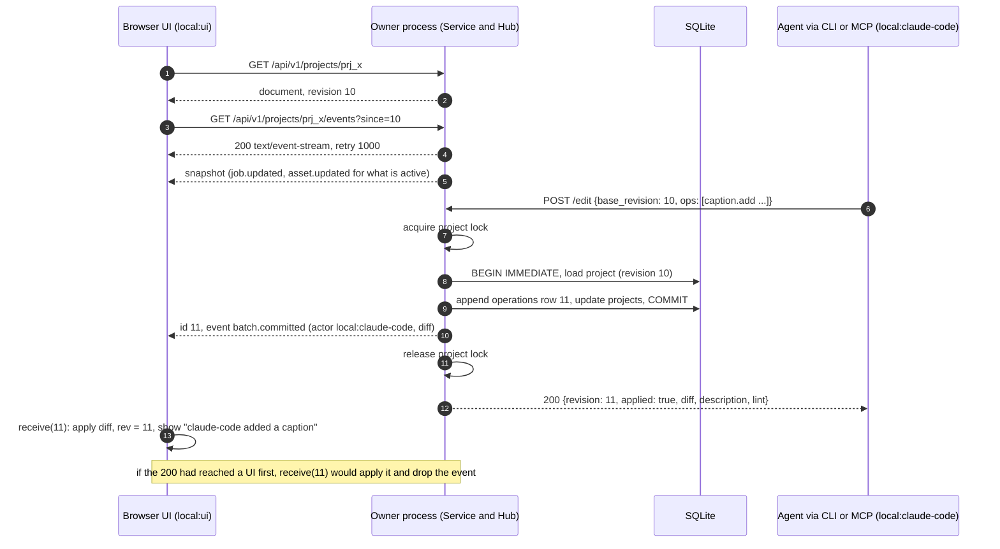

# SDD-006: Real-time protocol

- Status: Accepted (2026-11-14). Drafted by senior-c, reviewed and corrected by the architect; reconciled with SDD-005 and SDD-007.
- Depends on: ADR-0006, ADR-0008, ADR-0017, ADR-0018, ADR-0019, SDD-000, SDD-002, SDD-005
- Implements: RF-003, RF-072, RF-111, RF-118, RF-119, NFR-002
- Owner area: senior-c (service, persistence, HTTP, events, jobs)

## Contents

1. Purpose and scope
2. The event stream endpoint
3. Wire format and events
4. Ordering, `Last-Event-ID`, replay and resync
5. Server algorithm and vukem's SSE hub
6. Reconciling a response with the event of the same revision
7. Conflicts between a human and an agent
8. Job and ingest progress
9. Backpressure, slow consumers and event size
10. Out of scope: presence
11. Acceptance
12. The image document stream

## 1. Purpose and scope

This document defines the one real-time channel of the product: a server-sent event stream per project. It says what the server sends, in which order, what happens when a client falls behind or reconnects, how a client keeps its copy of the document correct, and how a human and an agent editing the same project are told apart and protected from each other. It is detailed enough to write the HTTP handler, the replay code, the TypeScript client and their tests.

Commands do not travel on this channel: they are ordinary HTTP requests (`POST /api/v1/projects/{id}/edit`, ADR-0017 item 3). The stream is one-way and text only. MCP has no stream (SDD-000 §1). The CLI command `events` prints this stream (SDD-003 owns its flags).

Storage of the log that replay reads, and the commit that produces events, are in SDD-005 sections 9 and 11. The event names are those of SDD-000 §5 and are used exactly.

## 2. The event stream endpoint

`GET /api/v1/projects/{id}/events`, scope `read`.

| Item | Rule |
| --- | --- |
| Query `since` | optional integer, a revision. Equivalent to `Last-Event-ID` for clients that cannot set a header on the first request (`EventSource` cannot). The UI always passes `since` (section 6). |
| Header `Last-Event-ID` | set by `EventSource` itself on every reconnect, and by other clients. When both are present, the header wins, because it records what the connection actually delivered. |
| Invalid value | a non-integer or negative `since` or `Last-Event-ID` is `E_VALIDATION` (400) with the JSON error envelope, before any stream starts. |
| Status before the stream | all errors use the JSON envelope of SDD-002 §A.8 and the HTTP statuses of SDD-000 §8: 400, 401, 403, 404 (unknown project), 429 (stream limit, section 9.4), 503. **`EventSource` does not retry any status other than 200**; the client must (section 4.6). |
| Response | `200`, `Content-Type: text/event-stream`, `Cache-Control: no-cache`, `X-Accel-Buffering: no` (all set by `sse.Serve`). No `Content-Encoding`: vukem's gzip middleware never compresses `text/event-stream`. No `Content-Length`. |
| Trashed project | the stream is allowed (a client may watch a restore). |
| Methods | `GET` only. |

### 2.1 Authentication and checks

ADR-0019 applies unchanged; this endpoint adds nothing and relaxes nothing.

- **Local mode.** Every request must carry a credential: the session cookie that the launch flow set (SDD-007 §3.4; this is what `EventSource` sends, same origin), or the local token as a bearer header (the CLI, scripts). The `Host`, `Origin` and `Sec-Fetch-Site` checks of SDD-007 §3.6 apply as to any route; a same-origin `EventSource` request passes them.
- **Network mode.** A vukem session cookie, or an API key as a bearer header, with scope `read`, and, if the key is limited to a project, that project (`E_FORBIDDEN` otherwise).
- **No token in the query string**, ever (ADR-0019 item 6). A request with a credential in the query (`?token=...`) is refused with `E_VALIDATION` (400) and the value is not logged (SDD-007 T-04). This is the reason `since` is the only query parameter.
- Authentication and project access are checked **before** the response switches to `text/event-stream`, so failures are normal JSON errors.
- **Revalidation.** While the stream is open the server re-checks the credential every 60 seconds (network mode: session or key still valid, key still scoped to the project). On failure it closes the stream without an event; the client's reconnect then receives 401 or 403 as a JSON error.
- The actor of a stream is irrelevant to delivery: every subscriber of a project receives every event of that project, including events caused by its own actor.

## 3. Wire format and events

A stream is the standard `text/event-stream` format (WHATWG HTML, "Server-sent events"). Each event is written by vukem's `sse.Stream` as

```text
id: <id>            (batch.committed only)
event: <name>
data: <one line of compact JSON>
<blank line>
```

- `data` is one JSON object on **one line** (the encoder of `sse.Event` would split lines into several `data:` lines; compact `encoding/json` output has no line breaks, so it never does).
- Timestamps are RFC 3339 UTC with milliseconds. Revisions and counts are JSON integers. Progress is a number from 0 to 1.
- Every payload has `project_id`. Fields listed here beyond the "essentials" of SDD-000 §5 are part of the protocol; a client ignores fields it does not know.
- Text that came from media (asset names inside an `object` of a diff, caption words) is data, not instructions (ADR-0020 item 5); the stream does not mark it again, because the UI renders it as text and agents do not read this stream through MCP.

### 3.1 Preamble and heartbeat

On connect the server writes one event that sets the client's reconnection delay. vukem's encoder always writes a `data:` line, so a browser dispatches an unnamed `message` event with empty data; clients register listeners only for the five names below and ignore it.

```text
retry: 1000
data: 

```

The same unnamed empty event is the **heartbeat**, sent every 15 seconds while the stream is otherwise silent:

```text
data: 

```

**Decision of this SDD.** vukem's own heartbeat is a comment line (`: ping`), which keeps proxies alive but is invisible to JavaScript, so a browser cannot detect a half-open connection. The handler turns vukem's heartbeat off (`sse.Heartbeat(0)`) and sends this visible event itself on a 15-second ticker; it also keeps proxies alive and a failed write detects a dead client the same way. The UI treats 40 seconds with no `message` or named event as a dead connection (section 4.6).

### 3.2 `batch.committed`

A batch was committed: an edit, an undo, a redo, a schema migration or a bundle import (SDD-005 §5.3). The SSE `id` is the revision.

| Field | Type | Meaning |
| --- | --- | --- |
| `project_id` | string | |
| `revision` | integer | the revision this batch produced; equals the SSE `id` |
| `base_revision` | integer | the revision the actor planned against |
| `kind` | `"edit"`, `"undo"`, `"redo"`, `"migrate"`, `"import"` | |
| `actor` | string | SDD-000 §3 |
| `at` | string | commit time |
| `description` | string | text description of the change (`DescribeDiff`), at most 500 characters, ending with `...` when cut |
| `diff` | array of Change | SDD-002 §A.5; absent when `diff_truncated` is true |
| `diff_truncated` | boolean | present and true when the diff did not fit (section 9.3); then `changed` replaces `diff` |
| `changed` | array of `{kind, id}` | only with `diff_truncated`: at most 500 entries |
| `changed_more` | integer | only with `diff_truncated`: entries beyond the 500 |
| `target_revision` | integer | undo and redo: the revision consumed |
| `skipped_count` | integer | undo and redo: number of primitives skipped (details are in the HTTP result and in the history) |

Example, an agent adds a caption:

```text
id: 42
event: batch.committed
data: {"project_id":"prj_7k2m9x4q1b","revision":42,"base_revision":41,"kind":"edit","actor":"local:claude-code","at":"2026-11-14T12:03:10.204Z","description":"+ item itm_s6t7v8w9x0 caption on trk_a1b2c3d4e5 0.4s/12f +1.6s/48f 4w \"Meet the new e…\"","diff":[{"kind":"item.added","id":"itm_s6t7v8w9x0","object":{"id":"itm_s6t7v8w9x0","type":"caption","track":"trk_a1b2c3d4e5","start":12,"duration":48,"words":[{"text":"Meet","start":0,"duration":9},{"text":"the","start":9,"duration":6},{"text":"new","start":15,"duration":12},{"text":"editor.","start":27,"duration":21}]}}]}

```

Example, an update and a removal in one batch from the UI:

```text
id: 43
event: batch.committed
data: {"project_id":"prj_7k2m9x4q1b","revision":43,"base_revision":42,"kind":"edit","actor":"local:ui","at":"2026-11-14T12:03:14.870Z","description":"- item itm_c3d4e5f6g7 text was 10s/300f +2s/60f on trk_a1b2c3d4e5 \"Sale\"\n~ item itm_m1n2p3q4r5: start 0s/0f -> 1s/30f","diff":[{"kind":"item.removed","id":"itm_c3d4e5f6g7","object":{"id":"itm_c3d4e5f6g7","type":"text","track":"trk_a1b2c3d4e5","start":300,"duration":60,"text":"Sale"}},{"kind":"item.updated","id":"itm_m1n2p3q4r5","changes":{"start":[0,30]}}]}

```

Example, an undo with a skipped change:

```text
id: 44
event: batch.committed
data: {"project_id":"prj_7k2m9x4q1b","revision":44,"base_revision":43,"kind":"undo","actor":"local:ui","at":"2026-11-14T12:03:20.011Z","target_revision":43,"skipped_count":1,"description":"+ item itm_c3d4e5f6g7 text on trk_a1b2c3d4e5 10s/300f +2s/60f \"Sale\"","diff":[{"kind":"item.added","id":"itm_c3d4e5f6g7","object":{"id":"itm_c3d4e5f6g7","type":"text","track":"trk_a1b2c3d4e5","start":300,"duration":60,"text":"Sale"}}]}

```

Example, a diff too large for one event:

```text
id: 45
event: batch.committed
data: {"project_id":"prj_7k2m9x4q1b","revision":45,"base_revision":44,"kind":"edit","actor":"key:key_h8v2n5q7w3","at":"2026-11-14T12:04:02.500Z","description":"+ item itm_a0b1c2d3e4 caption on trk_a1b2c3d4e5 0s/0f +1.6s/48f 4w \"Meet the new e…\"\n+ item itm_f5g6h7j8k9 caption on trk_a1b2c3d4e5 1.6s/48f +1.6s/48f 4w \"Meet the new e…\"\n...","diff_truncated":true,"changed":[{"kind":"item.added","id":"itm_a0b1c2d3e4"},{"kind":"item.added","id":"itm_f5g6h7j8k9"}]}

```

(The real event lists up to 500 entries; two are shown.)

### 3.3 `project.updated`

Project metadata outside the document changed: trash or restore (SDD-005 §13.1). No `id`, no revision change.

| Field | Meaning |
| --- | --- |
| `project_id` | |
| `state` | `"active"` or `"trashed"` |
| `at` | when |

```text
event: project.updated
data: {"project_id":"prj_7k2m9x4q1b","state":"trashed","at":"2026-11-14T12:10:00.000Z"}

```

On `trashed` the UI stops editing and shows the project as read only.

### 3.4 `asset.updated`

The ingest state or progress of an asset used by this project changed (SDD-005 §14.3). `asset_id` is the project's identifier (`ast_...`), not the hash. An ingest job belongs to the file, so the event is published on the stream of every project that references the file.

| Field | Meaning |
| --- | --- |
| `project_id`, `asset_id` | |
| `state` | `"pending"`, `"ingesting"`, `"ready"`, `"failed"` (SDD-000 §6) |
| `progress` | 0 to 1; 1 when `ready` |
| `message` | short text of the current step, may be empty |
| `error` | `null`, or the typed error of SDD-002 §A.8 when `failed` (`E_INGEST_FAILED`, `E_UNSUPPORTED_MEDIA`, ...), with `message` and `hint` |
| `updated_at` | when the row changed; clients keep the event with the largest `updated_at` per asset |

```text
event: asset.updated
data: {"project_id":"prj_7k2m9x4q1b","asset_id":"ast_3c5v8n2w6d","state":"ingesting","progress":0.42,"message":"Normalizing video","error":null,"updated_at":"2026-11-14T12:01:05.120Z"}

```

```text
event: asset.updated
data: {"project_id":"prj_7k2m9x4q1b","asset_id":"ast_9d2f4h6k8m","state":"failed","progress":0.18,"message":"","error":{"code":"E_UNSUPPORTED_MEDIA","message":"The file notes.txt has no video or audio stream that FFmpeg can decode.","hint":"Import a video, audio or image file.","retryable":false,"details":{}},"updated_at":"2026-11-14T12:01:07.400Z"}

```

When ingest finishes, the asset enters the document through an `asset.add` batch, which arrives as a `batch.committed` event; `asset.updated` with `ready` and that batch are not ordered relative to each other.

### 3.5 `job.updated`

The state or progress of a job of this project changed (SDD-005 §14). `queued`, `running`, `succeeded`, `failed`, `cancelled`. An ingest job belongs to the file, not to a project (`project_id` is null in the job object of SDD-003 §2.8), so its `job.updated` is published on the stream of every project that references the file, like `asset.updated` (SDD-005 §14.3).

| Field | Meaning |
| --- | --- |
| `project_id`, `job_id` | `project_id` is null for an ingest job (the stream is that of a project that references the file) |
| `kind` | `"ingest"`, `"transcribe"`, `"export"`, `"frame"` |
| `state` | SDD-000 §6 |
| `progress` | 0 to 1 |
| `message` | short text, for example `"Encoding frame 280 of 900"` |
| `error` | `null`, or the typed error when `failed` or `cancelled` (`E_EXPORT_FAILED`, `E_VERIFY_FAILED`, `E_CANCELLED`, ...) |
| `result` | `null`, or the `result` object of the job of SDD-003 §2.8 when `succeeded`; for an export `{"export": {revision, path, download_url, bytes, duration {frame, seconds}, ...}}`, where `path` is absolute and present in local mode only |
| `updated_at` | as for assets |

```text
event: job.updated
data: {"project_id":"prj_7k2m9x4q1b","job_id":"job_4f8h2k9m3q","kind":"export","state":"running","progress":0.31,"message":"Encoding frame 280 of 900","error":null,"result":null,"updated_at":"2026-11-14T12:20:31.870Z"}

```

```text
event: job.updated
data: {"project_id":"prj_7k2m9x4q1b","job_id":"job_4f8h2k9m3q","kind":"export","state":"succeeded","progress":1,"message":"Verified: 1080x1920, 30 fps, 30.000 s, AAC stereo, faststart","error":null,"result":{"export":{"revision":43,"path":"/home/ana/.stuarty/exports/prj_7k2m9x4q1b/job_4f8h2k9m3q.mp4","download_url":"/api/v1/jobs/job_4f8h2k9m3q/file","bytes":18211904,"duration":{"frame":900,"seconds":30}}},"updated_at":"2026-11-14T12:20:52.310Z"}

```

A terminal event carries `result` or `error`, so a client does not need to fetch the job.

### 3.6 `resync.required`

The server cannot bring this client up to date by replay. No `id`: the client's `Last-Event-ID` must not advance, or a missed range would be skipped silently after the client's next reconnect.

| Field | Meaning |
| --- | --- |
| `project_id` | |
| `revision` | the project's current revision |
| `reason` | `"gap_too_large"`, `"before_floor"` (a schema migration or import lies between the client's revision and the head), `"client_ahead"` (the client's revision is greater than the head: a different or restored database) |

```text
event: resync.required
data: {"project_id":"prj_7k2m9x4q1b","revision":1500,"reason":"gap_too_large"}

```

After writing it the server **closes the stream**. The client closes its `EventSource` on receipt (so that the browser does not reconnect with a stale `Last-Event-ID`), reloads the project (`GET /api/v1/projects/{id}`, which returns the document and its revision) and opens a new stream with `since=<revision of the reloaded document>`.

## 4. Ordering, `Last-Event-ID`, replay and resync

### 4.1 Guarantees

1. **Revisions are consecutive.** On one stream, the `batch.committed` events of a project arrive in strictly increasing revision order with no gap: after revision `r` the next batch event is `r + 1` (ADR-0017 item 5). The server guarantees this by publishing under the project lock (SDD-005 §9.1) and by filling any gap from the log (section 5). The exception is `resync.required`, after which nothing is promised and the stream ends.
2. **Each revision at most once per connection.** The server deduplicates by revision (a revision seen during replay is not sent again from the live buffer).
3. **Across connections, at least once.** A reconnecting client may receive a revision it already has (when its `Last-Event-ID` lags what it applied); clients ignore a revision less than or equal to the one they hold (section 6).
4. **Other events have no order guarantee** relative to batches or to each other, except per entity: `asset.updated` and `job.updated` carry `updated_at`, and a client keeps the newest per entity. They are **not replayable**; they are compensated by the state snapshot of 4.4.
5. **A response and an event for the same revision carry the same data** (section 6).

### 4.2 `Last-Event-ID`

It is the revision of the last `batch.committed` the client received on any connection, because only that event has an `id`. `EventSource` keeps it across reconnects and sends it as the `Last-Event-ID` header. It means "I have the document as of this revision; send me everything after it".

### 4.3 Replay from the log

On connect the server decides from the client's revision `L` (the header, else `since`) and the project's head `H` (read from `projects.revision` **after** subscribing to the hub, section 5):

| Condition | Action |
| --- | --- |
| `L` not given | no replay; live events only, plus the snapshot of 4.4 |
| `L == H` | nothing to replay |
| `L < H`, `H - L <= 1000`, `L >= resync_floor`, and the rows total at most 16 MiB | replay revisions `L+1 .. H` from `operations`, in pages of 100 rows, as ordinary `batch.committed` events (a client cannot tell replayed from live events) |
| `L < resync_floor` | `resync.required`, reason `before_floor` |
| `H - L > 1000` (`MaxReplayRevisions`) or the 16 MiB bound exceeded | `resync.required`, reason `gap_too_large` |
| `L > H` | `resync.required`, reason `client_ahead` |

A replayed event is built from the row with the same function as a live one (`EventFor(row)`), so the 64 KiB rule of section 9.3 applies equally. The `description` of a replayed event is the exception to "a client cannot tell replayed from live": the log keeps the diff, not its text, so the server computes the description (`DescribeDiff`, SDD-003 §3.4) from the diff and the **head** document, not the document of that revision. The frame rate, the order of the tracks and the names it prints are those of the head, and an item that no longer exists is described by its id. Every other member of the event is identical. The `description` is for display and carries no state, so a client never reads it to rebuild the document. A row of kind `migrate` or `import` is never replayed: it sets `resync_floor` (SDD-005 §8, §16.3), so a client behind it gets `resync.required`.

### 4.4 State snapshot on connect

Job and asset events are not in the log. After the replay (or immediately when there is none) the server sends the current state of what may have changed while the client was away:

- one `job.updated` for each job of the project that is `queued` or `running`, and for each job that reached a terminal state in the last 60 seconds;
- one `asset.updated` for each `project_assets` row of the project whose asset ingest is `pending` or `ingesting`, or whose asset row was updated in the last 60 seconds.

They are ordinary events; duplicates of live events are harmless because clients keep the largest `updated_at`.

### 4.5 `resync.required` summary

Sent in the three cases above, never otherwise. It is the only way the server asks a client to reload. A client also reloads on its own initiative when its local checks fail (section 6.3).

### 4.6 Reconnection behaviour of `EventSource`

What the browser does, and what the UI adds:

| Situation | Browser | UI |
| --- | --- | --- |
| Connection dropped (network, server restart, server closed it after a slow-consumer drop) | waits `retry` (1000 ms from the preamble), reconnects with `Last-Event-ID`; the same URL, so `?since=` is stale and the header wins | nothing; replay follows (section 4.3) |
| Server answers a non-200 status or a wrong content type | fires `error`, `readyState` becomes `CLOSED`, **never reconnects** | reconnects itself with backoff: 1 s, 2 s, 4 s, 8 s, up to 30 s, with up to 20% jitter, a new `EventSource` with `?since=<local revision>`; on 401 it shows the sign-in page, on 403 and 404 it stops and tells the user |
| `resync.required` | nothing special (the stream ends) | closes the `EventSource` at once, reloads, opens a new one (section 3.6) |
| No `message` or named event for 40 s (2.5 heartbeat intervals) | cannot see comments and detects a half-open TCP connection only by its own timeouts, if ever | closes the `EventSource`, opens a new one with `?since=<local revision>` |
| Browser tab hidden for a long time | may throttle timers | on becoming visible, if no event arrived for 40 s, reconnects as above |
| Several tabs of the same project | each tab would hold one of the browser's six HTTP/1.1 connections per origin (ADR-0017) | one tab owns the stream: it takes the Web Lock `vv-events-<project id>` (`navigator.locks.request`) and relays events to the other tabs on a `BroadcastChannel` with the same name; when the owner closes, another tab takes the lock and opens the stream with its own revision |

The last row is **Decision of this SDD** (a UI requirement for SDD-012). A tab that does not share a stream opens its own. Over cleartext loopback the browser uses HTTP/1.1 (browsers do not speak h2c), so the six-connection limit is real, and media range requests need connections too.

## 5. Server algorithm and vukem's SSE hub

### 5.1 What vukem provides (verified in the source)

| vukem API | Use here |
| --- | --- |
| `c.SSE(fn, opts...)` and `sse.Serve` | opens the response, lifts the server's 60 s write deadline, sends headers, flushes, ends the stream when the client leaves, the callback returns or the server shuts down |
| `*sse.Stream`: `Context()`, `LastEventID()`, `SendEvent(sse.Event)` | writes and flushes one event; safe for concurrent use |
| `sse.Event{ID, Event, Data string; Retry time.Duration}` | the wire event |
| `sse.Heartbeat(d)` | set to 0: we send our own (section 3.1) |
| `sse.NewHub(nil)` | one hub for the process, no broker (single process) |
| `hub.Publish(ctx, topic, sse.Event)` | fan-out; with no broker it delivers inline and never blocks (a full subscriber is dropped) |
| `hub.TrySubscribe(ctx, topics...)` | returns the channel of events and an unsubscribe function |
| `hub.Subscribers(topic)` | diagnostics and tests |
| `hub.Close()` | on shutdown, through `app.OnShutdown` |
| `sse.WithShutdown` (installed by `HTTPServer`) | streams end as soon as shutdown starts, so `Shutdown` does not wait on them |

`hub.Stream(s, topic)` is **not** used: it forwards events with no replay, no deduplication and no gap detection. The handler reads the channel of `hub.TrySubscribe` itself.

### 5.2 Topics

One topic per project: `"project:" + projectID`, for example `project:prj_7k2m9x4q1b`. All five event kinds of a project use it. The hub stores no history and no ids; the log is the history.

### 5.3 Publishing

Events are published **after commit** and in revision order, from the after-commit hook of the commit transaction, which runs under the project lock (SDD-005 §9). The publisher builds `sse.Event{ID: "<revision>", Event: "batch.committed", Data: <compact JSON>}` once and calls `hub.Publish`. Job and asset events are published after the single-statement update that changed the row (SDD-005 §14.3), coalesced as in section 8. Publishing never blocks a commit: a stalled stream cannot delay it (section 9).

### 5.4 The handler

```go
func (e *Events) Handle(c *web.Ctx) error {
	// 1. Authenticate, authorize (scope read, project limit), load the project head.
	//    Parse since / Last-Event-ID. Check the stream limits (section 9.4).
	//    Any failure here is a normal JSON error: nothing has been streamed.
	topic := "project:" + id

	// 2. Subscribe BEFORE reading the head, so no event can fall between replay and live.
	live, unsub, err := e.hub.TrySubscribe(c.Context(), topic)
	if err != nil { return err }
	defer unsub()

	return c.SSE(func(s *sse.Stream) error {
		w := newWriter(s, c.Writer()) // sets a 10 s write deadline before every send (section 9.2)
		_ = w.send(sse.Event{Retry: time.Second}) // preamble, section 3.1

		last := L // revision the client holds; 0 when none given

		// 3. Replay (section 4.3), page by page, updating last.
		head := e.store.Projects().Head(id)           // read after subscribing
		switch decide(L, head, floor) {
		case replay:   last = e.replay(w, id, last, head.Revision)
		case resync:   w.send(resyncEvent(...)); return nil // closes the stream
		}

		// 4. Snapshot of jobs and assets (section 4.4).
		e.snapshot(w, id)

		hb := time.NewTicker(15 * time.Second)
		rv := time.NewTicker(60 * time.Second)
		for {
			select {
			case <-s.Context().Done():
				return nil
			case ev, ok := <-live:
				if !ok { return nil } // dropped as too slow, or hub closed: the client reconnects
				if ev.Event != "batch.committed" { w.send(ev); continue }
				rev := atoi(ev.ID)
				switch {
				case rev <= last: // already sent during replay
				case rev == last+1: w.send(ev); last = rev
				default: // gap: fill from the log, then send
					last = e.replay(w, id, last, rev-1)
					w.send(ev); last = rev
				}
			case <-hb.C:
				w.send(sse.Event{}) // visible heartbeat
			case <-rv.C:
				if !e.stillAuthorized(c) { return nil }
			}
		}
	}, sse.Heartbeat(0))
}
```

Points that make it correct:

- Subscribing first and deduplicating by revision removes the race between replay and live delivery: an event published between the head read and the end of the replay is both in the replay rows and in the channel; the channel copy has `rev <= last` and is skipped.
- A gap in live events (a hub drop of one subscriber, or the injected gap of the tests) is filled from the log before the later event is sent, so consecutiveness holds without a reconnect.
- If a gap fill finds a row of kind `migrate` or `import`, or more than 1000 revisions, the handler sends `resync.required` and ends, like a connect-time resync.
- `hub.TrySubscribe` returns an error only with a broker; here it is always nil, and the call is kept so that a future broker fails closed.
- On shutdown `sse.WithShutdown` cancels `s.Context()`, the loop returns, the deferred `unsub` runs, and clients reconnect to the restarted server.

### 5.5 Limits of the single-process hub

- Events exist only in the memory of the owner process. That is correct because the workspace has one owner (ADR-0008); a second process cannot have subscribers for the same project.
- **No history in the hub.** A client that reconnects replays from the log; an event lost between the commit and the hook (a crash, SDD-005 §9.2) is recovered the same way after the restart.
- **Fixed per-subscriber buffer of 64 events** (`sse/hub.go`, `subscriberBuffer`, not configurable); a subscriber 64 events behind is removed and its channel closed (section 9.1).
- Fan-out cost is proportional to the number of subscribers of the topic and is done under the hub's mutex with non-blocking sends; with the stream limits of section 9.4 (32 per project) it is negligible.
- A string in an `sse.Event` is shared by all subscribers' buffers, so memory is bounded by events in flight, not multiplied by subscribers.
- If a deployment ever needs several processes on one database, the hub takes a `sse.Broker` (Redis or PostgreSQL, vukem drivers) and the log-based replay of this SDD still works, because the log is in the database. That is out of scope.

## 6. Reconciling a response with the event of the same revision

ADR-0017 item 6: the response to an edit and the stream both carry the revision, so a client applies whichever arrives first and ignores the other.

### 6.1 Client state

The UI keeps `doc` (its copy), `rev` (the revision of `doc`), and `buf` (revisions received out of order, `Map<number, Revision>`). Opening a project: `GET /api/v1/projects/{id}` returns `{document, revision}`; the UI then opens the stream with `?since=<revision>`. Without `since`, an edit committed between the GET and the stream opening would be missed (it is replayed only because of `since`).

### 6.2 The single entry point

Every source of a revision, the event and the HTTP response of an edit (its `revision` and `diff`), calls the same function:

```ts
function receive(r: { revision: number; diff?: Change[]; truncated?: boolean }) {
  if (r.revision <= rev) return;                 // already applied: the other copy arrived first
  if (r.revision > rev + 1) {                    // out of order: hold it
    buf.set(r.revision, r);
    startGapTimer();                             // 2000 ms, then resync()
    return;
  }
  if (r.truncated || !r.diff) return resync();   // a diff that was cut cannot be applied
  if (!applyDiff(doc, r.diff)) return resync();  // a "before" value did not match the local copy
  rev = r.revision;
  while (buf.has(rev + 1)) {                     // drain what arrived early
    const next = buf.get(rev + 1)!; buf.delete(rev + 1);
    if (next.truncated || !applyDiff(doc, next.diff!)) return resync();
    rev = next.revision;
  }
  if (buf.size === 0) cancelGapTimer();
}
```

`applyDiff` is generated from SDD-002 §A.5 with the generated types (SDD-001 §7): `added` inserts `object`, `removed` deletes by `id`, `updated` sets each field of `changes` to its second element (an absent value, `null` as the second element, deletes the field). **Before applying an `updated` change it checks that the local value of the field equals the first element**, and for `removed` that the object exists; any mismatch means the local copy has diverged, and the function returns false.

The edit's own component then uses the rest of the response (`effective`, `lint` findings, `description`) for feedback; these never alter `doc`.

### 6.3 Resync

`resync()` closes the `EventSource`, drops `buf`, fetches the project, replaces `doc` and `rev`, and opens a new stream with `since=<revision>`. It is triggered by `resync.required`, a truncated diff, a failed `applyDiff`, and the gap timer (2 seconds without the missing revision).

### 6.4 The two orders

| Order | What happens |
| --- | --- |
| Response first | `receive(response)` applies revision N and sets `rev = N`. The event for N arrives, `N <= rev`, and is dropped. |
| Event first | `receive(event)` applies N. The response arrives; its diff is ignored by `receive`; the component still uses `effective` and `lint`. |
| Another actor's revision N-1 not yet received when the response for N arrives | N is buffered; the event for N-1 arrives (it was published first, by the lock order) and drains the buffer. |

A revision applied twice is impossible (`r.revision <= rev`), and an unapplied one cannot be lost (the buffer and the gap timer). Both orders produce the same `doc` and `rev`.

### 6.5 Ephemeral state during gestures (ADR-0007)

While a drag or trim is in progress, the UI keeps a **local ephemeral preview** that is not part of `doc` and sends nothing. On release it sends one batch. On success, the preview is dropped as soon as `receive` has applied the revision (the response or the event, whichever is first), so the screen never shows a state the server did not commit. On any error the preview is dropped and the item returns to its committed place.

## 7. Conflicts between a human and an agent

### 7.1 The rule, restated

From SDD-002 §A.7, unchanged: a batch carries `base_revision`. With `current` the head:

1. `base == current`: apply.
2. `base < current`: take the batches of **other actors** in `(base, current]`. If any of them added, updated or removed an object that this batch refers to by identifier in its `args`, reject with `E_REVISION_CONFLICT`. Otherwise apply to the current document; if an operation then fails (for example `E_OVERLAP`, because another actor placed an item there), return that error.
3. `base > current`: `E_VALIDATION`.

Consequences worth stating, because they decide behaviour:

- **Different objects never conflict.** An agent trimming `itm_a` and a human moving `itm_b` from the same revision both apply, in the order they reach the server, as revisions 11 and 12.
- **Same actor never conflicts with itself.** Two browser tabs share the actor `local:ui` (SDD-000 §3), so their batches are never rejected against each other; this is why the server cannot tell tabs apart and why section 4.6 puts one stream in one tab.
- **Adding to a track does not change the track object**, so an agent that appends an item to a track does not conflict with a human who renames that track; but if both place an item at the same time on the same track, the second gets `E_OVERLAP` from the apply, not a conflict.
- **The rule is per object, not per property.** The two actors changing different properties of the same object (a human sets `opacity`, an agent sets `start`) conflict. This is deliberate (ADR-0006 item 3): it is stricter than RF-119 requires, cheap to decide from the arguments, and it never lets through a batch that was planned against a stale object. Undo is finer and works per property (SDD-005 §12). The check is isolated in `command.Conflicts` (SDD-005 §3.6).

### 7.2 What `base_revision` each client sends

| Client | `base_revision` |
| --- | --- |
| An agent through CLI or MCP | the revision of the last read (`project_get`, `view`, the `revision` of its previous edit result, or the `current_revision` of a conflict). The agent chooses; the tools describe this in their text. |
| The UI, for a command from a button or a form | `rev` at the moment of sending |
| The UI, for a **gesture** (drag, trim, scrub of a slider) | `rev` **at pointer down**, not at release |

**Decision of this SDD** for the last row. A gesture is planned against the state the user saw when they pressed. If another actor changed the object while the user held it, the user's intent is stale; sending with the release-time revision would silently override the other actor, which RF-119 forbids. With the pointer-down revision the server rejects it and the user is told. In the common case (nothing changed meanwhile) there is no cost.

### 7.3 What the UI does on `E_REVISION_CONFLICT`

The response is HTTP 409 with the error envelope of SDD-002 §A.8, `retryable: true`, and in `details`:

```json
{
  "code": "E_REVISION_CONFLICT",
  "message": "Item itm_m1n2p3q4r5 was changed by key:key_h8v2n5q7w3 in revision 11, after the revision 10 this request was based on.",
  "hint": "Read the current state and send the batch again with base_revision 11.",
  "retryable": true,
  "details": {
    "base_revision": 10,
    "current_revision": 11,
    "conflict": {"collection": "items", "id": "itm_m1n2p3q4r5", "revision": 11, "actor": "key:key_h8v2n5q7w3"},
    "diff": "r11 key:key_h8v2n5q7w3\n~ item itm_m1n2p3q4r5: duration 5s/150f -> 3s/90f",
    "diff_truncated": false
  }
}
```

`details.diff` is the text diff of every batch in `(base, current]` from all actors, in order: for each batch a header line `r<n> <actor>` followed by the lines of `DescribeDiff` (SDD-003 §3.4), at most 4,000 characters in all; when cut, the text ends with `... N more changes` and `diff_truncated` is true.

The UI, in order:

1. Drops the ephemeral preview: the item returns to its position in `doc`.
2. Brings `doc` to `details.current_revision`: normally the events for the missing revisions have arrived already or are about to; if `rev < current_revision` after 2 seconds it calls `resync()`.
3. Shows a notice that does not block: "`<actor label>` changed `<item name>` while you were editing it (revision 11). Your change was not applied." with the text of `details.diff`, and one action, **Apply again**.
4. **Apply again** sends the same operations as a new request (new idempotency key) with `base_revision = current_revision`. It is the human's explicit decision to override; it can still fail with `E_OVERLAP` or a new conflict, which are reported the same way.
5. **The UI never retries a conflicted batch on its own.** The server is the only judge: the UI does not predict conflicts from events it received during the gesture, it may only mark the dragged object as "changed by another actor" with a subtle outline.

### 7.4 What an agent receives

The same error. Over MCP it is a tool result with `isError: true` whose text is the readable message followed by the envelope as one line of JSON (SDD-003 §1.4); the CLI prints the envelope with `--json` and exits with code 2 (retryable, SDD-000 §8); over HTTP it is the 409 above. The `details.diff` text is enough to re-plan without another read; the agent then sends a new batch with `base_revision = details.current_revision`. It can first send it with `dry_run: true` to see whether it would conflict again or fail with `E_OVERLAP`. A well-behaved agent never repeats the identical request with the same `base_revision`.

### 7.5 Sequence 1: an agent edits while the UI is open



The agent reaches the owner process through HTTP here because the server owns the workspace (SDD-005 §6.4). With no server there is no open UI and the CLI runs in process.

### 7.6 Sequence 2: a human and an agent edit the same item from the same revision

```mermaid
sequenceDiagram
    autonumber
    participant UI as Browser UI (local:ui)
    participant SRV as Owner process
    participant AG as Agent (key:key_h8v2n5q7w3)

    Note over UI,AG: both hold the document at revision 10 (item itm_a on a track)
    UI->>UI: pointer down on itm_a, gesture base = 10, ephemeral drag preview
    AG->>SRV: POST /edit {base_revision: 10, item.trim itm_a}
    SRV-->>AG: 200 {revision: 11, applied: true}
    SRV-->>UI: id 11, batch.committed (item.updated itm_a duration)
    UI->>UI: receive(11): doc at revision 11, itm_a outlined as changed by another actor
    UI->>UI: pointer up, drop at new start
    UI->>SRV: POST /edit {base_revision: 10, item.move itm_a}
    SRV->>SRV: batches by other actors since 10: revision 11 updated itm_a
    SRV-->>UI: 409 E_REVISION_CONFLICT {current_revision: 11, diff text}
    UI->>UI: drop preview, itm_a shows its committed place at revision 11
    UI->>UI: notice "key:key_h8v2n5q7w3 changed itm_a (revision 11). Your change was not applied." [Apply again]
    alt the user chooses Apply again
        UI->>SRV: POST /edit {base_revision: 11, item.move itm_a, new idempotency key}
        SRV-->>UI: 200 {revision: 12} or 409 or E_OVERLAP
    else the user ignores it
        Note over UI: nothing is sent; revision stays 11
    end
    Note over UI,AG: the mirror case (the human commits first) gives the agent the 409 with details.diff
```

If the agent had instead edited another item, steps 4 to 8 would not conflict: the human's move would commit as revision 12 with `base_revision` 10, and both changes would stand.

## 8. Job and ingest progress

Progress is carried by `job.updated` and `asset.updated` on the same stream as edits (ADR-0017 item 4); nothing else polls.

- **Source.** The handler updates the row (SDD-005 §14.3) and then publishes. Publishing is after the statement returns, never before, so the event never describes a state the database does not hold.
- **Coalescing at the source.** At most one progress event per job or asset every 250 ms, and only when the progress moved by at least 0.01 or the message changed. State changes (`queued` to `running`, any terminal state) are never coalesced or delayed. Hence at most 4 progress events per second per entity.
- **Terminal events carry the outcome** (`result` or `error`), so a client can show an export link or an error without another request.
- **A `lut` asset** (a `.cube` table, SDD-011 section 7.1) is ingested in one step without FFmpeg: its job and its `asset.updated` events are the same, with a single progress report from `ingesting` to `ready` (or `failed` with `E_INGEST_FAILED`). The preview reads its table from `GET /projects/{id}/media/{asset_id}/lut` (SDD-004 §3.6).
- **Ingest fan-out.** An ingest job belongs to the file (SDD-005 §5.6); its `asset.updated` is published on the topic of each project that has a `project_assets` row for the hash, with that project's `asset_id`.
- **Not replayable.** A client that reconnects gets the snapshot of section 4.4 and then live events. A client that needs the authoritative state of one job calls `GET /api/v1/jobs/{job_id}` (SDD-000 §1).
- **Newest wins.** Events for one entity can be reordered by the hub's drop-and-reconnect path; clients keep the event with the largest `updated_at` for each `job_id` and `asset_id`.
- **Agents** do not read the stream: `job_get` waits a short time and returns the state (SDD-003).

## 9. Backpressure, slow consumers and event size

### 9.1 Slow consumers

Two layers, both ending in the same recovery (the client reconnects and replays):

1. **Hub buffer.** vukem gives each subscriber a buffer of 64 events. A publisher that finds it full does not wait: the hub removes the subscriber and closes its channel (`deliverLocked`). The handler sees `ok == false` and returns, the response ends, and `EventSource` reconnects with `Last-Event-ID`; the replay fills what was dropped. No commit is ever delayed by a slow stream.
2. **Write deadline.** `sse.Serve` lifts the server's write deadline for the whole stream, so a client whose TCP window is full would block the handler inside a write indefinitely while the hub, already dropping it, has nothing to deliver. The handler therefore sets `ResponseController.SetWriteDeadline(now + 10 s)` before every send (section 5.4, `newWriter`). A write that cannot finish in 10 seconds fails, the stream ends and the goroutine is released. vukem API to be confirmed in task: `sse.Stream` has no option for a per-event deadline, so the handler uses the `http.ResponseController` of `c.Writer()` directly; if vukem's heartbeat goroutine can race with it, the handler's own writer (which already owns every write, with the heartbeat off) avoids the issue.

A dropped subscriber is logged once at `info` with the project and actor of the stream (never event contents), per ADR-0026.

### 9.2 Bursts

`batch.committed` events are never coalesced (revisions are consecutive). A burst of more than 64 commits while a stream's goroutine is not scheduled can drop that subscriber; the replay costs one query of 100 rows per page. With 200 operations per batch at most, and commits serialized by the writer, a UI stream keeps up easily; the test of section 11 (check 6) exercises the drop.

### 9.3 Event size and large diffs

- **Maximum event size: 64 KiB** of `data` (`MaxEventBytes`), measured after JSON encoding. A normal edit is a few hundred bytes; 40 captions with words are about 25 KiB.
- If the encoded `batch.committed` would exceed it, the publisher replaces `diff` with the compact list `changed` (`{kind, id}`, at most 500 entries, with `changed_more` for the rest), sets `diff_truncated: true`, keeps `description` and every other field, and publishes that. The result is at most about 40 KiB, so a batch never causes `resync.required` by size.
- **The HTTP response to the edit is not subject to the limit** and returns the complete diff to the caller. A truncated event makes every other client call `resync()` (section 6.2), which is one document fetch.
- The same function builds replayed events, so a client sees the same truncation live and on replay.
- `job.updated` and `asset.updated` are small by construction (`message` is at most 200 characters, `error.details` at most 2 KiB, `result` at most 2 KiB).

### 9.4 Stream limits

A browser holds one stream per project (section 4.6), but scripts and CLI instances can open more. The server allows at most **32 concurrent streams per project and 128 per process**, and in network mode 16 per key (SDD-007 §9.1). Beyond that the request fails before streaming with `E_QUEUE_FULL` (HTTP 429, retryable) and `details.limit = "streams"`, `details.value` (the streams open) and `details.ceiling` (the cap that was reached). **Decision of this SDD**: no code of SDD-000 §8 names "too many streams", and `E_QUEUE_FULL` ("a concurrency limit is reached") is the nearest. Verified by a test that opens 33 streams.

## 10. Out of scope: presence

Presence is out of scope. There is no event for "a user opened the project", no cursor or selection sharing, no list of connected actors, and no "is typing" signal. `hub.Subscribers(topic)` is used for diagnostics and tests only and is never sent to clients. Actor attribution of **changes** (who made revision N) is in scope and is the `actor` field of `batch.committed` (RF-118).

## 11. Acceptance

The implementation of this SDD is complete when every check passes. Server tests run with `go test` (Linux, macOS, Windows); client tests with the repository's TypeScript test runner; browser tests with Playwright in Chromium, the supported browser (ADR-0013); Firefox and WebKit are tested after it.

**Wire format**

1. Golden tests, one file per event in `service/events/testdata/`, assert the **exact bytes** of each of the five events and of the preamble and heartbeat as in section 3: the field order `id`, `event`, `data`, one `data:` line, the blank line, compact JSON, UTC millisecond timestamps; the `id` equals the revision for `batch.committed` and is absent from the other four.
2. A test decodes every example of this document and validates it against a JSON Schema of the payload generated with the other contracts (ADR-0014): the examples above are extracted from the Markdown, so the document cannot drift.
3. `curl -N -H "Authorization: Bearer $TOKEN" http://127.0.0.1:7878/api/v1/projects/$ID/events?since=0` prints the preamble and, after a commit by another process, the event; a request without the token, with a wrong `Host`, with `?token=...`, or with a key limited to another project, is a JSON error (401, 403, 400, 403) and not a stream. The response has no `Content-Encoding`.

**Two clients, ordering and latency**

4. A test opens two streams on one project, commits 200 batches from 8 concurrent goroutines (some through `Edit`, some `Undo`), and asserts that each stream received revisions exactly `1..200` in order, once each, and that both streams are equal.
5. A test measures from the return of the commit to the receipt of the event on a loopback client: p95 at most 20 ms over 1,000 commits (the budget inside NFR-002's 200 ms, which also covers the response and the render). It fails above the limit.
6. A test with a stream held by a client that stops reading (a raw TCP client): 200 events are published; the subscriber is removed within 12 seconds (`hub.Subscribers` returns to 0, the goroutine count returns to its baseline), and commit latency during the stall stays within 20% of the baseline p95. The client then reconnects with its last id and receives every missed revision.

**Connection loss, replay and gaps**

7. Kill-the-connection test: a TCP proxy between client and server cuts the connection after event 20 while 10 more commits happen; the client (a real `EventSource` in Chromium, and a Go client) reconnects, sends `Last-Event-ID: 20`, and receives 21 to 30 once each, in order.
8. `since` and the header: with `since=5` and `Last-Event-ID: 8` the replay starts at 9; with only `since=5` it starts at 6; `since=-1` and `since=abc` are `E_VALIDATION`.
9. Gap injection (a test hook compiled with `-tags eventtest` that drops the hub delivery of one revision for one subscriber): the next event triggers a log read, and the client receives the dropped revision then the next one, in order, with no duplicate. The same with a gap of 50 revisions. With a gap above 1000 the client receives one `resync.required` (`gap_too_large`) and the stream closes.
10. Resync reasons: a client at `Last-Event-ID` 0 when the head is 1500 gets `gap_too_large`; a client at 700 when the project has a `migrate` row at 800 gets `before_floor`; a client at 50 when the head is 40 gets `client_ahead`. Each gets exactly one `resync.required` with no `id` and then end of stream; after the browser test closes the `EventSource` and reloads, a new stream with `since` works.
11. Snapshot: a client connecting while an export is `running` and an ingest is `ingesting` receives their current `job.updated` and `asset.updated` before any live event; a job that finished 30 seconds ago is included, one that finished 5 minutes ago is not.
12. Heartbeat: with the 15 s interval shortened by an injected ticker, a stream with no activity receives the unnamed empty event each interval; the client watchdog test with a server that stops sending closes and reconnects after the 40 s window (fake timers).
13. Shutdown: stopping the server ends open streams within 1 second (not `SHUTDOWN_TIMEOUT`); the clients reconnect to the restarted server and replay.

**Reconciliation**

14. The TypeScript harness tests of section 6: response first then event; event first then response; the event duplicated; revisions delivered out of order (N+1 before N) and buffered; a missing revision causing `resync()` after 2 seconds; a `before` mismatch causing `resync()`; a truncated diff causing `resync()`. In every case the final `doc` and `rev` equal the server's, and `applyDiff` of the recorded diffs of a random batch run reproduces the server's canonical document byte for byte.
15. A test publishes a batch whose diff exceeds 64 KiB (150 captions): the event has `diff_truncated: true` and at most 500 `changed` entries and is at most 64 KiB; the HTTP response has the full diff; a second client resyncs once and ends with the server's document.

**Conflicts**

16. Server test of the rule: two actors from revision 10, A trims `itm_a` (revision 11), B moves `itm_a` with base 10: `E_REVISION_CONFLICT` with `current_revision 11`, `conflict.id itm_a` and a non-empty `diff` text; B moves `itm_b` instead with base 10: applied as revision 12; the same actor sending two batches with base 10: both apply.
17. Playwright test of sequence 2: an agent trim commits while the UI is mid-drag on the same item; on release the UI sends exactly one edit request (counted at the server), receives 409, the item returns to its place at the new revision, the notice names the agent and shows the diff, and no second request is sent until **Apply again** is clicked; clicking it sends one request with `base_revision` equal to the current revision.
18. Playwright test of sequence 1: with the UI open, an edit through the CLI (process separate, server owning the workspace) appears in the UI within 200 ms of the CLI returning, attributed to `local:cli`.
19. A test opens the same project in 8 browser tabs: the server counts one stream for that project (Web Locks leader), all 8 tabs show an edit made by the CLI, and closing the leader tab moves the stream to another tab.

**Limits and progress**

20. 33 concurrent streams for one project: the 33rd is `E_QUEUE_FULL` (429) with `details.limit = "streams"`.
21. A job emitting 1,000 progress updates in one second produces at most 5 `job.updated` events on a stream, including the final state; `succeeded` and `failed` are never dropped; a failed export's event carries its `error` and a succeeded one its `result`.
22. Revalidation (network mode): revoking an API key closes its open stream within 60 seconds; the next connect is 401.
23. `markdownlint` passes on this document.

## 12. The image document stream

`GET /api/v1/images/{id}/events`, scope `read`. It is the stream of section 2 for one image document (SDD-021, epic 48), so that an editor open on an image shows what an agent or another window committed without polling. Everything in sections 2 to 9 holds for it unless this section says otherwise: the query `since` and the header `Last-Event-ID` (the header wins), the JSON error before the stream (`E_VALIDATION`, 401, 403, 404, 429), the preamble and the visible heartbeat, the revalidation every 60 seconds, the limits of section 9.4 (counted per image), the slow consumer of section 9.1 and `resync.required`.

**Access.** The caller must be able to read the image: an unknown image, or one the caller may not see in network mode, is `E_NOT_FOUND`; a key limited to one project reaches no image and gets `E_FORBIDDEN` (SDD-021 section 10). The handler asks the Service (`ImageDescribe`) before the response becomes a stream and again at every revalidation.

**Topic and publishing.** One topic per image, `"image:" + imageID`. A batch that an image operation commits (`ImageEdit`, `ImageUndo`, `ImageRedo`, and `ImageImport` into an existing image) publishes `image.updated` after the commit, in revision order, as section 5.3 says. A dry run, a batch with an empty diff (a no-op, or an undo step whose primitives were all skipped) and the creation of a document (revision 1) publish nothing, so the revisions of this stream rise but are not always consecutive: a client never waits for a missing one, it compares revisions.

### 12.1 `image.updated`

The SSE `id` is the revision.

| Field | Type | Meaning |
| --- | --- | --- |
| `image_id` | string | |
| `revision` | integer | the revision this batch produced; equals the SSE `id` |
| `base_revision` | integer | the revision the actor planned against |
| `kind` | `"edit"`, `"undo"`, `"redo"` | |
| `actor` | string | SDD-000 section 3 |
| `at` | string | commit time |
| `diff` | array of Change | the diff of the image batch (SDD-021 section 4); absent when `diff_truncated` is true |
| `diff_truncated`, `changed`, `changed_more` | | as in `batch.committed` (section 9.3): a payload over 64 KiB carries at most 500 `{kind, id}` entries instead of the diff |

```text
id: 7
event: image.updated
data: {"image_id":"img_7k2m9x4q1b","revision":7,"base_revision":6,"kind":"edit","actor":"local:claude-code","at":"2026-11-20T12:03:10.204Z","diff":[{"kind":"layer.updated","id":"lyr_a1b2c3d4e5","changes":{"x":[10,40]}}]}

```

### 12.2 Replay and resync

The rules of section 4.3 apply with the log of the image (`image_operations`, SDD-005 section 5.13): `L == H` sends nothing, `L < H` with `H - L <= 1000` replays the rows after `L` in order, in pages of 100 and within 16 MiB, as ordinary `image.updated` events (a client cannot tell them from live ones; a row with an empty diff is skipped as above), `H - L > 1000` or too many bytes is `resync.required` with `gap_too_large`, and `L > H` is `client_ahead`. An image has no migration or import row, so there is no `before_floor`. A live event that skips a revision is preceded by the rows between, from the log, as in section 5.4. There is no snapshot of jobs and assets: an image stream carries only the one event and `resync.required`.

### 12.3 What the client does

The image editor opens the stream while its window is visible, with `?since=<revision it holds>`, and reopens it as section 4.6 says. On an event whose revision is above its own it asks for the document again with `GET /images/{id}` (the order of layers is decided by the core, SDD-021 section 4, so the screen applies no diff itself), outlines the layers the diff names as another actor's work, and ignores an event whose revision it already holds: its own commits arrive as a response and as an event of the same revision and are applied once (section 6.2). It polls the revision (SDD-012 section 24.3) only while the stream is not open.

### 12.4 Acceptance of the image stream

1. `TestImageEvents` (`web/app/http`): one `image.updated` per committed revision, none for a dry run, a no-op or the creation of a document; the replay after `Last-Event-ID` sends the missed revisions in order, once each; `since` ahead of the head is `client_ahead`; a gap of more than 1,000 revisions is `gap_too_large`; a user who does not own the image gets 404.
2. The examples of this section are validated against the JSON Schema of the event (check 2 of section 11).
3. A Playwright test (`image-live.spec.ts`) edits an image by the CLI while the editor is open in two windows: both show the change in under a second, and no window asks for the document on a timer while its stream is open (the only reads after the first are those that follow an event).
