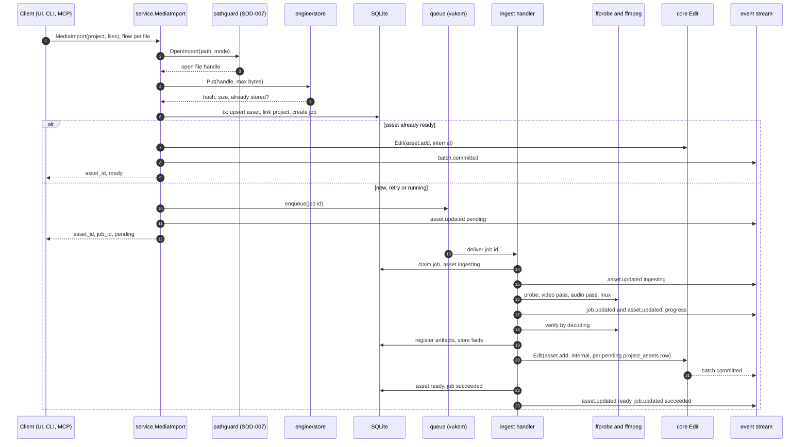

# SDD-011: Ingest, media store and transcription

- Status: Draft (2026-11-14)
- Depends on: SDD-000, SDD-001 (§3.2), SDD-002 (§A.9, §B.2), SDD-004 (§6, §7, §9, §10), SDD-005 (tables `assets`, `artifacts`, `project_assets`, `jobs`), SDD-007 (paths, FFmpeg arguments), ADR-0004, ADR-0008, ADR-0010, ADR-0011, ADR-0018, ADR-0020, ADR-0021
- Implements: RF-003, RF-004, RF-016 (analysis half), RF-033 (transcript half), RF-110, RF-204, RF-205, NFR-005
- Owner area: senior-b (render, ingest and media)

## Contents

1. Overview, packages and conventions
2. Import flow (`MediaImport`)
3. Probe
4. Ingest profiles
5. Verification by decoding
6. Artifact storage
7. The ingest job
8. FFmpeg discovery and encoder detection
9. Analysis for commands: silences, loudness, speech and beats
10. Transcription
11. Test fixtures
12. Acceptance
13. Decisions of this SDD and changes it required in other documents
14. The workspace asset library
15. The hand-off from an external motion engine

## 1. Overview, packages and conventions

### 1.1 Purpose

Everything a clip needs before it may enter a timeline, and everything the editor later reads about its media, is produced here: the content store, the probe, the normalized media (what the compositor and the mixer read), the proxy (what the browser plays), thumbnails, audio peaks, silence ranges, loudness and transcripts. The design goal is stated by ADR-0010: after ingest, no later step handles variable frame rate, rotation, mirroring, HDR, long GOPs or odd pixel shapes, and every number in SDD-001 §3.2 is a measurement of a file that exists, not an assumption.

### 1.2 Packages (ADR-0001 layout)

| Package | Holds |
| --- | --- |
| `engine/store` | content-addressed originals, artifact paths, atomic writes, garbage collection (sections 2, 6) |
| `engine/ffmpeg` | discovery, capability and encoder detection, ffprobe wrapper, runner on top of vukem `contrib/engine` (sections 3, 8) |
| `engine/ingest` | planning (pure functions), profiles, the ingest job handler, verification, analysis (sections 3 to 7, 9) |
| `engine/transcribe` | `Provider` interface, whisper.cpp provider, API provider, helper and model download, post-processing (section 10) |

The pure functions (`PlanVideo`, `NominalRate`, `ClassifyProbe`, `FilterChain`, `Postprocess`, `MSToFrames`, peak reduction) take plain values and return plain values, so they are tested without FFmpeg.

### 1.3 How processes are run

Every FFmpeg, ffprobe and whisper-cli execution goes through `contrib/engine`:

- One `engine.Tool` per binary, built at discovery (section 8) with `MaxOutput` 4 MiB for ffmpeg (silence analysis prints one line per silence on stderr) and 256 KiB for whisper-cli.
- `Tool.RunStream(ctx, dir, w, args...)` for runs that report progress. FFmpeg gets `-progress pipe:1`, so `w` receives `key=value` lines (`frame`, `out_time_us`, `progress`) live; whisper-cli gets a writer that parses its stdout (section 10.2). `Tool.Run` is used for short runs whose stdout or stderr is the result (ffprobe, `ebur128`, `silencedetect`).
- `dir` is the per-job work directory `tmp/<job id>/` (SDD-000 §9, SDD-007 §6.4: one directory per running child process), which `contrib/engine` makes the child's cwd, HOME and temporary directory. Output names are built with `engine.Sanitized(dir, name)`. Outputs are written there and published into `artifacts/<sha256>/` with `os.Rename` (section 6.2).
- `contrib/engine` gives the child a minimal environment and kills the whole process tree on cancellation. Its default 5 minute timeout applies only when the context has no deadline; the ingest handler always sets one (section 7.5).
- `-threads` is never put in the arguments by `contrib/engine`. Decoders use FFmpeg's automatic thread count; when `Tool.CPUCount()` is below the machine's logical CPU count (a container quota), the runner adds `-threads <CPUCount>` before the `-i`. Two counts are fixed instead, because they change bytes: the filter graph runs on one thread (`-filter_complex_threads 1` for the ingest graph, `-filter_threads 1` for a `-vf` chain), since swscale and zscale cut a frame in slices by thread count; and the `mpeg4` encoder of the normalized file runs with `-threads 1` (`NormalizedThreads`), since it encodes one slice per thread, and with `-dct int`, since the automatic DCT picks a SIMD version by CPU that is not bit-exact (the decoder and the `accurate_rnd+full_chroma_int` scaler of the export are bit-exact without help). With a count taken from the machine the normalized file, and every frame composed from it, differed between a 16-CPU and a 4-CPU host (NFR-010).
- **CPU tiers (NFR-010).** The bytes FFmpeg writes must not depend on the CPU of the machine. Measured on the pinned build (n9.0.2-39, Windows x86-64, a Zen 3 CPU with AVX2): the mpeg4 and ProRes 4444 normalize encodes, with the scale of the plan (1280x720 to 640x360, `bicubic+accurate_rnd`), give the same bytes under every tier from SSE2 to AVX2 (`-cpuflags` clearing AVX2, AVX, SSE4, SSSE3), and different bytes under plain C (`-cpuflags 0`, 3 to 4 times slower: 0.5 s against 1.6 to 2.2 s for 3 s of 1080p), so a SIMD path of swscale is not bit-exact with the C code and an AVX-512 path, which no test machine had, could differ from the AVX2 one as well. Without scaling (a 180x320 clip kept at its size) all tiers including C are equal. The normalized bytes of the golden fixture differed on a CI runner with AVX-512 (an AMD EPYC 9V74) from those of a Zen 3 machine, with the same generated clip, the same thread counts (1, 2, 4 and 8 decoder threads give the same bytes) and the same pinned binary. `ffargs` therefore adds `-cpuflags -avx512-avx512icl` to every `ffmpeg` run on x86-64 (SDD-007 FF-01): the AVX-512 code goes unused (it is absent from the pipelines measured here and costs nothing on a machine without it), and every x86-64 machine runs a tier shown equal. A machine on another architecture is not touched. This is a mask, not a proof: the first CI run with the mask shows whether the runners with AVX-512 now agree.
- Every FFmpeg and ffprobe command line built by `engine/ingest` starts with `-nostdin -hide_banner` (ffprobe: `-hide_banner`), adds `-v error` (the commands whose result is read from stderr, `silencedetect` and `ebur128`, keep the default log level and add `-nostats` instead) and carries `-protocol_whitelist file,pipe` (ffprobe: `file`) before its first `-i` that opens a file (ADR-0011 item 1, ADR-0020 item 7). The only input paths are the original in `store/`, files in the job's work directory and artifacts of the same asset. A unit test builds every command of this SDD and fails when one lacks the whitelist or names a path elsewhere.
- The commands of this SDD are shown in reading form. `engine/ffmpeg/ffargs` builds them and `ffargs.Check` runs on the result (SDD-007 §6.2, §6.3), so the argument lists that start differ from the listings in these ways: `-n -max_alloc 1073741824` replace `-y` (a job runs in a fresh directory, so nothing needs overwriting); every file input carries `-protocol_whitelist file,pipe -format_whitelist <demuxers> -sn -dn` before `-i`; every input and output path has the `file:` prefix; every output carries `-map_metadata -1 -map_chapters -1` and an explicit `-f`; ffprobe has no `-nostdin` and takes `-protocol_whitelist file -format_whitelist <demuxers> -probesize 33554432 -analyzeduration 20000000`. The runner kills a run that shows no advance of `-progress` for 120 s.

### 1.4 Measurement basis

Numbers marked "measured" in this document come from these runs, all on 2026-11-14:

- FFmpeg and ffprobe: the pinned LGPL build of `.config/ffmpeg.env`, BtbN `n9.0.2-39-g7adfbe40dc-20261031` (monthly tag `autobuild-2026-10-31-12-59`, chosen by P1-REL-006 because BtbN prunes the daily builds; the spike `spikes/export-pipeline` used the daily `n9.0.2-57-gd838f9f9ae-20261114` of the same 9.0.2 release), whose configure line has `--enable-version3` and neither `--enable-gpl` nor `--enable-nonfree`. Its encoders, filters and muxers were confirmed on 2026-11-14 with `ffmpeg -encoders`, `-filters` and `-muxers`, and every one in the table below was also run in a command of this SDD. The PATH build (`9.0.2-full_build-www.gyan.dev`, GPL) was used only to create two throwaway source files that a phone would produce (a 60 s HEVC clip and a 4K HEVC clip); it never appears in a product command.
- Machine: AMD Ryzen 7 5700X3D (8 cores, 16 threads), Windows 11, the machine of the other spikes. **The machine was shared with other work during these runs.** The same 60 s pass took 11.5 s and 12.0 s when idle and 53.5 s and 79.9 s when the CPU was 76 to 90% busy. Only idle numbers are quoted as measurements, and the NFR-005 benchmark (section 12) records the CPU load before it starts and refuses to report a pass above 20%.
- Browser check: Chrome 157.0.8103.78 (headless) loaded the proxy of 4.4 and seeked in it (section 4.4).
- Whisper: the `v1.9.2` helper and the models of `spikes/whisper-local`; the SHA-256 values of section 10.2 were computed on those files on 2026-11-14 and compared with the `X-Linked-ETag` and GitHub `digest` values.

Encoders, filters and muxers this SDD relies on, all present in the pinned build (listing on 2026-11-14, and executed in the commands below), and the two the spike README had already confirmed:

| Kind | Names |
| --- | --- |
| video encoders | `mpeg4`, `libvpx-vp9`, `mjpeg`, `png`; `libopenh264`, `h264_nvenc`, `h264_mf` (spike README: they encode; `h264_qsv` and `h264_amf` are present and failed for lack of hardware) |
| audio encoders | `pcm_s16le`, `aac`, `flac` (used only by the API provider) |
| video filters | `setpts`, `fps`, `scale`, `split`, `format`, `setsar`, `zscale`, `tonemap` (spike README: present), `bwdif`, `yadif` |
| audio filters | `aresample`, `aformat`, `adelay`, `apad`, `atrim`, `asetpts`, `asplit`, `silencedetect`, `ebur128` |
| muxers | `mov`, `mp4`, `wav`, `image2`, `null` |
| absent (GPL) | `eq`, `boxblur` (spike README), `libx264`, `libx265` (the configure line has `--disable-libx264 --disable-libx265`); none is used |

### 1.5 Constants and versions

Every tunable number of this SDD is a named Go constant in `engine/ingest/profiles.go` (or `engine/transcribe`), listed here once. "Confirmed by" names the test of section 12 that fails when the value is wrong for the fixtures.

| Constant | Initial value | Meaning | Confirmed by |
| --- | --- | --- | --- |
| `ProfileProbe`, `ProfileNormalized`, `ProfileProxy`, `ProfileThumbnails`, `ProfilePeaks`, `ProfileSilence`, `ProfileLoudness`, `ProfileTranscript` | 1 each | profile versions in artifact names (section 6) | A-3, A-21 |
| `MaxEdge` | 3840 | longest edge of normalized video and images | A-6 |
| `MaxSourceEdge` | 8192 | a source with a side above this is refused (`E_LIMIT_EXCEEDED`, `details.limit: "source_edge"`, no `variable`); a fixed constant. The frame area is limited separately by `STUARTY_MAX_IMPORT_PIXELS` (default 33,177,600, SDD-000 §10; `details.limit: "import_pixels"`). The limit names are those of SDD-007 §9 | A-9 |
| `MaxAssetDuration` | 4 h | the default of `STUARTY_MAX_IMPORT_SECONDS` (14400, SDD-000 §10): longer files are refused (`E_LIMIT_EXCEEDED`, `details.limit: "import_seconds"`) | A-9 |
| `MaxTranscribeDuration` | 2 h | the default of `STUARTY_MAX_TRANSCRIBE_SECONDS` (7200, SDD-000 §10): longer audio is refused by a `transcribe` job (`E_LIMIT_EXCEEDED`, `details.limit: "transcribe_seconds"`) | A-18 |
| `MaxFPS` | 60 | cap of the nominal frame rate | A-4 |
| `NormalizedQScale` | 2 | `-q:v` of the `mpeg4` encoder | A-6, A-22 |
| `ProxyShortEdge` | 540 | short edge of the proxy | A-6 |
| `ProxyCRF` | 33 | libvpx-vp9 constant quality | A-6 |
| `GOP(fps)` | `ceil(fps / 2)` frames | keyframe interval of normalized media and proxy | A-6 |
| `ThumbHeight`, `ThumbMaxCount`, `ThumbColumns` | 128, 400, 20 | thumbnail layout (4.5) | A-7 |
| `PeakLevels` | 128, 512, 2048, 8192, 32768 samples per peak | zoom levels (4.6) | A-8 |
| `SilenceThresholdsDB`, `SilenceMinMS` | -30, -35, -40, -45; 150 | silence artifact (section 9) | A-15 |
| `ProgressWeights` | section 7.4 | share of each step in job progress | A-22 |
| `MaxQueuedIngests` | 50 | queue length (7.6), the only fixed constant of concurrency. The concurrent runs are the variables `STUARTY_MAX_INGESTS` and `STUARTY_MAX_TRANSCRIBES` (defaults 2 and 1, SDD-000 §10), not constants | A-19 |
| `PauseMinMS`, `PauseNoiseDB`, `TailPadMS`, `MinWordMS`, `DegenerateMS` | 300, -35, 120, 100, 20 | word timing post-processing (10.4) | A-17 |

## 2. Import flow (`MediaImport`)

### 2.1 Interface to SDD-007

SDD-007 owns the security detail. This SDD uses exactly this interface:

```go
package pathguard // SDD-007

// OpenImport resolves path (symbolic links, "..", Windows UNC and drive forms), requires a regular
// file, enforces STUARTY_IMPORT_ROOTS in network mode (any readable file in local mode), and
// returns the file opened for reading. All later steps use the returned handle, never the path again.
// Errors: E_PATH_NOT_ALLOWED (outside the roots or not a regular file), E_FILE_NOT_FOUND (missing or unreadable).
func (g *Guard) OpenImport(path string, mode Mode) (*os.File, error)
```

Using the handle removes the window between the check and the copy: the file that was checked is the file that is copied.

### 2.2 Service contract

`MediaImport` is specified in SDD-003 §2.6 (`MediaImportRequest`, `MediaImportResult`, `ImportedAsset`), and its HTTP, CLI and MCP forms in SDD-003 §4 to §6. The call takes 1 to 50 files and answers one entry per file, in order; a mixed batch is HTTP 200. SDD-003 holds the contract; if the two differ, SDD-003 wins and this section is corrected. This SDD does not define its own arguments or result.

Section 2.3 is the flow the service runs for **each file** of the call, independently of the others. A refusal never undoes the other files: the call reports `imported` and `failed` counts (SDD-003 §2.6), and the CLI exits 1 when `failed` is above 0 while the ready files stay imported. The per-file entry is the SDD-003 `ImportedAsset`; the fields this flow fills are `asset_id` (the project's `ast_` identifier, `project_assets.asset_id`; the same for every import of the same bytes into this project), `name` (base name of the path, NFC-normalised, control characters replaced by `_`, at most 200 characters, SDD-007 §7; untrusted text), `job_id` (empty when no ingest is needed because the asset is already ready), `state` (`pending`, `ingesting`, `ready` or `failed`), `progress`, `deduplicated` (the hash was already in the store) and, for a refused file, `error` (with `name`). The hash (`"sha256:" + 64 hex`) is internal to the flow and is not part of the entry.

Scope `media`. The call is synchronous up to the end of the copy of the last file (or up to `wait_ms`, SDD-003) (a 67 MB clip took 0.09 s in a measurement of hash and copy together; 8 GiB is bound by the disk, expected 10 to 40 s), and asynchronous from then on. **Decision of this SDD (DS-6):** the copy is not deferred to the job, because the identity of the stored file is its hash (SDD-005 §5.5, `assets` keyed by hash) and the caller needs the asset identifier in the response.

Identity has two levels (SDD-005 §5.5, SDD-001 §3.2). `assets` has one row per original file, keyed by the hash (`assets.id = "sha256:" + 64 hex`), and `project_assets` maps a project's own `ast_` identifier to that hash. Two projects that import the same bytes get two different `ast_` identifiers and share one `assets` row, one store file, one set of artifacts and one ingest job. Importing the same bytes twice into the same project returns the same `ast_` identifier.

### 2.3 Steps

1. **Authorize.** Scope `media`; the project exists and is not trashed (`E_NOT_FOUND`).
2. **Open.** `OpenImport` (errors above).
3. **Size.** `Stat` on the handle. A size of 0 returns `E_UNSUPPORTED_MEDIA` (`reason: "empty_file"`). A size above `STUARTY_MAX_IMPORT_BYTES` returns `E_LIMIT_EXCEEDED` (`details: {limit: "import_bytes", value, ceiling, variable: "STUARTY_MAX_IMPORT_BYTES"}`, SDD-007 §9) before a byte is copied. Free space on the workspace volume must exceed `size + STUARTY_MIN_FREE_BYTES` (2 GiB, SDD-007 §7), else `E_LIMIT_EXCEEDED` (`details.reason: "disk_low"`).
4. **Hash and copy.** `store.Put(r io.Reader, max int64)` streams the handle through SHA-256 into `store/.incoming/<random>` on the same volume as `store/`, counting bytes: it aborts with `E_LIMIT_EXCEEDED` if the count passes `max` (a file growing during the copy). At the end: `fsync` the file; if `store/<first 2 hex>/<sha256>` exists, delete the temporary file (de-duplication; the existing file's size must equal the copied size, else `E_INTERNAL`); otherwise rename the temporary file to that name and mark it read-only (mode 0400, owner read only; on Windows the read-only attribute, inside the user-only workspace), then `fsync` the directory where the platform allows it. The original is never modified afterwards (ADR-0010 item 4). The same rule covers every published artifact (6.2): a file that is never rewritten is created `0400`; everything else this SDD writes (work directory files, `.part` files, caches) is `0600` (SDD-007 §7).
5. **Database, one transaction (SDD-005).**
   - Look up `assets` by hash (`assets.id`). Absent: insert a row with `kind` NULL until the probe classifies it, `original_name` (the first name seen), `size_bytes`, `ingest_state = pending`. Present with `ingest_state = failed`: set it to `pending` and clear `ingest_error` (a retry). Present otherwise: leave it.
   - Insert or find the `project_assets` row for `(project, asset hash)`. A new row gets a new `ast_` identifier (generated from a cryptographic source, here, when the row is inserted), `state = pending`, `name` (the base name of the path), `imported_by` the actor and `imported_ms`. An existing row keeps its `ast_` identifier; if it is `trashed`, it is restored (importing again is the user's request).
   - Job: if the asset's `ingest_state` is `pending` and no ingest job is active for it, insert a job (`kind = ingest`, `state = queued`, `asset_hash` set, `actor` the caller, input `{"asset_hash", "reason": "import"}`). The partial unique index of SDD-005 on the asset hash (`jobs (asset_hash)` where the kind is `ingest` and the state is `queued` or `running`) guarantees one active job per asset, however many projects hold it. If a job is already active (`pending` or `ingesting` asset), return its identifier. If the asset is `ready`, create no job.
6. **After commit.** Enqueue the job identifier (ADR-0018 item 3). Publish `asset.updated {asset_id, state, progress}` on the stream of the importing project, with that project's `asset_id`.
7. **Already ready.** When the asset is `ready` and the project's `project_assets` row is still `pending`, the service issues `asset.add` at once (section 2.5) with the facts stored in the `assets` row, and returns `state = "ready"`.
8. **Return** the per-file entry (2.2).

### 2.4 Sequence



### 2.5 `asset.add` when ingest succeeds

After verification (section 5) and the registration of the artifacts, for every `project_assets` row of the asset in state `pending` (imported, not yet added to its project's document), the handler calls the service's internal `Edit` with the single operation `asset.add` (SDD-002 §B.2, scope `media`, `internal: true`) with that row's `asset_id` and `name`, actor `imported_by` of that row, idempotency key `ingest.<job id>.<project id>` (the allowed characters of a key are `[A-Za-z0-9._~-]`; a colon is not allowed). After the commit of that `Edit` the row is `active`. The payload of one row:

```json
{"op": "asset.add", "args": {"asset": {
  "id": "ast_3c5v8n2w6d",
  "hash": "sha256:9f86d081884c7d659a2feaa0c55ad015a3bf4f1b2b0b822cd15d6c15b0f00a08",
  "kind": "video",
  "name": "IMG_0421.MOV",
  "frame_rate": {"num": 30, "den": 1},
  "frame_count": 1800,
  "sample_count": 2880000,
  "width": 1080,
  "height": 1920,
  "has_audio": true
}}}
```

The values are the **measurements of section 4.9**, not copies of the probe. (SDD-002 §A.9 says "with the facts from the probe"; this SDD narrows that to "from the verified normalized media". See section 13.) The commit produces `batch.committed` on that project's stream. If `Edit` fails (for example `E_LIMIT` with 200 assets in the document), the asset still becomes `ready` in the `assets` table, that row stays `pending`, and the job result carries the error for that project in `warnings`; the user can add it later with the same call.

### 2.6 States and events

| Asset `ingest_state` | Entered when | Event |
| --- | --- | --- |
| `pending` | row inserted, or a failed asset re-imported | `asset.updated {state: "pending", progress: 0}` |
| `ingesting` | the handler claimed the job | `asset.updated {state: "ingesting", progress}` on every progress change (at most 4 per second) |
| `ready` | artifacts verified and registered, facts stored | `asset.updated {state: "ready", progress: 1}` |
| `failed` | any error, or cancellation | `asset.updated {state: "failed"}`; the `assets` row keeps the typed error `{code, message, hint, details}` in `ingest_error` |

The state belongs to the `assets` row (one per hash), so every `asset.updated` event is published on the stream of each project that has a `project_assets` row for the asset, carrying that project's own `asset_id`. Progress is stored in `ingest_progress`.

Job states map as follows: `queued` with `pending`; `running` with `ingesting`; `succeeded` with `ready`; `failed` and `cancelled` with `failed` (a cancelled job stores `E_CANCELLED` as the asset's error). `job.updated` is published for every job change. An ingest job belongs to the asset, not to a project, so its `project_id` is null in the job object (SDD-003 §2.8) and `job.updated` is published on the stream of every project that has a `project_assets` row for the asset, like `asset.updated` (SDD-005 §14.3, SDD-006). A failed asset keeps its original in the store, so a retry (importing the same file again) skips the copy and runs a new job. `E_ASSET_NOT_READY` is returned by operations that need artifacts of an asset whose state is not `ready` (for example `JobStart` with kind `transcribe`); `MediaInspect` on such an asset returns its state and progress instead of an error.

### 2.7 Errors of the import call

Each is the `error` of the entry of the refused file (SDD-003 §2.6); the other files of the call are unaffected.

| Code | Case |
| --- | --- |
| `E_PATH_NOT_ALLOWED`, `E_FILE_NOT_FOUND` | from `OpenImport` |
| `E_LIMIT_EXCEEDED` | file above `STUARTY_MAX_IMPORT_BYTES` (`details.limit: "import_bytes"`), or not enough free disk (`details.reason: "disk_low"`) |
| `E_UNSUPPORTED_MEDIA` | empty file |
| `E_QUEUE_FULL` | more than `MaxQueuedIngests` ingest jobs are queued; `details.running` lists them |

Probe-level and decode-level errors surface later, on the job and on the asset (section 5.3).

## 3. Probe

### 3.1 Commands

Two ffprobe runs, in parallel, against the stored original (`store/ab/<sha256>`):

```text
ffprobe -v error -hide_banner -protocol_whitelist file -print_format json -show_format -show_streams -i <original>
ffprobe -v error -protocol_whitelist file -select_streams <video index> -show_entries packet=pts_time,dts_time -of csv=p=0 -i <original>
```

The second run lists the timestamp of every video packet. It does not decode: it took 0.29 s for 1,800 packets and the full JSON run took 0.28 s on the 60 s fixture. It is skipped for images and audio. Two more runs happen only when needed:

```text
# images and any stream whose frame carries orientation: the display matrix of an image is frame side data, not stream side data
ffprobe -v error -protocol_whitelist file -select_streams <index> -show_frames -read_intervals "%+#1" -show_entries frame=side_data_list -print_format json -i <original>
# still-image containers: is the file animated, and what are the frame delays? One line per packet, at most 1001 (the ceiling of 1000 frames and one to see it passed)
ffprobe -v error -protocol_whitelist file -select_streams <index> -read_intervals "%+#1001" -show_entries packet=pts_time,duration_time -of csv=p=0 -i <original>
```

Each option: `-v error` keeps stderr to real problems; `-print_format json` is the stable output; `-show_format -show_streams` gives container and streams; `-select_streams <index>` takes the absolute stream index, so a file with several video streams is read for the one chosen; `-show_entries packet=...` with `-of csv=p=0` is the smallest output that carries timestamps; `-read_intervals "%+#1"` stops after the first frame; `-protocol_whitelist file` keeps ffprobe from opening anything but the file.

Measured facts that shape the rest of this section (all on the pinned build):

- `r_frame_rate` of the cover-art stream of an MP3 is `90000/1` and its `avg_frame_rate` is `0/0`; for a VFR screen recording it was `60/1` against an average of `3200/99` (32.3). Neither value can be used as the frame rate without a check.
- `ffprobe` reports only a `rotation` for a display matrix. A pure horizontal flip is reported as `rotation: -180`, and rotation 90 combined with a flip as `rotation: 90`, so the flip is invisible in that field. The raw matrix (`displaymatrix` text) is the only complete source.
- An image's EXIF orientation shows as frame side data of type `3x3 displaymatrix` (stream side data type is `Display Matrix`), and `width` and `height` of the stream are the stored size.
- Packet timestamps come out of order for files with B-frames (`0.000000`, `0.166667`, `0.100000`), so they are sorted before use.

### 3.2 Probe summary

The summary is stored as the `probe` artifact (`probe-1.json`) next to the raw ffprobe JSON (with `format.filename` replaced by an empty string: a server path never leaves the process). As written by `engine/ingest`, `probe-1.json` is `{"summary": <the summary>, "ffprobe": <the raw JSON>}`.

```json
{
  "version": 1,
  "kind": "video",
  "container": "mov,mp4,m4a,3gp,3g2,mj2",
  "size_bytes": 67141289,
  "duration_ms": 60000,
  "video": {
    "stream_index": 0, "codec": "hevc", "profile": "Main",
    "coded_width": 1080, "coded_height": 1920,
    "matrix": [[1, 0], [0, 1]], "swap_dimensions": false, "mirrored": false,
    "sar": {"num": 1, "den": 1},
    "display_width": 1080, "display_height": 1920,
    "pix_fmt": "yuv420p", "bit_depth": 8, "field_order": "progressive",
    "color_range": "tv", "color_space": "bt709", "color_transfer": "bt709", "color_primaries": "bt709",
    "hdr": "none", "dolby_vision_profile": null,
    "r_frame_rate": "30/1", "avg_frame_rate": "30/1",
    "measured_fps": 29.99999, "nominal_fps": {"num": 30, "den": 1}, "vfr": false,
    "packet_count": 1800, "start_time_ms": 0
  },
  "audio": {"stream_index": 1, "codec": "aac", "sample_rate": 44100, "channels": 2, "start_time_ms": 0, "offset_samples": 0},
  "ignored_streams": [{"index": 2, "codec_type": "data", "reason": "data"}],
  "warnings": [],
  "tags": {"title": {"value": "...", "truncated": false}}
}
```

Rules:

- `matrix` is `[[a, b], [c, d]]`, the upper-left 2 by 2 of the display matrix with each entry divided by 65536 and rounded to an integer in {-1, 0, 1}; identity when absent. `swap_dimensions = (a == 0 and d == 0)`. `mirrored = (a*d - b*c) < 0`. Checked on the pinned build: the matrix of rotation 90 plus horizontal flip (`[[0, -1], [-1, 0]]`) gives `swap_dimensions: true`, `mirrored: true` and FFmpeg's automatic rotation produced exactly the frames of `transpose=3`; a pure horizontal flip (`[[-1, 0], [0, 1]]`) produced exactly the frames of `hflip`. FFmpeg applies the matrix by itself (`-autorotate` is on by default), so the ingest commands contain no `transpose`, `hflip` or `vflip`; the probe needs the matrix only to know the final dimensions and to show them in `MediaInspect` before ingest ends.
- `display_width` and `display_height`: from the coded size, first make pixels square (if `sar.num > sar.den`, `w = round(w * sar.num / sar.den)`; if `sar.num < sar.den`, `h = round(h * sar.den / sar.num)`; `0:1` means 1:1), then swap when `swap_dimensions`.
- `hdr`: `"hlg"` when `color_transfer` is `arib-std-b67`, `"pq"` when it is `smpte2084`, else `"none"`. `dolby_vision_profile` is read from the stream side data `DOVI configuration record` (`dv_profile`).
- `interlaced` is true when `field_order` is `tt`, `bb`, `tb` or `bt`.
- `bit_depth`: `bits_per_raw_sample` or the depth implied by `pix_fmt`.
- `tags`: only `title`, `artist`, `comment`, `description`, `creation_time`, `location`, `encoder`, `handler_name` (a closed set of 8 keys, so a file cannot choose them, inside the budget of SDD-007 §8.3), at most 200 characters each, control characters removed (section 10.7). Keys match ignoring case and are stored in lower case. The container tags (`format.tags`) are read first, then the streams in index order; the first non-empty value of a key wins. They are untrusted text.
- `ignored_streams` records every stream not used and why (`data`, `subtitle`, `attachment`, `attached_picture`, `extra_video`, `extra_audio`), so `MediaInspect` can say "3 audio streams, using #1".

### 3.3 Nominal frame rate

The nominal rate is what the capture device was doing, not what a container field claims. It is computed by the pure function `NominalRate(pts []float64, r, a Rational) (Rational, []string)`:

1. Sort the packet timestamps ascending, drop `N/A`. Deltas `d_i = pts[i+1] - pts[i]`, keeping those greater than 0.
2. With at least 10 deltas: `med` is their median; the regular set is `{d : 0.6 * med <= d <= 1.4 * med}`; `v = 1 / mean(regular set)`. The mean over the regular set (not the median alone) is what makes millisecond-quantized timestamps (16 and 17 ms alternating in WebM) come out as 60.0 and not 58.8. With fewer than 10 deltas: `v = r_frame_rate` if it lies in [1, 120], else `avg_frame_rate`, else 30 with the warning `frame_rate_unknown`.
3. A measured `v` above 240 is refused before this step (3.4). While `v > MaxFPS`, `v = v / 2` (so 120 becomes 60 and 240 becomes 60: whole frames are dropped, never invented). The comparison is `v > MaxFPS * 1.005`: a 60 fps source whose timestamps are rounded to milliseconds measures 60.0003, and halving that to 30 would drop half of its frames.
4. Snap: `i = max(1, round(v))`. If `i` is one of 12, 15, 24, 30, 48, 60, 120 and `|v - i * 1000 / 1001| < |v - i|`, the result is `i * 1000 / 1001` (written `(i * 1000) / 1001`); otherwise `i / 1`. If `|v - result| / result` is above 2%, add the warning `irregular_frame_rate`.
5. `vfr` is true when `avg_frame_rate` differs from `r_frame_rate` by more than 2%, or when more than 1% of the deltas lie outside the regular set. It is informational.

Why not `avg_frame_rate`: for the VFR fixture the average is 32.3 while the capture ran at 60; using the average would drop motion. Why not `r_frame_rate`: it is a container guess and is 90000 for cover art. The median-based measure gave 60.0 on that VFR fixture (a 10 s file with 40 to 50% of the frames dropped in bursts), 29.97003 for a 30000/1001 file and 30.0 for the 60 s HEVC fixture.

Initial values and their test (A-4): the table below is a unit test of `NominalRate`.

| Input | Result |
| --- | --- |
| 1,800 packets at 1/30 s | `30/1` |
| 150 packets at 1001/30000 s | `30000/1001` |
| 23.976 fps | `24000/1001` |
| the VFR fixture (60 nominal, 32.3 average) | `60/1` |
| 60 fps with timestamps rounded to milliseconds (16, 17, 17, 16 ...) | `60/1` |
| 120 fps | `60/1` |
| 119.88 fps | `60000/1001` |
| 25 fps | `25/1` |
| fewer than 10 packets, `r_frame_rate = 30/1` | `30/1` |
| fewer than 10 packets, `r_frame_rate = 90000/1`, `avg = 24/1` | `24/1` |

### 3.4 Classification

`ClassifyProbe(summary) (Kind, *Error)` applies the first matching row. A stream is an *attached picture* when `disposition.attached_pic = 1`.

| # | Condition | Result |
| --- | --- | --- |
| 1 | ffprobe exits non-zero, or `streams` is empty | `E_UNSUPPORTED_MEDIA`, `reason: unrecognized_format` |
| 2 | `format_name` is one of `image2`, `png_pipe`, `jpeg_pipe`, `webp_pipe`, `bmp_pipe`, `tiff_pipe`, `jpegxl_pipe`, `gif`, `apng`, with exactly one video stream and `nb_read_packets = 1` | kind `image`, stream = that one |
| 3 | same formats (and `webp_anim`) with more than one packet | kind `image`, animated (RF-028; 4.7): the packet count is the frame count and the packet durations are the frame delays. More than 1,000 packets, or more than `MaxAnimPixels` (134,217,728) pixels summed over all frames, is `E_LIMIT_EXCEEDED` (`anim_frames`, `anim_pixels`), decided from the packet list and the stream size before any frame is decoded (T-17) |
| 4 | at least one video stream that is not an attached picture | kind `video`. If several, the one with the most pixels (coded size), ties to the lowest index. The others are `extra_video` |
| 5 | no such video stream and at least one audio stream | kind `audio`. Attached pictures (cover art) are ignored, listed as `attached_picture` |
| 6 | only attached pictures, subtitles, data or attachments | `E_UNSUPPORTED_MEDIA`, `reason: no_usable_stream` |

Additional rules after classification:

| Rule | Result |
| --- | --- |
| audio stream choice (kinds `video` and `audio`): the stream with `disposition.default = 1`, else the lowest index, among streams with `channels > 0` and `sample_rate > 0`. The others are `extra_audio`; they are not mixed | **Decision of this SDD (DS-15)** |
| a video stream with zero packets | `E_UNSUPPORTED_MEDIA`, `reason: no_frames` |
| kind `audio` with a duration of 0 | `E_UNSUPPORTED_MEDIA`, `reason: empty_audio` |
| `max(coded_width, coded_height) > MaxSourceEdge`, `coded_width * coded_height` above `STUARTY_MAX_IMPORT_PIXELS`, or duration above `STUARTY_MAX_IMPORT_SECONDS` | `E_LIMIT_EXCEEDED`, `details.limit` is `source_edge` (no `variable`), `import_pixels` or `import_seconds`, with `value`, `ceiling` and, for the two that have one, `variable` (SDD-007 §9) |
| the measured rate of 3.3 step 2, before any halving, above 240 frames per second (SDD-007 §9, FF-06) | `E_UNSUPPORTED_MEDIA`, `reason: frame_rate_too_high`, `details.fps` |
| more than 16 streams in the container, of any kind (SDD-007 §9, FF-06) | `E_UNSUPPORTED_MEDIA`, `reason: too_many_streams`, `details.streams` |
| `dolby_vision_profile = 5` (no HDR10 or HLG base layer, decoders show green and purple) | `E_UNSUPPORTED_MEDIA`, `reason: dolby_vision_profile_5`, hint "export an HDR10, HLG or SDR version from the device" |
| `hdr` is `hlg` or `pq` and the capability list (section 8) lacks `zscale` or `tonemap` | `E_UNSUPPORTED_MEDIA`, `reason: hdr_needs_zscale` |
| the codec has no decoder in this FFmpeg (capability list) | `E_UNSUPPORTED_MEDIA`, `reason: decoder_missing`, `details.codec` |

Data streams (for example the iPhone's `mebx` metadata track or `tmcd` timecode) and subtitle streams are ignored without comment. A file with a video stream and an audio stream whose audio cannot be decoded fails later with `audio_decode_failed` (section 5.3): silently dropping audio is the failure FreeCut shipped (post-mortems §5), so it is not done.

## 4. Ingest profiles

### 4.1 Conventions

- Version numbers are in section 1.5 and in file names (section 6). A profile changes only by a new version.
- Every FFmpeg output carries `-fflags +bitexact -flags +bitexact`: no encoder tag, no creation time, so two runs of the same plan with the same FFmpeg build give the same bytes. Verified on 2026-11-14: two runs of the normalized-video command produced files with equal SHA-256.
- Plans are computed by pure functions from the probe summary and the capability list, and are stored in the job result (`plan`), so a failed ingest can be reproduced.
- Geometry arithmetic (`even(x) = max(2, 2 * round(x / 2))`):
  - `W, H` (normalized size): start from `display_width, display_height`; `f = min(1, MaxEdge / max(display_width, display_height))`; `W = even(display_width * f)`, `H = even(display_height * f)`. Never upscaled.
  - Proxy size `PW, PH`: `short = min(W, H)`; if `short > ProxyShortEdge`, `g = ProxyShortEdge / short`, `PW = even(W * g)`, `PH = even(H * g)`; else the proxy has the size of the normalized media.
- Frame rate `fps = num / den` (section 3.3); `G = ceil(num / (2 * den))` frames, a keyframe every half second: 15 at 30 and 29.97, 12 at 24, 13 at 25, 30 at 60.
- Track timescale `T = num` when `den = 1001`, else `num * 1000`: 30000 for 30 and for 30000/1001, 24000 for 24, 60000 for 60. It makes every frame duration an exact integer number of ticks (1000 for 30 fps, 1001 for 30000/1001), so no rounding creeps into the timestamps.

### 4.2 Choice of codecs

Candidates were encoded from the same 5 s source (150 frames at 1080×1920, 30 fps, a detailed animation, 60 fps source), then decoded to `null` and compared with a lossless FFV1 version with the `ssim` filter (timestamps of both sides normalized with `setpts=N/30/TB`, because Matroska's millisecond timestamps otherwise pair frames wrongly). Sizes are for the 150 frames.

| Candidate | Settings | Size | Encode, including source decode | Decode | SSIM (all planes) |
| --- | --- | --- | --- | --- | --- |
| `mpeg4` (MPEG-4 Part 2) | `-q:v 2 -g 15 -bf 0` | 16.7 MB | 0.94 s | 0.35 s | 0.9972 |
| `mpeg4` | `-q:v 3` | 12.1 MB | not timed | not timed | 0.9953 |
| `mpeg4` | `-q:v 4` | 9.6 MB | 0.84 s | 0.41 s | 0.9928 |
| `mjpeg` | `-q:v 2` | 33.2 MB | 0.81 s | 1.22 s | 0.9975 |
| `ffv1` | `-g 1` | 55.8 MB | 1.11 s | 1.08 s | lossless |
| `libopenh264` | `-b:v 30M -g 15` (produced 20 Mbit/s) | 12.6 MB | 2.93 s | 0.37 s | 0.9972 |
| `libopenh264` | `-b:v 12M` | 5.9 MB | 2.85 s | 0.35 s | 0.9892 |
| `libvpx-vp9` | `-crf 20 -deadline realtime -cpu-used 5` | 11.1 MB | 3.50 s | 0.59 s | 0.9971 |

Seeking: an accurate seek plus decode of one frame (including process start) on the normalized file of the 60 s fixture took 0.37 s. The 60 s normalized file and the 60 s proxy each had a keyframe every 15 frames (119 gaps of exactly 15).

**Normalized media: `mpeg4` in a MOV file. Decision of this SDD (DS-1).**

| Criterion | `mpeg4` | `mjpeg` | `ffv1` | `libopenh264` | `libvpx-vp9` | hardware H.264 |
| --- | --- | --- | --- | --- | --- | --- |
| Present in every LGPL FFmpeg, including the build of ADR-0011 D-017 | built in | built in | built in | needs OpenH264 (Cisco binary at run time) | needs libvpx | machine dependent |
| Same bytes on every machine | yes | yes | yes | yes | mostly | no |
| Size at near-transparent quality | medium | 2 times `mpeg4` | 3.3 times `mpeg4` | small | small | small |
| Decode speed (it is read for every exported frame and every seek) | fastest | 3.5 times slower | 3 times slower | fast | fast | n/a |
| Seekability | GOP 15, P frames only | every frame | every frame | GOP | GOP | GOP |
| Quality at its settings | SSIM 0.997 | 0.9975 | lossless | 0.997 only at an effective 20 Mbit/s | 0.997 | varies |

`mpeg4` wins on availability, determinism and decode speed; its price is size (28.6 Mbit/s measured at 1080×1920, 30 fps, about 0.46 bit per pixel per frame; about 214 MB for the 60 s fixture, 3.2 times the 67 MB original). The quality setting `-q:v 2` is deliberate (ADR-0010: one extra generation, kept small): the final H.264 export at 8 Mbit/s loses more than this step does. `NormalizedQScale` is the one lever if disk use is a complaint; changing it is a new profile version.

Not measured here, and flagged in section 13: the patent position of MPEG-4 Part 2 (`licensing.md` does not cover it). It is an old codec (standardized in 1999), but whether its essential patents have expired everywhere was not checked, and the same holds for libvpx and VP9 (the research covers H.264, AAC, AV1 and HEVC only).

**Proxy: `libvpx-vp9` in an MP4 file with AAC audio. Decision of this SDD (DS-2).** Candidates were encoded from the 30 s normalized file (900 frames) to 540×960:

| Candidate | Settings | Encode (incl. source decode) | Size | SSIM |
| --- | --- | --- | --- | --- |
| `libvpx-vp9` | `-crf 33 -b:v 0 -deadline realtime -cpu-used 8 -row-mt 1 -tile-columns 1 -g 15` | 5.04 s (179 fps) | 7.7 MB | 0.9867 |
| `libvpx-vp9` | same with `-cpu-used 5` | 10.7 s | 7.1 MB | 0.9877 |
| `libvpx-vp9` | `-deadline good -cpu-used 5` | 42.0 s | 6.1 MB | not measured |
| `libopenh264` | `-b:v 3M -g 15` | 3.21 s | 9.2 MB | 0.9865 |
| `h264_nvenc` | `-b:v 3M -g 15 -bf 0` | 1.61 s | 11.3 MB | 0.9935 |
| `h264_mf` | `-b:v 3M -g 15` | 1.61 s | 11.2 MB | not measured |

Reasons for VP9: it plays in Chrome's `<video>` (verified on 2026-11-14: Chrome 157 reported `canPlayType('video/mp4; codecs="vp09.00.10.08, mp4a.40.2"')` as `probably`, loaded a 540×960 VP9+AAC MP4 with `loadedmetadata`, seeked to 10.0333 s and reached `readyState` 4 with no error); its software encoder is in every build that has libvpx and gives the same quality on every machine, so proxies do not depend on which H.264 encoder detection found (section 8), and ingest works on a server with no H.264 encoder at all; it avoids the H.264 patent exposure that ADR-0011 limits to the export path. Realtime speed 8 gives 179 fps at 540×960, 6 times real time, and quality equal to OpenH264 at a lower bitrate. Hardware H.264 is faster but varies per machine.

### 4.3 Normalized media of a video asset

Output: `artifacts/<sha>/normalized-1.mov`: one video stream (`mpeg4`, `yuv420p`, constant frame rate, tagged BT.709 limited), and, when the source has audio, one audio stream (`pcm_s16le`, 48 kHz, stereo, exactly the length of the video).

#### 4.3.1 Filter chain

Built by `FilterChain(plan)` as the comma-joined pieces below, in this order. Pieces that do not apply are omitted. Before the chain, FFmpeg itself inserts the display-matrix rotation and flip.

| # | Piece | Applies when | Why |
| --- | --- | --- | --- |
| 1 | `setpts=PTS-STARTPTS` | always | the first frame is time 0; the audio offset of 4.3.3 is relative to it |
| 2 | `bwdif=mode=send_frame:parity=auto:deint=interlaced` (`yadif` with the same options if `bwdif` is not in the capability list) | `interlaced` | progressive frames at the source frame rate. Both filters are present in the pinned build (`ffmpeg -filters`); both were run on 2026-11-14 |
| 3 | `fps=<num>/<den>:round=near` | always | constant frame rate equal to the nominal rate: frames are duplicated or dropped to the nearest slot. Run before the expensive steps so dropped frames are not processed |
| 4 | `scale=<W>:<H>:flags=bicubic+accurate_rnd,setsar=1` | `(W, H)` differs from the rotated coded size (cap, anamorphic pixels) | square pixels, even dimensions, at most `MaxEdge`. `accurate_rnd` is kept for this rare step; the cheaper flag set is used for the proxy |
| 5 | colour block, below | not already BT.709 limited 8-bit | explicit conversion to BT.709 limited |
| 6 | `format=yuv420p` | always | 8-bit 4:2:0 |
| 7 | `setparams=colorspace=bt709:color_primaries=bt709:color_trc=bt709:range=tv` | the colour block is empty (the stream already is the target) or is the scale-only conversion | FFmpeg writes the colour tags of an encoder from the frames: with `-colorspace` and the other output options alone, an untagged source gave `unknown` tags in the MOV (measured on the pinned build, 1080p, 2026-11-14). The `zscale` paths set the properties themselves |

**Colour block.** Let `M, P, T` be the stream's matrix, primaries and transfer, with `unknown` replaced by assumed values: matrix and primaries `bt709` when the coded height is 720 or more, else `smpte170m`; transfer `bt709` (the BT.709 and SMPTE 170M curves are the same function). Let `R` be `pc` when `pix_fmt` starts with `yuvj` or `color_range` is `pc`, else `tv`.

| Case | Chain | Notes |
| --- | --- | --- |
| SDR, `pix_fmt = yuv420p`, `(M, P, T, R)` after assumption is `(bt709, bt709, bt709, tv)` | none | the stream is already the target; the tags written by the encoder are exact |
| SDR, anything else | `zscale=min=<M>:pin=<P>:tin=<T>:rin=<R>:m=709:p=709:t=709:r=limited:d=ordered` | `d=ordered` dithers when depth drops from 10 to 8 bits. The input properties are always given: on the pinned build a source without transfer and primaries tags made `zscale` fail with `code 3074: no path between colorspaces`, and the fixture from the old Studio (`yuvj420p`, full range, matrix `smpte170m`, no other tags) needed `tin` and `pin` |
| HLG or PQ (`T` is `arib-std-b67` or `smpte2084`) | `zscale=min=<M>:pin=<P>:tin=<T>:rin=<R>:t=linear:npl=100,format=gbrpf32le,zscale=p=709,tonemap=tonemap=hable:desat=0,zscale=m=709:p=709:t=709:r=limited:d=ordered` | tone mapping in linear float light. Every filter exists in the pinned build (`zscale` and `tonemap` are in the spike's list of 25 present filters, and the chain was run on 2026-11-14). Run on an HLG fixture at 1080×1920 and 30 fps: 2.5 s for 150 frames including HEVC decode and FFV1 encode |
| SDR and `zscale` absent from the capability list (a user's FFmpeg without libzimg) | `scale=<W>:<H>:flags=bicubic+accurate_rnd:in_range=<R>:out_range=tv:in_color_matrix=<bt601 or bt709>:out_color_matrix=bt709` (merged with piece 4, which is then always present) | range and matrix only, no gamut mapping. On the SMPTE 170M full-range sample it matched the `zscale` result at 43.1 dB PSNR. The `colorspace` filter was tried as the fallback and rejected: its output differed from `zscale` by 27 dB PSNR and its mean luma was 13 levels off, whatever input properties were given |
| HLG or PQ and `zscale` absent | not possible | `E_UNSUPPORTED_MEDIA hdr_needs_zscale` (section 3.4) |

Tone mapping regression (A-5). On 2026-11-14 a 1024-sample horizontal ramp was encoded in HLG (limited range, BT.2020 non-constant luminance) and in PQ, and the 8-bit luma of the output was read (displayed as 0 to 255 after the limited-to-full expansion of `format=gray`, so only differences between rows matter). Values at signal levels 0.10, 0.25, 0.50, 0.60, 0.75, 0.90, 1.00:

| Transfer | Chain | Output luma |
| --- | --- | --- |
| HLG | `hable`, `npl=100` (the chain above) | 25, 65, 124, 149, 193, 234, 255 |
| HLG | `hable`, `npl=203` | 19, 48, 95, 116, 157, 203, 231 |
| HLG | `hable`, `npl=1000` | 10, 24, 50, 61, 87, 125, 157 |
| HLG | `clip`, `npl=100` | 38, 96, 192, 238, 255, 255, 255 |
| HLG | `mobius`, `npl=100` | 38, 96, 185, 208, 235, 250, 255 |
| PQ | `hable`, `npl=100` | 15, 51, 152, 201, 255, 255, 255 |

**Initial choice: `hable`, `npl=100`, `desat=0`** for both transfers. At `npl=100` the middle of the HLG ramp stays near the middle of the SDR range (0.50 maps to 124 of 255) and the top is not clipped before 1.0, where `clip` already clips at 0.75; `npl=1000` is too dark. A round trip through SDR to HLG and back did not reproduce the original (PSNR 13.9 dB, SSIM 0.93 on the test clip), as expected: a tone mapper is not the inverse of an encoder, so that is not a quality test. **Open by ADR-0010 and kept open here:** the chain is settled by looking at real iPhone footage. The acceptance test A-5 asserts the ramp values above within ±4 and the tags; before a release the maintainer runs the real-media check of section 11.3 on one iPhone HLG clip and records the verdict in the pull request; a different choice changes the chain and `ProfileNormalized`.

#### 4.3.2 The video pass

One FFmpeg process decodes the original once and writes three outputs: the normalized video, the proxy video (4.4) and the thumbnail frames (4.5). The audio is not part of it. This is the command for a 1080×1920, 30 fps, BT.709 SDR source (an HEVC phone clip). It is the command run on the 60 s fixture on 2026-11-14:

```text
ffmpeg -y -nostdin -hide_banner -v error -nostats -progress pipe:1 -protocol_whitelist file,pipe
  -i <store>/ab/<sha256>
  -filter_complex "[0:0]setpts=PTS-STARTPTS,fps=30/1:round=near,format=yuv420p,split=2[n][p0];
                   [p0]scale=540:960:flags=bicubic,format=yuv420p,split=2[q][r];
                   [r]fps=1/1:round=near,scale=72:128:flags=bicubic,format=yuvj420p[s]"
  -map "[n]" -an -sn -dn -c:v mpeg4 -q:v 2 -g 15 -bf 0 -pix_fmt yuv420p
      -colorspace bt709 -color_primaries bt709 -color_trc bt709 -color_range tv
      -fps_mode cfr -video_track_timescale 30000 -fflags +bitexact -flags +bitexact
      -f mov  <work>/video.mov
  -map "[q]" -an -sn -dn -c:v libvpx-vp9 -crf 33 -b:v 0 -deadline realtime -cpu-used 8
      -row-mt 1 -tile-columns 1 -lag-in-frames 0 -g 15 -keyint_min 15 -pix_fmt yuv420p
      -colorspace bt709 -color_primaries bt709 -color_trc bt709 -color_range tv
      -fps_mode cfr -video_track_timescale 30000 -fflags +bitexact -flags +bitexact
      -f mp4  <work>/proxy-video.mp4
  -map "[s]" -an -sn -dn -c:v mjpeg -q:v 4 -fps_mode cfr -fflags +bitexact -flags +bitexact
      -f image2 -start_number 0  <work>/thumbs/t%04d.jpg
```

(The newlines and indentation are for reading; the runner passes one argument per token.) The input stream is selected by its absolute index (`[0:<index>]`); the colour block of 4.3.1 goes after `fps` and before the first `format=yuv420p`.

Measured on the 60 s fixture (1,800 frames), idle machine: 11.5 s with this exact command (157 frames per second). A variant that scaled the proxy with `zscale` took 12.3 s without the thumbnail branch and 12.0 s with it, so the thumbnail branch costs nothing measurable. Outputs: 214.7 MB (normalized), 17.9 MB (proxy video), 60 thumbnails of about 2 KB each. On the busy machine the same command took 53.5 s and 79.9 s (1.4). The scaler flags matter: on a 10 s excerpt the proxy scaler cost 2.3 s with `flags=bicubic`, 3.6 s with `zscale`, 3.7 s with `bicubic+accurate_rnd` and 5.1 s with `bicubic+accurate_rnd+full_chroma_int` (a noisy run, but the order held), which is why the proxy and the thumbnails use plain `bicubic`.

| Option | Why |
| --- | --- |
| `-y` | the work directory is new, but a retry inside it must overwrite |
| `-nostdin` | no interactive prompts; the runner gives no standard input |
| `-hide_banner -v error -nostats` | the tail of stderr kept by the runner is then the explanation of a failure |
| `-progress pipe:1` | `out_time_us` and `frame` on stdout, read live by `RunStream`; the end is a line `progress=end` |
| `-protocol_whitelist file,pipe` | ADR-0011 item 1 |
| `-filter_complex` with `split` | one decode, three consumers |
| `-map "[n]" -an -sn -dn` | exactly the filtered video, no other streams (audio is section 4.3.3) |
| `-c:v mpeg4 -q:v 2` | the choice of 4.2; `-q:v` selects a constant quantizer |
| `-g <G> -bf 0` | a keyframe every `G` frames; no B-frames means a closed GOP, decode order equal to display order, and no edit list shifting the start (the first packet has `pts 0`) |
| `-pix_fmt yuv420p` | 8-bit 4:2:0, repeated here as a guard against a graph that negotiated otherwise |
| `-colorspace`, `-color_primaries`, `-color_trc`, `-color_range tv` | explicit tags. On the pinned build the MOV muxer keeps matrix, primaries and transfer but drops the range for `mpeg4` (ffprobe then says `unknown`, which readers treat as limited for `yuv420p`). `-movflags +write_colr` did not change that in a MOV. In an MP4 container with `+write_colr` the range stayed `tv` and the muxer accepted PCM audio, but PCM in MP4 is outside the MP4 specification and a MOV is read by every FFmpeg version, so the MOV is kept. Section 5 therefore accepts `tv` or `unknown`, and the compositor always passes `in_range=tv` explicitly (SDD-004 §6) |
| `-fps_mode cfr` | the encoder receives exactly one frame per slot |
| `-video_track_timescale <T>` | exact frame durations (4.1). The produced track had `time_base 1/30000` and `duration_ts 1800000` |
| `-fflags +bitexact -flags +bitexact` | reproducible bytes |
| `-f mov` | MOV carries video with PCM audio and has no AAC priming problem |
| proxy: `-c:v libvpx-vp9 -crf 33 -b:v 0` | constant quality; 2.3 Mbit/s on the fixture |
| proxy: `-deadline realtime -cpu-used 8 -lag-in-frames 0` | the fastest mode (4.2) |
| proxy: `-row-mt 1 -tile-columns 1` | parallelism at a 540-pixel width: `-tile-columns 1` is two tile columns (the exponent), the most libvpx allows at its 256-pixel minimum tile width; `-row-mt 1` adds row-level threads |
| proxy: `-g <G> -keyint_min <G>` | a keyframe exactly every `G` frames (119 gaps of 15 measured), so seeks decode at most `G - 1` frames |
| thumbnails: `fps=1/<I>:round=near` | one frame every `I` seconds (4.5) |
| thumbnails: `format=yuvj420p`, `mjpeg -q:v 4` | the pixel format the MJPEG encoder accepts without `-strict unofficial` |
| thumbnails: `-f image2 -start_number 0 t%04d.jpg` | one file per tile; the count of files is the measured tile count |

#### 4.3.3 The audio pass

Only when the probe found a usable audio stream. It starts after the video pass because the exact length depends on the number of frames produced.

Let `F` be the measured frame count of `video.mov` (4.9) and `N = round(F * 48000 * den / num)` (integer arithmetic: `(F * 48000 * den + num / 2) / num`). Let `off = round((audio.start_time - video.start_time) * 48000)` in samples, from the probe.

```text
ffmpeg -y -nostdin -hide_banner -v error -nostats -progress pipe:1 -protocol_whitelist file,pipe
  -i <store>/ab/<sha256> -map 0:<audio index> -vn -sn -dn
  -af "aresample=48000,aformat=sample_fmts=s16:channel_layouts=stereo,<HEAD>,apad=whole_len=<N>,atrim=end_sample=<N>"
  -c:a pcm_s16le -rf64 auto -fflags +bitexact -flags +bitexact -f wav  <work>/audio.wav
```

`<HEAD>` aligns the first audio sample with the first video frame: `adelay=<off>S:all=1` when `off > 0` (the audio starts later than the video: silence is inserted), `atrim=start_sample=<-off>,asetpts=PTS-STARTPTS` when `off < 0` (the audio starts earlier: its head is dropped), nothing when `off = 0`. Both forms were tested on 2026-11-14 on a 3 s mono 44.1 kHz source whose audio started 0.2768 s after a 2 s video, with `adelay=14400S:all=1` and with `atrim=start_sample=4800,asetpts=PTS-STARTPTS`: `N = 96000` gave exactly 384,000 bytes (96,000 stereo samples) in both.

| Option | Why |
| --- | --- |
| `-map 0:<index> -vn -sn -dn` | the chosen audio stream only |
| `aresample=48000` | the project mixes at 48 kHz (SDD-001 §3.1) |
| `aformat=sample_fmts=s16:channel_layouts=stereo` | 16-bit stereo; mono is duplicated to both channels, surround is mixed down with FFmpeg's default matrix |
| `adelay=<off>S:all=1` | `S` is samples, so the head offset is exact; `all=1` applies it to every channel |
| `apad=whole_len=<N>,atrim=end_sample=<N>` | the stream is exactly `N` samples whether the source audio was shorter (padded with silence) or longer (cut). This closes the Editly desync of `engine.md` §6 and makes the clip with audio longer than video deterministic |
| `-c:a pcm_s16le` | exact sample counts (4.2: AAC adds priming and padding; the measured AAC proxy of a first attempt was 11,264 samples too long until it was encoded from the exact WAV) |
| `-rf64 auto` | a WAV above 4 GiB becomes RF64 instead of failing |

Then, in parallel, from `audio.wav`:

- the proxy audio, `ffmpeg ... -i <work>/audio.wav -c:a aac -b:a 128k -ar 48000 -ac 2 -fflags +bitexact -flags +bitexact -f mp4 <work>/proxy-audio.mp4`: AAC-LC from the exact WAV; the resulting stream had `duration_ts 2880000` for `N = 2880000` and 2,814 packets; 2.2 s for 60 s of audio;
- the peaks (4.6), the silence ranges and the loudness (section 9), computed in Go and by two short FFmpeg runs that read `audio.wav` (about 0.6 s and 0.5 s for 60 s of audio).

Measured: the WAV took 0.26 s for 60 s of audio. Reading audio back out of the finished 226 MB normalized MOV costs about 1 s because the video is interleaved in the file; this is why the analyses run now, from the WAV, and not later from the MOV.

#### 4.3.4 The mux

Copy only, no re-encode, with each stream keeping its own timestamps:

```text
ffmpeg -y -nostdin -hide_banner -v error -protocol_whitelist file,pipe -i <work>/video.mov -i <work>/audio.wav -map 0:v:0 -map 1:a:0 -c copy -fflags +bitexact -flags +bitexact -f mov <work>/normalized.mov
```

0.44 s on the fixture. A video without audio skips the audio pass and the mux: `video.mov` is renamed `normalized.mov`.

#### 4.3.5 A video with an alpha channel

A source video whose pixel format carries alpha (`yuva*`, `rgba`, `bgra`, `argb`, `gbrap*`; HDR sources excluded) keeps it, so a lower third, a logo or an effect can be composed over other clips (VV-013). A VP9 stream in WebM keeps its alpha plane apart: ffprobe reports `yuv420p` and the stream tag `alpha_mode=1`, so the summary reports `yuva420p` for it, and the video pass reads it with the decoder `libvpx-vp9` (`-c:v libvpx-vp9` before `-i`, the plan's `decoder`), because the native VP9 decoder drops the plane. The plan sets `alpha`, and these things change; every other source is unchanged:

| Piece | Opaque source | Alpha source |
| --- | --- | --- |
| Colour path (4.3.1) | by the table | `scale` with explicit matrix and range (`zscale` does not carry the alpha plane of every format) |
| Last filter of the chain | `format=yuv420p` | `format=yuva444p10le` |
| Encoder of `video.mov` (4.3.2) | `-c:v mpeg4 -q:v ... -pix_fmt yuv420p` | `-c:v prores_ks -profile:v 4444 -threads 1 -pix_fmt yuva444p10le`, same colour tags, `-fps_mode cfr`, same timescale |
| Proxy (4.4) | `proxy-1.mp4`: VP9 `yuv420p` and AAC in MP4 | `proxy-1.webm`: VP9 `yuva420p` and Opus in WebM, no chunk index |
| Thumbnails (4.5) | JPEG tiles, posters and sheet | PNG tiles, posters and sheet, with the alpha |

The proxy and the thumbnails take their input from the same split, so they are cut from the same picture; they keep the alpha so that the preview shows the overlay over the layers below it (VV-013). The proxy video is `-c:v libvpx-vp9 -crf 33 -b:v 0 -deadline realtime -cpu-used 8 -row-mt 1 -tile-columns 1 -lag-in-frames 0 -auto-alt-ref 0 -g <G> -keyint_min <G> -pix_fmt yuva420p`, the colour tags and `-fps_mode cfr`, in `-f webm` (the options of 4.3.2 for the proxy with `-auto-alt-ref 0`, which libvpx needs to carry an alpha plane, and without the mov-only timescale); the format filter of its chain is `yuva420p`. Its audio is the 48 kHz stereo WAV encoded with `-c:a libopus -b:a 128k -ar 48000 -ac 2` in WebM (WebM does not hold AAC). The two are muxed with `-c copy -f webm` and `-metadata:s:v:0 alpha_mode=1`: `-map_metadata -1` (SDD-007 FF-08) erases the `alpha_mode` tag that the muxer turns into the `AlphaMode` element of the track, and a browser ignores the alpha plane of a track without it, so the tag is written back (the one constant `-metadata` the policy allows). The tiles are `-c:v png -pix_fmt rgba` (the filter chain ends in `format=rgba`; a letterbox pad stays opaque black), the posters `-c:v png` after `format=rgba`, and the posters and the sheet are read from the proxy with `-c:v libvpx-vp9` before `-i`, the decoder that carries its alpha plane. Verification (4.9) expects codec `prores` and pixel format `yuva444p10le` (ffprobe reports the 4444 stream as `yuva444p12le`, also accepted); the GOP check passes because ProRes is intra only. It expects the proxy to be `vp9` with the stream tag `alpha_mode=1`, its audio `opus`, no `faststart` check (WebM has no `moov`), and the PNG posters and sheet to decode with the planned sizes. The fact `has_alpha` is true exactly for these assets. VP9 alpha in WebM is not detected: the probe reports `yuv420p` and the alpha lives in a side channel that the native decoder drops. An alpha asset ingested before this section existed has `has_alpha` false until it is imported again, and one ingested before its proxy kept the alpha has an MP4 proxy that flattens it until it is imported again. The asset's `proxy` route answers `video/webm` for the alpha proxy and `video/mp4` for any other, `thumbnail` and `strip` answer `image/png` or `image/jpeg` by the file, and `chunks` answers 404 for an alpha asset (the index reads MP4 only, 4.4.1): a client plays an asset with `has_alpha` through the `<video>` element and not through WebCodecs.

#### 4.3.6 The inputs with alpha that are accepted (epic 33)

A clip rendered by another tool (section 15) arrives as one of the files below. Every one is imported like any media, keeps its alpha through the pipeline of 4.3.5 (video) or 4.7 (image), and has a test that ingests a generated fixture and reads the result back (`go test ./engine/ingest/... -run TestAlpha`). **The alpha of every accepted input is straight (not premultiplied)**: the colour of a half transparent pixel is the colour of the picture, not the colour times the alpha. The normalized file, the proxy and the posters keep it straight, and the fixtures carry a soft edge (alpha rising from 0 to 255 across a quarter of the width) so that a decoder that treated a straight input as premultiplied, or the reverse, fails the edge test; the composed frames of the export are held to the same edge (`engine/export`, `TestAlphaInputsComposeWithCorrectEdges`).

| Input | Container and codec | Pixel format the probe reports | Notes |
| --- | --- | --- | --- |
| ProRes 4444 | MOV, `prores` | `yuva444p10le` (the decoder reports `yuva444p12le`) | the format the normalized file uses; the preferred hand-off format |
| VP9 with alpha | WebM, `vp9` with the stream tag `alpha_mode=1` | `yuv420p` (the plane is a side channel, 4.3.5) | read with `libvpx-vp9`; lossy, 4:2:0 colour at the edge |
| QuickTime Animation | MOV, `qtrle` | `argb` | lossless; large files |
| PNG | `png`, a still | `rgba` | a still image asset (4.7) |
| Animated GIF | `gif` | `bgra` for every GIF; the file declares alpha with a transparent colour index | alpha is on or off, no soft edge |
| APNG | `apng` | `rgba` | animated image (4.7) |
| Animated WebP | `webp_anim` | `argb` for every animated or lossless WebP; the file declares alpha with the alpha flag of its `VP8X` header (the alpha hint of a lossless `VP8L` still) | animated image (4.7) |

Any other container or codec is not refused, but its alpha is accepted only when the probe reports a pixel format with an alpha channel (4.3.5); a file whose alpha is carried in a way the probe cannot see (VP9 with `alpha_mode` missing) is read as opaque.

**A file that claims alpha and has none.** A file declares alpha by the pixel format of its probe, except a GIF and a WebP, whose decoder reports an alpha format for every file: the ingest reads their own declaration (the transparent colour flag of a graphic control extension; the `VP8X` alpha flag or the `VP8L` alpha hint), and a GIF or a WebP that declares none is never reported. After the verification (section 5), the pictures the ingest already made are read for their alpha plane: the tiles of the sheet (video), every decoded frame (animated image) or the normalized picture (still image). When every sampled pixel is fully opaque, the normalized artifact's `meta` records `alpha_opaque: true` and the job reports the warning `alpha_opaque`; the asset keeps `has_alpha`, so an opaque clip is never silently turned into a different kind of asset. The lint rule `L_ALPHA_MISSING` (SDD-003 section 3.6, a warning, depth `full`) reports a clip of such an asset: the file declares an alpha channel but every sampled frame is opaque, so the animation will cover what is below it. A clip with transparency in any sampled tile, or in the picture, does not raise it. The sample is the tiles of the sheet (one per interval, 4.5), so transparency that exists only between two tiles is not seen; the finding says "sampled" for that reason.

### 4.4 Proxy of a video asset

Output `artifacts/<sha>/proxy-1.mp4` (`proxy-1.webm` for a source with alpha, 4.3.5): VP9 (`yuv420p`, constant frame rate equal to the normalized media, size `PW × PH`) and, when there is audio, AAC-LC 128 kbit/s, 48 kHz, stereo, exactly `N` samples.

The video comes from the video pass (4.3.2); the proxy is muxed with its audio and moved to the front:

```text
ffmpeg -y -nostdin -hide_banner -v error -protocol_whitelist file,pipe -i <work>/proxy-video.mp4 -i <work>/proxy-audio.mp4 -map 0:v:0 -map 1:a:0 -c copy -movflags +faststart -fflags +bitexact -flags +bitexact -f mp4 <work>/proxy.mp4
```

`+faststart` puts `moov` before `mdat` (measured box order: `ftyp, moov, free, mdat`) so the browser can start playing with Range requests (SDD-004 §10 serves it with Range). The measured result: video 1,800 frames, audio 2,880,000 samples, both 60.000 s, start 0. A video without audio is `proxy-video.mp4` run through the same command with a single input.

GOP and seeking: every keyframe gap is `G` frames, so the preview's accurate seek decodes at most `G - 1` frames (SDD-004 §10 corrects drift above 2 frames).

#### 4.4.1 Chunk index (`chunks-1.json`)

Written in the mux step, right after `proxy.mp4`, for a video proxy only (audio and image proxies have none). The browser decodes the proxy with WebCodecs (ADR-0029 item 5), and the index is what lets it do that without a demuxer library: the configuration for `VideoDecoder.configure` and, for every sample, where its bytes are and when to show it. Go reads it from the sample table of the proxy's own `moov` box (`stsd`/`vpcC`, `stts`, `ctts`, `stss`, `stsz`, `stsc`, `stco` or `co64`, and the first `elst` entry), with no FFmpeg process and no new dependency (`ingest.ReadChunkIndex`). The proxy is VP9 only; any other codec, or a file with no video track, has no index (`ErrNoChunkIndex`).

```json
{
  "version": 1,
  "codec": "vp09.00.31.08.00.01.01.01.00",
  "coded_width": 304,
  "coded_height": 540,
  "duration_us": 60000000,
  "offsets": [4096, 9120],
  "sizes": [5024, 812],
  "timestamps_us": [0, 33333],
  "keyframes": [0]
}
```

- `codec` is the WebCodecs codec string of the VP9 registration, `vp09.<profile>.<level>.<bit depth>.<chroma>.<primaries>.<transfer>.<matrix>.<full range>`, every part read from the `vpcC` box.
- `coded_width` and `coded_height` are the proxy's picture size (`ProxySize`).
- The four arrays have one entry per sample in decode order. `offsets[i]` and `sizes[i]` are the byte range of sample `i` in `proxy-1.mp4`, so a client reads it with a `Range` request; `timestamps_us[i]` is its presentation time in microseconds (decode time plus the `ctts` offset, minus the media time of the first edit), which is what `EncodedVideoChunk.timestamp` takes. The proxy has no B-frames (`-lag-in-frames 0`), so decode and presentation order are the same.
- `keyframes` lists the indexes of the samples a decode can start from (`stss`; all samples when the box is absent). The first sample is always a key frame, and the gap between key frames is the GOP `G` of 4.4.
- Check: for the portrait fixture the arrays have `N` entries, the first sample is a key frame at 0, and the offsets, sizes, times and key frame flags equal `ffprobe -show_packets` of the proxy (`TestProxyChunkIndexMatchesFFprobe`).
- Schema: the file validates against `docs/schemas/chunks-1.schema.json` (JSON Schema 2020-12; the equal length of the four arrays is the one rule it cannot state). `TestChunkIndexMatchesItsSchema` shows the schema refuses a wrong codec string, version, size, negative offset and repeated key frame, and `TestProxyChunkIndexMatchesFFprobe` validates the index of every real proxy. The reader refuses inconsistent sample tables without panic or large allocations (`TestChunkIndexRefusesHostileSampleTables`, `FuzzChunkIndex`).

The file is deterministic for a given proxy, is an artifact of kind `chunks` and is served with the proxy (SDD-003 §6.5).

### 4.5 Thumbnails

Artifacts `thumbnails-1.jpg` (`.png` for a source with alpha, 4.3.5; the same for the posters below; the sprite sheet, served by the `strip` route; videos only) and the posters `thumbnails-1-w160.jpg`, `thumbnails-1-w320.jpg`, `thumbnails-1-w640.jpg` (one small picture of the asset at three widths, served by the `thumbnail` route; videos and images), four `thumbnails` rows told apart by `variant` (empty for the sheet, `w160`, `w320`, `w640` for the posters; 6.1). The widths are the closed set SDD-003 §6.5 allows for the `thumbnail` route (160, 320, 640).

There is no descriptor file. The layout lives in the `meta` column of the sheet's row and is returned as `strip` inside the media entry of `MediaList` and `MediaInspect` (SDD-003 §2.6: `strip` with `tile_w`, `tile_h`, `columns`, `count`, `interval_ms`), so the client never fetches a JSON file to place a tile.

Layout, all computed by `PlanThumbnails(duration_ms, W, H)`:

- Tile height 128 pixels; tile width `tw = even(round(W * 128 / H))`. If `tw > 256` the tile is 256 wide and the frame is letterboxed with `scale=256:128:force_original_aspect_ratio=decrease,pad=256:128:(ow-iw)/2:(oh-ih)/2`.
- Interval `I` in whole seconds: `I = max(1, ceil(duration_s / ThumbMaxCount))`. A clip up to 400 s has a tile per second; longer clips get at most 400 tiles. The video pass passes `-frames:v <ceil(duration_s / I) + 1>` (at most `ThumbMaxCount`) on the tile output, and `BuildSheet` refuses more tiles than that plan, so a crafted file cannot make the sheet's size depend on what FFmpeg wrote (security review of the ingest branch).
- `count` is the number of tile files the video pass wrote (a 60 s clip wrote 60, measured). Tile `i` shows the frame at `i * I` seconds. The viewer uses tile `min(count - 1, floor(t / I))`.
- The sheet has `columns = min(count, ThumbColumns)` columns (`ThumbColumns` = 20) and `rows = ceil(count / columns)`; tiles are placed row by row, left to right. Go assembles it with the standard library (`image/jpeg` to decode the tiles, `image/draw` to place them, `jpeg.Encode` at quality 80); unused cells are black. A 400-tile sheet of 72×128 tiles is 1440×2560 pixels, one of 228×128 tiles is 4560×2560.

The layout, as stored in `artifacts.meta` of the sheet and returned as `strip` (`rows` is not stored: it is `ceil(count / columns)`):

```json
{"tile_w": 72, "tile_h": 128, "columns": 20, "count": 60, "interval_ms": 1000}
```

**Posters (RF-004, the library card).** The three posters are cut from a stored file of the same asset, never from the original, and never at request time. They are written at ingest by one short FFmpeg run, the `poster` step, after the mux: the source is the first video frame of `proxy-1.mp4` taken at `min(1 s, duration / 2)` (`-ss` before `-i`; the proxy is a derived file of at most 540 pixels on the short edge, so the run costs a fraction of a second), or the proxy image for an image asset, and each output is scaled to the width `w` of its variant, never above the width of the source (`scale=w='min(<w>,iw)':h=-2:flags=bicubic`, so the height is even), JPEG `-q:v 4`:

```text
ffmpeg -y -nostdin -hide_banner -v error -nostats -protocol_whitelist file,pipe -ss <t> -i <work>/proxy.mp4
  -filter_complex "[0:v:0]split=3[a][b][c];[a]scale=w='min(160,iw)':h=-2:flags=bicubic,format=yuvj420p[x];[b]scale=w='min(320,iw)':h=-2:flags=bicubic,format=yuvj420p[y];[c]scale=w='min(640,iw)':h=-2:flags=bicubic,format=yuvj420p[z]"
  -map "[x]" -frames:v 1 -c:v mjpeg -q:v 4 -fflags +bitexact -flags +bitexact -f image2 -update 1 <work>/w160.jpg
  -map "[y]" -frames:v 1 -c:v mjpeg -q:v 4 -fflags +bitexact -flags +bitexact -f image2 -update 1 <work>/w320.jpg
  -map "[z]" -frames:v 1 -c:v mjpeg -q:v 4 -fflags +bitexact -flags +bitexact -f image2 -update 1 <work>/w640.jpg
```

For an image asset `-ss <t>` is omitted and the input is `proxy.jpg` or `proxy.png` (an alpha channel is dropped). The posters are artifacts like any other: they are renamed into `artifacts/<sha>/` and registered, so the `thumbnail` route (6.5) reads a stored file; there is no decode of the original, and no file is created at request time. An audio asset has no poster.

### 4.6 Peaks

Artifact `peaks-1.bin`, for assets with audio. Computed in Go from `audio.wav` (the file is read by walking its RIFF or RF64 chunks to `data`, so the 80 bytes of header that the muxer wrote are not assumed).

Each peak is the minimum and the maximum 16-bit sample over a group of consecutive sample frames, taken over both channels together (a peak in either channel is shown; nothing is averaged away). Levels have 128, 512, 2,048, 8,192 and 32,768 samples per peak. Level 0 is computed from the samples; each higher level is exactly the min and max of four consecutive peaks of the level below (all ratios are 4), with a partial last group handled by taking what exists. At 48 kHz the levels cover 2.7 ms to 683 ms per peak, so a timeline can pick the level whose peaks are at most a pixel wide at its zoom.

Binary format, little-endian:

| Offset | Size | Field |
| --- | --- | --- |
| 0 | 4 | magic `VKPK` |
| 4 | 2 | version, 1 |
| 6 | 2 | `level_count`, 5 |
| 8 | 4 | `sample_rate`, 48000 |
| 12 | 4 | reserved, 0 |
| 16 | 8 | `sample_count` (sample frames) |
| 24 | 16 per level | `samples_per_peak` (u32), `peak_count` (u32), `data_offset` (u64, from the start of the file) |
| after the table | `4 * peak_count` per level | peaks: `min` (i16), `max` (i16) |

`peak_count = ceil(sample_count / samples_per_peak)`. The size for a 60 s clip (2,880,000 samples) is 22,500 + 5,625 + 1,407 + 352 + 88 peaks, about 120 KB; for one hour about 7.2 MB. The browser fetches the file whole (route `GET /api/v1/projects/{id}/media/{asset_id}/peaks`, scope `read`, Range supported, immutable caching; SDD-000 §1) and indexes it by the offsets in the table.

### 4.7 Images

Normalized: `normalized-1.png`; proxy and thumbnail as below. One FFmpeg run per output.

```text
ffmpeg -y -nostdin -hide_banner -v error -nostats -protocol_whitelist file,pipe -i <store>/ab/<sha256> -map 0:<index>
  -frames:v 1 -vf "scale=<W>:<H>:flags=bicubic+accurate_rnd+full_chroma_int,format=<rgb24 or rgba>"
  -c:v png -update 1 -fflags +bitexact -flags +bitexact -f image2  <work>/normalized.png
```

| Piece | Why |
| --- | --- |
| orientation | FFmpeg applies EXIF orientation by itself. Checked on 2026-11-14 with JPEGs carrying orientation tags 1, 2, 3, 6 and 8; for tag 6 a 400×300 file came out 300×400, and the five outputs had five different hashes |
| `W`, `H` | from the probe's `display_width` and `display_height` with `MaxEdge`; for images they are computed from the frame side data run of 3.1. Evenness is not required for a PNG, so `W` and `H` here are `round` of the product, not `even(...)` |
| `scale=...:flags=bicubic+accurate_rnd+full_chroma_int,format=...` | one conversion from the decoded pixel format (JPEG is `yuvj420p`) to RGB; the flags are those SDD-004 §6 uses for video-to-RGB |
| `rgba` when the source has an alpha channel (`pix_fmt` with `a`, or `pal8` with transparency), else `rgb24` | transparent PNG and GIF stills stay transparent; photos do not carry an unused channel |
| `-c:v png -update 1` | one PNG file with a literal name |

**Animated images (RF-028).** A GIF, WebP or APNG with more than one frame gets, besides the files above (which hold its first frame), one more file, `frames-1.anim`, from a second FFmpeg run in the same step: the same graph (`scale=<W>:<H>:...,format=rgba`) with `-f rawvideo -pix_fmt rgba -fps_mode vfr` to `pipe:1`, which keeps every decoded frame once, composited by the decoder (disposal and blending are the decoder's) and with its alpha. Go packs the raw frames into the sequence file: `"VKAN"`, version 1, frame count, width, height (four little-endian `u32`), a table of one `u32` delay in ms and one `u32` PNG length per frame, then the PNG files back to back (straight alpha, Go `image/png`, default compression). One seek and one PNG decode give any frame (`ingest.OpenAnim`, `Anim.Frame`), and a reader checks the table against the ceilings and the file size before reading a frame. The delays are the packet durations rounded to whole milliseconds and held to 10 to 60,000 ms (an unknown duration is 100 ms, the delay browsers use). `Facts` carries `frame_count` and `frame_delays`, which become the asset's `frame_count` and `frame_delays` (SDD-001 §3.2), and verification (step 6) opens the file and checks its size, its delays and the decode of the first and the last frame. The decision between FFmpeg and Go's `image/gif` is FFmpeg: one path for GIF, WebP and APNG, inside the allowlist (SDD-007 FF-04: `gif`, `apng`, `webp_anim`), with no second decoder to fuzz. The browser proxy of an animated image is its first frame (`proxy-1.jpg` or `.png`); the editor plays the animation through the frames the core names.

The compositor decodes the PNG with Go's `image/png` (SDD-004 §6). **Not handled:** ICC profiles (a Display P3 photo renders a little desaturated), 16-bit depth (reduced to 8), HEIC (whether it decodes depends on the build; if it does not the file fails at decode with `decoder_missing`).

Image proxy: `proxy-1.jpg` (`-q:v 3`, longest edge at most 1280, `format=yuvj420p`) when the image has no alpha; `proxy-1.png` (same size) when it has. An image has no sprite sheet; its posters (4.5) are cut from the proxy image by the `poster` step. The two outputs of an image (normalized and proxy) come from one process with `split`, like 4.3.2.

### 4.8 Audio-only files

Normalized: `normalized-1.wav`, `pcm_s16le`, 48 kHz, stereo. **WAV, not FLAC (part of DS-1):** the sample count is the header size divided by four and a seek is a byte offset; decoding costs nothing; browsers play it. FLAC would save disk (the 60 s fixture's audio was 5.06 MB as FLAC against 11.52 MB as WAV, 56% smaller) and costs a decoder and a seek table. The cost of WAV is 11.5 MB per minute (measured: 60 s is 11,520,078 bytes), 690 MB per hour; `MaxAssetDuration` of 4 hours is 2.8 GB, inside the 4 GiB of a plain WAV (and `-rf64 auto` covers the rest).

```text
ffmpeg -y -nostdin -hide_banner -v error -nostats -progress pipe:1 -protocol_whitelist file,pipe
  -i <store>/ab/<sha256> -map 0:<audio index> -vn -sn -dn
  -af "aresample=48000,aformat=sample_fmts=s16:channel_layouts=stereo"
  -c:a pcm_s16le -rf64 auto -fflags +bitexact -flags +bitexact -f wav  <work>/normalized.wav
```

There is no video to align to and no padding: the length is whatever the decode produced, measured in 4.9. Proxy: `proxy-1.mp4`, AAC-LC 128 kbit/s from the WAV, `-movflags +faststart` (an audio-only MP4, so the `proxy` route of 6.5 serves audio assets too, with `Content-Type: audio/mp4`). Peaks, silence and loudness as in 4.6 and section 9. Cover art is ignored (3.4).

### 4.9 Facts of SDD-001 §3.2: how each is measured

The handler computes the facts after the files exist and passes only these measurements to `asset.add`. A difference between a measurement and its plan fails the ingest (section 5).

| Fact | Measured by | Plan it must equal |
| --- | --- | --- |
| `frame_rate` | `ffprobe -select_streams v:0 -show_entries stream=r_frame_rate,avg_frame_rate,time_base -of json` on `normalized.mov`: `r_frame_rate` and `avg_frame_rate` must both equal the nominal rate; then the packet list (`pts` in time-base units) must satisfy `pts[k] = k * T * den / num` for every packet `k` (an integer for every supported rate) | nominal rate of 3.3 |
| `frame_count` | decode the video stream to `null` with `-progress pipe:1` and take the last `frame=`; it must equal the packet count and the container's `nb_frames` | `F` returned by the video pass |
| `sample_count` | decode the audio stream to raw `s16le` stereo on a pipe and count bytes divided by 4; it must equal `duration_ts` of the audio stream (time base 1/48000). For audio assets this is the fact; for video it must also equal `N` | `N` of 4.3.3 |
| `width`, `height` | `ffprobe` of the produced file (`normalized.mov`, `normalized.png`) | `W`, `H` |
| `has_audio` | true when `normalized.mov` has an audio stream with `sample_count > 0` | the probe found a usable stream |
| `has_alpha` | video: true when `normalized.mov` is the ProRes 4444 file of 4.3.5; image: true when the source pixel format carries alpha (the proxy is then a PNG) | the plan's `alpha` |

Because the frame rate, timestamps, dimensions and counts are read back from the produced file and compared with the plan, the document never holds a number that the media does not have.

### 4.10 Summary of artifacts per kind

| Asset kind | `probe` | `normalized` | `proxy` | `thumbnails` | `peaks` | `silence`, `loudness` |
| --- | --- | --- | --- | --- | --- | --- |
| video with audio | `probe-1.json` | `normalized-1.mov` | `proxy-1.mp4` | sheet and poster `.jpg` | `peaks-1.bin` | yes |
| video without audio | yes | `normalized-1.mov` (video only) | `proxy-1.mp4` | yes | no | no |
| audio | yes | `normalized-1.wav` | `proxy-1.mp4` (audio only) | no | yes | yes |
| image | yes | `normalized-1.png` | `proxy-1.jpg` or `.png` | posters only | no | no |

## 5. Verification by decoding

ADR-0010 item 6: a file is usable because it decoded, not because a header says so. Verification runs after the files are muxed, before anything is renamed into `artifacts/`, with the checks of each artifact running in parallel. It reads the produced files only.

### 5.1 Checks

| Artifact | Checks (each is a named check in `details.checks` on failure) |
| --- | --- |
| `normalized.mov` video | `video_codec`: one video stream, `mpeg4`. `pix_fmt`: `yuv420p`. `size`: width and height equal `W`, `H`, even. `sar`: 1:1. `tags`: matrix, primaries and transfer `bt709`; range `tv` or `unknown`. `no_display_matrix`: no `Display Matrix` side data. `frame_rate`: section 4.9. `decode`: the full decode of the video stream finished with exit code 0 and reported `frame=F`. `frame_count`: decoded frames equal packets equal `nb_frames` equal `F`. `first_pts`: the first packet has `pts 0`. `gop`: the first packet is a keyframe (`flags` start with `K`) and no keyframe gap exceeds `G`. `coverage`: the produced duration `F / fps` is at least the declared duration minus `max(500 ms, 2%)` of it (a truncated or partly unreadable file fails here) |
| `normalized.mov` audio | `audio_codec`: `pcm_s16le`, 48,000 Hz, 2 channels. `audio_decode`: decoding finished with exit code 0. `sample_count`: section 4.9; for a video it equals `N`. `audio_start`: `start_time` 0 |
| `normalized.wav` | the same audio checks; `sample_count` greater than 0 |
| `proxy.mp4` | `proxy_codec`: `vp9` (and `aac` when there is audio). `proxy_size`: `PW`, `PH`. `proxy_decode`: full decode, exit code 0. `proxy_frames`: decoded frames equal `F`. `proxy_audio`: audio `duration_ts` equals `N` at 48,000 Hz (time base 1/48000). `proxy_gop`: keyframe gaps at most `G`. `faststart`: top-level boxes list `moov` before `mdat`. For audio assets: AAC only, duration within one AAC frame (1,024 samples) of the normalized audio |
| `normalized.png`, `proxy.jpg` or `.png` | decoded with Go's `image` decoders: dimensions equal the plan; `png.Decode` succeeds |
| `thumbnails` | every tile file decodes with `image/jpeg`; the sheet and the posters decode; the sheet size is `columns * tile_w` by `ceil(count / columns) * tile_h`; each poster is `min(w, source width)` wide (`w` of its variant); `count` is at least `max(1, floor(duration_s / I)) - 1` and at most `ceil(duration_s / I) + 1` |
| `peaks` | magic and version; `peak_count` of every level equals `ceil(sample_count / samples_per_peak)`; the global minimum and maximum of level 4 equal the minimum and maximum sample seen while counting `sample_count` |
| `silence`, `loudness` | the JSON parses and validates; `sample_count` equals that of the normalized audio |

The `coverage` check is the one that catches a damaged file: on a 20 MB truncation of a 67 MB HEVC fixture (with `moov` at the start), ffprobe still reported 1,800 frames and 60 s, ffmpeg printed `Invalid NAL unit size (62885 > 18468)` and `Error splitting the input into NAL units` and **exited with 0**, and only 514 to 526 frames came out (29%). Decoder messages are collected (the count of lines matching `Decoding error`, `error while decoding`, `Invalid data`) and reported in `warnings` as `decode_errors: <n>` even when verification passes, so a file with a few concealed frames is imported with a note and not silently. The `coverage` check also runs right after the video pass, before the audio pass starts, so a truncated file does not spend the rest of the pipeline.

### 5.2 Failure handling

On the first failed check the handler deletes the work directory, registers no artifact, marks the asset `failed` and the job `failed` with the typed error below. Nothing from the failed run is reused.

### 5.3 Errors and messages

Error messages state what was wrong with the actual values and never contain a server path (SDD-002 §A.8). `details.reason` is machine readable. `<name>` is the asset's file name as imported, shown as untrusted text and cut to the budgets of SDD-007 §8.3.

| Case | Code and `reason` | Example message | Hint |
| --- | --- | --- | --- |
| HEVC and this FFmpeg has no HEVC decoder (found at probe from the capability list; if missed, from stderr text `Decoder (codec hevc) not found`, `Unknown decoder`, `Unsupported codec`) | `E_UNSUPPORTED_MEDIA`, `decoder_missing`, `details.codec: "hevc"` | `"IMG_0421.MOV" uses the HEVC video codec and the FFmpeg in use (n9.0.2) has no HEVC decoder.` | `Use the FFmpeg that ships with Stuarty (run "stuarty doctor" to see which one is in use) or re-encode the file to H.264 and import it again.` |
| file is not media or the container is damaged (`moov atom not found`, `Invalid data found when processing input`) | `E_UNSUPPORTED_MEDIA`, `unrecognized_format`, `details.ffprobe: "moov atom not found"` | `"clip.mov" is not a media file FFmpeg can read: moov atom not found. The recording may have been interrupted before it was finalized.` | `Copy the original file from the device again. If the recording was cut short, a repair tool that rebuilds the index can recover it.` |
| the decoder produced much less video than the file declares (truncated) | `E_INGEST_FAILED`, `truncated`, `details: {declared_ms: 60000, decoded_ms: 17500}` | `Only 17.5 s of the 60.0 s declared in "IMG_0421.MOV" could be decoded; the rest is damaged or missing.` | `Copy the file again. If it is still short, trim the damaged part with another tool and import the result.` |
| a file with neither video nor audio (only cover art, subtitles, data) | `E_UNSUPPORTED_MEDIA`, `no_usable_stream`, `details.streams: ["attached_picture"]` | `"song.mp3" has no video or audio stream FFmpeg can use (found only: one attached picture).` | `Import the picture file itself if you want an image, or choose a file with audio or video.` |
| an animated image with more than 1,000 frames or more than 134,217,728 pixels over all frames | `E_LIMIT_EXCEEDED`, `anim_frames` or `anim_pixels` | `The animated image has more than 1000 frames, the most accepted.` | `Cut the animation to fewer frames or a smaller size and import that.` |
| Dolby Vision profile 5 | `E_UNSUPPORTED_MEDIA`, `dolby_vision_profile_5` | `"IMG_0502.MOV" is Dolby Vision profile 5, which has no standard HDR or SDR base layer.` | `Export an HDR10, HLG or SDR version from the device or the editor you used.` |
| HDR and no `zscale` | `E_UNSUPPORTED_MEDIA`, `hdr_needs_zscale` | `"IMG_0509.MOV" is HLG HDR video and the FFmpeg in use cannot tone-map it (no zscale filter).` | `Use the FFmpeg that ships with Stuarty, or an FFmpeg built with libzimg.` |
| over the size ceiling | `E_LIMIT_EXCEEDED`, `details: {limit: "import_bytes", value: 12884901888, ceiling: 8589934592, variable: "STUARTY_MAX_IMPORT_BYTES"}` | `The file is 12.0 GiB; the largest file accepted is 8.0 GiB.` | `Trim or compress the file, or ask the operator to raise STUARTY_MAX_IMPORT_BYTES.` |
| over the duration or resolution ceiling | `E_LIMIT_EXCEEDED`, `limit: import_seconds`, `import_pixels` or `source_edge` | `The video is 5 h 02 min long; the longest accepted is 4 h.` | `Cut it into shorter files first.` |
| FFmpeg failed during a pass | `E_INGEST_FAILED`, `decode_failed`, `details.step`, `details.stderr` (last 400 characters, with paths removed) | `FFmpeg stopped during the video pass of "IMG_0421.MOV": Error while decoding stream #0:0.` | `Try the file in another player; if it plays there, report it with the output of "stuarty doctor".` |
| audio could not be decoded while the video could | `E_INGEST_FAILED`, `audio_decode_failed`, `details.codec` | `The video of "clip.mp4" decoded, but its audio (codec "ac3") did not.` | `Re-encode the audio to AAC and import again. The file was not imported without audio so that sound is never lost silently.` |
| a verification check failed | `E_INGEST_FAILED`, `verification_failed`, `details.checks: [{name, expected, actual}]` | `The normalized video failed verification: frame_count expected 1800, decoded 1798.` | `Import the file again. If it repeats, report it with the output of "stuarty doctor".` |
| not enough disk for the artifacts (estimate `0.5 bit * W * H * fps * duration_s / 8 * 1.25` plus the proxy) | `E_LIMIT_EXCEEDED`, `details: {reason: "disk_low", needed_bytes, free_bytes}` (the estimate plus `STUARTY_MIN_FREE_BYTES` must be free, SDD-007 §9.2) | `About 1.2 GB are needed to prepare this file and 0.4 GB are free.` | `Free disk space on the volume that holds the workspace.` |
| the job ran out of time (7.5) | `E_INGEST_FAILED`, `timeout`, `details.step` | `Preparing "IMG_0421.MOV" took longer than the time allowed.` | `Try again; if the machine is busy, wait for other jobs to finish.` |
| cancelled | `E_CANCELLED` | `Preparing "IMG_0421.MOV" was cancelled.` | `Import the file again to restart.` |

Estimate for the disk check: 0.5 bit per pixel per frame covers the measured 0.46 at 1080×1920 (28.6 Mbit/s) and 0.43 for the noisy 4K fixture (107 Mbit/s); the proxy adds 10%.

## 6. Artifact storage

### 6.1 Paths and names

Per SDD-000 §9, `artifacts/<asset sha256 hex, without the "sha256:" prefix>/<kind>-<profile version>[-<variant>].<ext>`:

| File | Kind row in `artifacts` |
| --- | --- |
| `probe-1.json` | `probe` |
| `normalized-1.mov`, `normalized-1.wav`, `normalized-1.png` | `normalized` |
| `frames-1.anim` (animated images only, 4.7) | `frames` |
| `proxy-1.mp4`, `proxy-1.jpg`, `proxy-1.png` | `proxy` |
| `thumbnails-1.jpg` (the sheet), `thumbnails-1-w160.jpg`, `thumbnails-1-w320.jpg`, `thumbnails-1-w640.jpg` | `thumbnails`, one row per file: `variant` empty, `w160`, `w320`, `w640` |
| `chunks-1.json` (video proxies only, 4.4.1) | `chunks` |
| `peaks-1.bin` | `peaks` |
| `silence-1.json`, `loudness-1.json`, `speech-1.json`, `beats-1.json` | `silence`, `loudness`, `speech`, `beats` |
| `transcript-1-<key12>.json` | `transcript`, `variant = <key12>` |

`<key12>` is the first 12 hex characters of SHA-256 of `provider + "\n" + model + "\n" + language_requested` (ADR-0021 item 4). **Decision of this SDD (DS-7):** `silence` and `loudness` are new artifact kinds, `thumbnails` has two files, and `artifacts` has a `variant` column (empty except for transcripts and the thumbnail posters) and an `ext` column in its key `(asset_hash, kind, profile, variant, ext)`, as SDD-005 defines (SDD-000 §7 lists the kinds).

A row (SDD-005 `artifacts`) holds: `asset_hash`, `kind`, `profile` (the profile version), `variant`, `ext`, `rel_path` (relative to the workspace), `size_bytes`, `sha256` of the file, `meta` and `created_ms`. `meta` is JSON: for `normalized` the facts of 4.9, for the `thumbnails` sheet the layout of 4.5, for a `transcript` the provider, model and language. Rows are written after the files are renamed, in one transaction with the `assets` row update (`kind`, facts, `normalized_version`, `ingest_state`).

### 6.2 Atomic writes

All work happens in `tmp/<job id>/` (the `<work>` of the commands above; SDD-007 §6.4). A file is published by: `fsync` the file, `os.Rename` into `artifacts/<sha>/` under its final name, then the database transaction. `tmp/` and `artifacts/` are inside the same workspace, so the rename is atomic. When the rename fails because the two folders are on different volumes (a mounted `artifacts/`), the file is copied to `artifacts/<sha>/.<name>.part`, fsynced, and renamed. A crash at any point leaves either a work directory or a `.part` file (swept, 6.4) or final files without rows (swept, 6.4); never a final file that is half written. If the final name already exists (a concurrent job won), the new file is deleted: both were verified. A final file found without a row (a crash between rename and commit) is verified with the checks of section 5 and registered instead of being rewritten. Final files are created `0400` (the read-only attribute on Windows) because they are never rewritten; GC clears the read-only attribute before it deletes a file on Windows (6.4).

### 6.3 Profile version bumps

A bump is a new constant and a new file name; old files are not touched (ADR-0010 item 5).

- **Artifacts that do not carry facts** (`proxy`, `chunks`, `thumbnails`, `peaks`, `silence`, `loudness`, `transcript`): when a read finds no artifact of the current version, the service queues an `ingest` job with `reason: "profile_upgrade"` and `steps` listing the missing kinds. With a `normalized` artifact present, the step reads the normalized file instead of the original (a *derived pass*: decode `normalized-N.mov`, write proxy and thumbnails with the same filter graph of 4.3.2 minus piece 1 to 6, and run peaks and analyses from its audio). The asset stays `ready`; the job only produces `asset.updated` progress. Old files are deleted by 6.4 after the new ones are registered.
- **`normalized`:** the document holds the facts of the file that was measured (frame rate, frame count, sample count, dimensions). A new normalized profile may change them. **Decision of this SDD (DS-12):** the `assets` row records `normalized_version`, the compositor and the mixer read `normalized-<that version>`, and a new `normalized` version applies only to newly imported assets. A background re-ingest may produce the new version for an existing asset only when all of its measured facts equal the stored ones; then `normalized_version` is advanced and the old file becomes eligible for deletion. If any fact differs, both files are kept and the old version stays in use.

### 6.4 Garbage collection

`store.GC(ctx, now)` runs at server start (after the workspace lock is taken), after the trash is emptied (SDD-005 §13.3), and from `doctor --gc`. It removes, and logs, only:

1. `store/.incoming/*`, `tmp/*` that belong to no running job, `artifacts/*/.*.part` and `tools/.download/*`, each older than 1 hour.
2. Files in `artifacts/<sha>/` that have no row in `artifacts`, older than 24 hours (a crash between rename and commit).
3. Files whose row has a `profile` lower than the current one, except `normalized` files that are the `normalized_version` of an asset; 24 hours after the current version's row was created.
4. Leftovers of the removal that emptying the trash performs: a file of `store/<aa>/` or a folder of `artifacts/` whose hash has no `assets` row, older than 1 hour (so that a copy of step 4 of 2.3 that has not reached its transaction yet is never touched). The normal removal of the store file and of the artifact folder is not GC: it happens when emptying the trash removes the last reference to the hash (SDD-005 §13.3; a browser session in local mode or an `admin` key in network mode), after the commit and through `engine/store`. GC only finishes it after a crash between the commit and the file removal. On Windows GC clears the read-only attribute of a file (6.2) before deleting it.

Removing an asset from a project, and trashing it, deletes no file (ADR-0020 item 2: trash is a database state); the files of an asset go only with its last reference, as item 4 says. GC never runs while the asset has an active job.

### 6.5 Serving artifacts

The editor reads artifacts through four byte-serving routes (SDD-000 §1), all under the project so that access is checked against it, all scope `read`, all with HTTP Range and immutable caching (the content of a profile version never changes). `{asset_id}` is the project's `ast_` identifier; the service resolves it to the hash through `project_assets`. An asset that is not `ready` answers `E_ASSET_NOT_READY`. The service side is `OpenFile` with the kinds `proxy`, `thumbnail`, `strip` and `peaks` (SDD-003 §2.9); this SDD says which stored file each kind returns, and SDD-003 §6.5 holds the headers (`ETag`, `Cache-Control`).

| Route | Returns |
| --- | --- |
| `GET /api/v1/projects/{id}/media/{asset_id}/proxy` | the proxy of the asset, whatever its kind: `proxy-1.mp4` (`video/mp4`; for an audio asset its audio-only proxy, `audio/mp4`), `proxy-1.jpg` (`image/jpeg`) or `proxy-1.png` (`image/png`). The `Content-Type` tells which |
| `GET /api/v1/projects/{id}/media/{asset_id}/strip` | the thumbnail sheet, `thumbnails-1.jpg` (videos only; other kinds answer 404 `E_NOT_FOUND`) |
| `GET /api/v1/projects/{id}/media/{asset_id}/thumbnail?width=<w>` | one small poster image for the library card, `width` 160, 320 or 640 (SDD-003 §6.5; default 160). It is the stored file `thumbnails-1-w<w>.jpg` (4.5), cut at ingest from the proxy of the asset; nothing is decoded or written at request time. An audio asset has no poster: 404 `E_NOT_FOUND` |
| `GET /api/v1/projects/{id}/media/{asset_id}/peaks` | `peaks-1.bin` (assets with audio; others answer 404 `E_NOT_FOUND`) |

There is no JSON route for the thumbnail layout: it is part of the media entry of `MediaList` and `MediaInspect` as `strip` (4.5).

## 7. The ingest job

### 7.1 Steps

Kind `ingest`, handler `ingest.Handle(ctx, job)`. For a video with audio:

| # | Step | Needs | Writes |
| --- | --- | --- | --- |
| 1 | `probe` | the original | `probe-1.json` (registered at once) |
| 2 | `plan` | probe summary, capability list | plan in the job result; limit and disk checks (3.4, 5.3) |
| 3 | `video` | the plan | `<work>/video.mov`, `proxy-video.mp4`, `thumbs/` |
| 4 | `audio` | `F` from step 3 | `<work>/audio.wav`, `proxy-audio.mp4`, `peaks-1.bin`, `silence-1.json`, `loudness-1.json` |
| 5 | `mux` | steps 3 and 4 | `<work>/normalized.mov`, `proxy.mp4`, `thumbnails-1.jpg`, `thumbnails-1-w160.jpg`, `-w320.jpg`, `-w640.jpg` (the posters come from the extra `poster` run on `proxy.mp4`; the layout goes to `artifacts.meta`) |
| 6 | `verify` | step 5 | nothing (section 5) |
| 7 | `publish` | step 6 | renames, `artifacts` rows, `assets` facts, `asset.add` (2.5) |

A `.cube` colour table (asset kind `lut`, TASK-0254) has no FFmpeg step: before step 1 the handler reads the first 4 KiB of the original, and a file whose first line that is neither empty nor a `#` comment starts with a keyword of the format (`TITLE`, `DOMAIN_MIN`, `DOMAIN_MAX`, `LUT_3D_SIZE`, `LUT_1D_SIZE`, `LUT_3D_INPUT_RANGE`, `LUT_1D_INPUT_RANGE`) and has no NUL byte is read in full as a table. The check refuses with `E_INGEST_FAILED` (`reason: decode_failed`) a file over 32 MiB, a line over 4096 bytes, a 1D table, a `LUT_3D_SIZE` that is not given once as a whole number from 2 to 65, a data line that is not three finite numbers, a header line after the data, a `DOMAIN_MIN` that is not below `DOMAIN_MAX`, and a count of data lines other than size cubed; nothing is allocated from a number in the file. A valid table is kept as the `normalized` artifact `artifacts/<hash>/normalized-1.cube` (a byte copy of the original, read-only, registered with the facts in one transaction; the export reads the table from it), the kind is `assets.kind = 'lut'` with no picture facts, the asset is `ready` and `asset.add` adds a `lut` asset. A file that does not start like a `.cube` file goes to step 1 as before (a text file renamed `.cube` is `E_UNSUPPORTED_MEDIA`).

A video without audio skips step 4 and the mux of audio; an audio asset skips step 3 and has one audio pass that writes `normalized.wav` directly; an image has one pass (4.7) in place of 3 to 5, followed by the `poster` step (4.5). After step 7 the asset is `ready`.

### 7.2 Claim and execution

The handler claims the job with a conditional update (ADR-0018 item 3), sets the asset to `ingesting`, and runs the steps in order. Each step checks the cancel flag on the job row before it starts and passes the job's context to the runner, so cancelling kills the FFmpeg process tree (section 7.3). With `Retries(0)`, a failure ends the job; it is never silently retried.

### 7.3 Cancellation

`JobCancel` sets the flag. The handler notices at the next step boundary, and `contrib/engine` kills the running process tree because the handler checks the flag every 500 ms (SDD-005 §14.4) and cancels the step's context; the process tree is gone within 1 s (SDD-007 §6.6). The result: the work directory is deleted; the asset becomes `failed` with `E_CANCELLED`; the job ends `cancelled`; no artifact was registered, except `probe-1.json` if step 1 had finished. A test asserts no FFmpeg process remains (A-12).

### 7.4 Progress

Progress is real: each step reports from what FFmpeg tells it, and the job's progress is `sum(weight_i * progress_i)`. The initial weights come from the measured step times on the 60 s fixture (probe 0.6 s, video 12.0 s, audio 2.5 s, mux 0.6 s, verify about 1.5 s, store and publish 0.2 s, total about 17.4 s):

| Step | Weight (video with audio) | Progress inside the step |
| --- | --- | --- |
| `probe` | 0.04 | 0 or 1 |
| `video` | 0.66 | `out_time_us / (duration_s * 1e6)` of `-progress` |
| `audio` | 0.14 | WAV 0.2 and AAC 0.8, each from `out_time_us` |
| `mux` | 0.04 | 0 or 1 |
| `verify` | 0.10 | checks finished over checks started |
| `publish` | 0.02 | 0 or 1 |

Without a step the remaining weights are renormalized to sum to 1. Updates are written to the `jobs` row and published as `job.updated` and `asset.updated` at most 4 times per second (ADR-0018 item 4). The `message` field names the step (`"Preparing video (62%)"`). Acceptance (A-22): on the NFR fixture, progress never decreases, and at every sample `|progress - elapsed / total|` is at most 0.15.

### 7.5 Time budget and NFR-005

NFR-005 (PRD 001): ingest of a 60 s 1080p phone clip completes within 30 s. **How it is measured (A-23):** wall time from the call to `MediaImport` to the `asset.updated` event with `state: "ready"`, on the reference machine of the spikes, idle (CPU load below 20% over the minute before), with the fixture `ingest-60s-1080p.mp4` of 11.2. The benchmark prints the per-step `timings_ms` from the job result. From the parts measured in this SDD the expected total is 17 to 19 s, so a machine twice as slow still meets 30 s; under load the same work took up to seven times longer (1.4).

Deadlines (SDD-007 §6.5): every FFmpeg run of ingest gets `60 s + 3 x media duration + 1 s per MiB of the source file`, at most 4 h (the size term is for intermediate codecs such as ProRes 4444, whose decode time follows the bytes); the deadline of the job handler is that ceiling plus 10 min (SDD-005 §14). Expiry is `E_INGEST_FAILED` with `reason: timeout`.

### 7.6 Concurrency

At most `STUARTY_MAX_INGESTS` (default 2) ingest jobs run at once in a workspace (a job-level semaphore in the handler), and at most `STUARTY_MAX_TRANSCRIBES` (default 1) transcriptions; others wait in state `queued`. More than `MaxQueuedIngests` (50) queued returns `E_QUEUE_FULL` from `MediaImport`. Only the queue length is a constant (1.5, DS-9); the two concurrency limits are the variables of SDD-000 §10. Ingest does not count against `STUARTY_MAX_EXPORTS`.

### 7.7 Resume after a crash

There is no heartbeat. At the start of an owner process every job in state `running` is put back to `queued` with `attempts + 1`, and a job whose `attempts` has reached 3 becomes `failed` (`E_INGEST_FAILED`, `reason: "interrupted"`); only `queued` jobs are claimed (SDD-005 §14.5). The handler that claims the job again is on a second attempt, and its rules are:

- The previous work directory is deleted; no half-written output is ever continued.
- A step whose final artifacts are all registered and whose files exist with the recorded size is skipped: `probe` reuses `probe-1.json`; if all of `normalized`, `proxy`, `thumbnails`, `peaks`, `silence`, `loudness` exist, the job goes straight to `publish` (idempotent: the facts are in the `assets` row and `asset.add` carries an idempotency key).
- `normalized` and `proxy` come from one pass, so if either is missing the pass runs again and both are rebuilt. If only `proxy`, `thumbnails`, `peaks` or the analyses are missing, a derived pass (6.3) from the registered `normalized` file produces just those.
- The original in the store is never re-copied.

A crash during the pass costs the pass (about 12 s for 60 s of video); this is accepted because nothing about a partial pass is trusted.

## 8. FFmpeg discovery and encoder detection

### 8.1 Search order (RF-204)

`ffmpeg.Discover(ctx, cfg) (*Installation, error)` (this order is the contract; SDD-007 §6.8 follows it):

1. **Configured:** `STUARTY_FFMPEG` and `STUARTY_FFPROBE`. If `STUARTY_FFMPEG` is set and unusable, discovery fails with `E_FFMPEG_MISSING` (`details.configured: true`); it does not fall through to another source, because the user asked for that binary.
2. **Bundled:** `<directory of the stuarty executable>/ffmpeg[.exe]`, `<executable directory>/ffmpeg/ffmpeg[.exe]`, `<executable directory>/../libexec/stuarty/ffmpeg`, in that order.
3. **PATH:** `exec.LookPath("ffmpeg")`.

`ffprobe` is taken from the same directory as the chosen `ffmpeg` (a mixed pair of versions is refused), unless `STUARTY_FFPROBE` is set. Each candidate is run with `-hide_banner -version` through `engine.Find`; a binary that does not print `ffmpeg version` is skipped. If none is usable: `E_FFMPEG_MISSING`, message `No usable FFmpeg was found (looked at: the configured path, next to the program, the PATH).`, hint `Install FFmpeg 7 or newer, or set STUARTY_FFMPEG to its path. Run "stuarty doctor" for details.`, `details.tried` listing source names, never paths.

### 8.2 Version and licence

From `ffmpeg -hide_banner -version`, stdout:

- Version: the token after `ffmpeg version ` (`n9.0.2-57-gd838f9f9ae-20261114` on the pinned build). The product was tested on 9.0.2 only. Any other version is accepted with the warning `untested_ffmpeg_version` and a major version below 7 with `old_ffmpeg_version`; nothing is refused on the number alone, because the capability tests of 8.3 decide whether a feature works.
- Licence: parse the line starting with `configuration:` into tokens. `--enable-nonfree` gives `nonfree`; else `--enable-gpl` gives `gpl`; else `lgpl` (with `--enable-version3` the LGPL v3, else v2.1). `libx264` and `libx265` listed among the encoders also imply `gpl`. On the pinned build the line has `--enable-version3`, `--disable-libx264` and `--disable-libx265`, so it classifies as `lgpl`. The classification is reported as `{license: "lgpl", version3: true}`.
- The policy of ADR-0011: a bundled build must classify as `lgpl` (a CI test runs discovery on the build in the release artifact and fails otherwise). A user's own build may be `gpl`; `doctor` says so; `libx264` is used only when `STUARTY_ALLOW_USER_X264=true`. The engine never refuses a GPL build the user chose (`ffmpeg.license` stays `ok`, so nothing breaks and the decision is cheap to undo), but `doctor` warns: the text line reads `warn` and the `hint` names the GPL flags and says to point `STUARTY_FFMPEG` at an LGPL build. Any `ok` check with a `hint` prints `warn` in the text report.
- **Flavour (D-017, P3-RND-001).** `VersionInfo.Flavour()` names the build from the same line, with no extra process: `vukem` (the own build: `--extra-version=vukem<N>`; LGPL, with no OpenH264 compiled in, so neither `--enable-gpl`, `--enable-nonfree` nor `--enable-libopenh264`), `btbn` (the pinned BtbN `lgpl` build: `--prefix=/ffbuild/prefix`, with OpenH264 compiled in) or `other` (the user's own FFmpeg). `Flavour.Problems()` lists the flags a distributed build must not carry (`--enable-gpl`, `--enable-nonfree`, and for `vukem` also `--enable-libopenh264`); a non-empty list on a bundled build is a release defect, and `doctor` reports the flavour, its licence flags and that list in `ffmpeg.license`. A user's FFmpeg has no problems by definition. The build pipeline (P3-REL-001) must set `--extra-version=vukem<N>`; without it a build is never taken for the own build.

### 8.3 Capability tests

Parse `ffmpeg -hide_banner -encoders`, `-decoders`, `-filters` and `-muxers` once. Required: encoders `mpeg4`, `libvpx-vp9`, `aac`, `mjpeg`, `png`, `pcm_s16le`; filters `fps`, `scale`, `split`, `format`, `setpts`, `setsar`, `aresample`, `aformat`, `apad`, `atrim`, `adelay`, `silencedetect`, `ebur128`, `asplit`; muxers `mov`, `mp4`, `wav`, `image2`, `null`. Missing a required item: `E_FFMPEG_MISSING` with `details.missing`. Optional, recorded as capabilities: filters `zscale`, `tonemap`, `bwdif`, `yadif`; decoders by codec name (used by the probe). Then one smoke run of the encoders, `-f lavfi -i testsrc2=s=320x240:r=30:d=0.5` with each required encoder, 5 frames, to `-f null` or a temporary file, and a run of the HDR chain of 4.3.1 on `testsrc2` with `setparams=colorspace=bt2020nc:color_primaries=bt2020:color_trc=arib-std-b67:range=tv`, to set `hdr_ok`.

### 8.4 H.264 encoder detection (ADR-0011 item 5)

The export (SDD-004 §8) needs an H.264 encoder; ingest does not (VP9, section 4.2). Candidates, in the order of ADR-0011 item 5, filtered by presence in `-encoders`: `h264_videotoolbox` (macOS), `h264_nvenc`, `h264_qsv`, `h264_amf`, `h264_mf` (Windows), `h264_vaapi` (Linux), `libopenh264`, and `libx264` only when the FFmpeg is the user's own (`STUARTY_FFMPEG` set or discovered on the PATH, never a bundled one) and `STUARTY_ALLOW_USER_X264=true`.

Each candidate gets a real test encode of the largest frame the export commonly writes, to a file, so that a driver failing late is caught:

```text
ffmpeg -nostdin -hide_banner -v error <INPUT_ARGS> -f lavfi -i testsrc2=s=1080x1920:r=30:d=0.5
       -frames:v 15 -vf "<FILTER>" -c:v <encoder> <ENCODER_ARGS> -an -f mp4 <work>/probe-<encoder>.mp4
ffprobe -v error -count_packets -select_streams v:0 -show_entries stream=codec_name,nb_read_packets -of csv=p=0 <work>/probe-<encoder>.mp4
```

The candidate passes when both commands exit with 0, the codec is `h264` and the packet count is 15. A run is limited to 20 seconds. Recipes:

| Encoder | `INPUT_ARGS` | `FILTER` | `ENCODER_ARGS` |
| --- | --- | --- | --- |
| `h264_videotoolbox` | none | `format=yuv420p` | `-b:v 8M -profile:v high` |
| `h264_nvenc`, `h264_qsv`, `h264_amf` | none | `format=yuv420p` | `-b:v 8M -profile:v high` |
| `h264_mf` | none | `format=yuv420p` | `-b:v 8M` |
| `h264_vaapi` | `-vaapi_device <first /dev/dri/renderD*>` | `format=nv12,hwupload` | `-b:v 8M` |
| `libopenh264` | none | `format=yuv420p` | `-b:v 8M` |
| `libx264` | none | `format=yuv420p` | `-crf 18 -preset medium -profile:v high` |

**Ranking of the hardware encoders (D-034).** The order of the list above is the ranking; it is a decision of the engine, cheap to undo (`EncoderOrder` in `engine/ffmpeg/encoders.go`): the operating system encoder of macOS, then `h264_nvenc`, `h264_qsv`, `h264_amf`, `h264_mf`, `h264_vaapi` and the software encoder last. NVENC is first because a discrete GPU has a dedicated encode engine that leaves the CPU free for the compositor, and it is the one that passed on the reference machine; Quick Sync is before AMF because a Quick Sync machine also has the CPU of the same vendor and the H.264 quality of AMF is the one most often reported as the lowest of the three at equal bitrate (a general report, not measured here). On a machine with an Intel iGPU and an NVIDIA card both pass and NVENC wins; `STUARTY_ENCODER` forces another. Every candidate present in the build is tested (the doctor shows all of them), the first `ok` one is chosen, and a vendor whose runtime is missing fails at the test encode in about 100 to 150 ms. The three vendors use the same recipe: on the reference machine Quick Sync and AMF got past the pixel format negotiation with `format=yuv420p` and with `format=nv12` and failed only at the device (`Error creating a MFX session: -9`, `AMFQueryVersion failed with error 1`), so no `-init_hw_device`, `-hwaccel` or rate control option is needed and the grammar of `ffargs` keeps refusing them (`TestHardwareEncodersUseOnlyTheDocumentedOptions`); an option is added only when a capability test on a machine with that GPU proves it is needed. The tests of the ranking use a fake FFmpeg that opens only the encoders it is told to (`engine/ffmpeg/hwencoders_test.go`); Quick Sync and AMF have not run on real hardware yet (the reference machine has an NVIDIA card only).

The result of each candidate is `{name, status: ok, failed or not_listed, ms, stderr_tail (at most 300 characters, paths removed)}`, and the working ones carry their `INPUT_ARGS` and `FILTER`. **Decision of this SDD (DS-13):** the export must use the `INPUT_ARGS` and `FILTER` of the chosen encoder; SDD-004 §8's table lists `h264_vaapi` with the same plain `-vf` as the others, and the spike found that `h264_vaapi`, `h264_d3d12va` and `h264_vulkan` fail with a plain `format=yuv420p` (`Impossible to convert between the formats supported by the filter ...`) because they need `hwupload` with a device; the spike did not try that. This SDD gives the recipe for `h264_vaapi` and leaves `h264_d3d12va` and `h264_vulkan` out of the candidates (ADR-0011 lists neither).

`STUARTY_ENCODER=<name>` forces one encoder: only that candidate is tested; if it fails the result is `E_NO_ENCODER` with the failure text (the forced name is never silently replaced). The chosen encoder is the first `ok` candidate in the order above, or the forced one.

Error when none works: `E_NO_ENCODER`, message `No H.264 encoder works on this machine. Tried: h264_nvenc (failed: Cannot load nvcuda.dll), h264_mf (failed: ...), libopenh264 (not in this FFmpeg build).`, hint `Use the FFmpeg that ships with Stuarty, which includes OpenH264, or point STUARTY_FFMPEG at an FFmpeg that has libx264 and set STUARTY_ALLOW_USER_X264=true.` The message lists names and the first line of each failure, never paths. Measured on the spike machine (the spike README): `h264_mf`, `libopenh264` and `h264_nvenc` passed; `h264_qsv` failed with `Error creating a MFX session: -9`, `h264_amf` with `AMFQueryVersion failed with error 1`.

**The own build and the Cisco library (D-017, P3-RND-001).** In the own build (`Flavour` `vukem`, 8.2) `libopenh264` is a candidate only when Cisco's library is installed and unchanged. Discovery checks `tools/openh264/<version>/<file>` once, against the exact size and SHA-256 of the manifest (`engine/ffmpeg/manifest.json`, embedded; `ffmpeg.CheckOpenH264`) and, when it passes, starts that FFmpeg with `VUKEM_VIDEO_OPENH264_DIR` set to the folder (inside bwrap the folder is bound read-only and the variable is part of the child environment); no other build ever sees the variable. When the library is absent the candidate is `failed` with `reason: "openh264_not_installed"` (`openh264_changed` when the file differs from the manifest) and no test encode is spent on it; the other candidates run as usual, so a machine with a hardware encoder is not affected. When nothing else works the error is `E_NO_ENCODER` with `details.reason`, `details.install_command: "stuarty tools:install openh264"`, `details.tool: "openh264"`, `details.missing: ["openh264"]` and the hint `Run "stuarty tools:install openh264" to install Cisco's OpenH264 library for this FFmpeg build (nothing downloads it automatically), or use the hardware encoder of this machine, or point STUARTY_FFMPEG at an FFmpeg that has libx264 and set STUARTY_ALLOW_USER_X264=true.` An export, a transcription or an agent call never downloads: the only code that does is `ffmpeg.InstallOpenH264`, called by the explicit install step (SDD-007 6.8). The BtbN build has OpenH264 compiled in and is unaffected. Contract for the own build (P3-REL-001): it exposes the `libopenh264` encoder in `-encoders`, and its loader opens the library from the folder named by `VUKEM_VIDEO_OPENH264_DIR`, using the file name of the manifest entry of the platform (`libopenh264.so.8`, `libopenh264.8.dylib`, `openh264-8.dll`).

**The own build and `libopenh264` (D-017, P3-REL-001).** The own LGPL build is configured with `--extra-version=vukem<N>` (`<N>` is the last number of `FFMPEG_BUILD_TAG`), which `engine/ffmpeg/flavour.go` reads from the configure line; its flags are in `.config/ffmpeg-build/configure-flags.txt` and none of `--enable-gpl`, `--enable-nonfree` is ever on the line. The Cisco library is not compiled in: it is installed at run time into `tools/openh264/<version>/` and found through `VUKEM_VIDEO_OPENH264_DIR`. **Loading decision (the author, 2026-11-15): a dlopen patch, the Fedora model.** Upstream exposes the `libopenh264` encoder only with `--enable-libopenh264`, which links the library at build time; the own build does not use that flag. The pipeline applies one patch, `.config/ffmpeg-build/patches/0001-libopenh264-dlopen.patch`, pinned by SHA-256 in `sources.env` like the sources (the build refuses a different file and applies no other). The patch (a) makes `configure` enable the `libopenh264` encoder with the dependency `libdl` or `LoadLibrary` instead of the library, so the configure line has no OpenH264 flag; (b) replaces the two calls `WelsCreateSVCEncoder` and `WelsDestroySVCEncoder` of the encoder with functions that resolve them, and `WelsGetCodecVersionEx`, with `dlopen` (`LoadLibrary` on Windows) from the single file `<VUKEM_VIDEO_OPENH264_DIR>/<name>` (`libopenh264.so.8`, `libopenh264.8.dylib`, `openh264-8.dll`), never from a system search path; (c) refuses a library whose version is not exactly the pinned Cisco 2.6.0 (the headers' `OPENH264_MAJOR`, `OPENH264_MINOR`, `OPENH264_REVISION`); (d) logs the reason when the library is missing, and the encoder then fails to open, which the capability test reports as `E_NO_ENCODER` (the decoder is not built). The only Cisco material in the build is the four API headers of `codec/api/wels/` (BSD-2-Clause), each downloaded from the commit of the `v2.6.0` tag and pinned by its own SHA-256 in `sources.env`, and copied into the build prefix; no Cisco code is linked. `scripts/ffmpeg-verify.sh` requires `libopenh264` in `-encoders` and the string `VUKEM_VIDEO_OPENH264_DIR` in the binary, and still refuses `--enable-libopenh264` on the line and an OpenH264 library in the linker listing. The exact line of a build is the `configure.txt` of its archive and the notes of its release.

**Hardware encoders of the own build (D-034).** On Windows and Linux (x86_64) the line also carries `--enable-ffnvcodec` (NVENC; `nv-codec-headers`, MIT), `--enable-libvpl` (Intel Quick Sync; the oneVPL dispatcher `libvpl` 2.17.0, MIT, built static by `scripts/ffmpeg-build.sh` with cmake and `--extra-libs=-lstdc++`) and `--enable-amf` (AMD AMF; the headers-only release asset of AMF 1.5.3, MIT). The Linux arm64 build keeps only `--enable-ffnvcodec` (the script drops the other two when it does not fetch their inputs); macOS keeps VideoToolbox. All three are in `configure-allowlist.txt`. The vendor runtime (the NVIDIA driver, the Intel media runtime, `amfrt64.dll` or `libamfrt64.so`) is loaded from the machine at run time and is never shipped: a machine without it answers an open error and the export falls back to the next candidate of the list above, down to `libopenh264`. `scripts/ffmpeg-verify.sh` requires the three flags on Linux and Windows x86_64 and `h264_qsv`, `hevc_qsv`, `h264_amf`, `hevc_amf`, `h264_nvenc` and `hevc_nvenc` in `-encoders` whenever a flag is on; the encoder presence is not a proof that a GPU works (the capability test of section 8.2 proves that).

### 8.5 Cache

The full result (version, licence, capabilities, encoder table, `hdr_ok`) is cached in `tools/ffmpeg-capabilities.json`, keyed by SHA-256 of `<resolved path>\n<size>\n<mtime>\n<version line>` of ffmpeg, valid for 24 hours. The server runs detection in the background at start when the cache is missing or stale; an operation that needs an encoder waits for it up to 30 seconds. `Doctor` (CLI `doctor`, HTTP `GET /system`) always re-runs everything and rewrites the cache; no other operation does.

### 8.6 The diagnostic report

`Doctor` (RF-207) answers with the `DoctorResult` of SDD-003 §2 (`{version, api_version, mode, pid, started_at, workspace, checks[]}`); the CLI prints it as text and as JSON with `--json`. SDD-003 holds the contract and this section lists the named checks that this SDD adds to `checks[]`. Each check has the fields SDD-003 gives it: `name`, `ok`, `detail` (one line of text) and `hint` (what to do when `ok` is false, or a warning when it is true). The checks run when `Full` is set (`doctor --full`, HTTP `GET /system?full=true`) and `doctor` always re-runs them and rewrites the cache of 8.5. Nothing in the result is a key, a token or the contents of the environment.

CLI flags (SDD-003 §5): `doctor [--full] [--verify] [--bundle] [--gc]`.

- `--verify` adds the digest checks: the SHA-256 of FFmpeg, ffprobe and of the installed helpers against the embedded manifest and `tools/installed.json` (SDD-007 §6.8).
- `--gc` runs `store.GC` (6.4) and reports what it removed.
- `--bundle` writes `exports/diagnostics/doctor-<UTC timestamp>.zip` inside the workspace (the result, the logs and the capability cache, without keys, tokens or environment) and prints its path. It takes no path argument: nothing is written outside the workspace (RF-207).

| Check `name` | `ok` is true when | `detail` carries |
| --- | --- | --- |
| `ffmpeg.binary` | a usable FFmpeg and a matching ffprobe were found (8.1) | source (`configured`, `bundled` or `path`), path, version and the ffprobe version; the warnings `untested_ffmpeg_version` and `old_ffmpeg_version` go to `hint` |
| `ffmpeg.license` | the classification of 8.2 is `lgpl`, or `gpl` for a user's own build (the `hint` says so); false for `nonfree` | `lgpl`, `gpl` or `nonfree`, `version3`, the configure flags, the flavour (`vukem`, `btbn` or `other`) and the flags a distributed build must not carry (8.2) |
| `ffmpeg.capabilities` | every required encoder, filter and muxer of 8.3 is present | the missing names, and the optional ones: `zscale`, `tonemap`, `bwdif`, `yadif`, `hdr_ok` |
| `ffmpeg.encoder` | an H.264 encoder passed the test of 8.4 | the chosen encoder, whether it was forced, and every candidate with its status and time |
| `ffmpeg.openh264` (own build only) | the Cisco library is installed and unchanged, or the machine has another working H.264 encoder | `installed`, or `not installed, 0.6 MB to download` with the install command in `hint` (`reason` is `openh264_not_installed`, `openh264_changed` or `openh264_unsupported_platform`) |
| `transcribe.provider` | the provider of 10.1 can run, or none is configured | `whisper.cpp` or `openai-compatible`; for the API provider the host name only and whether the key is set (a boolean) |
| `transcribe.helper` | the helper is installed (false with the install command in `hint` when not) | version and `bytes_to_download` |
| `transcribe.model` | the configured model is installed | name and `bytes_to_download` |
| `workspace.store` | the database opens and the free space on the workspace volume is above `STUARTY_MIN_FREE_BYTES` | free bytes, database state |
| `system` | always | operating system, architecture, CPU count, CPU budget |
| `ffmpeg.digest`, `transcribe.digest` (only with `--verify`) | the digests match | the name of what was compared, never a path |

```json
{
  "version": "0.1.0", "api_version": "v1", "mode": "local", "pid": 4321,
  "started_at": "2026-11-14T12:00:00Z", "workspace": "C:/Users/me/Stuarty",
  "checks": [
    {"name": "ffmpeg.binary", "ok": true, "detail": "bundled, n9.0.2-57-gd838f9f9ae-20261114, ffprobe n9.0.2-57-gd838f9f9ae-20261114", "hint": ""},
    {"name": "ffmpeg.license", "ok": true, "detail": "lgpl, version3", "hint": ""},
    {"name": "ffmpeg.capabilities", "ok": true, "detail": "required present; optional: zscale, tonemap, bwdif, yadif; hdr_ok", "hint": ""},
    {"name": "ffmpeg.encoder", "ok": true, "detail": "h264_mf (not forced); h264_nvenc ok 410 ms, h264_qsv failed, libopenh264 ok 120 ms", "hint": ""},
    {"name": "transcribe.helper", "ok": false, "detail": "not installed, 8.2 MB to download", "hint": "Run \"stuarty tools:install whisper --model small\"."},
    {"name": "workspace.store", "ok": true, "detail": "database ok, 214 GB free", "hint": ""},
    {"name": "system", "ok": true, "detail": "windows amd64, 16 CPUs, budget 16", "hint": ""}
  ],
  "text": "..."
}
```

Binary paths: the path inside `ffmpeg.binary` (and any other path) is present only for the owner process and for `admin` scope; over HTTP in network mode without `admin` it is omitted from `detail` (ADR-0020 item 8, DS-17, and the rule against returning server paths). `workspace` is returned in local mode only, as SDD-003 says.

## 9. Analysis for commands: silences, loudness, speech and beats

Both are artifacts, computed during the audio step (4.3.3) from `audio.wav` and, when missing later, on first use from `normalized` (about 1 s per 60 s of audio, mostly reading the file). Both read the normalized audio, so their sample positions are positions in the asset's audio: sample 0 is the first sample of the asset.

### 9.1 Silence ranges (`silence-1.json`)

Four `silencedetect` instances in one decode, one per threshold, minimum duration 150 ms:

```text
ffmpeg -nostdin -hide_banner -nostats -protocol_whitelist file,pipe -i <work>/audio.wav
  -filter_complex "[0:a]asplit=4[a][b][c][d];
     [a]silencedetect=noise=-30dB:d=0.15[w]; [b]silencedetect=noise=-35dB:d=0.15[x];
     [c]silencedetect=noise=-40dB:d=0.15[y]; [d]silencedetect=noise=-45dB:d=0.15[z]"
  -map "[w]" -f null -  -map "[x]" -f null -  -map "[y]" -f null -  -map "[z]" -f null -
```

0.65 s on the 60 s fixture. `silencedetect` prints `silence_start: <s>` and `silence_end: <s> | silence_duration: <d>` on stderr, one pair per silence, tagged with the filter instance (`Parsed_silencedetect_1` and so on, in graph order); a silence still open at the end of the file is closed at the end of the file (verified: a 0.5 s trailing silence printed `silence_end: 3.5`). Each time is converted to samples, `round(seconds * 48000)`. The detector reports a start a few samples early (a tone ending at 1.000 s reported `0.999937`, 3 samples), which is within the tolerance of the test (±256 samples).

```json
{
  "version": 1, "sample_rate": 48000, "sample_count": 2880000, "min_duration_ms": 150,
  "sets": [
    {"threshold_db": -30, "ranges": [{"start": 47997, "end": 96004}]},
    {"threshold_db": -35, "ranges": [{"start": 47997, "end": 96004}]},
    {"threshold_db": -40, "ranges": []},
    {"threshold_db": -45, "ranges": []}
  ]
}
```

**Decision of this SDD (DS-16):** the artifact is in samples, not frames, because project frames depend on the project's frame rate (SDD-002 §A.9 asks for "ranges in asset frames"), and all thresholds are stored so the command does not need parameters in a file name. The default threshold is -35 dB (the value the spike used and validated on clean speech); a quiet room may justify -45 and a street -30. `clip.remove_silences` takes an optional `threshold_db` (one of -30, -35, -40, -45, default -35; SDD-002): the service uses it to pick the set of `silence-1.json` that fills `resolved.silences`, and the core only validates it (section 13).

**Conversion for `clip.remove_silences` (`resolved.silences`).** For a range `[s, e)` in samples and the project's `fps = num/den`, the range in asset frames is `[ceil(s * num / (48000 * den)), floor(e * num / (48000 * den)))` using 64-bit integers: only whole frames that are entirely silent. Ranges shorter than `max(min_silence, 150 ms)` are dropped before the conversion, and ranges whose frame length is 0 after it. The command applies `padding` (SDD-002). With a 30 fps project, the example above gives `[30, 60)` for `[47997, 96004)`: `ceil(47997 * 30 / 48000) = 30` and `floor(96004 * 30 / 48000) = 60`.

If the asset has no audio the service returns `E_INVALID_STATE` (message `Asset "..." has no audio, so there are no silences to remove.`) before any analysis.

### 9.2 Loudness (`loudness-1.json`)

```text
ffmpeg -nostdin -hide_banner -nostats -protocol_whitelist file,pipe -i <work>/audio.wav -af "ebur128=peak=true:framelog=quiet" -f null -
```

0.53 s for 60 s. The summary block on stderr is parsed with these patterns (anchored on the labels):

```text
  Integrated loudness:\n    I:\s+(-?\d+\.\d|-inf) LUFS
  Loudness range:\n    LRA:\s+(\d+\.\d) LU
  True peak:\n    Peak:\s+(-?\d+\.\d|-inf) dBFS
```

```json
{"version": 1, "integrated_lufs": -14.9, "lra_lu": 3.4, "true_peak_dbtp": -2.4, "silent": false, "sample_count": 2880000}
```

A silent file printed `I: -70.0 LUFS` and `Peak: -inf dBFS`. Rule: `true_peak_dbtp = null` and `silent = true` when the peak is `-inf`; then `integrated_lufs` is `null` too (the -70.0 is a floor, not a measurement). The same filter measures the mix in SDD-004 §7, so numbers are comparable. `MediaInspect` returns `integrated_lufs`, `lra_lu` and `true_peak_dbtp`; the asset's loudness is only information: no command changes it (the export normalizes the mix, SDD-004 §7).

### 9.3 Speech map (`speech-1.json`)

Where the audio is spoken over, for ducking music under a voice (RF-043). The artifact is in samples at 48 kHz like `silence-1.json`, and is half-open:

```json
{"version": 1, "sample_rate": 48000, "sample_count": 2880000, "source": "envelope", "threshold_db": -35,
 "ranges": [{"start": 0, "end": 47997}, {"start": 96004, "end": 2880000}]}
```

`source` says how the ranges were found. **`envelope`** (written by ingest): the exact inverse of the -35 dB set of `silence-1.json` (the default of `clip.remove_silences`, so the two commands agree on what a pause is); this is the ingest-time fallback because no transcript exists yet. **`transcript`**: the service joins the word spans of a transcript, bridging a gap shorter than `SpeechMergeGapMS` (300 ms, the pause of ADR-0021) and clamping to the audio; the service calls it when a transcript exists and stores the result under the same artifact name, since a transcript is a better witness than a loudness threshold. `timeval.FPS.FramesCovering` converts ranges to asset frames rounding outward (a frame with any speech is in), unlike `timeval.FPS.FramesInside`, used for silences, which keeps only whole silent frames, so ducking never starts late or ends early. Check: for the speech fixture of 4.1 (four 1 s tones, pauses of 0.5, 1.0 and 0.2 s) the ranges and the silences meet within one 20 ms window (`TestSpeechMatchesSilenceInverse`).

### 9.4 Beat grid (`beats-1.json`)

Beats of a music asset, so cuts and markers can follow the rhythm (RF-044). Computed in Go (`ingest.ComputeBeats`) from `audio.wav` in one streaming pass, no model and no third-party code:

1. Onset signal at 100 Hz: for each 10 ms block, the rise of the log energy over the two blocks before it, summed over two bands: the first difference of the mono mix (clicks, hats; weight 0.6) and the mix after a one-pole low-pass at about 200 Hz (kicks, bass; weight 1).
2. Tempo: the autocorrelation of the onset signal at lags of 60 to 200 BPM, weighted by a log-normal prior around 120 BPM (one octave wide) to settle the octave, refined by a parabola through the peak.
3. Beats: the dynamic programme of Ellis (2007), which keeps one period between beats and lands on strong onsets; weak beats at the start and the end (a silent intro) are trimmed; each beat is placed on the sharpest attack of its block, so a click is found to the sample. `tempo_bpm` is the median gap of the beats.

```json
{"version": 1, "sample_rate": 48000, "sample_count": 960000, "tempo_bpm": 120.0, "confidence": 1.0, "beats": [12000, 36000]}
```

Audio with no steady pulse (speech, ambience, a tone, silence, one click) gets `beats: []` and `tempo_bpm: 0`: fewer than 8 attacks, or a tempo peak below `confidence` 0.10, is no rhythm. Audio longer than two hours gets an empty grid, so the job stays inside the ingest limit (SDD-007 9.1). The speed is one pass over the PCM (a 30 s fixture in about 60 ms). **Measurement** (synthetic fixtures with known beats, `TestBeatsClickTrack`; fixtures built in the test, so no binary is committed): click tracks at 90, 120 and 150 BPM and drum loops (kick, off-beat hat and a pad) at 100, 120 and 128 BPM all give every beat within 20 ms (a hit rate of 1.000 in each of the six) and the tempo within 0.1 BPM. The 90% within 40 ms of P3-RND-005 holds with margin on these; real music is not measured here, and a hand-labelled set is the next step before the 40 ms is tightened. The grid is not deterministic across CPU architectures to the last bit of the floating point; the beats are integers and the fixtures give the same grid on x86-64, but a track with two near-equal onset peaks could move a beat by one block on another architecture. The artifact is produced by the ingest queue only when the caller sets `Input.SoundMaps`; nothing in an edit starts it.

## 10. Transcription

### 10.1 The provider interface

`engine/transcribe`:

```go
package transcribe

// Provider turns audio into timed words. It does not post-process (section 10.4).
type Provider interface {
    Name() string  // "whisper.cpp" or "openai-compatible"
    Model() string // part of the artifact key (ADR-0021 item 4)
    // Check says whether the provider can run now. It never downloads. It returns *Missing
    // (section 10.2) when the helper or the model is not installed, or an error carrying
    // E_TRANSCRIBE_UNAVAILABLE.
    Check(ctx context.Context) error
    Transcribe(ctx context.Context, in Input, progress func(done, total time.Duration)) (Raw, error)
}

type Input struct {
    Audio    string        // path to the asset's normalized audio (WAV)
    Duration time.Duration // length of that audio
    Language string        // "" or "auto" to detect; else a BCP 47 tag (SDD-003 §2.6); the provider uses its primary subtag, an ISO 639-1 code
    Silences []Range       // -35 dB silences of the same audio, samples at 48 kHz (used by the API provider to chunk)
    WorkDir  string        // per-job directory
}

type Raw struct {
    Language string
    Words    []RawWord
    Info     map[string]string // provider and helper versions, model hash
}

type RawWord struct {
    Text       string
    StartMS    int64
    EndMS      int64
    TokenProbs []float64 // probabilities of the word-bearing tokens; empty when unknown
    Confidence float64   // set by the API provider from segment log-probabilities; NaN when unknown
}

// Postprocess is pure: same input, same output (section 10.4).
func Postprocess(raw Raw, silences []Range, audio time.Duration) (Transcript, Stats)
```

The service starts the job (`JobStart` kind `transcribe`, scope `media`, SDD-000 §1; its argument is `language`), resolves the provider (the test stub when `STUARTY_TEST_TRANSCRIBER=stub` under `APP_ENV=test` in local mode, SDD-000 section 10; else the API provider when `STUARTY_TRANSCRIBE_URL` is set, built by `web/app/owner` only then, so with the variables unset nothing can dial; else whisper.cpp), and requires the asset to be `ready` and to have audio (`E_ASSET_NOT_READY`, or `E_INVALID_STATE`) and its audio to be at most `MaxTranscribeDuration` (`E_LIMIT_EXCEEDED`, `details.limit: "transcribe_seconds"`). SDD-003 holds the contract of `JobStart`; if the two differ, SDD-003 wins and this section is corrected. It looks for an existing transcript artifact with the same key `<key12>`; if found, the job returns it and succeeds at once (ADR-0021 item 4). At most `STUARTY_MAX_TRANSCRIBES` transcriptions run at a time (default 1).

Whisper's language handling: the key uses the requested language (`auto` when not given), so asking again for `auto` reuses the artifact; asking for `pt` after `auto` makes a new one.

Job steps and weights: `check` (0.02, confirms the provider can run; never downloads), `prepare` (0.04, section 10.2 or 10.3), `run` (0.86), `postprocess` and `write` (0.06), `verify` (0.02). The `message` says which.

### 10.2 whisper.cpp provider

**Helper and model: explicit install.** Installed helpers and models live under `tools/` (SDD-000 §9), in two subfolders, `tools/whisper/` for helpers and `tools/models/` for models; downloads in progress go to `tools/.download/`. They are installed by an explicit step (RF-205, ADR-0021 as amended): the CLI command `tools:install <name> [--model <model>] [--yes]` (SDD-003 §5.4; `--yes` skips the question in scripts) and the UI install dialog state the size and ask for confirmation, then download the helper and the model. The dialog calls the two install routes of SDD-000 §1, `POST /api/v1/system/tools/install` and `GET /api/v1/system/tools` (a browser session in local mode or an `admin` key in network mode only, SDD-007 §6.8 item 1). A job never downloads. The download code (pinned URLs, checksums, resume, archive checks) belongs to the `tools:install` path, in the same package, and follows SDD-007 §6.8 exactly: host allowlist and redirect checks, archive members extracted by the names of the manifest and never by the names in the archive, and `tools/installed.json` recording the name, version and SHA-256 of what is installed, verified at each start. Pinned values, in `engine/transcribe/manifest.json` (embedded with `go:embed`; a change is a reviewed commit):

| Item | URL | Bytes | SHA-256 |
| --- | --- | --- | --- |
| helper `windows-amd64` (`whisper-bin-x64.zip` of whisper.cpp `v1.9.2`) | `https://github.com/ggml-org/whisper.cpp/releases/download/v1.9.2/whisper-bin-x64.zip` | 8,194,445 | `49dcc16de826f20bd53d44f947a1ae49dfa81f86cad67a64d80820cb192d674a` |
| helper `linux-amd64` (`whisper-bin-ubuntu-x64.tar.gz`) | `https://github.com/ggml-org/whisper.cpp/releases/download/v1.9.2/whisper-bin-ubuntu-x64.tar.gz` | 9,497,583 | `46811a3ecf584307480a220b9ef5ff81b7b22dc41577cbc274ce3afc61f753b1` |
| helper `linux-arm64` (`whisper-bin-ubuntu-arm64.tar.gz`) | `https://github.com/ggml-org/whisper.cpp/releases/download/v1.9.2/whisper-bin-ubuntu-arm64.tar.gz` | 4,572,842 | `7e26fa6a36d9174d5c0bf033ccbc026c3b5e569e2ee787058241346ef5392719` |
| helper `darwin-arm64`, `darwin-amd64`, `windows-arm64` | none upstream: built by `helpers.yml` from the pinned source and published as the release `helpers-v1.9.2`, asset `https://github.com/AlexGalhardo/stuarty/releases/download/helpers-v1.9.2/whisper-cli-v1.9.2-<os>-<arch>.tar.gz` (`.zip` on Windows) | set by the first run of `helpers.yml` | set by that run (the asset's `.sha256` and the release notes) |
| model `tiny` | `https://huggingface.co/ggerganov/whisper.cpp/resolve/5359861c739e955e79d9a303bcbc70fb988958b1/ggml-tiny.bin` | 77,691,713 | `be07e048e1e599ad46341c8d2a135645097a538221678b7acdd1b1919c6e1b21` |
| model `base` | same path, `ggml-base.bin` | 147,951,465 | `60ed5bc3dd14eea856493d334349b405782ddcaf0028d4b5df4088345fba2efe` |
| model `small` (default) | same path, `ggml-small.bin` | 487,601,967 | `1be3a9b2063867b937e64e2ec7483364a79917e157fa98c5d94b5c1fffea987b` |
| model `large-v3-turbo` | same path, `ggml-large-v3-turbo.bin` | 1,624,555,275 | `1fc70f774d38eb169993ac391eea357ef47c88757ef72ee5943879b7e8e2bc69` |

**Which platforms have an upstream helper (checked 2026-11-14 with `gh api repos/ggml-org/whisper.cpp/releases/tags/v1.9.2`, commit `306c88f4d1286aec1bf96e544632897886af5501`).** The release has `whisper-bin-ubuntu-x64.tar.gz`, `whisper-bin-ubuntu-arm64.tar.gz`, `whisper-bin-x64.zip` and `whisper-bin-Win32.zip` (32-bit x86), the BLAS and CUDA Windows builds, and `whisper-v1.9.2-xcframework.zip` (a framework for Apple apps, not a command line program).

| Platform | Helper | Source |
| --- | --- | --- |
| linux-amd64 | `whisper-bin-ubuntu-x64.tar.gz` | upstream |
| linux-arm64 | `whisper-bin-ubuntu-arm64.tar.gz` | upstream |
| windows-amd64 | `whisper-bin-x64.zip` | upstream |
| windows-arm64 | none (Windows 11 on ARM can run the amd64 helper under emulation) | built by `helpers.yml` on `windows-11-arm` |
| darwin-arm64 | none | built by `helpers.yml` on `macos-latest` |
| darwin-amd64 | none | built by `helpers.yml` on `macos-15-intel` |

The pin is `.config/whisper.env` (tag, commit, source URL and its SHA-256, and the model and speech of the helper test). `scripts/whisper-build.sh` holds the build options: CPU only (no Metal, BLAS, Accelerate, CUDA, Vulkan, OpenCL, SYCL, HIP or RPC), no OpenMP, no SDL, curl or FFmpeg, no `-march=native`, a static MSVC runtime on Windows. `helpers.yml` runs on demand and when `.config/whisper.env` changes on `main`: each build transcribes 20 s of the LibriVox speech with the `tiny` model and must return at least 30 words (`scripts/whisper-test.sh`), then the `publish` job signs every archive with cosign (keyless), attests its provenance and uploads it, its `.sha256` and its `.sigstore.json` to the release `helpers-v1.9.2`. Found while building: `examples/common.cpp` of v1.9.2 lacks `#include <algorithm>` and fails with a libc++ that no longer includes it transitively, so the script adds `-include algorithm` on macOS and Linux.

How these were checked (2026-11-14): the Windows zip's SHA-256 was computed on the downloaded file and equals the `digest` GitHub reports for the asset; the Linux digests are the GitHub `digest` values (those two binaries were not run); each model's SHA-256 was computed on the file used in the spike and each equals the `X-Linked-ETag` of the Hugging Face URL pinned to commit `5359861c739e955e79d9a303bcbc70fb988958b1` (the revision of `ggerganov/whisper.cpp` on 2026-11-14, which fixes the file content, unlike `main`). The upstream release `v1.9.5` has no binaries, so the pin is `v1.9.2` (ADR-0021). A test (A-18) fails if a supported platform has no manifest entry, if a hash is not 64 hex characters, or if a URL is not HTTPS.

The Windows helper unpacks to `tools/whisper/v1.9.2/windows-amd64/` keeping `whisper-cli.exe` and every `.dll` (it needs `whisper.dll`, `ggml*.dll` and `SDL2.dll` next to it). On Linux the runner adds the helper directory to `LD_LIBRARY_PATH` through `engine.Config.Env`, since the child's environment is built from nothing. Models go to `tools/models/ggml-<name>.bin`. The model comes from `STUARTY_WHISPER_MODEL` (default `small`; `tiny`, `base`, `small`, `large-v3-turbo`).

**Reporting what is missing.** `Check` returns `*Missing{Items: [{name, url_host, bytes}], DownloadBytes}` when the helper or the model is not installed. `JobStart` for `transcribe` then fails at once, without creating a running job and without downloading anything, with `E_TRANSCRIBE_UNAVAILABLE`, `details: {missing: [...], download_bytes: 495796412, install_command: "stuarty tools:install whisper --model small", tool: "whisper", model: "small"}` (the keys are those of SDD-007 §6.8: `missing`, `download_bytes`, `install_command`, `tool`, `model`; `tool` is `"whisper"` and `model` the configured model name, the two values `installTool` takes), message `Local transcription needs the whisper.cpp program (8.2 MB) and the "small" model (487.6 MB), 495.8 MB in all, and they are not installed.`, hint `Run "stuarty tools:install whisper --model small" (or use the install dialog of the editor), choose a smaller model with STUARTY_WHISPER_MODEL (base is 148 MB), or configure an API provider.` **Decision of this SDD (DS-11):** the download is an explicit install step; the job reports what is missing and its size. `JobStart` of kind `transcribe` takes only the optional `language`.

**Outbound connections.** The install step and the API provider (10.3) are the only network use of this SDD. Both go through the allowlist of SDD-007 §10 (`internal/outbound`, purposes `helper_download` and `transcribe_api`): the install step reaches only the hosts of the manifest, and the API provider only the host of `STUARTY_TRANSCRIBE_URL`. The API provider is off unless configured (D-016).

Download procedure (the `tools:install` path): HTTPS GET with at most 5 redirects, to `tools/.download/<name>.part`, resuming with `Range` when a `.part` exists; progress is `bytes / size`, shown by the CLI and the dialog; at the end the size must equal the manifest's and the SHA-256 must match, else the `.part` is deleted and the install fails (`E_TRANSCRIBE_UNAVAILABLE`, `reason: "checksum_mismatch"`); then rename into `tools/`. A zip or tar is unpacked into a `tools/.download/<name>.partial` directory by Go (`archive/zip`, `archive/tar`), refusing entries that leave the directory, then renamed. Nothing is run before its hash is verified.

**Audio preparation.** From the asset's normalized audio, mono 16 kHz, the format whisper uses:

```text
ffmpeg -y -nostdin -hide_banner -v error -nostats -protocol_whitelist file,pipe -i <normalized audio> -map 0:a:0 -vn -sn -dn -ac 1 -ar 16000 -c:a pcm_s16le -f wav <work>/in.wav
```

For a video this reads the audio out of `normalized-<v>.mov` (about 1 s for 60 s). Whisper never sees the original file (and never a corrupt one: the spike found that whisper-cli exits with 0 on unreadable audio).

**Command line** (the spike's, with the language and thread count filled in):

```text
whisper-cli -m <tools/models/ggml-small.bin> -f <work>/in.wav -l <auto or ISO code> -t <threads> -ml 1 -sow -ojf -pp -of <work>/out
```

| Option | Why |
| --- | --- |
| `-m`, `-f` | model and 16 kHz WAV |
| `-l auto` or a code | the CLI's default is `en`, so the product always passes a value; `auto` detected `pt` with every model in the spike (probabilities 0.973 to 0.999) |
| `-t <threads>` | 8 or the number of physical cores, whichever is smaller (ADR-0021): `logical = engine.Tool.CPUCount()` (cgroup-aware); `physical = logical / 2` on `amd64` and `386` when `logical >= 4` (SMT is assumed), else `logical`; `threads = min(8, max(1, physical))`. 8 threads gave 4.6 times real time for `small` against 3.4 to 3.7 at the default of 4; 16 gave no gain |
| `-ml 1 -sow` | one JSON entry per word (without `-sow` entries split at tokens) |
| `-ojf` | JSON with tokens and their probabilities |
| `-pp` | print progress to stderr; not used live (see below), kept in the stderr tail for diagnosis |
| `-of <base>` | output is `<base>.json` |
| no `-dtw` | slower and worse on the onset measure (spike H3) |

Run with `RunStream`: stdout (which carries the transcript lines even with `-ojf`) goes to a writer that parses `[HH:MM:SS.mmm --> HH:MM:SS.mmm]` and reports `end / duration` as progress; stderr is kept as the tail. In the spike, lines arrive when a 30 s window is decoded (the first 12 chunks of a 90 s run arrived together at the first window), so progress moves in steps of that size; the stderr percentages (`whisper_print_progress_callback: progress = 58%`) have the same granularity and are not live through `contrib/engine`, so they are not used.

**Exit code 0 does not mean success.** The spike: a corrupt `.wav` printed `error: failed to read audio file` and exited with 0, with no JSON written; a truncated WAV exited with 0 and transcribed the part it could read; a missing input exited 2; a missing model exited 3. The rule: the run succeeded only if the exit code is 0 **and** `<work>/out.json` exists, is valid JSON, and has a `transcription` array. If not: `E_TRANSCRIBE_FAILED`, `reason: "output_missing"` (or `exit_code` for a non-zero exit), `details.stderr` the first line of the tail that contains `error` (paths removed). A transcript with no words is a valid result, not a failure (silence and music are legitimate): the artifact is stored with an empty `words`, so asking again returns it, and `warnings` carries `no_speech_detected` when the loudness artifact says the audio is not silent and the audio is longer than 5 s.

**Parsing** (`ParseWhisperJSON`). Input per spike H4: `result.language`; `transcription[]` entries with `offsets.from` and `offsets.to` (integer milliseconds), `text` (leading space), and `tokens[]` with `text`, `offsets`, `p`, `t_dtw`.

1. Drop entries whose trimmed text is empty or matches `^\[_.*_\]$` (`[_BEG_]` at the start; empty entries at pauses).
2. Remove tokens whose text matches `^\[_.*_\]$` (timestamp tokens such as `[_TT_308]`) before using probabilities.
3. An entry whose text has no leading space and that is not the first entry continues the previous word: append the text, set `end = max(end)`, append the token probabilities. An entry that consists only of punctuation and symbols attaches the same way. (The spike found whole-word entries with punctuation attached and no punctuation-only entries in its 8 outputs; sub-word pieces are inside the `tokens` array. These two rules are a guard for other whisper.cpp versions.)
4. Text is trimmed; words are ordered by `start`; if `start < previous.end`, set `start = previous.end`; clamp `start` and `end` to `[0, audio_ms]`.
5. `TokenProbs` keeps the `p` of tokens that contain a letter or a digit, so a punctuation token such as `","` (`p` 0.967) does not decide a word's confidence.

### 10.3 The OpenAI-compatible provider

Enabled when `STUARTY_TRANSCRIBE_URL` is set (the base URL, for example `https://api.openai.com/v1`); `STUARTY_TRANSCRIBE_KEY` is the bearer token; `STUARTY_TRANSCRIBE_MODEL` defaults to `whisper-1` when unset. Sending audio out is therefore an operator decision (ADR-0020 item 1). The key is never logged, never in an error, never returned.

**Preparation and chunks.** The audio is converted as in 10.2 but to FLAC (native encoder; 16 kHz mono FLAC measured 1.14 MB per minute on 90 s of speech and 1.38 MB per minute on the 60 s music-like fixture): `-ac 1 -ar 16000 -c:a flac -f flac`. The API accepts at most 25 MB per file (OpenAI's documented limit; other servers differ), so a chunk is at most 10 minutes (about 11 to 14 MB at the measured rates). Boundaries: for each multiple of 600 s, take the silence of `Input.Silences` (the -35 dB set, 150 ms or longer) closest to it within 30 s and cut at its midpoint; with none, cut at the multiple. No overlap; word times of chunk `k` are shifted by the chunk start. A file of at most 10 minutes is one request. Chunks are sent in order, one request at a time.

**Request.** `POST <URL>/audio/transcriptions`, `Authorization: Bearer <key>`, `multipart/form-data` with: `file` (the chunk, `chunk-k.flac`), `model`, `response_format=verbose_json`, `timestamp_granularities[]=word`, `timestamp_granularities[]=segment`, `language` (only when not `auto`), `temperature=0`. Per request timeout 10 minutes.

**Response fields used.** `language` (a name such as `english`, mapped to the ISO 639-1 code by the table of Whisper's languages in `engine/transcribe/languages.go`; unknown names are kept as returned), `duration` (seconds), `words[]` (`word`, `start`, `end` in seconds as floats; converted to milliseconds with `round(x * 1000)` and shifted), `segments[]` (`start`, `end`, `avg_logprob`). A word's `Confidence` is `exp(avg_logprob)` of the segment whose range holds its start, rounded to 3 decimals; no segments, no confidence.

**Failures.** HTTP 408, 429, 5xx and network errors are retried up to 3 times with waits of 2, 8 and 20 seconds (the `Retry-After` header wins when it is at most 60 s). 401 and 403: `E_TRANSCRIBE_UNAVAILABLE`, `reason: "api_unauthorized"`. 404 and other 4xx: `E_TRANSCRIBE_FAILED`, `reason: "api_error"`, `details.status`, and the `error.message` of the body cut at 200 characters (untrusted text). A response without `words`: `E_TRANSCRIBE_FAILED`, `reason: "api_no_word_timestamps"`, hint `Use a model that returns word timestamps (for example whisper-1) in STUARTY_TRANSCRIBE_MODEL.` The job message says `Uploading part 2 of 5`; progress is the audio time of finished chunks over the total.

### 10.4 Post-processing of word timings

Mandatory, in one place (`Postprocess`), identical for both providers (ADR-0021 item 7). The spike found that whisper.cpp's words are contiguous, so the silence between words is absorbed by the end of the previous word and the start of the next: after pauses the next word started 141 to 367 ms (mean) before the audible onset, up to 1.2 s; zero-length words (7 of 316 in an English 90 s run, 3 of 192 in a Portuguese one, at 10 ms or less) and words of a second or more (18 of 192 in Portuguese with `small`) occur.

Inputs: the assembled words; the silences of the asset at -35 dB with length at least `PauseMinMS` = 300 ms, in milliseconds (`PauseNoiseDB` = -35 and 300 ms are the reference the spike used, from `silencedetect=noise=-35dB:d=0.3`; here they come from the `silence-1.json` artifact set -35, filtered to 300 ms); the audio length. Constants: `TailPadMS` = 120 (not measured by the spike: chosen, confirmed by A-17), `MinWordMS` = 100 (chosen), `DegenerateMS` = 20.

**Order (DS-10).** ADR-0021 lists the steps as: move the start of a word that follows a pause; enforce a minimum duration; repair zero-length words; derive confidence. This SDD runs the zero-length repair before the minimum duration (steps 2 and 3), because the minimum-duration step cannot grow a word whose neighbours touch it, and the repair is what separates them; the four steps are the same.

1. **Onset snap and tail trim.** For each silence `(s, e)` in ascending order:
   1. `k` = the index of the first word with `end > e`. If there is none, continue.
   2. If `s <= W[k].start < e` (the word starts inside the silence): set `W[k].start = e`; if `W[k].end < e + MinWordMS`, set `W[k].end = max(W[k].end, min(e + MinWordMS, W[k+1].start))` (for the last word, `e + MinWordMS`), because the detector says sound begins at `e` even when whisper ended the word early; if `k > 0` and `W[k-1].end > e`, set `W[k-1].end = e`. The word before is `j = k - 1`.
   3. Otherwise `j = k` if `W[k].start < s`, else `j = k - 1`.
   4. If `j >= 0`, `W[j].start < s < W[j].end` and `W[j].end > s + TailPadMS`: set `W[j].end = max(W[j].start + MinWordMS, s + TailPadMS)`. (A word that spans a whole pause keeps its start; the pause is cut from its end.)
2. **Repair zero-length words by splitting with the neighbour.** A word is degenerate when `end - start < DegenerateMS`. For each maximal run of consecutive degenerate words, let `n` be the word after the run (if the run is at the end, the word before it). The window is `[run.start, n.end]` (or `[n.start, run.end]` at the end). Distribute the window over the run's words and `n` in proportion to the length of their texts in characters (minimum 1), in order, with integer rounding and the last word taking the remainder, so the window is covered with no gap and no overlap.
3. **Minimum duration.** For each word with `end - start < MinWordMS`: set `end = min(start + MinWordMS, next.start)` (for the last word, `start + MinWordMS`). If it is still short, its start touches the end of the previous word (`prev.end == start`) and the previous word can give the difference `need = MinWordMS - (end - start)` without falling below `MinWordMS` itself, move the shared boundary back (`prev.end -= need; start -= need`). Otherwise it stays short; the frame conversion (10.6) gives every word at least one frame. (Words that do not touch are never stretched backwards: doing so would swallow a pause.)
4. **Confidence.** `confidence = min(TokenProbs)` rounded to 3 decimals, for a word with token probabilities; the API provider's value is used as given; a word without either has no `confidence` field. Values are clamped to [0, 1].

**Settle pass.** Steps 2 and 3 can move a boundary back into a silence that step 1 had cleared. After step 3 the function runs step 1 once more and then step 3 once more (both are no-ops on words that already satisfy them). Then the invariants are enforced and counted in `stats.invariant_fixes`: `0 <= start < end <= audio_ms`, no overlap, order preserved.

Worked examples (each is a unit test): `So 7220-7220`, `she 7220-7220`, `was 7220-7500` become `So 7220-7290`, `she 7290-7395`, `was 7395-7500` (a 280 ms window split 2:3:3 by characters). `a 1000-1040` followed by `big 1340-1600` becomes `a 1000-1100`. `the 1000-1300`, `a 1300-1340`, `cat 1340-1600` become `the 1000-1240`, `a 1240-1340`, `cat 1340-1600` (60 ms taken from the touching previous word).

Steps 1 to 3 and the settle pass were prototyped in Python on 2026-11-14 on the spike's own outputs (8 threads, `-ml 1 -sow`; the throwaway script is not product code). Counts of words with a duration of 10 ms or less, under 100 ms and of 1 s or more, before and after the whole pipeline:

| Output | Pauses of 300 ms or more | First pass: onsets snapped, tails trimmed | At most 10 ms | Under 100 ms | At least 1 s | Overlaps after |
| --- | --- | --- | --- | --- | --- | --- |
| `small`, English 90 s (316 words) | 19 | 16, 9 | 7 to 1 | 38 to 23 | 0 to 0 | 0 |
| `small`, Portuguese 90 s (192 words) | 40 | 31, 25 | 3 to 0 | 18 to 11 | 18 to 10 | 0 |
| `base`, English 90 s (316 words) | 19 | 17, 9 | 2 to 0 | 29 to 12 | 1 to 1 | 0 |
| `large-v3-turbo`, Portuguese 90 s (195 words) | 40 | 32, 24 | 2 to 0 | 27 to 5 | 12 to 7 | 0 |

For all four outputs, after the pipeline, for every pause of 300 ms or more the first word that ends after the pause starts at or after the pause end, or starts before the pause start (zero violations; steps 2 and 3 alone left 2 violations in the English `small` output, which is why the settle pass exists). What this does not show: the onset error itself. The onsets used to snap are the same ones the spike used as its reference, so the error would be zero by construction; the test for step 1 is the property above (A-17), not an error figure. Residues that are accepted for the initial values: one word of 10 ms or less remains in the English `small` output (a word squeezed between a silence end and its neighbour); between 5 and 23 words per file stay under 100 ms (short words such as "a" and "of", or words that no neighbour can lend time to); words of 1 s or more remain in Portuguese (10 of 192 with `small`), because some of them lie inside pauses that `silencedetect` at -35 dB does not report (for example the first words of a file that begins with 1.8 s of silence, which whisper timed inside the silence).

**Implementation (P2-RND-011).** `engine/transcribe` has `provider.go` (`Provider`, `Input`, `Raw`, `Transcript`, `Stats`, `ArtifactKey`), `whisper.go` (`Whisper`, `Language`, `Threads`, `Argv`, `ParseWhisperJSON`) and `postprocess.go` (`Postprocess`, `Segments`); the fake helper is `testdata/fakewhisper`. Where the code differs from the text above: `Range` is in milliseconds (the caller converts the samples of `silence-1.json`); `Input.WorkDir` is the `*ffmpeg.RunDir` of the job, because the WAV is written by `RunFFmpeg`, which takes a run directory; `Check` returns `*MissingError` (the linter wants the `Error` suffix); `Postprocess` takes the audio length in milliseconds; and the special tokens are matched by `^\[_[A-Za-z]+(_\d+)?_?\]$`, because the pattern `^\[_.*_\]$` of step 2 of Parsing misses the timestamp tokens (`[_TT_308]` ends in digits) and their probabilities would count in a word's confidence. `TestWordTimingRepair` checks the canned output whose first word after a pause starts 300 ms early: the repaired start equals the onset (0 ms of error), no word is zero-length and none is under `MinWordMS`; `TestPostprocessProperties` checks the invariants and the onset property over 300 random inputs. The error on real speech is measured by the CI job of P2-RND-012 with the real helper.

### 10.5 The transcript artifact

`artifacts/<sha>/transcript-1-<key12>.json`:

```json
{
  "version": 1,
  "untrusted": true,
  "asset": "sha256:9f86d081884c7d659a2feaa0c55ad015a3bf4f1b2b0b822cd15d6c15b0f00a08",
  "provider": "whisper.cpp", "provider_version": "1.9.2",
  "model": "small", "model_sha256": "1be3a9b2063867b937e64e2ec7483364a79917e157fa98c5d94b5c1fffea987b",
  "language": "pt", "language_requested": "auto",
  "audio_ms": 60000,
  "created_at": "2026-11-14T15:20:00Z",
  "postprocess": {"version": 1, "pauses": 19, "onsets_snapped": 10, "tails_trimmed": 9,
                  "zero_length_repaired": 13, "min_duration_extended": 40, "invariant_fixes": 0},
  "warnings": [],
  "words": [
    {"text": "As", "start_ms": 50, "end_ms": 330, "confidence": 0.618},
    {"text": "crônicas", "start_ms": 330, "end_ms": 1040, "confidence": 0.912}
  ],
  "segments": [{"start_ms": 50, "end_ms": 6120, "first_word": 0, "last_word": 14}]
}
```

Times are integer milliseconds of the asset's audio (sample 0 is 0 ms). `confidence` is omitted when unknown. `segments` are derived for both providers by one function: a segment ends after a word whose text ends in `.`, `?`, `!`, `…`, `。`, `？` or `！`, or when the gap to the next word is at least 700 ms, or when it has lasted 15 s; they are for display and for `MediaInspect`, not for the core. `words[].text` and the whole file are untrusted text (10.7). The job result holds the artifact path and counts, never the text.

Verification (`verify`): the JSON validates against the schema in `engine/transcribe/transcript.schema.json`; words are ordered, each `0 <= start_ms < end_ms <= audio_ms`; no overlap; `audio_ms` equals the asset's `sample_count / 48` within 1 ms.

### 10.6 Milliseconds to asset frames (`caption.from_transcript`)

SDD-002 §A.9 has the service fill `resolved.words` with times in asset frames, the units of `source_in` (project frames on the asset's own time axis). With the project's `fps = num/den`:

```text
b(t)  = (2 * t * num + 1000 * den) / (2000 * den)          // integer division, round half up: frame boundary nearest to t ms
cursor = 0
for each word i in order:
    start = max(b(start_ms_i), cursor)
    end   = max(b(end_ms_i), start + 1)
    cursor = end
    (word i) -> {start, end - start}                        // frames, on the asset axis
```

A boundary shared by two words (the end of one is the start of the next, which post-processing keeps contiguous) maps to the same frame, so there is no overlap, and every word is at least one frame. Words outside the clip's visible source range `[source_in, source_in + ceil(duration * speed.num / speed.den))` are dropped; one that straddles an edge is cut to it, and dropped if nothing is left. Mapping to the timeline through `source_in`, `speed` and `start` is SDD-002's job. Examples: 30 fps, `2870 ms` is frame 86 (`2 * 2870 * 30 + 1000 = 173200`, divided by `2000` gives 86.6, down to 86; the exact value 86.1 rounds to 86); 30000/1001 fps, `2870 ms` is frame 86 (`2 * 2870 * 30000 + 1000 * 1001 = 173201000`, divided by `2002000` gives 86.5, down to 86; the exact value is 86.01); 24 fps, `2870 ms` is frame 69 (`(137760 + 1000) / 2000 = 69.4`; the exact value 68.88 rounds to 69).

### 10.7 Untrusted text (ADR-0020 item 5)

Text that originates in media is data. The delimiting format (the block `<untrusted_media_text source=...>` and the compact quoted form), the escapes, the truncation marker and the budgets belong to SDD-007 §8.2 and §8.3; the arguments and the paging of `MediaInspect` belong to SDD-003. This SDD defines none of them.

What is specific to ingest is which fields carry untrusted text and how they are cleaned before they are stored:

| Field | Where it is stored | `source` in SDD-007 §8.2 |
| --- | --- | --- |
| the file name | `assets.original_name`, `project_assets.name` (cleaned as SDD-007 §7 says: base name, NFC, control characters replaced by `_`, at most 200 characters) | `asset_name` |
| metadata tags of the container and streams (title, artist, comment, encoder, location, handler names) | the `probe-1.json` artifact and the summary of 3.2 | `metadata` |
| transcript text and words | the `transcript` artifact (10.5) | `transcript` |

Cleaning (`CleanText`, a pure function of `engine/ingest`, applied to tags and to transcript text before they are stored): invalid UTF-8 is replaced with U+FFFD; control characters (U+0000 to U+001F, U+007F to U+009F), the line and paragraph separators U+2028 and U+2029 and the bidirectional controls (U+202A to U+202E, U+2066 to U+2069, U+200E, U+200F) are removed. Escaping of `<` and `&`, truncation to a budget and the surrounding block are done when a value is shown, by the layer that renders it (SDD-007 §8.2), so the stored text is complete and clean. The structured results mark these fields `x-untrusted` (SDD-003 §1.3). Caption words created from a transcript are stored in the document as they are (SDD-001 §3.7 already marks them untrusted); they are capped at 80 characters per word by the schema.

## 11. Test fixtures

### 11.1 Policy

Repository stays small: `engine/testdata/media/` contains no committed video. Fixtures are **synthesized at test time with the pinned LGPL FFmpeg** into `t.TempDir()` by a helper `engine/testdata/media/mediagen` (Go, calling `ffmpeg` and writing bytes), cached for the run. Every command below was run on the pinned build on 2026-11-14; each file is 0.1 to 0.8 MB. Files that need an encoder the LGPL build lacks (x265 for HEVC Main 10) are replaced by an equivalent that the build has (10-bit VP9 for the HLG case: the tone-mapping chain does not depend on the codec). Licence: every generated file is a pattern made by FFmpeg's `testsrc2` and `sine` sources, released under CC0 by the repository (`engine/testdata/media/LICENSE`: "generated, no third-party content"); the generator is MIT like the repository. The only third-party content is speech (11.2). Names below are the file names the tests use. `L` stands for `ffmpeg -nostdin -hide_banner -v error -y`; `$FP` is ffprobe.

| # | Fixture | Synthesis (pinned build) | What it proves |
| --- | --- | --- | --- |
| 1 | `iphone-portrait-hevc-rot90.mov` | `L -f lavfi -i testsrc2=s=640x360:r=30:d=2 -f lavfi -i sine=f=440:r=48000:d=2 -c:v libkvazaar -kvazaar-params preset=ultrafast -pix_fmt yuv420p -tag:v hvc1 -c:a aac -shortest base_hevc.mp4`, then `L -display_rotation:v:0 90 -i base_hevc.mp4 -c copy iphone-portrait-hevc-rot90.mov` | HEVC decode; coded 640×360 with matrix rotation 90: normalized is 360×640; decoded frames within PSNR 40 dB of the source frames decoded with FFmpeg's automatic rotation and no re-encode |
| 2 | `front-camera-mirrored.mov` | `L -display_rotation:v:0 90 -display_hflip -i base_hevc.mp4 -c copy front-camera-mirrored.mov` | rotation plus flip: `mirrored: true`; FFmpeg's automatic rotation gave pixels identical to `transpose=3` (checked by MD5 on a decoded frame before any encode), so the normalized frames are within PSNR 40 dB of `transpose=3` of the source |
| 3 | `hlg-10bit.mp4` | `L -f lavfi -i "testsrc2=s=640x360:r=30:d=2,format=yuv420p,setparams=colorspace=bt709:color_primaries=bt709:color_trc=bt709:range=tv,zscale=t=arib-std-b67:p=bt2020:m=bt2020nc:r=limited:npl=100,format=yuv420p10le" -c:v libvpx-vp9 -pix_fmt yuv420p10le -profile:v 2 -b:v 0 -crf 30 -colorspace bt2020nc -color_primaries bt2020 -color_trc arib-std-b67 -color_range tv hlg-10bit.mp4` (ffprobe: `vp9, yuv420p10le, tv, bt2020nc, arib-std-b67, bt2020`; 119 KB) | HLG detection and the tone-mapping chain; output tagged BT.709 limited, 8-bit |
| 4 | `vfr-screen-recording.mp4` | `L -f lavfi -i testsrc2=s=640x360:r=60:d=6 -vf "select=gt(random(1)+0.3*sin(t*3)\,0.45)" -fps_mode vfr -c:v libopenh264 -b:v 2M vfr-screen-recording.mp4` (ffprobe: `r_frame_rate 60/1`, `avg_frame_rate 11580/359`, 193 frames, 5.983 s). (the expression's `random(1)` starts from a fixed state in FFmpeg's evaluator, so the frame selection is repeatable; the test still asserts ranges, not the exact count) | nominal 60 from a lower average; normalized has constant timestamps and `frame_count` within ±1 of `5.983 * 60 = 359` (359 measured) |
| 5 | `ntsc-2997.mp4` | `L -f lavfi -i testsrc2=s=640x360:r=30000/1001:d=3 -f lavfi -i sine=f=440:r=48000:d=3 -c:v libopenh264 -b:v 1M -c:a aac -shortest ntsc-2997.mp4` (the source has 89 video packets, 2.97 s) | `30000/1001`, time base 1/30000, frame duration 1001 ticks, `frame_count` 89, `duration_ts` 89089 (measured) |
| 6 | `audio-longer-than-video.mp4` | `L -f lavfi -i testsrc2=s=640x360:r=30:d=2 -f lavfi -i sine=f=440:r=48000:d=3.5 -c:v libopenh264 -b:v 1M -c:a aac audio-longer-than-video.mp4` (video 2.0 s, audio 3.5 s) | `sample_count` is exactly `round(60 * 48000 / 30) = 96000`, the extra audio is cut |
| 6b | `audio-offset.mp4` | `L -f lavfi -i testsrc2=s=320x568:r=30:d=2 -itsoffset 0.3 -f lavfi -i sine=f=440:r=44100:d=3 -c:v mpeg4 -q:v 3 -c:a aac -ac 1 audio-offset.mp4` (ffprobe: audio `start_time` 0.276780) | head alignment: the first 13,285 samples (± 1) are silence; length 96000 |
| 7 | `multi-audio.mp4` | `L -f lavfi -i testsrc2=s=640x360:r=30:d=2 -f lavfi -i sine=f=440:r=48000:d=2 -f lavfi -i sine=f=880:r=48000:d=2 -map 0 -map 1 -map 2 -c:v libopenh264 -b:v 1M -c:a aac -disposition:a:0 0 -disposition:a:1 default multi-audio.mp4` | the 880 Hz stream (index 2, default) is used; the test counts zero crossings; the 440 Hz stream is in `ignored_streams` |
| 8 | `silent-video.mp4` | `L -f lavfi -i testsrc2=s=640x360:r=30:d=2 -c:v libopenh264 -b:v 1M silent-video.mp4` | `has_audio: false`, no audio stream and no peaks, silence or loudness artifact |
| 9 | `exif-orientation-<n>.jpg` for n = 1, 2, 3, 6, 8 | `L -f lavfi -i testsrc2=s=400x300:d=1:r=1 -frames:v 1 -q:v 3 plain.jpg`, then the helper inserts an APP1 segment after SOI: `FF E1 <len BE16> "Exif\0\0" "II*\0" 08 00 00 00 01 00 12 01 03 00 01 00 00 00 <n LE16> 00 00 00 00 00 00` (after the TIFF header: one IFD entry, tag 0x0112 of type SHORT with count 1 and value n, then a next-IFD offset of 0) | orientation 6 and 8 give 300×400; all five outputs differ; `normalized.png` has no orientation side data |
| 10 | `cover-art.mp3` | `L -f lavfi -i sine=f=440:d=2 -f lavfi -i testsrc2=s=300x300:d=1:r=1 -map 0 -map 1 -c:a libmp3lame -b:a 64k -c:v mjpeg -disposition:v attached_pic -id3v2_version 3 cover-art.mp3` | kind `audio` although a video stream exists (`attached_pic: 1`, `r_frame_rate 90000/1`); the picture is in `ignored_streams` |
| 11 | `truncated.mp4`, `no-moov.mp4`, `random.mov`, `empty.mp4` | cut with the helper (no FFmpeg): the first 40% of a 2 s fixture that was muxed with `-movflags +faststart` (decodes partly: `coverage` fails); the first 300,000 bytes of a larger fixture (no `moov`); 5,000 random bytes named `.mov`; a 0-byte file | `truncated`, `unrecognized_format` (`moov atom not found`), and `empty_file` |
| 12 | `oversize-4096.mp4` | `L -f lavfi -i testsrc2=s=4096x2304:r=30:d=0.1 -c:v mpeg4 -q:v 8 oversize-4096.mp4` | cap: normalized 3840×2160 |
| 13 | `anamorphic.mp4` | `L -f lavfi -i "testsrc2=s=720x576:r=25:d=1,setsar=16/15" -c:v mpeg4 -q:v 3 anamorphic.mp4` | square pixels: 768×576 |
| 14 | `animated.gif` | `L -f lavfi -i testsrc2=s=64x64:r=5:d=1 animated.gif` | kind `image`, animated, 5 frames (`frames-1.anim` and `frame_delays`); `TestAnimatedGIFIngest`, `TestAnimatedBombRefused` |
| 15 | `bt601-fullrange.mp4` | `yuvj420p`, matrix `smpte170m`, no other tags (the old Studio's `exemplo.mp4` has exactly this: a short derivative of it is generated by `L -f lavfi -i testsrc2=s=640x360:r=30:d=1 -vf "scale=out_range=pc:out_color_matrix=bt601,format=yuvj420p" -c:v libopenh264 -b:v 2M -color_range pc -colorspace smpte170m bt601-fullrange.mp4`) | `zscale` with explicit `tin` and `pin`; the test fails if the plan omits them |
| 16 | `sil.wav` (analysis) | `L -filter_complex "sine=f=440:r=48000:d=1[a];anullsrc=r=48000:cl=stereo:d=1[b];sine=f=440:r=48000:d=1[c];anullsrc=r=48000:cl=stereo:d=0.5[d];[a]aformat=channel_layouts=stereo[a2];[c]aformat=channel_layouts=stereo[c2];[a2][b][c2][d]concat=n=4:v=0:a=1" -c:a pcm_s16le sil.wav` | silences `[0.9999, 2.0001)` and `[2.9999, 3.5)` s; loudness `I = -22.7 LUFS`, true peak `-21.1 dBFS` (both measured with the pinned build) |
| 17 | `ingest-60s-1080p.mp4` | generated once by `engine/ingest/bench/gen.sh` into `$VUKEM_BENCH_DIR`: `L -f lavfi -i "testsrc2=s=1080x1920:r=30:d=60,noise=alls=8:allf=t" -f lavfi -i sine=f=440:r=48000:d=60 -c:v libopenh264 -b:v 12M -c:a aac -b:a 128k ingest-60s-1080p.mp4` (5 s of it is 7.5 MB and took 2.9 s, so about 90 MB and 35 s; the 12 Mbit/s H.264 stream decodes like a phone clip) | the NFR-005 measurement (7.5) |

For every fixture the expected facts are in `engine/ingest/testdata/expected.json` (kind, `frame_rate`, `frame_count`, `sample_count`, `width`, `height`, `has_audio`, warnings), written by hand from the rules of this SDD, not copied from the output.

### 11.2 Speech for the transcription tests

`engine/transcribe/testdata/`: the three JSON files `whisper-small-en90.json`, `whisper-small-pt90.json`, `whisper-base-en90.json` (outputs of the spike, 160 KB each; they are text derived from public-domain recordings) plus the matching `silence-en90.json` in this SDD's format, for the post-processing golden tests; and `speech-en-20s.mp3` (a 20 s excerpt of the LibriVox reading of "Alice's Adventures in Wonderland" chapter 1, 32 kbit/s mono, about 80 KB) for the integration test of 12 (A-18, tagged `whisper`). The spike's README records the recordings as public-domain LibriVox readings (source `archive.org`, reader Kristen McQuillin); the licence line is cited from that README and was not re-verified here. `engine/transcribe/testdata/LICENSE.md` records the source and the licence.

### 11.3 Real-media checks (not in CI)

`VUKEM_TEST_REAL_MEDIA=<directory>` points to the maintainer's own clips; tests skip when it is unset. Names: `iphone-portrait.mov` (HEVC, rotated), `iphone-selfie.mov` (mirrored), `iphone-hlg.mov`, `screen-recording-vfr.mp4`, `ntsc-2997.mov`. The test ingests each, asserts the facts of 4.9 and writes the normalized frame at 10 s as PNG next to a frame decoded from the original by ffmpeg with the matrix applied. For the HLG clip a person looks at the two images and records the verdict (ADR-0010's open item) in the pull request; this check is run before a release and whenever `ProfileNormalized` changes. No real footage is committed.

## 12. Acceptance

The implementation is complete when all of these hold. Commands assume the pinned LGPL FFmpeg and ffprobe at `$STUARTY_FFMPEG` and `$STUARTY_FFPROBE`.

1. **A-1 build and style.** `go vet ./engine/...` reports nothing; `go test ./engine/store/... ./engine/ffmpeg/... ./engine/ingest/... ./engine/transcribe/...` passes; statement coverage of the pure planning code (`NominalRate`, `ClassifyProbe`, `PlanVideo`, `FilterChain`, `Postprocess`, `MSToFrames`, peak reduction, `ParseWhisperJSON`) is at least 90%.
2. **A-2 safety of command lines.** A test builds every FFmpeg, ffprobe and whisper command of this SDD for every fixture and asserts: each FFmpeg command that opens a file contains `-protocol_whitelist file,pipe` (ffprobe: `file`) before its first `-i` (the discovery commands of section 8 that use `-f lavfi` or print a version are the only exception); each path is under `store/`, `artifacts/<sha>/` or the job's work directory `tmp/<job id>/`; no argument contains `overlay`, `eq`, `boxblur`, `drawtext`, `subtitles` or `libx264` (except the opt-in recipe of 8.4); no command contains `-threads` unless the runner adds it.
3. **A-3 profile tables.** A test asserts that file names are exactly those of 6.1 for each asset kind and that `ProfileVersion` constants are 1.
4. **A-4 frame rate.** The table of 3.3 passes as a unit test; for fixtures 4 and 5, `NominalRate` on `ffprobe` packet lists returns `60/1` and `30000/1001`.
5. **A-5 colour.** For fixture 3, the plan uses the HDR chain of 4.3.1 and the normalized file is `yuv420p`, tags `bt709` and range `tv` or `unknown`. A ramp test encodes the HLG and PQ ramps of 4.3.1 and asserts the output luma within ±4 of the table (HLG: 25, 65, 124, 149, 193, 234, 255; PQ: 15, 51, 152, 201, 255, 255, 255). For fixture 15 (full range, matrix `smpte170m`, no other tags, height 360) the plan contains `min=smpte170m:pin=smpte170m:tin=bt709:rin=pc` (the assumed values of 4.3.1), and ingest succeeds. The real-media check of 11.3 has been run and its verdict is in the pull request that introduced `ProfileNormalized`.
6. **A-6 geometry and codecs.** For the fixtures: 1 gives 360×640; 2 gives 360×640 and decoded frames within PSNR 40 dB of `transpose=3` of the source frames (lossy encode in between); 12 gives 3840×2160; 13 gives 768×576, SAR 1:1; the normalized video of every video fixture has codec `mpeg4`, `yuv420p`, even dimensions, a keyframe gap of at most `ceil(fps / 2)` and `pts[k] = k * T * den / num`; the proxy has codec `vp9`, short edge at most 540 (and the size of the normalized video when smaller), the same frame count and AAC audio of the same length. `ffprobe` on the proxy lists `moov` before `mdat` (box walk).
7. **A-7 thumbnails.** For the 60 s fixture: `count` is 60, `interval_ms` 1000, the sheet decodes, its size is `columns * tile_w` by `ceil(count / columns) * tile_h`, and the `strip` of `MediaInspect` equals the `meta` of the sheet's row; the three posters decode with widths `min(w, proxy width)` and the `thumbnail` route serves them without running FFmpeg (a counted fake runner); fixture 12 has `tile_w` of 228 (16:9) rounded to even; a 10 minute synthetic duration gives `interval_ms` 2000 and at most 400 tiles (unit test of `PlanThumbnails`).
8. **A-8 peaks.** A unit test with a synthetic ramp checks each level against a direct computation; for `sil.wav`, level 0 has `ceil(168000 / 128) = 1313` peaks; the format header and offsets parse back; the minimum and maximum of level 4 equal those of the samples.
9. **A-9 limits and errors.** Each row of the table in 5.3 has a test with the stated code, `details.reason` and a message that contains no path separator; fixture 11 gives `truncated` (`coverage` check), `unrecognized_format` (details contain `moov atom not found`), `empty_file`; a file of 8 GiB + 1 byte (a sparse file) gives `E_LIMIT_EXCEEDED`; `STUARTY_MAX_IMPORT_BYTES=1000` and fixture 1 gives `E_LIMIT_EXCEEDED`; fixture 14 gives `animated_image`; a fake FFmpeg without the HEVC decoder gives `decoder_missing`; one with a non-zero exit in the video pass gives `decode_failed` with a stderr tail.
10. **A-10 facts.** For every fixture, the facts in the `assets` row and in the `asset.add` payload equal `expected.json` and equal what an independent ffprobe and decode measure on the artifacts: `frame_count` decoded, `sample_count` from `duration_ts`, dimensions from the stream. Fixture 6: `sample_count` 96,000; fixture 6b: the first 13,285 samples ± 1 are zero and the length is 96,000; fixture 5: `frame_count` 89 (one per source packet), `duration_ts` 89,089 and a frame duration of 1001 ticks; fixture 4: constant `pts` step of 1000 ticks at timescale 60000 and `frame_count` within ±1 of `5.983 * 60`; fixture 7: the chosen audio has 880 Hz; fixture 8: no audio stream; fixture 10: kind `audio`.
11. **A-11 images.** Fixtures 9: orientation 6 and 8 give 300×400, orientation 1 gives 400×300, the five normalized PNGs are pairwise different and each equals the expected transformation of orientation 1; a PNG with alpha stays `rgba` and a JPEG is `rgb24`.
12. **A-12 cancellation.** A test cancels an ingest of the 60 s fixture 3 s into the video pass: afterwards no `ffmpeg` process of the job exists (checked by process list), the work directory is gone, the asset is `failed` with `E_CANCELLED`, and no `artifacts` row exists except `probe`. The same on Windows and Linux runners.
13. **A-13 resume.** A test kills the handler between `video` and `mux` (a test hook) and restarts: the job completes; a second test kills it after `publish` rows were written: the restart goes straight to `asset.add` and does not duplicate the asset (same `asset_id`, one `asset.added` in the log); a third deletes `proxy-1.mp4` and re-runs: only the derived pass runs and the normalized file's SHA-256 is unchanged.
14. **A-14 de-duplication.** Importing the same file twice into one project gives one `ast_` id, one store file and one job; importing it into a second project gives a different `ast_` id, the same hash (one `assets` row, one store file, one set of artifacts) and an immediate `asset.add` in that project; importing a file whose ingest failed gives a new job and the same `ast_` id.
15. **A-15 analysis.** For `sil.wav`: the -35 dB set has ranges within ±256 samples of `[48000, 96000)` and `[144000, 168000)` (measured: `[47997, 96004)` and `[143997, 168000)`); `timeval.FPS.FramesInside` at 30 fps gives `[30, 60)` and `[90, 105)`; loudness is `-22.7 ± 0.1` LUFS and true peak `-21.1 ± 0.1` dBTP; a silent file gives `silent: true` and nulls. `clip.remove_silences` run end to end on fixture 7's audio gives the expected `resolved.silences`.
16. **A-16 discovery.** With fake `ffmpeg` scripts: the search order configured, bundled, PATH is respected; a bad `STUARTY_FFMPEG` gives `E_FFMPEG_MISSING` without falling through; a configure line with `--enable-gpl` is reported `gpl`, with `--enable-nonfree` `nonfree`, the pinned build `lgpl`; an encoder that fails is reported `failed` and the next is chosen; `STUARTY_ENCODER` naming a failing encoder gives `E_NO_ENCODER`; with every candidate failing the message lists the tried names and no paths; a second start inside 24 hours reads the cache and runs no encode (counted), and `doctor` re-runs. With the real pinned build on the CI runner: `doctor --json` has `license: "lgpl"`, `required` all `ok`, and at least one `ok` encoder (`libopenh264` on Linux).
17. **A-17 post-processing.** Golden tests on the three spike JSON files with their silence files: the output equals the stored `*.golden.json`; properties hold on all three: no overlap; order preserved; `0 <= start < end <= audio_ms`; for every silence of at least 300 ms, the first word that ends after it starts at or after the silence end, or starts before the silence start (it spans the pause); at most one word of 10 ms or less per file. The three worked examples of 10.4 (`So`, `she`, `was`; `a` followed by `big`; `the`, `a`, `cat`) give exactly the listed times. The counts of the prototype table in 10.4 are reproduced within ±2. Step 4 (confidence) has its own cases: `min` over word-bearing tokens ignores a punctuation token, a word with no token probabilities has no `confidence`, and the API provider's value passes through unchanged.
18. **A-18 providers.** whisper.cpp provider with a fake `whisper-cli` script: exit 0 and no JSON gives `E_TRANSCRIBE_FAILED` (`output_missing`); exit 3 gives `exit_code`; progress lines produce monotonic progress. The manifest test (platforms, hash shape, HTTPS). A local HTTPS test server for the install step (a `transcribe` job with the helper or the model missing fails at once with `E_TRANSCRIBE_UNAVAILABLE`, `details.missing`, `download_bytes` and `install`, and opens no connection): checksum mismatch deletes the `.part` and fails; an interrupted download resumes with `Range`; a zip entry `../x` is refused. An `httptest` server for the API provider: chunking of a 25 minute audio into three requests cut at silences (offsets added to times), a 429 with `Retry-After: 1` retried, a response without `words` gives `api_no_word_timestamps`, 401 gives `api_unauthorized`, and the key is absent from the logs and errors. Integration, tag `whisper` and `VUKEM_TEST_WHISPER_MODEL`: `tiny` on `speech-en-20s.mp3` gives language `en`, at least 30 words, `end_ms <= audio_ms`, and the properties of A-17.
19. **A-19 concurrency.** Three simultaneous imports of distinct fixtures run at most two ingests at once (a gauge in the test hook); 51 queued give `E_QUEUE_FULL` with `details.running`.
20. **A-20 conversion and text cleaning.** `MSToFrames` table: 30 fps `2870 ms` gives 86; 30000/1001 `2870 ms` gives 86; 24 fps `2870 ms` gives 69; two words sharing a boundary never overlap; a zero-length word gets one frame. `CleanText` (10.7): invalid UTF-8 replaced, control characters, U+2028, U+2029 and bidi controls removed, other text unchanged; the transcript and the tags stored for a hostile fixture contain none of them. Escaping, blocks and budgets are tested under SDD-007 (T-08) and SDD-003, not here.
21. **A-21 storage.** A test kills the process (`os.Exit` hook) between `fsync` and `rename`, and between `rename` and the transaction: no final file is half written; GC removes `store/.incoming/*`, `tmp/*` of no running job and `tools/.download/*` older than 1 hour, files without rows older than 24 hours, and nothing that belongs to an active job; bumping `ProfileProxy` in a test build produces `proxy-2.mp4` on read, leaves `proxy-1.mp4` until GC, and leaves `normalized-1.mov` and the asset facts untouched; bumping `ProfileNormalized` leaves an existing asset on its recorded `normalized_version`.
22. **A-22 determinism and progress.** Ingesting fixtures 1, 5 and 6 twice with the same FFmpeg gives byte-identical `normalized` files (SHA-256) and equal decoded frame hashes (`-f framemd5`) for the proxies. On the 60 s fixture, progress samples never decrease and each satisfies `|progress - elapsed / total| <= 0.15`.
23. **A-23 NFR-005.** `go test -run NFR005 -bench Ingest60s ./engine/ingest` with `VUKEM_BENCH_DIR` set generates fixture 17 if absent, reads the CPU load for 10 s and aborts as "not measurable" when it exceeds 20%, then imports the clip through `MediaImport` and reports the wall time from the call to the `ready` event and the per-step `timings_ms`. Pass: at most 30 s on the reference machine, run three times, median reported in the pull request. The same test runs on CI runners for information only.
24. **A-24 browser.** A Playwright test loads the proxy of fixtures 1 and 6 in a `<video>` in Chrome: `loadedmetadata` fires, `videoWidth` equals the plan, a seek to frame 30 ends with `seeked` and `readyState >= 3`, and the element reports no `error`. (The equivalent check was run by hand on 2026-11-14 on a 60 s proxy with Chrome 157.)
25. **A-25 secrets and paths.** `grep -rn "Authorization" engine/` finds only the API provider; a test captures the logs of a run with a key set and fails if the key appears; error messages of every test case in A-9 are searched for the workspace path and the original path, and none is found.

## 13. Decisions of this SDD and changes it required in other documents

### 13.1 Decisions of this SDD

| # | Decision |
| --- | --- |
| DS-1 | Normalized video is `mpeg4` (`-q:v 2`, GOP half a second, no B-frames) in a MOV with `pcm_s16le` audio; audio-only is a WAV; images are PNG (4.2, 4.8, 4.7) |
| DS-2 | The proxy is VP9 in MP4 with AAC, independent of H.264 detection (4.2, 4.4) |
| DS-3 | The nominal frame rate is measured from packet timestamps (mean of the regular deltas), snapped to `n` or `n*1000/1001`, cap 60 by halving (3.3) |
| DS-4 | Normalized audio is aligned to the first video frame and is exactly `round(F * 48000 * den / num)` samples (4.3.3) |
| DS-5 | One decode produces normalized video, proxy video and thumbnails; audio is a second pass that needs `F`; a copy mux joins them; the facts are measured from the produced files (4.3, 4.9) |
| DS-6 | `MediaImport` is synchronous through hashing and copying (2.2, 2.3) |
| DS-7 | New artifact kinds `silence` and `loudness`; `thumbnails` is a sheet plus three posters; `artifacts` has `variant` and `ext` (6.1) |
| DS-8 | New error code `E_TRANSCRIBE_FAILED`, a job code, for a transcription that ran and failed (10.2, 10.3) |
| DS-9 | The ceilings are the variables of SDD-000 §10 (`STUARTY_MAX_IMPORT_SECONDS`, `STUARTY_MAX_IMPORT_PIXELS`, `STUARTY_MAX_TRANSCRIBE_SECONDS`, `STUARTY_MAX_INGESTS`, `STUARTY_MAX_TRANSCRIBES`); this SDD adds two fixed constants that have no variable: no source side above 8192 and at most 50 queued ingests (1.5) |
| DS-10 | Post-processing runs the zero-length repair before the minimum duration, and trims the tail of a word before a pause (10.4) |
| DS-11 | The whisper.cpp download is an explicit install step (`tools:install`, the install dialog); a `transcribe` job never downloads and reports what is missing and its size (10.2) |
| DS-12 | `assets.normalized_version` binds document facts to the file that was measured; a new `normalized` version applies to new assets only unless all facts match (6.3) |
| DS-13 | The H.264 detection result carries the input arguments and filter of the chosen encoder, and the export uses them (8.4) |
| DS-14 | Interlaced sources are deinterlaced with `bwdif` (or `yadif`) at the source frame rate; HDR without `zscale` and Dolby Vision profile 5 are refused with an actionable error (3.4, 4.3.1) |
| DS-15 | One audio stream is used (default disposition, else the first); the others are listed as ignored; undecodable audio fails the ingest (3.4) |
| DS-16 | The silence artifact stores samples for four thresholds; frames are computed at command time (9.1) |
| DS-17 | `Doctor` omits binary paths over HTTP in network mode without `admin` scope (8.6) |

### 13.2 Changes this SDD required in other documents

Each row is what was decided; the architect applies it in the named document.

| Document | Decision |
| --- | --- |
| SDD-000 | Artifact kinds `silence` and `loudness`; the `variant` and `ext` parts of an artifact (name `<kind>-<profile>[-<variant>].<ext>`); error code `E_TRANSCRIBE_FAILED` (a job code, not retryable, `details.reason`); the ceilings of this SDD are the variables already in §10; `MaxSourceEdge` and the ingest queue length are fixed constants (§10 says how a constant becomes a variable) |
| SDD-002 | `asset.add` carries the facts measured on the verified normalized media, not "the facts from the probe" (§A.9; 2.5, 4.9); `clip.remove_silences` gets an optional `threshold_db`, one of -30, -35, -40, -45, default -35 (9.1) |
| SDD-004 §8 | The export uses the per-encoder `INPUT_ARGS` and `FILTER` of 8.4 (`h264_vaapi` needs `hwupload` and a device; `h264_d3d12va` and `h264_vulkan` are left out) |
| SDD-005 | `assets.normalized_version INTEGER` (NULL until ready) in place of `ingest_profile`; `assets.kind` nullable until the probe classifies the asset; `artifacts` with the kinds, the `variant` and `ext` columns and the key of 6.1 |
| ADR-0021 | The post-processing step "repair zero-length words" runs before "minimum duration" (10.4) |
| ADR-0010 | PCM for the normalized audio; AAC only in the proxy (4.3.3) |
| `licensing.md` | MPEG-4 Part 2 (normalized codec) and libvpx and VP9 (proxy codec) are listed as not yet researched; open point for the author before the first release (4.2) |
| `vukem/contrib/engine` | `RunStream` streams stdout live but stderr only as a tail after the run, and the default `Config.Timeout` (5 min) is shorter than a long ingest. No change needed; recorded by the architect as VF-021. A live stderr callback would let whisper's own `progress = N%` be used |

## 14. The workspace asset library

PRD-004 RF-320 to RF-323, ADR-0010, ADR-0039, ADR-0036 item 6. The library is the view of the files of the workspace, by content hash, with where each came from, whether it may be reused and how to find it. It is the same `assets` rows that the editor uses (section 2.2); nothing is copied and no file moves. Out of scope: generating assets, downloading from a link inside the product (an agent downloads on its own side and imports the file, ADR-0020 item 6) and editing an asset.

### 14.1 The entry

A library entry is one file by hash for one owner, with the facts of the probe and the library side of SDD-005 §5.5.1. The bytes are one per hash and shared; the library side (origin, rights note, description, tags, reuse mark and the search text) belongs to the owner: the user in network mode, the one local owner in local mode (DS-22). In `service` it is `LibraryAsset`; its members:

| Member | Meaning |
| --- | --- |
| `hash`, `kind`, `bytes`, `width`, `height`, `duration_ms` | the file and its facts (`kind` is `image`, `video`, `audio` or `lut`) |
| `name` | the name it was first imported under; untrusted |
| `origin` | `{kind, source, provider, model, prompt, cost_micros, rights_note}`; `source`, `prompt` and `rights_note` are untrusted |
| `description` | the user's own text; untrusted |
| `reusable`, `tags` | the reuse mark and the normalised tags |
| `created_by`, `created_at` | the actor and the time of the first import |
| `projects` | how many projects use it (a project counted once, however many timelines hold it) |
| `uses` | in `AssetGet` and `AssetUses`: `[{project_id, name, timelines, asset_id}]`, `asset_id` the `ast_` identifier in the first timeline that holds it |

The rights note is the user's own record of a licence or a permission. The product never checks it against a licence and never treats a note as permission; the UI says so beside every note.

### 14.2 Origin by kind (`core/asset`)

| Origin kind | Required | Optional |
| --- | --- | --- |
| `imported` | nothing | `source` (a path or a name the caller chooses to record), `rights_note` |
| `generated` | `provider`, `model` | `prompt`, `cost_micros`, `source`, `rights_note` |
| `fetched_by_agent` | `source` (a URL or a page, as plain text; the product never opens it), `rights_note` | `cost_micros` |
| `rendered_externally` | `source` (the tool or the project it was rendered by, or a description of it) | `engine`, `engine_version`, `render_key` (section 15), `rights_note` |

A missing required member is `E_VALIDATION` with `path` `origin.<member>` and `details.reason` `<member>_required` (`source_required`, `rights_note_required`, `provider_required`, `model_required`); an unknown kind is `origin_kind_unknown`; a text over its cap (source 2,000, prompt 8,000, rights note 2,000, description 2,000, provider and model 100 characters) is `too_long`; a negative `cost_micros` is `cost_invalid`. `engine` and `engine_version` (each 1 to 64 characters from letters, digits, `.`, `_`, `+` and `-`, starting with a letter or a digit) and `render_key` (1 to 120 characters from the same set and `:` and `/`) belong to the kind `rendered_externally` only: on any other kind they are `origin_member_not_allowed`, and one that breaks its form is `origin_member_invalid`. They are tokens, not free text, so they are not delimited as untrusted. The check runs before any file of the call is read, so one bad block refuses the whole call and writes nothing. A call with no block records `imported` with no source: the product never stores the directory of an import by itself (SDD-007 §7).

### 14.3 Tags, reuse and uses

- A tag is trimmed, NFC-normalised, lower-cased, a leading `#` removed and runs of white space turned into one `-`; it has 1 to 40 characters from letters, digits, `-` and `_`. An asset holds at most 20. A tag that is not valid after normalisation refuses the call (`tags_invalid`); a duplicate is kept once; the set is sorted. The NFC step is done by `service/assets` before `core/asset` applies the other rules, since `core/` imports only the standard library (ADR-0001).
- `reusable` is a mark the user or an agent sets on a file they want offered again (a logo, a reaction clip, a sound). It filters; it grants nothing: any file of the library can be used by a project, reusable or not.
- A project uses an asset when a timeline of it holds the hash in `project_assets` in state `active` (SDD-005 §5.5.1). Reusing a file from another project is `MediaImport` with the file given by hash (`files[].hash`, no path): the service links the hash to the timeline with its own `ast_` identifier and, when the asset is `ready`, issues `asset.add`. Nothing is copied and no ingest runs for a `ready` asset. In network mode the hash must be held by a project the caller can see; otherwise the answer is the same `E_VALIDATION` as for a hash that does not exist (SDD-007 T-20). The new use takes the name a project of the caller gives the file; only in local mode is it the first name seen (`assets.original_name`), which in network mode may be another user's.

### 14.4 Operations

| Operation | Request | Result |
| --- | --- | --- |
| `AssetList` | `kind`, `section`, `tag`, `project` (a production or a timeline id), `origin` (an origin kind), `reusable`, `text`, `limit`, `cursor` | `LibraryAsset` entries, `next_cursor`, `text` |
| `AssetGet` | `hash` | the entry with `uses` |
| `AssetUses` | `hash`, `limit`, `cursor` | the `uses` |
| `AssetSetInfo` | `hash`, and any of `description`, `rights_note` (it edits `origin.rights_note`), `reusable` | the entry |
| `AssetTag` | `hash`, `add`, `remove` (lists of tags) | the entry |

The first three are `read`; the last two are `media`. The result of every operation is an entry or a list of them, in `LibraryAsset` form; the text carries `source`, `prompt`, `rights_note` and `description` as delimited untrusted text (SDD-007 §8.2, source `metadata`, with the member as the attribute `field`) and the text of a list is cut to the budget of SDD-003 §3.10 with a `next_cursor`. `AssetList` keeps the order name, then hash, and the section filter: `visual` is the kinds `image` and `lut`, `video` is `video` and `audio`. `text` is a full-text query over name, tags, description and origin (SDD-005 §5.5.1), at most 8 terms, every term a prefix; it is never an SQL or FTS expression. An unknown hash is `E_NOT_FOUND`; in network mode a hash no visible project holds is the same.

`MediaImport` accepts an optional `origin` block for the call (all files of the call share it), validated as in 14.2, and an optional `info` block `{tags, reusable, description}` applied to the files it creates. An already-known hash keeps its origin (SDD-005 §5.5.1); its tags are added to.

### 14.5 Surfaces

HTTP: `GET /assets`, `GET /assets/{hash}`, `GET /assets/{hash}/uses`, `PUT /assets/{hash}`, `POST /assets/{hash}/tags`. CLI: `asset:list`, `asset:show`, `asset:uses`, `asset:set`, `asset:tag`, and `media:import` with `--origin-kind`, `--origin-source`, `--provider`, `--model`, `--prompt`, `--rights-note`, `--tag`, `--reusable` and `--hash`. MCP: no new tool (NFR-020): `media_inspect` without a `project_id` lists the library (arguments `kind`, `tag`, `reusable`, `origin`, `text`, `project`) and with a `hash` describes an entry and its uses (the `library` argument is one object: `tag`, `reusable`, `origin`, `text`, `kind`, `section`, `project`; `project_id` filters by project when `library.project` is absent); `media_import` takes `origin` and `info`, entries of `paths` of the form `sha256:<hex>` for reuse, and with a `hash` and no `paths` edits an entry through `info` (`description`, `rights_note`, `reusable`, `tags` to add, `remove_tags`). The list answers 50 entries by default on MCP. `AssetUses` has no tool.

### 14.6 The two sections

The UI has two sections over the library, Visual Assets (`image`, `lut`) and Video Assets (`video`, `audio`): a grid of posters (the `thumbnail` route of section 6.5), the filters of `AssetList`, a detail panel with the origin, the rights note (with the notice of 14.1) and the projects that use it, and "use in a project", which runs the reuse of 14.3 on the project the person picks (the sections are pages of their own, with no open timeline to drop on; inside the editor, the media library keeps its drag onto the timeline). The UI computes nothing: every list, filter and use comes from the operations above. Fonts keep their own picker (`FontList`, the brand kit) and image documents their own list (SDD-021); they are not entries of this library.

### 14.7 Decisions

| # | Decision |
| --- | --- |
| DS-18 | The library side is a table beside `assets`, not new columns of it, so ingest never writes it and a row is optional (SDD-005 §5.5.1). |
| DS-19 | Origin is written once, at the first import of the bytes; the user's fields change later. |
| DS-20 | A refused origin is `E_VALIDATION` with `details.reason`, not a new code. |
| DS-21 | MCP gains no tool: the library reads live in `media_inspect` and its writes in `media_import`. |
| DS-22 | Open, for the author before a release with network mode: the library side is kept per file, not per user. In network mode two users who both hold the same bytes see one entry (its origin, prompt, cost, rights note, description and tags) and either can change the description, the rights note, the reuse mark and the tags; a user who does not hold the bytes sees nothing of it (14.3). The alternative is an entry per owner in network mode. Local mode has one user and is not affected. |

## 15. The hand-off from an external motion engine

PRD-001 RF-084, PRD-004 RF-389, ADR-0042, ADR-0027, ADR-0020 item 6. When a video needs an animation the editor cannot make, the agent (or the person) builds it in a motion engine, on their own side, and brings it back as a clip that fits. **The product never runs, bundles or downloads the engine**: it gives the engine what it must fit (the brief), takes the rendered file like any other import (with its origin), says what does not fit (the check) and swaps a clip's media when the animation is rendered again (the replacement). The first engine the skill covers is HyperFrames (Apache-2.0, built-in skill `motion-with-an-external-engine`, SDD-018 section 16); nothing in the product is specific to it.

The rules (what a brief holds, what a mismatch is, which clips a render key reaches) are in `core/motion`; `service` composes them with the project, the brand kit and the frames.

### 15.1 The motion brief (`MotionBrief`)

Request: `project_id`, `timeline_id?`, `from?` (a time, default `0s`), `until?` (a time, exclusive, default the end of the timeline), `track_id?` (the visual track the clip will go on). Result, `MotionBrief`:

| Member | Meaning |
| --- | --- |
| `project_id`, `revision` | what the brief was made from (`project_id` is the timeline asked for) |
| `from`, `until` | the range as times (`{frame, seconds}`); `until` is exclusive |
| `width`, `height` | the pixel size to render at: the size of the project |
| `frame_rate` | the project frame rate, `{num, den}` |
| `duration_frames`, `duration` | the length of the range in project frames and as a time |
| `safe_area` | `{x, y, width, height}` from `plan.SafeArea` (SDD-004 section 4.1, the only place the margins exist) and `margins` `{left, right, top, bottom}` in pixels, so the animation keeps its text clear of what the platforms cover |
| `track` | with `track_id`: `{id, name, overlay}`; `overlay` is true when another visual track lies below it, which is when the render needs alpha (15.3) |
| `needs_alpha` | the same as `track.overlay`; false with no track |
| `brand_kit` | the caller's brand kit: `colors` (name to `#RRGGBB`), `fonts` (family names; the files are not given), `logo` (the library hash of the logo asset, or empty). Empty when none was set; a key limited to one project gets no brand kit (SDD-005 5.11) |
| `captions` | the captions that show inside the range: `{item_id, start, end, text}` with `start` and `end` relative to `from`, in frames. `text` is delimited as untrusted (source `project_text`) |
| `frames` | the reference pictures: `before` (the frame just before `from`) and `after` (the frame at `until`), each `{role, at, width, height, mime, path}` of the composed timeline at the current revision, a JPEG cut at no more than 800 image tokens. A role is left out when it would lie outside the timeline. `path` is the cached file for a local caller; the bytes are in `image_base64` for any other caller, like `ViewResult` |
| `image_tokens` | the total of the reference frames |
| `text` | the brief as text for an agent, with the captions in untrusted blocks |

A range that is empty or reversed, or a time that is not a time, is `E_INVALID_TIME`; one longer than 3,600 frames is `E_LIMIT_EXCEEDED` (a motion clip is a short piece, `details.ceiling`); an unknown track is `E_NOT_FOUND` and an audio track `E_TYPE_MISMATCH`. A range may reach past the end of the timeline (the animation may be longer than what is there now). Up to 200 captions are listed. The operation changes nothing, takes the `read` scope and renders at most two frames.

### 15.2 Import with origin

A rendered file is imported with `MediaImport` and the origin block `{kind: rendered_externally, source, engine?, engine_version?, render_key?}` (14.2). `source` is where the engine's project lives or what it was, as plain text (untrusted). The agent chooses the `render_key`: a stable name for "this animation" (for example `lower-third-intro`), the same every time it renders that animation again. The origin is written once for the bytes (14.4): a re-render has other bytes, so it is another entry with the same `render_key`.

### 15.3 The check (`MotionCheck`)

Request: the request of the brief plus `asset_id` (an asset of the project, ready). The result lists each mismatch between the asset and the brief, with the exact value expected and the value found, and nothing is changed or stretched:

| Field | A mismatch when | Expected | Found |
| --- | --- | --- | --- |
| `size` | the asset is not `width` x `height` of the brief | `1080x1920` | `1920x1080` |
| `frame_rate` | a video asset's rate differs from the project's | `30/1` | `24/1` |
| `duration` | a video asset's length in project frames differs from `duration_frames` | `90f` | `120f` |
| `alpha` | `needs_alpha` and the asset has no alpha channel | `alpha` | `no alpha` |
| `kind` | the asset is audio or a lookup table | `video or image` | `audio` |

An image has no frame rate and no length (a still is held for any time), so only `size`, `alpha` and `kind` apply to it. The result is `{ok, mismatches[], brief_summary, text}` with `ok` true when there is no mismatch; each mismatch carries a `hint` (what to ask the engine for). A file with `alpha_opaque` (4.3.6) is not a mismatch here: the lint finding reports it once the clip is placed. `MotionCheck` takes the `read` scope.

### 15.4 Replacing the media (`clip.replace_media`, `MotionReplace`)

`clip.replace_media` (SDD-002 C.78) swaps the asset of one clip and keeps its place, trim, transform, keyframes and effects. The re-render of an animation is one batch of these commands:

- **The offer.** `MediaImport` of a file with an origin `render_key` answers, for each imported asset, `replaces`: the other assets of the same project whose origin has that `render_key`, and for each the clips that use it (`{asset_id, name, item_ids}`). The text of the answer says so, and gives the command to run. Nothing is replaced by an import.
- **The replacement** (`MotionReplace`: `project_id`, `timeline_id?`, `asset_id` (the new asset), `render_key?` (default the key of the new asset's origin), `dry_run?`): every clip of the timeline that reads an asset with that `render_key` other than the new one gets `clip.replace_media`. All the commands are applied as **one batch**: one revision, one `history` entry, all or nothing, undone by one `undo`. A clip the new asset does not fit (`E_OUT_OF_SOURCE`) refuses the whole batch and names the clip. The result is the `EditResult` of the batch, plus `replaced` (the item ids). Scope `edit`. Over MCP the agent sends the same commands in one `edit` call (the item ids come from `replaces`).
- **No automatic link.** Nothing re-renders by itself and nothing is replaced unless asked (out of scope: a live link to an engine).

### 15.5 Surfaces

HTTP: `GET /projects/{id}/motion/brief`, `GET /projects/{id}/motion/check`, `POST /projects/{id}/motion/replace`. CLI: `motion:brief`, `motion:check`, `motion:replace`. MCP: no new tool (NFR-020, the catalogue is at its budget, and what a tool definition may add is a few bytes): `view` with `mode` `motion` is `MotionBrief` (arguments `from` and `until`; no `track_id`, so `needs_alpha` is false and the agent decides from `project_get`; `at`, `times`, `count` and `max_tokens` are refused); `media_import` takes the origin members of 15.2 and answers `replaces`; the replacement is one `edit` call with the `clip.replace_media` commands. **`MotionCheck` has no MCP tool**: it is on HTTP and in the CLI (`motion:check`), and an agent that has only MCP compares the probe of `media_inspect` (size, frame rate, duration) with the brief, which are the three comparisons of 15.3; a later budget may add `asset_id` to `view`.

### 15.6 Decisions

| # | Decision |
| --- | --- |
| DS-23 | The motion rules (the brief, the mismatches, which clips a key reaches) are `core/motion`, pure; the service reads the project and renders the two frames. |
| DS-24 | The product runs no engine: no process, no runtime, no download (ADR-0042, ADR-0020 item 6). The hand-off is files in and files out. |
| DS-25 | Nothing is stretched or trimmed silently: a mismatch is reported with the value expected, and `clip.replace_media` refuses a media that does not fit the clip's range. |
| DS-26 | The replacement by `render_key` is one batch, so one undo restores every clip; the key is workspace data (`asset_info`, SDD-005 5.5.1), not a field of the timeline. |
