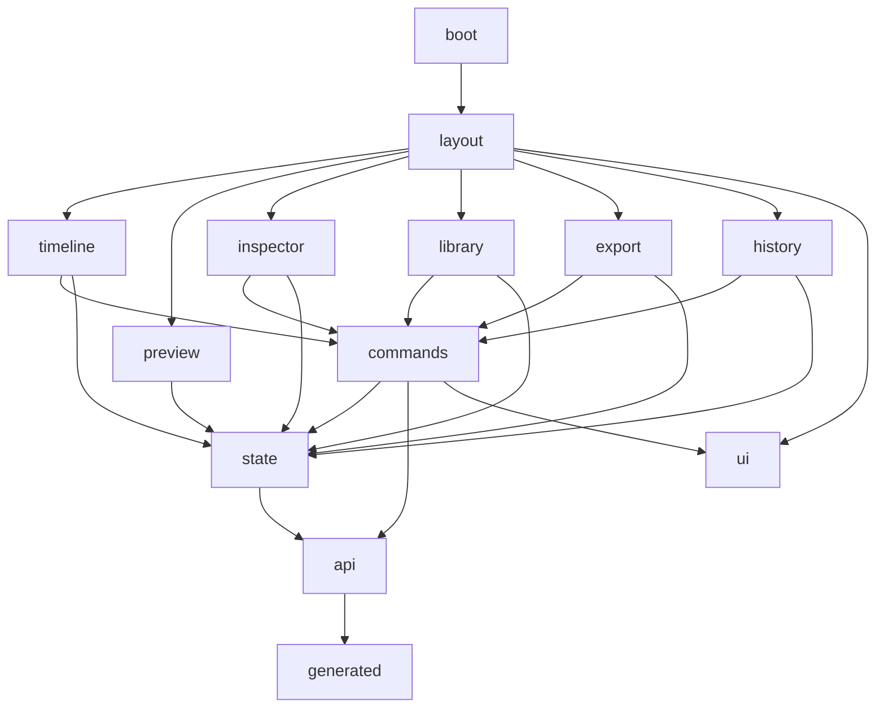
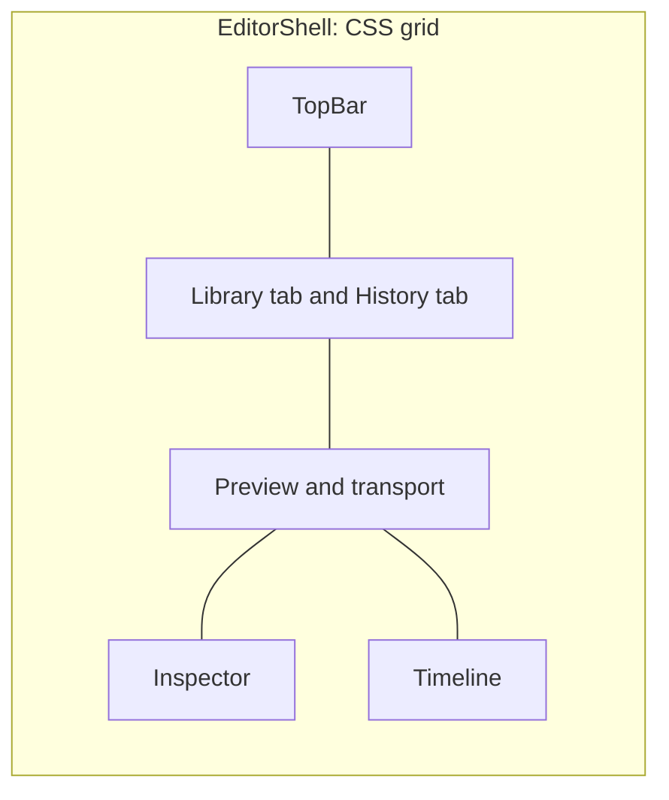
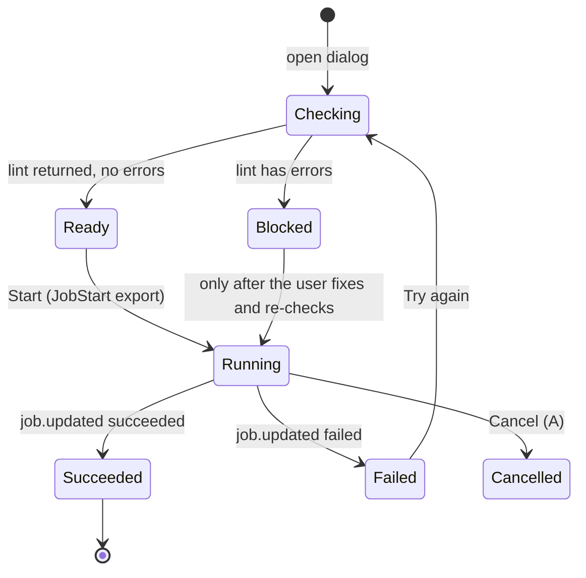

# SDD-012: Editor UI architecture

- Amended (2026-11-18) for Stuarty: there is one UI, the web UI, and the desktop is the Wails shell; the Gio window is removed (ADR-0041, which supersedes ADR-0030; section 21). This document specifies the video editor; the dashboard, the image editor and the other sections of PRD-004 are specified by the epics that build them and follow the same thin-client rules.
- Status: Accepted (2026-11-14). Drafted by a delegated engineer, reviewed and corrected by the architect; aligned with SDD-006 (stream, reconciliation, conflicts) and SDD-007 (session, content security policy). Amended the same day to agree with `docs/design-system.md` (tokens, focus, motion, components, desktop window; Appendix A items 19 to 23).
- Depends on: SDD-000 (names), SDD-001 (document), SDD-002 Parts A and B (commands, batch, errors), SDD-004 §4.1, §9, §10, §11 (safe area, frames, preview executor, tolerance), SDD-003 (service result shapes) and SDD-006 (event payloads): every shape this document takes from them is marked "mirrors SDD-003" or "mirrors SDD-006" and the generated types win on any difference. ADR-0003, ADR-0007, ADR-0013, ADR-0014, ADR-0017, ADR-0019, ADR-0023; author decisions D-013, D-023, D-024
- Implements: RF-060, RF-061, RF-070, RF-071, RF-072, RF-073, RF-074 (design only), RF-075, RF-118, RF-119; NFR-001, NFR-002, NFR-003, NFR-004, NFR-008, NFR-011
- Owner area: senior-e (editor UI)

## Contents

1. [Principles as testable rules](#1-principles-as-testable-rules)
2. [Routes and pages](#2-routes-and-pages)
3. [Directory layout and import rules](#3-directory-layout-and-import-rules)
4. [API client](#4-api-client)
5. [Read model and state](#5-read-model-and-state)
6. [Layout of the editor](#6-layout-of-the-editor)
7. [Timeline component](#7-timeline-component)
8. [Interactions and the commands they send](#8-interactions-and-the-commands-they-send)
9. [Command coverage](#9-command-coverage)
10. [The first editor](#10-the-first-editor)
11. [Preview component](#11-preview-component)
12. [Inspector](#12-inspector)
13. [Media library](#13-media-library)
14. [Export dialog and jobs](#14-export-dialog-and-jobs)
15. [History panel](#15-history-panel)
16. [Internationalization](#16-internationalization)
17. [Theme](#17-theme)
18. [Accessibility](#18-accessibility)
19. [Performance budgets](#19-performance-budgets)
20. [Testing](#20-testing)
21. [Desktop shell](#21-desktop-shell)
22. [Acceptance](#22-acceptance)
23. [The dashboard](#23-the-dashboard)
24. [The image editor](#24-the-image-editor)

- [Appendix A: Decisions of this SDD](#appendix-a-decisions-of-this-sdd)
- [Appendix B: Contract needs beyond SDD-000](#appendix-b-contract-needs-beyond-sdd-000)

Conventions of this document. "The core" is the Go process behind `/api/v1`. "The read model" is the project document at a revision, held in the browser. "A request" is what a gesture asks for; "a result" is what the timeline becomes. A paragraph headed **Decision of this SDD** fills a gap or resolves an ambiguity in another document and is listed again in Appendix A.

## 1. Principles as testable rules

ADR-0007 says the UI is a thin client. This section turns that into rules, each with the check that enforces it.

### 1.1 The three kinds of arithmetic

| Kind | What it is | Allowed | Example |
| --- | --- | --- | --- |
| Screen arithmetic | converts between pointer, pixel and frame coordinates, and between screen and project pixels | yes | `frame = round((clientX - left + scrollLeft) / pxPerFrame)` |
| Request composition | builds the arguments of a command from a gesture and from values read in the read model; the output is a command argument string or number, never stored | yes | a drag by 12 frames sends `item.move {start: "162f"}`; a nudge sends `start` equal to the item's current start plus 1 |
| Decoration | picks pixels of a decorative image (which thumbnail tile, which waveform window) | yes, with limits in 1.3 | tile index for a clip thumbnail |
| Result | decides what an edit does to the timeline, what a frame contains, or whether a command is valid | **never** | the new `start` of a neighbour, a keyframe value between two keyframes, the source frame shown, the layout of a text box, whether an overlap would occur |

### 1.2 Rules

Each rule has an identifier used by the checks of §20.

| Id | Rule | Enforced by |
| --- | --- | --- |
| T1 | The browser may hold only the read model (the document at a revision, §5), UI state (selection, playhead, zoom, scroll, panels, theme, locale, draft input text) and caches of binary content keyed by hash or by revision. It stores no project data in `localStorage`, `sessionStorage`, IndexedDB or the Cache API | `check-thin-client` rule R7; test `thin-client-storage` |
| T2 | The read model is replaced only by a document returned by the core, or by a diff event of the core applied by the mechanical patch of §5.4. No other code writes it | type `DeepReadonly`, import rule R4, runtime freeze in dev and test builds, unit test `document-frozen` |
| T3 | There is no optimistic update. After a gesture is released the read model does not change until the core answers. A pending edit is shown as a ghost drawn from UI state | Playwright test `thin-client-no-optimistic` (server answer delayed 1 s; the store revision and the item's stored `start` stay unchanged while the ghost is visible) |
| T4 | During a pointer drag the browser may move or resize the dragged element visually (the ephemeral preview, §8.1). It uses only screen arithmetic and snap targets supplied by the core (§7.8) or by UI state (playhead, frame 0). The preview is never written to the read model and never sent anywhere except as the one command at release | T2, T3, `check-thin-client` rule R3 |
| T5 | The browser never predicts whether a command is valid. It may gate a control on selection and on documented ranges (§8.3), but anything it sends is judged by the core | review checklist item in the pull request template; test `overlap-snapback` |
| T6 | The browser never interpolates a keyframe, never chooses a source frame, never lays out text, never evaluates a transition and never decides layer order. The preview executor draws exactly what a plan window says (SDD-004 §10). Item geometry for selection handles comes from the plan layer, not from the document | `check-thin-client` rules R1, R2, R5; test `preview-vs-export` |
| T7 | Every edit is sent through `editor/api/edit.ts`. Every read goes through `editor/api`. `fetch` and `EventSource` are used nowhere else | `check-thin-client` rule R6 |
| T8 | Every time argument sent to the core is a string with a unit (`"12.5s"`, `"375f"`, `"00:12.500"`). A bare number never leaves the browser as a time | unit test `builders-time-strings`; contract test that scans every recorded request of the e2e suite |
| T9 | Every user-facing string is looked up through `t(key)` (§16). The only strings shown as received are core-supplied error `message` and `hint`, the text of history steps and a user's own content (project, track and item names, text, caption words) | `check-i18n` rule I3 |
| T10 | Every non-internal command of the catalogue has a UI entry point (D-013) | contract test `command-coverage` (§9.3) |

**Untrusted text.** Item names, asset names, caption text, history text and project names come from agents and from files, and may contain right-to-left or bidirectional control characters (SDD-007 §8.5 item 3). They are rendered only through the component `components/UntrustedText.tsx` (it lives in `components/` because the Inertia pages use it too), an element with `dir="auto"` and `unicode-bidi: isolate`, so such text cannot reorder the surrounding interface. §7.4, §12.1 (word table), §13.2 and §15 refer to this rule.

### 1.3 Decoration limits

A decoration may read `source_in`, `speed`, `start` and `duration` of an item. Its output must not be written to the read model, shown as a time or sent to the core. If it is wrong by a few frames the user sees a slightly misplaced thumbnail and nothing else. Thumbnail strips and waveforms are the only decorations.

### 1.4 The check that enforces it

`web/scripts/check-thin-client.ts`, run with `bun run check:thin-client` and in CI. It parses every file under `web/resources/js/editor/` with the syntax tree API shipped inside the `typescript` package (`typescript/unstable/sync`: TypeScript 7 is the native compiler and has no JavaScript compiler API, and that API is marked unstable, so `typescript` stays pinned to an exact version; no new package) and fails with file, line and rule id. Rule R3 is syntactic: a write on an expression rooted at a name declared with one of the document types (the `DeepReadonly` types reject the same writes at typecheck). Biome stays the formatter and general linter; this script is the only authority on the rules below. Rules:

| Rule | What it looks for |
| --- | --- |
| R1 | Imports of packages that compute timelines or interpolate: `immer`, `mutative`, `fast-json-patch`, `rfc6902`, `jsondiffpatch`, `json-logic-js`, `mathjs`, `bezier-easing`, `d3-ease`, `d3-interpolate`, `gsap`, `popmotion`, any `*.wasm` import, `new Worker(` (except in `editor/preview/decode/createWorker.ts`, the decode worker of §11.2 item 8), `new SharedWorker(`. Imports from `@/generated/*` must be `import type`, except `@/generated/limits` and `@/generated/commands.json` |
| R2 | Declarations or calls whose name starts with `interpolate`, `ease`, `lerp`, `layoutText`, `resolveKeyframe`, `evaluateItem`, `sourceFrame`, `computeOverlap`, `findFreeSlot`, `rippleDelete`, `applyCommand`, `reduceTimeline`; calls to `.measureText(` anywhere |
| R3 | Any assignment, `Object.assign`, `delete`, array mutation (`push`, `splice`, `sort` in place, `reverse`) or `structuredClone` result mutation on an expression whose declared type is `ProjectDocument`, `Item`, `Track`, `Asset`, `Word` or `Keyframes` (types of `@/generated/timeline`), or on `documentStore` state outside `editor/state/sync.ts` |
| R4 | Imports of `editor/state/documentStore` write functions (`replaceDocument`, `applyRevisionDiff`) from any file except `editor/state/sync.ts` |
| R5 | In files outside the allowlist (`editor/timeline/geometry.ts`, `editor/timeline/gestures/**`, `editor/timeline/snapping.ts`, `editor/timeline/items/stripTiles.ts`, `editor/timeline/items/waveform.ts` (the two decorations of §1.3), `editor/commands/builders.ts`, `editor/commands/units.ts`, `editor/preview/**`, `editor/ui/TimeField.tsx`): a binary expression that has a property access named `start`, `duration`, `source_in`, `speed`, `fps`, `fade_in`, `fade_out` or `words` as an operand with `+`, `-`, `*`, `/`, `%` or a comparison against another time quantity. Display and request code that must do this arithmetic calls a named helper of `units.ts` and writes none of its own: `displayDuration(item)` (the read-only duration), `displayEnd(item)` (the End field and the end shown in labels), `captionWordSegments(item, ppf)` (the start and width of each caption word segment) and `speedLabel(speed)` (the `1.5x` badge). `selectors.ts`, `virtualize.ts`, `timeline/keyboard.ts`, the inspector fields and `CaptionItem` call these helpers |
| R6 | `fetch(`, `new EventSource(`, `XMLHttpRequest`, `navigator.sendBeacon` outside `editor/api/**`, `editor/boot/**` (boot reloads the editor with `?lang=`) and `editor/preview/decode/decodeWorker.ts` (the byte ranges of the proxy and the chunk index, §11.2 item 8) |
| R7 | `localStorage`, `sessionStorage`, `indexedDB`, `caches` outside `editor/state/prefs.ts`; in `prefs.ts` the keys must belong to the allowed list `theme`, `vv.layout` (the track row heights by kind, §7.4), `vv.timeDisplay`, `vv.timeUnit`, `vv.zoomByProject` (zoom and scroll only), `vv.keymap` (the shortcut overrides: a JSON object from binding id to key, UI preference, never project data), `vv.shortcutsSeen` (the string `1` once the first-run tips were shown), `vv.lang` (the language tag of the interface, a preference of this browser), `stuarty.preview.executor` (`rust`, `pixi` or `auto`, the preview executor this browser forces, §11.1) |
| R8 | The import rules of §3.3 |

The script has its own unit tests (a fixture per rule that must fail and one that must pass), run by Vitest.

## 2. Routes and pages

### 2.1 Which pages are Inertia

| Route | Page component | Purpose | Mode |
| --- | --- | --- | --- |
| `GET /` | `pages/Dashboard/Home.tsx` | the dashboard home; it and the section routes are listed in section 23.1 | both |
| `GET /projects` | `pages/Projects/Index.tsx` | list projects (`ProjectList`), create (`ProjectCreate`: name and size preset, RF-002), open, trash and restore; the template entries (below the list): the templates with "New from template" (`TemplateList`, `TemplateInstantiate`; the project name, then the editor opens on the new project), "Export file" (a download of `GET /templates/{id}/file`) and the import of a template file by its absolute path on the machine of the service (`TemplateImport`; the operation takes a path, never bytes, SDD-007 §7.6). The page calls the HTTP API with the browser session, like the settings page. A card shows the number of timelines, "Details" (the overview below) and, in its menu, "Duplicate" (`ProjectDuplicate`, VV-225) | both |
| `GET /projects/{id}` | `pages/Projects/Show.tsx` | the overview of a project as a production (ADR-0039, RF-303): props from `ProjectDescribe` and `BriefGet`; the brief (edited with `BriefSet`), the active items in order with their kind (a timeline opens in the editor at `/editor/{timeline_id}`), add a text or a timeline (`ProjectItemAdd`), move up and down, rename and trash (`ProjectItemMove`, `ProjectItemRename`, `ProjectItemTrash`), and the trashed items with restore (`ProjectItemRestore`). The page draws what the service returns; the order and the state are the core's | both |
| `GET /settings` | `pages/Settings/Index.tsx` | language, theme, default time unit, version and workspace path (`Doctor`, `GET /system`) | both |
| `GET /settings/keys` | `pages/Settings/Keys.tsx` | create and revoke API keys with scopes (SDD-007) | network only; 404 in local mode |
| `GET /login` | `pages/Auth/Login.tsx` | login (vukem sessions); the form posts JSON to `POST /auth/login` and the logout button to `POST /auth/logout` (SDD-007 §4.1 item 5 names those routes, so there is no `POST /logout` page route); the page gets the prop `next`, already a safe path of this server (default `/projects`); the only page that needs no session; 404 in local mode | network only |
| any error | `pages/Error.tsx` | error page of Inertia visits | both |

In network mode a browser that opens any other page with no session gets `303` to `/login?next=<path and query>` (a call of the API still gets 401); this is not counted as a failed authentication.

These pages talk to the Go controllers through Inertia props and form posts, as the existing Studio does. A controller of these pages calls the same `service.Service` operations as the HTTP API (ADR-0008) and passes the result as props.

### 2.2 The editor route

**Decision of this SDD: the editor is a hand-written route, not an Inertia page.** `GET /editor/{project_id}` is registered in `routes/web.go` with the same middleware stack as the Inertia pages (`DefaultMiddleware`, locale, session or local token), and its handler renders the view `resources/views/editor.html` through `c.Render`. The view is a copy of `app.html` that loads the Vite entry `resources/js/editor.tsx` instead of `app.tsx` and has no `{{.Inertia}}`.

Why a hand-written route and not an Inertia page that mounts the editor:

1. ADR-0013 says the editor is "decoupled from Inertia". The editor does not use Inertia's page object, props, partial reloads, progress bar, history state or scroll restoration. Mounting it as a page would bring all of that into a screen that owns its own data flow, and Inertia would try to handle `popstate` and link clicks inside a tool that must never navigate by accident.
2. The editor bundle stays free of `@inertiajs/react` (smaller first load) and of the Inertia asset-version reload, which would discard an editing session on every deploy.
3. vukem documented no SPA fallback when this was written (VF-004; vukem pull request #220 adds the documentation), and none is needed: the editor has exactly one server route, `/editor/{project_id}`, and no client-side routes. The `{{vite ...}}` view function and the CSP nonce work in any view (`vukem/site/content/docs/frontend/vite.mdx` line 213 "templ and plain handlers"), so the route needs only a view and a second Vite input.
4. A second entry is a one-line change in `vite.config.ts`: `vukem({ input: ["resources/css/app.css", "resources/js/app.tsx", "resources/js/editor.tsx"] })`. The `@inertiajs/vite` plugin only acts on `app.tsx`.

Handler behaviour:

1. Validate `project_id` against `prj_[0-9a-hjkmnp-tv-z]{10}`. Invalid: 404 error page.
2. Call `ProjectGet` through the service for existence and trash state. Unknown: 404. Trashed: the editor opens read-only with a banner.
3. Render the view with these values, written into the page as `<script type="application/json" id="vv-bootstrap" nonce="{{cspNonce}}">`:

```ts
interface EditorBootstrap {
  project_id: string;
  mode: "local" | "network";
  api_base: "/api/v1";
  locale: string;                 // resolved by vukem i18n middleware
  locales: string[];              // app.I18n.Locales()
  messages: Record<string, string | Record<string, string>>; // app.I18n.Messages(locale, "ui.editor.", "ui.common.", "ui.theme.", "ui.nav.")
  user: { id: string; name: string } | null; // network mode only
  version: string;                // binary version, shown in settings and in bug reports
}
```

4. `Bundle.Messages(locale, prefixes...)` (`vukem/i18n/i18n.go` line 360) is the same function `inertia.I18n` uses, so the catalogs in `resources/lang/` serve both kinds of page.

**Deep links and reloads.** The URL is `/editor/prj_7k2m9x4q1b` with optional query `?t=<time string>` (initial playhead, for example `?t=12.5s`) and `?item=itm_...` (initial selection and scroll into view). The browser URL is replaced (history `replaceState`) when the user selects an item or the playhead rests for 1 s, so a copied URL reopens the same place. Because all state of the project lives in the core, a reload, a pasted link or a new tab re-runs the same boot sequence (§5.6) and arrives at the same place. A link from the project list is an ordinary `<a href>` (full page load, because the editor is another document), and the "back to projects" control in the top bar is an ordinary `<a href="/projects">`.

**Content Security Policy.** The default policy (`default-src 'self'`, `img-src 'self' data:`, `connect-src 'self'`) is kept, with two additions: `worker-src 'self'` and `'wasm-unsafe-eval'` in `script-src`, the second for the render worker that compiles the renderer module (SDD-007 §8.5.5, SDD-013 §4.7). Consequences the editor must respect: bitmaps and frames are fetched with `fetch` and turned into `ImageBitmap` (`createImageBitmap`), not shown through `blob:` URLs; the paused frame is an `` to a same-origin URL; `<video src>` and `<audio src>` are same-origin; PixiJS is imported as `pixi.js/unsafe-eval` before the renderer is created, so no `eval` or `new Function` is needed (the name refers to the library's shader-sync code path, which is CSP-safe in that build); the module workers of the preview are created from same-origin scripts (`worker-src 'self'`), with no `blob:` or inline workers. The Playwright test `csp-clean` fails on any `securitypolicyviolation` event during the first scenario.

### 2.3 Entry points

| File | Role |
| --- | --- |
| `resources/js/app.tsx` | Inertia pages (kept) |
| `resources/js/editor.tsx` | reads `#vv-bootstrap`, applies the theme before paint (the inline script of the view does it, §17), mounts `<EditorApp bootstrap />` on `#editor` with `createRoot` |
| `resources/views/editor.html` | document shell; no sidebar, no layout |

## 3. Directory layout and import rules

### 3.1 Reuse of the existing front end

The existing `web/` is the Studio application (brief to video). The Stuarty web app replaces its pages and keeps its foundations. Files kept as they are: `components/ui/*` (shared primitives on `@base-ui/react`, Biome-excluded), `lib/cn.ts`, `hooks/use-mobile.ts`, `css/app.css` (tokens extended in §17), `vite/vukem.js`, `resources/resources.go`, `components/ThemeToggle.tsx`, `pages/Error.tsx`, `ssr.tsx`, `biome.json`, `components.json`, `tsconfig.json`. Files kept and changed: `lib/i18n.ts` (§16.3), `components/LocaleSwitcher.tsx` (split into `LocaleSelect` and an Inertia wrapper), `layouts/AppLayout.tsx` (navigation reduced to Projects and Settings, later replaced by the dashboard sidebar of section 23), `views/app.html` and `app.tsx` (theme default, §17), `lang/en.json` and `lang/pt-BR.json` (Studio keys removed, editor keys added), `vite.config.ts` (second input). Files removed: `components/BriefForm.tsx`, `FieldTip.tsx`, `Tips.tsx`, `pages/Jobs/*`, `pages/Dashboard.tsx`, the Studio types in `types.ts`.

Shared primitives. §4.4, §9.2, §12, §13 and §14 use `dialog`, `alert-dialog`, `popover`, `dropdown-menu`, `context-menu`, `slider`, `switch`, `checkbox`, `radio-group`, `progress`, `toggle`, `toggle-group`, `tabs`, `tooltip` and `select` (`docs/design-system.md` §4.2). Dialogs, popovers, tooltips, tabs, sheets, menus, the select and the form controls are `@base-ui/react`. Exact versions live in `web/package.json`. `radix-ui`, `@ui-sdk/react` and the shadcn CLI are not dependencies. `ScrollArea` is not used (native scroll). The command palette is built on `Dialog` and a listbox, not on a `command` component, because `cmdk` would be a new dependency (§9.2). Editor notices are the stack in `editor/timeline/Notices.tsx`, not a toast primitive.

New dependencies, to be added only after the owner approves each (they are the only ones this SDD needs), each at the latest stable release at install time, exact version in `package.json`: `zustand`, `pixi.js` (ADR-0013); development only: `vitest`, `@axe-core/playwright`, `json-schema-to-typescript` (ADR-0014 generation), `openapi-typescript` (types of HTTP endpoints from the OpenAPI document of ADR-0017). No form library, no drag-and-drop library, no state-diff library, no date library, no animation library.

### 3.2 Layout under `web/resources/js/`

```text
resources/js/
├── app.tsx                    Inertia entry (kept)
├── editor.tsx                 editor entry
├── layouts/AppLayout.tsx      Inertia pages layout
├── pages/                     Inertia pages: Projects/Index, Settings/Index, Settings/Keys, Auth/Login, Error
├── components/                ui/ (Base UI and UI SDK), ThemeToggle, LocaleSelect, LocaleSwitcher, UntrustedText (shared by both kinds of page)
├── lib/                       cn.ts, i18n.ts (context based useT), format.ts (Intl helpers)
├── hooks/                     use-mobile.ts
├── generated/                 COMMITTED, produced by CI (ADR-0014); never edited by hand
│   ├── timeline.ts            types of the document (from core/schema/timeline.v1.schema.json)
│   ├── commands.ts            CommandName union, CommandArgsMap, Operation (from core/schema/commands)
│   ├── commands.json          snapshot of the registry: name, summary, args_schema, example, errors, scope, internal
│   ├── events.ts              ProjectEvent union (from the event schema)
│   ├── api.ts                 paths and bodies of /api/v1 (from the OpenAPI document)
│   ├── errors.ts              ErrorCode union and the table of codes with retryable flag
│   └── limits.ts              constants of SDD-001 §4 (max frame 108000, max batch 200 ...)
└── editor/
    ├── boot/                  mount, bootstrap parsing, error boundary, test hooks (?debug=1)
    ├── api/                   http.ts, client.ts (one function per endpoint), edit.ts, errors.ts (ApiError), retry.ts, events.ts (EventSource), urls.ts (media URL builders)
    ├── state/                 documentStore.ts, sync.ts (the only writer), applyDiff.ts, selectors.ts, uiStore.ts, ghostStore.ts, jobsStore.ts, mediaStore.ts, activityStore.ts, prefs.ts
    ├── commands/              builders.ts (gesture to Operation), actions.ts (action registry), coverage.ts, keymap.ts, units.ts (time strings), palette/ (command palette), schemaForm/ (JSON Schema to form)
    ├── preview/               PreviewExecutor.ts (interface), PixiExecutor.ts, RustExecutor.ts, ExecutorSwitch.ts, executorChoice.ts, render/ (the render worker), planWindows.ts, videoPool.ts, audioGraph.ts, clock.ts, pausedFrame.ts, Preview.tsx, overlays/ (SafeArea, SelectionBox, Handles)
    ├── timeline/              Timeline.tsx, geometry.ts, Ruler.tsx, TrackRow.tsx, TrackHeader.tsx, items/ (ClipItem, AudioItem, TextItem, CaptionItem, ShapeItem), Playhead.tsx, snapping.ts, gestures/ (move, trim, scrub, marquee, reorder), keyboard.ts, virtualize.ts
    ├── inspector/             Inspector.tsx, ProjectPanel, TrackPanel, panels/ (Clip, Audio, Text, Caption, Shape, Keyframes, Template), fields/ (NumberField, ColorField, SelectField, TextField; the time field is `ui/TimeField.tsx`)
    ├── library/               Library.tsx, ImportBar.tsx, AssetCard.tsx, AssetDetails.tsx
    ├── export/                ExportDialog.tsx, JobsChip.tsx, LintList.tsx
    ├── history/               HistoryPanel.tsx
    ├── ui/                    small shared atoms used by two or more feature folders: Toolbar, IconButton, Panel, Splitter, Toast, ErrorNotice, Timecode, TimeField
    ├── layout/                EditorShell.tsx, TopBar.tsx, ActivityIndicator.tsx, panel sizing
    └── a11y/                  LiveRegion.tsx, focus helpers, announce()
```

`resources/js/editor/**/*.test.ts(x)` are Vitest files next to the code they test. End-to-end tests are under `web/e2e/specs/` (the existing Playwright setup).

### 3.3 Import rules

An arrow means "may import". Everything may import `@/generated` (types only, rule R1), `@/lib`, `@/components`.



| Folder | May import | Must not import |
| --- | --- | --- |
| `api` | `generated`, `lib` | `state`, `commands`, any UI |
| `state` | `api`, `generated`, `lib` | `commands`, any UI |
| `commands` | `state`, `api`, `ui`, `a11y` (`announce`), `generated`, `lib` | any feature folder |
| `preview` | `state` (read), `api/urls`, `api/client` (plan, frame, bitmaps), `ui` | `timeline`, `inspector`, `commands` write path (it sends no edits; the transform handles use `commands/actions`, so the overlay components live in `preview/overlays` and call actions through the `useAction` hook of `commands`) |
| `timeline`, `inspector`, `library`, `export`, `history` | `state`, `commands`, `ui`, `a11y`, `preview/clock` (read only), `api/urls` | each other |
| `ui`, `a11y` | `lib`, `components` | any other editor folder |
| `layout` | all feature folders, `commands` (the palette button) | `api` directly |
| `boot` | everything | |

Feature folders do not import each other. They communicate through the stores (selection, playhead) and through actions. Rule R8 of the check script verifies the table from the import graph.

## 4. API client

### 4.1 Types

Types come from the generated files of ADR-0014 and are never rewritten by hand:

```ts
// generated/commands.ts (shape)
export type CommandName = "item.move" | "item.trim" | /* every command of SDD-002 Part B */ never;
export interface CommandArgsMap { "item.move": ItemMoveArgs; "item.trim": ItemTrimArgs; /* ... */ }
export type Operation = { [K in CommandName]: { op: K; args: CommandArgsMap[K] } }[CommandName];

// generated/errors.ts
export type ErrorCode = "E_VALIDATION" | "E_OVERLAP" | /* every code of SDD-000 §8 and SDD-002 §A.8 */ never;
export const ERROR_TABLE: Record<ErrorCode, { retryable: boolean; http: number }>;
```

`task codegen` regenerates them (`go run ./internal/tools/contractgen`, then `bun run codegen:ts`); CI fails if the working tree changes afterwards (ADR-0014 item 2). `generated/commands.ts` also exports `COMMANDS`, a table of summary, scope, internal flag and error codes per command, and `generated/limits.ts` exports `LIMITS`.

**Open: the types of the HTTP endpoints are written by hand.** This section asks for `generated/api.ts` from the OpenAPI document with `openapi-typescript`. The pinned 7.13.0 uses the JavaScript API of TypeScript 5 (`ts.factory`), and the repository builds with TypeScript 7.0.2, which does not have it: the import fails at load. A second TypeScript version only for this script was refused (no new dependency), so the response types of the endpoints are interfaces in `editor/api/types.ts`, copied from `site/generated/openapi.json`. The step comes back when `openapi-typescript` supports TypeScript 7 or the project changes the generator.

### 4.2 Endpoints and functions

One typed function per endpoint of SDD-000 §1 that the UI uses, in `editor/api/client.ts`. Rows marked "gap" are not in SDD-000 and are specified in Appendix B.

| Function | Request | Result |
| --- | --- | --- |
| `getProject(id)` | `GET /projects/{id}?detail=document` | `{ project_id, name, revision, state, counts, document }` (SDD-003 §2.3: the head always, plus `document` with `detail=document`) |
| `listProjects()`, `createProject(body)` | `GET /projects`, `POST /projects` | used by Inertia controllers server side, not by the editor |
| `edit(id, req)` | `POST /projects/{id}/edit` | `EditResponse` (§4.3) |
| `getCommands()`, `getCommand(name)` | `GET /commands`, `GET /commands/{name}` | registry entries (palette, §9.2) |
| `getHistory(id, page)` | `GET /projects/{id}/history` | steps (§15) |
| `undo(id)`, `redo(id)` | `POST /projects/{id}/undo`, `.../redo` | `EditResponse` plus `skipped` |
| `importMedia(id, paths)` | `POST /projects/{id}/media` | `{ assets[] }`, one entry per path in order, each with `asset_id`, `job_id` and `name`, or an `error` (SDD-003 §2.6) |
| `listMedia(id)` | `GET /projects/{id}/media` (gap) | `MediaEntry[]` |
| `inspectMedia(id, asset)` | `GET /projects/{id}/media/{asset_id}` | text and facts |
| `trashMedia`, `restoreMedia` | `POST .../trash`, `.../restore` | |
| `getPlan(id, from, until, rev, width?)` | `GET /projects/{id}/plan?from=&until=&rev=&width=` (SDD-004 §10; `width` is the pixel width the preview draws at, so bitmaps come at that scale) | `PlanWindow` |
| `frameUrl(id, at, width, rev)` | `GET /projects/{id}/frame?at=<time string>&width=<px>&rev=<n>` (mirrors SDD-003) | JPEG, used as `` |
| `getLint(id)` | `GET /projects/{id}/lint` | findings |
| `getSnapPoints(id, rev, words)` | `GET /projects/{id}/snap-points?rev=&words=` (gap) | `SnapPoints` (§7.8) |
| `startJob(id, body)` | `POST /projects/{id}/jobs` | `{ job_id }` |
| `getJob(job)` | `GET /jobs/{job_id}` | `Job` |
| `listJobs(id)` | `GET /projects/{id}/jobs?state=queued,running` (gap) | `Job[]`, for rehydration after reload |
| `cancelJob(job)` | `POST /jobs/{job_id}/cancel` | |
| `getFonts()` | `GET /fonts` (gap) | `{ family, weights[], bundled }[]` |
| `getSystem()` | `GET /system` | version, workspace, encoder |
| `openEvents(id)` | `GET /projects/{id}/events` | `EventSource`, §5.5 |
| `getTools()` | `GET /system/tools` | installed tools and, for a running install, `done_bytes` and `total_bytes`; polled every second while an install runs (§12.5) |
| `installTool(body)` | `POST /system/tools/install` with `{ name, model? }` | 202; allowed only to a browser session in local mode or an `admin` key in network mode (SDD-007 §6.8 item 1) |
| `duplicateProject(id)` | `POST /projects/{id}/duplicate` | `ProjectCreateResult` of the copy (the card menu of the list, VV-225) |
| `addProjectItem(id, body)`, `moveProjectItem(id, item, position)`, `renameProjectItem(id, item, title)`, `trashProjectItem(id, item)`, `restoreProjectItem(id, item)` | `POST /projects/{id}/items`, `.../items/{item_id}/move`, `.../rename`, `.../trash`, `.../restore` | `ProjectItemResult` (SDD-003 §2.3.1) |
| `setBrief(id, text)` | `PUT /projects/{id}/brief` | `BriefResult` |

Binary URL builders (no function call, only strings, in `api/urls.ts`): `proxyUrl(project, asset)` = `/api/v1/projects/{id}/media/{asset_id}/proxy`, `thumbnailUrl(project, asset, width)` (`width` 160, 320 or 640), `stripUrl` and `peaksUrl` on the same prefix (`/thumbnail`, `/strip`, `/peaks`), `bitmapUrl(project, key)` = `/api/v1/projects/{id}/bitmaps/{key}`, `exportFileUrl(job)` = `/api/v1/jobs/{job_id}/file` (SDD-000 §1). All are served with HTTP Range and content-hash caching (ADR-0017 item 8).

### 4.3 The edit function

```ts
export interface EditRequest {
  operations: Operation[];     // 1 to 200 (SDD-003 section 2.4)
  base_revision: number;       // the revision the user was looking at when the gesture was composed
  idempotency_key: string;     // 8 to 64 characters; crypto.randomUUID() (36)
  dry_run?: boolean;
}

export interface EditResponse {          // mirrors SDD-003 and SDD-002 A.5 to A.7
  revision: number;                      // the revision after the batch (current revision when applied is false)
  applied: boolean;
  replayed?: boolean;
  diff: Change[];                        // same shape as the diff of batch.committed
  effective: OpEffect[];                 // one per operation (SDD-003 section 2.4)
  description: string;                   // DescribeDiff output, English, shown in history (same name as in the event, SDD-006)
  findings: LintFinding[];               // new findings (RF-107); `lint` carries the totals
}

export interface EditOptions {
  label: string;                         // i18n key of the gesture, for toasts and the live region
  idempotencyKey?: string;               // reused across retries of one logical edit
  signal?: AbortSignal;
}

export function edit(projectId: string, ops: Operation[], baseRevision: number, opts: EditOptions): Promise<EditOutcome>;

export type EditOutcome =
  | { ok: true; response: EditResponse }
  | { ok: false; error: ApiError; handled: boolean };   // handled: the error policy of §4.4 already informed the user
```

Rules:

1. **One edit in flight per project.** `edit()` pushes the batch on a FIFO queue in `editor/api/edit.ts`; the next batch is sent when the previous one finished. This prevents a user's own quick gestures from racing each other. `base_revision` is the one captured at composition time, not at send time: the core ignores the actor's own intervening batches (SDD-002 A.7 step 2), so a queued batch is still judged against what the user saw, and another actor's intervening edit to the same objects is still reported as `E_REVISION_CONFLICT` (RF-119).
2. **Idempotency key.** Generated once per logical edit with `crypto.randomUUID()`, reused on every automatic retry, replaced by a new key when the user chooses "Apply again" after a conflict (a new logical edit).
3. **Identifiers.** The UI omits `id` and `new_id` and lets the core assign them (SDD-002 A.3 rule 4), except when a later operation of the same batch must refer to a created object (a `track.add` followed by `clip.add` on it). Then the UI supplies the id: `trk_` plus 10 characters from the Crockford alphabet drawn with `crypto.getRandomValues` in `editor/commands/ids.ts`. After a batch the UI learns created identifiers from `item.added` and `track.added` entries of `diff` (for example to select the right part after `item.split`).
4. **Timeouts.** Reads 10 s, `edit` 30 s, `importMedia` 10 s (it returns a job), `startJob` 10 s. A timeout is a network failure for the retry rules.
5. **Request headers.** `Accept: application/json`, `Content-Type: application/json`, `credentials: "same-origin"`. No `Authorization` header, no token in the URL: authentication is the same-site cookie (ADR-0019). The browser adds `Origin` and `Sec-Fetch-Site` itself.
6. **Self-measurement.** `edit()` calls `performance.mark("vv:edit:start")` and `performance.measure("vv:edit", ...)` at response. The measure is what NFR-001 is checked against in the browser (§19).

### 4.4 Error handling by code

`ApiError` holds the envelope of SDD-002 A.8 (`code`, `message`, `hint`, `retryable`, `op_index`, `path`, `details`) plus `status` (HTTP). A response that is not the envelope (a proxy 502, a network failure) becomes `ApiError` with code `E_NETWORK` (UI only, retryable). Display rule: the headline is `t("ui.editor.errors." + code)`, localized; below it the core's `message` and `hint` as received (T9 exception). A code with no catalogue key falls back to the headline `ui.editor.errors.unknown` and the check `check-i18n` fails the build when a code of `ERROR_TABLE` lacks a key.

Retry rules:

| Situation | Automatic retry | Notes |
| --- | --- | --- |
| Network failure, timeout, HTTP 502, 503, 504 without envelope | up to 3 retries, delays 250 ms, 500 ms, 1 s with up to 20% jitter, same idempotency key | safe: the core replays by key (A.7). After the last retry the UI shows `E_NETWORK` and marks the connection state `offline` (§5.5) |
| `E_WORKSPACE_LOCKED` | same as above | |
| `E_REVISION_CONFLICT` | none, §4.5 | the user decides |
| `E_ASSET_NOT_READY` | none | the library disables placement of assets that are not `ready`; if it still happens, a toast says the asset is still ingesting and the user repeats the gesture |
| `E_QUEUE_FULL` | none | the export dialog says another export is running, lists `details.running` and offers a retry button |
| every other code | none | |

Error policy per code (the "handled" step; gesture-specific behaviour is in §8.4):

| Code | UI behaviour |
| --- | --- |
| `E_UNAUTHORIZED` | local mode: banner "session ended, reopen the editor from the terminal" with a reload button; network mode: navigate to `/login?next=` the current URL |
| `E_FORBIDDEN` | toast with the scope in the message; controls needing that scope stay disabled afterwards |
| `E_UNKNOWN_COMMAND`, `E_IDEMPOTENCY_MISMATCH`, `E_INTERNAL` | these are bugs of the UI or core: toast with the message and a "copy details" button (code, message, request id, revision) |
| `E_VALIDATION`, `E_INVALID_TIME` | if `path` is `args.<field>` of an operation that came from an inspector field, the message appears under that field and the field keeps the draft; otherwise a toast |
| `E_NOT_FOUND` | refetch the document (the object was removed by someone else), drop the missing ids from the selection, toast |
| `E_ID_EXISTS` | regenerate the supplied ids and retry once (only possible when the UI supplied them) |
| `E_TYPE_MISMATCH`, `E_INVALID_STATE`, `E_LIMIT`, `E_SLOT` | toast with message and hint; the ghost disappears |
| `E_OVERLAP`, `E_OUT_OF_SOURCE` | per gesture, §8.4 |
| `E_IN_USE` | dialog listing `details.used_by` items as links that select them |
| `E_NOT_EMPTY` | confirmation dialog "remove the track and its N items", on confirm the same operation is resent with `with_items: true` (the item count is read from the read model for the sentence only) |
| `E_FONT_UNKNOWN` | font select reloads and highlights `details.available` |
| `E_PAYLOAD_TOO_LARGE` | toast; multi-item gestures are split into chunks of at most 200 operations before sending (the chunk is one batch each, so it is no longer one undo step: the toast says so) |
| `E_PATH_NOT_ALLOWED`, `E_FILE_NOT_FOUND`, `E_UNSUPPORTED_MEDIA`, `E_INGEST_FAILED`, `E_LIMIT_EXCEEDED` | shown on the asset card or in the import bar (§13) |
| `E_FFMPEG_MISSING`, `E_NO_ENCODER`, `E_EXPORT_FAILED`, `E_VERIFY_FAILED`, `E_LINT_BLOCKING`, `E_CANCELLED`, `E_TRANSCRIBE_UNAVAILABLE` | shown in the export dialog (§14); `E_TRANSCRIBE_UNAVAILABLE` opens the install dialog (§12.5) |
| `E_NOTHING_TO_UNDO`, `E_NOTHING_TO_REDO` | brief status message; the button is disabled until the next batch of this actor |

### 4.5 Conflict policy (`E_REVISION_CONFLICT`)

SDD-006 §7 is the specification; this section only places it in the code. The rule is per object: the core rejects a batch when another actor changed an object the batch refers to, after the revision the batch was based on.

1. `base_revision` of a gesture is the read-model revision **at pointer down** (SDD-006 §7.2); for a button, a key or a form it is the revision at the moment of sending. `edit()` receives it from the caller and never replaces it.
2. On `E_REVISION_CONFLICT` the UI drops the ghost, waits for the read model to reach `details.current_revision` (the events are normally already there; after 2 s it resyncs), and shows a notice that does not block: who changed the object, the text of `details.diff`, and one action, **Apply again**.
3. **Apply again** sends the same operations as a new logical edit (new idempotency key) with `base_revision` equal to the current revision. It is the explicit decision of the user to act on top of the other change. It can still fail, and is reported the same way.
4. **The UI never resends a conflicted batch on its own** and never predicts a conflict from the events it saw during the gesture. It may outline the dragged object as "changed by another actor". This is the RF-119 behaviour: no silent overwrite.

## 5. Read model and state

### 5.1 Stores

Zustand, one store per concern, no store holds both project data and UI state. Stores are created in `editor/state/` and exposed only through hooks and selectors.

```ts
// documentStore.ts: the read model (T2)
export interface DocumentState {
  projectId: string;
  status: "loading" | "ready" | "resyncing" | "offline" | "failed";
  revision: number | null;
  document: DeepReadonly<ProjectDocument> | null;
  state: "active" | "trashed";
  lastEventAt: number;             // performance.now() of the last applied event or fetch
}

// uiStore.ts: UI state, never sent to the core
export interface UiState {
  selection: {
    items: ItemId[];
    track: TrackId | null;
    word: { item: ItemId; index: number } | null;
    keyframe: { item: ItemId; property: string; at: number } | null;
  };
  playheadFrame: number;           // committed value; the live value during playback is in clock.ts (§19)
  playing: boolean;
  timeline: { pxPerFrame: number; scrollLeft: number; scrollTop: number; snapEnabled: boolean; trackHeights: Record<TrackId, number> };
  panels: { library: boolean; inspector: boolean; history: boolean; libraryWidth: number; inspectorWidth: number; timelineHeight: number };
  locale: string;
  theme: "dark" | "light";
  timeDisplay: "timecode" | "frames" | "seconds";
  timeUnit: "s" | "f";             // unit appended to a bare number typed in a time field
  safeAreaVisible: boolean;
  activePanelTab: "library" | "history";
  dismissedCards: string[];        // asset ids of failed library cards the user dismissed (§13.2); not persisted
}

// ghostStore.ts: ephemeral drag previews (T4); written only by gestures
export interface GhostState { ghosts: Record<ItemId, { start: number; track: TrackId; duration: number; pending: boolean }>; snapLine: number | null; errorItem: ItemId | null }

// jobsStore.ts, mediaStore.ts, activityStore.ts hold job and asset lists from events and fetches
export interface ActivityState { recent: ActivityEntry[]; active: Record<string, number>; self: string }  // active: actor to last event time
```

Persisted preferences (`theme`, panel sizes, `timeDisplay`, `timeUnit`, zoom per project, shortcut overrides) go through `editor/state/prefs.ts`, the only file allowed to touch `localStorage` (rule R7), wrapped in `try/catch` so a blocked storage degrades to defaults.

### 5.2 Selectors

`selectors.ts` exposes memoized functions with narrow inputs so components subscribe to as little as possible: `selectItem(id)`, `selectTrackItemIds(trackId)` (item ids of a track sorted by `start`, recomputed only when an item of that track was added, removed or changed `start`, `duration` or `track`), `selectOrderedTrackIds()` (tracks sorted by `order` compared as byte strings, SDD-001 §3.3.1; this is display ordering by the documented key), `selectAsset(id)`, `selectEndFrame()` (the `end_frame` of the last plan window received, SDD-004 §10: the end of the project as the core computed it, used for the scroll width, the total shown and the point where playback stops; the browser derives no end from the items, so the selector does no arithmetic, and before the first window arrives it returns 0), `selectSlots()`. Any selector that needs arithmetic on item times calls a helper of `units.ts` (rule R5). Selectors never contain edit logic (T6).

### 5.3 How a new revision replaces the document

`documentStore` exposes two write functions, callable only from `sync.ts`:

1. `replaceDocument(revision, document)`: deep-freezes (in dev and test builds), sets the document and revision. Used by the first load and every resync. Structural sharing: before replacing, `sync.ts` walks the new document and reuses the previous object for every item, track and asset whose canonical JSON is equal (a string compare of `JSON.stringify` with sorted keys, cached per object), so React components keep their props identity and do not re-render.
2. `applyRevisionDiff(revision, diff)`: the mechanical patch of §5.4. Requires `revision === current + 1`.

### 5.4 The mechanical patch

**Decision of this SDD.** ADR-0007 item 2 lets the browser update from events. The event of SDD-000 §5 carries a diff (SDD-002 A.5), not a document. Applying a diff is not computing a timeline result: every entry states the after-values, so the patch only copies them in.

```ts
// applyDiff.ts
export function applyDiff(doc: DeepReadonly<ProjectDocument>, diff: readonly Change[]): ProjectDocument | "unpatchable";
```

For each change, in order: `item.added`, `track.added`, `asset.added`, `font.added`: insert `object` under its `id`. `item.removed`, `track.removed`, `asset.removed`, `font.removed`: delete the key. `item.updated`, `track.updated`: for each field in `changes`, set the field to `after`, or delete it when `after` is `null`. `settings.updated`: same on `settings`. `project.updated`: same on `name`. The function creates new objects only along the changed path. Before it sets a field it checks that the local value equals the before-value of the change (SDD-006 §6.2). It returns `"unpatchable"` for an unknown `kind`, an `updated` or `removed` change for an id that is missing, an `added` change for an id that exists, or a before-value that does not match; the caller then resyncs (§5.5). It does no validation, no ordering and no derived values.

Safety net: in dev and test builds `sync.ts` fetches `getProject` after every applied diff and asserts that the canonical bytes equal the patched document; the e2e suite runs with this check on, so a diff that does not describe the whole change fails the test suite, not a user.

### 5.5 The event stream

One `EventSource` per open project, in `editor/api/events.ts`, opened as `new EventSource("/api/v1/projects/" + id + "/events?since=" + revision)` after the document was loaded (same origin, session cookie, no credential in the URL; SDD-006 §2 and §6.1). One tab per project may own the stream and relay to the others (Web Locks and `BroadcastChannel`, SDD-006 §4.6); the relay is optional, and where `navigator.locks` or `BroadcastChannel` is missing each tab keeps its own stream (the fallback). The module owns the connection and reports to `sync.ts`:

```ts
export type ConnectionState = "connecting" | "live" | "reconnecting" | "offline";
export interface EventStream {
  close(): void;
  onEvent(cb: (e: ProjectEvent) => void): Unsubscribe;
  onState(cb: (s: ConnectionState) => void): Unsubscribe;
}
export type ProjectEvent =                         // mirrors SDD-000 §5 and SDD-006
  | { name: "batch.committed"; id: number; revision: number; base_revision: number; kind: string; actor: string; at: string; description: string; diff?: Change[]; diff_truncated?: boolean }
  | { name: "project.updated"; project_id: string; state: string }
  | { name: "asset.updated"; asset_id: string; state: AssetState; progress: number }
  | { name: "job.updated"; job_id: string; kind: JobKind; state: JobState; progress: number; message: string }
  | { name: "resync.required"; revision: number; reason: string };
```

Boot and reconciliation algorithm (the same code serves boot and resync). It is the algorithm of SDD-006 §6, which is authoritative:

1. `getProject(id)` returns revision `R` and the document. `replaceDocument(R, doc)`. State `connecting`.
2. Open the stream with `since=R`. The server replays whatever was committed between the fetch and the connection, then goes live (SDD-006 §4.3), so nothing is missed.
3. Every revision, from an event or from the response of an edit, enters through the single function `receive()` of SDD-006 §6.2:
   - `revision <= current`: ignore (already applied by the other source). This is the reconciliation of §5.7.
   - `revision === current + 1`: `applyRevisionDiff`.
   - `revision > current + 1`: hold it in a buffer and start a 2 s timer; when the missing revision arrives the buffer drains in order.
4. Resync (set status `resyncing`, close the stream, go to step 1) on: `resync.required`, a `batch.committed` with `diff_truncated`, `applyDiff` returning `"unpatchable"`, or the 2 s gap timer. At most 3 consecutive resyncs without progress; then status `failed` with a banner and a Reload button.
5. `asset.updated`, `job.updated`, `project.updated` update `mediaStore`, `jobsStore` and the trash flag. They do not carry revisions and need no ordering.
6. `EventSource` reconnects by itself and sends `Last-Event-ID` (ADR-0017 item 5); the server replays or sends `resync.required`. When `readyState` becomes `CLOSED` (an HTTP error response such as 401 ends the automatic retry), `events.ts` probes `GET /projects/{id}`: a 401 follows the `E_UNAUTHORIZED` policy, any other failure schedules a manual reopen with delays 1, 2, 4, 8, 15 s (15 s thereafter) and state `offline`; success runs the algorithm from step 1.
7. Staleness: the server sends an unnamed empty event every 15 s as a heartbeat that JavaScript can see (SDD-006 §3.1). `events.ts` listens to `message` only to record the time; 40 s without any event closes the `EventSource` and opens a new one with `since=<current revision>`. The same check runs on `visibilitychange` to visible and on `online`.

While the status is `offline` or `resyncing`, controls that send edits stay enabled but the top bar shows the state; an edit sent while offline fails with `E_NETWORK` after its retries and the ghost disappears.

**Tabs.** The tab that holds the Web Lock `vv-events-<project id>` owns the `EventSource` and relays events and the connection state on a `BroadcastChannel` of the same name (`api/eventsLock.ts`); a tab that joins asks for the state with a `hello` message; when the owner closes, the lock passes to the next tab, which opens the stream with the revision it holds. A browser without Web Locks opens one stream per tab.

### 5.6 Boot sequence

1. `editor.tsx` parses the bootstrap, applies the locale messages to the i18n context, mounts the shell with skeleton panels.
2. Opens the event stream and loads the document (§5.5).
3. In parallel: `listMedia`, `listJobs` (rehydrate an export in progress, §14), `getFonts` when needed lazily.
4. Applies `?t` and `?item` if present.
5. The first plan window and first paused frame are requested as soon as the document arrives (§11).

### 5.7 Reconciliation of the edit response and the event

The response to an edit and the event of the same revision both reach the UI (ADR-0017 item 6). The rule is "apply whichever arrives first, ignore the other":

1. The edit response arrives with `revision` `N`, `diff`: if `N === current + 1`, `applyRevisionDiff(N, diff)` and the ghosts of that edit are removed in the same React batch. If `N <= current`, the event already applied it; only the ghost cleanup and result handling run.
2. The event for `N` arrives afterwards: `N <= current`, ignored.
3. If the event arrives first, the response still delivers `effective` and `lint`, which feed toasts and the live region, and clears the ghost.
4. A response with `applied: false` (`dry_run`) changes nothing in the stores.
5. An undo or redo response is handled exactly like an edit response (the undo is a batch in the log).

### 5.8 Another actor edits (RF-118)

`batch.committed` with `actor` different from `bootstrap`'s own actor string (`local:ui` in local mode, `user:<id>` in network mode) is a remote edit:

1. The read model is updated as above, so the timeline and the preview change at once (live view).
2. `activityStore` records `{ actor, revision, at, summary }` and sets `active[actor] = now`. The summary is built from the diff kinds and counts, localized: for example "claude-code changed 3 items and added 1 track".
3. The **activity indicator** in the top bar (§6.2) shows a dot and the actor's name while any `active[actor]` is younger than 3 s: "claude-code is editing". After 3 s it settles to "Last edit by claude-code, 12 s ago", updated every 10 s, and clears after 5 min. Clicking opens a popover with the 20 latest entries (actor, relative time, summary) in the History tab (§15). **Several actors at once (D-030).** The indicator stays one badge: it names the actor of the latest remote batch and counts the other actors whose `active[actor]` is also younger than 3 s ("claude-code and 1 other are editing"; plural through `params.count`). The popover then starts with one row per active actor, each with its last action (the summary of its latest entry) and relative time, followed by the latest entries.
4. Items named in the diff get a 2 px highlight outline in `--agent` for 1.5 s (a CSS class removed by a timer; the outline eases in over 200 ms with `.ed-highlight`, §17 item 5). The colour is the agent attribution colour, not `--ed-selection`, so a remote edit is not mistaken for a selection (`docs/design-system.md` §2.4). With `prefers-reduced-motion` the outline appears at once, with no ease-in.
5. A live-region announcement "claude-code changed 3 items" is made at most once every 2 s (§18).
6. An actor string is shown as its label: `local:claude-code` becomes `claude-code`, `key:key_ab12cd34ef` becomes `key ab12`, `user:12` shows the name of that user in network mode  and stays `user:12` when the name is not known. Before the first render the editor of a network workspace asks `GET /users` once (an administrator session only, SDD-007 section 4.1, waiting at most 2 s, any failure ignored) and keeps the `email` of each user by `user_id`; the own name comes with the bootstrap (`user.name`) and wins. A member session is refused, so it sees `user:<id>` for the other users: there is no endpoint that names a collaborator to a member, and one would be a decision for SDD-007. The activity indicator, the history chips and the notices all read the label through `actorLabel`.
7. If a remote edit removes or changes an item a gesture is currently dragging, the gesture is cancelled and a toast says who changed it.
8. Two tabs of the same browser share the actor `local:ui`; a batch from the other tab is treated as "you" (no indicator) and shares undo history. This is documented, not solved.

## 6. Layout of the editor

### 6.1 Regions

```text
┌────────────────────────────────────────────────────────────────────────────────────────┐
│ TOP BAR  [<] Project name (edit)   rev 42 · synced   [Undo][Redo]  ● claude-code is    │
│          editing        [Command palette Ctrl+K] [Theme][Language]        [ Export ]   │
├──────────────┬─────────────────────────────────────────────────┬───────────────────────┤
│ MEDIA        │  PREVIEW                                         │ INSPECTOR             │
│ LIBRARY      │  ┌──────────────────────────────┐                │ (selected item,       │
│  [path____]  │  │                              │  fit to space  │  track or project)    │
│  [Import]    │  │   canvas + selection         │                │                       │
│ ┌────┐ ┌────┐│  │   handles + safe-area        │                │  Timing   Start End   │
│ │card│ │card││  └──────────────────────────────┘                │  Transform ...        │
│ └────┘ └────┘│  [|<] [<] [Play] [>] [>|]  00:12.500 / 01:00.000  │  Style ...            │
│  [History]   │                                  [Safe area][Fit]│  Keyframes ...        │
├──────────────┴─────────────────────────────────────────────────┴───────────────────────┤
│ TIMELINE   [Split][Trim start][Trim end][Add caption]  [Delete]  [Snap]  Zoom [-][+][Fit]│
│            0:00      0:05      0:10      0:15      0:20                                  │
│ T1 Captions  ░░[ caption  ]░░░░[ caption ]                                              │
│ T2 Video     [ clip ───────────────][ clip ──────]                                      │
│ A1 Music     [ audio waveform ─────────────────── ]            ▲ playhead               │
└────────────────────────────────────────────────────────────────────────────────────────┘
```



The timeline toolbar is the one place of the zoom controls (`-`, `+`, `Fit`, and the slider). The 9:16 sizes below assume this layout.

CSS grid of the shell: rows `48px 1fr var(--timeline-h)`, columns `var(--library-w) 1fr var(--inspector-w)`; the timeline spans all three columns; the top bar spans all columns. Splitters are focusable separators (`role="separator"`, `aria-orientation`, arrow keys resize by 16 px) implemented with Pointer Events in `ui/Splitter.tsx`. Sizes persist through `prefs.ts`.

### 6.2 Top bar

| Control | Behaviour |
| --- | --- |
| Back to projects | `<a href="/projects">` |
| Project name | text; inline edit sends `project.rename` on Enter or blur |
| Revision and sync state | "rev 42", connection state (`live`, `reconnecting`, `offline`, `resyncing`) as text and icon; tones `live` muted, `reconnecting` `--warning`, `offline` `--destructive`, `resyncing` `--info` (`docs/design-system.md` §4.3.3) |
| Undo, Redo | `Undo` and `Redo` service operations, act for the current actor (§15) |
| Activity indicator | §5.8 |
| Command palette button | §9.2 |
| Theme toggle | the existing `ThemeToggle` |
| Language | `LocaleSelect` |
| Jobs chip | running ingest or export count with progress, opens the export dialog |
| Export | opens the export dialog (§14) |

### 6.3 Responsive behaviour

The editor is a desktop tool. The supported minimum is 1280 by 720 CSS pixels. Defaults and rules:

| Viewport width | Library | Inspector | Notes |
| --- | --- | --- | --- |
| 1600 and wider | 320 px open | 360 px open | timeline height default 300 px |
| 1280 to 1599 | 240 px open | 280 px open | timeline height default 240 px |
| 1024 to 1279 | drawer (`Sheet`) opened by a top-bar button | drawer, opens by itself when a selection is made | tolerated, not supported: a notice "best used at 1280 pixels or wider" is shown once per session |
| below 1024 | not supported: a full-screen notice with a link back to the projects list | | |

At 1280 by 720 the preview region is 760 px wide and 392 px high after the top bar (48), the transport row (40) and the 240 px timeline. After the 16 px padding of §11.4 (16 px less in each dimension) the canvas box is 744 by 376 px, and a 9:16 canvas measures about 211 by 376 px; the user can collapse the library and the inspector (`Alt+1`, `Alt+2`, or the panel buttons) to give the preview the full width, and drag the timeline splitter down to 160 px. Minimum sizes: timeline 160 px, preview 240 px high, panels 200 px. Height below 600 px is allowed and only produces smaller regions with scroll in the inspector and library (each panel scrolls on its own; the page itself never scrolls).

### 6.4 CapCut-familiar layout

Decision D-038: a person who edits in CapCut should find the same places in the Vukem editor. The layout of §6.1 already has the classic arrangement (material on the left, player in the centre, properties on the right, timeline below), so this section changes what is inside each region and adds one menu; it does not move a region. The research is the research note `capcut-gui` (private, D-037). That note is partial: its tab names come from fragments of public product pages and the proportions are not measured, so each row below is checked against the CapCut app by TASK-0242, and a difference found there changes this section. TASK-0296 walked the installed CapCut 9.8.0.4213 on Windows (2026-11-17); the marks are in the walk-through at the end of this section. CapCut is named only for compatibility; no CapCut asset, icon, colour or text is used.

**What does not change.** The thin-client rules of §1 hold for every control here: a control calls an action of the registry (`commands/actions.ts`) or a `surface.*` id, shows what the core answered and computes nothing. A list of effects, transitions, filters, presets, fonts or shapes is read from the core (the argument schemas of the registry, `getFonts`, the preset lists the core serves) and never written in TypeScript. A control whose command does not exist is not drawn (absent, not disabled), so the editor never shows a button that does nothing. The tokens are those of `docs/design-system.md` §2; this section adds none. The sizes of §6.1 to §6.3 are kept, and the widths and heights below are inside those regions.

#### Screens

| Screen | Route | What it holds | Change |
| --- | --- | --- | --- |
| Start (projects) | `/projects` | a primary "Create project" button, a grid of project cards (thumbnail, name, last edit, a menu with Rename and Delete, and Duplicate when the project API has it), the size preset chosen at creation (RF-002) | the page already lists projects; the grid and the card menu are the change. Project actions are the existing project endpoints, not timeline commands |
| Editor | `/editor/{project_id}` | the regions of §6.1 | tab rail, inspector tabs, timeline toolbar and menu, below |
| Export | dialog of §14 | name, size, frame rate, lint findings, progress, format, and the range of the I and O points when the server lists `start` and `end` (`args.start`, `args.end`; not with png), and the png format when the server lists it, which exports the frame at the playhead (`args.at`, frames with the unit `f`); later bitrate (the core has no such argument) | fields are added as the engine supports them; today the dialog keeps what §14 lists |
| Shortcuts and settings | dialog of §18.2 | the cheat sheet, "Replay the tour", and now the language, the theme and the version | the editor still has no settings page |
| Dialogs | §4.4, §9.2, §13, §14 | import, export, palette, schema form, confirmations | unchanged |

#### Material panel (the library region)

The library region keeps its width (§6.3) and gets a vertical tab rail of 40 px at its left edge: `role="tablist"` with `aria-orientation="vertical"`, one icon button of 32 px per tab (24 px at least, §18.1 item 7), an `aria-label` and a tooltip from `t()`, roving `tabindex` with `Up`, `Down`, `Home` and `End`. The panel of the selected tab is `ui/Panel` (design system §4.3.2) with the header and body of §6.1. A tab is drawn only when the registry has the command it needs. The tabs, in this order:

| Tab | Body | Command or surface | State today |
| --- | --- | --- | --- |
| Media | the import bar and asset cards of §13 | `asset.add`, `clip.add`, `audio.add` | exists |
| Audio | asset cards of kind audio, then the audio actions of the selection: ducking and beat markers | `audio.add`, `audio.duck`, `audio.mark_beats` | exists (sound libraries are out of scope, D-016) |
| Text | "Add text", the text presets, the fonts, "Add shape" | `text.add`, `text.apply_preset`, `shape.add`, `getFonts` | exists |
| Captions | "Generate captions" (§12.4), "Import subtitles" (§12.1), the caption styles, the track style | `caption.from_transcript`, `caption.import_subtitles`, `caption.set_style`, `track.set_caption_style` | exists |
| Effects | the effect list served by the core | the effect commands (card NEW-18 of TASK-0232) | needs command |
| Transitions | the transition kinds served by the core, grouped as the core groups them | `item.set_transition`, `item.crossfade` | exists (few kinds; more with the card NEW-16) |
| Filters | the filter names served by the core, with an amount slider | `clip.set_filter` | exists |
| Templates | the slots of the project and the template info | `slot.fill`, `slot.mark`, `template.set_info` | exists |
| History | the history panel of §15 | `undo`, `redo` and the history endpoints | exists |

A card in Effects, Transitions or Filters applies to the selection with one command; with nothing selected it is disabled, with the reason in `aria-describedby`. A thumbnail of an effect is drawn by the same `ViewFrame` request as the player and is optional; without it the card shows the name. `Alt+1` still toggles the whole region (§18.2).

#### Player

The preview region keeps the canvas box and the transport row of §11. The transport row gains, at its right: the aspect ratio selector (the size presets of RF-002, sending `settings.reframe` as the project panel does, so a text or shape is rescaled and the two controls never differ), "Fit", the safe-area toggle (exists) and "Full screen" (`surface.preview_fullscreen`, §18.7). Time shows the project's `timeDisplay`. Nothing is added inside the canvas box.

#### Properties panel (the inspector region)

The inspector keeps the sections of §12.1, now behind a tab strip of 36 px under the panel header, so the person finds them where a CapCut editor puts them. The tab of a section is drawn only when the selection has the section.

| Tab | Sections of §12.1 inside it |
| --- | --- |
| Video | Name, Timing, Transform, Framing, Keyframes, Transitions |
| Audio | Audio, Silences |
| Speed | Speed (and, when it exists, the speed curve) |
| Animation | Animation |
| Adjust | Color (and, when they exist, the advanced colour controls) |
| Text | Text, Shape, Caption words, Caption style, Auto captions |

The project panel, the track panel and the template sections have no tab strip. The keyframe diamond sits beside each animatable field (§12.1 Transform) and sends `keyframe.set`. A selection of several items shows only the tabs they share.

#### Timeline toolbar and track headers

The toolbar of §6.1 (40 px) holds, left to right: the tools "Select" and "Blade" (`surface.tool`), Undo and Redo, Split, Trim start, Trim end, Delete, Add caption, Freeze frame, Snap, the Magnet button (it acts on the track of `magnetTrackId`: the selected track, else the track of the selected or focused item, else the first visual track), the audio-video link when it exists, and at the right the zoom controls with the slider (§6.1). Icons are those of `docs/design-system.md` §5.1. A text button collapses to its icon when the toolbar is narrow (design system §4.3.1). The track header (176 px) keeps name, hide or mute, drag handle and menu.

#### Menu

The editor has one menu, in two forms with the same content:

- On the web, a "Menu" button at the left of the top bar opens a `DropdownMenu` (`@ui-sdk/react` menu).
- In the desktop shell the items are the native menu bar (§21.3 item 4), and the in-page button is not drawn (feature-detected with `window.vukemDesktop`).

Both call the same actions, the shell through `onMenuAction`. An item is drawn only when its action exists, and the key shown beside it is read from `SHORTCUTS` (§18.7), never written twice.

| Menu | Items | Action |
| --- | --- | --- |
| File | New project, Open project, Import media, Export, Quit (the shell only) | `surface.new_project`, `surface.open_project`, `surface.import`, `surface.export` |
| Edit | Undo, Redo, Cut, Copy, Paste, Select all, Delete, Duplicate | `undo`, `redo`, `surface.clipboard`, `surface.select_all`, `deleteSelection`, `duplicateSelection` |
| Clip | Split, Trim start, Trim end, Speed, Rename and, when they exist, Reverse, Freeze frame, Group, Disable | `splitAtPlayhead`, `trimToPlayhead`, `surface.open_inspector_tab("speed")`, `renameItem` |
| Timeline | Add track, Snap, Add caption, Add text, Add shape and, when they exist, the magnet and the markers | `addTrack`, `surface.toggle_snap`, `addCaption`, `addText`, `addShape` |
| View | Library, Inspector and History panels, Zoom in, out and fit, Full screen preview, Theme, Language | `surface.toggle_panel`, `surface.zoom`, `surface.preview_fullscreen` |
| Help | Keyboard shortcuts, Take the tour, Documentation, About (the version) | `surface.cheat_sheet`, `surface.tour`, `surface.about` |

The context menu of a clip repeats the Clip menu and adds Copy, Cut, Paste, Duplicate, Delete and Ripple delete (§8).

#### Accessibility and tests

The tab rail and the tab strips follow the tabs pattern with roving `tabindex`; `F6` visits the regions in the order top bar, library, preview, timeline, inspector (§18.2). Every new region keeps its landmark and its `aria-label` (§18.1). Each screen or panel has an e2e test of its controls and an `axe` check in both themes and both languages; the strings are in the catalogues (§16) and checked by `check:i18n`. A control tied to a command that does not exist yet has no test and is not drawn.

#### Judgement calls of the first build

TASK-0296 walked CapCut 9.8.0.4213 with the window on screen. The build kept the calls below. They are Vukem's choices where the walk found a difference, and none of them copies a CapCut asset, colour or label. A surface whose contents were not on screen is marked Different, and its items are not guessed:

- **Inspector tabs.** Adjust holds Color, Filters, Chroma key and Effects (the sections that change how the picture looks); Text holds Auto captions beside Text, Shape and Caption words. Several kinds of item show no tab strip when one tab would hold everything. The Transitions panel has no length field: the length is a field of the item's Transitions section.
- **Timeline toolbar.** Select and Blade are two buttons with `aria-pressed`, not a `ToggleGroup`. Undo and Redo moved from the top bar into the toolbar, with one instance of each. "Add text" and "Add shape" stay in the editing strip above the timeline and in the Text tab, not in the toolbar. Magnet and Link are drawn because `track.update` and `item.link` exist; the zoom slider is drawn. A text button keeps its label from 1536 px up and collapses to its icon below, keeping its name for assistive technology.
- **Player row.** Time at the left, transport in the centre, and at the right the ratio, the preview size (Fit, 50%, 100%), the safe area, mute and volume, and Full screen. The ratio is a native `select` (it sits on the dark surround, where a portal menu would not follow the theme). The row wraps when the preview region is narrow.
- **Release mark.** Every screen, the projects pages and the editor included, draws the version `GET /system` reports, fixed at the bottom left (`vX.Y.Z`). It does not take pointer events. Settings still lists the same version.
- **Menu.** The items without an action are not drawn: New project (the projects page creates), Quit (the shell has its own), Zoom, Full screen preview, Theme and Language (they have top bar controls and the shortcuts dialog), Documentation, About (the version is in the shortcuts dialog), Group, Reverse and the Add shape submenu. Cut, Copy and Paste are not native accelerators either; only Undo, Redo and Select all show a key in the native bar (§21.3 item 4).
- **Projects page.** The create form stays on the page above the grid, with the preset radios; "Delete" moves the project to the trash after a confirmation. Duplicate is not drawn because the service has no project duplicate endpoint (a card for the service owner). The picture of a card is the first frame and is absent for a project with nothing on the timeline. CapCut's home is a different page (the walk-through); the full-width create bar and the sales rail are not adopted.

#### Walk-through against CapCut 9.8.0.4213

The binary walked is `CapCut.exe` file version 9.8.0.4213, on a 2560×1080 Windows desktop, with the editor window wide enough to show the whole chrome (a restored 1440×960 window clipped the left of the media panel and left the timeline blank). Marks use only what was on screen. A surface that did not appear is Different; that is not a guess that its contents match.

| Row of this section | Mark | What was on screen |
| --- | --- | --- |
| Start (projects) | Different | A marketing home: Sign in, Join Pro, Home, Templates, a "Create with AI" group, Library, a full-width cyan "Create project" bar, AI cards, then a Projects grid with search, Trash and Project sync. No name-and-preset form. Cards at rest showed a name, a size and a duration, not Duplicate or Delete. Vukem keeps the form and the grid. |
| Editor | Different | The same four regions (library, player, inspector, timeline). The top bar is a logo, a Menu button, the project name, Share and a cyan Export button. The material tabs are a horizontal strip with an icon and a label, not a vertical icon rail. |
| Export | Different | The cyan Export button in the top bar left the editor in place. File, then Export, in the Menu dropdown opened a dialog. On screen: a cover with Edit cover, Export timeline set to Timeline 01, Name, a destination folder, a Video section (Remove watermark, Resolution 1080P, Bit rate Recommended, Codec H.264, Format mp4, Frame rate 30fps, Color space Rec. 709 SDR), a collapsed Audio section, a duration and size line, and Export and Cancel. §14 stays as it is. |
| Shortcuts and settings | Different | Help, then Shortcuts, opened a Shortcuts dialog. The tabs on screen were Timeline (selected), Player, Basic and Other, with a set control reading Shortcut 1. The Timeline list showed Split (Ctrl B), Split all (Ctrl Shift B), Select mode (A), Split mode (B), Select leftward ([), Select rightward (]), Main track magnet (P), Auto snapping (N), Linkage switch (~), Preview axis switch (S), Zoom in (Ctrl +), Zoom out (Ctrl -), Shuttle stop (K), Shuttle right (L), Delete left (Q), Delete right (W), Show/Hide keyframe panel (Alt K), Add keyframe on keyframe panel (Shift and the pointer), Add keyframe (Shift Alt K), Ease in, Ease out, Easing, Linear and Adjust properties. Reset, Save and Cancel sit on the bottom. Player, Basic and Other were not opened, and the Settings row of the menu was not opened. §18.2 stays as it is. |
| Other dialogs | Different | Import, the palette and the confirmations were not on the home screen or the editor chrome. |
| Media | Different | First tab. Body: Import, Media, Timeline, Subprojects, Yours, Generate, Spaces, Library, a drop target ("Drag and drop videos, photos, and audio files here"), and Generate, AI avatars and Record. |
| Audio | Different | Second tab, labelled Audio. A click on that icon left the Text panel showing, so the audio body was not on screen. It is not the second of a vertical rail, and it is not followed by Text then Captions. |
| Text | Different | Third tab. Body: Add text, a Default text card, Yours, Text effects, Text template, Auto captions, Local captions, Generate AI font. No shape control in that body. |
| Captions | Different | Seventh tab, after Transitions, not after Text. Body: Auto captions, Templates, Auto lyrics, Add captions, spoken language, bilingual captions, filler words. |
| Effects | Different | Fifth tab. Body: Favorites, Video effects, Body effects, and a search field. The list was still loading. |
| Transitions | Different | Sixth tab. Favorites was visible and the list was still loading, so the kinds were not compared. |
| Filters | Different | Eighth tab. Favorites and a Filters group were visible and the list was still loading. |
| Templates | Different | Tenth tab. Search, orientation, clip-count and duration filters, and category names (some of them not in English). The cards were still loading. It is not the project's slot list. |
| History | Different | Not a tab in the material strip. |
| Player row | Different | Timecode on the left, play in the centre, and on the right Full, one unmarked icon, Ratio and full screen. Fit, 50%, 100%, the safe area, mute and volume were not on that row. |
| Inspector, nothing selected | Different | A Details panel and no tab strip: Name, Path, Rec. 709 SDR, Imported media (Stay in original location), Arrange layers (Turned on), Proxy (Turned off), aspect ratio (Original), resolution (Adapted), frame rate (30.00fps), and Modify. |
| Video, Audio, Speed, Animation, Adjust, Text | Different | A selected text clip shows Text (active), Animation, Tracking, Text to speech and AI avatars. It does not show Video, Audio, Speed or Adjust. The Text body shows Basic and Bubble, a font field, bold, underline and italic, three case buttons, a colour swatch, alignment controls and a row of font presets. |
| Timeline toolbar | Different | An icon row, not the labelled Select, Blade, Split, Trim, Add caption, Freeze sequence. Visible: a plus, a pointer with a menu, undo and redo arrows, three bracket icons, a trash can, a shield-shaped icon, a frame icon, a pencil, a microphone, three pressed toggles, another pointer, a small monitor, and a zoom slider. A 1.1 s hover drew no tooltip, so the toggles were not named. The empty timeline reads "Drag material here and start to create". |
| Menu groups | Different | One Menu button in the top bar. There is no Clip, Timeline or View menu. A click on the word did not open it; a click on the top edge did. The dropdown showed File, Edit, Layout, More and Help, each with a submenu, then Settings, Back to home page and Quit. File showed New project, New timeline, Import (its own submenu was not opened) and Export. Edit showed Undo, Recovery, Copy, Cut, Paste and Delete. Layout showed Default (checked), Media, Generative, Attributes, Vertical and Reset current layout. More showed Terms of Service, Privacy Policy, Third-party copyright, Environment Testing and Version:9.8.0. Help showed Feedback, Shortcuts, Walkthrough and About. The menu table above stays as specified. |
| Clip context menu | Different | A right-click on the Default text bar selected the clip and moved the playhead. A second right-click, and Shift+F10 while the clip was selected, did not draw a menu. The items were not on screen. |
| Stickers, Adjustment, AI avatar | Different | Extra tabs. The strip on screen was Media, Audio, Text, Stickers, Effects, Transitions, Captions, Filters, Adjustment, Templates, AI avatar. Stickers showed Yours, Stickers, Shapes and GIPHY, still loading. Adjustment showed Add adjustment, Yours, LUT and Custom adjustment. AI avatar showed Avatar library, Photo to avatar, Video to avatar, Fashion model, Video translator, AI dialogue, Choose avatar, Add speech, Frame and Background, with the list still loading. None of these is drawn in Vukem unless a command exists (§6.4, a missing command is absent). |

What the walk does not change: the vertical rail, the inspector tabs of a selection, the toolbar order, the menu table and the projects form stay as specified above. Adopting the cyan bar, the sales rail, the horizontal tab strip or a tab with no command would be a new feature, and this walk does not add one.

#### Order of work

One card per screen or panel (listed in the report of TASK-0241): the tab rail with the Media, Text and Captions panels first, because their commands exist; then the inspector tabs, the timeline toolbar, the menu and the player row. Effects and the controls of new commands wait for the core cards of TASK-0232. The desktop menu bar is its own card for the shell (`desktop/`).

### 6.5 Comparison with the CapCut interface (research note capcut-gui)

TASK-0242 walked the editor against the ten patterns of layout and interaction that the research note capcut-gui observed in CapCut 9.8 (Windows), and against its list of what to avoid. Each row gives the pattern, what the editor does today, the gap, and the decision: **adopt now** (cheap, reversible, no author decision: done in this task), **later** (needs a card or the author's choice, because it moves a region or needs a core command) or **no** (with the reason). The same rules as §6.4 apply: no CapCut asset, icon, colour or text.

| # | Pattern | Vukem today | Gap | Decision |
| --- | --- | --- | --- | --- |
| 1 | Four fixed regions: library at the left, player in the centre, inspector at the right, timeline full width below | The regions of §6.1 are the same four, with the same order | The proportions differ (the library and the inspector are narrower than CapCut's 34 and 30 per cent, so the player is larger); the edit toolbar is a strip under the top bar and not part of the timeline | No for the proportions: a wider player serves the vertical video use case and the panels are resizable (§6.3). Later for moving the edit strip into the timeline toolbar, which changes the height budget of §6.3 |
| 2 | Left panel in two levels: tab rail with icon and label, and a column of categories | The library region has two tabs (Library, History); text, captions, shapes and effects are buttons of the edit strip or inspector sections | There is no tab rail, so what is added to the timeline comes from several places | Later: the tab rail of §6.4 is a region rebuild and has its own cards (TASK-0241) |
| 3 | Contextual inspector: project details with no selection, tabs by domain with a clip | The inspector shows the project panel with no selection and the sections of §12.1 with a selection, in one scrolling column | No tab strip | Later: the tab strip of §6.4 has its own card; the content is already contextual |
| 4 | Each property with reset and keyframe on the same row | Each animatable Transform field has a keyframe toggle (VV-161); an animated one also shows the marker; the keyframes editor is a separate section (§12.1) | Scale, Rotation and Opacity had no reset; X and Y have no clearing value in the registry | Adopt now for Scale, Rotation and Opacity: a reset button after the keyframe marker, sending the values the core documents as clearing the property (`item.set_transform`), off at the default and for a keyframed property. The keyframe toggle follows the reset: a labelled button, pressed while every selected item has a keyframe of the property at the playhead, that sends `keyframe.set` (the value shown now) or `keyframe.remove` at the playhead; off when the playhead is outside an item. Later for X and Y, which need a core `clear` value, and for the previous and next keyframe arrows |
| 5 | Timeline toolbar split: edit tools at the left, modes and zoom at the right | The timeline toolbar held zoom, snap, magnet and blade in one run, with the time at the right | Tools and modes were not grouped | Adopt now: two labelled groups, "Edit tools" (blade, time) at the left and "Modes and zoom" (snap, magnet, zoom, fit) at the right. The separate edit strip stays (see row 1) |
| 6 | Tooltips with the shortcut in parentheses; toggles lit when on | Edit, Undo, Redo, Snap, Fit and zoom had no tooltip with the key; toggles used a `secondary` fill that is hard to see in the light theme | Missing keys in tooltips; weak on state | Adopt now: the tooltip shows the key that is current, read from `SHORTCUTS` and the rebinding store (`useShortcutLabel`), so it never states a rebound key; every pressed toggle (`aria-pressed="true"`) of the ghost, secondary and outline buttons gets a border and the `accent` surface, with no new token. The name of the button stays its visible text or `aria-label` |
| 7 | Cursor editing with ripple on the main track; Q and W delete left and right; I and O mark a range; short notices on the canvas | Q and W trim to the playhead (§18.2), I and O mark a range, notices exist (§8.4); the ripple version is Shift+Delete | Q and W do not close the gap on a main track; there is no dimmed range overlay | Later, and an author decision: whether the trim closes the gap is a core behaviour (`item.trim`, ripple), not a UI choice. **Decided by the author 2026-11-17: `Q` and `W` close the gap by default.** The core already does it: `item.trim` with `ripple: "track"` moves the later items of the track by the change in length (the start edge keeps the start of the item), and the default of `item.trim` stays `none` for agents and the CLI. So the change is the UI's: `trimToPlayhead` sends `ripple: "track"`, and the user can turn the closing off (a setting or a modifier, the UI card decides), which sends `ripple: "none"` and keeps the old behaviour |
| 8 | One player for source and timeline; time at the left, play in the centre, ratio and full screen at the right | The player shows the timeline only; transport row as in §11.5 and §6.4 | No source preview from the library; time is at the centre | Later: a source preview needs a surface and a core read; the transport row change is in §6.4 |
| 9 | Export in sections with check boxes, cover preview, name and destination, estimate of duration and size | The dialog of §14 has the checks, format, range, progress and the size when finished | No sections, no cover, no estimate | Later: the estimate needs a core command; the sections follow the formats the engine supports (§6.4 Screens) |
| 10 | Shortcut editor by context with named sets, reset and conflict warning; empty states with the action; "Saved automatically: time" in the top bar | The cheat sheet of §18.2 rebinds nine rows, resets and names a conflict; the empty library and timeline say what to do; there was no save indicator | No time of the last save; only the rows of `BINDING_IDS` can be rebound; no named sets or contexts | Adopt now: "Saved automatically: HH:MM" in the top bar, the moment the open revision reached the editor (every revision is already stored by the core), hidden while the editor is not live. Later for more rebindable rows, named sets and contexts. No for a button in the empty library state: the import bar is already the action |

What to avoid, and how the editor stands:

- **An interface that screen readers cannot see.** The editor keeps roles, names and focus on every control (§18.1); the new controls above have an accessible name, the groups of the toolbar are `role="group"` with a label, and a tooltip is never the only name.
- **Sales and AI mixed into editing.** There is none, and the menus of §6.4 stay short.
- **Confusing translation.** The strings go through the catalogues (§16) and the terms of the glossary; the new ones use "Redefinir" for reset and "Salvo automaticamente".
- **Ctrl+Y does not redo.** Here Ctrl+Y and Mod+Shift+Z both redo (§18.2).
- **Separate windows for the editor and the export.** The export is a dialog inside the page (§14).
- **Interruptions.** The first-run tour can be skipped and replayed; the shortcuts dialog closes with Esc.
- **Panels that only say "Loading" with no network.** The product is offline by default and every panel has local content.
- **Icon-only buttons with a delayed tooltip.** The edit tools keep a visible label; the icon-only buttons (zoom, track toggles) have an `aria-label` and now a tooltip with the key.

## 7. Timeline component

### 7.1 DOM structure

```text
div#timeline  role="grid" aria-label  aria-rowcount (2 x tracks + 1)  tabindex=-1  style="--ppf: 0.5"
├── div role="row" (display: contents)         the ruler row
│   ├── div.tl-corner  role="none"             top-left cell (empty; the zoom controls are in the timeline toolbar, §6.1)
│   └── div role="columnheader"                holds the ruler
│       └── div.tl-ruler  (canvas, aria-hidden) + div role="slider" aria-label="Playhead" aria-valuetext
├── div.tl-headers  role="rowgroup"            sticky column, one row per track
│   └── div role="row" (display: contents)
│       └── div role="rowheader"  [name][hide/mute][menu]
├── div.tl-scroll  (the only scroll container, overflow auto)
│   ├── div.tl-canvas  style="width: calc(var(--extent) * var(--ppf) * 1px)"
│   │   ├── div.tl-row role="row"  one per track, height from trackHeights
│   │   │   └── div.tl-item role="gridcell" aria-selected  style="--f: 120; --d: 90"
│   │   ├── div.tl-ghost-layer             ghosts from ghostStore, pointer-events none
│   │   ├── div.tl-snapline
│   │   └── div.tl-playhead                one element, transform driven by clock (§19)
└── div role="status" aria-live="polite"           announcements
```

The grid has two sets of rows because the header column and the scrolling canvas are separate boxes: ARIA allows a `rowheader` and a `slider` only inside a row, and axe (§18.4) rejects them as direct children of the grid. The headers rowgroup and the canvas rows are therefore both rows of the grid, and `aria-rowcount` is two per track plus the ruler row.

Items are positioned by CSS custom properties: `left: calc(var(--f) * var(--ppf) * 1px); width: calc(var(--d) * var(--ppf) * 1px)`, where `--f` and `--d` are the item's `start` and `duration` set inline when the item changes and `--ppf` is the zoom set once on `#timeline`. A zoom change updates one variable and the browser relayouts; no React component re-renders (§19).

### 7.2 Coordinate mapping and zoom

```ts
// geometry.ts: screen arithmetic only (R5 allowlist)
export const TRACK_HEADER_PX = 176;
export const ZOOM_LEVELS = [0.03125, 0.0625, 0.125, 0.25, 0.5, 1, 2, 4, 8, 16, 32] as const; // pixels per frame
export function frameToContentX(frame: number, ppf: number): number;            // frame * ppf
export function clientXToFrame(clientX: number, rectLeft: number, scrollLeft: number, ppf: number): number; // round((clientX - rectLeft + scrollLeft) / ppf), never below 0, never above TIMELINE_MAX_FRAME
export function deltaPxToFrames(dx: number, ppf: number): number;               // round(dx / ppf)
export function zoomAround(anchorFrame: number, anchorClientX: number, nextPpf: number): { scrollLeft: number };
export function fitZoom(viewportPx: number, endFrame: number): number;          // viewportPx / (endFrame * 1.05), clamped to the first and last level
export function nextZoom(current: number, direction: 1 | -1): number;
export function rulerStep(ppf: number, fps: { num: number; den: number }): { labelEvery: number; tickEvery: number; format: "m:ss" | "s+ff" };
```

Zoom: `+` and `-` buttons and keys move to the next or previous level; `Ctrl+wheel` (and pinch) zooms continuously within the extremes and keeps the frame under the pointer fixed; `Shift+Z` fits the project in the viewport; the zoom range is 1/32 to 32 pixels per frame, so one frame is at least 32 px wide at the maximum. The initial zoom is `fitZoom` for a project that fits, else 1 px per frame at the playhead. Zoom and scroll position per project persist in `prefs.ts`.

Time axis extent: `max(viewport width, (selectEndFrame() + 300) * ppf)`, so there is always scrollable empty space past the last item for appending. `selectEndFrame()` is the `end_frame` of the last plan window received (SDD-004 §10), not a value derived from the items in the browser (§5.2).

### 7.3 Ruler

A `<canvas>` redrawn on scroll, zoom and resize inside `requestAnimationFrame`. Ticks every `tickEvery` frames, labels every `labelEvery` frames with at least 70 px between labels. The candidate label steps in frames are 1, 2, 5, 10, then 1, 2, 5, 10, 15, 30, 60, 120, 300 and 600 seconds converted with the project's rational rate rounded to the nearest frame. Labels read `m:ss` when the step is a second or more and `s+ff` (for example `12+15`) when the step is below a second, so seconds and frames are both readable. Clicking or dragging the ruler seeks (scrub gesture, §8.1). A wrapper element with `role="slider"` carries `aria-valuenow` (frame), `aria-valuetext` (timecode) and handles `Left`, `Right`, `Home`, `End`, `PageUp`, `PageDown`.

### 7.4 Rendering by item type

Every item is a `div.tl-item` with a type class (`tl-clip`, `tl-audio`, `tl-text`, `tl-caption`, `tl-shape`), a label (item `name`, else asset name, else text, else the localized type name), and these parts:

| Type | Content | Source of artifacts |
| --- | --- | --- |
| `clip` | label; thumbnail strip as the background; badges: speed when not 1 (`1.5x`), transition-in and transition-out marks at the edges, keyframe diamonds when `keyframes` exists, slot icon when `slot` exists | strip image of the asset (`stripUrl`), tile geometry from `listMedia` (`strip: { tile_w, tile_h, columns, count, interval_ms }`); tile choice is decoration (§1.3) |
| `audio` | label; waveform drawn on a `<canvas>` for the visible part only; volume text when not 1; fade-in and fade-out ramps drawn from `fade_in` and `fade_out` | `peaksUrl(asset)`: the binary peaks file of SDD-011 §4.6, read as an `ArrayBuffer`; fetched once per asset and cached |
| `text` | the first line of `text` | none |
| `caption` | one segment per word when the item is wider than 120 px and `ppf >= 0.5`, else one block with the word count; the selected word is outlined | `words[i].start` and `.duration` relative to the item, turned into segments by `captionWordSegments(item, ppf)` of `units.ts` (rule R5); `CaptionItem` does no arithmetic of its own |
| `shape` | fill colour swatch and shape icon | none |

The label and the caption words are rendered with `UntrustedText` (§1.2, untrusted text). Colours come from tokens (§17). A selected item has a 2 px selection ring (token `--ed-selection`). A locked or hidden track dims its row. An item whose asset is missing (`ast_placeholder` or unknown) shows a warning icon.

Track header: name (inline rename sends `track.update`), a hide toggle (visual tracks) or a mute toggle (any track), a drag handle for reordering, a menu (add track above or below, remove, caption style). Row height: 64 px for visual tracks with thumbnails, 48 px for audio, 40 px for tracks of only text and captions. A splitter (`role="separator"`, `ui/Splitter.tsx`) at the bottom edge of each header resizes the rows of that kind of track (visual or audio) between 32 and 160 px: drag, Up and Down by 4 px (16 with Shift), Home and End for the bounds, Enter or a double click for the default. The two heights are kept in `vv.layout` as `{"rows": {"visual": px, "audio": px}}` through `state/prefs.ts`; a stored value outside the bounds reads as the default. Items fill the row less 4 px above and below, so they follow the height. The heights are screen state and never reach the core.

### 7.5 Playhead

One `div.tl-playhead` (a 2 px line plus a triangle handle on the ruler). Its horizontal position is written directly to `style.transform` from the clock subscriber, not through React state (§19). While playing, the timeline scrolls horizontally to keep the playhead in view (page-follow: when the playhead passes 90% of the viewport the scroll jumps so it sits at 10%).

### 7.6 Selection

Click selects one item; `Shift+click` adds the range of items between the anchor and the clicked item on the same track; `Ctrl` or `Cmd` `+click` toggles. Empty space click clears the selection; empty space drag draws a marquee that selects every item the marquee touches (A, a screen hit test only). Clicking a track header selects the track; clicking a caption word selects the item and the word. `Esc` clears. Selection lives in `uiStore`; when the read model removes a selected id, the id is dropped.

### 7.7 Snapping

Snap targets, in order of precedence when equally close: the playhead, frame 0, then the points supplied by the core. Snapping happens only during gestures that move a frame (move, trim, scrub with `Shift`). The threshold is 8 screen pixels (`SNAP_PX`), converted to frames at the current zoom. Toggle with the Snap button or `N`; holding `Alt` during a gesture suspends snapping. Points that belong to the dragged items themselves are excluded. Snapping is screen arithmetic on supplied points: the UI picks the nearest point and sends its frame.

### 7.8 Snap points from the core

**Decision of this SDD.** SDD-000 has no endpoint for snap points although ADR-0007 requires one ("one more read endpoint"). The UI needs `GET /api/v1/projects/{id}/snap-points?rev=<revision>&words=<0 or 1>` (service operation `SnapPoints`, scope `read`, specified in Appendix B). It is fetched at the start of the first move or trim gesture after a revision change and cached by revision; the request is therefore at most one per revision and gesture. A negative `rev` is `400 E_VALIDATION` (`path: "revision"`), not a conflict (VV-166).

```ts
export interface SnapPoints {
  revision: number;
  points: Array<{ frame: number; kind: "timeline_start" | "item_start" | "item_end" | "caption_word"; item?: string; track?: string }>;
  limits: Record<string, { trim_start_min?: number; trim_end_max?: number }>;  // per item id, frames
}
```

`caption_word` points are included only with `words=1`, which the UI sets when `ppf >= 0.5` (the same threshold at which the timeline draws words, §7.4) and a caption is the dragged item. `limits` are the earliest frame the start edge of the item can move to and the latest frame its end edge can reach, bounded by the neighbours on the track and by the end of the source. The value a trim sends is the value of the ghost, which is clamped to these limits as the core supplied them; the browser adds no further rule. The core still judges every command, so `E_OVERLAP` and `E_OUT_OF_SOURCE` remain possible (a clamp that does not apply because the revision moved on, for example) and are handled by §8.4. When `rev` is older than the current revision the core returns the points for the current one and the revision it used; the UI uses the points only if the revision matches its own, else it fetches again once and snaps to the playhead only meanwhile.

### 7.9 Virtualization

Per track, item ids are kept sorted by `start` (`selectTrackItemIds`). Rendering is windowed by time when the project has more than `VIRTUALIZE_ABOVE = 150` items: only items intersecting `[scrollLeft - 1 viewport, scrollLeft + 2 viewports]` (found by binary search on `start`, and on the item end for the left edge; `virtualize.ts` obtains the end from `displayEnd(item)` of `units.ts` and does no arithmetic of its own, rule R5) plus the selected items and the item being dragged are mounted. At or below the threshold all items are mounted. The initial value of 150 is a lever, not a belief: the test `timeline-200-items-perf` (§20) must show no long task over 50 ms while scrolling and zooming a 200-item, 2,000-word project, and if it fails the threshold is lowered until it passes. Rows (at most 50 tracks) are never virtualized. Caption words are not separate nodes unless the item is wide enough (§7.4), which bounds the node count by `items + visible words`.

### 7.10 Keyboard operation

The grid has one tab stop (roving `tabindex`: 0 on the focused cell, -1 on the others). Keys (when the timeline has focus):

| Key | Action |
| --- | --- |
| `Left`, `Right` | focus previous or next item on the track |
| `Up`, `Down` | focus the nearest item (by start) on the track above or below |
| `Home`, `End` | first or last item of the track |
| `Enter` on an item | select it; `Enter` again moves focus to the inspector (`Space` is not used here: it always toggles play) |
| `Shift+Left`, `Shift+Right` | extend the selection along the track |
| `Alt+Left`, `Alt+Right` | nudge the selected items by 1 frame (`Shift+Alt`: 1 second): one `item.move` per item from `nudgeOperations(items, delta)` of `commands/builders.ts` (request composition; `timeline/keyboard.ts` does no arithmetic of its own, rule R5) |
| `Alt+Up`, `Alt+Down` | move the selected items to the track above or below (`item.move` `track_id`) |
| `Mod+Alt+Left`, `Mod+Alt+Right` | slide the selected items by 1 frame: `item.move {item_id, start, slide: true}` from `slideOperations` (VV-036); the core keeps the neighbours touching |
| `Mod+Alt+Shift+Left`, `Mod+Alt+Shift+Right` | roll the cut after the selected item by 1 frame: `item.trim {item_id, edge: "end", to, roll: true}` from `rollOperations` (VV-036); the core moves the edge of the next item with it |
| `Alt+,`, `Alt+.` | slip the selected clips by 1 frame: `item.slip {item_id, source_in}` from `slipOperations`, `source_in` read from the item, 0 for a clip without one (VV-036); read from `event.code`, because Option rewrites `key` on a Mac |
| `[` `]` | trim start or end of the selected item to the playhead (`item.trim`) |
| `S` | split selected items at the playhead |
| `Delete`, `Backspace` | delete selection; `Shift+Delete`: ripple on the track (A) |
| `Ctrl+D` | duplicate (A) |
| `F2` | rename (A) |
| `Esc` | cancel a gesture, else clear selection |

Global keys are in §18.2. Where a key appears here and in §18.2, focus decides:

| Key | Focus on a timeline grid cell | Focus elsewhere |
| --- | --- | --- |
| `Space` | toggles play (always) | toggles play (outside editable fields) |
| `Left`, `Right` | previous or next item on the track | step one frame (the grid captures the arrow keys only on a cell) |
| `Home`, `End` | first or last item of the track | go to the start or the end of the project |
| `Enter` | selects the item | none |

## 8. Interactions and the commands they send

### 8.1 The gesture life cycle

All pointer gestures in `timeline/gestures/` and `preview/overlays/` follow the same life cycle:

1. `pointerdown` on the target: record the read-model revision (the `base_revision` of the edit this gesture will send, §4.5) and call `setPointerCapture`.
2. After a 3 px movement threshold the gesture starts (a click below the threshold is a click). Before that, nothing is created.
3. `pointermove`: compute the requested values with screen arithmetic and snapping (§7.7), and write the ghost into `ghostStore` (and, for transform gestures, the overlay box). The read model and the plan canvas do not change. Edge auto-scroll runs while the pointer is within 40 px of the timeline edge.
4. `pointerup`: build the operations with `commands/builders.ts` from the final requested values and call `edit()`. The ghost is marked `pending: true` and stays at the released position, drawn with a dashed outline.
5. When the response or event applies the new revision, the ghost is removed in the same React batch that shows the item at its new place. If the answer is an error, the ghost is removed at once and the item is where the read model says it is.
6. `Esc` or `pointercancel` before release: the ghost is removed, nothing is sent.
7. A remote edit of a dragged item cancels the gesture (§5.8 item 7).

A gesture that touches several items (a multi-selection move) sends one batch containing one operation per item, so it is one revision and one undo step.

### 8.2 Gestures and commands

"Ghost" is the ephemeral preview of §8.1.

| Gesture | Command or batch sent | Ephemeral preview |
| --- | --- | --- |
| Click "Add to timeline" on an asset card | `clip.add {track_id, asset_id}` (`start` omitted: the core places the item at the end of the last item of the track, so a second add never overlaps) on the first visual track by `order`; if the project has no visual track the batch is `[track.add {kind: "visual", id}, clip.add {track_id: id, ...}]`; audio-only assets use `audio.add` on an audio track, creating one the same way | none |
| Drag an asset card onto a track at a time | `clip.add` or `audio.add` with `track_id` of the row under the pointer and `start` from the pointer frame | ghost of the item with the asset's duration (from `listMedia`) |
| Drag item body horizontally | `item.move {item_id, start}` (only `start`) | ghost at the snapped frame |
| Drag item body to another track | `item.move {item_id, track_id, start?}` | ghost on the target row |
| Drag a multi-selection | one `item.move` per selected item, same delta | ghosts for all |
| Drag start handle | `item.trim {item_id, edge: "start", to}` | ghost with the new edge, clamped to `limits.trim_start_min` |
| Drag end handle | `item.trim {item_id, edge: "end", to}` | ghost clamped to `limits.trim_end_max` |
| `[` or `]`, or the "Trim start/end to playhead" buttons | `item.trim {item_id, edge, to: "<playhead>f"}` | none |
| Split at playhead (`S`, toolbar button, context menu) | one `item.split {item_id, at: "<playhead>f"}` per selected item whose range contains the playhead strictly (request shaping, §8.3), in one batch; with none left, a local message and nothing sent | none |
| `Delete` | `item.delete {item_ids}` | none |
| `Shift+Delete`, context menu "Ripple delete" | `item.delete {item_ids, ripple: "track"}`; menu "Ripple delete all tracks": `ripple: "all"` | none |
| `Ctrl+D` | `item.duplicate {item_id, start: "<item end>f"}` with the same track (the end frame is read from the item) | none |
| Right-click an empty gap, "Close gap" | `timeline.close_gap {track_id, at: "<frame under pointer>f"}` | none |
| Toolbar "Add text" (`T`) | `text.add {track_id, start: "<playhead>f", duration: "3s", text: t("ui.editor.defaults.text")}` on the first visual track (created as above if none) | none |
| Toolbar "Add caption" (`C`) | dialog with text, start (playhead), duration; sends `caption.add {track_id, start, text, duration}` on the first visual track named by the user or created, `track.add` first when none | none |
| Double-click text on the canvas or in the timeline | inline editor; commit sends `text.set {item_id, text}` | the editor overlay |
| Double-click a caption word | inline editor; commit sends `caption.edit_word {item_id, index, text}` (empty text removes the word) | the editor overlay |
| Drag a boundary between two caption words | `caption.set_words {item_id, words}` with the two neighbouring words' `start` and `duration` strings adjusted, the others copied from the read model | ghost boundary |
| Context menu "Split caption here" on a word | `caption.split {item_id, before_word}` | none |
| Select two captions on one track, "Merge" | `caption.merge {item_ids}` | none |
| Drag corner handle on the canvas | `item.set_transform {item_id, scale}`; with keyframes on `scale`: `keyframe.set {item_id, property: "scale", at: "<playhead>f", value}` | outline box only; the compositor is not touched (T6) |
| Drag body on the canvas | `item.set_transform {item_id, x, y}` (or two `keyframe.set` for animated properties) | outline box |
| Drag rotate handle | `item.set_transform {item_id, rotation}` | outline box |
| `~`, or the item menu "Link items" with two or more unlinked items selected | `item.link {item_ids}` (the core generates the group id) | none |
| `~`, or the item menu "Unlink items", with any selected item linked | `item.unlink {item_ids}` of the linked ones | none |
| `Mod+Shift+S`, or the item menu "Extract audio", on a clip of a video asset | `item.extract_audio {item_id, track_id}` to the first audio track that has no items; when there is none the batch is `[track.add {kind: "audio", id}, item.extract_audio]`. Several clips go to the same track in one batch | none |
| Crossfade (menu with two selected items) | `item.crossfade {from_item_id, to_item_id, duration}` where `from` is the item with the smaller `start`; for two neighbours on one track the same batch carries `track_id`, an empty visual track of the project, or a `track.add` (client id) when none is empty | none |
| Track header actions | `track.add`, `track.update`, `track.move {track_id, above or below}`, `track.remove {track_id}` (confirm; `with_items: true` after `E_NOT_EMPTY`) | reorder ghost row |
| Rename project in the top bar | `project.rename {name}` | none |
| Scrub on the ruler, `Left` or `Right` (one frame), `Shift` (one second), Space | no command; moves the playhead (UI state) | the playhead itself |

### 8.3 Gating

A control may be disabled or a request narrowed using only: whether a selection exists and its item types; whether the playhead lies strictly inside `[start, start + duration)` of an item (for split, trim and keyframe gestures); whether a property key exists in `keyframes`. Gating is an affordance, never a prediction of success (T5), and anything it lets through is judged by the core.

### 8.4 What happens on each error, per gesture

| Gesture | `E_OVERLAP` | `E_OUT_OF_SOURCE` | `E_REVISION_CONFLICT` | other |
| --- | --- | --- | --- | --- |
| Move | ghost removed, item back at its place; the item named in `details.conflicting_item` gets a static 2 s outline and is scrolled into view; toast with the message, hint and an action "Move to next free position" that sends `item.move` with `start` `"<details.next_free>f"` (the core's own value) | not returned | §4.5 | `E_TYPE_MISMATCH` (wrong kind of track): toast, back |
| Trim | as move; the action is absent when `next_free` is absent | toast "the source has only `<details.available>`"; the item returns to its place | §4.5 | `E_INVALID_STATE` (a transition or fade no longer fits): toast with the hint, back |
| Split | not returned | not returned | §4.5 | `E_INVALID_STATE` (caption with no words on a side): toast with the hint "split at a word boundary" and a button that selects the caption and opens the word list |
| Delete | not returned | not returned | §4.5 | `E_NOT_FOUND`: refetch, nothing more |
| Add clip, text, caption | the same toast and next-free action using `start` | toast | §4.5 | `E_ASSET_NOT_READY`: message, no retry |
| Transform | not returned | not returned | §4.5 | `E_INVALID_STATE` (property has keyframes, only if gating missed it): toast with the hint "use keyframes" and a button that sends the gesture as `keyframe.set` |
| Inspector field | not returned except for timing fields, handled like move and trim | timing fields as trim | §4.5 | `E_VALIDATION` and `E_INVALID_TIME`: message under the field |

## 9. Command coverage

### 9.1 The table

Every command is also reachable through the command palette (§9.2), which is why the "Palette" entry is the same for all rows and is not repeated. `asset.add` is `internal` (SDD-002 B.2): it is issued by the import flow, exempt from the entry-point requirement and listed for completeness. The catalogue in SDD-002 Part B has 48 commands.

| Command | Entry points besides the palette |
| --- | --- |
| `project.rename` | top bar name field |
| `settings.set` | project panel of the inspector (width, height, background, loudness target) |
| `settings.reframe` | project panel of the inspector, the "Change aspect" select (16:9, 9:16, 1:1, 4:5): `settings.reframe {aspect}`; the core rescales text, shapes and fit none clips |
| `settings.set_fps` | project panel, with a confirmation dialog that lists `effective.adjusted` afterwards |
| `asset.add` | internal: import flow (`MediaImport`) |
| `asset.remove` | library card menu "Remove from project"; `E_IN_USE` dialog |
| `track.add` | implicit in "Add to timeline" and "Add caption" when no track exists; later: "Add track" menu in the timeline toolbar and track header menu |
| `item.slip` | `Alt+,` and `Alt+.` (slip) |
| `track.update` | track header (rename, hide, mute) and track panel |
| `track.move` | track header drag handle; menu "Move up", "Move down" |
| `track.remove` | track header menu with confirmation |
| `track.set_caption_style` | track panel of the inspector, caption style section, "Replace" toggle |
| `item.move` | drag, keyboard nudge, `Mod+Alt+Left` and `Mod+Alt+Right` (slide), inspector Start field |
| `item.trim` | `[` and `]` keys and toolbar buttons (P); handles, inspector End field, `Mod+Alt+Shift+Left` and `Mod+Alt+Shift+Right` (roll) (A) |
| `item.split` | `S`, toolbar button, context menu |
| `item.delete` | `Delete`, toolbar, context menu, ripple variants |
| `item.duplicate` | `Ctrl+D`, context menu |
| `item.rename` | `F2`, inspector Name field |
| `item.set_transform` | canvas handles, inspector Transform section |
| `item.set_transition` | inspector Transitions section (kind and duration for in and out) |
| `item.set_audio` | inspector Audio section (volume, fades, mute) |
| `item.crossfade` | context menu with two items selected |
| `timeline.close_gap` | gap context menu |
| `clip.add` | "Add to timeline" button on a card (P); drag from the library (A) |
| `audio.add` | "Add to timeline" on an audio card; drag from the library |
| `clip.set_framing` | inspector Framing section (fit, crop) |
| `clip.set_speed` | inspector Speed section with the ripple toggle, the Reverse toggle and the speed curve |
| `clip.set_effects` | inspector Effects section |
| `item.link`, `item.unlink` | `~` and the item menu "Link items" and "Unlink items"; a linked item shows a link badge |
| `item.extract_audio` | `Mod+Shift+S` and the item menu "Extract audio" |
| `clip.set_color` | inspector Color section (brightness, contrast, saturation, temperature, tint, hue, and the lookup table picker with its intensity, and the HSL, wheels and curves groups) |
| `clip.set_flip` | inspector Flip section |
| `item.set_enabled` | `V`, item menu "Turn off" and "Turn on", the On switch of the Name section |
| `clip.set_blend` | inspector Blend section |
| `clip.set_mask` | inspector Mask section |
| `clip.set_shadow` | inspector Shadow section of a clip (VV-122) |
| `clip.set_outline` | inspector Outline section of a clip (VV-122) |
| `clip.remove_silences` | inspector button "Remove silences" with minimum silence and padding fields |
| `text.add` | toolbar "Add text" (`T`) |
| `text.set` | inspector Text section, inline canvas editor |
| `text.apply_preset` | inspector Animation section |
| `keyframe.set_easing` | inspector Keyframes section: the easing select of a row and the curve editor of a custom curve (epic 31) |
| `animation.apply_preset` | inspector Motion presets section (epic 31) |
| `shape.add` | toolbar "Add shape" menu |
| `shape.set` | inspector Shape section |
| `caption.add` | toolbar "Add caption" dialog |
| `caption.set_words` | inspector word table (bulk edit), word boundary drag |
| `caption.edit_word` | double-click a word, inspector word table |
| `caption.split` | word context menu |
| `caption.merge` | menu with two captions selected |
| `caption.set_breaks` | inspector word table (line break toggle per word) |
| `caption.set_style` | inspector Caption style section ("Use track style" sends `style: null`) |
| `caption.from_transcript` | inspector button "Auto captions" on a clip (§12.4) |
| `caption.import_subtitles` | inspector "Import subtitles" file picker in the track panel of a visual track and in the caption panel (§12.1), and the palette |
| `caption.retime_from_clip` | button "Re-sync captions" in the inspector of a clip with linked captions, and in the lint finding for out-of-sync captions |
| `keyframe.set` | inspector Keyframes section (diamond button at the playhead), canvas handles on animated properties |
| `keyframe.remove` | inspector Keyframes section, `Delete` on a selected keyframe |
| `keyframe.clear` | inspector Keyframes section, "Clear" per property and for all |
| `slot.mark` | inspector Template section, toggle "Template slot" with name, description, required, duration policy |
| `slot.unmark` | same toggle off |
| `slot.fill` | "Template slots" panel: one row per slot with an asset picker or text field and a "Fill" button |
| `template.set_info` | project panel, Template section (description, colour names) |

Build order, so coverage grows in a useful order: (1) command palette, schema form and the coverage test; inspector shell; history panel; i18n of pt-BR; (2) drag move and trim, snap points, library drag; (3) transform handles, text and caption editing, keyframes, transitions, presets; (4) track and settings dialogs, templates, shapes, speed, silence, color; (5) accessibility pass and performance pass (§18, §19).

### 9.2 The command palette

`Ctrl+K` (or the top bar button) opens a dialog with a search field (a `Dialog` holding a `listbox` with `aria-activedescendant` for the active row; anatomy and keys in `docs/design-system.md` §4.3.11). The list comes from `getCommands()` (the live registry, SDD-000 `CommandHelp`), so a command added to the catalogue appears the moment the core has it, without UI work. Rows show the localized title (`ui.editor.commands.<name>.title`, falling back to the English `summary` from the registry), the command name and the scope. Search matches title, name and `summary`. Selecting a command opens a form.

**The form is generated from `args_schema`** (JSON Schema 2020-12, `additionalProperties: false`) by `commands/schemaForm/`:

| Schema construct | Control |
| --- | --- |
| `string` with an `ast_`, `trk_`, `itm_` pattern or a description mentioning the id kind | a select of the matching objects of the read model (label: name and id), with free text allowed |
| string whose schema is a time (`format` or `x-vv-kind: "time"`; the generator marks every time argument of A.4; until it does, the form also treats a string as a time when its description says "a time with a unit", "a length", "absolute position", "absolute start", "absolute frame" or "offset into", or its name is one of `start`, `duration`, `at`, `to`, `source_in`, `fade_in`, `fade_out`, `max_gap`, `min_silence`, `padding`) | `TimeField` (§12.2) |
| other `string` | text input; `enum` renders a select |
| `number`, `integer` | number input with `minimum`, `maximum` |
| `boolean` | checkbox |
| `type: [T, "null"]` (a merge that removes a key, or a command that clears a value) | the control of `T` plus a "Remove" toggle that sends `null` |
| `array` of scalars | list editor with add and remove |
| `array` of objects, `object` | nested fieldset |
| `oneOf`, `anyOf` | radio group choosing the variant, then its fields |
| anything the generator cannot render | a JSON textarea for that sub-value (never blocks the command) |

Required fields are marked; the registry `example` pre-fills the form with a "Fill example" button. Below the form the dialog offers "Preview" (sends the batch with `dry_run: true` and shows `diff` and `text`) and "Run" (sends it for real with `base_revision` and a new idempotency key). Errors from the core appear in the dialog with `path` mapped onto the field. A palette-run command goes through exactly the same `edit()` as a gesture. Commands with `internal: true` are hidden.

The palette can run a batch of several operations: "Add to batch" keeps the form open for the next command and "Run batch" sends them as one revision (RF-105 for people).

### 9.3 The coverage contract test

`editor/commands/coverage.ts` declares, for every command name, the entry points that exist in code:

```ts
export interface EntryPoint {
  kind: "gesture" | "inspector" | "menu" | "toolbar" | "key" | "palette";
  action: string;          // id in the action registry of commands/actions.ts
}
export const COVERAGE: Record<Exclude<CommandName, InternalCommand>, EntryPoint[]>;
```

The Vitest test `command-coverage.test.ts` loads `generated/commands.json` (a snapshot of the registry committed by CI, ADR-0014) and fails when:

1. A command that is not `internal` has no key in `COVERAGE`, or its list is empty. **This is the test of D-013 and ADR-0007 item 5: a new command in the catalogue breaks the UI build until an entry point is declared.** (The palette entry is declared by one line per command and is real, because the palette is generated from the registry; a command may therefore always satisfy the test with `{ kind: "palette", action: "palette.run" }`, and the table of §9.1 states which commands must have more.)
2. An `EntryPoint.action` does not exist in the action registry, or exists but its builder in `commands/builders.ts` does not produce an `Operation` whose `op` equals the command name (tested by running every builder with a fixture and checking the emitted `op`).
3. A command lacks an entry point, or lacks the `palette` entry. The rule applies to every non-internal command.
4. `COVERAGE` has a key for a name that is not in the registry (stale entry).

The Playwright test `command-palette-coverage` (§20) is the run-time half: for every non-internal command it opens the palette, checks that the form renders with a control for every property of `args_schema` and no JSON-textarea fallback for a property of any command, then sends the registry `example` as a dry run against the fixture project and expects either `applied: false` or an error code from the command's `errors` list, never `E_UNKNOWN_COMMAND` and never `E_VALIDATION`.

## 10. The first editor

D-023: the first UI shows the timeline and the preview updating live while an agent edits, plays the video, and lets a person do the same four things the agent does in the reference scenario.

### 10.1 What the first UI contains

| Area | Contents |
| --- | --- |
| Pages | `/projects` list with create (name, preset) and open; `/editor/{project_id}` |
| Top bar | back link, project name (read only), revision and connection state, Undo and Redo buttons (§10.3), activity indicator with popover, jobs chip, theme toggle, Export button |
| Live view | the timeline shows every track and item as labelled blocks (name, type colour) on a ruler with a playhead; the preview shows the composed picture; both update at once when any actor commits a batch (RF-072, RF-118); remote edits are attributed in the indicator and the changed items are outlined for 1.5 s |
| Play, pause, seek | Play and Pause button and `Space`; seek by clicking or dragging the ruler; frame step with `Left` and `Right`, one second with `Shift`; `Home` and `End`; timecode display; picture and sound; truth on pause (RF-060, RF-061) |
| Zoom | zoom buttons, `Ctrl+wheel`, fit; keys `+`, `-` and `Shift+Z`; horizontal and vertical scroll |
| Keyboard | the keys of §18.2 that the first UI had: `Space`, `Left` and `Right`, `Shift+Left` and `Shift+Right`, `Home` and `End`, `S`, `[` and `]`, `Mod+Z`, `Mod+Shift+Z` and `Ctrl+Y`, `+`, `-` and `Shift+Z`, `C`, `Esc`, `Tab` and `Shift+Tab` |
| Operation 1: import a file by path | the library has a path text field and an Import button; ingest progress from `asset.updated` events; asset cards with thumbnail, duration and state; failed cards show code and hint (§13) |
| Placing the imported file | a button "Add to timeline" on a `ready` card (`clip.add` after the last item of the track, creating a visual track if there is none). This is not a fifth manual operation: it is the minimum that lets the reference scenario start (Decision of this SDD) |
| Operation 2: split or trim | click an item to select it; `S` or the Split button splits it at the playhead (`item.split`); `[` and `]` or the Trim buttons trim its start or end to the playhead (`item.trim`). No handles, no drag |
| Operation 3: add a caption | the Add caption button opens a dialog (text, start defaulting to the playhead, duration defaulting to 3 s) and sends `caption.add`, creating a visual track if needed |
| Operation 4: export with progress | the Export dialog: lint findings, Start, progress bar from `job.updated` events, result with path and download link, failure with code and hint (§14) |
| Theme and i18n | dark by default with the light toggle; every string through `t()`, English catalog first; the Portuguese catalog follows |
| Debug | `?debug=1` test hooks (§20.4) |

### 10.2 No build gate

There is no build gate: every control the editor has is shown, and the bootstrap carries no phase. The coverage test runs the full rule of section 9.3 for every command (every non-internal command has an entry point and a `palette` entry).

### 10.3 Decisions about the boundary

**Decision of this SDD.** Undo and Redo buttons are in the first UI although D-023 lists four operations. Manual split and trim without undo makes it unusable, and a button costs nothing. They act for the current actor (`local:ui`).

## 11. Preview component

### 11.1 Interface

The preview is hosted behind the interface ADR-0013 requires, so PixiJS can be replaced:

```ts
export interface PreviewExecutor {
  mount(host: HTMLElement): void;
  dispose(): void;
  setProject(info: { projectId: string; width: number; height: number; fps: { num: number; den: number } }): void;
  setRevision(revision: number): void;           // invalidates plan windows, keeps media elements
  seek(frame: number): void;                     // paused or scrubbing
  play(): Promise<void>;                         // resumes the AudioContext (needs a user gesture)
  pause(): void;
  onFrame(cb: (frame: number) => void): Unsubscribe;   // called every presented frame during playback
  onState(cb: (s: "idle" | "playing" | "seeking" | "buffering" | "unsupported") => void): Unsubscribe;
  getLayerGeometry(frame: number): LayerGeometry[];    // plan geometry for handles and hit tests
  readonly stats: {
    videoElements: number; planWindows: number; droppedFrames: number;
    openFrames: number; peakOpenFrames: number; fallbackAssets: number;   // WebCodecs (§11.2 item 8)
  };
}
```

`PixiExecutor` implements it with PixiJS v8, imported as `pixi.js/unsafe-eval` (§2.2), on a WebGPU canvas when the browser gives an adapter (`navigator.gpu.requestAdapter()`) and on a WebGL2 canvas otherwise (`rendererChoice.ts`; the query parameter `?renderer=webgl` or `?renderer=webgpu` forces one, for the end-to-end specs). `RustExecutor` implements it over the renderer of the export (ADR-0029, SDD-013 §4.7): the plan window of the frame is expanded to the render input (`render/frameInput.ts`, SDD-013 §2.4), the pixels each layer needs are sent to a dedicated worker (`render/renderWorker.ts`) that holds the core module of the renderer, and the frame it draws is put on a 2D canvas. The preview and the export are then drawn by the same code, and the paused frame and the playing frame differ only by the decoder and the proxy codec. `ExecutorSwitch` is what `Preview.tsx` builds: it picks one of the two by feature detection (`executorChoice.ts`) and a setting, and replaces `RustExecutor` by `PixiExecutor` when the worker cannot start (a module that does not load or whose digest differs, a worker the page may not create).

**Choosing the executor.** `RustExecutor` needs `Worker`, `WebAssembly`, `OffscreenCanvas`, `createImageBitmap`, `VideoDecoder`, `VideoFrame` and `crypto.subtle`; they are probed once, when the editor opens. Missing one of them, the editor uses `PixiExecutor` and writes one line to the console (`preview: the browser lacks <names>`); the canvas carries `data-executor` (`rust` or `pixi`) and, when the other executor is in use, `data-executor-reason`. The setting forces either: the query parameter `?executor=rust` or `?executor=pixi`, else the value of `localStorage["stuarty.preview.executor"]` (read through `state/prefs.ts`, rule R7); `auto` or nothing follows `DEFAULT_EXECUTOR` in `executorChoice.ts`. The end-to-end specs run with either forced through `STUARTY_E2E_EXECUTOR`. WebGPU and WebGL2 are not required by `RustExecutor`, which draws on the CPU path of the renderer (SDD-013 §4.7.1).

Everything else in this section is the contract of SDD-004 §10, which is not restated, only bound to UI behaviour. Items 1 to 8 describe `PixiExecutor`; item 9 is what `RustExecutor` does differently.

### 11.2 What the executor does and does not do

1. It requests plan windows with `getPlan(id, from, to, rev)` (at most 300 frames each), keeps the window of the playhead and the next one, prefetches the next when the playhead is within 60 frames of the end of the current one, keeps at most 8 windows (LRU), and discards all on `setRevision`.
2. It fills the canvas with the plan's `background`, then draws each layer as a sprite at the plan's `cx`, `cy`, `w`, `h`, `rotation`, `opacity` and `color_matrix`, in plan order, using the layer's `crop` as the source region of the sprite, and nothing else (T6). Bitmaps are fetched by key (`bitmapUrl`) with `fetch` and `createImageBitmap`, cached in a map of at most 64 entries by LRU. Constants given as arrays are indexed by `frame - first`.
3. Video layers use pooled `<video>` elements on the proxy (`videoPool.ts`, key: asset id) for an asset the decode worker of item 8 does not decode (the fallback), and for every asset when the setting forces `<video>`. During playback the element plays with `playbackRate` equal to the slope of `source_seconds` over the next 8 frames of the layer (clamped to 0.25 to 4, `preservesPitch` true, so a speed curve is followed as it ramps) and its `currentTime` is corrected when it drifts by more than 2 frames from `source_seconds` (SDD-004 §10 item 2). A reversed item (SDD-004 §3.12) has a falling `source_seconds`, which a media element cannot play: the element is paused and seeks to `source_seconds` at every frame (`videoDrive` in `mediaSync.ts`), so reverse plays as a series of seeks, at the speed the browser seeks. When paused or scrubbing it seeks (`fastSeek` when present, else `currentTime`).
4. Audio goes through one `AudioContext`. The plan's `audio` entries (SDD-004 §10) are played by audio elements on the proxy, one `GainNode` each, with `playbackRate` taken from `audio[].speed`; for an entry with `speed_curve` the rate is the speed of the ramp at the middle of the frame and the target `currentTime` is `source_seconds` plus the source frames the ramp has read since the first frame of the entry, which the executor computes from the points with the formula of SDD-004 §3.11 in floating point (`audioDrive`, `curveOffset` in `mediaSync.ts`; the plan carries the points for that purpose). An entry with `reverse` is left silent in the preview: a media element does not play backwards, and decoding the range to reverse it is the export mixer's job (SDD-004 §3.12). The export plays it. Each element, video or audio, feeds a `MediaElementAudioSourceNode` and a `GainNode` whose gain is the plan's `gain` (so gains above 1, up to 4, work; `HTMLMediaElement.volume` cannot exceed 1). `play()` resumes the context from the click that started it (autoplay policy). The master clock is the audio clock: `frame = startFrame + floor((ctx.currentTime - t0) * fps.num / fps.den)` (SDD-004 §10 item 4). The clock runs on a silent context when no layer has audio. When the context does not run within 500 ms of the resume (a browser with no audio output device leaves `resume()` pending, as Firefox does on a headless Linux machine), the clock is `performance.now()` for that playback and the preview plays without sound.
5. **Cap on decoding video elements.** `MAX_VIDEO_LAYERS = 4` (initial value from SDD-004 §10 item 5). The executor ranks the media layers of the current window by plan order, topmost first, gives the first four a decoding element and draws the others, and every image, as the asset's thumbnail still (`thumbnailUrl`, width 640, never upscaled). That still uses the frame's crop (`crop`, or the entry of `crops`) as the sprite's source region, scaled from source pixels onto the poster, the same region a decoded frame uses. Elements of assets that left the window are paused and released after 5 s (`src` removed and `load()` called, to free the decoder). The number is confirmed by the scenario `video-layers-budget` (§19.1, §20.1: fixtures with 4, 6 and 8 simultaneous video layers; `getVideoPlaybackQuality().droppedVideoFrames` over 10 s, limit 2%, and tab memory, on the reference machine); if 4 shows more than 2% dropped frames or breaks NFR-008, it is lowered and recorded here.
6. If WebGL2 is unavailable the executor reports `unsupported`; the preview then shows only paused frames (truth on pause), disables Play, and a banner says why.
7. **Assets with alpha.** An asset whose `has_alpha` is true has a WebM proxy (VP9 `yuva420p`, `alpha_mode` tag) at the same `proxyUrl`, PNG thumbnails and strips, and no chunk index (SDD-011 §4.3.5). The preview takes no other path for it: the pooled `<video>` element decodes the proxy and the browser keeps the alpha, which the sprite draws premultiplied, by the plan's blend mode, over the layers below it, so a transparent pixel of the overlay shows the lower layer. The decode worker of item 8 asks for the chunk index of every video asset and treats the 404 the `chunks` route answers for such an asset as the fallback, so the asset is drawn by `<video>`, and it does not assume a JPEG thumbnail: an `` reads the type the core sends. The Playwright scenario `alpha-overlay` (§20.1) pins it.
8. **WebCodecs decode (ADR-0029 item 5, SDD-013 §5.3, §6).** Where the browser has `VideoDecoder` and `Worker`, the video layers of the window are decoded by one module worker (`preview/decode/decodeWorker.ts`, created by `createWorker.ts` from a same-origin script: no `blob:` URL, no inline worker, covered by `script-src 'self'` and `worker-src 'self'`). For each asset the worker fetches the chunk index (`GET .../media/{asset}/chunks`, `chunkIndex.ts` checks every invariant of SDD-013 §6.1 by hand), asks `VideoDecoder.isConfigSupported` with the index's `codec`, `coded_width` and `coded_height` (VP9 in the MP4 proxy, `vp09.…`; no `description` is needed), and decodes `EncodedVideoChunk`s cut from `Range` requests on `proxyUrl` with `offsets` and `sizes` (`decodeCore.ts`). The sample is the one whose `timestamps_us` is the largest not above the plan's `source_seconds` plus half a sample (`sampleAt`), so a paused or scrubbed frame is frame exact. A seek decodes from the previous key frame to the target, one `Range` request for the whole run, closing the frames before the target (at most a GOP less one); a target at most 4 samples after the last queued one with no key frame between goes on forward without a reset; a decoder that keeps its last output until a flush is flushed after 250 ms and wants a key frame next. During playback the worker keeps at most 4 decoded frames ahead of the one shown and no more than 8 chunks in the decoder (`decodeQueueSize`); a reversed item is a seek per frame. The worker sends each frame to the main thread by transfer; the main thread (`client.ts`) keeps a cache of at most 12 frames keyed by asset and source frame (the window of source times in which that sample is the one shown), one request in flight per asset and only the latest time asked for, draws the last frame it has (`complete` stays false, so `data-drawn` is not set) until the exact one arrives, and uploads the `VideoFrame` as the source of the layer's PixiJS texture (`ImageSource`). A frame evicted from the cache is closed only after the render that follows (`FrameCache.sweep`), so a texture never reads a closed frame (the black texture of P2-QA-003). The number of open frames is the cache plus what the worker holds and is bounded; `stats.openFrames` and `stats.peakOpenFrames` report it, and the canvas carries `data-open-frames`, `data-peak-frames`, `data-fallback-assets` and `data-frame-us` (the timestamp of the last frame drawn exactly) for the specs. An asset is decoded by `<video>` instead (item 3) when the chunk index answers 404 (an old proxy, an alpha asset: item 7), is invalid or has an unknown version, when `isConfigSupported` answers false, when the decoder or a `Range` request fails, or when the setting forces it; it is a per-asset decision that lasts until the page is reloaded and is counted in `stats.fallbackAssets`, never a toast. The query parameter `?decoder=video` forces `<video>` for every asset and `?decoder=webcodecs` is the default spelled out, so a spec runs the same scenario on both paths. Frames are not byte-equal to the export's: the browser converts YUV to RGB, and the preview stays in the tolerance class of §20.3. The worker is the one place besides `editor/api` that calls `fetch` (R6) and `createWorker.ts` the one that calls `new Worker` (R1); neither reads or writes project data.

9. **`RustExecutor`.** It requests, keeps and prefetches plan windows exactly as items 1 and 4 say (`PlanWindows`), takes the frame from the audio clock (`PlaybackClock`) and drives audio elements and the `<video>` fallback of items 3, 4 and 8 unchanged; it differs in who draws. For each frame it makes sure the worker holds the pixels of every layer of the window: a decoded `VideoFrame` of the decode worker (item 8) is cloned and transferred with its crop (`texture`), a still or a `<video>` frame is cut to the crop with `createImageBitmap`, a bitmap is fetched by key and a lookup table by asset (`bitmap`, `lut`); what left the frame is released. A layer that is not rotated at the frame is delivered at its drawn size in canvas pixels, the others at their cropped size, as the Go host delivers a single frame (SDD-013 §4.7.1, §5.1 item 4). A layer whose pixels have not arrived is left out of the render input and the canvas does not set `data-drawn` until it is complete, so a layer never draws over a black texture. A render the module refuses (`missing_texture`, a restarted module) clears what was uploaded and draws again, at most three times in a row. The rasterized bitmaps are sent with a centre offset of zero: the rasterizer keeps the block within half a pixel of the centre of its bitmap (SDD-004 §5.3), so the preview draws it by its own centre. The canvas carries `data-drawn`, `data-frame-us`, `data-open-frames`, `data-peak-frames`, `data-fallback-assets`, `data-clock` (`audio` or `wall`) and `data-presented` (frames of the worker that reached the canvas) like item 8 says for the PixiJS canvas. `readColour` reads the pixel from the canvas with `getImageData`.

### 11.3 Truth on pause

150 ms after playback stops or a seek ends, `pausedFrame.ts` requests the exact frame: it sets an `` overlaying the canvas to `frameUrl(projectId, "<frame>f", width, revision)`, where `width` is the canvas width in device pixels rounded up to the next of 270, 360, 540, 720, 1080 (so the cache of the core is hit; SDD-004 §9 default 540). The image is shown when `img.decode()` resolves and the frame, revision and width still match. Any change of playhead, play start or revision removes the overlay at once (SDD-004 §10 item 6). A failed request keeps the canvas and shows no error toast (the canvas is still a valid approximation); the failure is logged as a measure. `performance.measure("vv:truth", "vv:pause", "vv:truth-shown")` records NFR-004.

### 11.4 Fit and size

The canvas has the project's intrinsic size `width × height` (CSS `aspect-ratio`), scaled by `scale = min(availableWidth / width, availableHeight / height)` where the available box is the preview region minus 16 px padding (in each dimension), observed with `ResizeObserver`. Its backing store is `width * scale * devicePixelRatio` wide rounded to the nearest even number (`ViewFrame` accepts only an even width, SDD-004 §9), and `round(width * H / W)` high, the height `ViewFrame` derives from that width, so the canvas and the exact frame have the same pixels; the long edge is capped at 1080 px for the pixel buffer (preview resolution), give or take the one pixel that rounding adds. The overlay `` and the overlays below share the same box, so a point in project pixels maps to the screen by `x_screen = left + x * scale`. `Fit` is the default; the user can also choose 50% or 100% of the buffer size (`previewSize` of `uiStore`, not persisted). 100% is the project scaled so that its long edge is `min(long edge, 1080)` CSS pixels, that is the size of the pixel buffer at a device pixel ratio of 1; 50% is half of that (`sizedScale` of `fit.ts`). The region is then a scroll container (`overflow: auto`) and the canvas box is centred in it with `margin: auto`, so a box larger than the region scrolls instead of being clipped. The three choices are a group of toggle buttons (`aria-pressed`) in the transport row.

### 11.5 Playback controls

A transport row under the canvas: go to start, step back one frame, Play and Pause, step forward, go to end, timecode `current / total` (`Timecode` component writing text from the clock, §19), loop is not in scope. Timecodes are set in the UI font (Geist) with `font-variant-numeric: tabular-nums`, not in a monospace face: no monospace UI font is bundled, and a system monospace stack would differ between platforms and between browser and webview (`docs/design-system.md` §2.7). The six families of D-022 are rendering fonts of the core (ADR-0012) and are never loaded by the browser. A unit test of `Timecode` checks that the digits `0` and `1` have the same advance width in the bundled Geist file; if they do not, the fallback is `@fontsource-variable/geist-mono` at an exact version, approved in advance by the author for that case only (D-030). The total is the project's end, read from `selectEndFrame()`, which is the `end_frame` of the last plan window (SDD-004 §10), not derived in the browser. `Space` toggles play (§18.2 gives the precedence by focus). Seeking while playing keeps playing from the new frame. Playback stops at `end_frame`. The transport row also holds a mute toggle (`aria-pressed`), a volume slider (native range input, 0 to 1 in steps of 0.05, labelled "Preview volume"; moving it while muted unmutes) and, where §21.1 allows it, a full screen toggle that requests fullscreen on the whole preview block (canvas and transport row, over the preview surround; `Esc` leaves it natively). Volume and mute are `previewVolume` and `previewMuted` of `uiStore`: screen state, not persisted, never sent to the core and not part of an export. The executor applies them through `setVolume(volume, muted)` to one master `GainNode` (`preview/audioGraph.ts`) that every element gain feeds before the destination, so the per-item gain of the plan is unchanged.

### 11.6 Overlays

All overlays are DOM elements in `preview/overlays/`, positioned over the canvas box, `pointer-events` only where interactive:

| Overlay | Source of geometry |
| --- | --- |
| Safe-area guide | the `safe_area: [x, y, w, h]` field of the plan window, in project pixels (the core computes it with `SafeArea(width, height)` of SDD-004 §4.1; the UI never re-implements the percentages). Drawn as a dashed rectangle and a dimmed band outside it; toggled by the "Safe area" button, off by default |
| Selection box | the plan layer of the selected item at the playhead frame, `getLayerGeometry(frame)`: `cx`, `cy`, `w`, `h`, `rotation`, `scale`, `opacity` (indexed by `frame - first` when an array). When the playhead is outside the item no box is drawn |
| Transform handles | four corner handles (uniform scale), one rotation handle above the box, drag on the body to move; the gestures of §8.2. The box, the handles and any focus ring over the preview use `--ed-handle` (§17), because the surround is dark in both themes. The box moves under the pointer as the ephemeral preview; the picture does not |
| Hit test | a click on the canvas selects the topmost layer (last in plan order) whose rotated rectangle contains the point; clicks that hit nothing clear the selection |
| Inline text editor | a `<textarea>` over the item's box for `text.set` |

Handles are not part of the exported picture and are drawn only in the editor. Text and caption items are never drawn by the browser: their appearance comes from the plan's bitmaps.

### 11.7 Effects and transitions that change pixels

The five pixel effects of `clip.set_effects` (SDD-004 §3.13: motion blur, glow, vignette, grain, RGB split) and the whip blur, the dip and the wipe of `item.set_transition` (SDD-004 §3.2) are drawn from the layer's `effects` (constant over the item, in the order of the item) and `transition` (one entry per frame from `first`, `null` where there is none) of the plan window. The executor decides nothing: `effects.ts` turns each entry into a pass with the integer formulas of the SDD (the sine table of §3.13, `whipLength`, `dipOpacity`, the grain amplitude), and `effectFilter.ts` runs the pass on the GPU as one PixiJS filter, written in GLSL ES 3.00 and in WGSL, the same program for every kind. Shake, zoom and the slide of a whip are values of the animated item (`CX`, `CY`, `Rotation`, `Scale`, `Opacity`) and the plan already carries them, so the preview draws them as it draws any layer, with no code of their own.

The order of the filters of a layer is that of SDD-004 §3.13: key, colour, filter, blur, the effects in list order, the whip blur or the dip, the mask, the wipe, and then opacity and blend. For that the filters, the opacity and the blend are on a holder container with no transform of its own, and the passes of one layer share its filter area: the box of the rotated layer grown by what the passes add (a filter area is in the local space of the object that has it, which is why the sprite is not the holder). So the shader knows where the layer sits inside the texture it reads, and computes the local position `(lx, ly)` of a pixel for the vignette, the grain cells and the wipe. A direction of the SDD (an angle, `left`, `up`) is on the layer's own pixels, and the preview filters the layer after its rotation, so the executor turns the direction by the rotation of the layer.

What is exact and what is not:

| Part | In the preview |
| --- | --- |
| Zoom, shake, slide of a whip, fade, opacity | exact: they are the plan's values |
| Vignette, dip, wipe | the formulas of the SDD in floating point; a pixel can differ from the export by a rounding step; the wipe edge is hard |
| Motion blur, whip blur | the box blur of the SDD, with the length in output pixels (`round(len x scale)`, at most 64 taps a side) |
| RGB split | the offset of the SDD in output pixels, sampled bilinearly, so a fractional offset blends two texels where the export rounds the shift |
| Grain | the integer hash and the amplitude of the SDD (`hash3`, `amq`, `delta`), per cell of `size` output pixels; the frame counter is the frame inside the plan entry of the layer, so the pattern restarts at the start of a plan window, which noise does not show; the cell size follows the output scale, so the pattern is not the same pixels as the export |
| Glow | approximate: the bright pass of the SDD, then 32 taps on a disc of radius 2.5 sigma with Gaussian weights instead of the two Gaussian passes of §3.6, so it is a little noisier and the tails past 2.5 sigma are cut |
| Mirrored layers | the effects read the layer after the mirror, so a direction (a blur angle) is not mirrored; SDD-004 does not say where the mirror sits among the effects |

The Playwright spec `effects-preview` (§20.1) pins the picture on a solid clip: each kind changes the pixels where the SDD says it does. The bit-exact comparison with the export belongs to the golden cases of TASK-0279.

## 12. Inspector

### 12.1 What it shows

The inspector panel shows one panel by selection: nothing selected, the project panel; a track selected, the track panel; one item, the panel for its type; several items, only the fields they share (Name is hidden, Timing hidden, Transform and Audio shown with "mixed" placeholders and sent to all selected items in one batch). Every field is bound to one command; the third column names the property in the argument list of SDD-002 Part B.

| Section | Fields | Command | Applies to |
| --- | --- | --- | --- |
| Name | name; On switch (the item is off when cleared: dimmed on the timeline with an "off" badge, no layer in the preview, skipped by the export and the audio mix) | `item.rename {name}`; `item.set_enabled {item_id, enabled}` (`V` and the item menu send the same command to every selected item: off when any is on, else on) | any item |
| Timing | Start (time field) | `item.move {start}` | any item |
| | End (time field, shown through `displayEnd(item)`) | `item.trim {edge: "end", to}` | any item |
| | Duration (read only, `displayDuration`), In point (read only) | none | any item |
| Transform | X, Y, Scale, Rotation, Opacity | `item.set_transform {x, y, scale, rotation, opacity}` (only fields changed); an animated property shows a keyframe marker and sends `keyframe.set` | visual items |
| Transitions | in kind, in duration, out kind, out duration; the kinds are fade, slide left, right, up, down, zoom, whip, dip and wipe; a dip also has its colour and a whip or a wipe its direction (left, right, up, down) | `item.set_transition {edge, kind, duration, color, direction}` (kind none sends `kind: null`; `color` goes with a dip and `direction` with a whip or a wipe only, and changing the kind starts from the defaults, so the core never sees a colour on another kind). The preview draws zoom, whip and dip as §11.7 says | visual items |
| Audio | volume, fade in, fade out, noise reduction (slider 0 to 1), voice filter (none, clear, warm, deep, bright, radio), mute | `item.set_audio {volume, fade_in, fade_out, denoise, voice, audio_muted}` | clip, audio |
| Audio processors | the preset select and "Apply preset"; the chain in its order, each processor with an On switch, move up, move down, remove and, under "Parameters", one number field for each parameter (the name, unit, range and default come from the `x-vv-processors` table of the registry, SDD-004 §7.1: the editor states no range); the kind select and "Add processor"; "Measure the sound" (a table of loudness, true peak, noise floor and speech to noise, before and after the chain, from `GET /projects/{id}/audio-measure`); "Listen to the processed sound" (an audio-only export, `format` wav, of the item, played from the file of the job) | `audio.apply_preset`, `audio.processor_add`, `audio.processor_set {index, params}` or `{index, enabled}`, `audio.processor_move {index, to}`, `audio.processor_remove {index}`; the marked noise profile of `noise_reduction` is offered on an item only | clip, audio item, and a track (its own chain, run on the sum of the track) |
| Framing | fit, crop left, top, right, bottom | `clip.set_framing {fit, crop}` | clip |
| Speed | speed (numeric with `x` suffix), "ripple later items" toggle, Reverse toggle, speed curve | `clip.set_speed {speed: "1.5x", ripple}`; Reverse sends `clip.set_speed {reverse}` alone; the curve is a list of 2 to 8 points (position in the item in percent, speed with `x`; the first and last positions are fixed at 0 and 100) kept as a draft with a chart of the ramp, and "Apply curve" sends the whole list as `clip.set_speed {curve: [{t, speed: "2x"}], ripple}`; "Remove curve" sends the stored mean as `clip.set_speed {speed: {num, den}}`, so the duration does not change. The order and the bounds are the core's to judge; its error shows under the buttons | clip (SDD-002 B.5 defines `clip.set_speed` for clips only; the field is not shown for audio items) |
| Effects | the effects the clip has, each with the parameters of its kind (SDD-002 C.68: amount, angle, radius, threshold, softness, size, speed, seed, with their ranges), remove, and a picker that adds a kind not yet there with the defaults of its kind | `clip.set_effects {item_id, effects}` with the whole list at each change (`[]` removes them all) | clip. Shown only when the registry exposes the command. The preview draws the five pixel effects as §11.7 says; shake is the plan's own movement |
| Color | brightness, contrast, saturation, temperature, tint, hue (sliders; the ranges come from the registry); a lookup table select (the assets of kind `lut`, "None" sends `lut_intensity` 0) and its intensity slider, drawn only when the project has a lut asset; three groups, closed until opened, each with a Reset: HSL by colour (a range select for the eight ranges that only picks which three sliders show, then hue shift, saturation and lightness, -1 to 1), colour wheels (shadows, midtones and highlights, each with hue 0 to 360, amount 0 to 1 and luma -1 to 1 as sliders, so every control works from the keyboard) and curves (a channel select for master, red, green and blue, and a plot with 2 to 8 draggable points that are also sliders: arrow keys move one, Shift for a larger step, Delete removes it, a click on the plot or the Add point button adds one; the point list is kept as a draft and sent once the gesture ends). The ranges come from the registry. The page draws the points the person chose and never the graded pixels. Each of the six sliders has a keyframe diamond button after its value (NEW-15): it adds a keyframe of that property at the playhead with the value shown (`keyframe.set`) or, when the playhead is on one, removes it (`keyframe.remove`); it is disabled with the playhead outside the item. For a property that has keyframes an edit of its slider is one `keyframe.set` at the playhead, never a static `clip.set_color` value (the core answers `E_INVALID_STATE` to that), and the slider shows the keyframe at the playhead or the latest one before it: the plan does not report colour, so the page never works out a value between two keyframes. The timeline draws the colour keyframes as diamonds like the others | `clip.set_color {...}`; a band, wheel or curve is sent whole (`hsl: [band]`, `wheels: {name: wheel}`, `curves: {channel: [points]}`) and replaces the stored one; Reset sends the neutral value of what the item stores (bands at 0, a wheel at 0, an empty curve list), which the core reads as removal | clip. The preview applies the single colour matrix of the layer, which already carries temperature, tint and hue (SDD-004 section 3.5) |
| Markers | for each marker of the item (project panel: of the timeline): position, label, remove; shown only when there is one | `marker.set {at, to}` or `{at, label}`, `marker.remove {at}`, with `item_id` for an item marker | any item, project |
| Flip | flip horizontally, flip vertically | `clip.set_flip {item_id, horizontal, vertical}` (only the side that changed) | visual items. The preview mirrors the layer sprite inside its unrotated rectangle from the layer `flip_x` and `flip_y` (SDD-004 section 3.10); the mask and the chroma key are not mirrored |
| Blend | blend mode (normal, multiply, screen, overlay, add) | `clip.set_blend {item_id, mode}` | visual items (clip, text, caption, shape). The preview draws it from the layer `blend` of the plan: `multiply`, `screen` and `add` with the GPU blend functions of PixiJS, `overlay` with `pixi.js/advanced-blend-modes`; the GPU works in floats, so a pixel can differ from the export (integer formulas of SDD-004 section 3.8) by a rounding step |
| Mask | shape (none, rect, ellipse), x, y, width, height (fractions of the item, 0 to 1; the fields also take a percentage, `50%` or a number above 1 read as a percentage, which is only the parsing of what was typed: the command receives the fraction), feather (project pixels, 0 to 200), invert | `clip.set_mask {item_id, mask}` (`mask` null for none) | visual items (clip, text, caption, shape). The preview draws it from the layer `mask` of the plan: the executor evaluates the integer coverage of SDD-004 section 3.9 (`mask.ts`, `maskCoverage`, tested against the section's values) once per texel of a coverage texture laid over the layer's own `W x H` rectangle, and the PixiJS `MaskFilter` multiplies the layer by it as the last filter, after key, colour, filter and blur and before opacity and blend, in the item's own frame, so it follows position, scale and rotation. The texture has at most 640 texels on its longest side and is sampled bilinearly, so on a layer larger than that an edge can differ from the export by a fraction of a pixel; the texture is rebuilt only when the mask or the rounded size of the layer changes. The PixiJS mask filter drops everything outside the layer rectangle, so with `invert` a blur halo outside the rectangle is cut (the export keeps it); the plan leaves out a feather of 0 and the preview reads it as 0 |
| Chroma key | the switch, the colour to remove, similarity, smoothness and spill, plus an eyedropper button | `clip.set_chroma_key {item_id, color, similarity, smoothness, spill}` | clip. The eyedropper arms `uiStore.eyedropper` for the item; the next click on the preview reads the colour of the canvas under the pointer (`PreviewExecutor.readColour`, a read of pixels, no edit result is worked out from it) and sends it as `color`; `Esc` or the button again cancels. A slider moved by the keyboard is a burst: one command 400 ms after the last key |
| Silences | minimum silence, padding, ripple toggle, button | `clip.remove_silences {min_silence, padding, ripple}` | clip |
| Text | content (multi-line), font family, weight, size, color, stroke color and width, shadow color, dx, dy and blur, background color, padding and radius, align, line height, max width, uppercase | `text.set {text, style}` (style is the partial of changed fields) | text |
| Animation | preset, edge, duration | `text.apply_preset {preset, edge, duration}` | any visual item (the command works on any visual item, SDD-002 B.6) |
| Motion presets | preset (fade, slide, scale, pop, push in, pull out), edge, duration, direction (slide), amount (slide, scale, push in, pull out) | `animation.apply_preset {item_id, preset, edge, duration?, direction?, amount?}` | any visual item. The core writes ordinary keyframes at the start or the end of the item, edited afterwards in the Keyframes section; the section sends the arguments and shows nothing of the result (epic 31, RF-082) |
| Shape | shape, width, height, radius, fill, stroke color and width | `shape.set {...}` | shape |
| Caption words | table: index, text (rendered with `UntrustedText`, §1.2), start, duration, line break toggle; buttons: split before word, merge with next | `caption.edit_word`, `caption.set_words`, `caption.set_breaks`, `caption.split`, `caption.merge` | caption |
| Caption style | the CaptionStyle fields; "Use track style" | `caption.set_style {style}` (`null` to clear) | caption |
| Auto captions | max words, max chars, max gap, replace toggle, button "Generate"; "Re-sync captions" | `caption.from_transcript`, `caption.retime_from_clip` | clip |
| Keyframes | per animated property: list of keyframes (time, value, easing; the time field is item-relative and `keyframe.set` and `keyframe.remove` receive the absolute `at` from `keyframeFrame(itemStart, t)` of `commands/builders.ts`, rule R5), "Add at playhead", remove, "Clear"; a clip also offers the six colour properties (brightness, contrast, saturation, temperature, tint, hue) in the property select | `keyframe.set`, `keyframe.set_easing`, `keyframe.remove`, `keyframe.clear` | visual and audio items. The easing select of a row sends `keyframe.set_easing`; the option "Custom curve" starts from the named curve `in_out` and opens the curve editor of the row: a plot with the two control handles (pointer, or arrow keys with Shift for a larger step; the gesture ends and the four numbers go as `keyframe.set_easing {bezier}`), a list of the named curves (`preset`) and the four numbers typed. The plot draws the SVG cubic through the numbers; no value between keyframes is worked out in the UI (epic 31, RF-080) |
| Template | "Template slot" toggle, name (fixed once marked: the core refuses another name on a slot), description, required, duration policy (media slots only). Each change is one `slot.mark` with the whole slot; the toggle off is `slot.unmark` | `slot.mark`, `slot.unmark` | clip, audio, text, caption |
| Template slots (in the project panel) | one row per slot with an asset picker (media) or a text field (text) and "Fill"; the required slots still open are read from the `L_SLOT_UNFILLED` findings of the lint, read again at each revision. A caption slot is filled from the CLI, MCP or API (its words carry times, which the browser does not compute) | `slot.fill` | nothing selected |
| Track panel | name, hidden, muted, magnet, caption style (partial and "Replace"); on a visual track a closed "Import subtitles" section with a button that opens a file picker for `.srt` and `.vtt` (the caption panel has the same section for the track of the caption): the browser reads the text of the file and sends it, with `format` from the extension, in one `caption.import_subtitles {track_id, text, format?}`; the core parses it, creates one caption per cue and judges the cues, and its refusal (`E_VALIDATION` for a bad file, `E_OVERLAP`, `E_INVALID_STATE`, ...) shows under the button as received; the page parses no time line and builds no caption | `track.update`, `track.set_caption_style`, `caption.import_subtitles` | track |
| Project panel | name, size preset (9:16, 1:1, 16:9, 4:5), width, height, background, loudness target, frame rate, template info (description and the named colours, added and removed one at a time) | `project.rename`, `settings.set`, `settings.set_fps`, `template.set_info` | nothing selected |

Fonts come from `getFonts()` (Appendix B); the select shows bundled families first, as names in the UI font: the browser never loads the rendering fonts, and no rendered samples are shown (D-030). Colours use `ColorField` (hex text input plus the native colour input for the RGB part and a slider for alpha, sending `#RRGGBB` or `#RRGGBBAA`).

### 12.2 Time inputs

`TimeField` (`ui/TimeField.tsx`, used by the inspector, the palette form and the dialogs) is a presentational text field (it shows the text it is given and reports what was typed; the owner of the value, the schema form or the commit rule of the inspector, calls `normalizeTimeInput` and `formatTime` of `commands/units.ts`, because `ui` imports no other editor folder, §3.3). The value is displayed in the user's `timeDisplay` mode (§5.1) and any of the three forms is accepted of SDD-002 A.4:

| Typed | Sent as |
| --- | --- |
| `12.5s`, `0.04s` | the same string |
| `375f` | the same string |
| `00:12.500`, `01:02.5` | the same string |
| a bare number such as `12.5` | the number with the user's default unit appended (`timeUnit`, default `s`): `"12.5s"` |
| in the pt-BR locale, a decimal comma: `12,5`, `12,5s`, `00:12,500` (D-030) | the comma replaced by `.`: `"12.5s"`, `"12.5s"`, `"00:12.500"` |
| empty, `abc`, `1:2:3:4`, a negative number, a decimal when the unit is `f` (`12.5` with `timeUnit` `f`) | not sent; the field shows the inline message `ui.editor.errors.E_INVALID_TIME` with the hint listing the three forms |

`normalizeTimeInput(raw: string, defaultUnit: "s" | "f"): { ok: true; value: string } | { ok: false }` in `commands/units.ts` is a pure string function (trim, replace one decimal comma by `.` when the active locale is `pt-BR`, regex, append unit); the locale is read from the bootstrap by its caller, which in `en` passes the raw text unchanged, so `12,5` stays invalid there. `NumberField` applies the same comma rule before it parses its value. Times are always displayed with `.` (timecodes are not localized, §16.4); other displayed numbers follow the locale. It does not convert to frames; the core parses and rounds (A.4). The field never sends a number (T8). After a command the field shows the value of the read model, which is what the core applied; the `effective` frame and seconds also appear in the toast ("start set to frame 374, 12.467 s").

Display formatting `formatTime(frame, fps, mode)` is a pure display function: `frames` gives `375f`, `seconds` gives `12.500s`, `timecode` gives `00:12.500`; `fps` is the project rational. A duration the core gives in seconds (an asset's `duration_seconds`) is formatted by `formatSeconds(seconds, mode)` of `units.ts`, which never converts through frames.

### 12.3 Debouncing and commit rules

One command per committed change, never per keystroke.

| Control | Commit when | Revert when |
| --- | --- | --- |
| Text, number, time, color text | `Enter`, or blur with a changed value | `Esc` (draft discarded, no command) |
| Number with arrows or spin buttons | 400 ms after the last change (a burst of arrow presses is one command with the final value) | `Esc` while focused |
| Slider (opacity, volume, color adjustments) | on release (`onValueCommit`); keyboard steps coalesce as above | `Esc` |
| Select, checkbox, toggle, radio | immediately on change | |
| Colour picker | on close of the native picker | `Esc` |
| Text area (text content, caption words) | blur, or `Ctrl+Enter` | `Esc` |

A field keeps a local draft while it has focus. If the draft equals the stored value, nothing is sent. While its command is in flight the field is `aria-busy` and keeps the draft; on success the draft is dropped in favour of the read model's value; on error the draft is dropped, the stored value returns and the error shows under the field. If a remote edit changes the stored value while the field has focus, the draft is kept and a small "changed by `<actor>`" note appears, with the conflict policy of §4.5 deciding on commit. Each committed change is one revision and one undo step, by design.

### 12.4 Auto captions flow

"Generate" on a clip: if `inspectMedia` (section `transcript`) lists no transcript in `available`, the UI starts `startJob {kind: "transcribe", asset_id}` (media scope), shows progress from `job.updated`, and on success sends `caption.from_transcript {clip_item_id, track_id, max_words, max_chars, max_gap, replace}` with the track chosen in a select (default the first track that has `caption_style`, else a new "Captions" track created in the same batch). `E_TRANSCRIBE_UNAVAILABLE` opens the install dialog of §12.5. The shape of the transcript state follows SDD-003 and SDD-011.

### 12.5 Install dialog for local transcription (RF-205)

When `startJob {kind: "transcribe"}` answers `E_TRANSCRIBE_UNAVAILABLE`, the UI shows a dialog with the message and hint of the core, the list `details.missing` (what is not installed), the size `details.download_bytes` (formatted for display) and the command `details.install_command` in a copyable field (the client never parses that string). There is no job for the install:

1. In local mode with a browser session, or in network mode with an `admin` key, the dialog offers the button "Install". It calls `installTool({ name, model? })` (`POST /api/v1/system/tools/install`, answer 202), with `name` taken from `details.tool`. For `whisper` the dialog shows a select of the model (`tiny`, `base`, `small`, `large-v3-turbo`, the list of the CLI help, since the service does not expose one over HTTP), default `small` or `details.model` when it is one of them, with the hint that the chosen model becomes the transcription default of the workspace; `model` is the chosen one. The download size is shown only while the chosen model is the one the service announced. The route is allowed only to a browser session in local mode or an `admin` key in network mode (SDD-007 §6.8 item 1), like emptying the trash.
2. While an install runs the dialog polls `getTools()` (`GET /api/v1/system/tools`) every second and shows a determinate progress bar from `done_bytes` and `total_bytes`. When the install is no longer running and has not failed the dialog says so and the user presses Generate again; the UI does not restart the transcription by itself.
3. With any other caller, or when the answer of `installTool` is `E_FORBIDDEN`, the dialog shows only the command `details.install_command` and no button.
4. A failed install shows the code, message and hint of the core and "Copy details". It comes with the auto captions flow.

## 13. Media library

### 13.1 Import by path

The library has a single-line path input and an Import button (`Enter` submits). The input accepts a path as the user pastes it: surrounding double quotes (Windows "Copy as path") are stripped and leading and trailing spaces trimmed; nothing else is interpreted. Pasting several lines imports each line in order (one `importMedia` request each). The browser cannot learn the path of a dropped or chosen file, so:

1. **Plain browser (local mode).** Drag and drop onto the library is accepted only to show a message: "A browser page cannot see the path of a file. Paste the path into the field." The picker `<input type="file">` is not used.
2. **Desktop shell .** The shell exposes `window.vukemDesktop?.pickFiles(): Promise<string[]>` and delivers dropped paths through `window.vukemDesktop?.onDropPaths(cb)`. The library feature-detects them; when present it shows a "Choose files" button and accepts drops, and passes the returned absolute paths to the same `importMedia` function. The interface is the only coupling to the shell (§21). Its two other optional members (D-030) are `onMenuAction(cb: (action: string) => void): Unsubscribe`, through which the native menu calls an action id of the action registry (`commands/actions.ts`), and `setTheme(theme: "dark" | "light"): void`, which the UI calls at boot and on every theme toggle so the shell's title bar follows the page. All three are feature-detected. In the shell (`desktop/shell/bridge.go`) `pickFiles` opens the native file dialog and resolves with the chosen absolute paths (an empty list when the dialog is cancelled); `onDropPaths` receives the paths of files dropped anywhere on the window, and the browser message of item 1 is not shown. The page and the shell talk by one JSON message each way through the webview; the shell answers only a message from the main frame of its own server origin, and the only operations it knows are `pickFiles`, `pickTemplate` (a native dialog for one template file, which fills the template path field of the projects page; the button "Choose file" appears only when the member exists) and `showInFolder(path)`. The export dialog shows a "Show in folder" button next to the path of a finished export when `showInFolder` is present; the shell opens the file manager (Explorer or Finder with the file selected, the folder on Linux) only for an absolute path to an existing regular file and rejects the promise otherwise. The page code of the bridge lives in `lib/desktopBridge.ts`, because the library, the export dialog and the first-run tips all use it and feature folders may not import each other. The shell defines the object after the page loads and announces it with a `vukem-desktop-ready` event on `window`, so the library subscribes to that event instead of reading the object once. With the object, the empty-library text also mentions the button and drops ("No media yet. Choose files, drop them here or paste a path above.").
3. **Network mode.** `STUARTY_IMPORT_ROOTS` bounds the paths; an `E_PATH_NOT_ALLOWED` answer carries the configured roots in its hint only for an administrator (a member sees the generic hint), and the library shows the hint with the error. Uploads are out of scope (PRD-001 §7).

### 13.2 Cards and progress

```ts
export interface MediaEntry {           // mirrors SDD-003 plus the strip metadata, Appendix B
  asset_id: string;
  name: string;
  kind: "video" | "audio" | "image";
  state: "pending" | "ingesting" | "ready" | "failed";
  progress: number;                     // 0 to 1
  duration_frames: number | null;
  duration_seconds: number | null;
  width: number | null; height: number | null;
  has_audio: boolean;
  error?: { code: string; message: string; hint: string };
  strip?: { tile_w: number; tile_h: number; columns: number; count: number; interval_ms: number };   // SDD-011 §6.5, SDD-003 §2.6
  trashed: boolean;
}
```

`listMedia` runs at boot; `asset.updated` events update the card; when an asset becomes `ready` the library refetches that entry. A card shows: thumbnail (`thumbnailUrl`, a placeholder while not ready), name (rendered with `UntrustedText`, §1.2), duration (`duration_seconds` formatted by `formatSeconds(seconds, mode)`, from the core; the browser does not derive it from frame counts and rates), size, a state label, a progress bar while `ingesting` (`role="progressbar"` with `aria-valuenow`), and for `failed` the error code headline plus the core's message and hint and buttons "Try again" (same path) and "Dismiss" (UI state: the asset id goes into `uiStore.dismissedCards`, nothing is persisted and the card returns after a reload). Actions: "Add to timeline" (P, enabled only when `state === "ready"` and the asset exists in the read model, `selectAsset(id)`, because the `asset.updated ready` event and the `asset.add` batch are not ordered, SDD-006), drag handle (A), menu with "Inspect" (`inspectMedia`, A), "Remove from project" (`asset.remove`, A) and "Move to trash" and "Restore" (`MediaTrash`, `MediaRestore`, A; trashed assets sit in a collapsed "Trash" group). Cards are sorted by import order (the order of `listMedia`).

A not-yet-ready asset, or one not yet in the read model, is never offered for placement (`E_ASSET_NOT_READY` is prevented by gating, §4.4).

## 14. Export dialog and jobs

### 14.1 Flow



1. **Open.** The dialog calls `getLint` and lists the findings grouped as errors, warnings and notes (RF-108 text with the rule name, the item id and the message). Each finding with an item id is a link that closes the dialog and selects the item. Errors disable Start and explain that export would answer `E_LINT_BLOCKING`; the dialog "Re-check" button runs lint again. Warnings do not block.
2. **Start.** `startJob(id, { kind: "export" })` returns `job_id`; the dialog goes to Running. If the answer is `E_LINT_BLOCKING` (the document changed since the check) the findings from `details.findings` replace the list. `E_QUEUE_FULL` shows the running jobs from `details.running` and a Try again button. `E_FFMPEG_MISSING` and `E_NO_ENCODER` show their hint and no retry.
3. **Progress.** From `job.updated` events with the matching `job_id` (`state`, `progress` 0 to 1, `message`): a determinate progress bar with the percentage and the message. If no event for the job arrived for 5 s, the dialog polls `getJob` every 2 s until an event arrives. A progress bar is `role="progressbar"`; updates are announced at most every 10% (§18).
4. **Cancel.** A Cancel button calls `cancelJob`; the state `cancelled` shows "Export cancelled" (`E_CANCELLED` is a state, not an error toast). The dialog can also be closed while the job continues (the jobs chip keeps showing it).
5. **Success.** Shows the file path as the core reports it (copyable), the size and duration, and a Download link to `exportFileUrl(job_id)` (`GET /jobs/{job_id}/file`, with `Content-Disposition: attachment`, Range supported; SDD-000 §1). The copyable path stays for local mode, where the file is already on the user's disk. The verification checks of the core are listed when present. A note says the export is of revision `N` and a warning appears if the read model is newer.
6. **Failure.** Shows the headline for the code (`E_EXPORT_FAILED`, `E_VERIFY_FAILED` with `details.checks` as a list of failed checks, `E_NO_ENCODER`, and so on), then the core's message and hint, and "Copy details".
7. **Reload during an export.** Boot calls `listJobs` and rehydrates running jobs into `jobsStore`; the jobs chip shows them and the dialog reopens at the Running state when the user clicks it.

### 14.2 Jobs chip

Shows the number of running jobs (ingest, transcribe, export) with the highest progress; click opens the export dialog if an export runs, else a small list. Ingest jobs are also shown on their asset cards.

### 14.3 Platforms, codecs and batches (RF-087 to RF-089)

In the Ready state the dialog lists the platform presets of `GET /export-presets` grouped by network (a fieldset per network), each with its limits as short phrases, a link to the page they were read on and the date (`Limits read on 2026-11-19`). The browser words the limits and decides nothing: whether the project fits is `GET /projects/{id}/export-check` (`ExportCheck`), asked again for each chosen preset when the range or the revision changes, and shown under the preset as `The project fits.` or as the findings with their code, message and exact limit (`limit 90 s, now 100 s`); a preset that does not fit stays selectable and the dialog says how many will fail.

Several presets can be chosen at once. A preset is an mp4, so choosing one puts the format back on the video and keeps the range. **Start** then sends one `POST /projects/{id}/export-batches` with an item per preset (and the range, and the codec when one is chosen) and follows the batch job: the Running state lists the children from `result.batch.items` (the job is read every second, because its events carry the progress of the parent and not the state of the children), each row with its state, its progress, and, once done, its file with a copy and a Download link, or its error with the code and the hint. The batch ends Succeeded when every child did and Failed otherwise, and the list stays: a failed row never hides the files of the others.

The **codec** select offers Automatic (the first codec of the preset that this machine can write, else H.264, and the result says so), H.264, H.265 and AV1; the second call of `GET /export-presets?codecs=true` runs the test encodes of SDD-004 §8.3 and the select disables the codecs the machine cannot write. A plain export (no preset) sends the codec as `args.codec`.

**A busy server is not a dead end (VV-220).** When a plain export is refused with `E_QUEUE_FULL` because every export slot is taken, the dialog starts the same export as a batch of one: the core queues it behind the running exports and starts it by itself, and the dialog says it waits. A png is one frame and has no batch, so it keeps the error and the retry.

## 15. History panel

A tab beside the library (A). It lists `getHistory(id, page)` newest first, 50 per page with "Load more":

```ts
export interface HistoryStep {           // mirrors SDD-003
  revision: number;
  actor: string;
  at: string;
  description: string;                   // DescribeDiff text, English, shown as received (the name of the event, SDD-006 §3.2)
  kind: "batch" | "undo" | "redo";
  undone: boolean;
  undoable_by_me: boolean;
  redoable_by_me: boolean;
}
```

Each row shows the revision, the actor chip (`you`, `claude-code`, ...), the relative time (`Intl.RelativeTimeFormat`), the first line of `description` and, expanded, the whole text, rendered with `UntrustedText` (§1.2). Steps of other actors are not dimmed but carry their actor chip; undone steps are struck through. A row prepended from a `batch.committed` event is provisional and shows only `revision`, `actor`, `at`, `kind` and `description`, the fields of the event. `undone`, `undoable_by_me` and `redoable_by_me` come only from a refetch of the first page (`getHistory`) after each event, debounced by 250 ms; the refetched page replaces the provisional rows. The panel also refetches the page when the event is a gap.

The top-bar Undo and Redo buttons (and `Ctrl+Z`, `Ctrl+Shift+Z`, `Ctrl+Y`) call `undo(id)` and `redo(id)`, which the core applies to the current actor's own latest step (ADR-0006). The buttons are enabled while the history list says `undoable_by_me` or `redoable_by_me` exists for some step; when the history list is not loaded they are enabled and `E_NOTHING_TO_UNDO` and `E_NOTHING_TO_REDO` disable them until the next batch by this actor. The response lists the primitives the core skipped because another actor changed the same fields (SDD-002 A.6); the UI shows a toast "Undo applied, 2 changes were left alone because claude-code changed them" using `skipped`. Undo and redo are batches in the log: they arrive as events like any batch.

**Going back, the diff and checkpoints (RF-120, RF-121, epic 36).** The panel has three additions, in `web/resources/js/editor/history/`, and the UI computes none of what they show (rule 2 of `AGENTS.md`):

- **Checkpoints** (`CheckpointsSection`). A list of the named states, newest revision first, read with `getCheckpoints(id)` and read again whenever the newest step of the history changes. A text field ("Name this state") and a button make a checkpoint at the current revision (`createCheckpoint`); each checkpoint has "Revert to here" and a remove button (`removeCheckpoint`, which removes no revision). The automatic checkpoint that the service makes before an agent's first edit of the day carries an "Automatic" badge. The name and the note are untrusted text (§1.2).
- **Compare.** Every listed step has a checkbox named `Compare r<n>`; ticking two shows the diff between them (`DiffView`, `getHistoryDiff(id, {from, until})`, from the older step to the newer). The lines are the `line` of each entry of the core's diff, in the order the core gave (most significant first), shown as received; the view counts and classifies nothing. A third tick replaces the oldest.
- **Revert to here** (`RevertDialog`). Every step but the newest has the button, and so has each checkpoint. It opens a confirmation dialog (an alert dialog: focus is trapped, Escape cancels) that first sends `revertTo(id, {revision | checkpoint, dry_run: true})` and shows the lines of what would change; "Revert" sends the same request without `dry_run` and with the `base_revision` of the preview, so that a change another actor made after the preview is `E_REVISION_CONFLICT`, shown in the dialog, and is never gone back over unseen (SDD-002 A.7). When the core says the document already equals the target (`same`) the dialog says so and "Revert" is disabled. The result is a new step by the person, so it arrives as a `batch.committed` event, and the top-bar Undo takes it back (the row of the event reads `Reverted to r<n>.`; the page of the history that replaces it lists the step by its operation, `history.revert`, as it lists every step by its operations).

Every control is a button, a checkbox or a text field, so the panel is operable from the keyboard with no shortcut of its own; the strings are in `ui.editor.history.*` in `en` and `pt-BR`. `web/e2e/specs/history-revert.spec.ts` covers the flow.

## 16. Internationalization

RF-073: English and Brazilian Portuguese.

### 16.1 Where strings live

In the existing vukem catalogs, `web/resources/lang/en.json` and `web/resources/lang/pt-BR.json`, loaded by `vukem.WithTranslations` (`resources.Lang()` in `resources/resources.go`). Editor strings are under `ui.editor`, shared ones under `ui.common`, `ui.theme` and `ui.nav` (kept from the existing files). The existing Studio keys (`ui.login`, `ui.dashboard`, `ui.jobs`) are removed with their pages.

### 16.2 Key naming

`ui.editor.<area>.<element>[.<state or variant>]`, camelCase leaf names as in the existing catalog. Areas: `topbar`, `library`, `preview`, `timeline`, `inspector`, `history`, `export`, `palette`, `activity`, `shortcuts`, `defaults`, `dialogs`, `units`, `a11y`, `errors`, `commands`, `lint`. Examples: `ui.editor.timeline.split`, `ui.editor.export.progress`, `ui.editor.activity.editing` ("{actor} is editing"). Error headlines are `ui.editor.errors.<CODE>` (for example `ui.editor.errors.E_OVERLAP`, plus `ui.editor.errors.E_NETWORK` and `ui.editor.errors.unknown`). Command titles are `ui.editor.commands.<name>.title` with the dots of the command name as nesting (`ui.editor.commands.item.move.title`). Lint rule names are `ui.editor.lint.<rule>`. Plurals use the existing object form (`zero`, `one`, `other`, selected by `Intl.PluralRules` through `params.count`) as in `lib/i18n.ts`.

### 16.3 Reuse of the existing mechanism

The mechanism is kept: server catalogs, `{name}` placeholders, plural objects, `translate()`. One change: `useT()` currently reads `usePage()` from Inertia, which does not exist in the editor. `lib/i18n.ts` gets an `I18nContext` and `I18nProvider({messages, locale})`; `useT()` reads the context. `layouts/AppLayout.tsx` wraps its children in a provider fed from `usePage().props` (so Inertia pages behave as before) and `editor.tsx` wraps the editor in a provider fed from the bootstrap. `ThemeToggle` and other shared components therefore work in both. Changing language: the language is a preference of each browser, not of the workspace, so two windows on one server (a browser and the desktop shell) keep their own. `LocaleSelect` stores the tag in `localStorage` under `vv.lang` (through `state/prefs.ts`, rule R7) and loads the page again. Every Inertia request carries it in the `Stuarty-Lang` header (`lib/lang.ts`, an Inertia `http.onRequest` handler); the server copies that header over `Accept-Language` for the locale middleware, whose sources are the `lang` query parameter and `Accept-Language` in that order, so there is no `lang` cookie and no `POST /locale`. A page load cannot carry a header: the server renders it from `Accept-Language`, and when the stored tag differs, the first load asks again (an Inertia reload, or for the editor `location.replace` with `?lang=<tag>` that is removed from the URL once the page has loaded). The editor reload keeps the playhead through `?t=` and the selection through `?item=`.

### 16.4 Rules and checks

`web/scripts/check-i18n.ts`, `bun run check:i18n`, in CI:

| Rule | Check |
| --- | --- |
| I1 | The flattened key sets of `en.json` and `pt-BR.json` are equal. A key present in only one fails the check |
| I2 | For every key, the set of `{placeholder}` names is the same in both locales, and plural objects have the same categories where the locale needs them |
| I3 | No hard-coded user-facing string: in every source of `web/resources/js` (editor, components, layouts and pages; generated code and tests excepted) a TypeScript AST scan fails on JSX text containing a letter that is not inside `t(...)`, and on string literals assigned to `aria-label`, `aria-description`, `title`, `placeholder`, `alt`, `label` that are not a call to `t`. Allowed: symbols and numbers, file names, CSS classes, test ids, the values listed in T9, and the format examples in `TECHNICAL_LITERALS` of `check-i18n.ts` (`sha256:…`, `prj_...`). A key used by a shared component (`components/ui`) lives under a prefix served to both the editor and the Inertia pages (`ui.nav.`, `ui.common.`, `ui.theme.`, `ui.editor.`), because `routes/pages.go` ships only those to the editor |
| I4 | Every literal key passed to `t("...")` in `editor/**` exists in `en.json`, and every `ui.editor` key of `en.json` is used somewhere in `resources/js`; a template key such as `` `ui.editor.errors.${code}` `` uses every key under its prefix |
| I5 | Every `ErrorCode` of `generated/errors.ts` has `ui.editor.errors.<CODE>`; every non-internal `CommandName` has `ui.editor.commands.<name>.title`; every lint rule name listed in `lint-rules.json` has `ui.editor.lint.<rule>`. The rule names are read from that file only, never from `Doctor`; `lint-rules.json` is generated by ROADMAP task P2-ENG-022 |
| I6 | All rules run, I1 and I2 against `pt-BR.json` included ; each rule has a failing and a passing fixture under `web/scripts/i18n-fixtures`, and the check fails when one is missing |

Dates and numbers use `Intl` with the active locale; timecodes are not localized. Core text shown as received (T9) is English in both locales; the headline and labels around it are localized.

## 17. Theme

D-024: dark by default, light on a toggle.

1. **Default.** The current `views/app.html` and `app.tsx` pick the operating system preference when nothing is saved. **Decision of this SDD:** both and the new `editor.html` use `localStorage.theme` when present and dark otherwise, ignoring `prefers-color-scheme`. The pre-paint script in the view runs before paint (as it does today), toggling the `dark` class on `<html>`; it carries the CSP nonce (`nonce="{{cspNonce}}"`) or is a blocking external script, never an inline script without a nonce. The `@custom-variant dark` line of `app.css` stays.
2. **Toggle.** The existing `ThemeToggle` is reused unchanged (it already flips the class and stores `theme`). It lives in the editor top bar and in the `AppLayout`.
3. **Tokens.** shadcn's CSS variables in `app.css` (`--background`, `--foreground`, `--primary`, `--muted`, `--border`, `--ring`, `--destructive`, and so on) stay the base. The editor adds a second group, defined once in `:root` and overridden in `.dark`, and exposed to Tailwind with `@theme inline` so components use `bg-ed-panel`, `text-ed-item-clip-fg` and so on. The values below are those of `docs/design-system.md` §2.5, which owns token values and rules for the whole UI (including the changed shadcn values `--muted-foreground`, `--destructive`, `--input`, `--ring` and the product tokens `--success`, `--warning`, `--info`, `--agent`, `--brand`, §2.3 and §2.4 there); this table and that document change together, and only the contrast script of §18.4 may force a new value. Four values differ from the first draft of this table because they failed the pairs of §18.3: `--ed-track-line` (dark `0.28`, light `0.88`: 1.29:1 and 1.24:1), light `--ed-ghost` (alpha `0.5`: 2.33:1), and the new `--ed-handle` (the light `--ed-selection` on the preview surround is 2.50:1).

| Token | Dark | Light | Used for |
| --- | --- | --- | --- |
| `--ed-bg` | `oklch(0.16 0 0)` | `oklch(0.97 0 0)` | editor surround |
| `--ed-panel` | `oklch(0.2 0 0)` | `oklch(1 0 0)` | library, inspector, top bar |
| `--ed-timeline` | `oklch(0.18 0 0)` | `oklch(0.95 0 0)` | timeline background |
| `--ed-track-line` | `oklch(0.50 0 0)` | `oklch(0.62 0 0)` | row separators, ruler ticks, the 1 px border of item blocks |
| `--ed-item-clip` / `-fg` | `oklch(0.42 0.12 250)` / `oklch(0.98 0 0)` | `oklch(0.80 0.08 250)` / `oklch(0.2 0 0)` | clip blocks |
| `--ed-item-audio` / `-fg` | `oklch(0.42 0.10 150)` / `oklch(0.98 0 0)` | `oklch(0.80 0.08 150)` / `oklch(0.2 0 0)` | audio blocks |
| `--ed-item-text` / `-fg` | `oklch(0.50 0.12 70)` / `oklch(0.98 0 0)` | `oklch(0.84 0.10 80)` / `oklch(0.2 0 0)` | text blocks |
| `--ed-item-caption` / `-fg` | `oklch(0.44 0.14 300)` / `oklch(0.98 0 0)` | `oklch(0.82 0.08 300)` / `oklch(0.2 0 0)` | caption blocks |
| `--ed-item-shape` / `-fg` | `oklch(0.46 0.13 350)` / `oklch(0.98 0 0)` | `oklch(0.82 0.08 350)` / `oklch(0.2 0 0)` | shape blocks |
| `--ed-playhead` | `oklch(0.70 0.20 25)` | `oklch(0.55 0.22 25)` | playhead line and handle |
| `--ed-selection` | `oklch(0.85 0.12 230)` | `oklch(0.45 0.18 250)` | selection ring, focus ring in the timeline |
| `--ed-snap` | `oklch(0.85 0.15 90)` | `oklch(0.50 0.15 90)` | snap line |
| `--ed-ghost` | `oklch(0.85 0.12 230 / 0.5)` | `oklch(0.45 0.18 250 / 0.75)` | ghosts, dashed outline when pending |
| `--ed-safe-area` | `oklch(0.80 0.15 90)` | `oklch(0.50 0.15 90)` | safe-area guide |
| `--ed-error-flash` | `oklch(0.70 0.20 25)` | `oklch(0.55 0.22 25)` | conflicting item outline; the remote-edit outline uses `--agent` (§5.8) |
| `--ed-preview-surround` | `oklch(0.2 0 0)` | `oklch(0.2 0 0)` | the preview region around the canvas, the same in both themes |
| `--ed-handle` | `oklch(0.85 0.12 230)` | `oklch(0.85 0.12 230)` | selection box, transform handles and focus rings drawn over the preview surround (§11.6) |

4. **Surround.** The preview region uses `--ed-preview-surround` only (not `--ed-bg`) and is never white in the light theme: the canvas surround stays at `oklch(0.2 0 0)` in both themes so the picture is judged against a neutral dark surround (D-024 reason). It is the one token that is the same in both themes. The `main` element that holds it carries the `dark` class and `text-foreground`, so the transport row text and icons resolve to the dark tokens in both themes (the light `--muted-foreground` on the surround is 3.01:1).
5. **Motion.** D-013 deferred interface animation, and the editor allows it in two forms only (`docs/design-system.md` §2.13): `.ed-motion` (a 150 ms fade of colour, border, shadow, opacity and outline colour on timeline items, rows, track headers and the row splitter; never position or size) and `.ed-highlight` (a 200 ms ease-in of the remote-edit and conflict outlines). There is still no rotating spinner, and the 1.5 s highlights are still class toggles with a timer. Editor components take no other `transition`, `animate-` or `duration-` class (unit test `web/scripts/motion.test.ts`). The transitions and `tw-animate-css` animations the shared primitives already carry (button press, select, sheet, tooltip, sidebar, 100 to 200 ms) stay, and `app.css` turns them off under `prefers-reduced-motion: reduce` with one global rule (transition duration and delay of 0 s, animation duration of 0.01 ms, one iteration; an animation of exactly 0 s would not fire `animationend` in every engine, and popup presence waits for it). The motion tokens and that rule are in `docs/design-system.md` §2.13.
6. **Tests.** Both themes are exercised: every Playwright scenario tagged `@themes` runs twice, and the axe job and the contrast script cover both (§18.4).

## 18. Accessibility

RF-075: this SDD builds the keyboard operation and automated checks in, so the cost is not retrofitted; full WCAG 2.2 AA conformance sign-off is a separate task. Native elements, names and visible focus are used from the start.

### 18.1 Names, roles, focus

1. Native elements first: `<button>`, `<input>`, `<select>`, `<a>`; `@base-ui/react` for dialogs, popovers, tooltips and tabs, and `@ui-sdk/react` for menus and the select (they carry roles, focus trapping and `Esc`).
2. Every icon-only button has an `aria-label` from `t()` (and a tooltip with the shortcut). Every input has a visible or `aria-label` name and `aria-describedby` for its error message.
3. The timeline is a `grid` as in §7.1, items are `gridcell` with `aria-selected` and an `aria-label` such as "Clip IMG_0421, 00:00 to 00:05, track Video". The ruler wrapper is a `slider`. The preview canvas has `role="img"` and `aria-label` "Preview, frame 375 at 00:12.500"; it is outside the WCAG scope of RF-075 but every canvas action has a keyboard equivalent in the inspector or the toolbar.
4. Dialogs trap focus, restore it to the opener on close, and `Esc` closes them. After a command the focus stays where it was; after `Delete` the focus moves to the next item on the track (else the previous, else the track header).
5. A visually hidden `aria-live="polite"` region (`a11y/LiveRegion.tsx`, `announce(key, params)`) reports results: "Split, 2 items", "Moved to 00:12.500", errors (headline only, the full message is in the toast, which has `role="status"`; errors use `role="alert"`), remote edits at most once every 2 s, and export progress at 10% steps.
6. Focus rings are a solid 2 px outline with a 2 px offset (1 px on timeline cells) and 3:1 contrast against the adjacent colours. The colour is `--ring`, which has the same values as `--ed-selection`, so focus looks the same on the Inertia pages and in the editor; over the preview surround it is `--ed-handle`. The shared primitives draw a 50% ring (`ring-ring/50`) that cannot reach 3:1 against white at any colour, so `app.css` adds the solid outline in an unlayered `:focus-visible` rule that wins over Tailwind's utilities (`docs/design-system.md` §2.10). Nothing is conveyed by colour alone: the selected state also has the ring and `aria-selected`, errors have an icon and text, track types have an icon and a label.
7. Touch and pointer target size is at least 24 by 24 CSS pixels for controls (WCAG 2.2 target size minimum), timeline handles are 8 px wide visually with a 24 px hit area.
8. `prefers-reduced-motion` is respected: editor components have no animations, and the global rule of §17 item 5 turns off those the shared primitives carry.

### 18.2 Keyboard map outside the canvas

`Mod` is `Ctrl` on Windows and Linux and `Cmd` on macOS. Shortcuts are ignored while focus is in an editable field (text input, text area, select, a field with `contenteditable`), with two exceptions: `Mod+K` (the palette) and `Mod+Enter` where a form uses it to commit. Project undo, redo and select-all (`Mod+Z`, `Mod+Shift+Z`, `Ctrl+Y`, `Mod+A`) act only outside an editable field, so the native undo and select-all of the input work there. The precedence by focus between this map and the grid keys is in §7.10. Defined in `commands/keymap.ts`; every shortcut calls an action of the action registry, so the map and the coverage table agree. Shortcut customization and the cheat sheet dialog (`?`) are specified by RF-074:

1. The table is `SHORTCUTS` in `commands/keymap.ts` (the registry, §18.9): one row per action with an `id`, its scope, its keys in each preset and its action. The cheat sheet (dialog opened by `?` outside an editable field, or by the keyboard button of the top bar), the tooltips and every handler read that table and the current bindings; there is no second list and no handler names a key.
2. Every row that has keys is rebindable, in the cheat sheet, in both presets (§18.9). The rows without a key of their own (the wheel, the grid keys of §7.10, `Esc`) are listed and fixed.
3. A rebinding is refused, with the name of the row in conflict, when the key is already used by another row (of any scope, §18.9 item 2) or is on the reserved list of §18.9 (`Tab`, `Shift+Tab`, `Enter` and the browser-reserved keys of §18.7). There is no swap. `Esc` leaves the capture.
4. The choice is stored as `{preset, overrides}` (the overrides are a JSON object from row id to key), in `localStorage` under `vv.keymap` through `state/prefs.ts` (rule R7; it is a UI preference, not project data, so T1 holds). A blocked storage keeps the choice for the page. The workspace has no per-user settings operation yet, so the preference follows the browser; `prefs.ts` is the one seam to move it when it has (QUESTIONS, epic 37). "Reset to defaults" removes the overrides and keeps the preset.
5. The handlers read the current key when a key is pressed, so a rebinding takes effect at once and a reload keeps it. The old key then does nothing.
6. The "Replay the tour" action of the first-run tour (§18.5) is in the footer of the same dialog and in the Help menu; the editor has no separate settings page.

| Key | Action |
| --- | --- |
| `Space` | play or pause |
| `Left`, `Right` | step one frame (when focus is not in a field or on a grid cell, §7.10) |
| `Shift+Left`, `Shift+Right` | step one second |
| `Home`, `End` | go to start or end (on a grid cell: first or last item, §7.10) |
| `Mod+B` | split at playhead (§18.7) |
| `Q`, `W` | trim start or end to playhead, that is delete what is left or right of it (§18.7) |
| `Mod+Z`, `Mod+Shift+Z`, `Ctrl+Y` | undo, redo |
| `Mod+=`, `Mod+-`, `Shift+Z` (`+` and `-` stay as aliases) | zoom in, out, fit |
| `Delete`, `Backspace`, `Shift+Delete` | delete, ripple delete |
| `Mod+D` | duplicate |
| `C` | add caption |
| `T` | add text |
| `F2` | rename |
| `V` | turn the selected items off or on |
| `N` | toggle snapping |
| `Mod+K` | command palette |
| `Alt+1`, `Alt+2`, `Alt+3` | toggle library, inspector, history panels |
| `Mod+A` in the timeline | select all items |
| `Esc` | cancel gesture, close dialog or palette, clear selection |
| `Tab`, `Shift+Tab` | move through regions in the order top bar, library, preview, timeline, inspector |
| `F6` | jump to the next region (landmark) |
| `?` | open the cheat sheet |
| Timeline grid keys | §7.10 |

Regions are landmarks: `header` (top bar), `aside` with `aria-label` for library and inspector, `main` for the preview and timeline.

### 18.5 First-run tour and empty states

1. The first-run tour is a short guided walk through the editor (`layout/tour/`), five steps in this order: library, preview, timeline, inspector, export. Each step outlines its region and shows a card (`role="dialog"`, not modal, named by the step title) with a sentence, "Back", "Next" (on the last step "Done") and "Skip tour". `Esc` skips. The card moves focus to its "Next" button when a step opens and gives it back to the element that had it when the tour ends, so the tour never traps the keyboard. The sentences name the keys that are current (`?` for the shortcuts, `Mod+K` for the palette, `Mod+I` to import), read from the registry.
2. The tour shows when the browser has no `vv.shortcutsSeen` (the same key the former tips used, so no new key enters rule R7). Showing it writes the key (`1`, through `state/prefs.ts`), so a reload does not show it again whether it was finished or skipped. A blocked storage shows it on every load. "Replay the tour" (Help menu, and the footer of the cheat sheet) starts it at once whatever was remembered.
3. Empty states use `ui/EmptyState.tsx` (icon, title, one sentence, as in `docs/design-system.md` §4.3.15) in the library, the timeline and the History tab; the sentence names the next action. All text comes from `t()`. While the project is still loading (`status` is `loading`), the library and the timeline draw skeletons with `aria-busy="true"` and no empty state, which is shown once the project has answered (`loading-states.spec.ts`).

### 18.3 Contrast

Text against its background at least 4.5:1, large text and interface components and graphical objects at least 3:1, in both themes, for every pair listed in the table of §17: each `-fg` on its item colour; `--ed-selection`, `--ed-playhead`, `--ed-snap`, `--ed-safe-area`, `--ed-ghost`, `--ed-error-flash` and `--ed-track-line` against `--ed-timeline`; `--ed-safe-area` and `--ed-handle` against `--ed-preview-surround`; `--ed-selection` against each item colour; the shadcn pairs `foreground` on `background`, `muted-foreground` on `background`, on `muted` and on `--ed-timeline`, `primary-foreground` on `primary`, `secondary-foreground` on `secondary`, `destructive` on `background` and on its own tint, `input` and `ring` against `background`; and `--success`, `--warning`, `--info`, `--agent` on `background` and on their tints. The computed ratios of every pair, in both themes, are listed in `docs/design-system.md` §2.6, and the contrast script must reproduce them within 0.02. Item fills against `--ed-timeline` are below 3:1 by design; the 1 px `--ed-track-line` border of each block carries its boundary.

### 18.4 Automated checks in CI

1. **axe-core through `@axe-core/playwright`**, in the Playwright job. The test `a11y-axe-both-themes` opens the editor in each state (empty project, project with items, an item selected for each type, library with an error card, export dialog in each state, palette, history) in the dark and light themes, runs axe with the tags `wcag2a`, `wcag2aa`, `wcag21aa`, `wcag22aa`, and fails on any violation of impact `serious` or `critical`; `moderate` violations are reported and must be fixed or listed with a reason in `e2e/a11y-allow.json`.
2. **Contrast script** `web/scripts/check-contrast.ts` (`bun run check:contrast`): reads the tokens of `app.css` for `:root` and `.dark`, converts OKLCH to sRGB with a small local function (no new dependency), computes WCAG contrast for every pair of §18.3 and fails below the thresholds. It runs in CI and is the authority that adjusts the initial values of §17.
3. **Keyboard-only test** `keyboard-only-edit`: performs split, trim, nudge, delete, undo and an export using only the keyboard.
4. A manual pass with a screen reader (NVDA on Windows, VoiceOver on macOS) is part of the sign-off, not of CI.
5. **WCAG 2.2 measurements** `wcag22.spec.ts`, with page-side helpers in `e2e/support/wcag.ts`: the criteria that axe does not decide (§18.6). The last test of the spec runs each helper on a page built to break its criterion, so a helper that stops detecting fails CI.

### 18.6 Conformance of the criteria of WCAG 2.2 that axe cannot decide

State is `met`, `met by exception` (the exception is named), `not claimed` or `n/a`. Evidence is a command; `a11y-axe-both-themes` covers every criterion axe can decide (the tags `wcag2a`, `wcag2aa`, `wcag21aa`, `wcag22aa`) in both themes. The NVDA and VoiceOver pass is P3-QA-002.

| Criterion | State | Evidence and notes |
| --- | --- | --- |
| 1.4.10 Reflow | met for the Inertia pages (projects, settings, brand kit) | `wcag22 > the pages reflow at 320 CSS px`, at 320 by 256, both themes. The header and the project rows wrap. The editor is a two-dimensional layout (timeline, canvas), which the criterion exempts |
| 1.4.11 Non-text contrast | met | `bun run check:contrast` (every pair of §18.3, `input` and `ring` against `background`) and `wcag22 > field borders and focus outlines reach 3:1` on the rendered field in both themes |
| 1.4.12 Text spacing | met | `wcag22 > ... keeps its text when the spacing of the criterion is applied`: line height 1.5, letter spacing 0.12 em, word spacing 0.16 em, paragraph spacing 2 em, on the pages and on the editor with a clip selected; no element hides overflowing text (an ellipsis on a project name is not a clip) |
| 2.4.11 Focus not obscured (minimum) | met | `wcag22 > no focused element is hidden behind other content`: 25 tab stops on each page and 60 in the editor; the centre or a corner of the focused element must resolve to the element |
| 2.4.13 Focus appearance | not claimed | AAA; the 2 px solid outline of §18.1 item 6 is built to meet it |
| 2.5.7 Dragging movements | met | every drag has a keyboard or single-click alternative: library drag, the "Add to timeline" button on the card; track reorder, the track menu; trim handles, `[` and `]`; transform handles, the Transform section fields; keyframe diamonds, the Keyframes section; splitter, the arrow keys (`wcag22 > dragging alternatives`, `keyboard-only-edit`) |
| 2.5.8 Target size (minimum) | met by exception | `wcag22 > every pointer target ... is 24 by 24 CSS px or spaced`, on the pages and on the editor (project, item selected, export dialog, palette). The helper applies the spacing exception (a 24 px circle touches no other target). One equivalent exception: the keyframe diamonds of a timeline block (10 px, 9 px lanes) have the same function in the Keyframes section of the inspector |
| 3.2.6 Consistent help | met | the shortcuts button keeps its place in the top bar of every project (`wcag22 > consistent help`). The Inertia pages offer no help mechanism, so there is nothing to keep consistent there |
| 3.3.7 Redundant entry | met | a refused font import keeps the path and the family name (`wcag22 > redundant entry`) |
| 3.3.8 Accessible authentication (minimum) | met | `resources/js/pages/Auth/Login.test.tsx`: e-mail and password carry `autoComplete` `username` and `current-password`, have labels, nothing blocks paste or turns autofill off, and there is no puzzle or captcha. Local mode has no login |
| 3.3.9 Accessible authentication (enhanced) | not claimed | AAA |

### 18.7 CapCut-compatible keymap

Decision D-038: the default keymap is the one a person coming from CapCut already knows, and the shortcuts page of the site is generated from it (TASK-0237). The keys come from public guides, not from a specification of the CapCut app: no source states the CapCut version, so every row is checked against the app by TASK-0238. CapCut is named only to say what the keys are compatible with; no CapCut text or asset is used. The table below is the contract of `SHORTCUTS` in `commands/keymap.ts` (§18.2 item 1); TASK-0236 implements it. Each row has a state:

- **exists**: the action is a method of the registry (`commands/actions.ts`) or a `surface.*` id that exists today;
- **UI**: an editor surface or tool with no core command (a selection, a tool, the preview, a dialog); it adds `surface.*` ids but changes nothing in `core/`;
- **needs command** (`N-x`): the action needs a command of the core that does not exist. It is listed in "Commands to add to the core" and a card for `senior-a` comes before the card of the UI. Until the command exists the row is absent from `SHORTCUTS`, so the cheat sheet never lists a key that does nothing.

`Mod` is `Ctrl` on Windows and Linux and `Cmd` on macOS, and `Alt` is `Option`. A single-letter key is the same on every system.

#### Default map

| Action | Keys | Action id or command | State |
| --- | --- | --- | --- |
| Play or pause | `Space` | `surface.play_pause` | exists |
| Step one frame | `Left`, `Right` | `surface.step_frame` | exists |
| Step several frames | `Shift+Left`, `Shift+Right` | `surface.step_second` (one second, as in §18.2) | exists |
| First, last frame | `Home`, `End` (`Fn+Left`, `Fn+Right` on a Mac laptop) | `surface.go_to_edge` | exists |
| Previous, next cut point | `Up`, `Down` | `surface.next_cut` | exists |
| Shuttle back, stop, forward | `J`, `K`, `L` (J or L again goes faster) | `surface.shuttle` | UI |
| Mark in, mark out | `I`, `O` | `surface.mark_range` (the range is view state; an export can be limited to it) | UI |
| Select the range by clip, clear it | `Shift+X`, `Alt+X` | `surface.range`: `Shift+X` sets the in and out points to the span of the selected items, `Alt+X` clears them (`Mod+Shift+X` stays as an alias of `Alt+X`, read by the physical key so Option works on a Mac) | UI, built (TASK-0236) |
| Split the selected item at the playhead | `Mod+B` | `splitAtPlayhead` (`item.split`) | exists |
| Split every track at the playhead | `Mod+Shift+B` | `splitAtPlayhead` with every item under the playhead | exists (the action takes the ranges) |
| Blade tool, select tool | `B`, `A` | `surface.tool`: `B` arms the blade, and a click on an item sends `item.split` at the frame under the pointer; `A` or `Esc` goes back to select. The state is `UiState.tool`, shown by the pressed "Blade" button of the timeline bar and the crosshair cursor | UI, built (TASK-0236) |
| Delete what is left, right of the playhead | `Q`, `W` | `trimToPlayhead("start")`, `trimToPlayhead("end")` (`item.trim` with `ripple: "track"` by default, row 7 of §6.5; `none` keeps the gap) | exists, ripple pending |
| Select everything left, right of the playhead | `[`, `]` | `surface.select_side` | UI |
| Delete the selection | `Delete`, `Backspace` | `deleteSelection` (`item.delete`) | exists |
| Delete and close the gap | `Shift+Delete` | `deleteSelection(ripple)` | exists |
| Slide, roll, slip the selected item by one frame | `Mod+Alt+Left, Right`, `Mod+Alt+Shift+Left, Right`, `Alt+,`, `Alt+.` | `slideItems`, `rollItems`, `slipItems` (`item.move` with `slide`, `item.trim` with `roll`, `item.slip`) | exists |
| Duplicate | `Mod+D` | `duplicateSelection` (`item.duplicate`) | exists |
| Copy, cut, paste items | `Mod+C`, `Mod+X`, `Mod+V` | `surface.clipboard` (paste puts the held items at the playhead, keeping the distances between them: a copy is `item.duplicate` with `start`, a cut one is `item.move`, so cut leaves the items in place until they are pasted and never needs a command to bring back a deleted item) | UI |
| Copy, paste attributes | `Mod+Shift+C`, `Mod+Shift+V` | `copyAttributes` (remembers the first selected item), `pasteAttributes` (`item.paste_attributes` with every group except `flip`, which would reset a mirrored target (VV-184), onto the other selected items; the core skips the groups a target lacks); also the item menu | exists (N-8, TASK-0254) |
| Undo, redo | `Mod+Z`, `Mod+Shift+Z`, `Ctrl+Y` | `undo`, `redo` | exists |
| Select all | `Mod+A` | `surface.select_all` | exists |
| Enable or disable the item | `V` | `toggleEnabled` (`item.set_enabled`) | exists (N-1, TASK-0273) |
| Group, ungroup | `Mod+G`, `Mod+Shift+G` | `item.group`, `item.ungroup` | needs command (N-2) |
| Link or unlink audio and video | `~` | `toggleLink` (`item.link`, `item.unlink`) | exists (N-4, TASK-0277, TASK-0280) |
| Extract the audio of a clip | `Mod+Shift+S` | `extractAudio` (`item.extract_audio`; restoring the audio is not a command: the person turns the audio of the clip on again and deletes the audio item) | exists (N-4, TASK-0277, TASK-0280) |
| Add a marker, with another colour | `M`, `Alt+M` | `toggleMarkerAtPlayhead` (`marker.add`, `marker.remove`); `Alt+M` is not bound: `marker.add` has a label and no colour | exists for `M`; `Alt+M` needs a colour on the marker (N-3) |
| Next, previous marker | `Shift+M`, `Alt+Shift+M`, `Mod+Shift+Right`, `Mod+Shift+Left` | `surface.next_marker` (`Alt+Shift+M` is read by the physical key, so Option works on a Mac) | UI, built (TASK-0236) |
| Speed panel | `Mod+R` (desktop shell only, see the browser rules) | `surface.open_inspector_tab("speed")` | UI |
| Speed by curve | `Shift+B` | `surface.speed_curve`: opens the inspector, expands the Speed section, starts a draft curve if the clip has none (sent only by Apply, as `clip.set_speed` with `curve`) and focuses the first editable field | UI, built (TASK-0236; N-5 exists) |
| Volume up, down 0.1 dB | `Mod+.`, `Mod+,` | `item.set_audio` (`volume`) | exists |
| Show or hide the keyframe panel | `Alt+K` | `surface.keyframe_panel`: with an item selected it opens the inspector if hidden, expands the Keyframes section and moves focus to its header; again from inside the section it collapses it | UI, built (TASK-0236) |
| Add a keyframe at the playhead | `Shift`+click in the keyframe panel | `keyframe.set` | exists |
| Toggle snapping | `N` | `surface.toggle_snap` | exists |
| Toggle the main-track magnet | `P` | `toggleMagnet` (`track.update` with `magnet`, new value the opposite of the stored one); also the Magnet button of the timeline toolbar and a toggle in the track panel | exists (N-6, TASK-0254) |
| Freeze the frame at the playhead | no key | `freezeFrame` (`item.freeze_frame` at the playhead on the first selected clip it lies inside): Freeze frame button of the edit toolbar and entry of the clip menu | exists (TASK-0254) |
| Switch the preview axis | `S` | `surface.preview_axis` | UI, blocked: the preview has no axis guides to switch (only the safe-area overlay), so there is nothing for the key to do; it enters `SHORTCUTS` with the guides |
| Zoom the timeline in, out | `Mod+=`, `Mod+-` (`+` and `-` stay as aliases), `Mod`+wheel (`Ctrl` or `Cmd`) | `surface.zoom` | exists |
| Fit the timeline to the window | `Shift+Z` | `surface.zoom` | exists |
| Scroll the timeline vertically, horizontally | wheel, `Alt`+wheel | `surface.scroll` | UI, built (TASK-0236) |
| Preview full screen, leave it | `Mod+Shift+F` (desktop shell only), `Esc` | `surface.preview_fullscreen` | UI |
| Fit the preview, zoom the preview | `Alt+Shift+Z`, `Alt+Shift+=`, `Alt+Shift+-` | `surface.preview_zoom` | UI |
| Ignore the alignment guides while dragging | hold `Mod` | modifier of the drag gesture (§8): holding `Ctrl` or `Cmd` during a move, a trim or a word-boundary drag suspends snapping, like `Alt` | UI, built (TASK-0236) |
| Import media | `Mod+I` | `surface.import` (the import dialog; `asset.add`) | UI |
| Export | `Mod+E` | `surface.export` (opens the dialog of §14) | UI |
| Save | `Mod+S` | `surface.saved` (every command is saved already, RF-001; the key only shows "Saved") | UI |
| New project, open a project | `Mod+N`, `Mod+O` | `surface.new_project`, `surface.open_project` | UI |
| Split a caption at the cursor, line break in a caption | `Enter`, `Mod+Enter` in a caption word field | `caption.split`, `caption.set_breaks` | exists |
| Resize a text box from its centre | hold `Alt` while dragging | modifier of the drag gesture (`item.set_transform`) | UI |
| Find in the project | `Mod+F` | `surface.find` (the find bar, section 18.8) | UI |
| Keys the Vukem keeps | `Mod+K` palette, `Alt+1`, `Alt+2`, `Alt+3` panels, `F2` rename, `F6` landmarks, `C` add caption, `T` add text, `Esc`, `?` cheat sheet, grid keys (§7.10) | as in §18.2 | exists |

Not mapped: `Tab` cycles the material panel in the compatible editor, but in the Vukem it moves focus between regions (§18.1) and stays so. `Mod+J` (match cut) and `Alt+G`, `Alt+Shift+G` (compound clip) have no command and no product decision (N-7, a decision for the author before any work). `Mod+Q` (quit) and `Mod+Alt+Q` (back to the edit page) belong to the desktop shell (§21).

#### Conflicts with §18.2 and how they were resolved

1. `S` was "split" and is the compatible key for "switch the preview axis". Split moves to `Mod+B`, and a rebinding of `split` to `S` is refused with the name of the row in conflict (§18.2 item 3).
2. `[` and `]` were "trim" and are "select left, right". Trim moves to `Q` and `W`, as in the compatible map; the two do the same, they delete what is on one side of the playhead.
3. `+` and `-` stay as aliases of `Mod+=` and `Mod+-`, so that a person who learned the first map keeps zooming. The alias is shown in the detail of the cheat sheet row, not as a row.
4. `Tab` and `Enter` stay reserved for rebinding (`RESERVED_KEYS`). `Enter` is bound only inside a caption word field, where it is a field key and not a global shortcut.
5. `C` and `T` have no compatible key and stay. `F2`, `F6`, `Mod+K`, `Alt+1` to `Alt+3` and `?` do not collide with the compatible map and stay.

#### Browser rules

The web editor cannot capture every key. A browser-reserved key is never bound on the web. A capturable key that collides with a browser action is captured only while the focus is inside the editor and not in an editable field, calls `preventDefault`, and is marked in the cheat sheet.

| Group | Keys | Rule |
| --- | --- | --- |
| Reserved by the browser or the system (cannot be captured) | `Mod+N`, `Mod+T`, `Mod+W`, `Mod+Shift+N`, `Mod+Shift+T`, `Mod+Q` (`Cmd+Q` on a Mac), `Mod+Tab`, `Cmd+H`, `Cmd+M`, `Cmd+Space`, `Ctrl+Up` on a Mac (Mission Control) | not bound on the web. `Mod+N`, `Mod+O` and `Mod+Q` are bound by the desktop shell. On the web "New project" is in the palette and on the projects page |
| Colliding but capturable | `Mod+B`, `Mod+Shift+B`, `Mod+D`, `Mod+G`, `Mod+Shift+G`, `Mod+I`, `Mod+E`, `Mod+O`, `Mod+S`, `Mod+Shift+C`, `Mod+Shift+S`, `Mod+F`, `Mod+=`, `Mod+-`, `Mod`+wheel, `Mod+.`, `Mod+,` | captured while the focus is in the editor. In a field the browser or the field keeps them |
| Collides in a way that costs the page | `Mod+R` (reload), `Mod+Shift+F` and `Cmd+Ctrl+F` (the system full screen) | bound only by the desktop shell. On the web the speed panel and the full screen are buttons and palette entries, so a key that fails to be captured never reloads the page |
| Free | single letters, `Shift`+letter, `Alt`+letter, arrows, `Home`, `End`, `Esc`, `Space` | bound as written |

Each row of the first two groups is checked by an e2e test on Chromium, Firefox and WebKit (TASK-0236, EPIC-27); a key that the test shows not to be capturable moves to the first group. The browser behaviour in the table is the usual one and was not measured for this SDD.

#### macOS

`Mod` is `Cmd` on macOS and `Alt` is `Option`; the handlers already read `metaKey`. A key that uses `Alt` and a digit or a symbol reads `code`, because `Option` produces another character (as `panelShortcut` does). `Home` and `End` are `Fn+Left` and `Fn+Right` on a laptop, and the handlers read `Home` and `End`. The cheat sheet shows `Cmd`, `Option` and the glyph of `Shift` on a Mac.

#### Commands to add to the core (before the UI card)

Each is a card for `senior-a`, with its name in `000-shared-definitions.md` first (rule 3 of `AGENTS.md`). The UI card of a row waits for its command.

| Id | Command | Used by |
| --- | --- | --- |
| N-1 | `item.set_enabled`: a disabled item stays on the timeline and is skipped by the preview and the export | `V` |
| N-2 | `item.group`, `item.ungroup`: items move, trim and delete together | `Mod+G`, `Mod+Shift+G` |
| N-3 | `marker.add`, `marker.set`, `marker.remove`: a marker on the timeline with a time, a label and a colour (today only `audio.mark_beats` writes markers, on a music item) | `M`, `Alt+M`, `Shift+M`, `Alt+Shift+M` |
| N-4 | `item.link`, `item.unlink` and `item.extract_audio`: tie a clip to its audio item, and put the audio of a clip on an audio track (today `audio.add` can place the audio of a video asset but does not detach it from a clip or restore it) | `~`, `Mod+Shift+S` |
| N-5 | a curve in `clip.set_speed`: points of time and speed, with presets (today only a constant speed) | `Shift+B` |
| N-6 | the `magnet` property of `track.update`: the track closes gaps on its own, after every command (built, TASK-0254; `timeline.close_gap` stays for a one-off close) | `P` |
| N-7 | decision of the author, no work before it: compound clip (`item.compound`, `item.uncompound`) and match cut | `Alt+G`, `Alt+Shift+G`, `Mod+J` |
| N-8 | `item.paste_attributes`: copy the effects, colour and transform of one item to others | `Mod+Shift+C`, `Mod+Shift+V` |

TASK-0236 draws and binds the rows of state exists and the UI rows that need no new surface: split, split every track, `Q`, `W`, `[` and `]`, `Mod+=` and `Mod+-`, copy, cut and paste (paste is `item.duplicate`), the volume keys (`item.set_audio`, 0.1 dB as a gain of `10^(0.1/20)`), the preview size keys, `Mod+I`, `Mod+E` and `Mod+S`. The UI rows that need a surface that does not exist yet (`J` `K` `L`, `I` `O`, `Shift+X` `Alt+X`, `B` `A`, `S` the preview axis, `Alt+K`, the wheel keys, the drag modifiers) and the desktop-only rows (`Mod+R`, `Mod+Shift+F`, `Mod+N`, `Mod+O`) are not in `SHORTCUTS` until their surface or the desktop shell exists. An alias is the `aliases` field of a row (`+` and `Mod++` for zoom in, `-` for zoom out): they are held by the row, so no other row may rebind to them, and they are lost when the person rebinds the row.

N-4 and N-5 exist, `Shift+B` included. Rows still without a command or a surface when TASK-0236 closed: `Mod+Shift+C` and `Mod+Shift+V` (N-8), `Mod+G` and `Mod+Shift+G` (N-2), `Alt+M` (N-3, no colour), `S` (no preview axis) and the desktop-only `Mod+R`, `Mod+Shift+F`, `Mod+N`, `Mod+O`, which belong to the shell menu accelerators (§21), not to the page. The rows of N-2 enter `SHORTCUTS` when their command exists. The `surface.*` ids marked UI are added to `UI_SHORTCUT_ACTIONS` by TASK-0236. The cheat sheet and the shortcuts page of the site read the same table, so no key is written twice.

NEW-36 (advanced colour, TASK-0254): the HSL, wheels and curves groups of the Colour section (§12.1) send `clip.set_color` with `hsl`, `wheels` and `curves`; an e2e test (`colour-advanced`) drives each from the keyboard and checks the command and Reset. NEW-32a (subtitle import, TASK-0254): the "Import subtitles" section of the track panel and the caption panel sends `caption.import_subtitles`; an e2e test (`import-subtitles`) picks an SRT file and a bad file. NEW-15 (colour keyframes, TASK-0254): the diamond buttons of the Colour section and the colour properties of the Keyframes section send `keyframe.set` and `keyframe.remove` (the e2e test covers add, edit and remove).

### 18.8 Find bar

VV-052. `Mod+F` opens a find bar in the editor, on the web and in the desktop window alike: the web view of the shell turns the accelerators of the browser off (Wails v3), so the key is read by the page, never by a native find. Like every capturable colliding key (§18.7) it is taken only while focus is not in an editable field or an open dialog or menu, and the browser's own find is kept there. Inside the bar `Mod+F` selects the text again.

- **What it searches.** The name of an item, the name of its asset (what the timeline shows when the item has no name of its own), the content of a text item and every caption word, of the project open at the revision the client holds. It is the read model that is looked through; there is no endpoint, and it is display logic, not an edit (rule T6): nothing is sent to the core. The text is compared without case and without accents (`acao` finds `Ação`). `findMatches` in `find/findMatches.ts` is the one place.
- **Matches.** One per hit, in playhead order (a word is at its own frame), each with its kind (name, text, caption word) and the text that matched, listed in the bar. Text is drawn as untrusted text (`UntrustedText`).
- **Keys.** Typing changes the list and moves nothing. `Enter` goes to the next match and `Shift+Enter` to the previous one, wrapping at the ends; the first `Enter` goes to the first match and the first `Shift+Enter` to the last. Going to a match selects its item, selects the word for a caption word and puts the playhead at the start of the match (of the item, or of the word), and scrolls the item into view. `Esc` closes the bar and clears the query. Every other key typed in the bar stops there, so `Delete` or a letter never edits the timeline.
- **Accessibility.** The bar is a `search` landmark named "Find in the project"; its field is a `searchbox` with a label; the count ("3 of 12", "No match") is a `status` region; each match is a button in a list, the current one has `aria-current`. Opening remembers the element that had focus and `Esc` gives focus back to it (to the timeline when it is gone).
- **Strings** are `ui.editor.find.*` and the row `ui.editor.shortcuts.rows.find`, in English and pt-BR.

### 18.9 Shortcut registry, presets and remapping

Epic 37. RF-074.

1. **One registry.** `SHORTCUTS` in `commands/keymap.ts` is the only place that writes a key. A row is `{id, scope, keys, classic?, aliases?, action, fixed?}`: `keys` are the keys of the `short` preset (the default map of §18.7, written as a list of keys that do the same), `classic` those of the `classic` preset when they differ, `aliases` keys that also work and are not listed as a row, `action` the action of the registry (`commands/actions.ts`) or a `surface.*` id. Every row with keys has keys in both presets. The site generator and the cheat sheet read this table; the site page lists both presets.
2. **Scopes.** `global` (everywhere in the editor outside an editable field and an open dialog), `timeline` (the timeline and the playhead slider), `preview` (the player: play, pause, shuttle) and `text` (also acts inside an editable field: the palette and the find bar). A handler asks `rowFor(event, scopes)` (`commands/keymapStore.ts`) and gets a row id or null; it then calls the row's action. The checks "not in a field", "not in a dialog" are shared (`commands/keyTarget.ts`), not repeated per handler. The scope says where a row acts, not where its key may repeat: every handler listens at the window, so one press reaches the player and the timeline alike, and two rows conflict whenever they have the same key in the same preset, whatever their scopes (a timeline row on `K` would also pause the player).
3. **Presets.** `short`, a map close to the most used short-video editor (§18.7, the default), and `classic`, the map of a traditional timeline editor: select tool `V`, blade tool `C`, split `S`, split every track `Shift+S`, turn the item off or on `Shift+E`, add caption `Shift+C`, add text `Shift+T`, zoom in `=`, zoom out `-`, zoom to fit `\`; every other row has the key of `short`. The preset is chosen in the cheat sheet. A person's overrides apply on top of the preset and survive a change of preset only where they do not conflict with it (a conflicting override is dropped with a notice).
4. **Remapping.** Each row of the cheat sheet has a button that captures the next key press (§18.2 item 3). Validation (`keymapStore.findConflict`): a key of another row, or a reserved key, is refused with the row's name. The reserved list is `Tab`, `Shift+Tab`, `Enter`, the browser-reserved keys of §18.7 and `Esc`; a default key is never on it (unit test). An override replaces the row's whole key list (its aliases too).
5. **Search.** The cheat sheet has a search field (`role="searchbox"`, labelled) that filters the rows by action name and by key text as the person types; the empty result says so. Opening the dialog focuses the search field.
6. **Actions are commands.** A shortcut calls the same action a button calls. No handler computes an edit (§1); the unit test `commands/noHardCodedKeys.test.ts` (part of `task test:web`) fails when a file of `web/resources/js/editor/` compares a key event against a letter, digit, function-key or symbol literal outside `commands/keymap.ts` (a widget key such as an arrow inside a slider, `Enter` or `Esc` is allowed; a line that must keep a literal says why on a comment `shortcut-ok:`).
7. **Physical keys.** A combo with `Alt` is read from `event.code` (the letter, digit or punctuation key), because `Option` produces another character on a Mac; this is how `Alt+,` and `Alt+.` (slip) and `Alt+Shift+Z` are read.

## 19. Performance budgets

### 19.1 How each requirement is measured in the browser

All measurements use `performance.mark` and `performance.measure` with the prefix `vv:` so the browser records them in production builds too (cost: negligible); Playwright reads them with `performance.getEntriesByName`. Budgets are the PRD numbers on the reference machine of SDD-008.

| Requirement | Measure | How | Budget |
| --- | --- | --- | --- |
| NFR-001 command round trip, local, p95 on 200 items | `vv:edit` (from `edit()` call to response parsed) | test `perf-edit-200`: a 200-item, 2,000-word fixture, 200 sequential `item.trim` operations sent through `window.__vv.dispatch(ops)` of the end-to-end build (§20.4), which calls the same `edit()` queue the UI uses; p95 of the measure. The UI's own part, from response received to the store patched and React committed (`vv:edit-apply`), is budgeted separately | 50 ms p95 for `vv:edit`; 8 ms p95 for `vv:edit-apply` |
| NFR-002 remote change reaches an open UI | `vv:remote` (from `performance.timeOrigin`-based timestamp passed by the test's HTTP client at the moment it sent the request, to the moment the DOM shows the change) | test `two-actor-live-update`: a second HTTP client (actor `local:claude-code`) sends 20 edits; the page reports, through the `?debug=1` hook, the `performance.now()` of each `applyRevisionDiff` commit; the test compares with the client's send time on the same clock (Playwright `Date.now()` and `performance.timeOrigin` are aligned) | 200 ms p95 |
| NFR-003 proxy frame within 100 ms of a seek | `vv:scrub` (seek call to the `seeked` event of the first video element and the canvas draw) | test `scrub-latency`: 30 seeks across a proxy with a short GOP | 100 ms p95 |
| NFR-004 exact frame within 500 ms of pause | `vv:truth` (`vv:pause` to `vv:truth-shown`) | test `play-pause-truth`: 20 pauses at random frames, with a cold and a warm cache | 500 ms p95 (cold) |
| NFR-008 tab under 1 GB with a 5 minute project | resident memory of the browser process tree | nightly job `soak-5min`: Chromium launched with `--enable-precise-memory-info --js-flags=--expose-gc`; load the 5 minute fixture, run 10 minutes of scroll, zoom, play loops and 100 edits; after a forced GC read `performance.memory.usedJSHeapSize` and the sum of resident memory of the child processes of the launched browser (read from the operating system by process id) | 300 MB JS heap; 1 GB for the whole tab (renderer plus GPU process) |
| NFR-011 preview against export | SSIM and displacement | the test `preview-vs-export` of §20.3 | SSIM at least 0.97 on luma, 1 px |
| `MAX_VIDEO_LAYERS` (§11.2 item 5) | `getVideoPlaybackQuality().droppedVideoFrames` and tab memory | scenario `video-layers-budget`: fixtures with 4, 6 and 8 simultaneous video layers, each played for 10 s | at most 2% dropped frames at the chosen `MAX_VIDEO_LAYERS`; tab memory within NFR-008 |

**Measured on 2026-11-14** (the first end-to-end specs, headless Chromium with software WebGL, Windows, FFmpeg n9.0.2 LGPL; the numbers move with the machine, rerun `bun run e2e`):

| Budget | Result |
| --- | --- |
| Timeline, 200 items (5 tracks of 40), scroll plus zoom frames (`timeline-200-items-perf`) | p50 1.8 ms, p95 8.1 to 12.2 ms, max 16.4 ms (budget 16 ms at p95) |
| Edit round trip, Split on the 200-item project, click to the new item in the DOM (`command-round-trip`) | p50 14.9 ms, p95 25.0 ms, one `/edit` request per gesture (25 gestures, 25 requests; budget 50 ms at p95) |
| NFR-003 seek to a decoded proxy frame (`scrub-latency`) | p50 53 ms, p95 65 ms over 20 seeks (budget 100 ms) |
| NFR-004 pause to exact frame (`play-pause-truth`, 20 pauses, `vv:truth`, which includes the 150 ms delay) | Warm (the frame was rendered once before): p50 151 ms, p95 153 ms, gated at 500 ms. Cold (first pause at a frame): p50 154 to 159 ms, p95 395, 409 and 524 ms over three runs. **Cold ViewFrame render, profiled (P3 NFR-004 task)**: a cold frame is one FFmpeg process start (61 to 82 ms on this machine with nothing else to do, 150 ms and more with the CPU taken by other builds) plus the decode of up to 14 frames from the last keyframe; the tail of 395 to 1,678 ms is the start of the process and the decode under load, not a step of the engine. A frame of two clips now starts both decoders before the first is read (`engine/export` `prestart`), which halves the cold time of a picture in picture; see SDD-004 section 12 for the numbers |
| NFR-011 preview against `ViewFrame` (`preview-vs-export`, three cases: cover, contain, one caption; frame 30; `ViewFrame` requested at the width of the canvas and compared at the size of the canvas, 463 x 823) | SSIM (luma) 0.977 cover, 0.984 contain, 0.974 caption, at least 0.97. Red and blue marker centroids at most 0.62 px apart (gate 1 px). With the canvas at exactly 360 x 640 the SSIM is 0.991 to 0.994. Compared after downscaling both images to a thumbnail the same frame scores 0.96: that loss is the resampling, not the preview |
| `MAX_VIDEO_LAYERS` (`video-layers-budget`), dropped frames over 10 s | 4 layers: 0 of 1200 (0%); 6 layers (4 decoding plus 2 stills): 125 of 1603 (7.8%); 8 layers: 79 of 1249 (6.3%); JS heap 11 to 13 MB. The 4 decoding elements are within budget, so `MAX_VIDEO_LAYERS = 4` stands; the layers beyond the cap cost frames on software WebGL, to be rechecked on the reference machine with a GPU |
| `MAX_VIDEO_LAYERS` again (P2-QA-003, `video-layers.spec.ts`, perf project, Windows 11 on the reference machine, 10 s each) | 4 layers: 0 of 1200 frames dropped (0%); 6 layers: 0 of 1242 (0%); 8 layers: 0 of 1498 (0%); in every run 4 video elements existed (the cap holds); JS heap 15 to 20 MB; the renderer process of the tab 682 to 705 MB, under the 1 GB of NFR-008. `MAX_VIDEO_LAYERS = 4` is kept |
| NFR-011 preview against `ViewFrame`, every golden case of `engine/export/testdata/golden` (P2-QA-003, `preview-vs-export.spec.ts`; each case loaded as a 180 x 320 project, every listed frame, canvas 463 x 823, `ViewFrame` at the same width, SSIM on the luma and the offset of the whole picture by the Lucas-Kanade method, marker or shape centroids where the case has them) | 27 of 31 cases meet the gate (worst SSIM per case 0.9701 to 0.9928, largest offset 0.96 px). Four miss it and are expected failures in the spec with the cause: `crop` (offset 5.2 px, one source pixel: the export crops an odd x of a 4:2:0 source through FFmpeg `crop`, which aligns it to an even one; the preview samples the exact rectangle), `text-style` (SSIM 0.958, background box 2.5 px) and `caption-highlight` (SSIM 0.958, 2.2 px): the preview asks the plan for its buffer width, but the plan rounds PixelScale up to a quarter (2.75 where the output scale is 2.57), so the bitmap is resampled by 0.935 in the preview while the export lays the text out at the output scale; `filter-sepia` (SSIM 0.9698 at frame 0, 0.0002 under the gate). The spec also exposed two preview defects fixed with it: the first resize arrived before the renderer finished its init and was dropped (any project that is not 1080 x 1920 drew a sixth of the canvas), and the colour matrix of 12 numbers was read as 20 (a black layer), with no filter matrix or blur drawn |
| P4-UI-001 on the release candidate (2026-11-15, `STUARTY_PERF=1`, perf project, six runs; Windows 11, Ryzen 7 5700X3D, FFmpeg n9.0.2 LGPL, headless Chromium with software WebGL; **the machine was shared and its CPU was at 85 to 100% from other work in every run, so these are not the reference-machine numbers**) | `video-layers`: 4, 6 and 8 layers 0 dropped frames in all six runs, 4 video elements each time, JS heap 15 to 23 MB, renderer process 669 to 695 MB. NFR-003 seek: p95 26 to 53 ms. NFR-004 `vv:truth`: warm p95 154 to 159 ms; cold p95 333 to 931 ms (two of six runs above 500 ms). Timeline 200 items: frame p95 111 to 136 ms. Edit round trip on 200 items: p95 438 to 1,212 ms. `perf-edit-200`: `vv:edit` p95 161 to 320 ms with `vv:edit-apply` p95 at most 2.3 ms. The client side stays under its budget (`vv:edit-apply`, one request per gesture); the round trip, the timeline frame and the cold truth miss only because the browser, the server and FFmpeg shared the cores with other work. These runs do not close NFR-001, NFR-004 or the 16 ms timeline frame: they have to be repeated three times on a quiet reference machine |
| `soak-5min` (P2-QA-002, `STUARTY_SOAK=1`, project `soak`; 2026-11-15, Windows 11, headless Chromium with software WebGL; the machine was shared, CPU at about 50% from other work) | The 5 minute project of NFR-009 (one 300 s clip, 165 texts, 34 captions of 60 words: 200 items, 2,040 words) opened and edited for 10 minutes: 101 rounds of timeline scroll, zoom, playhead moves and a 2 s play loop, and 103 edits (`item.rename`, `item.set_transform`, `text.set`). After a forced GC: JS heap 14 to 15 MB (limit 300); renderer plus GPU process 487 MB at the start, 860 MB after the first minute, 956 MB after ten (limit 1,024; the tab grows in the first minute while the 4 video elements and the textures are made, then by about 10 MB a minute: **close to the budget, to be rechecked on the reference machine with a real GPU**); DOM nodes 5,180 to 5,179, event listeners 799 to 799, documents 1 to 1 (no growth). Opening the project and one play loop had 4 tasks over 50 ms (58 to 179 ms) on this loaded machine, so the NFR-009 `longtask` check is a soft assertion of the spec |

If a measurement misses its budget, the owner fixes the code or reports the measured number to the architect to correct the budget; the initial constants (`MAX_VIDEO_LAYERS = 4`, `VIRTUALIZE_ABOVE = 150`, `SNAP_PX = 8`, plan window prefetch 60 frames, bitmap cache 64) are corrected by these tests and recorded in this document.

**Where they run.** The budgets above are those of the reference machine (SDD-008), with a real GPU and no other load. The shared CI runner has software WebGL and noisy neighbours, so the browser job does not gate on them: the specs that measure a time (`timeline-200-items-perf`, `command-round-trip`, `scrub-latency`, `play-pause-truth`, `video-layers-budget` and `perf-edit-200`, all in `e2e/specs/perf.spec.ts`) belong to the `perf` project of `e2e/playwright.config.ts`, which exists only when `STUARTY_PERF=1`. On the reference machine run `STUARTY_PERF=1 bun run e2e` in `web/`; the project runs after the functional ones, alone, on one worker. The numbers recorded above come from such runs.

### 19.2 Rules that keep the budgets

1. **No re-render of the timeline on playhead move.** The playhead is not React state. During playback `clock.ts` (a module with a `frame` field and a subscriber list) is updated from the audio clock inside `requestAnimationFrame`; `Playhead.tsx` subscribes once and writes `style.transform` directly; `Timecode` writes `textContent` directly; the inspector's "at playhead" values read the clock on demand. `uiStore.playheadFrame` is updated only when playback stops, when the user seeks, and at most every 250 ms while playing for features that need a committed value (autosave of the URL).
2. **Structural sharing and narrow subscriptions.** `replaceDocument` and `applyDiff` preserve object identity for unchanged items (§5.3); `TimelineItem` is `React.memo` keyed by id with props `item`, `selected`; selectors return primitives or stable ids; no component subscribes to the whole document except `Boot`.
3. **Zoom without render.** Item geometry is CSS variables (§7.1); a zoom or scroll updates one custom property and the ruler canvas, never the item components.
4. **Virtualization** as in §7.9.
5. **Ghosts are separate.** `ghostStore` changes at pointer rate, only the ghost layer subscribes to it; items never subscribe.
6. **Bounded caches.** Plan windows (8), bitmaps (64), thumbnails strips and peaks (per asset, by LRU of 50 assets), at most `MAX_VIDEO_LAYERS` decoding videos plus released elements, one `AudioContext`, one `EventSource`.
7. **No decoding in the browser** besides what the `<video>` elements do (ADR-0013).
8. **Request hygiene.** Plan and frame requests are cancelled with `AbortController` when the playhead or revision moves on; `snap-points` is fetched at most once per revision; the document is refetched only on resync; the edit queue sends one request at a time.
9. **Long task guard.** The test `timeline-200-items-perf` records `PerformanceObserver` `longtask` entries during scroll, zoom, drag and playback and fails if any exceeds 50 ms.
10. **Idle.** With the tab hidden, playback pauses, the rAF loops stop, and the event stream stays open (events are cheap) so the read model is current when the user returns.

## 20. Testing

### 20.1 Playwright end-to-end scenarios

They live in `web/e2e/specs/`, use the existing Playwright setup (`web/e2e/playwright.config.ts`, a Go test server per project) with the Stuarty server started on fixture workspaces, and use the real core: no mocks of the API. Fixtures: tiny media files in `web/e2e/fixtures/` (a 5 s 1080×1920 clip with audio, a short music file, an image), a 200-item 2,000-word project, a 5 minute project, a golden-case project per `engine/export/testdata/golden/`.

| # | Name | Scenario |
| --- | --- | --- |
| 1 | `prototype-reference` | the first scenario: create a project, import the fixture by path, see progress and the card, add it to the timeline, play, pause and see the truth frame, split at the playhead, trim an end, add a caption, open Export, see lint findings, export, see progress to success, check the file exists and passes `ffprobe` through the API result; the UI shows no console error and no CSP violation |
| 2 | `two-actor-live-update` | an HTTP client as `local:claude-code` edits while the page is open; the timeline and preview change within 200 ms p95, the activity indicator names the actor, changed items are outlined, the revision number advances; the page's own undo does not undo the other actor's step |
| 3 | `deep-link-reload` | open `/editor/{id}`, reload, open it in a second tab, open with `?t=12.5s&item=...`; same document, playhead and selection; unknown id gives 404 |
| 4 | `event-gap-resync` | a test proxy between the browser and the server drops chosen events of the stream (and kills the stream mid-session), so the client misses revisions or receives `resync.required`; the UI detects the gap or `resync.required`, refetches, ends at the same document, with no duplicated item |
| 5 | `play-pause-truth` | play 3 s, pause, the exact frame overlay appears within 500 ms and equals `ViewFrame` bytes; any seek or revision removes it |
| 6 | `scrub-latency` | drag the ruler across the clip; each proxy frame within 100 ms p95 |
| 7 | `import-errors` | in local mode, import a missing path and a text file; each card or message shows the code headline, the core message and the hint, in both locales |
| 8 | `export-lint-blocking` | a project with a blocking lint error: findings are listed and Start is disabled; a forced `JobStart` answers `E_LINT_BLOCKING` and the dialog shows `details.findings` |
| 9 | `export-failure` | the server runs with a failing encoder (`STUARTY_ENCODER` set to an unusable name): the dialog shows `E_NO_ENCODER` or `E_EXPORT_FAILED` with hint |
| 10 | `thin-client-no-optimistic` | delay the server's edit answer by 1 s; after releasing a split or a drag the store revision and the stored item fields stay unchanged while the ghost is visible, and change after the answer |
| 11 | `undo-redo-per-actor` | UI and agent interleave edits; UI undo reverts only the UI's last batch and reports skipped primitives when the agent touched the same fields |
| 12 | `theme-default-dark-and-toggle` | first visit is dark regardless of the system preference; toggle persists across reload (the contrast script, §22.2 item 10) |
| 13 | `csp-clean` | the whole first scenario produces no `securitypolicyviolation` |
| 14 | `overlap-snapback` | drag an item onto another: ghost removed, item back in place, conflicting item outlined, "move to next free position" works |
| 15 | `conflict-revision` | an agent edit lands between pointer down and release of the same item: the core answers `E_REVISION_CONFLICT`; the UI sends nothing more and shows the action "Apply again"; only the click sends, with the current `base_revision` and a new idempotency key (SDD-006 §7.3) |
| 16 | `inspector-debounce` | typing `1.5` then `s` then Enter in a time field sends exactly one command; `Esc` sends none; a slider drag sends one on release; arrow-key bursts send one |
| 17 | `keyboard-only-edit` | split, trim, nudge, delete, undo and export with the keyboard alone |
| 18 | `command-palette-coverage` | §9.3 run-time half |
| 19 | `caption-word-edit` | edit a word by double-click, split and merge captions, retime a boundary, auto captions through a fake transcription provider |
| 20 | `transform-handles` | drag, scale and rotate on the canvas send `item.set_transform` or `keyframe.set` for animated properties; the picture changes only after the plan window arrives |
| 21 | `i18n-switch` | switch to pt-BR: no English UI string remains except core text; layout holds; switch back |
| 22 | `a11y-axe-both-themes` | §18.4 |
| 23 | `snap-points` | moving an item near another snaps to its edge, near the playhead snaps to it, `Alt` suspends snapping; the request is made once per revision |
| 24 | `timeline-200-items-perf` | scroll, zoom and drag on the 200-item project; no long task above 50 ms |
| 25 | `history-panel` | steps from UI and agent with actors, live prepend, undo and redo for the current actor |
| 26 | `network-mode-pages` | login, API keys page create and revoke, local-mode 404 of `/settings/keys`; in network mode, import of a path outside the roots shows `E_PATH_NOT_ALLOWED` with the roots |
| 27 | `preview-vs-export` | §20.3 |
| 28 | `soak-5min` | nightly memory job of §19.1 |
| 29 | `perf-edit-200` | the 200-item, 2,000-word fixture; 200 sequential `item.trim` operations sent through `window.__vv.dispatch(ops)` (§20.4); p95 of `vv:edit` at most 50 ms and of `vv:edit-apply` at most 8 ms (NFR-001, §19.1) |
| 30 | `video-layers-budget` | fixtures with 4, 6 and 8 simultaneous video layers played for 10 s each; `getVideoPlaybackQuality().droppedVideoFrames` at most 2% at the chosen `MAX_VIDEO_LAYERS`, and tab memory recorded (§11.2 item 5, §19.1) |
| 31 | `alpha-overlay` | a clip whose right half is opaque red and left half transparent (WebM VP9 `yuva420p`) over an opaque green clip: the preview canvas at frame 0 is green under the transparent half and red under the opaque half; no response of the page is an error |
| 32 | `effects-preview` | a solid clip with each effect or transition of §11.7: the vignette darkens the edges of the layer, the grain changes pixels of a flat colour, a motion blur and a whip blur spread past the edge of a shrunken layer, a dip starts from its colour and ends on the clip, a wipe reveals one side first, a zoom and a whip settle on the clip; no shader error in the console |
| 33 | `effects-inspector` | the Effects section sends the whole list as one `clip.set_effects` for each add, edit and remove, and shows the range of a value out of range without sending; the Transitions section shows the colour of a dip and the direction of a whip or a wipe and sends them with that kind only |
| 34 | `speed-curve` | the Reverse toggle sends `clip.set_speed {reverse}`; the curve is a draft until Apply sends one `clip.set_speed {curve}`; Remove curve sends the stored mean; a curve the core refuses shows its message |
| 35 | `link-extract-audio` | `~` and the item menu link and unlink the selected items and the link mark follows; "Extract audio" and `Mod+Shift+S` send `track.add` and `item.extract_audio` and the clip is muted |

**Browser matrix** (`web/e2e/playwright.config.ts`, `web/e2e/support/browsers.ts`). Three projects run the specs: `chromium`, `firefox` and `webkit` (ADR-0023 item 5). Firefox and WebKit skip a test whose title carries `@chromium-only`; each use has its reason in a comment (an engine limit, never a defect to hide). The specs in `NOT_IN_MATRIX` run in no project of the matrix: `perf`, `video-layers`, `export-failure` and the two `desktop-detect` specs, because they are load-sensitive budgets or need their own server (the performance specs run alone, with `STUARTY_PERF=1`; the detection page has its own `desktop-detect-webkit` project).

Runtime skips, each with a stated reason:

- WebKit on Windows (the WinCairo build of Playwright) cannot decode the VP9 MP4 proxy (`MEDIA_ERR_SRC_NOT_SUPPORTED`), so the specs that compare video pixels skip there (`noVideoDecode`). The WebKit builds of Linux and macOS decode it and run them.
- The same build has no Web Audio, so the preview cannot play; a scenario that plays skips with `skipWithoutWebAudio`, because the playback clock is the `AudioContext` clock (§11.2).

Firefox has no divergence list of its own any more: `scale-linear` missed the gate there (SSIM 0.9665 at frame 15) until the preview buffer took the even width and the height of `ViewFrame`; it now scores 0.9879. The cases of `KNOWN_DIVERGENCES` are expected failures in every browser.

Open item: WebKit reports one `style-src-attr` CSP violation each time React mounts elements that carry a `style` prop, although the styles apply and Chromium and Firefox report nothing on the same pages. The CSP specs drop only that directive in WebKit (`cspViolations`). This is not yet explained: it needs a run on a real macOS WebKit (the CI job of P3-REL-005) to tell a Playwright WebKit build artefact from a real violation, and the filter must be removed if the macOS run is clean.

### 20.2 Component and unit tests (Vitest)

Only code that has logic is unit tested, next to the code:

| Subject | Cases |
| --- | --- |
| `geometry.ts` | frame to pixel and back at every zoom level, clamping at 0 and 108,000, `zoomAround` keeps the anchor fixed, `rulerStep` never produces labels under 70 px, 29.97 and 30000/1001 rates |
| `units.ts` | `normalizeTimeInput` for every form of A.4, bare numbers with each default unit, the pt-BR decimal comma (accepted in pt-BR, rejected in en), rejects of empty, negative and a decimal with unit `f`, `formatTime` in the three modes, `formatSeconds`, and the helpers `displayEnd` and `captionWordSegments` |
| `builders.ts` | each builder emits the right `op` and time strings (T8), omits optional fields that did not change, uses `start` as `"<n>f"` |
| `applyDiff.ts` | every `kind` of A.5, identity preserved for untouched objects, `"unpatchable"` for missing ids and unknown kinds |
| `sync.ts` | the reconciliation algorithm with scripted sequences: edit response before event, event before response, duplicates, gaps, reorder, `resync.required`, three failed resyncs |
| `edit.ts` and `retry.ts` | queue order, one in flight, backoff schedule, idempotency key reuse, no resend after a conflict (`E_REVISION_CONFLICT` sends nothing until "Apply again", which uses a new key) |
| `errors.ts` | every code of `ERROR_TABLE` maps to a policy entry (a test iterates the table so a new code fails until handled) |
| `schemaForm` | every construct of the §9.2 table, the fallback textarea, required fields, the `example` fill |
| `selectors.ts` | `selectTrackItemIds` sort and recompute only when needed; track order by byte comparison |
| `virtualize.ts` | window selection by binary search, selected and dragged items always mounted |
| scripts | `check-thin-client`, `check-i18n`, `check-contrast`: a failing and a passing fixture per rule |

### 20.3 Preview against export (SDD-004 §11)

The Playwright test `preview-vs-export`: for each golden case of `engine/export/testdata/golden/<case>/` (loaded into a workspace as a project), open the editor with `?debug=1`, call `__vv.preview.drawFrameWithoutOverlay(frame)` for each listed frame (it seeks, waits for the draw and disables the truth overlay), capture the canvas pixels with `canvas.toBlob` through the hook, fetch `ViewFrame` at the same width, and compare: luma SSIM at least 0.97 (computed in the test runner in Node, not in the app) and, for the displacement check, the golden scenes use solid-colour marker layers: the test computes the centroid of each marker colour in the browser canvas capture and in the `ViewFrame` image of the core and compares them, at most 1 pixel apart at the preview size. The test runs the cases for a single clip with cover fit, contain fit and one caption, and then every golden case of SDD-004 §11.

### 20.4 Test hooks

`?debug=1` installs `window.__vv`: read-only getters (`revision`, `document` as a frozen clone, `connection`, `ghosts`, `measures()`), `preview.drawFrameWithoutOverlay(frame)`, `preview.layerGeometry(frame)`, and `onRevisionCommit(cb)`. It has no function that changes the project or the stores, so it is safe in production builds. The one exception is the end-to-end build (`VITE_E2E=1` only, absent from production builds, checked by a test that greps the production bundle for `__vv.dispatch`), which also exposes `window.__vv.dispatch(ops)`: it calls the same `edit()` queue the UI uses, so `perf-edit-200` measures NFR-001 without a pointer gesture. The thin-client consistency check of §5.4 (fetch and compare after every diff) is switched on by `?debug=1&verify=1`, which the e2e config always adds.

`?debug=1` and the end-to-end build (`vite build --mode e2e`, `bun run build:e2e`) install the hooks; `check:hooks` builds both bundles and fails when the production one contains the marker of `dispatch`. `?verify=1` is on in the end-to-end build, and the `page` fixture of the specs fails a test whose patched document differed from the fetched one; the diff of the core carries every default, as a fetched document does (`diff-safety-net`). `preview.drawFrameWithoutOverlay` and `preview.layerGeometry` are not built.

### 20.5 Contract and static checks

`command-coverage` (§9.3), `check-i18n` (§16.4), `check-thin-client` (§1.4), `check-contrast` (§18.4), `typecheck` (`tsc --noEmit`), `biome ci resources/js e2e`, and the generated-files check (`bun run codegen:ts` leaves the tree unchanged). CI runs them before Playwright.

## 21. Desktop shell

The packaged desktop application is RF-213. ADR-0023 wraps the browser UI in a system webview, and ADR-0041 confirms that shell (`desktop/shell`, Wails) as the only desktop window: the native Gio editor that ADR-0030 added is removed (epic 01). This section fixes what the browser UI must not assume, and the detection page that informs the webview choice on each platform.

### 21.1 What the UI must not assume

ADR-0023: the same UI loads in a system webview later. The UI therefore uses only the features below, and uses nothing outside the list without an amendment to this section and a run of the detection page.

Minimum features, all required, none optional unless marked:

| Group | Feature |
| --- | --- |
| Language | ES2022 syntax and library (`structuredClone`, `Array.prototype.at`, `Object.hasOwn`), modules, dynamic `import()`, `Intl.RelativeTimeFormat` and `Intl.PluralRules` (history times, plural messages) |
| Network | `fetch` with `AbortController` and `AbortSignal.timeout`, same-origin cookies, `Range` requests answered for media, `EventSource` with `Last-Event-ID` reconnection |
| DOM and input | Pointer Events with `setPointerCapture`, `ResizeObserver`, `requestAnimationFrame`, `performance.mark` and `performance.measure`, `visibilitychange`, `crypto.randomUUID`, `crypto.getRandomValues`, `localStorage` (failure tolerated) |
| CSS | grid, flexbox, custom properties, `oklch()` and `color-mix()` (Tailwind 4 baseline), `aspect-ratio`, `:focus-visible`, `prefers-reduced-motion` |
| Media | `<video>` and `<audio>` playing the proxy of SDD-011 §4.2 (VP9 and AAC in MP4) with Range, `playbackRate` between 0.25 and 4 with `preservesPitch`, `currentTime` seeking; `HTMLMediaElement.fastSeek` is optional and feature-detected |
| Graphics | WebGL2 canvas, `createImageBitmap` from a `Blob`, `img.decode()` |
| Audio | `AudioContext` with `createMediaElementSource` and `GainNode` gain up to 4 |
| Optional integration | `window.vukemDesktop` (§13.1), feature-detected, absent in a plain browser |
| Optional preview full screen | `Element.requestFullscreen`, `document.fullscreenEnabled`, `fullscreenchange` (§11.5): the control shows only when `document.fullscreenEnabled` is true and the method exists; a webview without it has no button and loses nothing else |
| Optional multi-tab | `navigator.locks` and `BroadcastChannel` for the stream relay of §5.5; when either is missing each tab keeps its own stream |

Not used, so a webview need not have them: File System Access API, OPFS, WebCodecs, WebGPU, `SharedArrayBuffer` and cross-origin isolation, Service Workers, Web Workers (including Pixi workers), WebSocket, `blob:` URLs for media or images, `eval` and `new Function`, `Notification`, `navigator.clipboard` beyond a feature-detected "copy" with a fallback text selection, `showOpenFilePicker`, the fullscreen of the application window (the desktop shell offers View, Toggle full screen, F11, as a native menu item and not as a `window.vukemDesktop` member; the preview control below is the DOM Fullscreen API on one element and never goes through the bridge, because `editor/preview` may not import `editor/library`, SDD-012 section 1.4 rule R8), Web Share, WebRTC. The UI sets no cookies of its own except through the server.

### 21.2 Feature-detection page specification (`desktop/`)

ADR-0023 item 1 says `desktop/` holds only this page and its results. Specification:

1. Files: `desktop/detect/index.html`, `desktop/detect/detect.js` and `desktop/detect/detect.css` (three static files served by the same small server as `'self'`, so the default CSP holds: no inline script and no inline style, no build step, no dependency), `desktop/detect/main.go` (a `net/http` server of about 60 lines that serves the page, serves `fixtures/` through `http.ServeContent` so Range works, offers `/events` that emits 100 numbered server-sent events at 10 ms intervals, and stores posted results), `desktop/detect/fixtures/proxy.mp4` (a 4 s, 540×960, 30 fps, H.264 baseline, AAC, GOP of 15 frames file made with the FFmpeg command recorded in `desktop/detect/README.md`), `desktop/results/<platform>-<webview version>-<date>.json`.
2. Run: `go run ./desktop/detect` serves on `127.0.0.1:7979`; the page is opened in the browser or webview under test. The page runs every test on load and on a "Run again" button.
3. Each test returns `{ id, required, pass, detail, measured }`. The page shows a table and offers "Send results" (POST to the server, which writes the JSON file) and "Download results".

| Id | Required | Test | Pass condition |
| --- | --- | --- | --- |
| `es2022` | yes | checks by property presence (no `eval`) that `structuredClone`, `Array.prototype.at`, `Object.hasOwn` and `AbortSignal.timeout` exist | all present |
| `intl` | yes | `typeof Intl.RelativeTimeFormat` and `typeof Intl.PluralRules` are `function`, and each formats one sample | both work |
| `tab-relay` | no | `navigator.locks.request` grants a lock, and a `BroadcastChannel` delivers a message between two instances | reported only |
| `css-oklch` | yes | `CSS.supports("color", "oklch(0.5 0.1 200)")`, `CSS.supports("color", "color-mix(in oklab, red, blue)")`, `aspect-ratio`, `:focus-visible` via `CSS.supports("selector(:focus-visible)")` | all true |
| `fetch-range` | yes | fetches `fixtures/proxy.mp4` with `Range: bytes=0-99`, expects status 206 and 100 bytes | status 206 |
| `video-playback` | yes | `<video>` with the proxy fixture, a VP9 and AAC MP4 made with the ingest profile of SDD-011 §4.4 (`canPlayType('video/mp4; codecs="vp09.00.10.08, mp4a.40.2"')` is recorded): reaches `canplay`, plays 2 s, and `currentTime` advances to at least 1.5 | pass |
| `video-seek` | yes | 20 random seeks, measures `seeked` latency | pass when all complete; `measured` is p50 and p95 in ms, reviewed against NFR-003 (100 ms) |
| `video-rate` | yes | `playbackRate` 0.25, 2 and 4 accepted, `preservesPitch` true | pass |
| `webgl2` | yes | creates a WebGL2 context, uploads a video frame with `texImage2D`, draws it to a 4×4 canvas, `readPixels` equals the expected colour within 8 per channel | pass |
| `image-bitmap` | yes | `createImageBitmap` of a PNG `Blob` and `img.decode()` | pass |
| `eventsource` | yes | opens `/events`, receives 100 events in order, closes, reopens with a forced disconnect after 40 events and checks that `Last-Event-ID` equals 40 | pass |
| `pointer` | yes | dispatches synthetic `PointerEvent`s with `setPointerCapture` on an element; plus a manual step (the page asks the tester to drag a box and reports the captured moves) | pass and manual yes |
| `audio-graph` | yes | `AudioContext`, `createMediaElementSource` on the video, `GainNode` set to 4 accepted, state `running` after a click | pass |
| `resize-observer` | yes | observer fires on a resized element | pass |
| `crypto-uuid` | yes | `crypto.randomUUID()` matches the UUID pattern | pass |
| `storage` | no | `localStorage` write and read | reported only |
| `fast-seek` | no | `typeof HTMLMediaElement.prototype.fastSeek` | reported only |
| `csp` | yes | the server sends the default vukem CSP; the page (`index.html` with `detect.js` and `detect.css` as `'self'`) runs under it and reports any `securitypolicyviolation` | none |

The overall verdict is `pass` when every required test passes. The webview is accepted only on a `pass` verdict from WKWebView on macOS and WebKitGTK 6.0 on Linux (ADR-0023 item 5); WebView2 on Windows is Chromium and is run for the record. Measured playback numbers go into the results file and are compared with the budgets of §19 by a person.

### 21.3 The desktop window

The shell loads this UI with the same `app.css`, tokens, bundled fonts and components; it adds no stylesheet of its own (ADR-0023 item 2, `docs/design-system.md` §8).

1. **Size.** Minimum inner size 1280 by 640 CSS pixels: 1280 is the supported minimum width of §6.3, and 640 fits a 1366 by 768 laptop after the taskbar and title bar while staying above the 600 px height §6.3 allows. Default inner size 1600 by 900, or maximized when the screen is smaller. The shell remembers position and size. The tolerated and unsupported widths of §6.3 therefore never occur in the window.
2. **Chrome.** Native title bar and decorations; no custom title bar and no draggable CSS region.
3. **First paint.** The window background is `oklch(0.16 0 0)` (dark `--ed-bg`) before the page loads, so there is no white flash. The theme rule of §17 item 1 applies inside the webview unchanged.
4. **Menus (D-030).** A native menu bar with the items of the menu table of §6.4 (File, Edit, Clip, Timeline, View, Help); an item is present only when its action exists, so in the first desktop release it is File (Import files, Export), Edit (Undo, Redo, Select all), View (toggle panels, zoom, theme, language) and Help (documentation, version). Each item calls the same action as its in-page control through `window.vukemDesktop.onMenuAction` (§13.1). `Mod+Z`, `Mod+Shift+Z` and `Mod+A` are shown next to Undo, Redo and Select all but are **not registered as native accelerators**: the key reaches the webview, where §18.2 decides (native undo and select-all inside an editable field, project undo and select-all elsewhere). Other accelerators may be registered only for keys that mean the same in every focus context.
5. **Theme of the chrome (D-030).** The UI calls `window.vukemDesktop.setTheme(theme)` at boot and on every toggle; the shell sets the native title bar to match.
6. **Launcher dialogs (D-039, SDD-009 10.5).** The updater uses native dialogs and one small window, never the page; the texts come from the catalogue of `desktop/shell/strings.go` (en and pt-BR, system language). The rows:

   | Dialog | When | Content | Buttons |
   | --- | --- | --- | --- |
   | Consent | first start, setting absent, build with a feed | "Check for updates automatically?" and one line saying that it connects to the update server only for this check and sends nothing about the person | Yes (default), No |
   | Update available | the check found a newer stable version | the version, the notes of the feed when present (plain text, scrollable by the system dialog), the running version | Install and restart (default), Not now |
   | Progress | after Install, until the file is verified | title "Downloading Stuarty X.Y.Z", a bar and a percentage; it has no close button | none |
   | Up to date, check failed | only after the menu action "Check for updates" | one line, with the reason for a failure | OK |
   | Update undone | the first start after a rollback | "Version X.Y.Z could not start, so the previous version was restored." | OK |

   The Help menu has "Check for updates" and the checkbox "Check for updates automatically" (checked while the setting is `true`). The automatic checks show a dialog only for the "Update available" row and, once, for "Update undone"; a failed automatic check is silent.

## 22. Acceptance

### 22.1 First checks

1. `bun run typecheck`, `bun run lint`, `bun run check:thin-client`, `bun run check:i18n` (rules I3 to I5 against `en.json`), `bun run test` (Vitest) and the generated-files check all pass.
2. The route `/editor/{project_id}` is served by the hand-written route with the second Vite entry; the Inertia pages `/projects` and `/` work; `/editor/{unknown}` answers 404; reloading the editor URL restores the same document.
3. The Playwright scenarios 1 to 13, 29 and 30 of §20.1 pass against a real server, in the dark theme, and 12 also in light.
4. Scenario 1 (`prototype-reference`) completes the four manual operations of D-023 using only the UI, and the exported file passes the core's verification.
5. While another actor edits (scenario 2) the timeline and preview update without reload, the revision advances, the activity indicator names the actor, and NFR-002 holds (200 ms p95 over 20 edits).
6. NFR-001 holds in the browser (scenario 29 `perf-edit-200`: 200 sequential `item.trim` operations through the `window.__vv.dispatch` hook of the end-to-end build, `vv:edit` p95 at most 50 ms on the 200-item fixture) and NFR-003 and NFR-004 hold (100 ms and 500 ms p95) for the first fixtures.
7. Truth on pause: after pause and after seek the overlay equals the core's `ViewFrame` and is removed by any playhead or revision change.
8. `preview-vs-export` passes for the three first cases (SSIM at least 0.97, 1 px; and for every golden case, with the four expected failures recorded in §19.1) and the number `MAX_VIDEO_LAYERS` is confirmed or corrected by scenario 30 (`video-layers-budget`) and recorded in §11.2.
9. No `securitypolicyviolation` and no unhandled console error in scenario 1; the page loads no `blob:` URL.
10. The read model is never written outside `sync.ts` (rule R4), the edit queue sends one request at a time, and scenario 10 shows no optimistic change.
11. Every error code of `ERROR_TABLE` has an entry in the policy table and an English headline key (test `errors.ts`).
12. `COVERAGE` lists an entry point for each command and the coverage test passes.
13. A running export is rehydrated after a reload (the jobs chip and the dialog at the Running state, §14.1 item 7), and the Download link of the export file works (§14.1 item 5).

### 22.2 Later checks

1. All checks of 22.1 pass with the Portuguese catalog included: `check:i18n` runs rules I1 to I6, and the keys of every error code and every command exist in both locales.
2. The command palette lists every non-internal command from the live registry, builds a form for every `args_schema` without the JSON fallback for any property of any command, and the coverage test passes with the full rule (§9.3 item 3). Adding a command to the catalogue without a `COVERAGE` entry fails the UI build.
3. Every command of §9.1 has its entry point and the Playwright scenarios 3, 14 to 26 and 27 (all golden cases) pass.
4. Drag, trim, move to another track, multi-selection move, snap to the playhead, to item edges and to caption words work and each gesture sends exactly one batch (scenarios 10, 14, 15, 23).
5. `E_OVERLAP`, `E_OUT_OF_SOURCE` and `E_REVISION_CONFLICT` behave as the table of §8.4, including that a conflicted batch is never resent without the user choosing Apply again (RF-119).
6. The inspector binds every field of §12.1 to its command; a time field never sends a bare number; one committed change sends one command (scenario 16).
7. Transform handles on the canvas send `item.set_transform` or `keyframe.set`, and the picture changes only through the plan (scenario 20); the safe-area guide draws the rectangle supplied by the core.
8. The history panel shows actors and live updates; undo and redo act for the current actor.
9. The export dialog has Cancel and shows `E_VERIFY_FAILED` checks; the install dialog of §12.5 works for local transcription.
10. Dark is the default in the Inertia pages and the editor; both themes pass `check:contrast` (§18.4) for every pair of §18.3, including the contrast part of scenario 12.
11. Zero axe violations of impact serious or critical in both themes; the keyboard-only scenario passes; the live region announces results.
12. `perf-edit-200` and `timeline-200-items-perf` meet §19.1 and §19.2 item 9, and the nightly `soak-5min` stays under 1 GB with a 300 MB JS heap on the reference machine.
13. `VIRTUALIZE_ABOVE`, `MAX_VIDEO_LAYERS`, `SNAP_PX` and the cache sizes in this document equal the values in code, or the document has been corrected to the measured values.
14. The detection page of §21.2 exists, reports a `pass` verdict in Chromium, and `desktop/detect` runs in Chromium, WKWebView and WebKitGTK 6.0 with the results files committed (the verdict for the system webviews informs the desktop shell, it does not block the editor).

### 22.3 Acceptance status (2026-11-15, P2-QA-004)

Run: headless Chromium on Windows 11, `bun run build:e2e`, `playwright test --project=chromium --workers=2` with `STUARTY_MIN_FREE_BYTES=1`: 194 passed, 6 failed, 1 skipped (7.9 min). Every failure was rerun alone. The projects `perf`, `failing-encoder` and `desktop-detect` are run apart from `chromium` (see `playwright.config.ts`).

| Failure of the full run | Alone | Verdict |
| --- | --- | --- |
| `onboarding` tips | passes (4.6 s) | load flake: it failed in 2.9 s with two workers and the machine busy |
| `transform-handles` rotation handle | fails 3 of 3 | product bug, fixed in this change: a box touching the top of the canvas put the handle 36 px above it, under the editing toolbar, so no pointer reached it; the handle now sits inside the box when the box top is nearer than `ROTATE_HANDLE_REACH` (36 px) to the canvas edge (`transformGestures.test.ts` and the spec) |
| `command-palette-coverage` form, `font.add` | fails | contract bug, not fixed here (owner: core, senior-a): the service answers `E_NOT_FOUND` for a hash the workspace does not hold (§C.53 and `service/font_import.go`) but `font.add` lists only `E_VALIDATION` in `Errors`; add `CodeNotFound` to the spec in `core/command/font.go`, the C.53 error table and regenerate (`task codegen`, the site reference and the agent docs) |
| `preview-vs-export` golden `caption-highlight`, `crop`, `filter-sepia`, `text-style`, `sticker-anim`, `sticker-png`, `shape`, `pip-opacity` | `caption-highlight`, `crop`, `filter-sepia`, `text-style` fail again (SSIM 0.9698 to 0.9706, shifts of 1.25 to 3.35 px); `shape` and `pip-opacity` swapped places between two runs (load); the two `sticker-*` cases failed to start `ffmpeg` while the disk was full (`ENOSPC`) | owner: senior-e (spec and preview code under review in the same release); not touched here |

The `perf` project (budgets of the reference machine, §19.1) ran while other agents loaded the machine: scrub p95 35 ms (NFR-003, met), pause to exact frame cold p95 481 ms (NFR-004, met), `video-layers-budget` 0 of 1215, 1261 and 1216 frames dropped at 4, 6 and 8 layers, `vv:edit-apply` p95 0.10 ms; the round-trip budgets (NFR-001) missed under that load (edit p95 139 to 819 ms, timeline frames p95 83.5 ms) and must be read on the reference machine, where the earlier measures of §19.1 hold.

| # | Item | Status | Evidence |
| --- | --- | --- | --- |
| 1 | 22.1 checks with the Portuguese catalog | met | `check:i18n` (rules I1 to I6, both locales), `typecheck`, `lint`, `check:thin-client`, `test`; `project-settings` (`/settings` in pt-BR, the language select) |
| 2 | Palette lists every command, forms without JSON fallback, coverage | not met: `font.add` | `command-palette-coverage` lists all commands; the form test fails on the dry run of `font.add` (`E_NOT_FOUND` not in its `Errors`, owner core) |
| 3 | Entry points of every command; scenarios 3, 14 to 26, 27 | not met | 3 `deep-link-reload`, 14 to 17, 19, 20, 22 to 26 pass (20 after this fix); 18 fails on item 2; 21 `i18n-switch` passes (pt-BR from an Inertia page and from the editor: no English string left on projects, settings, brand kit, the editor with a clip selected and the export dialog; playhead, selection and the `lang` cookie survive; back to English; the spec found the dialog close button still in English and the catalogs now carry `ui.editor.dialog.close`); 27 fails for four golden cases (above) |
| 4 | Drag, trim, move, multi-select, snaps, one batch per gesture | met | `overlap-snapback`, `trim-handles`, `library-drag`, `snap-points`, `editor-ops`, `timeline-selection`, `thin-client-no-optimistic` |
| 5 | `E_OVERLAP`, `E_OUT_OF_SOURCE`, `E_REVISION_CONFLICT` per §8.4, no resend | met | `overlap-snapback`, `trim-handles` (past the end of the source), `conflict-revision` (Apply again) |
| 6 | Inspector binds every field; one change, one command | met | `inspector-debounce`, `clip-sections`, `text-edit`, `keyframes`, `shapes` |
| 7 | Transform handles, plan-only picture, safe area | met | `transform-handles` (8 of 8 after the fix), `safe-area` |
| 8 | History panel: actors, live, per-actor undo | met | `history-panel`, `scenarios` (`undo-redo-per-actor`) |
| 9 | Export dialog Cancel and `E_VERIFY_FAILED`; install dialog | met | `export-dialog-alpha` (cancel, verification failure), `caption-word-edit` (install dialog); `export-formats` skips one case until the server lists the `format` argument of `job_start` |
| 10 | Dark default; both themes pass `check:contrast` | met | `theme` (4 cases), `check:contrast` (68 pairs pass in both themes) |
| 11 | Zero serious or critical axe violations; keyboard-only; live region | met | `a11y-axe-both-themes` (both themes), `keyboard-only-edit`, `wcag22` |
| 12 | `perf-edit-200` and `timeline-200-items-perf` budgets; nightly `soak-5min` | not verified | the budgets are those of the reference machine and the run was loaded (see above); `soak-5min` is the nightly Go job and was not run |
| 13 | Constants equal the code | met | `VIRTUALIZE_ABOVE` 150 (`virtualize.ts`), `MAX_VIDEO_LAYERS` 4 (`mediaSync.ts`), `SNAP_PX` 8 (`snapping.ts`), plan windows of `WINDOW_FRAMES` 300 with `PREFETCH_FRAMES` 60 and `MAX_WINDOWS` 8 (`planWindows.ts`), bitmap cache 64 (`BITMAP_CACHE` in `PixiExecutor.ts`); checked against the code again on 2026-11-15 (P4-UI-001), none changed |
| 14 | Detection page, `pass` in Chromium; WKWebView and WebKitGTK results | partly met | `desktop-detect` passes in Chromium; the system webview results are P3-DSK-001 and do not block the editor |

### 22.4 Browser matrix status (2026-11-16, TASK-0060, TASK-0203)

Run: Windows 11, `bun run build:e2e`, `playwright test` on the three projects of the matrix, each in one full run with 3 or 4 workers, then every failure rerun alone with one worker. The pinned LGPL FFmpeg, a port and a workspace of its own (a run that reuses the server of another checkout can test old code).

| Browser | Full run | Failures of the full run | Alone |
| --- | --- | --- | --- |
| Chromium 156 | 284 passed, 4 failed, 5 skipped (8.1 min, 4 workers) | `a11y-axe-both-themes` dark and light pt-BR (the export did not finish in 120 s: the server answered 429 to `POST /jobs` while four workers exported), `scenarios` prototype-reference (one 429 on `GET /frame` in the console), `templates` slot name | all pass (15 of 15 in the three files); `text-style` passes at SSIM 0.9941 to 0.9948, shift 0.05 px |
| Firefox | 283 passed, 5 failed, 5 skipped (13.8 min, 3 workers) | three failures with `ENOENT` on `test-results` (a second Playwright run of the same checkout started in the meantime and cleared the folder), `a11y-axe-both-themes` dark en (120 s export, load), `transform-handles` plan window | the first four pass; `transform-handles` failed 3 of 3 alone: a test defect, see below |
| WebKit (Windows) | 214 passed, 2 failed, 77 skipped (4.9 min, 3 workers) | `a11y-axe-both-themes` dark pt-BR (load), `mask-preview` | the a11y case passes; `mask-preview` is a test defect, see below |

Test defects found and fixed: `templates` waited for the posted request, not for its answer, so the next field of the item built its batch from the old slot (`slot_1` again); `transform-handles` "the picture changes only after the new plan window arrives" took its "before" picture while Firefox had drawn nothing (a black buffer), so the first drawn frame looked like a change before the plan arrived; it now waits for `data-drawn`; `mask-preview` had no skip for WebKit on Windows, which cannot decode the VP9 proxy.

The failures under load are the 429 of the heavy limit and the 120 s export wait of four or three parallel workers on one server; none of them fails alone. The black texture of P2-QA-003 did not appear in 500 repetitions of the `golden flip-x` case in Chromium (`--repeat-each=500`, 4 workers, 500 passed in 29.4 min). The `text-style` failure at SSIM 0.9693 of the earlier Chromium run did not reproduce in four runs (two alone, the full Chromium run and the full Firefox run; frames 0, 15 and 29: 0.9941, 0.9948, 0.9948; the preview buffer is sized like `ViewFrame` since the even-buffer change, and `KNOWN_DIVERGENCES` is empty); the threshold was not changed.

`preview-vs-export` with WebCodecs: Chromium and Firefox pass all 58 tests (golden cases and prototype scenes, 211 frames each, lowest SSIM 0.9779 in Chromium and 0.9860 in Firefox, offsets under 1 px). WebKit on Windows skips them (62 skipped): its build answers `MEDIA_ERR_SRC_NOT_SUPPORTED` for the VP9 proxy, so neither WebCodecs nor the `<video>` fallback draws a video layer there; the WebKit jobs of Linux and macOS decode it. `webcodecs-seek-is-frame-exact`, `webcodecs-no-leak`, `webcodecs-fallback` and `webcodecs-forced-video` pass in Chromium and Firefox.

## 23. The dashboard

Implements RF-310, RF-311 and RF-312 (PRD-004), author decision D-075 and epic 07. The dashboard is the home of the web UI and of the desktop shell (ADR-0041): it is written once, in `web/resources/js/`, and both load it.

### 23.1 Routes

| Route | Page component | Holds |
| --- | --- | --- |
| `GET /` | `pages/Dashboard/Home.tsx` | the home: a short welcome and one card for each section, with what it will hold |
| `GET /projects` | `pages/Projects/Index.tsx` | Projects (epic 06 owns the content) |
| `GET /edit-image` and `/edit-image/{image_id}` | `pages/EditImage/Index.tsx`, `pages/EditImage/Show.tsx` | the image editor (epic 28, section 24) |
| `GET /edit-video`, `/write`, `/publish`, `/skills`, `/prompts`, `/memory` | `pages/Dashboard/Section.tsx` | an honest empty state, until the epic of the section replaces the route's page |
| `GET /visual-assets`, `/video-assets` | `pages/VisualAssets/Index.tsx`, `pages/VideoAssets/Index.tsx` | the two sections of the asset library (epic 08, SDD-011 §14.6): filters, a grid of posters, a detail panel with the origin, the rights note, the tags and the projects that use the file, and "use in a project" (no copy); both are `assetlibrary/AssetLibrary.tsx` with a section |
| `GET /connections` | `pages/Connections/Index.tsx` | the connections (epic 04, SDD-014) and, under them, one card per AI provider (epic 09, SDD-016, `pages/Connections/ProviderCards.tsx`): connect with a key, test it, read the models with their price and where it comes from, set a price, and the spend of the day of each connection. The names of the models and the labels are untrusted text; amounts are formatted and never summed |
| `GET /approvals` | `pages/Approvals/Index.tsx` | the approval queue, the rules and the cost ceilings (epic 05, SDD-015), built from `dashboard/approval/`; not a section of the sidebar: it is linked from the Connections page, and the Publish section (epic 20) will link it too. The queue follows `GET /api/v1/approvals/events` and shows what the service answers (the summary and the actor as untrusted text, the amounts formatted and never summed) |
| `GET /settings`, `/settings/*` | the existing pages | reached from the profile block, not a section |

`GET /` stopped redirecting to `/projects`. A controller of these routes renders an Inertia page with the key of the section as its only prop; it computes nothing. The section list (key, path, icon) is data in `resources/js/dashboard/sections.ts`; the paths are the single list the sidebar, the home and the routes of `web/routes/pages.go` agree on, and a test compares the Go routes with it.

### 23.2 Layout

`layouts/AppLayout.tsx` keeps the i18n provider and chooses the frame: the pages of `Auth/` (the login) have no sidebar; every other page is drawn by `layouts/DashboardLayout.tsx`, which has three regions:

1. the sidebar, a `header` (the banner landmark) that holds the product mark, a `nav` landmark labelled `ui.nav.label` with the eleven sections in the order of RF-311 (Projects, Edit Video, Edit Image, Write, Visual Assets, Video Assets, Publish, Skills, Prompts, Memory, Connections), then, at the bottom, the profile and the controls (language, theme, collapse);
2. the main region (`main`), which holds the page and the flash message;
3. the right dock, which holds the panel of the agent chat (`dashboard/chat/`, SDD-017). Closed, it is one floating button (`ui.chat.open`) on every section; open, it is a `complementary` landmark labelled `ui.chat.title` and 24 rem wide (the whole window below 768 px). `Escape` closes it and gives the focus back to the button; the composer takes the focus when it opens. The panel is a thin client like every page: it sends the person's words and commands and draws what the server says (the events of `GET /chat/sessions/{id}/events`, the state of the session); what the agent writes is drawn only as text nodes, never as HTML, and a link in it is not made clickable.

The sidebar is collapsible to icons; the choice is remembered in `localStorage.sidebar` (`expanded` or `collapsed`) and read by `dashboard/sidebarState.ts`. Below 768 px the sidebar is a strip above the page, in the same reading and `Tab` order as the wide column, always collapsed: it does not take the choice from storage and shows no collapse button. The current section is the one whose path is the longest prefix of the URL, and its link has `aria-current="page"`; the logic is `dashboard/sections.ts`, pure and unit tested. The profile block shows the signed-in user's email in network mode, with the API keys link and Sign out; in local mode it shows "Local" and no sign out. It always links to Settings. The theme toggle is the existing `ThemeToggle` (section 17), moved here from the header.

The editor is not drawn by this layout (section 2.2): it opens on the full window, and its top bar offers a link back to the dashboard (`/`) next to the link back to the projects list.

### 23.3 Rules

1. Every control is a native link or button, reachable by `Tab` in reading order, with the focus outline of the design system. A collapsed item keeps its accessible name (the label is visually hidden, not removed) and a tooltip.
2. A section whose epic is not done shows a heading, one sentence on what it will hold and a link to the sections that work today; never a blank page or an error. The text is in both languages under `ui.dashboard.*`.
3. The pages ask for data through the existing service results; the dashboard computes no result (section 1).
4. Test ids stay as they were; the specs that moved selectors are listed in the epic's hand-off.

## 24. The image editor

Implements RF-341 and RF-342 (PRD-004), author decisions D-062 and D-075, and epic 28. It is the screen over the image documents of SDD-021: a creator opens Edit Image, sees a thumbnail on a canvas, moves a title, swaps a photo, applies the brand colours and exports. Like the dashboard it is written once, in `web/resources/js/`, and the web UI and the desktop shell both load it (ADR-0041). It follows the thin-client rules of section 1: it sends the commands of SDD-021 section 3, draws what the core and the renderer answer, and decides no result.

### 24.1 Routes

| Route | Page component | Holds |
| --- | --- | --- |
| `GET /edit-image` | `pages/EditImage/Index.tsx` | the documents and, in a list of their own, the templates, newest first; "New image" (a preset or a size, and "Make it a template", the `template` flag of `image.create`) and "New from template" |
| `GET /edit-image/{image_id}` | `pages/EditImage/Show.tsx` | the editor of one document |

A controller validates the shape of `image_id` (`img_` and ten characters, SDD-000 section 2) and renders the page with that id; it computes nothing. The page reads the document through `GET /api/v1/images/{id}` and sends every change through `POST /api/v1/images/{id}/edit`, the calls of SDD-021 section 11. `edit-image` leaves the list of empty sections of section 23.1.

### 24.2 Directory layout

Under `web/resources/js/image-editor/`, one folder per area. `check:thin-client` scans the whole tree with rules R1 to R7 of section 1.4; the import graph R8 is that of the video editor and does not apply.

| Folder | Holds |
| --- | --- |
| `api/` | the only place that calls the network (rule R6): a client over the `Transport` of `editor/api/http.ts`, the types of the answers, the event stream of the image and the polling of the revision (the fallback) |
| `state/` | one `zustand` store: the read model (the last `ImageDescribeResult`), the selection, the viewport, the history and the status; a command goes out through `api/` and the answer replaces the read model |
| `canvas/` | the frame, the viewport maths (zoom, pan, fit: display only), the selection overlay, the handles, the guides, the snapping to the boxes of the read model and the keyboard nudges |
| `layers/` | the layer panel, a tree |
| `inspector/` | the fields of the document and of each layer kind, with the brand kit swatches of the colour fields and its families in the font field |
| `toolbar/` | the actions that add (with "Place logo" of the brand kit), arrange, align, undo and redo |
| `templates/`, `export/`, `history/` | new from template, the export dialog and the list of recent operations |

### 24.3 What the screen asks of the service

Besides the seven operations of SDD-021 section 11, the screen reads the asset library (`GET /api/v1/assets?kind=image`), the brand kit (`GET /api/v1/brand-kit`) and the fonts (`GET /api/v1/fonts`), and three HTTP-only operations added by epic 28, with no MCP tool and no CLI command because an agent has the text view and the log of the same data (SDD-000 section 1):

| Operation | Route | Answers |
| --- | --- | --- |
| `ImageFrame` | `GET /api/v1/images/{id}/frame?width=<px>` | the PNG of the current revision at that width, drawn by the renderer of SDD-021 section 6, with the header `X-Vukem-Revision`; unlike `ImageExport` it writes no file and a blocking finding does not stop it |
| `ImageHistory` | `GET /api/v1/images/{id}/history?limit=<n>` | the latest batches, newest first: revision, kind (`edit`, `undo`, `redo`), actor, time, whether it applied, and the names of its operations |
| `ImageFile` | `GET /api/v1/images/{id}/exports/{name}` | the bytes of a file that `ImageExport` wrote for that document, for the browser to download |

**Decision of this SDD (amended by epic 48).** The video editor learns of a change of another actor from the event stream of the project, and the image editor does the same from the stream of its image, `GET /api/v1/images/{id}/events` (SDD-006 section 12). The screen opens it while the window is visible, with `since` the revision it holds, through the `Transport` of `editor/api/http.ts` and the reconnection rules of SDD-006 section 4.6. An `image.updated` event whose revision is above the one on screen makes the screen ask for the document again (`GET /images/{id}`, one call: the order of the layers is the core's, so the screen applies no diff) and outline the layers the event names; an event at or below the revision on screen is ignored, so the screen's own commits, which arrive as a response and as an event of the same revision, are applied once. Polling the revision (every 2 seconds while the window is visible, and at once when it becomes visible) stays as the fallback and runs only while the stream is not open. Both are functions in `api/`.

The screen reads the image library (`GET /api/v1/assets?kind=image`) to put a file already in the workspace in an image, and imports a file from the computer with `ImageImport` (SDD-021 section 10): the image list offers "Import image" (a new document) and the editor offers "Put a file in this image" (`image_id`). The browser has no path on the disk of the server, so a file chosen in the browser goes through `POST /api/v1/images/upload` (SDD-021 section 10.1), and the screen shows the reason of a refusal (a file over the limit, a file that is not an image) as it shows any error of the Service.

### 24.4 The canvas

The picture is the PNG of `ImageFrame`, drawn in an `img` the size of the canvas times the zoom, so what a person sees is what the renderer and the export draw. When the render worker of the browser preview (epic 26) is wired to the one-frame plan of an image, it could draw it in the browser instead; the server path is the one in use, and the switch is a change of `canvas/Frame.tsx` only.

- **Viewport.** Zoom (10% to 800%, by the wheel with `Ctrl`, by `+` and `-`), pan (drag with the middle button or with `Space` held), "fit" and "100%". Zoom and pan are display state; none of it is sent.
- **Selection.** A click selects the topmost visible, unlocked layer whose box holds the point (hit testing over the boxes of the read model, display only; a rotated layer is hit through the inverse rotation); `Shift` adds to the selection; a click on nothing clears it. The outline and its eight handles are drawn over the picture from the box of the read model.
- **Gestures.** Move, scale (the handles) and rotate (the handle above the box, `Shift` in steps of 15 degrees) preview with a transient transform of the outline only, never of pixels, and on release send one `layer.transform` batch; the answer replaces the read model and the picture is the one of the new revision. A drag cancelled with `Escape` sends nothing.
- **Snapping.** While a layer moves or scales, its edges and centre snap to the canvas edges and centre and to the edges and centres of the other visible layers within 6 screen pixels; the targets are the boxes of the read model (a child of a group with the offsets of its groups added), the guides are lines over the picture, and `Alt` held turns snapping off. What goes into the command is the snapped integer position; alignment is the core's `layer.align`, never computed here.
- **Keyboard.** With the canvas focused, the arrow keys nudge the selection by 1 pixel, `Shift` with an arrow by 10, `PageUp` and `PageDown` move the selection to the layer above or below (`Tab` leaves the canvas, as it must), `Delete` removes it, `Escape` cancels a drag. The canvas announces the selection in a live region ("Layer Title, text, at 80, 440, 800 by 200").

### 24.5 The layer panel

A `role="tree"` with one `treeitem` per layer, the top layer first, groups as expandable items (`aria-expanded`, `aria-level`, `aria-setsize`, `aria-posinset`). A row has the kind icon, the name (`UntrustedText`) and a visibility and a lock toggle (`layer.set`). `F2` renames. Reordering and grouping are by drag and drop and by keyboard: `Alt+Up` and `Alt+Down` move a layer one place among its siblings, `Alt+Left` takes it out of its group and `Alt+Right` puts it in the group below it in the list, all `layer.move`; `Ctrl+G` and `Ctrl+Shift+G` are `layer.group` and `layer.ungroup`. A locked layer can be selected and unlocked, and nothing else (SDD-021 section 3).

### 24.6 The inspector

Fields for the document (the canvas size and the resize mode, `canvas.resize`; the name of a document is given when it is created, and the catalogue has no operation that renames it) and, for the selected layer, per kind: common (name, opacity, visible, locked, slot: `layer.set`), box and rotation (`layer.transform`), image (the asset, the crop and its reset: `layer.crop`; fit and fill the canvas: `layer.fit`), text (the text, the font, size, colour, alignment: `layer.set_text`), shape and fill (the shape, the fill, the stroke, the radius: `layer.set_shape`), the alignment buttons (`layer.align`, to the canvas or to another layer) and, for an image, "Replace the photo": one batch with the new image above the old one, `layer.fit` to cover the old box, `layer.remove` of the old layer and `layer.set` of its slot and opacity, so it is one step of the history (the catalogue has no operation that changes the file of a layer; the UI gives the new layer an id of its own, as decision 3 of Appendix A allows). A numeric field takes the units of the video inspector (section 12.2): a whole number of pixels, or a percent of the canvas written with `%`, which the field resolves to the integer it shows before it sends. A field sends its command on `Enter` or on leaving the field (section 12.3), not on every key. What the core refuses comes back as its error, shown beside the field.

### 24.7 Brand kit and templates

The brand kit (RF-342) is read from `GET /api/v1/brand-kit`: its colours are swatches in the colour fields (one click sets the colour), its font families are choices of the font field, and "Place logo" adds an image layer with the hash of the logo (`layer.add_image`). "New from template" lists `ImageList` with `templates=only`, asks for the value of each slot (a text for a text slot, an image of the library for an image slot), marks as required the slots whose layer has the core's finding `L_IMAGE_EMPTY_SLOT` in the read model of the template (the screen has no rule of its own for it), and calls `ImageCreate` with `template_id` and `values`; a missing required slot is the core's `E_SLOT` with the list, shown beside the form.

### 24.8 Export

The dialog asks for the format (PNG, JPEG, WebP), the preset size or "original", and the quality for JPEG. Before it sends `ImageExport` it shows the findings of the read model (SDD-021 section 8), each with a link that selects its layer, and a finding that blocks disables the button with the reason (the core still refuses it with `E_LINT_BLOCKING`). WebP shows the service's answer while it is `webp_unavailable`. A finished export offers the file for download through `ImageFile`, with its size, digest and pixel size; the bytes are those the CLI export of the same revision writes.

### 24.9 History and the other actors

The history panel lists `ImageHistory`: the revision, the actor as a chip (person or agent, with a text label, never colour alone), the time and the operations. Undo and Redo send `ImageUndo` and `ImageRedo`, which act on the caller's own last step (SDD-021 section 4): the person's step is undone and an agent's later step stays; a primitive the core skipped because another actor changed the object since is shown with its reason. When the stream (or, while it is down, the polling) brings a new revision, the layers it changed are outlined with `--agent` (a static class, as in section 5.8) and the live region says that the image changed.

### 24.10 Keyboard map

| Keys | Does |
| --- | --- |
| `Ctrl+Z`, `Ctrl+Shift+Z` or `Ctrl+Y` | undo, redo |
| `Ctrl+D` | duplicate (`layer.duplicate`, offset 10, 10) |
| `Delete`, `Backspace` | remove (`layer.remove`) |
| `Ctrl+G`, `Ctrl+Shift+G` | group, ungroup |
| `[` and `]` | send a layer back, bring it forward (`layer.move`) |
| `+`, `-`, `0`, `1` | zoom in, zoom out, fit, 100% |
| `Alt+arrows` in the tree | move, out of and into a group |
| arrows on the canvas | nudge by 1 pixel, by 10 with `Shift` |
| `PageUp`, `PageDown` on the canvas | select the layer above, below |
| `F2`, `H`, `L` in the tree | rename, hide or show, lock or unlock |
| `Escape` | cancel a drag, close a dialog |

Letters and symbols act only when no field has the focus. Every other action is a button of the toolbar, reachable by `Tab`.

### 24.11 Accessibility

Every action has a keyboard path (section 24.10 and the toolbar of design system 4.3.1); the layer panel is a tree with its roles; the canvas is one focusable region with an accessible name, and the selection is announced in a polite live region; handles are not tab stops (their action is the inspector fields and the arrow keys). Contrast, focus rings and target sizes follow the design system; axe runs in both languages and both themes (section 18.4).

### 24.12 Tests

- Vitest: the viewport maths (zoom about a point, fit), hit testing, the snapping targets and tolerance, the store (an answer replaces the read model, a polled revision or an event of a newer revision replaces it, an event of a revision on screen is ignored), the tree rows.
- Playwright (`web/e2e/specs/`): `image-transform`, `image-layers`, `image-inspector`, `image-template-brand`, `image-export` (the file equals the CLI export), `a11y-image-editor` (axe in both languages and both themes, and a keyboard-only session), a mixed session where an agent command arrives while the person edits, `image-live` (two windows on one image: an edit by the CLI appears in both within a second, with no polling while the stream is open) and `image-import` (a file chosen in the browser becomes a new document, and another is put in an open one).

### 24.13 Decisions of this section

1. The picture is the renderer's PNG of the current revision, drawn by the server (`ImageFrame`); the browser worker is a later switch of one file.
2. Three HTTP-only operations (`ImageFrame`, `ImageHistory`, `ImageFile`) are added because the screen cannot compute a frame, a history or a download path.
3. Changes of another actor arrive by the event stream of the image (SDD-006 section 12, epic 48); polling the revision is only the fallback while the stream is not open.
4. Snapping and hit testing are display arithmetic over the boxes of the read model (section 1.1, screen arithmetic); the position they produce is an integer sent to `layer.transform`.
5. An image enters a document from the workspace library, or from a file of the computer through `ImageImport` (a path on the server) and `POST /images/upload` (a file chosen in the browser), epic 48; the screen decides nothing about the file.
6. A command planned from a key that repeats (an arrow, `Alt` with an arrow) is given to the store as a function of the document, evaluated when its turn comes, so each press is planned against the document the one before it made.
7. The picture is asked for again twice after a failure or a 429 (the route allows two renders at once per caller) before the canvas says it could not be drawn.

## Appendix A: Decisions of this SDD

| # | Decision | Section |
| --- | --- | --- |
| 1 | The editor is a hand-written route `/editor/{project_id}` with its own Vite entry and view, not an Inertia page | 2.2 |
| 2 | The browser applies the diff of `batch.committed` as a mechanical patch and resyncs by refetching the document on any gap or anomaly | 5.4, 5.5 |
| 3 | The UI supplies identifiers only when a later operation of the same batch needs them; otherwise the core assigns them | 4.3 |
| 4 | (Withdrawn in review.) The draft allowed one automatic retry after a conflict; SDD-006 §7.3 forbids it and wins: the user chooses Apply again | 4.5 |
| 5 | The UI uses a snap-points endpoint with trim limits supplied by the core | 7.8 |
| 6 | Three kinds of browser arithmetic are allowed (screen, request, decoration); results never | 1.1 |
| 7 | The safe area is taken from a `safe_area` field of the plan window; the percentages are not implemented in TypeScript | 11.6 |
| 8 | Undo and Redo buttons and a minimal "Add to timeline" button are in the first UI | 10 |
| 9 | Keyboard operation and automated accessibility checks are built in although RF-075 is a later requirement | 18 |
| 10 | Dark is the default regardless of the system preference; this changes `app.html` and `app.tsx` | 17 |
| 11 | `useT` becomes context based so shared components work in Inertia and editor pages | 16.3 |
| 12 | Staleness is detected with the visible heartbeat of SDD-006 §3.1 (40 s without an event), also checked on `visibilitychange` and `online` | 5.5 |
| 13 | The library takes asset durations from the core (`duration_seconds`), never from frame counts and rates | 13.2 |
| 14 | Remote-edit highlights are static class toggles, not animations (D-013) | 5.8 |
| 15 | Core error `message`, `hint` and history text are shown as received (English); the headline and surrounding labels are localized | 4.4, 16.4 |
| 16 | PixiJS is imported through its CSP-safe build and `blob:` is not added to the CSP | 2.2 |
| 17 | The check of the thin-client rules is a TypeScript compiler API script, not a Biome plugin | 1.4 |
| 18 | `?debug=1` installs read-only test hooks in production builds | 20.4 |
| 19 | Token values and visual rules come from `docs/design-system.md`; the editor token table, the focus outline, the reduced-motion rule and the contrast pairs agree with it | 17, 18.1, 18.3 |
| 20 | The remote-edit outline uses `--agent`, not `--ed-selection` | 5.8, 17 |
| 21 | Shared primitives come from `@base-ui/react` and `@ui-sdk/react`; the palette does not use `cmdk` | 3.1, 9.2 |
| 22 | Timecodes use Geist with tabular figures, not a monospace font | 11.5 |
| 23 | The desktop window has a minimum inner size of 1280 by 640 and a dark pre-paint background | 21.3 |
| 24 | Author decision D-030 recorded: pt-BR decimal comma, one badge for several agents, Geist Mono only if the digit test fails, menus without text-field accelerators, font names without samples | 5.8, 11.5, 12.1, 12.2, 13.1, 21.3 |

## Appendix B: Contract needs beyond SDD-000

Each item is something the UI needed that SDD-000 did not list when this document was drafted. Resolved in review on 2026-11-14: B1, B2, B3, B4, B6 and B7 are now in SDD-000 §1 (`SnapPoints`, `MediaList`, `JobList`, `PlanWindow`, the byte-serving routes under `/projects/{id}/...`, `FontList`); B5 is in SDD-004 §10 (`safe_area`); B9 is in SDD-006 §3.1. Where a route below differs from SDD-000, SDD-000 wins.

| # | Need | Proposed contract | Used in |
| --- | --- | --- | --- |
| B1 | `SnapPoints` operation | `GET /api/v1/projects/{id}/snap-points?rev=<n>&words=<0 or 1>`, scope `read`; response of §7.8; cached by revision; MCP not needed | 7.8 |
| B2 | `MediaList` operation | `GET /api/v1/projects/{id}/media`, scope `read`; returns `MediaEntry[]` of §13.2 including assets still ingesting or failed (they are not in the document, SDD-001 §3.2), with `duration_frames` and `duration_seconds` | 13 |
| B3 | `JobList` operation | `GET /api/v1/projects/{id}/jobs?state=<list>`, scope `read`; lets a reloaded UI find a running export | 14 |
| B4 | Plan endpoint in SDD-000 | `GET /projects/{id}/plan?from=&until=&rev=` (defined in SDD-004 §10) is missing from the table of SDD-000 §1; add it | 11 |
| B5 | `safe_area` in the plan window | top-level `"safe_area": [x, y, w, h]` in project pixels, computed by `SafeArea` (SDD-004 §4.1, §10) | 11.6 |
| B6 | Binary endpoints | `GET /api/v1/projects/{id}/media/{asset_id}/thumbnail` (`width` 160, 320 or 640), `.../strip` (one sprite image; its layout `tile_w`, `tile_h`, `columns`, `count`, `interval_ms` comes in the media entry, SDD-011 §6.5, SDD-003 §2.6), `.../peaks` (the binary file of SDD-011 §4.6, read as an `ArrayBuffer`, not JSON), `.../proxy`, `GET /api/v1/projects/{id}/bitmaps/{key}` (SDD-000 §1), and `GET /api/v1/jobs/{job_id}/file` (export download, Range); all content-hash cached (ADR-0017 item 8) | 4.2 |
| B7 | `Fonts` operation | `GET /api/v1/fonts`: `[{family, weights[], bundled}]` for the font selects | 12 |
| B8 | Edit and event shapes | SDD-003 and SDD-006 must give `EditResponse` (§4.3) with `diff` in the same shape as the event, `batch.committed` with the full `diff`, history step fields (§15), `getProject` with `revision`, `trashed`, and `frame` query parameters `at` (time string with unit), `width`, `rev` | 4, 5, 15 |
| B9 | (Resolved.) | SDD-006 §3.1 sends a visible heartbeat event every 15 s | 5.5 |
| B11 | (Resolved.) Tool install routes | `GET /api/v1/system/tools` and `POST /api/v1/system/tools/install` `{name, model?}` (202), in SDD-000 §1 and SDD-007 §6.8 item 1; no job | 4.2, 12.5 |
| B10 | `lint-rules.json` and `commands.json` snapshots | committed by the generator of ADR-0014 next to the schemas, so the i18n and coverage checks have a catalogue to read | 9.3, 16.4 |
