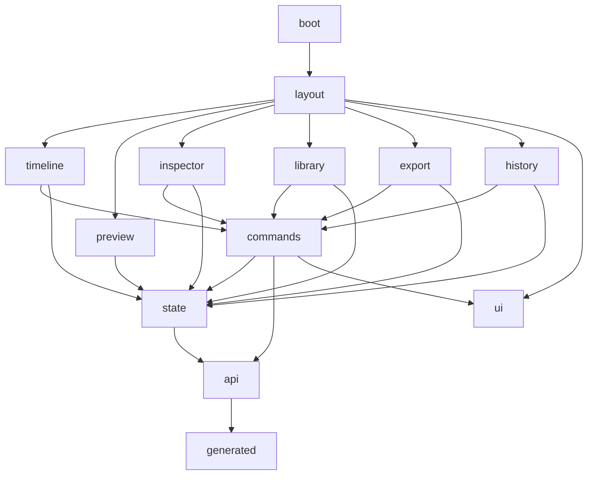
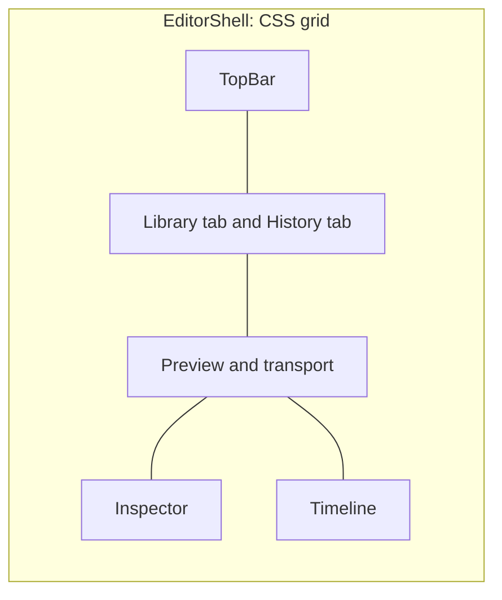
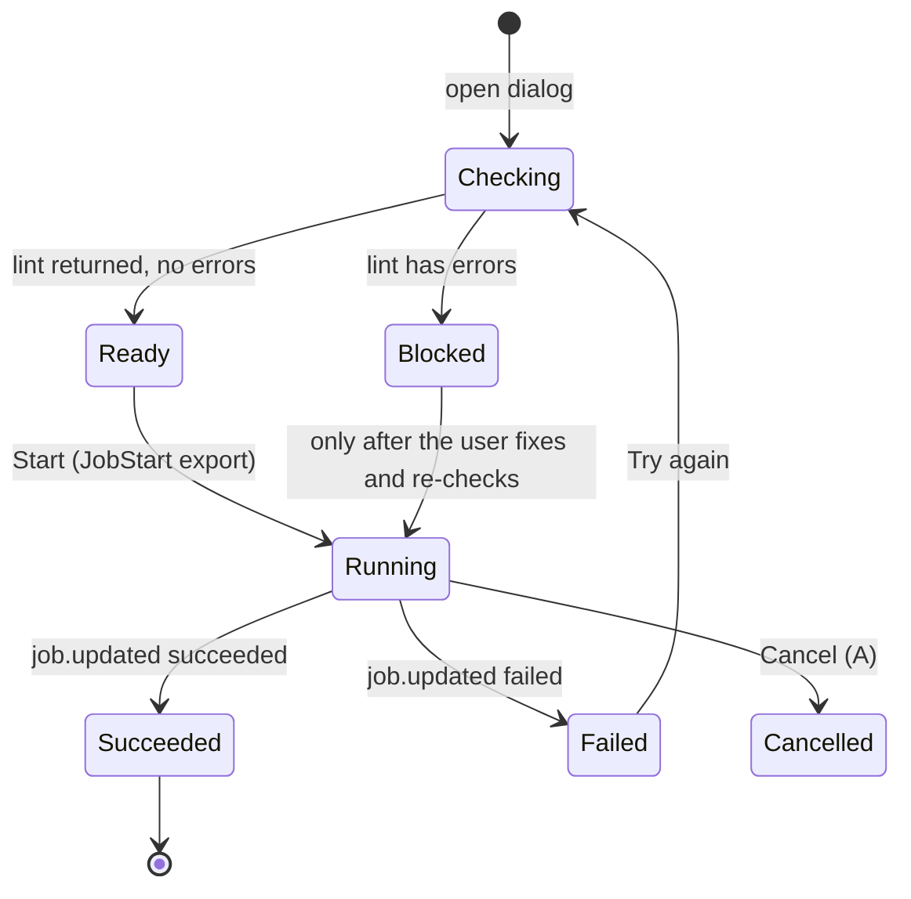

# SDD-012: Editor UI architecture

- Status: Accepted (2026-11-14). Drafted by a delegated engineer, reviewed and corrected by the architect; aligned with SDD-006 (stream, reconciliation, conflicts) and SDD-007 (session, content security policy). Amended the same day to agree with `docs/design-system.md` (tokens, focus, motion, components, desktop window; Appendix A items 19 to 23).
- Depends on: SDD-000 (names), SDD-001 (document), SDD-002 Parts A and B (commands, batch, errors), SDD-004 §4.1, §9, §10, §11 (safe area, frames, preview executor, tolerance), SDD-003 (service result shapes) and SDD-006 (event payloads): every shape this document takes from them is marked "mirrors SDD-003" or "mirrors SDD-006" and the generated types win on any difference. ADR-0003, ADR-0007, ADR-0013, ADR-0014, ADR-0017, ADR-0019, ADR-0023; brainstorming D-013, D-023, D-024
- Implements: RF-060, RF-061, RF-070, RF-071, RF-072, RF-073, RF-074 (design only), RF-075, RF-118, RF-119; NFR-001, NFR-002, NFR-003, NFR-004, NFR-008, NFR-011
- Owner area: senior-e (editor UI)

## Contents

1. [Principles as testable rules](#1-principles-as-testable-rules)
2. [Routes and pages](#2-routes-and-pages)
3. [Directory layout and import rules](#3-directory-layout-and-import-rules)
4. [API client](#4-api-client)
5. [Read model and state](#5-read-model-and-state)
6. [Layout of the editor](#6-layout-of-the-editor)
7. [Timeline component](#7-timeline-component)
8. [Interactions and the commands they send](#8-interactions-and-the-commands-they-send)
9. [Command coverage](#9-command-coverage)
10. [Prototype scope](#10-prototype-scope)
11. [Preview component](#11-preview-component)
12. [Inspector](#12-inspector)
13. [Media library](#13-media-library)
14. [Export dialog and jobs](#14-export-dialog-and-jobs)
15. [History panel](#15-history-panel)
16. [Internationalization](#16-internationalization)
17. [Theme](#17-theme)
18. [Accessibility](#18-accessibility)
19. [Performance budgets](#19-performance-budgets)
20. [Testing](#20-testing)
21. [Desktop shell](#21-desktop-shell)
22. [Acceptance](#22-acceptance)

- [Appendix A: Decisions of this SDD](#appendix-a-decisions-of-this-sdd)
- [Appendix B: Contract needs beyond SDD-000](#appendix-b-contract-needs-beyond-sdd-000)

Conventions of this document. "The core" is the Go process behind `/api/v1`. "The read model" is the project document at a revision, held in the browser. "A request" is what a gesture asks for; "a result" is what the timeline becomes. Phase letters follow SDD-000: `P` Prototype, `A` ALPHA, `B` BETA. A paragraph headed **Decision of this SDD** fills a gap or resolves an ambiguity in another document and is listed again in Appendix A.

## 1. Principles as testable rules

ADR-0007 says the UI is a thin client. This section turns that into rules, each with the check that enforces it.

### 1.1 The three kinds of arithmetic

| Kind | What it is | Allowed | Example |
| --- | --- | --- | --- |
| Screen arithmetic | converts between pointer, pixel and frame coordinates, and between screen and project pixels | yes | `frame = round((clientX - left + scrollLeft) / pxPerFrame)` |
| Request composition | builds the arguments of a command from a gesture and from values read in the read model; the output is a command argument string or number, never stored | yes | a drag by 12 frames sends `item.move {start: "162f"}`; a nudge sends `start` equal to the item's current start plus 1 |
| Decoration | picks pixels of a decorative image (which thumbnail tile, which waveform window) | yes, with limits in 1.3 | tile index for a clip thumbnail |
| Result | decides what an edit does to the timeline, what a frame contains, or whether a command is valid | **never** | the new `start` of a neighbour, a keyframe value between two keyframes, the source frame shown, the layout of a text box, whether an overlap would occur |

### 1.2 Rules

Each rule has an identifier used by the checks of §20.

| Id | Rule | Enforced by |
| --- | --- | --- |
| T1 | The browser may hold only the read model (the document at a revision, §5), UI state (selection, playhead, zoom, scroll, panels, theme, locale, draft input text) and caches of binary content keyed by hash or by revision. It stores no project data in `localStorage`, `sessionStorage`, IndexedDB or the Cache API | `check-thin-client` rule R7; test `thin-client-storage` |
| T2 | The read model is replaced only by a document returned by the core, or by a diff event of the core applied by the mechanical patch of §5.4. No other code writes it | type `DeepReadonly`, import rule R4, runtime freeze in dev and test builds, unit test `document-frozen` |
| T3 | There is no optimistic update. After a gesture is released the read model does not change until the core answers. A pending edit is shown as a ghost drawn from UI state | Playwright test `thin-client-no-optimistic` (server answer delayed 1 s; the store revision and the item's stored `start` stay unchanged while the ghost is visible) |
| T4 | During a pointer drag the browser may move or resize the dragged element visually (the ephemeral preview, §8.1). It uses only screen arithmetic and snap targets supplied by the core (§7.8) or by UI state (playhead, frame 0). The preview is never written to the read model and never sent anywhere except as the one command at release | T2, T3, `check-thin-client` rule R3 |
| T5 | The browser never predicts whether a command is valid. It may gate a control on selection and on documented ranges (§8.3), but anything it sends is judged by the core | review checklist item in the pull request template; test `overlap-snapback` |
| T6 | The browser never interpolates a keyframe, never chooses a source frame, never lays out text, never evaluates a transition and never decides layer order. The preview executor draws exactly what a plan window says (SDD-004 §10). Item geometry for selection handles comes from the plan layer, not from the document | `check-thin-client` rules R1, R2, R5; test `preview-vs-export` |
| T7 | Every edit is sent through `editor/api/edit.ts`. Every read goes through `editor/api`. `fetch` and `EventSource` are used nowhere else | `check-thin-client` rule R6 |
| T8 | Every time argument sent to the core is a string with a unit (`"12.5s"`, `"375f"`, `"00:12.500"`). A bare number never leaves the browser as a time | unit test `builders-time-strings`; contract test that scans every recorded request of the e2e suite |
| T9 | Every user-facing string is looked up through `t(key)` (§16). The only strings shown as received are core-supplied error `message` and `hint`, the text of history steps and a user's own content (project, track and item names, text, caption words) | `check-i18n` rule I3 |
| T10 | Every non-internal command of the catalogue has a UI entry point (D-013) | contract test `command-coverage` (§9.3) |

**Untrusted text.** Item names, asset names, caption text, history text and project names come from agents and from files, and may contain right-to-left or bidirectional control characters (SDD-007 §8.5 item 3). They are rendered only through the component `components/UntrustedText.tsx` (it lives in `components/` because the Inertia pages use it too), an element with `dir="auto"` and `unicode-bidi: isolate`, so such text cannot reorder the surrounding interface. §7.4, §12.1 (word table), §13.2 and §15 refer to this rule.

### 1.3 Decoration limits

A decoration may read `source_in`, `speed`, `start` and `duration` of an item. Its output must not be written to the read model, shown as a time or sent to the core. If it is wrong by a few frames the user sees a slightly misplaced thumbnail and nothing else. Thumbnail strips and waveforms are the only decorations.

### 1.4 The check that enforces it

`web/scripts/check-thin-client.ts`, run with `bun run check:thin-client` and in CI. It parses every file under `web/resources/js/editor/` with the syntax tree API shipped inside the `typescript` package (`typescript/unstable/sync`: TypeScript 7 is the native compiler and has no JavaScript compiler API, and that API is marked unstable, so `typescript` stays pinned to an exact version; no new package) and fails with file, line and rule id. Rule R3 is syntactic: a write on an expression rooted at a name declared with one of the document types (the `DeepReadonly` types reject the same writes at typecheck). Biome stays the formatter and general linter; this script is the only authority on the rules below. Rules:

| Rule | What it looks for |
| --- | --- |
| R1 | Imports of packages that compute timelines or interpolate: `immer`, `mutative`, `fast-json-patch`, `rfc6902`, `jsondiffpatch`, `json-logic-js`, `mathjs`, `bezier-easing`, `d3-ease`, `d3-interpolate`, `gsap`, `popmotion`, any `*.wasm` import, `new Worker(`, `new SharedWorker(`. Imports from `@/generated/*` must be `import type`, except `@/generated/limits` and `@/generated/commands.json` |
| R2 | Declarations or calls whose name starts with `interpolate`, `ease`, `lerp`, `layoutText`, `resolveKeyframe`, `evaluateItem`, `sourceFrame`, `computeOverlap`, `findFreeSlot`, `rippleDelete`, `applyCommand`, `reduceTimeline`; calls to `.measureText(` anywhere |
| R3 | Any assignment, `Object.assign`, `delete`, array mutation (`push`, `splice`, `sort` in place, `reverse`) or `structuredClone` result mutation on an expression whose declared type is `ProjectDocument`, `Item`, `Track`, `Asset`, `Word` or `Keyframes` (types of `@/generated/timeline`), or on `documentStore` state outside `editor/state/sync.ts` |
| R4 | Imports of `editor/state/documentStore` write functions (`replaceDocument`, `applyRevisionDiff`) from any file except `editor/state/sync.ts` |
| R5 | In files outside the allowlist (`editor/timeline/geometry.ts`, `editor/timeline/gestures/**`, `editor/timeline/snapping.ts`, `editor/commands/builders.ts`, `editor/commands/units.ts`, `editor/preview/**`, `editor/ui/TimeField.tsx`): a binary expression that has a property access named `start`, `duration`, `source_in`, `speed`, `fps`, `fade_in`, `fade_out` or `words` as an operand with `+`, `-`, `*`, `/`, `%` or a comparison against another time quantity. Display and request code that must do this arithmetic calls a named helper of `units.ts` and writes none of its own: `displayDuration(item)` (the read-only duration), `displayEnd(item)` (the End field and the end shown in labels), `nudgeStart(item, delta)` (keyboard nudge), `keyframeAbsoluteAt(item, t)` (the item-relative time of a keyframe field to the absolute `at` of `keyframe.set` and `keyframe.remove`) and `captionWordSegments(item, ppf)` (the start and width of each caption word segment). `selectors.ts`, `virtualize.ts`, `timeline/keyboard.ts`, the inspector fields and `CaptionItem` call these helpers |
| R6 | `fetch(`, `new EventSource(`, `XMLHttpRequest`, `navigator.sendBeacon` outside `editor/api/**` and `editor/boot/**` (boot posts `/locale`) |
| R7 | `localStorage`, `sessionStorage`, `indexedDB`, `caches` outside `editor/state/prefs.ts`; in `prefs.ts` the keys must belong to the allowed list `theme`, `vv.layout`, `vv.timeDisplay`, `vv.timeUnit`, `vv.zoomByProject` (zoom and scroll only) |
| R8 | The import rules of §3.3 |

The script has its own unit tests (a fixture per rule that must fail and one that must pass), run by Vitest.

## 2. Routes and pages

### 2.1 Which pages are Inertia

| Route | Page component | Purpose | Mode | Phase |
| --- | --- | --- | --- | --- |
| `GET /` | redirect to `/projects` | | both | P |
| `GET /projects` | `pages/Projects/Index.tsx` | list projects (`ProjectList`), create (`ProjectCreate`: name and size preset, RF-002), open, in ALPHA trash and restore | both | P |
| `GET /settings` | `pages/Settings/Index.tsx` | language, theme, default time unit, version and workspace path (`Doctor`, `GET /system`) | both | A |
| `GET /settings/keys` | `pages/Settings/Keys.tsx` | create and revoke API keys with scopes (SDD-007) | network only; 404 in local mode | A |
| `GET /login`, `POST /logout` | `pages/Auth/Login.tsx` | login (vukem sessions) | network only | A |
| any error | `pages/Error.tsx` | error page of Inertia visits | both | P |

These pages talk to the Go controllers through Inertia props and form posts, as the existing Studio does. A controller of these pages calls the same `service.Service` operations as the HTTP API (ADR-0008) and passes the result as props.

### 2.2 The editor route

**Decision of this SDD: the editor is a hand-written route, not an Inertia page.** `GET /editor/{project_id}` is registered in `routes/web.go` with the same middleware stack as the Inertia pages (`DefaultMiddleware`, locale, session or local token), and its handler renders the view `resources/views/editor.html` through `c.Render`. The view is a copy of `app.html` that loads the Vite entry `resources/js/editor.tsx` instead of `app.tsx` and has no `{{.Inertia}}`.

Why a hand-written route and not an Inertia page that mounts the editor:

1. ADR-0013 says the editor is "decoupled from Inertia". The editor does not use Inertia's page object, props, partial reloads, progress bar, history state or scroll restoration. Mounting it as a page would bring all of that into a screen that owns its own data flow, and Inertia would try to handle `popstate` and link clicks inside a tool that must never navigate by accident.
2. The editor bundle stays free of `@inertiajs/react` (smaller first load) and of the Inertia asset-version reload, which would discard an editing session on every deploy.
3. vukem documented no SPA fallback when this was written (VF-004; vukem pull request #220 adds the documentation), and none is needed: the editor has exactly one server route, `/editor/{project_id}`, and no client-side routes. The `{{vite ...}}` view function and the CSP nonce work in any view (`vukem/site/content/docs/frontend/vite.mdx` line 213 "templ and plain handlers"), so the route needs only a view and a second Vite input.
4. A second entry is a one-line change in `vite.config.ts`: `vukem({ input: ["resources/css/app.css", "resources/js/app.tsx", "resources/js/editor.tsx"] })`. The `@inertiajs/vite` plugin only acts on `app.tsx`.

Handler behaviour:

1. Validate `project_id` against `prj_[0-9a-hjkmnp-tv-z]{10}`. Invalid: 404 error page.
2. Call `ProjectGet` through the service for existence and trash state. Unknown: 404. Trashed: the editor opens read-only with a banner (ALPHA); in the Prototype a trashed project is 404.
3. Render the view with these values, written into the page as `<script type="application/json" id="vv-bootstrap" nonce="{{cspNonce}}">`:

```ts
interface EditorBootstrap {
  project_id: string;
  mode: "local" | "network";
  api_base: "/api/v1";
  locale: string;                 // resolved by vukem i18n middleware
  locales: string[];              // app.I18n.Locales()
  messages: Record<string, string | Record<string, string>>; // app.I18n.Messages(locale, "ui.editor.", "ui.common.", "ui.theme.", "ui.nav.")
  user: { id: string; name: string } | null; // network mode only
  phase: "prototype" | "alpha" | "beta";     // the build's feature gate, §10
  version: string;                // binary version, shown in settings and in bug reports
}
```

4. `Bundle.Messages(locale, prefixes...)` (`vukem/i18n/i18n.go` line 360) is the same function `inertia.I18n` uses, so the catalogs in `resources/lang/` serve both kinds of page.

**Deep links and reloads.** The URL is `/editor/prj_7k2m9x4q1b` with optional query `?t=<time string>` (initial playhead, for example `?t=12.5s`) and `?item=itm_...` (initial selection and scroll into view), both ALPHA. The browser URL is replaced (history `replaceState`) when the user selects an item or the playhead rests for 1 s, so a copied URL reopens the same place. Because all state of the project lives in the core, a reload, a pasted link or a new tab re-runs the same boot sequence (§5.6) and arrives at the same place. A link from the project list is an ordinary `<a href>` (full page load, because the editor is another document), and the "back to projects" control in the top bar is an ordinary `<a href="/projects">`.

**Content Security Policy.** The default policy (`default-src 'self'`, `img-src 'self' data:`, `connect-src 'self'`) is kept unchanged. Consequences the editor must respect: bitmaps and frames are fetched with `fetch` and turned into `ImageBitmap` (`createImageBitmap`), not shown through `blob:` URLs; the paused frame is an `` to a same-origin URL; `<video src>` and `<audio src>` are same-origin; PixiJS is imported as `pixi.js/unsafe-eval` before the renderer is created, so no `eval` or `new Function` is needed (the name refers to the library's shader-sync code path, which is CSP-safe in that build); no workers, no `blob:` workers. The Playwright test `csp-clean` fails on any `securitypolicyviolation` event during the Prototype scenario.

### 2.3 Entry points

| File | Role |
| --- | --- |
| `resources/js/app.tsx` | Inertia pages (kept) |
| `resources/js/editor.tsx` | reads `#vv-bootstrap`, applies the theme before paint (the inline script of the view does it, §17), mounts `<EditorApp bootstrap />` on `#editor` with `createRoot` |
| `resources/views/editor.html` | document shell; no sidebar, no layout |

## 3. Directory layout and import rules

### 3.1 Reuse of the existing front end

The existing `web/` is the Studio application (brief to video). The Vukem Video web app replaces its pages and keeps its foundations. Files kept as they are: `components/ui/*` (shadcn, Biome-excluded), `lib/cn.ts`, `hooks/use-mobile.ts`, `css/app.css` (tokens extended in §17), `vite/vukem.js`, `resources/resources.go`, `components/ThemeToggle.tsx`, `pages/Error.tsx`, `ssr.tsx`, `biome.json`, `components.json`, `tsconfig.json`. Files kept and changed: `lib/i18n.ts` (§16.3), `components/LocaleSwitcher.tsx` (split into `LocaleSelect` and an Inertia wrapper), `layouts/AppLayout.tsx` (navigation reduced to Projects and Settings), `views/app.html` and `app.tsx` (theme default, §17), `lang/en.json` and `lang/pt-BR.json` (Studio keys removed, editor keys added), `vite.config.ts` (second input). Files removed: `components/BriefForm.tsx`, `FieldTip.tsx`, `Tips.tsx`, `pages/Jobs/*`, `pages/Dashboard.tsx`, the Studio types in `types.ts`.

Shadcn components to add. §4.4, §9.2, §12, §13 and §14 need components that `components/ui/` does not have yet: `dialog`, `alert-dialog`, `popover`, `dropdown-menu`, `context-menu`, `slider`, `switch`, `checkbox`, `radio-group`, `progress`, `toggle` and `toggle-group` (`docs/design-system.md` §4.2). They are added with `bunx shadcn add <name>` in the `radix-nova` style of `components.json` and import from `radix-ui`, which is already a dependency, so they add no package. After they are added they are kept as they are, like the other `components/ui/*` files. `ScrollArea` is not used (native scroll). The command palette is built on `Dialog` and a listbox, not on shadcn's `command` component, because its `cmdk` package would be a new dependency (§9.2). Toasts use the Radix Toast primitive of `radix-ui` in `editor/ui/Toast.tsx`.

New dependencies, to be added only after the owner approves each (they are the only ones this SDD needs), each at the latest stable release at install time, exact version in `package.json`: `zustand`, `pixi.js` (ADR-0013); development only: `vitest`, `@axe-core/playwright`, `json-schema-to-typescript` (ADR-0014 generation), `openapi-typescript` (types of HTTP endpoints from the OpenAPI document of ADR-0017). No form library, no drag-and-drop library, no state-diff library, no date library, no animation library.

### 3.2 Layout under `web/resources/js/`

```text
resources/js/
├── app.tsx                    Inertia entry (kept)
├── editor.tsx                 editor entry
├── layouts/AppLayout.tsx      Inertia pages layout
├── pages/                     Inertia pages: Projects/Index, Settings/Index, Settings/Keys, Auth/Login, Error
├── components/                shadcn ui/, ThemeToggle, LocaleSelect, LocaleSwitcher, UntrustedText (shared by both kinds of page)
├── lib/                       cn.ts, i18n.ts (context based useT), format.ts (Intl helpers)
├── hooks/                     use-mobile.ts
├── generated/                 COMMITTED, produced by CI (ADR-0014); never edited by hand
│   ├── timeline.ts            types of the document (from core/schema/timeline.v1.schema.json)
│   ├── commands.ts            CommandName union, CommandArgsMap, Operation (from core/schema/commands)
│   ├── commands.json          snapshot of the registry: name, summary, args_schema, example, errors, scope, phase, internal
│   ├── events.ts              ProjectEvent union (from the event schema)
│   ├── api.ts                 paths and bodies of /api/v1 (from the OpenAPI document)
│   ├── errors.ts              ErrorCode union and the table of codes with retryable flag
│   └── limits.ts              constants of SDD-001 §4 (max frame 108000, max batch 200 ...)
└── editor/
    ├── boot/                  mount, bootstrap parsing, error boundary, test hooks (?debug=1)
    ├── api/                   http.ts, client.ts (one function per endpoint), edit.ts, errors.ts (ApiError), retry.ts, events.ts (EventSource), urls.ts (media URL builders)
    ├── state/                 documentStore.ts, sync.ts (the only writer), applyDiff.ts, selectors.ts, uiStore.ts, ghostStore.ts, jobsStore.ts, mediaStore.ts, activityStore.ts, prefs.ts
    ├── commands/              builders.ts (gesture to Operation), actions.ts (action registry), coverage.ts, keymap.ts, units.ts (time strings), palette/ (command palette), schemaForm/ (JSON Schema to form)
    ├── preview/               PreviewExecutor.ts (interface), PixiExecutor.ts, planWindows.ts, videoPool.ts, audioGraph.ts, clock.ts, pausedFrame.ts, Preview.tsx, overlays/ (SafeArea, SelectionBox, Handles)
    ├── timeline/              Timeline.tsx, geometry.ts, Ruler.tsx, TrackRow.tsx, TrackHeader.tsx, items/ (ClipItem, AudioItem, TextItem, CaptionItem, ShapeItem), Playhead.tsx, snapping.ts, gestures/ (move, trim, scrub, marquee, reorder), keyboard.ts, virtualize.ts
    ├── inspector/             Inspector.tsx, ProjectPanel, TrackPanel, panels/ (Clip, Audio, Text, Caption, Shape, Keyframes, Template), fields/ (NumberField, ColorField, SelectField, TextField; the time field is `ui/TimeField.tsx`)
    ├── library/               Library.tsx, ImportBar.tsx, AssetCard.tsx, AssetDetails.tsx
    ├── export/                ExportDialog.tsx, JobsChip.tsx, LintList.tsx
    ├── history/               HistoryPanel.tsx
    ├── ui/                    small shared atoms used by two or more feature folders: Toolbar, IconButton, Panel, Splitter, Toast, ErrorNotice, Timecode, TimeField
    ├── layout/                EditorShell.tsx, TopBar.tsx, ActivityIndicator.tsx, panel sizing
    └── a11y/                  LiveRegion.tsx, focus helpers, announce()
```

`resources/js/editor/**/*.test.ts(x)` are Vitest files next to the code they test. End-to-end tests are under `web/e2e/specs/` (the existing Playwright setup).

### 3.3 Import rules

An arrow means "may import". Everything may import `@/generated` (types only, rule R1), `@/lib`, `@/components`.



| Folder | May import | Must not import |
| --- | --- | --- |
| `api` | `generated`, `lib` | `state`, `commands`, any UI |
| `state` | `api`, `generated`, `lib` | `commands`, any UI |
| `commands` | `state`, `api`, `ui`, `generated`, `lib` | any feature folder |
| `preview` | `state` (read), `api/urls`, `api/client` (plan, frame, bitmaps), `ui` | `timeline`, `inspector`, `commands` write path (it sends no edits; the transform handles use `commands/actions`, so the overlay components live in `preview/overlays` and call actions through the `useAction` hook of `commands`) |
| `timeline`, `inspector`, `library`, `export`, `history` | `state`, `commands`, `ui`, `a11y`, `preview/clock` (read only), `api/urls` | each other |
| `ui`, `a11y` | `lib`, `components` | any other editor folder |
| `layout` | all feature folders, `commands` (the palette button) | `api` directly |
| `boot` | everything | |

Feature folders do not import each other. They communicate through the stores (selection, playhead) and through actions. Rule R8 of the check script verifies the table from the import graph.

## 4. API client

### 4.1 Types

Types come from the generated files of ADR-0014 and are never rewritten by hand:

```ts
// generated/commands.ts (shape)
export type CommandName = "item.move" | "item.trim" | /* every command of SDD-002 Part B */ never;
export interface CommandArgsMap { "item.move": ItemMoveArgs; "item.trim": ItemTrimArgs; /* ... */ }
export type Operation = { [K in CommandName]: { op: K; args: CommandArgsMap[K] } }[CommandName];

// generated/errors.ts
export type ErrorCode = "E_VALIDATION" | "E_OVERLAP" | /* every code of SDD-000 §8 and SDD-002 §A.8 */ never;
export const ERROR_TABLE: Record<ErrorCode, { retryable: boolean; http: number }>;
```

`task codegen` regenerates them (`go run ./internal/tools/contractgen`, then `bun run codegen:ts`); CI fails if the working tree changes afterwards (ADR-0014 item 2). `generated/commands.ts` also exports `COMMANDS`, a table of summary, scope, phase, internal flag and error codes per command, and `generated/limits.ts` exports `LIMITS`.

**Open: the types of the HTTP endpoints are written by hand.** This section asks for `generated/api.ts` from the OpenAPI document with `openapi-typescript`. The pinned 7.13.0 uses the JavaScript API of TypeScript 5 (`ts.factory`), and the repository builds with TypeScript 7.0.2, which does not have it: the import fails at load. A second TypeScript version only for this script was refused (no new dependency), so the response types of the endpoints are interfaces in `editor/api/types.ts`, copied from `site/generated/openapi.json`. The step comes back when `openapi-typescript` supports TypeScript 7 or the project changes the generator.

### 4.2 Endpoints and functions

One typed function per endpoint of SDD-000 §1 that the UI uses, in `editor/api/client.ts`. Rows marked "gap" are not in SDD-000 and are specified in Appendix B.

| Function | Request | Result | Phase |
| --- | --- | --- | --- |
| `getProject(id)` | `GET /projects/{id}?detail=document` | `{ project_id, name, revision, state, counts, document }` (SDD-003 §2.3: the head always, plus `document` with `detail=document`) | P |
| `listProjects()`, `createProject(body)` | `GET /projects`, `POST /projects` | used by Inertia controllers server side, not by the editor | P |
| `edit(id, req)` | `POST /projects/{id}/edit` | `EditResponse` (§4.3) | P |
| `getCommands()`, `getCommand(name)` | `GET /commands`, `GET /commands/{name}` | registry entries (palette, §9.2) | A |
| `getHistory(id, page)` | `GET /projects/{id}/history` | steps (§15) | A |
| `undo(id)`, `redo(id)` | `POST /projects/{id}/undo`, `.../redo` | `EditResponse` plus `skipped` | P |
| `importMedia(id, paths)` | `POST /projects/{id}/media` | `{ assets[] }`, one entry per path in order, each with `asset_id`, `job_id` and `name`, or an `error` (SDD-003 §2.6) | P |
| `listMedia(id)` | `GET /projects/{id}/media` (gap) | `MediaEntry[]` | P |
| `inspectMedia(id, asset)` | `GET /projects/{id}/media/{asset_id}` | text and facts | A |
| `trashMedia`, `restoreMedia` | `POST .../trash`, `.../restore` | | A |
| `getPlan(id, from, until, rev)` | `GET /projects/{id}/plan?from=&until=&rev=` (SDD-004 §10) | `PlanWindow` | P |
| `frameUrl(id, at, width, rev)` | `GET /projects/{id}/frame?at=<time string>&width=<px>&rev=<n>` (mirrors SDD-003) | JPEG, used as `` | P |
| `getLint(id)` | `GET /projects/{id}/lint` | findings | P |
| `getSnapPoints(id, rev, words)` | `GET /projects/{id}/snap-points?rev=&words=` (gap) | `SnapPoints` (§7.8) | A |
| `startJob(id, body)` | `POST /projects/{id}/jobs` | `{ job_id }` | P |
| `getJob(job)` | `GET /jobs/{job_id}` | `Job` | P |
| `listJobs(id)` | `GET /projects/{id}/jobs?state=queued,running` (gap) | `Job[]`, for rehydration after reload | P |
| `cancelJob(job)` | `POST /jobs/{job_id}/cancel` | | A |
| `getFonts()` | `GET /fonts` (gap) | `{ family, weights[], bundled }[]` | A |
| `getSystem()` | `GET /system` | version, workspace, encoder | A |
| `openEvents(id)` | `GET /projects/{id}/events` | `EventSource`, §5.5 | P |
| `getTools()` | `GET /system/tools` | installed tools and, for a running install, `bytes_done` and `bytes_total`; polled every second while an install runs (§12.5) | A |
| `installTool(body)` | `POST /system/tools/install` with `{ name, model? }` | 202; allowed only to a browser session in local mode or an `admin` key in network mode (SDD-007 §6.8 item 1) | A |

Binary URL builders (no function call, only strings, in `api/urls.ts`): `proxyUrl(project, asset)` = `/api/v1/projects/{id}/media/{asset_id}/proxy`, `thumbnailUrl(project, asset, width)` (`width` 160, 320 or 640), `stripUrl` and `peaksUrl` on the same prefix (`/thumbnail`, `/strip`, `/peaks`), `bitmapUrl(project, key)` = `/api/v1/projects/{id}/bitmaps/{key}`, `exportFileUrl(job)` = `/api/v1/jobs/{job_id}/file` (SDD-000 §1). All are served with HTTP Range and content-hash caching (ADR-0017 item 8).

### 4.3 The edit function

```ts
export interface EditRequest {
  operations: Operation[];     // 1 to 200 (SDD-003 section 2.4)
  base_revision: number;       // the revision the user was looking at when the gesture was composed
  idempotency_key: string;     // 8 to 64 characters; crypto.randomUUID() (36)
  dry_run?: boolean;
}

export interface EditResponse {          // mirrors SDD-003 and SDD-002 A.5 to A.7
  revision: number;                      // the revision after the batch (current revision when applied is false)
  applied: boolean;
  replayed?: boolean;
  diff: Change[];                        // same shape as the diff of batch.committed
  effective: OpEffect[];                 // one per operation (SDD-003 section 2.4)
  description: string;                   // DescribeDiff output, English, shown in history (same name as in the event, SDD-006)
  findings: LintFinding[];               // new findings (RF-107); `lint` carries the totals
}

export interface EditOptions {
  label: string;                         // i18n key of the gesture, for toasts and the live region
  idempotencyKey?: string;               // reused across retries of one logical edit
  signal?: AbortSignal;
}

export function edit(projectId: string, ops: Operation[], baseRevision: number, opts: EditOptions): Promise<EditOutcome>;

export type EditOutcome =
  | { ok: true; response: EditResponse }
  | { ok: false; error: ApiError; handled: boolean };   // handled: the error policy of §4.4 already informed the user
```

Rules:

1. **One edit in flight per project.** `edit()` pushes the batch on a FIFO queue in `editor/api/edit.ts`; the next batch is sent when the previous one finished. This prevents a user's own quick gestures from racing each other. `base_revision` is the one captured at composition time, not at send time: the core ignores the actor's own intervening batches (SDD-002 A.7 step 2), so a queued batch is still judged against what the user saw, and another actor's intervening edit to the same objects is still reported as `E_REVISION_CONFLICT` (RF-119).
2. **Idempotency key.** Generated once per logical edit with `crypto.randomUUID()`, reused on every automatic retry, replaced by a new key when the user chooses "Apply again" after a conflict (a new logical edit).
3. **Identifiers.** The UI omits `id` and `new_id` and lets the core assign them (SDD-002 A.3 rule 4), except when a later operation of the same batch must refer to a created object (a `track.add` followed by `clip.add` on it). Then the UI supplies the id: `trk_` plus 10 characters from the Crockford alphabet drawn with `crypto.getRandomValues` in `editor/commands/ids.ts`. After a batch the UI learns created identifiers from `item.added` and `track.added` entries of `diff` (for example to select the right part after `item.split`).
4. **Timeouts.** Reads 10 s, `edit` 30 s, `importMedia` 10 s (it returns a job), `startJob` 10 s. A timeout is a network failure for the retry rules.
5. **Request headers.** `Accept: application/json`, `Content-Type: application/json`, `credentials: "same-origin"`. No `Authorization` header, no token in the URL: authentication is the same-site cookie (ADR-0019). The browser adds `Origin` and `Sec-Fetch-Site` itself.
6. **Self-measurement.** `edit()` calls `performance.mark("vv:edit:start")` and `performance.measure("vv:edit", ...)` at response. The measure is what NFR-001 is checked against in the browser (§19).

### 4.4 Error handling by code

`ApiError` holds the envelope of SDD-002 A.8 (`code`, `message`, `hint`, `retryable`, `op_index`, `path`, `details`) plus `status` (HTTP). A response that is not the envelope (a proxy 502, a network failure) becomes `ApiError` with code `E_NETWORK` (UI only, retryable). Display rule: the headline is `t("ui.editor.errors." + code)`, localized; below it the core's `message` and `hint` as received (T9 exception). A code with no catalogue key falls back to the headline `ui.editor.errors.unknown` and the check `check-i18n` fails the build when a code of `ERROR_TABLE` lacks a key.

Retry rules:

| Situation | Automatic retry | Notes |
| --- | --- | --- |
| Network failure, timeout, HTTP 502, 503, 504 without envelope | up to 3 retries, delays 250 ms, 500 ms, 1 s with up to 20% jitter, same idempotency key | safe: the core replays by key (A.7). After the last retry the UI shows `E_NETWORK` and marks the connection state `offline` (§5.5) |
| `E_WORKSPACE_LOCKED` | same as above | |
| `E_REVISION_CONFLICT` | none, §4.5 | the user decides |
| `E_ASSET_NOT_READY` | none | the library disables placement of assets that are not `ready`; if it still happens, a toast says the asset is still ingesting and the user repeats the gesture |
| `E_QUEUE_FULL` | none | the export dialog says another export is running, lists `details.running` and offers a retry button |
| every other code | none | |

Error policy per code (the "handled" step; gesture-specific behaviour is in §8.4):

| Code | UI behaviour |
| --- | --- |
| `E_UNAUTHORIZED` | local mode: banner "session ended, reopen the editor from the terminal" with a reload button; network mode: navigate to `/login?next=` the current URL |
| `E_FORBIDDEN` | toast with the scope in the message; controls needing that scope stay disabled afterwards |
| `E_UNKNOWN_COMMAND`, `E_IDEMPOTENCY_MISMATCH`, `E_INTERNAL` | these are bugs of the UI or core: toast with the message and a "copy details" button (code, message, request id, revision) |
| `E_VALIDATION`, `E_INVALID_TIME` | if `path` is `args.<field>` of an operation that came from an inspector field, the message appears under that field and the field keeps the draft; otherwise a toast |
| `E_NOT_FOUND` | refetch the document (the object was removed by someone else), drop the missing ids from the selection, toast |
| `E_ID_EXISTS` | regenerate the supplied ids and retry once (only possible when the UI supplied them) |
| `E_TYPE_MISMATCH`, `E_INVALID_STATE`, `E_LIMIT`, `E_SLOT` | toast with message and hint; the ghost disappears |
| `E_OVERLAP`, `E_OUT_OF_SOURCE` | per gesture, §8.4 |
| `E_IN_USE` | dialog listing `details.used_by` items as links that select them |
| `E_NOT_EMPTY` | confirmation dialog "remove the track and its N items", on confirm the same operation is resent with `with_items: true` (the item count is read from the read model for the sentence only) |
| `E_FONT_UNKNOWN` | font select reloads and highlights `details.available` |
| `E_PAYLOAD_TOO_LARGE` | toast; multi-item gestures are split into chunks of at most 200 operations before sending (the chunk is one batch each, so it is no longer one undo step: the toast says so) |
| `E_PATH_NOT_ALLOWED`, `E_FILE_NOT_FOUND`, `E_UNSUPPORTED_MEDIA`, `E_INGEST_FAILED`, `E_LIMIT_EXCEEDED` | shown on the asset card or in the import bar (§13) |
| `E_FFMPEG_MISSING`, `E_NO_ENCODER`, `E_EXPORT_FAILED`, `E_VERIFY_FAILED`, `E_LINT_BLOCKING`, `E_CANCELLED`, `E_TRANSCRIBE_UNAVAILABLE` | shown in the export dialog (§14); `E_TRANSCRIBE_UNAVAILABLE` opens the install dialog (§12.5) |
| `E_NOTHING_TO_UNDO`, `E_NOTHING_TO_REDO` | brief status message; the button is disabled until the next batch of this actor |

### 4.5 Conflict policy (`E_REVISION_CONFLICT`)

SDD-006 §7 is the specification; this section only places it in the code. The rule is per object: the core rejects a batch when another actor changed an object the batch refers to, after the revision the batch was based on.

1. `base_revision` of a gesture is the read-model revision **at pointer down** (SDD-006 §7.2); for a button, a key or a form it is the revision at the moment of sending. `edit()` receives it from the caller and never replaces it.
2. On `E_REVISION_CONFLICT` the UI drops the ghost, waits for the read model to reach `details.current_revision` (the events are normally already there; after 2 s it resyncs), and shows a notice that does not block: who changed the object, the text of `details.diff`, and one action, **Apply again**.
3. **Apply again** sends the same operations as a new logical edit (new idempotency key) with `base_revision` equal to the current revision. It is the explicit decision of the user to act on top of the other change. It can still fail, and is reported the same way.
4. **The UI never resends a conflicted batch on its own** and never predicts a conflict from the events it saw during the gesture. It may outline the dragged object as "changed by another actor". This is the RF-119 behaviour: no silent overwrite.

## 5. Read model and state

### 5.1 Stores

Zustand, one store per concern, no store holds both project data and UI state. Stores are created in `editor/state/` and exposed only through hooks and selectors.

```ts
// documentStore.ts: the read model (T2)
export interface DocumentState {
  projectId: string;
  status: "loading" | "ready" | "resyncing" | "offline" | "failed";
  revision: number | null;
  document: DeepReadonly<ProjectDocument> | null;
  state: "active" | "trashed";
  lastEventAt: number;             // performance.now() of the last applied event or fetch
}

// uiStore.ts: UI state, never sent to the core
export interface UiState {
  selection: {
    items: ItemId[];
    track: TrackId | null;
    word: { item: ItemId; index: number } | null;
    keyframe: { item: ItemId; property: string; at: number } | null;
  };
  playheadFrame: number;           // committed value; the live value during playback is in clock.ts (§19)
  playing: boolean;
  timeline: { pxPerFrame: number; scrollLeft: number; scrollTop: number; snapEnabled: boolean; trackHeights: Record<TrackId, number> };
  panels: { library: boolean; inspector: boolean; history: boolean; libraryWidth: number; inspectorWidth: number; timelineHeight: number };
  locale: string;
  theme: "dark" | "light";
  timeDisplay: "timecode" | "frames" | "seconds";
  timeUnit: "s" | "f";             // unit appended to a bare number typed in a time field
  safeAreaVisible: boolean;
  activePanelTab: "library" | "history";
  dismissedCards: string[];        // asset ids of failed library cards the user dismissed (§13.2); not persisted
}

// ghostStore.ts: ephemeral drag previews (T4); written only by gestures
export interface GhostState { ghosts: Record<ItemId, { start: number; track: TrackId; duration: number; pending: boolean }>; snapLine: number | null; errorItem: ItemId | null }

// jobsStore.ts, mediaStore.ts, activityStore.ts hold job and asset lists from events and fetches
export interface ActivityState { recent: ActivityEntry[]; active: Record<string, number>; self: string }  // active: actor to last event time
```

Persisted preferences (`theme`, panel sizes, `timeDisplay`, `timeUnit`, zoom per project) go through `editor/state/prefs.ts`, the only file allowed to touch `localStorage` (rule R7), wrapped in `try/catch` so a blocked storage degrades to defaults.

### 5.2 Selectors

`selectors.ts` exposes memoized functions with narrow inputs so components subscribe to as little as possible: `selectItem(id)`, `selectTrackItemIds(trackId)` (item ids of a track sorted by `start`, recomputed only when an item of that track was added, removed or changed `start`, `duration` or `track`), `selectOrderedTrackIds()` (tracks sorted by `order` compared as byte strings, SDD-001 §3.3.1; this is display ordering by the documented key), `selectAsset(id)`, `selectEndFrame()` (the `end_frame` of the last plan window received, SDD-004 §10: the end of the project as the core computed it, used for the scroll width, the total shown and the point where playback stops; the browser derives no end from the items, so the selector does no arithmetic, and before the first window arrives it returns 0), `selectSlots()`. Any selector that needs arithmetic on item times calls a helper of `units.ts` (rule R5). Selectors never contain edit logic (T6).

### 5.3 How a new revision replaces the document

`documentStore` exposes two write functions, callable only from `sync.ts`:

1. `replaceDocument(revision, document)`: deep-freezes (in dev and test builds), sets the document and revision. Used by the first load and every resync. Structural sharing: before replacing, `sync.ts` walks the new document and reuses the previous object for every item, track and asset whose canonical JSON is equal (a string compare of `JSON.stringify` with sorted keys, cached per object), so React components keep their props identity and do not re-render.
2. `applyRevisionDiff(revision, diff)`: the mechanical patch of §5.4. Requires `revision === current + 1`.

### 5.4 The mechanical patch

**Decision of this SDD.** ADR-0007 item 2 lets the browser update from events. The event of SDD-000 §5 carries a diff (SDD-002 A.5), not a document. Applying a diff is not computing a timeline result: every entry states the after-values, so the patch only copies them in.

```ts
// applyDiff.ts
export function applyDiff(doc: DeepReadonly<ProjectDocument>, diff: readonly Change[]): ProjectDocument | "unpatchable";
```

For each change, in order: `item.added`, `track.added`, `asset.added`, `font.added`: insert `object` under its `id`. `item.removed`, `track.removed`, `asset.removed`, `font.removed`: delete the key. `item.updated`, `track.updated`: for each field in `changes`, set the field to `after`, or delete it when `after` is `null`. `settings.updated`: same on `settings`. `project.updated`: same on `name`. The function creates new objects only along the changed path. Before it sets a field it checks that the local value equals the before-value of the change (SDD-006 §6.2). It returns `"unpatchable"` for an unknown `kind`, an `updated` or `removed` change for an id that is missing, an `added` change for an id that exists, or a before-value that does not match; the caller then resyncs (§5.5). It does no validation, no ordering and no derived values.

Safety net: in dev and test builds `sync.ts` fetches `getProject` after every applied diff and asserts that the canonical bytes equal the patched document; the e2e suite runs with this check on, so a diff that does not describe the whole change fails the test suite, not a user.

### 5.5 The event stream

One `EventSource` per open project, in `editor/api/events.ts`, opened as `new EventSource("/api/v1/projects/" + id + "/events?since=" + revision)` after the document was loaded (same origin, session cookie, no credential in the URL; SDD-006 §2 and §6.1). From ALPHA one tab per project may own the stream and relay to the others (Web Locks and `BroadcastChannel`, SDD-006 §4.6); the relay is optional, and where `navigator.locks` or `BroadcastChannel` is missing each tab keeps its own stream (the fallback, and the whole behaviour in the Prototype). The module owns the connection and reports to `sync.ts`:

```ts
export type ConnectionState = "connecting" | "live" | "reconnecting" | "offline";
export interface EventStream {
  close(): void;
  onEvent(cb: (e: ProjectEvent) => void): Unsubscribe;
  onState(cb: (s: ConnectionState) => void): Unsubscribe;
}
export type ProjectEvent =                         // mirrors SDD-000 §5 and SDD-006
  | { name: "batch.committed"; id: number; revision: number; base_revision: number; kind: string; actor: string; at: string; description: string; diff?: Change[]; diff_truncated?: boolean }
  | { name: "project.updated"; project_id: string; state: string }
  | { name: "asset.updated"; asset_id: string; state: AssetState; progress: number }
  | { name: "job.updated"; job_id: string; kind: JobKind; state: JobState; progress: number; message: string }
  | { name: "resync.required"; revision: number; reason: string };
```

Boot and reconciliation algorithm (the same code serves boot and resync). It is the algorithm of SDD-006 §6, which is authoritative:

1. `getProject(id)` returns revision `R` and the document. `replaceDocument(R, doc)`. State `connecting`.
2. Open the stream with `since=R`. The server replays whatever was committed between the fetch and the connection, then goes live (SDD-006 §4.3), so nothing is missed.
3. Every revision, from an event or from the response of an edit, enters through the single function `receive()` of SDD-006 §6.2:
   - `revision <= current`: ignore (already applied by the other source). This is the reconciliation of §5.7.
   - `revision === current + 1`: `applyRevisionDiff`.
   - `revision > current + 1`: hold it in a buffer and start a 2 s timer; when the missing revision arrives the buffer drains in order.
4. Resync (set status `resyncing`, close the stream, go to step 1) on: `resync.required`, a `batch.committed` with `diff_truncated`, `applyDiff` returning `"unpatchable"`, or the 2 s gap timer. At most 3 consecutive resyncs without progress; then status `failed` with a banner and a Reload button.
5. `asset.updated`, `job.updated`, `project.updated` update `mediaStore`, `jobsStore` and the trash flag. They do not carry revisions and need no ordering.
6. `EventSource` reconnects by itself and sends `Last-Event-ID` (ADR-0017 item 5); the server replays or sends `resync.required`. When `readyState` becomes `CLOSED` (an HTTP error response such as 401 ends the automatic retry), `events.ts` probes `GET /projects/{id}`: a 401 follows the `E_UNAUTHORIZED` policy, any other failure schedules a manual reopen with delays 1, 2, 4, 8, 15 s (15 s thereafter) and state `offline`; success runs the algorithm from step 1.
7. Staleness: the server sends an unnamed empty event every 15 s as a heartbeat that JavaScript can see (SDD-006 §3.1). `events.ts` listens to `message` only to record the time; 40 s without any event closes the `EventSource` and opens a new one with `since=<current revision>`. The same check runs on `visibilitychange` to visible and on `online`.

While the status is `offline` or `resyncing`, controls that send edits stay enabled but the top bar shows the state; an edit sent while offline fails with `E_NETWORK` after its retries and the ghost disappears.

**Tabs.** The tab that holds the Web Lock `vv-events-<project id>` owns the `EventSource` and relays events and the connection state on a `BroadcastChannel` of the same name (`api/eventsLock.ts`); a tab that joins asks for the state with a `hello` message; when the owner closes, the lock passes to the next tab, which opens the stream with the revision it holds. A browser without Web Locks opens one stream per tab.

### 5.6 Boot sequence

1. `editor.tsx` parses the bootstrap, applies the locale messages to the i18n context, mounts the shell with skeleton panels.
2. Opens the event stream and loads the document (§5.5).
3. In parallel: `listMedia`, `listJobs` (rehydrate an export in progress, §14), `getFonts` when needed lazily.
4. Applies `?t` and `?item` if present.
5. The first plan window and first paused frame are requested as soon as the document arrives (§11).

### 5.7 Reconciliation of the edit response and the event

The response to an edit and the event of the same revision both reach the UI (ADR-0017 item 6). The rule is "apply whichever arrives first, ignore the other":

1. The edit response arrives with `revision` `N`, `diff`: if `N === current + 1`, `applyRevisionDiff(N, diff)` and the ghosts of that edit are removed in the same React batch. If `N <= current`, the event already applied it; only the ghost cleanup and result handling run.
2. The event for `N` arrives afterwards: `N <= current`, ignored.
3. If the event arrives first, the response still delivers `effective` and `lint`, which feed toasts and the live region, and clears the ghost.
4. A response with `applied: false` (`dry_run`) changes nothing in the stores.
5. An undo or redo response is handled exactly like an edit response (the undo is a batch in the log).

### 5.8 Another actor edits (RF-118)

`batch.committed` with `actor` different from `bootstrap`'s own actor string (`local:ui` in local mode, `user:<id>` in network mode) is a remote edit:

1. The read model is updated as above, so the timeline and the preview change at once (live view).
2. `activityStore` records `{ actor, revision, at, summary }` and sets `active[actor] = now`. The summary is built from the diff kinds and counts, localized: for example "claude-code changed 3 items and added 1 track".
3. The **activity indicator** in the top bar (§6.2) shows a dot and the actor's name while any `active[actor]` is younger than 3 s: "claude-code is editing". After 3 s it settles to "Last edit by claude-code, 12 s ago", updated every 10 s, and clears after 5 min. Clicking opens a popover with the 20 latest entries (actor, relative time, summary) in the History tab (§15). Prototype has the indicator and the popover. **Several actors at once (D-030).** The indicator stays one badge: it names the actor of the latest remote batch and counts the other actors whose `active[actor]` is also younger than 3 s ("claude-code and 1 other are editing"; plural through `params.count`). The popover then starts with one row per active actor, each with its last action (the summary of its latest entry) and relative time, followed by the latest entries.
4. Items named in the diff get a static 2 px highlight outline in `--agent` for 1.5 s (a CSS class removed by a timer; no animation, D-013). The colour is the agent attribution colour, not `--ed-selection`, so a remote edit is not mistaken for a selection (`docs/design-system.md` §2.4). With `prefers-reduced-motion` the behaviour is the same because nothing moves.
5. A live-region announcement "claude-code changed 3 items" is made at most once every 2 s (§18).
6. An actor string is shown as its label: `local:claude-code` becomes `claude-code`, `key:key_ab12cd34ef` becomes `key ab12`, `user:12` stays `user:12` (resolving user names in network mode is BETA).
7. If a remote edit removes or changes an item a gesture is currently dragging, the gesture is cancelled and a toast says who changed it.
8. Two tabs of the same browser share the actor `local:ui`; a batch from the other tab is treated as "you" (no indicator) and shares undo history. This is documented, not solved.

## 6. Layout of the editor

### 6.1 Regions

```text
┌────────────────────────────────────────────────────────────────────────────────────────┐
│ TOP BAR  [<] Project name (edit)   rev 42 · synced   [Undo][Redo]  ● claude-code is    │
│          editing        [Command palette Ctrl+K] [Theme][Language]        [ Export ]   │
├──────────────┬─────────────────────────────────────────────────┬───────────────────────┤
│ MEDIA        │  PREVIEW                                         │ INSPECTOR             │
│ LIBRARY      │  ┌──────────────────────────────┐                │ (selected item,       │
│  [path____]  │  │                              │  fit to space  │  track or project)    │
│  [Import]    │  │   canvas + selection         │                │                       │
│ ┌────┐ ┌────┐│  │   handles + safe-area        │                │  Timing   Start End   │
│ │card│ │card││  └──────────────────────────────┘                │  Transform ...        │
│ └────┘ └────┘│  [|<] [<] [Play] [>] [>|]  00:12.500 / 01:00.000  │  Style ...            │
│  [History]   │                                  [Safe area][Fit]│  Keyframes ...        │
├──────────────┴─────────────────────────────────────────────────┴───────────────────────┤
│ TIMELINE   [Split][Trim start][Trim end][Add caption]  [Delete]  [Snap]  Zoom [-][+][Fit]│
│            0:00      0:05      0:10      0:15      0:20                                  │
│ T1 Captions  ░░[ caption  ]░░░░[ caption ]                                              │
│ T2 Video     [ clip ───────────────][ clip ──────]                                      │
│ A1 Music     [ audio waveform ─────────────────── ]            ▲ playhead               │
└────────────────────────────────────────────────────────────────────────────────────────┘
```



The timeline toolbar is the one place of the zoom controls (`-`, `+`, `Fit`; the slider is ALPHA). In the Prototype it holds Split, Trim start, Trim end, Add caption, and the zoom buttons; Delete, Snap and the slider are ALPHA. The 9:16 sizes below assume this layout.

CSS grid of the shell: rows `48px 1fr var(--timeline-h)`, columns `var(--library-w) 1fr var(--inspector-w)`; the timeline spans all three columns; the top bar spans all columns. Splitters are focusable separators (`role="separator"`, `aria-orientation`, arrow keys resize by 16 px) implemented with Pointer Events in `ui/Splitter.tsx`. Sizes persist through `prefs.ts`.

### 6.2 Top bar

| Control | Behaviour | Phase |
| --- | --- | --- |
| Back to projects | `<a href="/projects">` | P |
| Project name | text; inline edit sends `project.rename` on Enter or blur | name shown P, edit A |
| Revision and sync state | "rev 42", connection state (`live`, `reconnecting`, `offline`, `resyncing`) as text and icon; tones `live` muted, `reconnecting` `--warning`, `offline` `--destructive`, `resyncing` `--info` (`docs/design-system.md` §4.3.3) | P |
| Undo, Redo | `Undo` and `Redo` service operations, act for the current actor (§15) | P |
| Activity indicator | §5.8 | P |
| Command palette button | §9.2 | A |
| Theme toggle | the existing `ThemeToggle` | P |
| Language | `LocaleSelect` | A |
| Jobs chip | running ingest or export count with progress, opens the export dialog | P |
| Export | opens the export dialog (§14) | P |

### 6.3 Responsive behaviour

The editor is a desktop tool. The supported minimum is 1280 by 720 CSS pixels. Defaults and rules:

| Viewport width | Library | Inspector | Notes |
| --- | --- | --- | --- |
| 1600 and wider | 320 px open | 360 px open | timeline height default 300 px |
| 1280 to 1599 | 240 px open | 280 px open | timeline height default 240 px |
| 1024 to 1279 | drawer (shadcn `Sheet`) opened by a top-bar button | drawer, opens by itself when a selection is made | tolerated, not supported: a notice "best used at 1280 pixels or wider" is shown once per session |
| below 1024 | not supported: a full-screen notice with a link back to the projects list | | |

At 1280 by 720 the preview region is 760 px wide and 392 px high after the top bar (48), the transport row (40) and the 240 px timeline. After the 16 px padding of §11.4 (16 px less in each dimension) the canvas box is 744 by 376 px, and a 9:16 canvas measures about 211 by 376 px; the user can collapse the library and the inspector (`Alt+1`, `Alt+2`, or the panel buttons) to give the preview the full width, and drag the timeline splitter down to 160 px. Minimum sizes: timeline 160 px, preview 240 px high, panels 200 px. Height below 600 px is allowed and only produces smaller regions with scroll in the inspector and library (each panel scrolls on its own; the page itself never scrolls).

## 7. Timeline component

### 7.1 DOM structure

```text
div#timeline  role="grid" aria-label  aria-rowcount  tabindex=-1  style="--ppf: 0.5"
├── div.tl-corner                              top-left cell (empty; the zoom controls are in the timeline toolbar, §6.1)
├── div.tl-ruler  (canvas, aria-hidden) + div role="slider" aria-label="Playhead" aria-valuetext
├── div.tl-headers                             sticky column, one TrackHeader per track
│   └── div role="rowheader"  [name][hide/mute][menu]
├── div.tl-scroll  (the only scroll container, overflow auto)
│   ├── div.tl-canvas  style="width: calc(var(--extent) * var(--ppf) * 1px)"
│   │   ├── div.tl-row role="row"  one per track, height from trackHeights
│   │   │   └── div.tl-item role="gridcell" aria-selected  style="--f: 120; --d: 90"
│   │   ├── div.tl-ghost-layer             ghosts from ghostStore, pointer-events none
│   │   ├── div.tl-snapline
│   │   └── div.tl-playhead                one element, transform driven by clock (§19)
└── div role="status" aria-live="polite"           announcements
```

Items are positioned by CSS custom properties: `left: calc(var(--f) * var(--ppf) * 1px); width: calc(var(--d) * var(--ppf) * 1px)`, where `--f` and `--d` are the item's `start` and `duration` set inline when the item changes and `--ppf` is the zoom set once on `#timeline`. A zoom change updates one variable and the browser relayouts; no React component re-renders (§19).

### 7.2 Coordinate mapping and zoom

```ts
// geometry.ts: screen arithmetic only (R5 allowlist)
export const TRACK_HEADER_PX = 176;
export const ZOOM_LEVELS = [0.03125, 0.0625, 0.125, 0.25, 0.5, 1, 2, 4, 8, 16, 32] as const; // pixels per frame
export function frameToContentX(frame: number, ppf: number): number;            // frame * ppf
export function clientXToFrame(clientX: number, rectLeft: number, scrollLeft: number, ppf: number): number; // round((clientX - rectLeft + scrollLeft) / ppf), never below 0, never above TIMELINE_MAX_FRAME
export function deltaPxToFrames(dx: number, ppf: number): number;               // round(dx / ppf)
export function zoomAround(anchorFrame: number, anchorClientX: number, nextPpf: number): { scrollLeft: number };
export function fitZoom(viewportPx: number, endFrame: number): number;          // viewportPx / (endFrame * 1.05), clamped to the first and last level
export function nextZoom(current: number, direction: 1 | -1): number;
export function rulerStep(ppf: number, fps: { num: number; den: number }): { labelEvery: number; tickEvery: number; format: "m:ss" | "s+ff" };
```

Zoom: `+` and `-` buttons and keys move to the next or previous level; `Ctrl+wheel` (and pinch) zooms continuously within the extremes and keeps the frame under the pointer fixed; `Shift+Z` fits the project in the viewport; the zoom range is 1/32 to 32 pixels per frame, so one frame is at least 32 px wide at the maximum. The initial zoom is `fitZoom` for a project that fits, else 1 px per frame at the playhead. Zoom and scroll position per project persist in `prefs.ts`.

Time axis extent: `max(viewport width, (selectEndFrame() + 300) * ppf)`, so there is always scrollable empty space past the last item for appending. `selectEndFrame()` is the `end_frame` of the last plan window received (SDD-004 §10), not a value derived from the items in the browser (§5.2).

### 7.3 Ruler

A `<canvas>` redrawn on scroll, zoom and resize inside `requestAnimationFrame`. Ticks every `tickEvery` frames, labels every `labelEvery` frames with at least 70 px between labels. The candidate label steps in frames are 1, 2, 5, 10, then 1, 2, 5, 10, 15, 30, 60, 120, 300 and 600 seconds converted with the project's rational rate rounded to the nearest frame. Labels read `m:ss` when the step is a second or more and `s+ff` (for example `12+15`) when the step is below a second, so seconds and frames are both readable. Clicking or dragging the ruler seeks (scrub gesture, §8.1). A wrapper element with `role="slider"` carries `aria-valuenow` (frame), `aria-valuetext` (timecode) and handles `Left`, `Right`, `Home`, `End`, `PageUp`, `PageDown`.

### 7.4 Rendering by item type

Every item is a `div.tl-item` with a type class (`tl-clip`, `tl-audio`, `tl-text`, `tl-caption`, `tl-shape`), a label (item `name`, else asset name, else text, else the localized type name), and these parts:

| Type | Content | Source of artifacts | Phase |
| --- | --- | --- | --- |
| `clip` | label; thumbnail strip as the background; badges: speed when not 1 (`1.5x`), transition-in and transition-out marks at the edges, keyframe diamonds when `keyframes` exists, slot icon when `slot` exists | strip image of the asset (`stripUrl`), tile geometry from `listMedia` (`strip: { tile_w, tile_h, columns, count, interval_ms }`); tile choice is decoration (§1.3) | blocks with label P, thumbnails and badges A |
| `audio` | label; waveform drawn on a `<canvas>` for the visible part only; volume text when not 1; fade-in and fade-out ramps drawn from `fade_in` and `fade_out` | `peaksUrl(asset)`: the binary peaks file of SDD-011 §4.6, read as an `ArrayBuffer`; fetched once per asset and cached | A |
| `text` | the first line of `text` | none | block and label P |
| `caption` | one segment per word when the item is wider than 120 px and `ppf >= 0.5`, else one block with the word count; the selected word is outlined | `words[i].start` and `.duration` relative to the item, turned into segments by `captionWordSegments(item, ppf)` of `units.ts` (rule R5); `CaptionItem` does no arithmetic of its own | block P, words A |
| `shape` | fill colour swatch and shape icon | none | A |

The label and the caption words are rendered with `UntrustedText` (§1.2, untrusted text). Colours come from tokens (§17). A selected item has a 2 px selection ring (token `--ed-selection`). A locked or hidden track dims its row. An item whose asset is missing (`ast_placeholder` or unknown) shows a warning icon.

Track header: name (inline rename sends `track.update`), a hide toggle (visual tracks) or a mute toggle (any track), a drag handle for reordering, a menu (add track above or below, remove, caption style). Row height: 64 px for visual tracks with thumbnails, 48 px for audio, 40 px for tracks of only text and captions; resizable in BETA.

### 7.5 Playhead

One `div.tl-playhead` (a 2 px line plus a triangle handle on the ruler). Its horizontal position is written directly to `style.transform` from the clock subscriber, not through React state (§19). While playing, the timeline scrolls horizontally to keep the playhead in view (page-follow: when the playhead passes 90% of the viewport the scroll jumps so it sits at 10%).

### 7.6 Selection

Click selects one item; `Shift+click` adds the range of items between the anchor and the clicked item on the same track; `Ctrl` or `Cmd` `+click` toggles. Empty space click clears the selection; empty space drag draws a marquee that selects every item the marquee touches (A, a screen hit test only). Clicking a track header selects the track; clicking a caption word selects the item and the word. `Esc` clears. Selection lives in `uiStore`; when the read model removes a selected id, the id is dropped.

### 7.7 Snapping

Snap targets, in order of precedence when equally close: the playhead, frame 0, then the points supplied by the core. Snapping happens only during gestures that move a frame (move, trim, scrub with `Shift`). The threshold is 8 screen pixels (`SNAP_PX`), converted to frames at the current zoom. Toggle with the Snap button or `N`; holding `Alt` during a gesture suspends snapping. Points that belong to the dragged items themselves are excluded. Snapping is screen arithmetic on supplied points: the UI picks the nearest point and sends its frame.

### 7.8 Snap points from the core

**Decision of this SDD.** SDD-000 has no endpoint for snap points although ADR-0007 requires one ("one more read endpoint"). The UI needs `GET /api/v1/projects/{id}/snap-points?rev=<revision>&words=<0 or 1>` (service operation `SnapPoints`, scope `read`, phase A, specified in Appendix B). It is fetched at the start of the first move or trim gesture after a revision change and cached by revision; the request is therefore at most one per revision and gesture.

```ts
export interface SnapPoints {
  revision: number;
  points: Array<{ frame: number; kind: "timeline_start" | "item_start" | "item_end" | "caption_word"; item?: string; track?: string }>;
  limits: Record<string, { trim_start_min?: number; trim_end_max?: number }>;  // per item id, frames
}
```

`caption_word` points are included only with `words=1`, which the UI sets when `ppf >= 0.5` (the same threshold at which the timeline draws words, §7.4) and a caption is the dragged item. `limits` are the earliest frame the start edge of the item can move to and the latest frame its end edge can reach, bounded by the neighbours on the track and by the end of the source. The value a trim sends is the value of the ghost, which is clamped to these limits as the core supplied them; the browser adds no further rule. The core still judges every command, so `E_OVERLAP` and `E_OUT_OF_SOURCE` remain possible (a clamp that does not apply because the revision moved on, for example) and are handled by §8.4. When `rev` is older than the current revision the core returns the points for the current one and the revision it used; the UI uses the points only if the revision matches its own, else it fetches again once and snaps to the playhead only meanwhile.

### 7.9 Virtualization

Per track, item ids are kept sorted by `start` (`selectTrackItemIds`). Rendering is windowed by time when the project has more than `VIRTUALIZE_ABOVE = 150` items: only items intersecting `[scrollLeft - 1 viewport, scrollLeft + 2 viewports]` (found by binary search on `start`, and on the item end for the left edge; `virtualize.ts` obtains the end from `displayEnd(item)` of `units.ts` and does no arithmetic of its own, rule R5) plus the selected items and the item being dragged are mounted. At or below the threshold all items are mounted. The initial value of 150 is a lever, not a belief: the test `timeline-200-items-perf` (§20) must show no long task over 50 ms while scrolling and zooming a 200-item, 2,000-word project, and if it fails the threshold is lowered until it passes. Rows (at most 50 tracks) are never virtualized. Caption words are not separate nodes unless the item is wide enough (§7.4), which bounds the node count by `items + visible words`.

### 7.10 Keyboard operation

The grid has one tab stop (roving `tabindex`: 0 on the focused cell, -1 on the others). Keys (when the timeline has focus):

| Key | Action |
| --- | --- |
| `Left`, `Right` | focus previous or next item on the track |
| `Up`, `Down` | focus the nearest item (by start) on the track above or below |
| `Home`, `End` | first or last item of the track |
| `Enter` on an item | select it; `Enter` again moves focus to the inspector (`Space` is not used here: it always toggles play) |
| `Shift+Left`, `Shift+Right` | extend the selection along the track |
| `Alt+Left`, `Alt+Right` | nudge the selected items by 1 frame (`Shift+Alt`: 1 second): `item.move` with `start` from `nudgeStart(item, delta)` of `units.ts` (request composition; `timeline/keyboard.ts` does no arithmetic of its own, rule R5) |
| `Alt+Up`, `Alt+Down` | move the selected items to the track above or below (`item.move` `track_id`) |
| `[` `]` | trim start or end of the selected item to the playhead (`item.trim`) |
| `S` | split selected items at the playhead |
| `Delete`, `Backspace` | delete selection; `Shift+Delete`: ripple on the track (A) |
| `Ctrl+D` | duplicate (A) |
| `F2` | rename (A) |
| `Esc` | cancel a gesture, else clear selection |

Global keys are in §18.2. The grid keys above exist from ALPHA. Where a key appears here and in §18.2, focus decides:

| Key | Focus on a timeline grid cell (ALPHA) | Focus elsewhere, or any focus in the Prototype |
| --- | --- | --- |
| `Space` | toggles play (always) | toggles play (outside editable fields) |
| `Left`, `Right` | previous or next item on the track | step one frame (the Prototype grid does not capture the arrow keys) |
| `Home`, `End` | first or last item of the track | go to the start or the end of the project |
| `Enter` | selects the item | none |

## 8. Interactions and the commands they send

### 8.1 The gesture life cycle

All pointer gestures in `timeline/gestures/` and `preview/overlays/` follow the same life cycle:

1. `pointerdown` on the target: record the read-model revision (the `base_revision` of the edit this gesture will send, §4.5) and call `setPointerCapture`.
2. After a 3 px movement threshold the gesture starts (a click below the threshold is a click). Before that, nothing is created.
3. `pointermove`: compute the requested values with screen arithmetic and snapping (§7.7), and write the ghost into `ghostStore` (and, for transform gestures, the overlay box). The read model and the plan canvas do not change. Edge auto-scroll runs while the pointer is within 40 px of the timeline edge.
4. `pointerup`: build the operations with `commands/builders.ts` from the final requested values and call `edit()`. The ghost is marked `pending: true` and stays at the released position, drawn with a dashed outline.
5. When the response or event applies the new revision, the ghost is removed in the same React batch that shows the item at its new place. If the answer is an error, the ghost is removed at once and the item is where the read model says it is.
6. `Esc` or `pointercancel` before release: the ghost is removed, nothing is sent.
7. A remote edit of a dragged item cancels the gesture (§5.8 item 7).

A gesture that touches several items (a multi-selection move) sends one batch containing one operation per item, so it is one revision and one undo step.

### 8.2 Gestures and commands

Entries marked P exist in the Prototype (§10); every other entry is A unless marked B. "Ghost" is the ephemeral preview of §8.1.

| Gesture | Command or batch sent | Ephemeral preview | Phase |
| --- | --- | --- | --- |
| Click "Add to timeline" on an asset card | `clip.add {track_id, asset_id, start: "<playhead>f"}` on the first visual track by `order`; if the project has no visual track the batch is `[track.add {kind: "visual", id}, clip.add {track_id: id, ...}]`; audio-only assets use `audio.add` on an audio track, creating one the same way | none | P (visual), A (audio) |
| Drag an asset card onto a track at a time | `clip.add` or `audio.add` with `track_id` of the row under the pointer and `start` from the pointer frame | ghost of the item with the asset's duration (from `listMedia`) | A |
| Drag item body horizontally | `item.move {item_id, start}` (only `start`) | ghost at the snapped frame | A |
| Drag item body to another track | `item.move {item_id, track_id, start?}` | ghost on the target row | A |
| Drag a multi-selection | one `item.move` per selected item, same delta | ghosts for all | A |
| Drag start handle | `item.trim {item_id, edge: "start", to}` | ghost with the new edge, clamped to `limits.trim_start_min` | A |
| Drag end handle | `item.trim {item_id, edge: "end", to}` | ghost clamped to `limits.trim_end_max` | A |
| `[` or `]`, or the "Trim start/end to playhead" buttons | `item.trim {item_id, edge, to: "<playhead>f"}` | none | P |
| Split at playhead (`S`, toolbar button, context menu) | one `item.split {item_id, at: "<playhead>f"}` per selected item whose range contains the playhead strictly (request shaping, §8.3), in one batch; with none left, a local message and nothing sent | none | P |
| `Delete` | `item.delete {item_ids}` | none | A |
| `Shift+Delete`, context menu "Ripple delete" | `item.delete {item_ids, ripple: "track"}`; menu "Ripple delete all tracks": `ripple: "all"` | none | A |
| `Ctrl+D` | `item.duplicate {item_id, start: "<item end>f"}` with the same track (the end frame is read from the item) | none | A |
| Right-click an empty gap, "Close gap" | `timeline.close_gap {track_id, at: "<frame under pointer>f"}` | none | A |
| Toolbar "Add text" (`T`) | `text.add {track_id, start: "<playhead>f", duration: "3s", text: t("ui.editor.defaults.text")}` on the first visual track (created as above if none) | none | A |
| Toolbar "Add caption" (`C`) | dialog with text, start (playhead), duration; sends `caption.add {track_id, start, text, duration}` on the first visual track named by the user or created, `track.add` first when none | none | P |
| Double-click text on the canvas or in the timeline | inline editor; commit sends `text.set {item_id, text}` | the editor overlay | A |
| Double-click a caption word | inline editor; commit sends `caption.edit_word {item_id, index, text}` (empty text removes the word) | the editor overlay | A |
| Drag a boundary between two caption words | `caption.set_words {item_id, words}` with the two neighbouring words' `start` and `duration` strings adjusted, the others copied from the read model | ghost boundary | A |
| Context menu "Split caption here" on a word | `caption.split {item_id, before_word}` | none | A |
| Select two captions on one track, "Merge" | `caption.merge {item_ids}` | none | A |
| Drag corner handle on the canvas | `item.set_transform {item_id, scale}`; with keyframes on `scale`: `keyframe.set {item_id, property: "scale", at: "<playhead>f", value}` | outline box only; the compositor is not touched (T6) | A |
| Drag body on the canvas | `item.set_transform {item_id, x, y}` (or two `keyframe.set` for animated properties) | outline box | A |
| Drag rotate handle | `item.set_transform {item_id, rotation}` | outline box | A |
| Crossfade (menu with two selected items) | `item.crossfade {from_item_id, to_item_id, duration}` where `from` is the item with the smaller `start` | none | A |
| Track header actions | `track.add`, `track.update`, `track.move {track_id, above or below}`, `track.remove {track_id}` (confirm; `with_items: true` after `E_NOT_EMPTY`) | reorder ghost row | A |
| Rename project in the top bar | `project.rename {name}` | none | A |
| Scrub on the ruler, `Left` or `Right` (one frame), `Shift` (one second), Space | no command; moves the playhead (UI state) | the playhead itself | P |

### 8.3 Gating

A control may be disabled or a request narrowed using only: whether a selection exists and its item types; whether the playhead lies strictly inside `[start, start + duration)` of an item (for split, trim and keyframe gestures); whether a property key exists in `keyframes`. Gating is an affordance, never a prediction of success (T5), and anything it lets through is judged by the core.

### 8.4 What happens on each error, per gesture

| Gesture | `E_OVERLAP` | `E_OUT_OF_SOURCE` | `E_REVISION_CONFLICT` | other |
| --- | --- | --- | --- | --- |
| Move | ghost removed, item back at its place; the item named in `details.conflicting_item` gets a static 2 s outline and is scrolled into view; toast with the message, hint and an action "Move to next free position" that sends `item.move` with `start` `"<details.next_free>f"` (the core's own value) | not returned | §4.5 | `E_TYPE_MISMATCH` (wrong kind of track): toast, back |
| Trim | as move; the action is absent when `next_free` is absent | toast "the source has only `<details.available>`"; the item returns to its place | §4.5 | `E_INVALID_STATE` (a transition or fade no longer fits): toast with the hint, back |
| Split | not returned | not returned | §4.5 | `E_INVALID_STATE` (caption with no words on a side): toast with the hint "split at a word boundary" and a button that selects the caption and opens the word list |
| Delete | not returned | not returned | §4.5 | `E_NOT_FOUND`: refetch, nothing more |
| Add clip, text, caption | the same toast and next-free action using `start` | toast | §4.5 | `E_ASSET_NOT_READY`: message, no retry |
| Transform | not returned | not returned | §4.5 | `E_INVALID_STATE` (property has keyframes, only if gating missed it): toast with the hint "use keyframes" and a button that sends the gesture as `keyframe.set` |
| Inspector field | not returned except for timing fields, handled like move and trim | timing fields as trim | §4.5 | `E_VALIDATION` and `E_INVALID_TIME`: message under the field |

## 9. Command coverage

### 9.1 The table

Phase of the entry point is the phase in which that entry point is built. Every command is also reachable through the command palette (§9.2) from the first ALPHA task, which is why the "Palette" entry is the same `A` for all rows and is not repeated. `asset.add` is `internal` (SDD-002 B.2): it is issued by the import flow, exempt from the entry-point requirement and listed for completeness. The catalogue in SDD-002 Part B has 48 commands.

| Command | Entry points besides the palette | Phase |
| --- | --- | --- |
| `project.rename` | top bar name field | A |
| `settings.set` | project panel of the inspector (size preset, width, height, background, loudness target) | A |
| `settings.set_fps` | project panel, with a confirmation dialog that lists `effective.adjusted` afterwards | A |
| `asset.add` | internal: import flow (`MediaImport`) | P |
| `asset.remove` | library card menu "Remove from project"; `E_IN_USE` dialog | A |
| `track.add` | implicit in "Add to timeline" and "Add caption" when no track exists; later: "Add track" menu in the timeline toolbar and track header menu | P (implicit), A (explicit) |
| `track.update` | track header (rename, hide, mute) and track panel | A |
| `track.move` | track header drag handle; menu "Move up", "Move down" | A |
| `track.remove` | track header menu with confirmation | A |
| `track.set_caption_style` | track panel of the inspector, caption style section, "Replace" toggle | A |
| `item.move` | drag, keyboard nudge, inspector Start field | A |
| `item.trim` | `[` and `]` keys and toolbar buttons (P); handles, inspector End field (A) | P, A |
| `item.split` | `S`, toolbar button, context menu | P |
| `item.delete` | `Delete`, toolbar, context menu, ripple variants | A |
| `item.duplicate` | `Ctrl+D`, context menu | A |
| `item.rename` | `F2`, inspector Name field | A |
| `item.set_transform` | canvas handles, inspector Transform section | A |
| `item.set_transition` | inspector Transitions section (kind and duration for in and out) | A |
| `item.set_audio` | inspector Audio section (volume, fades, mute) | A |
| `item.crossfade` | context menu with two items selected | A |
| `timeline.close_gap` | gap context menu | A |
| `clip.add` | "Add to timeline" button on a card (P); drag from the library (A) | P, A |
| `audio.add` | "Add to timeline" on an audio card; drag from the library | A |
| `clip.set_framing` | inspector Framing section (fit, crop) | A |
| `clip.set_speed` | inspector Speed section with the ripple toggle | A |
| `clip.set_color` | inspector Color section | A |
| `clip.remove_silences` | inspector button "Remove silences" with minimum silence and padding fields | A |
| `text.add` | toolbar "Add text" (`T`) | A |
| `text.set` | inspector Text section, inline canvas editor | A |
| `text.apply_preset` | inspector Animation section | A |
| `shape.add` | toolbar "Add shape" menu | A |
| `shape.set` | inspector Shape section | A |
| `caption.add` | toolbar "Add caption" dialog | P |
| `caption.set_words` | inspector word table (bulk edit), word boundary drag | A |
| `caption.edit_word` | double-click a word, inspector word table | A |
| `caption.split` | word context menu | A |
| `caption.merge` | menu with two captions selected | A |
| `caption.set_breaks` | inspector word table (line break toggle per word) | A |
| `caption.set_style` | inspector Caption style section ("Use track style" sends `style: null`) | A |
| `caption.from_transcript` | inspector button "Auto captions" on a clip (§12.4) | A |
| `caption.retime_from_clip` | button "Re-sync captions" in the inspector of a clip with linked captions, and in the lint finding for out-of-sync captions | A |
| `keyframe.set` | inspector Keyframes section (diamond button at the playhead), canvas handles on animated properties | A |
| `keyframe.remove` | inspector Keyframes section, `Delete` on a selected keyframe | A |
| `keyframe.clear` | inspector Keyframes section, "Clear" per property and for all | A |
| `slot.mark` | inspector Template section, toggle "Template slot" with name, description, required, duration policy | A |
| `slot.unmark` | same toggle off | A |
| `slot.fill` | "Template slots" panel: one row per slot with an asset picker or text field and a "Fill" button | A |
| `template.set_info` | project panel, Template section (description, colour names) | A |

Build order inside ALPHA, so coverage grows in a useful order: (1) command palette, schema form and the coverage test; inspector shell; history panel; i18n of pt-BR; (2) drag move and trim, snap points, library drag; (3) transform handles, text and caption editing, keyframes, transitions, presets; (4) track and settings dialogs, templates, shapes, speed, silence, color; (5) accessibility pass and performance pass (§18, §19).

### 9.2 The command palette

`Ctrl+K` (or the top bar button) opens a dialog with a search field (a `Dialog` holding a `listbox` with `aria-activedescendant` for the active row; anatomy and keys in `docs/design-system.md` §4.3.11). The list comes from `getCommands()` (the live registry, SDD-000 `CommandHelp`), so a command added to the catalogue appears the moment the core has it, without UI work. Rows show the localized title (`ui.editor.commands.<name>.title`, falling back to the English `summary` from the registry), the command name and the scope. Search matches title, name and `summary`. Selecting a command opens a form.

**The form is generated from `args_schema`** (JSON Schema 2020-12, `additionalProperties: false`) by `commands/schemaForm/`:

| Schema construct | Control |
| --- | --- |
| `string` with an `ast_`, `trk_`, `itm_` pattern or a description mentioning the id kind | a select of the matching objects of the read model (label: name and id), with free text allowed |
| string whose schema is a time (`format` or `x-vv-kind: "time"`; the generator marks every time argument of A.4; until it does, the form also treats a string as a time when its description says "a time with a unit", "a length", "absolute position", "absolute start", "absolute frame" or "offset into", or its name is one of `start`, `duration`, `at`, `to`, `source_in`, `fade_in`, `fade_out`, `max_gap`, `min_silence`, `padding`) | `TimeField` (§12.2) |
| other `string` | text input; `enum` renders a select |
| `number`, `integer` | number input with `minimum`, `maximum` |
| `boolean` | checkbox |
| `array` of scalars | list editor with add and remove |
| `array` of objects, `object` | nested fieldset |
| `oneOf`, `anyOf` | radio group choosing the variant, then its fields |
| anything the generator cannot render | a JSON textarea for that sub-value (never blocks the command) |

Required fields are marked; the registry `example` pre-fills the form with a "Fill example" button. Below the form the dialog offers "Preview" (sends the batch with `dry_run: true` and shows `diff` and `text`) and "Run" (sends it for real with `base_revision` and a new idempotency key). Errors from the core appear in the dialog with `path` mapped onto the field. A palette-run command goes through exactly the same `edit()` as a gesture. Commands with `internal: true` are hidden. In the Prototype the palette does not exist; it is the first ALPHA task.

The palette can run a batch of several operations: "Add to batch" keeps the form open for the next command and "Run batch" sends them as one revision (RF-105 for people).

### 9.3 The coverage contract test

`editor/commands/coverage.ts` declares, for every command name, the entry points that exist in code:

```ts
export interface EntryPoint {
  kind: "gesture" | "inspector" | "menu" | "toolbar" | "key" | "palette";
  action: string;          // id in the action registry of commands/actions.ts
  phase: "P" | "A" | "B";
}
export const COVERAGE: Record<Exclude<CommandName, InternalCommand>, EntryPoint[]>;
```

The Vitest test `command-coverage.test.ts` loads `generated/commands.json` (a snapshot of the registry committed by CI, ADR-0014) and fails when:

1. A command that is not `internal` has no key in `COVERAGE`, or its list is empty. **This is the test of D-013 and ADR-0007 item 5: a new command in the catalogue breaks the UI build until an entry point is declared.** (The palette entry is declared by one line per command and is real, because the palette is generated from the registry; a command may therefore always satisfy the test with `{ kind: "palette", action: "palette.run", phase: "A" }`, and the table of §9.1 states which commands must have more.)
2. An `EntryPoint.action` does not exist in the action registry, or exists but its builder in `commands/builders.ts` does not produce an `Operation` whose `op` equals the command name (tested by running every builder with a fixture and checking the emitted `op`).
3. For the current build phase (`vv.phase` of the bootstrap), a command whose catalogue `phase` is at or before the build phase lacks an entry point whose phase is at or before it. In the Prototype build the rule applies to the commands marked `P` in §9.1; from the first ALPHA task it applies to every command and every command must have the `palette` entry.
4. `COVERAGE` has a key for a name that is not in the registry (stale entry).

The Playwright test `command-palette-coverage` (§20) is the run-time half: for every non-internal command it opens the palette, checks that the form renders with a control for every property of `args_schema` and no JSON-textarea fallback for a property of a Prototype or ALPHA command, then sends the registry `example` as a dry run against the fixture project and expects either `applied: false` or an error code from the command's `errors` list, never `E_UNKNOWN_COMMAND` and never `E_VALIDATION`.

## 10. Prototype scope

D-023: the Prototype UI shows the timeline and the preview updating live while an agent edits, plays the video, and lets a person do the same four things the agent does in the reference scenario.

### 10.1 What the Prototype UI contains

| Area | Contents |
| --- | --- |
| Pages | `/projects` list with create (name, preset) and open; `/editor/{project_id}` |
| Top bar | back link, project name (read only), revision and connection state, Undo and Redo buttons (§10.3), activity indicator with popover, jobs chip, theme toggle, Export button |
| Live view | the timeline shows every track and item as labelled blocks (name, type colour) on a ruler with a playhead; the preview shows the composed picture; both update at once when any actor commits a batch (RF-072, RF-118); remote edits are attributed in the indicator and the changed items are outlined for 1.5 s |
| Play, pause, seek | Play and Pause button and `Space`; seek by clicking or dragging the ruler; frame step with `Left` and `Right`, one second with `Shift`; `Home` and `End`; timecode display; picture and sound; truth on pause (RF-060, RF-061) |
| Zoom | zoom buttons, `Ctrl+wheel`, fit; keys `+`, `-` and `Shift+Z`; horizontal and vertical scroll |
| Keyboard | exactly the keys marked `P` in §18.2: `Space`, `Left` and `Right`, `Shift+Left` and `Shift+Right`, `Home` and `End`, `S`, `[` and `]`, `Mod+Z`, `Mod+Shift+Z` and `Ctrl+Y`, `+`, `-` and `Shift+Z`, `C`, `Esc`, `Tab` and `Shift+Tab` |
| Operation 1: import a file by path | the library has a path text field and an Import button; ingest progress from `asset.updated` events; asset cards with thumbnail, duration and state; failed cards show code and hint (§13) |
| Placing the imported file | a button "Add to timeline" on a `ready` card (`clip.add` at the playhead, creating a visual track if there is none). This is not a fifth manual operation: it is the minimum that lets the reference scenario start (Decision of this SDD) |
| Operation 2: split or trim | click an item to select it; `S` or the Split button splits it at the playhead (`item.split`); `[` and `]` or the Trim buttons trim its start or end to the playhead (`item.trim`). No handles, no drag |
| Operation 3: add a caption | the Add caption button opens a dialog (text, start defaulting to the playhead, duration defaulting to 3 s) and sends `caption.add`, creating a visual track if needed |
| Operation 4: export with progress | the Export dialog: lint findings, Start, progress bar from `job.updated` events, result with path and download link, failure with code and hint (§14) |
| Theme and i18n | dark by default with the light toggle; every string through `t()`, English catalog only (the Portuguese catalog is ALPHA) |
| Debug | `?debug=1` test hooks (§20.4) |

### 10.2 What is explicitly not in the Prototype

Dragging or resizing items; drag from the library to the timeline; snapping and the snap-points endpoint; the inspector and every field in it; transform handles and any canvas editing; multi-selection, marquee, copy, paste, duplicate, delete, ripple; text items, shapes, keyframes, transitions, speed, color, silence removal, templates; caption editing beyond adding; track operations (the track header shows name only); project settings and rename; the command palette and the schema form; the history panel; thumbnails strips and waveforms in the timeline; the safe-area guide; the keyboard map beyond the keys listed in §10.1; cancel of an export (`JobCancel` is A); the Portuguese catalog and the language switcher; the settings, API-keys and login pages; deep link parameters `?t` and `?item`; virtualization; the accessibility audit (semantic elements and labels are still used, §18). The coverage test runs in the Prototype but only for the commands marked `P` in §9.1.

In the ALPHA build the gate of this list is lifted by one function: every control that exists only from a later phase asks `isPhaseAtLeast("alpha")` of `boot/phase.ts`, which reads the `phase` of the bootstrap. Nothing else compares the phase string, and `coverage.test.ts` runs the full rule of section 9.3 for the ALPHA build (47 keys, one `palette` entry each).

### 10.3 Decisions about the boundary

**Decision of this SDD.** Undo and Redo buttons are in the Prototype although D-023 lists four operations. Manual split and trim without undo makes the Prototype unusable, the service operations are `P` in SDD-000, and a button costs nothing. They act for the current actor (`local:ui`).

## 11. Preview component

### 11.1 Interface

The preview is hosted behind the interface ADR-0013 requires, so PixiJS can be replaced:

```ts
export interface PreviewExecutor {
  mount(host: HTMLElement): void;
  dispose(): void;
  setProject(info: { projectId: string; width: number; height: number; fps: { num: number; den: number } }): void;
  setRevision(revision: number): void;           // invalidates plan windows, keeps media elements
  seek(frame: number): void;                     // paused or scrubbing
  play(): Promise<void>;                         // resumes the AudioContext (needs a user gesture)
  pause(): void;
  onFrame(cb: (frame: number) => void): Unsubscribe;   // called every presented frame during playback
  onState(cb: (s: "idle" | "playing" | "seeking" | "buffering" | "unsupported") => void): Unsubscribe;
  getLayerGeometry(frame: number): LayerGeometry[];    // plan geometry for handles and hit tests
  readonly stats: { videoElements: number; planWindows: number; droppedFrames: number };
}
```

`PixiExecutor` implements it with PixiJS v8 on a WebGL2 canvas, imported as `pixi.js/unsafe-eval` (§2.2). Everything else in this section is the contract of SDD-004 §10, which is not restated, only bound to UI behaviour.

### 11.2 What the executor does and does not do

1. It requests plan windows with `getPlan(id, from, to, rev)` (at most 300 frames each), keeps the window of the playhead and the next one, prefetches the next when the playhead is within 60 frames of the end of the current one, keeps at most 8 windows (LRU), and discards all on `setRevision`.
2. It fills the canvas with the plan's `background`, then draws each layer as a sprite at the plan's `cx`, `cy`, `w`, `h`, `rotation`, `opacity` and `color_matrix`, in plan order, using the layer's `crop` as the source region of the sprite, and nothing else (T6). Bitmaps are fetched by key (`bitmapUrl`) with `fetch` and `createImageBitmap`, cached in a map of at most 64 entries by LRU. Constants given as arrays are indexed by `frame - first`.
3. Video layers use pooled `<video>` elements on the proxy (`videoPool.ts`, key: asset id). During playback the element plays with `playbackRate` equal to the slope of `source_seconds` over the window (clamped to 0.25 to 4, `preservesPitch` true) and its `currentTime` is corrected when it drifts by more than 2 frames from `source_seconds` (SDD-004 §10 item 2). When paused or scrubbing it seeks (`fastSeek` when present, else `currentTime`).
4. Audio goes through one `AudioContext`. The plan's `audio` entries (SDD-004 §10) are played by audio elements on the proxy, one `GainNode` each, with `playbackRate` taken from `audio[].speed`. Each element, video or audio, feeds a `MediaElementAudioSourceNode` and a `GainNode` whose gain is the plan's `gain` (so gains above 1, up to 4, work; `HTMLMediaElement.volume` cannot exceed 1). `play()` resumes the context from the click that started it (autoplay policy). The master clock is the audio clock: `frame = startFrame + floor((ctx.currentTime - t0) * fps.num / fps.den)` (SDD-004 §10 item 4). The clock runs on a silent context when no layer has audio.
5. **Cap on decoding video elements.** `MAX_VIDEO_LAYERS = 4` (initial value from SDD-004 §10 item 5). The executor ranks the media layers of the current window by plan order, topmost first, gives the first four a decoding element and draws the others as the asset's thumbnail still (`thumbnailUrl`). Elements of assets that left the window are paused and released after 5 s (`src` removed and `load()` called, to free the decoder). The number is confirmed by the Prototype scenario `video-layers-budget` (§19.1, §20.1: fixtures with 4, 6 and 8 simultaneous video layers; `getVideoPlaybackQuality().droppedVideoFrames` over 10 s, limit 2%, and tab memory, on the reference machine); if 4 shows more than 2% dropped frames or breaks NFR-008, it is lowered and recorded here.
6. If WebGL2 is unavailable the executor reports `unsupported`; the preview then shows only paused frames (truth on pause), disables Play, and a banner says why.

### 11.3 Truth on pause

150 ms after playback stops or a seek ends, `pausedFrame.ts` requests the exact frame: it sets an `` overlaying the canvas to `frameUrl(projectId, "<frame>f", width, revision)`, where `width` is the canvas width in device pixels rounded up to the next of 270, 360, 540, 720, 1080 (so the cache of the core is hit; SDD-004 §9 default 540). The image is shown when `img.decode()` resolves and the frame, revision and width still match. Any change of playhead, play start or revision removes the overlay at once (SDD-004 §10 item 6). A failed request keeps the canvas and shows no error toast (the canvas is still a valid approximation); the failure is logged as a measure. `performance.measure("vv:truth", "vv:pause", "vv:truth-shown")` records NFR-004.

### 11.4 Fit and size

The canvas has the project's intrinsic size `width × height` (CSS `aspect-ratio`), scaled by `scale = min(availableWidth / width, availableHeight / height)` where the available box is the preview region minus 16 px padding (in each dimension), observed with `ResizeObserver`. Its backing store is `round(width * scale * devicePixelRatio)` wide, capped at 1080 px on the long edge for the pixel buffer (preview resolution). The overlay `` and the overlays below share the same box, so a point in project pixels maps to the screen by `x_screen = left + x * scale`. `Fit` is the default; the user can also choose 50%, 100% of the buffer size (BETA).

### 11.5 Playback controls

A transport row under the canvas: go to start, step back one frame, Play and Pause, step forward, go to end, timecode `current / total` (`Timecode` component writing text from the clock, §19), loop is not in scope. Timecodes are set in the UI font (Geist) with `font-variant-numeric: tabular-nums`, not in a monospace face: no monospace UI font is bundled, and a system monospace stack would differ between platforms and between browser and webview (`docs/design-system.md` §2.7). The six families of D-022 are rendering fonts of the core (ADR-0012) and are never loaded by the browser. A unit test of `Timecode` checks that the digits `0` and `1` have the same advance width in the bundled Geist file; if they do not, the fallback is `@fontsource-variable/geist-mono` at an exact version, approved in advance by the author for that case only (D-030). The total is the project's end, read from `selectEndFrame()`, which is the `end_frame` of the last plan window (SDD-004 §10), not derived in the browser. `Space` toggles play (§18.2 gives the precedence by focus). Seeking while playing keeps playing from the new frame. Playback stops at `end_frame`. Volume and mute of the preview are in BETA.

### 11.6 Overlays

All overlays are DOM elements in `preview/overlays/`, positioned over the canvas box, `pointer-events` only where interactive:

| Overlay | Source of geometry | Phase |
| --- | --- | --- |
| Safe-area guide | the `safe_area: [x, y, w, h]` field of the plan window, in project pixels (the core computes it with `SafeArea(width, height)` of SDD-004 §4.1; the UI never re-implements the percentages). Drawn as a dashed rectangle and a dimmed band outside it; toggled by the "Safe area" button, off by default | A (RF-036) |
| Selection box | the plan layer of the selected item at the playhead frame, `getLayerGeometry(frame)`: `cx`, `cy`, `w`, `h`, `rotation` (indexed by `frame - first` when an array). When the playhead is outside the item no box is drawn | A |
| Transform handles | four corner handles (uniform scale), one rotation handle above the box, drag on the body to move; the gestures of §8.2. The box, the handles and any focus ring over the preview use `--ed-handle` (§17), because the surround is dark in both themes. The box moves under the pointer as the ephemeral preview; the picture does not | A |
| Hit test | a click on the canvas selects the topmost layer (last in plan order) whose rotated rectangle contains the point; clicks that hit nothing clear the selection | A |
| Inline text editor | a `<textarea>` over the item's box for `text.set` | A |

Handles are not part of the exported picture and are drawn only in the editor. Text and caption items are never drawn by the browser: their appearance comes from the plan's bitmaps.

## 12. Inspector

### 12.1 What it shows

The inspector panel shows one panel by selection: nothing selected, the project panel; a track selected, the track panel; one item, the panel for its type; several items, only the fields they share (Name is hidden, Timing hidden, Transform and Audio shown with "mixed" placeholders and sent to all selected items in one batch). Every field is bound to one command; the third column names the property in the argument list of SDD-002 Part B. Phase A for the whole inspector.

| Section | Fields | Command | Applies to |
| --- | --- | --- | --- |
| Name | name | `item.rename {name}` | any item |
| Timing | Start (time field) | `item.move {start}` | any item |
| | End (time field, shown through `displayEnd(item)`) | `item.trim {edge: "end", to}` | any item |
| | Duration (read only, `displayDuration`), In point (read only) | none | any item |
| Transform | X, Y, Scale, Rotation, Opacity | `item.set_transform {x, y, scale, rotation, opacity}` (only fields changed); an animated property shows a keyframe marker and sends `keyframe.set` | visual items |
| Transitions | in kind, in duration, out kind, out duration | `item.set_transition {edge, kind, duration}` (kind none sends `kind: null`) | visual items |
| Audio | volume, fade in, fade out, mute | `item.set_audio {volume, fade_in, fade_out, audio_muted}` | clip, audio |
| Framing | fit, crop left, top, right, bottom | `clip.set_framing {fit, crop}` | clip |
| Speed | speed (numeric with `x` suffix), "ripple later items" toggle | `clip.set_speed {speed: "1.5x", ripple}` | clip (SDD-002 B.5 defines `clip.set_speed` for clips only; the field is not shown for audio items) |
| Color | brightness, contrast, saturation | `clip.set_color {...}` | clip |
| Silences | minimum silence, padding, ripple toggle, button | `clip.remove_silences {min_silence, padding, ripple}` | clip |
| Text | content (multi-line), font family, weight, size, color, stroke color and width, shadow color, dx, dy and blur, background color, padding and radius, align, line height, max width, uppercase | `text.set {text, style}` (style is the partial of changed fields) | text |
| Animation | preset, edge, duration | `text.apply_preset {preset, edge, duration}` | any visual item (the command works on any visual item, SDD-002 B.6) |
| Shape | shape, width, height, radius, fill, stroke color and width | `shape.set {...}` | shape |
| Caption words | table: index, text (rendered with `UntrustedText`, §1.2), start, duration, line break toggle; buttons: split before word, merge with next | `caption.edit_word`, `caption.set_words`, `caption.set_breaks`, `caption.split`, `caption.merge` | caption |
| Caption style | the CaptionStyle fields; "Use track style" | `caption.set_style {style}` (`null` to clear) | caption |
| Auto captions | max words, max chars, max gap, replace toggle, button "Generate"; "Re-sync captions" | `caption.from_transcript`, `caption.retime_from_clip` | clip |
| Keyframes | per animated property: list of keyframes (time, value, easing; the time field is item-relative and `keyframe.set` and `keyframe.remove` receive the absolute `at` from `keyframeAbsoluteAt(item, t)` of `units.ts`, rule R5), "Add at playhead", remove, "Clear" | `keyframe.set`, `keyframe.remove`, `keyframe.clear` | visual and audio items |
| Template | "Template slot" toggle, name, description, required, duration policy | `slot.mark`, `slot.unmark` | any item |
| Track panel | name, hidden, muted, caption style (partial and "Replace") | `track.update`, `track.set_caption_style` | track |
| Project panel | name, size preset (9:16, 1:1, 16:9, 4:5), width, height, background, loudness target, frame rate, template info | `project.rename`, `settings.set`, `settings.set_fps`, `template.set_info` | nothing selected |

Fonts come from `getFonts()` (Appendix B); the select shows bundled families first, as names in the UI font: the browser never loads the rendering fonts, and the MVP shows no rendered samples (D-030). Colours use `ColorField` (hex text input plus the native colour input for the RGB part and a slider for alpha, sending `#RRGGBB` or `#RRGGBBAA`).

### 12.2 Time inputs

`TimeField` (`ui/TimeField.tsx`, used by the inspector, the palette form and the dialogs) is a presentational text field (it shows the text it is given and reports what was typed; the owner of the value, the schema form or the commit rule of the inspector, calls `normalizeTimeInput` and `formatTime` of `commands/units.ts`, because `ui` imports no other editor folder, §3.3). The value is displayed in the user's `timeDisplay` mode (§5.1) and any of the three forms is accepted of SDD-002 A.4:

| Typed | Sent as |
| --- | --- |
| `12.5s`, `0.04s` | the same string |
| `375f` | the same string |
| `00:12.500`, `01:02.5` | the same string |
| a bare number such as `12.5` | the number with the user's default unit appended (`timeUnit`, default `s`): `"12.5s"` |
| in the pt-BR locale, a decimal comma: `12,5`, `12,5s`, `00:12,500` (D-030) | the comma replaced by `.`: `"12.5s"`, `"12.5s"`, `"00:12.500"` |
| empty, `abc`, `1:2:3:4`, a negative number, a decimal when the unit is `f` (`12.5` with `timeUnit` `f`) | not sent; the field shows the inline message `ui.editor.errors.E_INVALID_TIME` with the hint listing the three forms |

`normalizeTimeInput(raw: string, defaultUnit: "s" | "f"): { ok: true; value: string } | { ok: false }` in `commands/units.ts` is a pure string function (trim, replace one decimal comma by `.` when the active locale is `pt-BR`, regex, append unit); the locale is read from the bootstrap by its caller, which in `en` passes the raw text unchanged, so `12,5` stays invalid there. `NumberField` applies the same comma rule before it parses its value. Times are always displayed with `.` (timecodes are not localized, §16.4); other displayed numbers follow the locale. It does not convert to frames; the core parses and rounds (A.4). The field never sends a number (T8). After a command the field shows the value of the read model, which is what the core applied; the `effective` frame and seconds also appear in the toast ("start set to frame 374, 12.467 s").

Display formatting `formatTime(frame, fps, mode)` is a pure display function: `frames` gives `375f`, `seconds` gives `12.500s`, `timecode` gives `00:12.500`; `fps` is the project rational. A duration the core gives in seconds (an asset's `duration_seconds`) is formatted by `formatSeconds(seconds, mode)` of `units.ts`, which never converts through frames.

### 12.3 Debouncing and commit rules

One command per committed change, never per keystroke.

| Control | Commit when | Revert when |
| --- | --- | --- |
| Text, number, time, color text | `Enter`, or blur with a changed value | `Esc` (draft discarded, no command) |
| Number with arrows or spin buttons | 400 ms after the last change (a burst of arrow presses is one command with the final value) | `Esc` while focused |
| Slider (opacity, volume, color adjustments) | on release (`onValueCommit`); keyboard steps coalesce as above | `Esc` |
| Select, checkbox, toggle, radio | immediately on change | |
| Colour picker | on close of the native picker | `Esc` |
| Text area (text content, caption words) | blur, or `Ctrl+Enter` | `Esc` |

A field keeps a local draft while it has focus. If the draft equals the stored value, nothing is sent. While its command is in flight the field is `aria-busy` and keeps the draft; on success the draft is dropped in favour of the read model's value; on error the draft is dropped, the stored value returns and the error shows under the field. If a remote edit changes the stored value while the field has focus, the draft is kept and a small "changed by `<actor>`" note appears, with the conflict policy of §4.5 deciding on commit. Each committed change is one revision and one undo step, by design.

### 12.4 Auto captions flow

"Generate" on a clip: if `inspectMedia` reports no transcript, the UI starts `startJob {kind: "transcribe", asset_id}` (media scope), shows progress from `job.updated`, and on success sends `caption.from_transcript {clip_item_id, track_id, max_words, max_chars, max_gap, replace}` with the track chosen in a select (default the first track that has `caption_style`, else a new "Captions" track created in the same batch). `E_TRANSCRIBE_UNAVAILABLE` opens the install dialog of §12.5. The shape of the transcript state follows SDD-003 and SDD-011.

### 12.5 Install dialog for local transcription (RF-205)

When `startJob {kind: "transcribe"}` answers `E_TRANSCRIBE_UNAVAILABLE`, the UI shows a dialog with the message and hint of the core, the list `details.missing` (what is not installed), the size `details.download_bytes` (formatted for display) and the command `details.install_command` in a copyable field. There is no job for the install:

1. In local mode with a browser session, or in network mode with an `admin` key, the dialog offers the button "Install". It calls `installTool({ name, model? })` (`POST /api/v1/system/tools/install`, answer 202), with `name` and `model` taken from `details.missing`. The route is allowed only to a browser session in local mode or an `admin` key in network mode (SDD-007 §6.8 item 1), like emptying the trash.
2. While an install runs the dialog polls `getTools()` (`GET /api/v1/system/tools`) every second and shows a determinate progress bar from `bytes_done` and `bytes_total`. When the tool is listed as installed the dialog closes and the user presses Generate again; the UI does not restart the transcription by itself.
3. With any other caller, or when the answer of `installTool` is `E_FORBIDDEN`, the dialog shows only the command `details.install_command` and no button.
4. A failed install shows the code, message and hint of the core and "Copy details". Phase A, with the auto captions flow.

## 13. Media library

### 13.1 Import by path

The library has a single-line path input and an Import button (`Enter` submits). The input accepts a path as the user pastes it: surrounding double quotes (Windows "Copy as path") are stripped and leading and trailing spaces trimmed; nothing else is interpreted. Pasting several lines imports each line in order (one `importMedia` request each). The browser cannot learn the path of a dropped or chosen file, so:

1. **Plain browser (local mode).** Drag and drop onto the library is accepted only to show a message: "A browser page cannot see the path of a file. Paste the path into the field." The picker `<input type="file">` is not used.
2. **Desktop shell (BETA).** The shell exposes `window.vukemDesktop?.pickFiles(): Promise<string[]>` and delivers dropped paths through `window.vukemDesktop?.onDropPaths(cb)`. The library feature-detects them; when present it shows a "Choose files" button and accepts drops, and passes the returned absolute paths to the same `importMedia` function. The interface is the only coupling to the shell (§21). Its two other optional members (D-030) are `onMenuAction(cb: (action: string) => void): Unsubscribe`, through which the native menu calls an action id of the action registry (`commands/actions.ts`), and `setTheme(theme: "dark" | "light"): void`, which the UI calls at boot and on every theme toggle so the shell's title bar follows the page. All three are feature-detected.
3. **Network mode.** `VUKEM_VIDEO_IMPORT_ROOTS` bounds the paths; an `E_PATH_NOT_ALLOWED` answer shows the roots from `details` when present. Uploads are out of scope (PRD-001 §7).

### 13.2 Cards and progress

```ts
export interface MediaEntry {           // mirrors SDD-003 plus the strip metadata, Appendix B
  asset_id: string;
  name: string;
  kind: "video" | "audio" | "image";
  state: "pending" | "ingesting" | "ready" | "failed";
  progress: number;                     // 0 to 1
  duration_frames: number | null;
  duration_seconds: number | null;
  width: number | null; height: number | null;
  has_audio: boolean;
  error?: { code: string; message: string; hint: string };
  strip?: { tile_w: number; tile_h: number; columns: number; count: number; interval_ms: number };   // SDD-011 §6.5, SDD-003 §2.6
  trashed: boolean;
}
```

`listMedia` runs at boot; `asset.updated` events update the card; when an asset becomes `ready` the library refetches that entry. A card shows: thumbnail (`thumbnailUrl`, a placeholder while not ready), name (rendered with `UntrustedText`, §1.2), duration (`duration_seconds` formatted by `formatSeconds(seconds, mode)`, from the core; the browser does not derive it from frame counts and rates), size, a state label, a progress bar while `ingesting` (`role="progressbar"` with `aria-valuenow`), and for `failed` the error code headline plus the core's message and hint and buttons "Try again" (same path) and "Dismiss" (UI state: the asset id goes into `uiStore.dismissedCards`, nothing is persisted and the card returns after a reload). Actions: "Add to timeline" (P, enabled only when `state === "ready"` and the asset exists in the read model, `selectAsset(id)`, because the `asset.updated ready` event and the `asset.add` batch are not ordered, SDD-006), drag handle (A), menu with "Inspect" (`inspectMedia`, A), "Remove from project" (`asset.remove`, A) and "Move to trash" and "Restore" (`MediaTrash`, `MediaRestore`, A; trashed assets sit in a collapsed "Trash" group). Cards are sorted by import order (the order of `listMedia`).

A not-yet-ready asset, or one not yet in the read model, is never offered for placement (`E_ASSET_NOT_READY` is prevented by gating, §4.4).

## 14. Export dialog and jobs

### 14.1 Flow



1. **Open.** The dialog calls `getLint` and lists the findings grouped as errors, warnings and notes (RF-108 text with the rule name, the item id and the message). Each finding with an item id is a link that closes the dialog and selects the item. Errors disable Start and explain that export would answer `E_LINT_BLOCKING`; the dialog "Re-check" button runs lint again. Warnings do not block. (Lint is the Prototype's first rule set; the full set is ALPHA.)
2. **Start.** `startJob(id, { kind: "export" })` returns `job_id`; the dialog goes to Running. If the answer is `E_LINT_BLOCKING` (the document changed since the check) the findings from `details.findings` replace the list. `E_QUEUE_FULL` shows the running jobs from `details.running` and a Try again button. `E_FFMPEG_MISSING` and `E_NO_ENCODER` show their hint and no retry.
3. **Progress.** From `job.updated` events with the matching `job_id` (`state`, `progress` 0 to 1, `message`): a determinate progress bar with the percentage and the message. If no event for the job arrived for 5 s, the dialog polls `getJob` every 2 s until an event arrives. A progress bar is `role="progressbar"`; updates are announced at most every 10% (§18).
4. **Cancel (A).** A Cancel button calls `cancelJob`; the state `cancelled` shows "Export cancelled" (`E_CANCELLED` is a state, not an error toast). In the Prototype there is no Cancel button and the dialog can be closed while the job continues (the jobs chip keeps showing it).
5. **Success.** Shows the file path as the core reports it (copyable), the size and duration, and a Download link to `exportFileUrl(job_id)` (`GET /jobs/{job_id}/file`, with `Content-Disposition: attachment`, Range supported; the route is Prototype, SDD-000 §1, so the link is in the Prototype too). The copyable path stays for local mode, where the file is already on the user's disk. The verification checks of the core are listed when present. A note says the export is of revision `N` and a warning appears if the read model is newer.
6. **Failure.** Shows the headline for the code (`E_EXPORT_FAILED`, `E_VERIFY_FAILED` with `details.checks` as a list of failed checks, `E_NO_ENCODER`, and so on), then the core's message and hint, and "Copy details".
7. **Reload during an export.** Boot calls `listJobs` and rehydrates running jobs into `jobsStore`; the jobs chip shows them and the dialog reopens at the Running state when the user clicks it.

### 14.2 Jobs chip

Shows the number of running jobs (ingest, transcribe, export) with the highest progress; click opens the export dialog if an export runs, else a small list. Ingest jobs are also shown on their asset cards.

## 15. History panel

A tab beside the library (A). It lists `getHistory(id, page)` newest first, 50 per page with "Load more":

```ts
export interface HistoryStep {           // mirrors SDD-003
  revision: number;
  actor: string;
  at: string;
  description: string;                   // DescribeDiff text, English, shown as received (the name of the event, SDD-006 §3.2)
  kind: "batch" | "undo" | "redo";
  undone: boolean;
  undoable_by_me: boolean;
  redoable_by_me: boolean;
}
```

Each row shows the revision, the actor chip (`you`, `claude-code`, ...), the relative time (`Intl.RelativeTimeFormat`), the first line of `description` and, expanded, the whole text, rendered with `UntrustedText` (§1.2). Steps of other actors are not dimmed but carry their actor chip; undone steps are struck through. A row prepended from a `batch.committed` event is provisional and shows only `revision`, `actor`, `at`, `kind` and `description`, the fields of the event. `undone`, `undoable_by_me` and `redoable_by_me` come only from a refetch of the first page (`getHistory`) after each event, debounced by 250 ms; the refetched page replaces the provisional rows. The panel also refetches the page when the event is a gap.

The top-bar Undo and Redo buttons (and `Ctrl+Z`, `Ctrl+Shift+Z`, `Ctrl+Y`) call `undo(id)` and `redo(id)`, which the core applies to the current actor's own latest step (ADR-0006). The buttons are enabled while the history list says `undoable_by_me` or `redoable_by_me` exists for some step; in the Prototype, where there is no history panel, they are always enabled and `E_NOTHING_TO_UNDO` and `E_NOTHING_TO_REDO` disable them until the next batch by this actor. The response lists the primitives the core skipped because another actor changed the same fields (SDD-002 A.6); the UI shows a toast "Undo applied, 2 changes were left alone because claude-code changed them" using `skipped`. Undo and redo are batches in the log: they arrive as events like any batch.

## 16. Internationalization

RF-073: English and Brazilian Portuguese.

### 16.1 Where strings live

In the existing vukem catalogs, `web/resources/lang/en.json` and `web/resources/lang/pt-BR.json`, loaded by `vukem.WithTranslations` (`resources.Lang()` in `resources/resources.go`). Editor strings are under `ui.editor`, shared ones under `ui.common`, `ui.theme` and `ui.nav` (kept from the existing files). The existing Studio keys (`ui.login`, `ui.dashboard`, `ui.jobs`) are removed with their pages.

### 16.2 Key naming

`ui.editor.<area>.<element>[.<state or variant>]`, camelCase leaf names as in the existing catalog. Areas: `topbar`, `library`, `preview`, `timeline`, `inspector`, `history`, `export`, `palette`, `activity`, `shortcuts`, `defaults`, `dialogs`, `units`, `a11y`, `errors`, `commands`, `lint`. Examples: `ui.editor.timeline.split`, `ui.editor.export.progress`, `ui.editor.activity.editing` ("{actor} is editing"). Error headlines are `ui.editor.errors.<CODE>` (for example `ui.editor.errors.E_OVERLAP`, plus `ui.editor.errors.E_NETWORK` and `ui.editor.errors.unknown`). Command titles are `ui.editor.commands.<name>.title` with the dots of the command name as nesting (`ui.editor.commands.item.move.title`). Lint rule names are `ui.editor.lint.<rule>`. Plurals use the existing object form (`zero`, `one`, `other`, selected by `Intl.PluralRules` through `params.count`) as in `lib/i18n.ts`.

### 16.3 Reuse of the existing mechanism

The mechanism is kept: server catalogs, `{name}` placeholders, plural objects, `translate()`. One change: `useT()` currently reads `usePage()` from Inertia, which does not exist in the editor. `lib/i18n.ts` gets an `I18nContext` and `I18nProvider({messages, locale})`; `useT()` reads the context. `layouts/AppLayout.tsx` wraps its children in a provider fed from `usePage().props` (so Inertia pages behave as before) and `editor.tsx` wraps the editor in a provider fed from the bootstrap. `ThemeToggle` and other shared components therefore work in both. Changing language: `LocaleSelect` posts to the existing `POST /locale` with `fetch` (`editor/boot/locale.ts`, allowed by rule R6) and the header `Content-Type: application/json` (SDD-007 §3.6 step 6) and then reloads the page; the editor loses nothing on reload because its state is in the core, and the playhead is kept through `?t=`.

### 16.4 Rules and checks

`web/scripts/check-i18n.ts`, `bun run check:i18n`, in CI:

| Rule | Check |
| --- | --- |
| I1 | The flattened key sets of `en.json` and `pt-BR.json` are equal. A key present in only one fails the check |
| I2 | For every key, the set of `{placeholder}` names is the same in both locales, and plural objects have the same categories where the locale needs them |
| I3 | No hard-coded user-facing string: in `editor/**` a TypeScript AST scan fails on JSX text containing a letter that is not inside `t(...)`, and on string literals assigned to `aria-label`, `aria-description`, `title`, `placeholder`, `alt`, `label` that are not a call to `t`. Allowed: symbols and numbers, file names, CSS classes, test ids, and the values listed in T9 |
| I4 | Every literal key passed to `t("...")` in `editor/**` exists in `en.json`, and every `ui.editor` key of `en.json` is used somewhere in `resources/js`; a template key such as `` `ui.editor.errors.${code}` `` uses every key under its prefix |
| I5 | Every `ErrorCode` of `generated/errors.ts` has `ui.editor.errors.<CODE>`; every non-internal `CommandName` has `ui.editor.commands.<name>.title`; every lint rule name listed in `lint-rules.json` has `ui.editor.lint.<rule>`. The rule names are read from that file only, never from `Doctor`; `lint-rules.json` is generated by ROADMAP task P2-ENG-022 in ALPHA, and in the Prototype the list is the generated TypeScript constant of the first rules |
| I6 | In the Prototype only I3 to I5 run against `en.json`; from the first ALPHA task all rules run |

Dates and numbers use `Intl` with the active locale; timecodes are not localized. Core text shown as received (T9) is English in both locales; the headline and labels around it are localized.

## 17. Theme

D-024: dark by default, light on a toggle.

1. **Default.** The current `views/app.html` and `app.tsx` pick the operating system preference when nothing is saved. **Decision of this SDD:** both and the new `editor.html` use `localStorage.theme` when present and dark otherwise, ignoring `prefers-color-scheme`. The pre-paint script in the view runs before paint (as it does today), toggling the `dark` class on `<html>`; it carries the CSP nonce (`nonce="{{cspNonce}}"`) or is a blocking external script, never an inline script without a nonce. The `@custom-variant dark` line of `app.css` stays.
2. **Toggle.** The existing `ThemeToggle` is reused unchanged (it already flips the class and stores `theme`). It lives in the editor top bar and in the `AppLayout`.
3. **Tokens.** shadcn's CSS variables in `app.css` (`--background`, `--foreground`, `--primary`, `--muted`, `--border`, `--ring`, `--destructive`, and so on) stay the base. The editor adds a second group, defined once in `:root` and overridden in `.dark`, and exposed to Tailwind with `@theme inline` so components use `bg-ed-panel`, `text-ed-item-clip-fg` and so on. The values below are those of `docs/design-system.md` §2.5, which owns token values and rules for the whole UI (including the changed shadcn values `--muted-foreground`, `--destructive`, `--input`, `--ring` and the product tokens `--success`, `--warning`, `--info`, `--agent`, `--brand`, §2.3 and §2.4 there); this table and that document change together, and only the contrast script of §18.4 may force a new value. Four values differ from the first draft of this table because they failed the pairs of §18.3: `--ed-track-line` (dark `0.28`, light `0.88`: 1.29:1 and 1.24:1), light `--ed-ghost` (alpha `0.5`: 2.33:1), and the new `--ed-handle` (the light `--ed-selection` on the preview surround is 2.50:1).

| Token | Dark | Light | Used for |
| --- | --- | --- | --- |
| `--ed-bg` | `oklch(0.16 0 0)` | `oklch(0.97 0 0)` | editor surround |
| `--ed-panel` | `oklch(0.2 0 0)` | `oklch(1 0 0)` | library, inspector, top bar |
| `--ed-timeline` | `oklch(0.18 0 0)` | `oklch(0.95 0 0)` | timeline background |
| `--ed-track-line` | `oklch(0.50 0 0)` | `oklch(0.62 0 0)` | row separators, ruler ticks, the 1 px border of item blocks |
| `--ed-item-clip` / `-fg` | `oklch(0.42 0.12 250)` / `oklch(0.98 0 0)` | `oklch(0.80 0.08 250)` / `oklch(0.2 0 0)` | clip blocks |
| `--ed-item-audio` / `-fg` | `oklch(0.42 0.10 150)` / `oklch(0.98 0 0)` | `oklch(0.80 0.08 150)` / `oklch(0.2 0 0)` | audio blocks |
| `--ed-item-text` / `-fg` | `oklch(0.50 0.12 70)` / `oklch(0.98 0 0)` | `oklch(0.84 0.10 80)` / `oklch(0.2 0 0)` | text blocks |
| `--ed-item-caption` / `-fg` | `oklch(0.44 0.14 300)` / `oklch(0.98 0 0)` | `oklch(0.82 0.08 300)` / `oklch(0.2 0 0)` | caption blocks |
| `--ed-item-shape` / `-fg` | `oklch(0.46 0.13 350)` / `oklch(0.98 0 0)` | `oklch(0.82 0.08 350)` / `oklch(0.2 0 0)` | shape blocks |
| `--ed-playhead` | `oklch(0.70 0.20 25)` | `oklch(0.55 0.22 25)` | playhead line and handle |
| `--ed-selection` | `oklch(0.85 0.12 230)` | `oklch(0.45 0.18 250)` | selection ring, focus ring in the timeline |
| `--ed-snap` | `oklch(0.85 0.15 90)` | `oklch(0.50 0.15 90)` | snap line |
| `--ed-ghost` | `oklch(0.85 0.12 230 / 0.5)` | `oklch(0.45 0.18 250 / 0.75)` | ghosts, dashed outline when pending |
| `--ed-safe-area` | `oklch(0.80 0.15 90)` | `oklch(0.50 0.15 90)` | safe-area guide |
| `--ed-error-flash` | `oklch(0.70 0.20 25)` | `oklch(0.55 0.22 25)` | conflicting item outline; the remote-edit outline uses `--agent` (§5.8) |
| `--ed-preview-surround` | `oklch(0.2 0 0)` | `oklch(0.2 0 0)` | the preview region around the canvas, the same in both themes |
| `--ed-handle` | `oklch(0.85 0.12 230)` | `oklch(0.85 0.12 230)` | selection box, transform handles and focus rings drawn over the preview surround (§11.6) |

4. **Surround.** The preview region uses `--ed-preview-surround` only (not `--ed-bg`) and is never white in the light theme: the canvas surround stays at `oklch(0.2 0 0)` in both themes so the picture is judged against a neutral dark surround (D-024 reason). It is the one token that is the same in both themes.
5. **Motion.** No interface animations (D-013): editor components add no CSS transition, keyframe animation or rotating spinner, and the 1.5 s highlights are class toggles. The transitions and `tw-animate-css` animations the kept shadcn components already carry (button press, select, sheet, tooltip, sidebar, 100 to 200 ms) stay, and `app.css` turns them off under `prefers-reduced-motion: reduce` with one global rule (animation and transition durations of 0.01 ms, one iteration). The motion tokens and that rule are in `docs/design-system.md` §2.13.
6. **Tests.** Both themes are exercised: every Playwright scenario tagged `@themes` runs twice, and the axe job and the contrast script cover both (§18.4).

## 18. Accessibility

RF-075 (BETA in the PRD): this SDD builds the keyboard operation and automated checks into ALPHA, so the cost is not retrofitted; full WCAG 2.2 AA conformance sign-off stays a BETA task. In the Prototype, native elements, names and visible focus are used from the start but nothing is audited.

### 18.1 Names, roles, focus

1. Native elements first: `<button>`, `<input>`, `<select>`, `<a>`; shadcn and Radix for dialogs, popovers, menus, tooltips and the select (they carry roles, focus trapping and `Esc`).
2. Every icon-only button has an `aria-label` from `t()` (and a tooltip with the shortcut). Every input has a visible or `aria-label` name and `aria-describedby` for its error message.
3. The timeline is a `grid` as in §7.1, items are `gridcell` with `aria-selected` and an `aria-label` such as "Clip IMG_0421, 00:00 to 00:05, track Video". The ruler wrapper is a `slider`. The preview canvas has `role="img"` and `aria-label` "Preview, frame 375 at 00:12.500"; it is outside the WCAG scope of RF-075 but every canvas action has a keyboard equivalent in the inspector or the toolbar.
4. Dialogs trap focus, restore it to the opener on close, and `Esc` closes them. After a command the focus stays where it was; after `Delete` the focus moves to the next item on the track (else the previous, else the track header).
5. A visually hidden `aria-live="polite"` region (`a11y/LiveRegion.tsx`, `announce(key, params)`) reports results: "Split, 2 items", "Moved to 00:12.500", errors (headline only, the full message is in the toast, which has `role="status"`; errors use `role="alert"`), remote edits at most once every 2 s, and export progress at 10% steps.
6. Focus rings are a solid 2 px outline with a 2 px offset (1 px on timeline cells) and 3:1 contrast against the adjacent colours. The colour is `--ring`, which has the same values as `--ed-selection`, so focus looks the same on the Inertia pages and in the editor; over the preview surround it is `--ed-handle`. The kept shadcn components draw a 50% ring (`ring-ring/50`) that cannot reach 3:1 against white at any colour, so `app.css` adds the solid outline in an unlayered `:focus-visible` rule that wins over Tailwind's utilities without editing `components/ui/*` (`docs/design-system.md` §2.10). Nothing is conveyed by colour alone: the selected state also has the ring and `aria-selected`, errors have an icon and text, track types have an icon and a label.
7. Touch and pointer target size is at least 24 by 24 CSS pixels for controls (WCAG 2.2 target size minimum), timeline handles are 8 px wide visually with a 24 px hit area.
8. `prefers-reduced-motion` is respected: editor components have no animations, and the global rule of §17 item 5 turns off those the shadcn components carry.

### 18.2 Keyboard map outside the canvas

`Mod` is `Ctrl` on Windows and Linux and `Cmd` on macOS. Shortcuts are ignored while focus is in an editable field (text input, text area, select, a field with `contenteditable`), with two exceptions: `Mod+K` (the palette) and `Mod+Enter` where a form uses it to commit. Project undo, redo and select-all (`Mod+Z`, `Mod+Shift+Z`, `Ctrl+Y`, `Mod+A`) act only outside an editable field, so the native undo and select-all of the input work there. The precedence by focus between this map and the grid keys is in §7.10. Defined in `commands/keymap.ts`; every shortcut calls an action of the action registry, so the map and the coverage table agree. Shortcut customization and the cheat sheet dialog (`?`) are BETA (RF-074).

| Key | Action | Phase |
| --- | --- | --- |
| `Space` | play or pause | P |
| `Left`, `Right` | step one frame (when focus is not in a field; from ALPHA also not on a grid cell, §7.10) | P |
| `Shift+Left`, `Shift+Right` | step one second | P |
| `Home`, `End` | go to start or end (on a grid cell from ALPHA: first or last item, §7.10) | P |
| `S` | split at playhead | P |
| `[`, `]` | trim start or end to playhead | P |
| `Mod+Z`, `Mod+Shift+Z`, `Ctrl+Y` | undo, redo | P |
| `+`, `-`, `Shift+Z` | zoom in, out, fit | P |
| `Delete`, `Backspace`, `Shift+Delete` | delete, ripple delete | A |
| `Mod+D` | duplicate | A |
| `C` | add caption | P |
| `T` | add text | A |
| `F2` | rename | A |
| `N` | toggle snapping | A |
| `Mod+K` | command palette | A |
| `Alt+1`, `Alt+2`, `Alt+3` | toggle library, inspector, history panels | A |
| `Mod+A` in the timeline | select all items | A |
| `Esc` | cancel gesture, close dialog or palette, clear selection | P |
| `Tab`, `Shift+Tab` | move through regions in the order top bar, library, preview, timeline, inspector | P |
| `F6` | jump to the next region (landmark) | A |
| Timeline grid keys | §7.10 | A |

Regions are landmarks: `header` (top bar), `aside` with `aria-label` for library and inspector, `main` for the preview and timeline.

### 18.3 Contrast

Text against its background at least 4.5:1, large text and interface components and graphical objects at least 3:1, in both themes, for every pair listed in the table of §17: each `-fg` on its item colour; `--ed-selection`, `--ed-playhead`, `--ed-snap`, `--ed-safe-area`, `--ed-ghost`, `--ed-error-flash` and `--ed-track-line` against `--ed-timeline`; `--ed-safe-area` and `--ed-handle` against `--ed-preview-surround`; `--ed-selection` against each item colour; the shadcn pairs `foreground` on `background`, `muted-foreground` on `background`, on `muted` and on `--ed-timeline`, `primary-foreground` on `primary`, `secondary-foreground` on `secondary`, `destructive` on `background` and on its own tint, `input` and `ring` against `background`; and `--success`, `--warning`, `--info`, `--agent` on `background` and on their tints. The computed ratios of every pair, in both themes, are listed in `docs/design-system.md` §2.6, and the contrast script must reproduce them within 0.02. Item fills against `--ed-timeline` are below 3:1 by design; the 1 px `--ed-track-line` border of each block carries its boundary.

### 18.4 Automated checks in CI

1. **axe-core through `@axe-core/playwright`**, in the Playwright job. The test `a11y-axe-both-themes` opens the editor in each state (empty project, project with items, an item selected for each type, library with an error card, export dialog in each state, palette, history) in the dark and light themes, runs axe with the tags `wcag2a`, `wcag2aa`, `wcag21aa`, `wcag22aa`, and fails on any violation of impact `serious` or `critical`; `moderate` violations are reported and must be fixed or listed with a reason in `e2e/a11y-allow.json`.
2. **Contrast script** `web/scripts/check-contrast.ts` (`bun run check:contrast`): reads the tokens of `app.css` for `:root` and `.dark`, converts OKLCH to sRGB with a small local function (no new dependency), computes WCAG contrast for every pair of §18.3 and fails below the thresholds. It runs in CI and is the authority that adjusts the initial values of §17.
3. **Keyboard-only test** `keyboard-only-edit`: performs split, trim, nudge, delete, undo and an export using only the keyboard.
4. A manual pass with a screen reader (NVDA on Windows, VoiceOver on macOS) is part of the BETA sign-off, not of CI.

## 19. Performance budgets

### 19.1 How each requirement is measured in the browser

All measurements use `performance.mark` and `performance.measure` with the prefix `vv:` so the browser records them in production builds too (cost: negligible); Playwright reads them with `performance.getEntriesByName`. Budgets are the PRD numbers on the reference machine of SDD-008.

| Requirement | Measure | How | Budget |
| --- | --- | --- | --- |
| NFR-001 command round trip, local, p95 on 200 items | `vv:edit` (from `edit()` call to response parsed) | test `perf-edit-200` (Prototype): a 200-item, 2,000-word fixture, 200 sequential `item.trim` operations sent through `window.__vv.dispatch(ops)` of the end-to-end build (§20.4), which calls the same `edit()` queue the UI uses; p95 of the measure. The UI's own part, from response received to the store patched and React committed (`vv:edit-apply`), is budgeted separately | 50 ms p95 for `vv:edit`; 8 ms p95 for `vv:edit-apply` |
| NFR-002 remote change reaches an open UI | `vv:remote` (from `performance.timeOrigin`-based timestamp passed by the test's HTTP client at the moment it sent the request, to the moment the DOM shows the change) | test `two-actor-live-update`: a second HTTP client (actor `local:claude-code`) sends 20 edits; the page reports, through the `?debug=1` hook, the `performance.now()` of each `applyRevisionDiff` commit; the test compares with the client's send time on the same clock (Playwright `Date.now()` and `performance.timeOrigin` are aligned) | 200 ms p95 |
| NFR-003 proxy frame within 100 ms of a seek | `vv:scrub` (seek call to the `seeked` event of the first video element and the canvas draw) | test `scrub-latency`: 30 seeks across a proxy with a short GOP | 100 ms p95 |
| NFR-004 exact frame within 500 ms of pause | `vv:truth` (`vv:pause` to `vv:truth-shown`) | test `play-pause-truth`: 20 pauses at random frames, with a cold and a warm cache | 500 ms p95 (cold) |
| NFR-008 tab under 1 GB with a 5 minute project | resident memory of the browser process tree | nightly job `soak-5min`: Chromium launched with `--enable-precise-memory-info --js-flags=--expose-gc`; load the 5 minute fixture, run 10 minutes of scroll, zoom, play loops and 100 edits; after a forced GC read `performance.memory.usedJSHeapSize` and the sum of resident memory of the child processes of the launched browser (read from the operating system by process id) | 300 MB JS heap; 1 GB for the whole tab (renderer plus GPU process) |
| NFR-011 preview against export | SSIM and displacement | the test `preview-vs-export` of §20.3 | SSIM at least 0.97 on luma, 1 px |
| `MAX_VIDEO_LAYERS` (§11.2 item 5) | `getVideoPlaybackQuality().droppedVideoFrames` and tab memory | scenario `video-layers-budget`: fixtures with 4, 6 and 8 simultaneous video layers, each played for 10 s | at most 2% dropped frames at the chosen `MAX_VIDEO_LAYERS`; tab memory within NFR-008 |

**Measured on 2026-11-14** (the Prototype end-to-end specs, headless Chromium with software WebGL, Windows, FFmpeg n9.0.2 LGPL; the numbers move with the machine, rerun `bun run e2e`):

| Budget | Result |
| --- | --- |
| Timeline, 200 items (5 tracks of 40), scroll plus zoom frames (`timeline-200-items-perf`) | p50 1.8 ms, p95 8.1 to 12.2 ms, max 16.4 ms (budget 16 ms at p95) |
| Edit round trip, Split on the 200-item project, click to the new item in the DOM (`command-round-trip`) | p50 14.9 ms, p95 25.0 ms, one `/edit` request per gesture (25 gestures, 25 requests; budget 50 ms at p95) |
| NFR-003 seek to a decoded proxy frame (`scrub-latency`) | p50 53 ms, p95 65 ms over 20 seeks (budget 100 ms) |
| NFR-004 pause to exact frame (`play-pause-truth`, 20 pauses, `vv:truth`, which includes the 150 ms delay) | Warm (the frame was rendered once before): p50 151 ms, p95 153 ms, gated at 500 ms. Cold (first pause at a frame): p50 154 to 159 ms, p95 395, 409 and 524 ms over three runs. **Open: cold ViewFrame render**, the cold p95 straddles the budget because each new frame costs one decode of the source on the server |
| NFR-011 preview against `ViewFrame` (`preview-vs-export`, three Prototype cases: cover, contain, one caption; frame 30; `ViewFrame` requested at the width of the canvas and compared at the size of the canvas, 463 x 823) | SSIM (luma) 0.977 cover, 0.984 contain, 0.974 caption, at least 0.97. Red and blue marker centroids at most 0.62 px apart (gate 1 px). With the canvas at exactly 360 x 640 the SSIM is 0.991 to 0.994. Compared after downscaling both images to a thumbnail the same frame scores 0.96: that loss is the resampling, not the preview |
| `MAX_VIDEO_LAYERS` (`video-layers-budget`), dropped frames over 10 s | 4 layers: 0 of 1200 (0%); 6 layers (4 decoding plus 2 stills): 125 of 1603 (7.8%); 8 layers: 79 of 1249 (6.3%); JS heap 11 to 13 MB. The 4 decoding elements are within budget, so `MAX_VIDEO_LAYERS = 4` stands; the layers beyond the cap cost frames on software WebGL, to be rechecked on the reference machine with a GPU |

If a measurement misses its budget, the owner fixes the code or reports the measured number to the architect to correct the budget; the initial constants (`MAX_VIDEO_LAYERS = 4`, `VIRTUALIZE_ABOVE = 150`, `SNAP_PX = 8`, plan window prefetch 60 frames, bitmap cache 64) are corrected by these tests and recorded in this document.

**Where they run.** The budgets above are those of the reference machine (SDD-008), with a real GPU and no other load. The shared CI runner has software WebGL and noisy neighbours, so the browser job does not gate on them: the specs that measure a time (`timeline-200-items-perf`, `command-round-trip`, `scrub-latency`, `play-pause-truth`, `video-layers-budget` and `perf-edit-200`, all in `e2e/specs/perf.spec.ts`) belong to the `perf` project of `e2e/playwright.config.ts`, which exists only when `VUKEM_VIDEO_PERF=1`. On the reference machine run `VUKEM_VIDEO_PERF=1 bun run e2e` in `web/`; the project runs after the functional ones, alone, on one worker. The numbers recorded above come from such runs.

### 19.2 Rules that keep the budgets

1. **No re-render of the timeline on playhead move.** The playhead is not React state. During playback `clock.ts` (a module with a `frame` field and a subscriber list) is updated from the audio clock inside `requestAnimationFrame`; `Playhead.tsx` subscribes once and writes `style.transform` directly; `Timecode` writes `textContent` directly; the inspector's "at playhead" values read the clock on demand. `uiStore.playheadFrame` is updated only when playback stops, when the user seeks, and at most every 250 ms while playing for features that need a committed value (autosave of the URL).
2. **Structural sharing and narrow subscriptions.** `replaceDocument` and `applyDiff` preserve object identity for unchanged items (§5.3); `TimelineItem` is `React.memo` keyed by id with props `item`, `selected`; selectors return primitives or stable ids; no component subscribes to the whole document except `Boot`.
3. **Zoom without render.** Item geometry is CSS variables (§7.1); a zoom or scroll updates one custom property and the ruler canvas, never the item components.
4. **Virtualization** as in §7.9.
5. **Ghosts are separate.** `ghostStore` changes at pointer rate, only the ghost layer subscribes to it; items never subscribe.
6. **Bounded caches.** Plan windows (8), bitmaps (64), thumbnails strips and peaks (per asset, by LRU of 50 assets), at most `MAX_VIDEO_LAYERS` decoding videos plus released elements, one `AudioContext`, one `EventSource`.
7. **No decoding in the browser** besides what the `<video>` elements do (ADR-0013).
8. **Request hygiene.** Plan and frame requests are cancelled with `AbortController` when the playhead or revision moves on; `snap-points` is fetched at most once per revision; the document is refetched only on resync; the edit queue sends one request at a time.
9. **Long task guard.** The test `timeline-200-items-perf` records `PerformanceObserver` `longtask` entries during scroll, zoom, drag and playback and fails if any exceeds 50 ms.
10. **Idle.** With the tab hidden, playback pauses, the rAF loops stop, and the event stream stays open (events are cheap) so the read model is current when the user returns.

## 20. Testing

### 20.1 Playwright end-to-end scenarios

They live in `web/e2e/specs/`, use the existing Playwright setup (`web/e2e/playwright.config.ts`, a Go test server per project) with the vukem Video server started on fixture workspaces, and use the real core: no mocks of the API. Fixtures: tiny media files in `web/e2e/fixtures/` (a 5 s 1080×1920 clip with audio, a short music file, an image), a 200-item 2,000-word project, a 5 minute project, a golden-case project per `engine/export/testdata/golden/`.

| # | Name | Scenario | Phase |
| --- | --- | --- | --- |
| 1 | `prototype-reference` | the Prototype scenario: create a project, import the fixture by path, see progress and the card, add it to the timeline, play, pause and see the truth frame, split at the playhead, trim an end, add a caption, open Export, see lint findings, export, see progress to success, check the file exists and passes `ffprobe` through the API result; the UI shows no console error and no CSP violation | P |
| 2 | `two-actor-live-update` | an HTTP client as `local:claude-code` edits while the page is open; the timeline and preview change within 200 ms p95, the activity indicator names the actor, changed items are outlined, the revision number advances; the page's own undo does not undo the other actor's step | P |
| 3 | `deep-link-reload` | open `/editor/{id}`, reload, open it in a second tab, open with `?t=12.5s&item=...`; same document, playhead and selection; unknown id gives 404 | P (without query), A (query) |
| 4 | `event-gap-resync` | a test proxy between the browser and the server drops chosen events of the stream (and kills the stream mid-session), so the client misses revisions or receives `resync.required`; the UI detects the gap or `resync.required`, refetches, ends at the same document, with no duplicated item | P |
| 5 | `play-pause-truth` | play 3 s, pause, the exact frame overlay appears within 500 ms and equals `ViewFrame` bytes; any seek or revision removes it | P |
| 6 | `scrub-latency` | drag the ruler across the clip; each proxy frame within 100 ms p95 | P |
| 7 | `import-errors` | in local mode, import a missing path and a text file; each card or message shows the code headline, the core message and the hint, in both locales from ALPHA | P |
| 8 | `export-lint-blocking` | a project with a blocking lint error: findings are listed and Start is disabled; a forced `JobStart` answers `E_LINT_BLOCKING` and the dialog shows `details.findings` | P |
| 9 | `export-failure` | the server runs with a failing encoder (`VUKEM_VIDEO_ENCODER` set to an unusable name): the dialog shows `E_NO_ENCODER` or `E_EXPORT_FAILED` with hint | P |
| 10 | `thin-client-no-optimistic` | delay the server's edit answer by 1 s; after releasing a split or a drag the store revision and the stored item fields stay unchanged while the ghost is visible, and change after the answer | P (split), A (drag) |
| 11 | `undo-redo-per-actor` | UI and agent interleave edits; UI undo reverts only the UI's last batch and reports skipped primitives when the agent touched the same fields | P |
| 12 | `theme-default-dark-and-toggle` | first visit is dark regardless of the system preference; toggle persists across reload (the contrast script is ALPHA, §22.2 item 10) | P |
| 13 | `csp-clean` | the whole Prototype scenario produces no `securitypolicyviolation` | P |
| 14 | `overlap-snapback` | drag an item onto another: ghost removed, item back in place, conflicting item outlined, "move to next free position" works | A |
| 15 | `conflict-revision` | an agent edit lands between pointer down and release of the same item: the core answers `E_REVISION_CONFLICT`; the UI sends nothing more and shows the action "Apply again"; only the click sends, with the current `base_revision` and a new idempotency key (SDD-006 §7.3) | A |
| 16 | `inspector-debounce` | typing `1.5` then `s` then Enter in a time field sends exactly one command; `Esc` sends none; a slider drag sends one on release; arrow-key bursts send one | A |
| 17 | `keyboard-only-edit` | split, trim, nudge, delete, undo and export with the keyboard alone | A |
| 18 | `command-palette-coverage` | §9.3 run-time half | A |
| 19 | `caption-word-edit` | edit a word by double-click, split and merge captions, retime a boundary, auto captions through a fake transcription provider | A |
| 20 | `transform-handles` | drag, scale and rotate on the canvas send `item.set_transform` or `keyframe.set` for animated properties; the picture changes only after the plan window arrives | A |
| 21 | `i18n-switch` | switch to pt-BR: no English UI string remains except core text; layout holds; switch back | A |
| 22 | `a11y-axe-both-themes` | §18.4 | A |
| 23 | `snap-points` | moving an item near another snaps to its edge, near the playhead snaps to it, `Alt` suspends snapping; the request is made once per revision | A |
| 24 | `timeline-200-items-perf` | scroll, zoom and drag on the 200-item project; no long task above 50 ms | A |
| 25 | `history-panel` | steps from UI and agent with actors, live prepend, undo and redo for the current actor | A |
| 26 | `network-mode-pages` | login, API keys page create and revoke, local-mode 404 of `/settings/keys`; in network mode, import of a path outside the roots shows `E_PATH_NOT_ALLOWED` with the roots | A |
| 27 | `preview-vs-export` | §20.3 | P (cases of the Prototype), A (all golden cases) |
| 28 | `soak-5min` | nightly memory job of §19.1 | A |
| 29 | `perf-edit-200` | the 200-item, 2,000-word fixture; 200 sequential `item.trim` operations sent through `window.__vv.dispatch(ops)` (§20.4); p95 of `vv:edit` at most 50 ms and of `vv:edit-apply` at most 8 ms (NFR-001, §19.1) | P |
| 30 | `video-layers-budget` | fixtures with 4, 6 and 8 simultaneous video layers played for 10 s each; `getVideoPlaybackQuality().droppedVideoFrames` at most 2% at the chosen `MAX_VIDEO_LAYERS`, and tab memory recorded (§11.2 item 5, §19.1) | P |

### 20.2 Component and unit tests (Vitest)

Only code that has logic is unit tested, next to the code:

| Subject | Cases |
| --- | --- |
| `geometry.ts` | frame to pixel and back at every zoom level, clamping at 0 and 108,000, `zoomAround` keeps the anchor fixed, `rulerStep` never produces labels under 70 px, 29.97 and 30000/1001 rates |
| `units.ts` | `normalizeTimeInput` for every form of A.4, bare numbers with each default unit, the pt-BR decimal comma (accepted in pt-BR, rejected in en), rejects of empty, negative and a decimal with unit `f`, `formatTime` in the three modes, `formatSeconds`, and the helpers `displayEnd`, `nudgeStart`, `keyframeAbsoluteAt` and `captionWordSegments` |
| `builders.ts` | each builder emits the right `op` and time strings (T8), omits optional fields that did not change, uses `start` as `"<n>f"` |
| `applyDiff.ts` | every `kind` of A.5, identity preserved for untouched objects, `"unpatchable"` for missing ids and unknown kinds |
| `sync.ts` | the reconciliation algorithm with scripted sequences: edit response before event, event before response, duplicates, gaps, reorder, `resync.required`, three failed resyncs |
| `edit.ts` and `retry.ts` | queue order, one in flight, backoff schedule, idempotency key reuse, no resend after a conflict (`E_REVISION_CONFLICT` sends nothing until "Apply again", which uses a new key) |
| `errors.ts` | every code of `ERROR_TABLE` maps to a policy entry (a test iterates the table so a new code fails until handled) |
| `schemaForm` | every construct of the §9.2 table, the fallback textarea, required fields, the `example` fill |
| `selectors.ts` | `selectTrackItemIds` sort and recompute only when needed; track order by byte comparison |
| `virtualize.ts` | window selection by binary search, selected and dragged items always mounted |
| scripts | `check-thin-client`, `check-i18n`, `check-contrast`: a failing and a passing fixture per rule |

### 20.3 Preview against export (SDD-004 §11)

The Playwright test `preview-vs-export`: for each golden case of `engine/export/testdata/golden/<case>/` (loaded into a workspace as a project), open the editor with `?debug=1`, call `__vv.preview.drawFrameWithoutOverlay(frame)` for each listed frame (it seeks, waits for the draw and disables the truth overlay), capture the canvas pixels with `canvas.toBlob` through the hook, fetch `ViewFrame` at the same width, and compare: luma SSIM at least 0.97 (computed in the test runner in Node, not in the app) and, for the displacement check, the golden scenes use solid-colour marker layers: the test computes the centroid of each marker colour in the browser canvas capture and in the `ViewFrame` image of the core and compares them, at most 1 pixel apart at the preview size. The Prototype runs the cases for a single clip with cover fit, contain fit and one caption; ALPHA runs every golden case of SDD-004 §11.

### 20.4 Test hooks

`?debug=1` installs `window.__vv`: read-only getters (`revision`, `document` as a frozen clone, `connection`, `ghosts`, `measures()`), `preview.drawFrameWithoutOverlay(frame)`, `preview.layerGeometry(frame)`, and `onRevisionCommit(cb)`. It has no function that changes the project or the stores, so it is safe in production builds. The one exception is the end-to-end build (`VITE_E2E=1` only, absent from production builds, checked by a test that greps the production bundle for `__vv.dispatch`), which also exposes `window.__vv.dispatch(ops)`: it calls the same `edit()` queue the UI uses, so `perf-edit-200` measures NFR-001 without a pointer gesture. The thin-client consistency check of §5.4 (fetch and compare after every diff) is switched on by `?debug=1&verify=1`, which the e2e config always adds.

`?debug=1` and the end-to-end build (`vite build --mode e2e`, `bun run build:e2e`) install the hooks; `check:hooks` builds both bundles and fails when the production one contains the marker of `dispatch`. `?verify=1` is on in the end-to-end build, and the `page` fixture of the specs fails a test whose patched document differed from the fetched one; the diff of the core carries every default, as a fetched document does (`diff-safety-net`). `preview.drawFrameWithoutOverlay` and `preview.layerGeometry` are not built.

### 20.5 Contract and static checks

`command-coverage` (§9.3), `check-i18n` (§16.4), `check-thin-client` (§1.4), `check-contrast` (§18.4), `typecheck` (`tsc --noEmit`), `biome ci resources/js e2e`, and the generated-files check (`bun run codegen:ts` leaves the tree unchanged). CI runs them before Playwright.

## 21. Desktop shell

The packaged desktop application is RF-213 (BETA) and its shell is chosen in BETA (ADR-0023). This section fixes what the UI must not assume until then, and the detection page that informs that choice, which is built in ALPHA (ROADMAP task P2-DSK-001).

### 21.1 What the UI must not assume

ADR-0023: the same UI loads in a system webview later. The UI therefore uses only the features below, and uses nothing outside the list without an amendment to this section and a run of the detection page.

Minimum features, all required, none optional unless marked:

| Group | Feature |
| --- | --- |
| Language | ES2022 syntax and library (`structuredClone`, `Array.prototype.at`, `Object.hasOwn`), modules, dynamic `import()`, `Intl.RelativeTimeFormat` and `Intl.PluralRules` (history times, plural messages) |
| Network | `fetch` with `AbortController` and `AbortSignal.timeout`, same-origin cookies, `Range` requests answered for media, `EventSource` with `Last-Event-ID` reconnection |
| DOM and input | Pointer Events with `setPointerCapture`, `ResizeObserver`, `requestAnimationFrame`, `performance.mark` and `performance.measure`, `visibilitychange`, `crypto.randomUUID`, `crypto.getRandomValues`, `localStorage` (failure tolerated) |
| CSS | grid, flexbox, custom properties, `oklch()` and `color-mix()` (Tailwind 4 baseline), `aspect-ratio`, `:focus-visible`, `prefers-reduced-motion` |
| Media | `<video>` and `<audio>` playing the proxy of SDD-011 §4.2 (VP9 and AAC in MP4) with Range, `playbackRate` between 0.25 and 4 with `preservesPitch`, `currentTime` seeking; `HTMLMediaElement.fastSeek` is optional and feature-detected |
| Graphics | WebGL2 canvas, `createImageBitmap` from a `Blob`, `img.decode()` |
| Audio | `AudioContext` with `createMediaElementSource` and `GainNode` gain up to 4 |
| Optional integration | `window.vukemDesktop` (§13.1), feature-detected, absent in a plain browser |
| Optional multi-tab | `navigator.locks` and `BroadcastChannel` for the stream relay of §5.5; when either is missing each tab keeps its own stream |

Not used, so a webview need not have them: File System Access API, OPFS, WebCodecs, WebGPU, `SharedArrayBuffer` and cross-origin isolation, Service Workers, Web Workers (including Pixi workers), WebSocket, `blob:` URLs for media or images, `eval` and `new Function`, `Notification`, `navigator.clipboard` beyond a feature-detected "copy" with a fallback text selection, `showOpenFilePicker`, fullscreen API (BETA), Web Share, WebRTC. The UI sets no cookies of its own except through the server.

### 21.2 Feature-detection page specification (`desktop/`)

ADR-0023 item 1 says `desktop/` holds only this page and its results. Specification:

1. Files: `desktop/detect/index.html`, `desktop/detect/detect.js` and `desktop/detect/detect.css` (three static files served by the same small server as `'self'`, so the default CSP holds: no inline script and no inline style, no build step, no dependency), `desktop/detect/main.go` (a `net/http` server of about 60 lines that serves the page, serves `fixtures/` through `http.ServeContent` so Range works, offers `/events` that emits 100 numbered server-sent events at 10 ms intervals, and stores posted results), `desktop/detect/fixtures/proxy.mp4` (a 4 s, 540×960, 30 fps, H.264 baseline, AAC, GOP of 15 frames file made with the FFmpeg command recorded in `desktop/detect/README.md`), `desktop/results/<platform>-<webview version>-<date>.json`.
2. Run: `go run ./desktop/detect` serves on `127.0.0.1:7979`; the page is opened in the browser or webview under test. The page runs every test on load and on a "Run again" button.
3. Each test returns `{ id, required, pass, detail, measured }`. The page shows a table and offers "Send results" (POST to the server, which writes the JSON file) and "Download results".

| Id | Required | Test | Pass condition |
| --- | --- | --- | --- |
| `es2022` | yes | checks by property presence (no `eval`) that `structuredClone`, `Array.prototype.at`, `Object.hasOwn` and `AbortSignal.timeout` exist | all present |
| `intl` | yes | `typeof Intl.RelativeTimeFormat` and `typeof Intl.PluralRules` are `function`, and each formats one sample | both work |
| `tab-relay` | no | `navigator.locks.request` grants a lock, and a `BroadcastChannel` delivers a message between two instances | reported only |
| `css-oklch` | yes | `CSS.supports("color", "oklch(0.5 0.1 200)")`, `CSS.supports("color", "color-mix(in oklab, red, blue)")`, `aspect-ratio`, `:focus-visible` via `CSS.supports("selector(:focus-visible)")` | all true |
| `fetch-range` | yes | fetches `fixtures/proxy.mp4` with `Range: bytes=0-99`, expects status 206 and 100 bytes | status 206 |
| `video-playback` | yes | `<video>` with the proxy fixture, a VP9 and AAC MP4 made with the ingest profile of SDD-011 §4.4 (`canPlayType('video/mp4; codecs="vp09.00.10.08, mp4a.40.2"')` is recorded): reaches `canplay`, plays 2 s, and `currentTime` advances to at least 1.5 | pass |
| `video-seek` | yes | 20 random seeks, measures `seeked` latency | pass when all complete; `measured` is p50 and p95 in ms, reviewed against NFR-003 (100 ms) |
| `video-rate` | yes | `playbackRate` 0.25, 2 and 4 accepted, `preservesPitch` true | pass |
| `webgl2` | yes | creates a WebGL2 context, uploads a video frame with `texImage2D`, draws it to a 4×4 canvas, `readPixels` equals the expected colour within 8 per channel | pass |
| `image-bitmap` | yes | `createImageBitmap` of a PNG `Blob` and `img.decode()` | pass |
| `eventsource` | yes | opens `/events`, receives 100 events in order, closes, reopens with a forced disconnect after 40 events and checks that `Last-Event-ID` equals 40 | pass |
| `pointer` | yes | dispatches synthetic `PointerEvent`s with `setPointerCapture` on an element; plus a manual step (the page asks the tester to drag a box and reports the captured moves) | pass and manual yes |
| `audio-graph` | yes | `AudioContext`, `createMediaElementSource` on the video, `GainNode` set to 4 accepted, state `running` after a click | pass |
| `resize-observer` | yes | observer fires on a resized element | pass |
| `crypto-uuid` | yes | `crypto.randomUUID()` matches the UUID pattern | pass |
| `storage` | no | `localStorage` write and read | reported only |
| `fast-seek` | no | `typeof HTMLMediaElement.prototype.fastSeek` | reported only |
| `csp` | yes | the server sends the default vukem CSP; the page (`index.html` with `detect.js` and `detect.css` as `'self'`) runs under it and reports any `securitypolicyviolation` | none |

The overall verdict is `pass` when every required test passes. The webview is accepted for BETA only on a `pass` verdict from WKWebView on macOS and WebKitGTK 6.0 on Linux (ADR-0023 item 5); WebView2 on Windows is Chromium and is run for the record. Measured playback numbers go into the results file and are compared with the budgets of §19 by a person.

### 21.3 The desktop window (BETA)

The shell loads this UI with the same `app.css`, tokens, bundled fonts and components; it adds no stylesheet of its own (ADR-0023 item 2, `docs/design-system.md` §8).

1. **Size.** Minimum inner size 1280 by 640 CSS pixels: 1280 is the supported minimum width of §6.3, and 640 fits a 1366 by 768 laptop after the taskbar and title bar while staying above the 600 px height §6.3 allows. Default inner size 1600 by 900, or maximized when the screen is smaller. The shell remembers position and size. The tolerated and unsupported widths of §6.3 therefore never occur in the window.
2. **Chrome.** Native title bar and decorations; no custom title bar and no draggable CSS region.
3. **First paint.** The window background is `oklch(0.16 0 0)` (dark `--ed-bg`) before the page loads, so there is no white flash. The theme rule of §17 item 1 applies inside the webview unchanged.
4. **Menus (D-030).** A native menu bar: File (Import files, Export), Edit (Undo, Redo, Select all), View (toggle panels, zoom, theme, language), Help (documentation, version). Each item calls the same action as its in-page control through `window.vukemDesktop.onMenuAction` (§13.1). `Mod+Z`, `Mod+Shift+Z` and `Mod+A` are shown next to Undo, Redo and Select all but are **not registered as native accelerators**: the key reaches the webview, where §18.2 decides (native undo and select-all inside an editable field, project undo and select-all elsewhere). Other accelerators may be registered only for keys that mean the same in every focus context.
5. **Theme of the chrome (D-030).** The UI calls `window.vukemDesktop.setTheme(theme)` at boot and on every toggle; the shell sets the native title bar to match.

## 22. Acceptance

### 22.1 Prototype

1. `bun run typecheck`, `bun run lint`, `bun run check:thin-client`, `bun run check:i18n` (rules I3 to I5 against `en.json`), `bun run test` (Vitest) and the generated-files check all pass.
2. The route `/editor/{project_id}` is served by the hand-written route with the second Vite entry; the Inertia pages `/projects` and `/` work; `/editor/{unknown}` answers 404; reloading the editor URL restores the same document.
3. The Playwright scenarios 1 to 13, 29 and 30 of §20.1 pass against a real server, in the dark theme, and 12 also in light.
4. Scenario 1 (`prototype-reference`) completes the four manual operations of D-023 using only the UI, and the exported file passes the core's verification.
5. While another actor edits (scenario 2) the timeline and preview update without reload, the revision advances, the activity indicator names the actor, and NFR-002 holds (200 ms p95 over 20 edits).
6. NFR-001 holds in the browser (scenario 29 `perf-edit-200`: 200 sequential `item.trim` operations through the `window.__vv.dispatch` hook of the end-to-end build, `vv:edit` p95 at most 50 ms on the 200-item fixture) and NFR-003 and NFR-004 hold (100 ms and 500 ms p95) for the Prototype fixtures.
7. Truth on pause: after pause and after seek the overlay equals the core's `ViewFrame` and is removed by any playhead or revision change.
8. `preview-vs-export` passes for the three Prototype cases (SSIM at least 0.97, 1 px) and the number `MAX_VIDEO_LAYERS` is confirmed or corrected by scenario 30 (`video-layers-budget`) and recorded in §11.2.
9. No `securitypolicyviolation` and no unhandled console error in scenario 1; the page loads no `blob:` URL.
10. The read model is never written outside `sync.ts` (rule R4), the edit queue sends one request at a time, and scenario 10 shows no optimistic change.
11. Every error code of `ERROR_TABLE` has an entry in the policy table and an English headline key (test `errors.ts`).
12. `COVERAGE` lists an entry point for each command marked `P` in §9.1 and the coverage test passes in the Prototype mode.
13. Nothing in the list of §10.2 is present in the Prototype build (the build's `phase: "prototype"` gate hides those controls).
14. A running export is rehydrated after a reload (the jobs chip and the dialog at the Running state, §14.1 item 7), and the Download link of the export file works (§14.1 item 5).

### 22.2 ALPHA

1. All checks of 22.1 pass with the Portuguese catalog included: `check:i18n` runs rules I1 to I6, and the keys of every error code and every command exist in both locales.
2. The command palette lists every non-internal command from the live registry, builds a form for every `args_schema` without the JSON fallback for any property of any ALPHA command, and the coverage test passes with the full phase rule (§9.3 item 3). Adding a command to the catalogue without a `COVERAGE` entry fails the UI build.
3. Every command of §9.1 has the entry point named for phase A and the Playwright scenarios 3, 14 to 26 and 27 (all golden cases) pass.
4. Drag, trim, move to another track, multi-selection move, snap to the playhead, to item edges and to caption words work and each gesture sends exactly one batch (scenarios 10, 14, 15, 23).
5. `E_OVERLAP`, `E_OUT_OF_SOURCE` and `E_REVISION_CONFLICT` behave as the table of §8.4, including that a conflicted batch is never resent without the user choosing Apply again (RF-119).
6. The inspector binds every field of §12.1 to its command; a time field never sends a bare number; one committed change sends one command (scenario 16).
7. Transform handles on the canvas send `item.set_transform` or `keyframe.set`, and the picture changes only through the plan (scenario 20); the safe-area guide draws the rectangle supplied by the core.
8. The history panel shows actors and live updates; undo and redo act for the current actor.
9. The export dialog has Cancel and shows `E_VERIFY_FAILED` checks; the install dialog of §12.5 works for local transcription.
10. Dark is the default in the Inertia pages and the editor; both themes pass `check:contrast` (§18.4) for every pair of §18.3, including the contrast part of scenario 12.
11. Zero axe violations of impact serious or critical in both themes; the keyboard-only scenario passes; the live region announces results.
12. `perf-edit-200` and `timeline-200-items-perf` meet §19.1 and §19.2 item 9, and the nightly `soak-5min` stays under 1 GB with a 300 MB JS heap on the reference machine.
13. `VIRTUALIZE_ABOVE`, `MAX_VIDEO_LAYERS`, `SNAP_PX` and the cache sizes in this document equal the values in code, or the document has been corrected to the measured values.
14. The detection page of §21.2 exists, reports a `pass` verdict in Chromium, and `desktop/detect` runs in Chromium, WKWebView and WebKitGTK 6.0 with the results files committed (the verdict for the system webviews informs BETA, it does not block ALPHA).

## Appendix A: Decisions of this SDD

| # | Decision | Section |
| --- | --- | --- |
| 1 | The editor is a hand-written route `/editor/{project_id}` with its own Vite entry and view, not an Inertia page | 2.2 |
| 2 | The browser applies the diff of `batch.committed` as a mechanical patch and resyncs by refetching the document on any gap or anomaly | 5.4, 5.5 |
| 3 | The UI supplies identifiers only when a later operation of the same batch needs them; otherwise the core assigns them | 4.3 |
| 4 | (Withdrawn in review.) The draft allowed one automatic retry after a conflict; SDD-006 §7.3 forbids it and wins: the user chooses Apply again | 4.5 |
| 5 | The UI uses a snap-points endpoint with trim limits supplied by the core | 7.8 |
| 6 | Three kinds of browser arithmetic are allowed (screen, request, decoration); results never | 1.1 |
| 7 | The safe area is taken from a `safe_area` field of the plan window; the percentages are not implemented in TypeScript | 11.6 |
| 8 | Undo and Redo buttons and a minimal "Add to timeline" button are in the Prototype | 10 |
| 9 | Keyboard operation and automated accessibility checks are built in ALPHA although RF-075 is BETA in the PRD | 18 |
| 10 | Dark is the default regardless of the system preference; this changes `app.html` and `app.tsx` | 17 |
| 11 | `useT` becomes context based so shared components work in Inertia and editor pages | 16.3 |
| 12 | Staleness is detected with the visible heartbeat of SDD-006 §3.1 (40 s without an event), also checked on `visibilitychange` and `online` | 5.5 |
| 13 | The library takes asset durations from the core (`duration_seconds`), never from frame counts and rates | 13.2 |
| 14 | Remote-edit highlights are static class toggles, not animations (D-013) | 5.8 |
| 15 | Core error `message`, `hint` and history text are shown as received (English); the headline and surrounding labels are localized | 4.4, 16.4 |
| 16 | PixiJS is imported through its CSP-safe build and `blob:` is not added to the CSP | 2.2 |
| 17 | The check of the thin-client rules is a TypeScript compiler API script, not a Biome plugin | 1.4 |
| 18 | `?debug=1` installs read-only test hooks in production builds | 20.4 |
| 19 | Token values and visual rules come from `docs/design-system.md`; the editor token table, the focus outline, the reduced-motion rule and the contrast pairs agree with it | 17, 18.1, 18.3 |
| 20 | The remote-edit outline uses `--agent`, not `--ed-selection` | 5.8, 17 |
| 21 | The shadcn components the editor needs are added from `radix-ui` without a new package; the palette does not use `cmdk` | 3.1, 9.2 |
| 22 | Timecodes use Geist with tabular figures, not a monospace font | 11.5 |
| 23 | The desktop window has a minimum inner size of 1280 by 640 and a dark pre-paint background | 21.3 |
| 24 | Author decision D-030 recorded: pt-BR decimal comma, one badge for several agents, Geist Mono only if the digit test fails, menus without text-field accelerators, font names without samples | 5.8, 11.5, 12.1, 12.2, 13.1, 21.3 |

## Appendix B: Contract needs beyond SDD-000

Each item is something the UI needed that SDD-000 did not list when this document was drafted. Resolved in review on 2026-11-14: B1, B2, B3, B4, B6 and B7 are now in SDD-000 §1 (`SnapPoints`, `MediaList`, `JobList`, `PlanWindow`, the byte-serving routes under `/projects/{id}/...`, `FontList`); B5 is in SDD-004 §10 (`safe_area`); B9 is in SDD-006 §3.1. Where a route below differs from SDD-000, SDD-000 wins.

| # | Need | Proposed contract | Used in |
| --- | --- | --- | --- |
| B1 | `SnapPoints` operation | `GET /api/v1/projects/{id}/snap-points?rev=<n>&words=<0 or 1>`, scope `read`, phase A; response of §7.8; cached by revision; MCP not needed | 7.8 |
| B2 | `MediaList` operation | `GET /api/v1/projects/{id}/media`, scope `read`, phase P; returns `MediaEntry[]` of §13.2 including assets still ingesting or failed (they are not in the document, SDD-001 §3.2), with `duration_frames` and `duration_seconds` | 13 |
| B3 | `JobList` operation | `GET /api/v1/projects/{id}/jobs?state=<list>`, scope `read`, phase P; lets a reloaded UI find a running export | 14 |
| B4 | Plan endpoint in SDD-000 | `GET /projects/{id}/plan?from=&until=&rev=` (defined in SDD-004 §10) is missing from the table of SDD-000 §1; add it | 11 |
| B5 | `safe_area` in the plan window | top-level `"safe_area": [x, y, w, h]` in project pixels, computed by `SafeArea` (SDD-004 §4.1, §10) | 11.6 |
| B6 | Binary endpoints | `GET /api/v1/projects/{id}/media/{asset_id}/thumbnail` (`width` 160, 320 or 640), `.../strip` (one sprite image; its layout `tile_w`, `tile_h`, `columns`, `count`, `interval_ms` comes in the media entry, SDD-011 §6.5, SDD-003 §2.6), `.../peaks` (the binary file of SDD-011 §4.6, read as an `ArrayBuffer`, not JSON), `.../proxy`, `GET /api/v1/projects/{id}/bitmaps/{key}` (SDD-000 §1), and `GET /api/v1/jobs/{job_id}/file` (export download, Range, Prototype); all content-hash cached (ADR-0017 item 8) | 4.2 |
| B7 | `Fonts` operation | `GET /api/v1/fonts`: `[{family, weights[], bundled}]` for the font selects | 12 |
| B8 | Edit and event shapes | SDD-003 and SDD-006 must give `EditResponse` (§4.3) with `diff` in the same shape as the event, `batch.committed` with the full `diff`, history step fields (§15), `getProject` with `revision`, `trashed`, and `frame` query parameters `at` (time string with unit), `width`, `rev` | 4, 5, 15 |
| B9 | (Resolved.) | SDD-006 §3.1 sends a visible heartbeat event every 15 s | 5.5 |
| B11 | (Resolved.) Tool install routes | `GET /api/v1/system/tools` and `POST /api/v1/system/tools/install` `{name, model?}` (202), in SDD-000 §1 and SDD-007 §6.8 item 1; no job; phase A | 4.2, 12.5 |
| B10 | `lint-rules.json` and `commands.json` snapshots | committed by the generator of ADR-0014 next to the schemas, so the i18n and coverage checks have a catalogue to read | 9.3, 16.4 |
