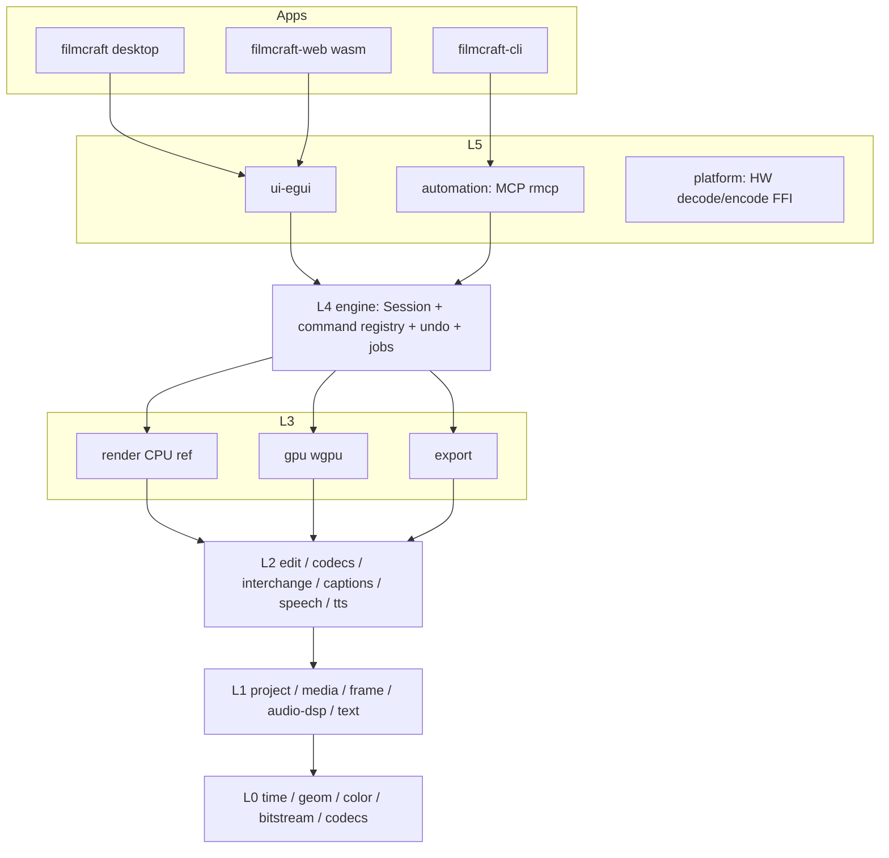

# Profile: storytold/filmcraft (FilmCraft)

> **Status of this file.** Project profile delivered by a research agent on 2026-11-14 and reviewed by the architect. Its "lessons" are input to the design, not decisions; the decisions are in `../../brainstorming.md` and `../../adrs/`. Code excerpts and diagrams are quoted from the project as found and are not translated.

Accessed 2026-11-14. Shallow clone at commit `e4ab3c6` (2026-11-14). File links point to that SHA: `https://github.com/storytold/filmcraft/blob/e4ab3c6ab99c355290ad536d012421e06ed33e11b/<path>`; abbreviated below as `[repo]/<path>`. Marking: FACT (read in the source), INFERENCE (with reasoning), OPINION.

Base: `https://github.com/storytold/filmcraft/blob/e4ab3c6/`

## 0. Existence and identity

- FACT: the repo exists, is public, not archived, Rust language, created 2026-09-30, description "An open-source, nonlinear video editor written from scratch in pure Rust" (`gh api repos/storytold/filmcraft`, accessed 2026-11-14).
- FACT: it is a clone of Premiere Pro (explicit target "Adobe Premiere Pro 2026 (26.5.2)"), made by the ArtCraft team, "largely built by agents" ([docs/agents.md](https://github.com/storytold/filmcraft/blob/e4ab3c6/docs/agents.md), line 3).
- OPINION: it is the only one of the three projects that is truly agent-first. It is also the furthest from our scope (a professional NLE of ~343k lines of Rust), so the value lies in the command/MCP architecture, not in the features.

## 1. Stack

Summary: **both (native desktop + web via WASM)**. No backend/network server (control channel only on loopback). The whole core is Rust; the front end is egui. Web = wasm32 + WebGPU/WebGL2.

- FACT: Cargo workspace `version = "0.20.1"`, `edition = "2024"`, `rust-version = "1.95"`, license `MIT OR Apache-2.0` ([Cargo.toml](https://github.com/storytold/filmcraft/blob/e4ab3c6/Cargo.toml)).
- FACT: UI `egui 0.37` + `eframe 0.37` (same Cargo.toml); MCP via `rmcp = "3.5"` with features `server, macros, transport-io` ([crates/automation/Cargo.toml](https://github.com/storytold/filmcraft/blob/e4ab3c6/crates/automation/Cargo.toml) line 18).
- FACT: GPU `wgpu` (crate `gpu`, WGSL shaders); text with `harfrust` (shaping); inference Whisper/Kokoro in `candle` ([docs/architecture.md](https://github.com/storytold/filmcraft/blob/e4ab3c6/docs/architecture.md) crate table).
- FACT: codecs and containers written from scratch in Rust, "clean-room" (H.264, HEVC, VP9, AV1, ProRes, AAC, Opus etc.), part of them in a separate repo `storytold/craft-libs` (git dependency by `rev`). Does not use FFmpeg at runtime (ffmpeg only appears in tests: `testkit` "ffmpeg/ffprobe discovery").
- FACT: 45 crates, ~343k lines of Rust, 2,520 tests, 268 merged PRs (numbers from the [ROADMAP.md](https://github.com/storytold/filmcraft/blob/e4ab3c6/ROADMAP.md), measured by the authors, measurement of 2026-10-10).
- FACT: WASM: single-threaded web build ("wasm threads need ... atomics (nightly build-std), so this build is single-threaded", [docs/web.md](https://github.com/storytold/filmcraft/blob/e4ab3c6/docs/web.md) lines 57-61); `wasm-bindgen 0.2.129`; decoding via WebCodecs; audio via AudioWorklet.
- FACT: apps: `apps/filmcraft` (desktop), `apps/filmcraft-cli`, `apps/filmcraft-web`.

## 2. Architecture

FACT: workspace in layers L0..L6, enforced by `cargo xtask layers` (dependency graph read from `cargo metadata`; only downward edges; UI/OS crates forbidden below L5) ([docs/architecture.md](https://github.com/storytold/filmcraft/blob/e4ab3c6/docs/architecture.md) section 1). Headless engine; "egui is a client among the CLI, JSON channel and MCP".



- FACT: state lives in `Session` in the engine: the project is `Arc<Project>` (copy-on-write), plus `EditorState` (active sequence, playhead, selection, targeting) which is also serde ([docs/architecture.md](https://github.com/storytold/filmcraft/blob/e4ab3c6/docs/architecture.md) section 4).
- FACT: every action that changes the project goes through `Session::execute(id, params)`. UI, CLI, TCP control channel and MCP dispatch the same commands. There are also "UI-only commands" (tools, zoom, panels) in `crates/ui-egui/src/menus.rs`.
- FACT: UI and engine communicate by direct in-process call (egui calls `Session`); events (`ProjectChanged`, `Toast`...) are drained per frame. On the web, the "MCP" becomes `window.filmcraft` (promises) ([docs/web.md](https://github.com/storytold/filmcraft/blob/e4ab3c6/docs/web.md) lines 109-137).
- FACT: declared principles: engine-first, everything is a command, exact integer time, copy-on-write snapshots, reference CPU + fast GPU, clean-room pure Rust.
- INFERENCE: the rule "the oracle is the CPU, the GPU is tested against it" (`crates/golden`) is what allows 2,500 tests without a GPU and is transferable to us (oracle = software reference renderer; Canvas/WebGPU tested against it).

## 3. Timeline data model

### Time representation

FACT: `Tick(i64)` with `TICKS_PER_SECOND = 254_016_000_000`, chosen to divide the frame duration of all broadcast rates (23.976, 24, 25, 29.97, 30, 48, 50, 59.94, 60, 120) and audio sample rates (8 to 192 kHz, 44.1 family) exactly. `FrameRate { num, den }` rational; timecode only for display. "No f64 seconds in edit math" ([docs/architecture.md](https://github.com/storytold/filmcraft/blob/e4ab3c6/docs/architecture.md) section 2). Commands accept `time` (ticks), `frame`, `seconds` or `timecode` and convert once at the edge.

FACT (exception): `TrackItem.speed` is `f64`.

### Real types (pasted excerpts)

Hierarchy (the doc's own diagram, [docs/architecture.md](https://github.com/storytold/filmcraft/blob/e4ab3c6/docs/architecture.md) section 3):

```text
Project
 root: Bin ; items: map ItemId -> ProjectItem (Media | Sequence | Subclip | AdjustmentLayer | Graphic)
Sequence: settings, video_tracks/audio_tracks: Vec<Track>, markers, mark_in/out, submix_tracks, master_*
Track: locked, sync lock, targeting, mute/solo/visibility, items: Vec<TrackItem> (ordered, no overlap),
       transitions: Vec<Transition>, audio: volume_db, pan, effects, mixer strip
TrackItem: item, start, source_in, duration, speed, link group, enabled, effects: Vec<EffectInstance>
EffectInstance: effect id, enabled, params: id -> valor constante ou trilha de keyframes, masks
```

Keys and keyframes ([crates/project/src/keyframe.rs](https://github.com/storytold/filmcraft/blob/e4ab3c6/crates/project/src/keyframe.rs) lines 12-175):

```rust
pub enum ParamValue { Float(f64), Vec2(Vec2), Color([f32;4]), Bool(bool), Choice(u32),
                      Text(String), Curve(Vec<[f32;2]>), Path(MaskPath) }
pub enum Interpolation { Linear, Hold, Bezier, AutoBezier, ContinuousBezier, EaseIn, EaseOut }
pub struct Keyframe {
    pub time: Tick,                 // relativo ao início do clip
    pub value: ParamValue,
    pub interp: Interpolation,      // do segmento que SAI deste keyframe
    pub out_influence: f64,         // default 1/3
    pub in_influence: f64,
}
pub struct Param { pub value: ParamValue, pub keyframes: Vec<Keyframe> /* vazio = estático */ }
```

Clip ([crates/project/src/track.rs](https://github.com/storytold/filmcraft/blob/e4ab3c6/crates/project/src/track.rs) lines 64-130, summarized):

```rust
pub struct TrackItem {
    pub id: ClipId, pub item: ItemId, pub name: String, pub label: Label,
    pub start: Tick,        // position on the timeline
    pub duration: Tick,
    pub source_in: Tick,    // tempo da mídia do primeiro quadro
    pub speed: f64,         // negativo = reverso
    pub reverse: bool, pub enabled: bool,
    pub link: Option<u64>, pub group: Option<u64>,
    pub effects: Vec<EffectInstance>,
    pub markers: Vec<Marker>,
    pub gain_db: f64, pub frame_hold: Option<Tick>, pub scale_to_frame: bool,
    pub essential: Option<EssentialSound>, pub multicam: Option<MulticamSel>,
    pub graphic: Option<Box<GraphicMeta>>, /* ... schema v12 */
}
```

Transition ([crates/project/src/track.rs](https://github.com/storytold/filmcraft/blob/e4ab3c6/crates/project/src/track.rs) lines 259-290):

```rust
pub struct Transition {
    pub id: TransitionId, pub effect: EffectInstance,
    pub start: Tick, pub duration: Tick,
    pub from: Option<ClipId>, pub to: Option<ClipId>,   // um lado pode ser None (fade de/para nada)
    pub align: TransitionAlign, /* CenterAtCut | StartAtCut | EndAtCut */ pub reverse: bool,
}
```

- FACT: `source_in` and keyframes are in media/clip time, "trims and splits never move keyframes" (line in `architecture.md` section 3). INFERENCE: the model is "keyframe relative to the clip" as in Premiere; for us, relative to the clip avoids rewriting keyframes when doing ripple.
- FACT: "Effect definitions are data": `project::effect::effect_defs()` lists every video/audio/transition effect with its parameter schema, and from there come the Effects panel tree, the Effect Controls rows and the parameter documentation the agent sees.
- FACT: text/graphics: `Graphic` clips with text/shape layers stored as hidden effect instances (`graphic_text`/`graphic_shape`) ([docs/graphics.md](https://github.com/storytold/filmcraft/blob/e4ab3c6/docs/graphics.md)). Captions: caption tracks (Subtitle, CEA-608/708, Teletext), SRT/WebVTT/SCC, burned in on export.
- FACT: invariants: `Sequence::check()` validates no overlap and unique ids, run after every edit.

### Versioning, migration, persistence

- FACT: `.fcproj` file = UTF-8 JSON with envelope `{ "format": "filmcraft.project", "schema_version": N, "generator": "FilmCraft x.y.z", "project": {...} }`. `SCHEMA_VERSION = MIGRATIONS.len() + 1`, currently 17 ([docs/project-files.md](https://github.com/storytold/filmcraft/blob/e4ab3c6/docs/project-files.md) line 11; [crates/format/src/lib.rs](https://github.com/storytold/filmcraft/blob/e4ab3c6/crates/format/src/lib.rs) lines 1-70).
- FACT: migrations are a chain of single-step functions over the JSON (v1->v2, v2->v3...). Many are "no-op steps": the bump exists only so that old builds **refuse** the file (`FormatError::TooNew`) instead of reading it halfway and losing fields when saving.
- FACT: atomic save (temp file in the same directory, fsync, rename, directory fsync); autosave with rotation in an `Auto-Save` folder. On the web: OPFS `recovery/snapshot.fcproj` every 5 s with changes + copy of the media (up to 4 GiB).
- FACT: interchange: EDL, FCP7 XML, FCPXML, OTIO, AAF, OMF (crate `interchange`).
- OPINION: the "version bump without a shape change to refuse a new file in an old build" trick is cheap and we should copy it.

## 4. Preview and export

- FACT: CPU reference path `render::render_sequence(project, seq, t, scale)`: track by track from bottom to top, maps timeline t to media t (speed), fetches frame, effects, Motion, opacity/blend, transitions, composition in linear light with f32 premultiplied alpha. GPU path: `render::plan::plan_frame -> gpu::GpuCompositor` (wgpu), with CPU fallback for what the shaders do not cover ([docs/architecture.md](https://github.com/storytold/filmcraft/blob/e4ab3c6/docs/architecture.md) section 5).
- FACT: export calls `filmcraft_render::render_sequence` ([crates/export/src/pipeline.rs](https://github.com/storytold/filmcraft/blob/e4ab3c6/crates/export/src/pipeline.rs) line 280): export uses the CPU reference renderer, preview uses GPU when possible. The README admits: "color grading, keys and export rendering still run on the CPU" ([README.md](https://github.com/storytold/filmcraft/blob/e4ab3c6/README.md) Status section, acceleration issue #30 open).
- INFERENCE: preview and export **share the model and the semantics**, with export on the CPU oracle and preview on GPU tested against it; it is not literally the same composition code. This ensures fidelity but makes export slow.
- FACT: the frame goes through the `frames.rs` worker pool for monitors, thumbnails, prefetch. LRU frame cache with a byte budget.
- FACT: hardware decode (VideoToolbox, Media Foundation, VA-API) behind `codecs::VideoDecoder` with transparent fallback to software decoders; hardware H.264/H.265 encode opt-in (NVENC, VideoToolbox) because "hardware streams differ from ours, and software exports are byte-identical from run to run".
- FACT: export on the web advances one frame per step, 30 ms per UI frame, on the main thread ([docs/web.md](https://github.com/storytold/filmcraft/blob/e4ab3c6/docs/web.md) line 49). Missing media renders an "offline slate" instead of failing.
- FACT: export has a queue, ETA, progress and cancellation; via MCP it uses `notifications/progress` and `notifications/cancelled` ([docs/agents.md](https://github.com/storytold/filmcraft/blob/e4ab3c6/docs/agents.md) section "Long exports").

## 5. Audio

- FACT: the audio clock is the master ("the sound card is the master clock, so picture follows sound"). Output via `cpal` (desktop), AudioWorklet (web).
- FACT: crate `audio-dsp` with no dependencies: BS.1770/R128 loudness measurement (matches `ffmpeg ebur128` at 0.1 LU), EQ, filters, dynamics, true-peak limiter, delay, reverb, DeNoise, DeHummer, pitch shift; mixer with 5 inserts, sends, submixes, Read/Latch/Touch/Write automation, constant-power crossfades, latency compensation, 5.1; `Essential Sound` (audio type per clip) ([README.md](https://github.com/storytold/filmcraft/blob/e4ab3c6/README.md) Audio section).
- FACT: TTS (Kokoro-82M) and STT (Whisper in candle with word-level timestamps) present, optional and off by default; transcript-based editing (`edit::transcript`).

## 6. Undo/redo, command layer, MCP/CLI/API/agents

### Undo and commands

- FACT: undo = stack of `Arc<Project>` snapshots (200 entries) with a label; `Session::edit(label, |project, state| ...)` clones, applies, and on success pushes the old one; on error nothing changes. `edit.undo`/`edit.redo` swap snapshots ([docs/architecture.md](https://github.com/storytold/filmcraft/blob/e4ab3c6/docs/architecture.md) section 4).
- FACT: serializable command layer: more than 650 commands; `CommandSpec` with stable id, label, menu, shortcut, parameter doc as a JSON string, `enabled()` predicate with a readable reason, `run()`, `journal` flag ([crates/engine/src/commands.rs](https://github.com/storytold/filmcraft/blob/e4ab3c6/crates/engine/src/commands.rs) line 23; the file has 5,470 lines):

```rust
pub struct CommandSpec {
    pub id: &'static str,                 // "sequence.addEdit"
    pub label: &'static str,
    pub menu: &'static [&'static str],
    pub shortcut: Option<&'static str>,
    pub params: &'static str,             // r#"{"time":ticks?}"#, mostrado aos agentes
    pub enabled: fn(&Session) -> Result<(), String>,  // Err carrega o motivo
    pub run: fn(&mut Session, &Value) -> Result<Value>,
    pub journal: bool,                    // false para queries
}
```

- FACT: event log (`events.list`, `events.clear`): failed commands, toasts, jobs. Events panel.
- INFERENCE: the "journal" is only a log of executed commands; undo is not based on inverse commands nor on replay, but on snapshots. What is serialized is the input command, not a patch.

### MCP (agent-first, detailed)

- FACT: `filmcraft-cli mcp` serves MCP over stdio, two modes: headless (`--demo`, `--project p.fcproj` or empty; in-process engine without a window) and bridge (`--bridge 127.0.0.1:9876`; connects to the desktop app started with `--control 9876`) ([docs/agents.md](https://github.com/storytold/filmcraft/blob/e4ab3c6/docs/agents.md) section 1). No folder confinement flags: "the server can read and write wherever the user can".
- FACT: control channel: one JSON per line over TCP loopback; requires `FILMCRAFT_CONTROL_TOKEN` (64 hex) or the listener does not even open; at most 16 connections; max line 4 MiB; any invalid line closes the connection (prevents smuggling a command via an HTTP `fetch` from a web page) ([docs/control-protocol.md](https://github.com/storytold/filmcraft/blob/e4ab3c6/docs/control-protocol.md)).
- FACT: granularity = **meta-tools**, not one tool per command. There are 16 tools: `command_list`, `command_run`, `command_batch`, `doc_inspect`, `render_preview`, `project_inspect`, `sequence_inspect`, `media_import`, `render_frame` (all in both modes) and, only in the bridge, `ui_inspect`, `ui_elements`, `ui_click`, `ui_drag`, `ui_key`, `ui_type`, `ui_screenshot`, `ui_control`. The 650+ commands are discovered via `command_list` (id, label, menu, shortcut, params, enabled now) and executed via `command_run {id, params}`.
- FACT: MCP resources `filmcraft://document` and `filmcraft://commands`.
- FACT: visual feedback: `render_frame`/`render_preview` return a **PNG of the program frame** at `seconds` (headless renders; bridge takes a screenshot of the Program monitor); default `max_side` 960; read-only, does not move the playhead ([crates/automation/src/server.rs](https://github.com/storytold/filmcraft/blob/e4ab3c6/crates/automation/src/server.rs) lines 442-448). In the bridge, `ui_screenshot` of the whole app or of a panel.
- FACT: loop recommended by the doc itself: `project_inspect`/`sequence_inspect` -> ids -> `command_run` -> `render_frame` or `ui_screenshot` -> look -> `edit.undo` if wrong.
- FACT: agent conventions: each tool has a `title` and the four MCP annotations (`readOnlyHint`, `destructiveHint`, `idempotentHint`, `openWorldHint`), verified by a test; **strict arguments** (`-32602` naming the unknown argument and the accepted ones); command error = `isError` with the engine message; panic is caught as `internal error` and the session remains usable.
- FACT: long export: `file.exportMedia {wait:true}` blocks, but with `progressToken` it emits `notifications/progress` every 100 ms and honors `notifications/cancelled` (deletes partial output). Without `wait`, it returns `{job, path, poll: "jobs.list", cancel: "jobs.cancel"}`. Each job has `etaSeconds`. Export reports `offlineMedia` (items for which it drew the slate), still successful.
- FACT: command responses are designed for agents: `effects.setParam` returns `{"keyframes": n, "param": id, "value": value}` (accepted value; a choice by name comes back as an index); `effects.addKeyframe` is a *toggle* and returns `{"added": true|false, "mediaTime": t}`.
- FACT: web: `window.filmcraft.execute/request/commands/uiInspect/screenshot` (shared API `craft-web-api` from the craft-libs repo, "same shape in every Craft app").

Tool definitions pasted ([crates/automation/src/server.rs](https://github.com/storytold/filmcraft/blob/e4ab3c6/crates/automation/src/server.rs) lines 361-373, 442-446):

```rust
#[tool(
    title = "Run a command",
    description = "Run a command by id with JSON params, e.g. {\"id\":\"timeline.razor\",\"params\":{\"seconds\":3.5}} or {\"id\":\"effects.apply\",\"params\":{\"effect\":\"Gaussian Blur\"}}. Undoable edits land in History.",
    annotations(read_only_hint = false, destructive_hint = true, idempotent_hint = false, open_world_hint = false)
)]
async fn command_run(&self, Parameters(p): Parameters<RunParams>) -> Result<CallToolResult, McpError> { ... }

#[tool(
    title = "Run several commands",
    description = "Run several commands in order: {steps: [{id, params?}], stop_on_error?: true}. Returns {completed, failed, results: [{ok, result | error}]}; each edit is its own undo step.",
    ...
)]
async fn command_batch(...)

#[tool(
    title = "Render a frame",
    description = "Render the active sequence's frame (at `seconds` or the playhead) and return it as PNG.",
    annotations(read_only_hint = true, destructive_hint = false, idempotent_hint = true, open_world_hint = false)
)]
async fn render_frame(...)
```

Global server instruction ([crates/automation/src/server.rs](https://github.com/storytold/filmcraft/blob/e4ab3c6/crates/automation/src/server.rs) line 627, excerpt): "Every edit is an engine command: `command_list` to discover ids/params, `command_run` to execute (undoable; `command_batch` runs several). `doc_inspect` ... returns ids you can pass to commands; `render_preview` shows the result ... Time is in ticks: 254016000000 per second (commands also accept `seconds`, `frame` or `timecode`)."

Call examples (README, [README.md](https://github.com/storytold/filmcraft/blob/e4ab3c6/README.md) lines 235-242):

```jsonc
{"method": "engine.execute", "params": {"command": "timeline.place",
  "params": {"item": 1, "track": "V1", "seconds": 0, "sourceIn": 284298240000000, "duration": 1270080000000}}}
{"method": "engine.execute", "params": {"command": "effects.setParam",
  "params": {"clip": 87, "effect": "lumetri", "param": "curve_luma", "value": [[0,0],[0.25,0.21],[0.75,0.82],[1,1]]}}}
{"method": "ui.screenshot", "params": {"path": "frame.png"}}
```

- OPINION: agent design wins: (a) meta-tools with a discoverable catalog keep the tool count at 16 despite 650 commands (avoids overflowing the model's context), (b) `enabled` with a textual reason is actionable feedback, (c) `command_batch` with `stop_on_error`, (d) inspection that returns reusable ids, (e) PNG of the frame, (f) per-tool safety hints, (g) token + loopback on the channel.
- OPINION (weaknesses for agents): the agent must know the tick unit of 254016000000 (15-digit integers in params, e.g. `sourceIn: 284298240000000`); effect parameter names are free strings (`curve_luma`); `effects.addKeyframe` being a toggle is an idempotency trap; missing audio feedback (only PNG; loudness only via measurement commands).

## 7. What they do well

- FACT/OPINION: exact integer time with fixed tick and rational `FrameRate`. No drift.
- FACT: a single command layer for UI, CLI, JSON and MCP, with a metadata registry (`enabled`, params doc).
- FACT: undo by immutable `Arc<Project>` snapshot: cheap, simple, and background readers (playback, export) hold a snapshot without a lock.
- FACT: effects schema as data that generates UI, docs and validation.
- FACT: layers enforced by tooling (`cargo xtask layers`, `cargo xtask wasm` verifies that L0-L4 compile to wasm32); `unsafe_code = "forbid"` outside `platform`.
- FACT: format migration with refusal of newer files; atomic save.
- FACT: control channel security (token, loopback, size limit, closes connection on garbage).
- FACT: web and desktop from the same code, with explicit desktop->web mapping (table in docs/web.md).

## 8. What to avoid

- OPINION: Premiere clone scope (650 commands, AAF/OMF, CEA-608, multicam) without need for 9:16 vertical + commercials. For us it is dead weight.
- FACT: codecs and containers written from scratch: a large surface (decoders "bit-exact on conformance streams" but "real camera/phone files less tested"; README). Real media issues: [#4783](https://github.com/storytold/filmcraft/issues/4783) AVCHD/MTS fails to import without an error, [#4781](https://github.com/storytold/filmcraft/issues/4781) GH5S MOV does not play. For the web, WebCodecs/ffmpeg-wasm avoids this.
- FACT: single-thread web (no SharedArrayBuffer/atomics), export and playback cooperative on the UI thread; commands such as render previews, proxies and mask tracking "report an error on the web for now"; [#4635](https://github.com/storytold/filmcraft/issues/4635) "Web build: every H.264 export fails with 'cannot build the 1-thread pool'" (regression).
- FACT: egui UI on canvas: the doc admits the agent needs a widget-level automation layer (`ui_elements`, automation ids) because there is no DOM. For us, DOM + commands is better (accessibility and testability for free).
- FACT: export uses the CPU renderer: slow (README: "Speed on big footage" is the biggest gap; issue [#30](https://github.com/storytold/filmcraft/issues/30)). Issue [#1616](https://github.com/storytold/filmcraft/issues/1616): "GPU export silently renders on the CPU" on Windows.
- FACT: command ids and params as free strings + `params: &'static str` with example JSON: it is not a machine-readable schema (no per-command JSON Schema seen in `CommandSpec`). INFERENCE: the agent depends on the documentation string; strict validation exists only for the arguments of the MCP tools, not for the command params. (I did not verify all 650 handlers.)
- FACT: maturity and hype state: "alpha", ready for real work ~56% (self-estimated). The parity numbers are self-reported and not verified by me.
- FACT: a project developed largely by agents generates a huge volume of agent-generated PRs and issues (see section 12), with several "Coverage: investigate ... test failures" tests in the tracker.

## 9. Features present (summary, FACT from the README)

3-point editing (insert/overwrite/lift/extract), ripple/roll/slip/slide, multicam, multiple Source/Program monitors, bins, markers; color (Lumetri-like, curves, LUTs, scopes: waveform, parade, histogram, vectorscope); keyframes with Bezier; masks with tracking (desktop); effects and transitions (100% of the target catalog "measured by tests"); text engine (OpenType, bidi, kerning), graphic clips, templates; captions and STT/TTS; mixer and automation; H.264 export (software), H.265/ProRes; interchange EDL/FCPXML/OTIO/AAF; proxies; relink; 7+ UI languages (localization ~35%); no plugins (OpenFX/VST) and no generative AI.

## 10. Maintenance

- FACT: last commit `e4ab3c6`, 2026-11-14T15:20:57+01:00 (merge of PR #4782). `pushed_at` 2026-11-14T14:20:57Z.
- FACT: releases: v0.20.1 (2026-11-12, "Latest"), v0.20.0 (2026-11-11), v0.19.0 (2026-11-09), v0.18.0 (2026-11-06), v0.17.1 (2026-11-05): cadence of 1 to 3 days (`gh release list -R storytold/filmcraft`).
- FACT: stars 18,265; open issues (counting PRs, field `open_issues_count`) 2,184; contributors ~207 (`Link` header of the contributors API, `page=207`); 7,429 forks (`network_count` shows 7429 in the API; `forks_count` not queried separately; 85 subscribers).
- FACT: repository created 2026-09-30, that is, 45 days between creation and this access. INFERENCE: star and issue growth in 6 weeks is anomalous; part of the traffic is brand traffic (ArtCraft) and of template/agent-generated issues (titles `[Bug Report] [FilmCraft]`). I did not verify the origin of the stars.
- FACT: CI: SonarCloud, CodeRabbit; tests on Windows; `docs/contributing.md`, `AGENTS.md`, `CLAUDE.md` extensive.

## 11. License

FACT: `MIT OR Apache-2.0` (Cargo.toml workspace; GitHub API reports `Apache-2.0` as the primary spdx, there are `LICENSE-MIT` and `LICENSE-APACHE` at the root; `ATTRIBUTION.md` and `NOTICE` present). Git dependency on `craft-libs` (same organization). Compatible with MIT for reference and reuse of ideas; copying code would require preserving notices.

## 12. Real pain points (issues, accessed 2026-11-14)

- [#4635](https://github.com/storytold/filmcraft/issues/4635) Web: every H.264 export fails with "cannot build the 1-thread pool" (regression of #3205).
- [#4775](https://github.com/storytold/filmcraft/issues/4775) "Headless CLI does not initialize the effect preset library; imports are not persisted": the divergence between headless and desktop mode is a recurring bug on the agent surface.
- [#4758](https://github.com/storytold/filmcraft/issues/4758) "Blank video after export".
- [#4771](https://github.com/storytold/filmcraft/issues/4771) Space/play with ~0.5 s delay with Bluetooth headphones; [#4772](https://github.com/storytold/filmcraft/issues/4772) no audio when moving the playhead with arrow keys (audio latency/sync is hard).
- [#4768](https://github.com/storytold/filmcraft/issues/4768) and [#4755](https://github.com/storytold/filmcraft/issues/4755): unstable timing/performance tests on the Windows runner (tests dependent on real time).
- [#30](https://github.com/storytold/filmcraft/issues/30) hardware acceleration still open; [#4730](https://github.com/storytold/filmcraft/issues/4730) "Make the Render Faster".
- Windows: [#3719](https://github.com/storytold/filmcraft/issues/3719) freezes at startup, [#1038](https://github.com/storytold/filmcraft/issues/1038) window never opens, [#1390](https://github.com/storytold/filmcraft/issues/1390) does not start; the README confirms "Windows and Linux get much less testing than macOS".
- [#4783](https://github.com/storytold/filmcraft/issues/4783), [#4781](https://github.com/storytold/filmcraft/issues/4781) real camera formats.
- [#940](https://github.com/storytold/filmcraft/issues/940) request for versioning/project locking in user storage.
- [#4791](https://github.com/storytold/filmcraft/issues/4791) artifacts at the edges of the text.
- Gap: I did not read the issue comments; count of agent vs human issues not measured.

## 13. Lessons for our project

1. OPINION (high confidence): adopt the principle "every action is a command with an id, typed params, `enabled()` + reason, structured result", dispatched by UI, CLI, API and MCP. It is what FilmCraft proves works at 650 commands.
2. OPINION: expose **meta-tools** to MCP (`command_list/run/batch`, `doc_inspect`, `render_frame`) instead of one tool per command. A possible improvement over FilmCraft: return a JSON Schema per command in `command_list`, instead of an example string.
3. OPINION: visual feedback for the agent = `render_frame(seconds, max_side)` PNG, read-only, without moving the playhead. Add `render_contact_sheet` (N frames in a grid) and audio metrics (loudness) to reduce round-trips, which FilmCraft does not have.
4. OPINION: exact integer time. For short videos we can use a tick smaller than 254016000000 (e.g. 705600000, a multiple of 44.1k/48k/30/29.97/25/24), but keep integers and rational `FrameRate`; never seconds as float in editing. Expose `seconds`/`frame` in the commands and convert at the edge.
5. OPINION: undo by immutable document snapshot (structural sharing), with batch commands each as its own undo step; consider "one batch = one step" as an option (FilmCraft: each batch command is one step).
6. OPINION: `schema_version` + single-step migrations + refusal of newer versions + atomic save. Copy the shape-free version bump trick.
7. OPINION: software rendering oracle + golden tests; GPU/Canvas tested against it. And decide early whether preview and export share the same compositor: FilmCraft suffers from slow export by using the CPU. For us, the ideal is a single compositor (WebGPU/WebCodecs) for both.
8. OPINION: do not write codecs. Their experience (real media issues) reinforces using WebCodecs/FFmpeg.
9. FACT + OPINION: headless mode and UI should share exactly the same service bootstrap (#4775).
10. OPINION: agent channel security: mandatory token, loopback, size limit, closing the connection on invalid input, `readOnlyHint` etc.
11. OPINION: captions as their own track with SRT/WebVTT import/export and burn-in on export: our core use case; FilmCraft covers it but within a broadcast captions model. For 9:16, a cue model with words + style is enough.
