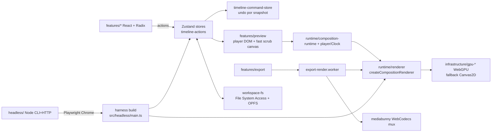

# Profile: FreeCut (reference)

> **Status of this file.** Project profile delivered by a research agent on 2026-11-14 and reviewed by the architect. Its "lessons" are input to the design, not decisions; the decisions are in `../../brainstorming.md` and `../../adrs/`. Code excerpts and diagrams are quoted from the project as found and are not translated.

Research done on 2026-11-14 (accessed 2026-11-14 for all links). Commit read: `5ceeeb388eef5423640b7db157706274bf1b8165` (main, 2026-10-29). Shallow clone in `scratchpad/freecut`; nothing was installed or executed.
Base of the links: `https://github.com/walterlow/freecut/blob/5ceeeb388eef5423640b7db157706274bf1b8165/` (abbreviated below as `[repo]/`).
Legend: FACT, INFERENCE (with reasoning), OPINION.

## 0. Identification of the official repository

- FACT: the official repo is `walterlow/freecut`. Confirmation: the `homepage` field of the GitHub API is `http://freecut.net` and the README opens with "[freecut.net](http://freecut.net/)" and points to `https://freecut.net/docs` as the user guide ([README.md:3, 23](https://github.com/walterlow/freecut/blob/5ceeeb388eef5423640b7db157706274bf1b8165/README.md); `gh api repos/walterlow/freecut`, accessed 2026-11-14).
- FACT: other candidates with the same name are NOT the official one: `SUP3RMASS1VE/freecut` (12 stars, same description, copy), `Moh4696/freecut` (fork of `browser-use/video-use`, another product), `Watertube-bilibili/freecut-desktop` (2 stars, third-party desktop), `Arlet/Freecut` (Cricut firmware), `geri1701/freecut` (cutting optimizer). Source: `gh search repos freecut` (accessed 2026-11-14).
- FACT: https://www.freecut.net/ and https://www.freecut.net/docs serve an SPA (1408-byte HTML with `<div id="root">` and `main-*.js`); `curl` does not get the rendered content. See section 14 on how the docs structure was surveyed.

## 1. Stack (versions read from `package.json`)

Source: [repo]/package.json. All production dependencies are pinned exactly (explicit rule in [CLAUDE.md:11](https://github.com/walterlow/freecut/blob/5ceeeb388eef5423640b7db157706274bf1b8165/CLAUDE.md)).

| Area | Lib and version |
| --- | --- |
| UI | react 19.2.5, react-dom 19.2.5, TypeScript 7.0.2 (via `overrides`), Tailwind 4.2.2, Radix UI (several 1.x/2.x), lucide-react 0.468.0 (deliberate pin), sonner, react-colorful |
| State | zustand 5.0.12 |
| Routes | @tanstack/react-router 1.168.22 (file-based, `src/routeTree.gen.ts`) |
| Media | mediabunny 1.54.0 (demux/decode/encode/mux, WebCodecs), @mediabunny/aac-encoder, ac3, mp3-encoder, prores (all 1.54.0), fflate, gifuct-js |
| Animation | motion 12.40.0, @lottiefiles/dotlottie-web 0.76.0 |
| Local AI | @huggingface/transformers 4.1.0, kokoro-js 1.2.1, onnxruntime-web `1.26.0-dev.20260410-5e55544225` (dev build, deliberate pin) |
| Storage | idb 8.0.3 (only handles and legacy reader), File System Access API + OPFS |
| i18n | i18next 25.6.0, react-i18next 16.2.4 |
| Validation | zod 4.3.6 |
| Toolchain | vite-plus 1.1.0 (`vp`, VoidZero wrapper with Rolldown/Oxlint/Oxfmt), vitest 5.0.3, playwright 1.60.0 (dev, used by the headless harness), jsdom 27.4.0 |
| Package manager | `packageManager: npm@11.8.0` |

- FACT: there is no ffmpeg.wasm among the dependencies. All encode/decode uses WebCodecs via mediabunny.
- FACT: there is no Three.js/Pixi/regl; WebGPU is used directly (`src/infrastructure/gpu-*`, `@webgpu/types` types).
- FACT: `package.json` has `"version": "0.0.0"`, `"private": true`. The app does not version by SemVer; the CHANGELOG uses weekly CalVer ([CHANGELOG.md:3](https://github.com/walterlow/freecut/blob/5ceeeb388eef5423640b7db157706274bf1b8165/CHANGELOG.md)).

## 2. Architecture

FACT ([README.md "Project Structure"](https://github.com/walterlow/freecut/blob/5ceeeb388eef5423640b7db157706274bf1b8165/README.md), [src/](https://github.com/walterlow/freecut/tree/5ceeeb388eef5423640b7db157706274bf1b8165/src)): layers `features/` (UI by domain: editor, timeline, preview, export, media-library, keyframes, effects, projects, scene-browser...), `runtime/` (composition-runtime, player/Clock, renderer), `infrastructure/` (gpu-compositor, gpu-effects, gpu-transitions, gpu-masks, gpu-text, gpu-scopes, storage, audio, analysis), `shared/` (stores, migrations, utils), `headless/` (harness).



- FACT: state lives in Zustand stores per domain (items, tracks, transitions, keyframes, markers, compositions) and is captured by snapshot for undo ([commands/types.ts](https://github.com/walterlow/freecut/blob/5ceeeb388eef5423640b7db157706274bf1b8165/src/features/timeline/stores/commands/types.ts)).
- FACT: architectural rules enforced by scripts: `check:boundaries`, `check:layer-boundaries`, `check:deps-contracts`, `check:edge-budgets` ([package.json scripts](https://github.com/walterlow/freecut/blob/5ceeeb388eef5423640b7db157706274bf1b8165/package.json)). Features only import each other via local `deps/`; the runtime accesses feature state only via `runtime/<engine>/deps/*-contract.ts` (README, "Project Structure").
- FACT: workers: `export-render.worker.ts` ([runtime/renderer/workers](https://github.com/walterlow/freecut/blob/5ceeeb388eef5423640b7db157706274bf1b8165/src/runtime/renderer/workers/export-render.worker.ts)), `decoder-prewarm-worker.ts` (preview), `media-processor`, `proxy-generation`, `frame-interpolation`, `upscale` workers (media-library), AudioWorklet SoundTouch ([soundtouch-preview-processor.worklet.ts](https://github.com/walterlow/freecut/blob/5ceeeb388eef5423640b7db157706274bf1b8165/src/runtime/composition-runtime/worklets/soundtouch-preview-processor.worklet.ts)).
- FACT: admitted hotspot: `renderFrame` in `client-render-engine.ts` with ~810 lines of per-frame closures; there is a decomposition plan that requires manual pixel verification ([docs/render-frame-decomposition-plan.md](https://github.com/walterlow/freecut/blob/5ceeeb388eef5423640b7db157706274bf1b8165/docs/render-frame-decomposition-plan.md)).

## 3. Timeline data model

### Time representation

- FACT: the timeline is in whole FRAMES: `from` and `durationInFrames` per item; `trimStart/trimEnd/sourceStart/sourceEnd/sourceDuration` also in frames, with `sourceFps` for conversion ([types/timeline.ts:58-75](https://github.com/walterlow/freecut/blob/5ceeeb388eef5423640b7db157706274bf1b8165/src/types/timeline.ts)). The fps belongs to the project (`metadata.fps`, integer 1..240 in the headless contract).
- FACT: keyframes use `frame` relative to the start of the item ([types/keyframe.ts:303-316](https://github.com/walterlow/freecut/blob/5ceeeb388eef5423640b7db157706274bf1b8165/src/types/keyframe.ts)).
- FACT: imported/transcribed captions use float SECONDS (`startSeconds`/`endSeconds`), relative to the source or the segment (`TimelineTranscriptCaptionCue`, `SubtitleSegmentCue`, [timeline.ts:20-25, 80-84](https://github.com/walterlow/freecut/blob/5ceeeb388eef5423640b7db157706274bf1b8165/src/types/timeline.ts)). The format mixes frames and seconds.
- FACT: volume in dB, fades in seconds, speed as a float multiplier (0.1..10).
- INFERENCE: there is no rational time (num/den); fractional fps (29.97) must be rounded or approximated, since the creation contract accepts an integer `fps` (`z.number().int().min(1).max(240)`, [headless/lib/contract.mjs:385-398](https://github.com/walterlow/freecut/blob/5ceeeb388eef5423640b7db157706274bf1b8165/headless/lib/contract.mjs)). Reasoning: integer in the creation schema; I did not trace how a fractional `sourceFps` is handled on each path.

### Real types (excerpts)

`TimelineItem` is a union discriminated by `type` ([timeline.ts:464-474](https://github.com/walterlow/freecut/blob/5ceeeb388eef5423640b7db157706274bf1b8165/src/types/timeline.ts)):

```ts
export type TimelineItem =
  | VideoItem | AudioItem | TextItem | ImageItem | LottieItem
  | ShapeItem | AdjustmentItem | ControllerItem | CompositionItem
  | SubtitleSegmentItem
```

Common base (summary; the full type has ~115 fields, almost all audio EQ and reverse conform):

```ts
type BaseTimelineItem = {
  id: string; trackId: string
  from: number                 // start frame
  durationInFrames: number
  label: string
  mediaId?: string; compositionId?: string
  originId?: string; linkedGroupId?: string   // video+audio ligados
  trimStart?: number; trimEnd?: number
  sourceStart?: number; sourceEnd?: number; sourceDuration?: number; sourceFps?: number
  speed?: number; isReversed?: boolean
  transform?: TransformProperties; transformParent?: TransformParentBinding
  crop?: CropSettings
  volume?: number              // dB
  audioFadeIn?: number; audioFadeOut?: number   // segundos
  audioPitchSemitones?: number; audioDucking?: AudioDuckingSettings
  effects?: ItemEffect[]
  motionModifiers?: MotionModifier[]; motionLayers?: MotionAnimationLayer[]
  blendMode?: BlendMode; cornerPin?: TimelineItemCornerPin
  transcriptCaptions?: TimelineTranscriptCaptions
  // ... EQ por banda (audioEq*), reverseConform* (cache de reverso), fades de vídeo
}
```

- FACT: text: `TextItem` = base + `TextStyleFields` + `text`, `textSpans`, `spanLayout: 'stack'|'inline'`, `textMotion` (animation per character/word/line), `textRole?: 'caption'`, `captionSource` (`transcript | ai-captions | subtitle-import | embedded-subtitles`) ([timeline.ts:213-234](https://github.com/walterlow/freecut/blob/5ceeeb388eef5423640b7db157706274bf1b8165/src/types/timeline.ts)). Captions are regular text items (one per sentence) plus `SubtitleSegmentItem` (list of cues) and `transcriptCaptions` (cues attached to the media).
- FACT: `TimelineTrack` ([timeline.ts:476-497](https://github.com/walterlow/freecut/blob/5ceeeb388eef5423640b7db157706274bf1b8165/src/types/timeline.ts)): `id,name,kind?:'video'|'audio',height,locked,syncLock?,visible,muted,solo,volume?,audioEq?,color?,order,items[],parentTrackId?,isGroup?,isCollapsed?`.
- FACT: in the saved project, `ProjectTimeline` has `tracks[]` WITHOUT `items` and `items[]` as a flat array with `trackId` ([types/project.ts:51-140](https://github.com/walterlow/freecut/blob/5ceeeb388eef5423640b7db157706274bf1b8165/src/types/project.ts)); plus `masterBusDb`, `busAudioEq` and, in the same file, transitions, keyframes, markers and compositions.
- FACT: keyframe ([keyframe.ts:303-316, 430-453](https://github.com/walterlow/freecut/blob/5ceeeb388eef5423640b7db157706274bf1b8165/src/types/keyframe.ts)):

```ts
export interface Keyframe {
  id: string
  frame: number          // relativo ao início do item
  value: number
  easing: EasingType     // 'linear'|'ease-in'|'ease-out'|'ease-in-out'|'hold'|'cubic-bezier'|'spring'
  easingConfig?: EasingConfig
  source?: AnimationKeyframeSource
}
export interface PropertyKeyframes { property: AnimatableProperty; keyframes: Keyframe[] }
export interface ItemKeyframes {
  itemId: string
  animationVersion?: 2            // ANIMATION_CORE_VERSION
  properties: PropertyKeyframes[]
  vectorProperties?: VectorPropertyKeyframes[]   // position/scale/anchor acoplados
  separatedVectorProperties?: VectorAnimatableProperty[]
  propertyLinks?: DirectPropertyLink[]            // "pick whip" entre propriedades
}
```

  `AnimatableProperty` includes built-in properties (x, y, width, height, rotation, opacity, crop*, volume, fontSize, trimPath*...), `pathVertex:<n>:<component>` and `effect:<id>:<..>:<..>`. Keyframes are kept in a separate record keyed by `itemId`, not inside the item.
- FACT: transition ([types/transition.ts:121-157](https://github.com/walterlow/freecut/blob/5ceeeb388eef5423640b7db157706274bf1b8165/src/types/transition.ts)): `{ id, type, presentation, timing: 'linear'|'ease-in'|'ease-out'|'ease-in-out'|'cubic-bezier', leftClipId, rightClipId, trackId, durationInFrames, direction?, alignment?: 0..1 (0.5 default), bezierPoints?, presetId?, properties? }`. It is a separate entity linking two adjacent clips on the same track, not a field of the clip.

### Versioning and migration

- FACT: `schemaVersion` integer in the project; `CURRENT_SCHEMA_VERSION = 15` ([shared/projects/migrations/types.ts:13](https://github.com/walterlow/freecut/blob/5ceeeb388eef5423640b7db157706274bf1b8165/src/shared/projects/migrations/types.ts)). Migrations N→N+1 in order, "never modify existing migrations", historical constants as literals ([migrations.ts:1-20](https://github.com/walterlow/freecut/blob/5ceeeb388eef5423640b7db157706274bf1b8165/src/shared/projects/migrations/migrations.ts)). Plus a `normalize` step applied on every load ([migrations/index.ts](https://github.com/walterlow/freecut/blob/5ceeeb388eef5423640b7db157706274bf1b8165/src/shared/projects/migrations/index.ts)). No schemaVersion = v1.
- FACT: separate workspace migration (`migrate-workspace-v2.ts`) and migration of the legacy IndexedDB to files (`legacy-idb/migrate.ts`).
- OPINION: the schema is heavy (items with ~115 optional fields, legacy `@deprecated` fields such as base64 `thumbnail` and `offset`), the result of 15 versions without removing fields.

### Where it persists

FACT ([infrastructure/storage/workspace-fs/paths.ts:1-40](https://github.com/walterlow/freecut/blob/5ceeeb388eef5423640b7db157706274bf1b8165/src/infrastructure/storage/workspace-fs/paths.ts)): a WORKSPACE FOLDER chosen by the user via File System Access API, with `projects/{id}/project.json`, `media-links.json`, `media/{id}/metadata.json`, `media/{id}/cache/{filmstrip,waveform,gif-frames,decoded-audio,preview-audio.wav,ai/*}`, `content/{hash}` (dedup reserved). Directory handles are kept in IndexedDB (`handles-db.ts`); OPFS is used for caches. There is no server. The original media is not copied (`source.link.json`).

## 4. Preview and export pipeline

### Preview

- FACT: normal playback uses a React composition with DOM elements (`<video>` etc.), driven by its own `Clock`, "single source of truth for time", independent of React's render cycle ([runtime/player/clock/Clock.ts:12-30](https://github.com/walterlow/freecut/blob/5ceeeb388eef5423640b7db157706274bf1b8165/src/runtime/player/clock/Clock.ts); `runtime/composition-runtime/components/*`).
- FACT: scrubbing uses a "fast scrub renderer" on canvas: the hook `use-preview-renderer-controller` imports `createCompositionRenderer` (the same engine as the export) in `renderMode: 'preview'`, with decoder prewarm in a worker, preseek, fallback to proxy on scrub and a scrub overlay ([use-preview-renderer-controller.ts](https://github.com/walterlow/freecut/blob/5ceeeb388eef5423640b7db157706274bf1b8165/src/features/preview/hooks/use-preview-renderer-controller.ts), [use-preview-render-pump-controller.ts](https://github.com/walterlow/freecut/blob/5ceeeb388eef5423640b7db157706274bf1b8165/src/features/preview/hooks/use-preview-render-pump-controller.ts)).
- FACT: there are proxies (`proxy-generation-worker.ts`), filmstrip/waveform cached in the workspace, its own ProRes decoding (`prores-preview-canvas.tsx`) and pitch via SoundTouch in AudioWorklet. The README declares adaptive preview quality.

### Export

- FACT: dedicated worker `export-render.worker.ts` runs the `createCompositionRenderer` engine (WebGPU with Canvas 2D fallback) frame by frame and sends to `mediabunny` (`CanvasSource` and audio) to encode via WebCodecs and mux ([client-renderer.ts:1-14](https://github.com/walterlow/freecut/blob/5ceeeb388eef5423640b7db157706274bf1b8165/src/runtime/renderer/client-renderer.ts), [client-render-engine.ts:1-15](https://github.com/walterlow/freecut/blob/5ceeeb388eef5423640b7db157706274bf1b8165/src/runtime/renderer/client-render-engine.ts)). Containers MP4/WebM/MOV/MKV; codecs avc/hevc/vp8/vp9/av1; audio aac/opus/mp3/pcm; AC3 and ProRes via `@mediabunny/*` packages ([client-renderer.ts:20-26](https://github.com/walterlow/freecut/blob/5ceeeb388eef5423640b7db157706274bf1b8165/src/runtime/renderer/client-renderer.ts)).
- FACT: there are optimizations: pipelined frame loop (`pipelined-frame-loop.ts`), "smart copy"/remux of packets without re-encoding (`packet-remux-plan.ts`, `smart-copy.ts`), capability preflight (`export-preflight.ts`, `export-capabilities.ts`).
- INFERENCE: the header comment of `client-renderer.ts` ("Mount a hidden Composition Player") is out of date relative to the worker and to `canvas-render-orchestrator.ts`. Reasoning: both exist, and the header of `client-render-engine.ts` describes the same factory; I did not trace each call.

### Do preview and export share the render path?

- FACT: partially. There is a common factory (`createCompositionRenderer`) with `renderMode: 'export' | 'preview'` and caches per mode ([render-mode-resources.ts:16-60](https://github.com/walterlow/freecut/blob/5ceeeb388eef5423640b7db157706274bf1b8165/src/runtime/renderer/render-mode-resources.ts)). But the real-time PLAYBACK goes through the DOM/React composition; only scrub and export go through the canvas renderer.
- INFERENCE: there are two pixel paths (DOM in playback, canvas/WebGPU in export) that must match. Evidence: `dom-video-drift.test.ts`, `video-preview.sync.test.tsx`, script `test:preview-sync:stress`, and issues #250, #92 and #108 (section 12).
- FACT: the headless harness calls the same `renderFrame`/`dumpLayout` as the app, with a SHA-256 frame "oracle" to detect pixel regressions during refactors; it cannot be pinned in CI because it depends on the GPU ([headless/frame-oracle.mjs:1-20](https://github.com/walterlow/freecut/blob/5ceeeb388eef5423640b7db157706274bf1b8165/headless/frame-oracle.mjs)).

## 5. Audio

- FACT (preview): `HTMLMediaElement`/custom decoder (`custom-decoder-audio.tsx`, `custom-decoder-buffered-audio.tsx`) and SoundTouch in AudioWorklet for pitch ([runtime/composition-runtime/components](https://github.com/walterlow/freecut/tree/5ceeeb388eef5423640b7db157706274bf1b8165/src/runtime/composition-runtime/components)). The decoded `preview-audio.wav` is cached per media; master bus and monitor volume are separate (README "Audio").
- FACT (export): OFFLINE per-sample mixing in JS: segment planning, decode, DSP (gain, animated volume, fades, time-stretch, resampling), sidechain ducking, downmix and windowing ([runtime/renderer/audio/](https://github.com/walterlow/freecut/tree/5ceeeb388eef5423640b7db157706274bf1b8165/src/runtime/renderer/audio): `planning, decode, dsp, ducking, mixdown, transitions, windowed, pipeline`). Default rate 48000 (`decode.ts:105`; `new OfflineAudioContext(2, 1, 48000)` in `decode.ts:326`).
- FACT: multi-resolution stereo waveform in `cache/waveform/multi-res.bin`.
- FACT: preview and export have DIFFERENT audio implementations (Web Audio/media element vs offline mixing). The README states "Pitch, EQ, fades, volume, and transition audio paths are preserved in preview and export". INFERENCE: parity depends on two implementations and on tests; the missing-audio bugs (#137, #317, #349) come from the export path.
- I did not verify A/V drift with VFR; I did not find a specific drift issue.

## 6. Undo/redo, command layer, AI/agents

### Undo/redo

- FACT: SNAPSHOT, not patches. `execute(command, action)` captures a `TimelineSnapshot` before, runs the action, captures after and only pushes if `!snapshotsEqual`. The entry stores `{command, beforeSnapshot, timestamp}`; the `command` is only metadata (`type`, `payload`), "undo uses snapshots, not per-command logic" ([commands/types.ts:34-53](https://github.com/walterlow/freecut/blob/5ceeeb388eef5423640b7db157706274bf1b8165/src/features/timeline/stores/commands/types.ts), [timeline-command-store.ts:120-150](https://github.com/walterlow/freecut/blob/5ceeeb388eef5423640b7db157706274bf1b8165/src/features/timeline/stores/timeline-command-store.ts)). History per context (sequence/composition), limit `maxUndoHistory`.
- OPINION: snapshot is simple and robust, but it copies the whole timeline per entry (memory grows with the project) and the command is not replayable.

### Reusable command layer for API/agent

- FACT: undo is NOT a layer of serializable commands. The reuse layer is another one: `src/headless/edit-ops.ts` + `edit-op-support.ts`, a dispatch table of named operations that call the SAME real store actions (`addItem`, `updateItem`, `splitItem`, `trimItemStart`, `addTransition`, `addKeyframe`, `addEffect`...) ([src/headless/edit-ops.ts:1-60](https://github.com/walterlow/freecut/blob/5ceeeb388eef5423640b7db157706274bf1b8165/src/headless/edit-ops.ts)). The public list has 19 operations ([headless/lib/contract.mjs:323-343](https://github.com/walterlow/freecut/blob/5ceeeb388eef5423640b7db157706274bf1b8165/headless/lib/contract.mjs)): `addText, addItem, updateItem, moveItem, removeItems, split, trimStart, trimEnd, addTransition, updateTransition, removeTransition, addTrack, addClip, addKeyframe, removeKeyframes, setTransformParent, addEffect, removeEffect, setTransform`.
- FACT: there is no MCP (`grep -i "mcp|model context"` in the repo only finds a worker file name, unrelated), nor an AI assistant in the editor that commands the timeline. There is LOCAL AI (transcription, VLM captions, TTS, MusicGen), which is something else.

### Integration with agents/API (headless)

- FACT: there is a strong headless surface, not announced in the site docs (nothing about headless in `src/features/docs`):
  - Node CLI/HTTP in `headless/` that starts a real Chrome via Playwright on a "harness" build (`headless.html`, `src/headless/main.ts`), with `render`, `frame`, `layout`, `edit`, `serve`, `agent` (scripts `headless:*` in [package.json](https://github.com/walterlow/freecut/blob/5ceeeb388eef5423640b7db157706274bf1b8165/package.json)).
  - HTTP service `headless/serve.mjs` (one warm Chrome, serialized requests): `GET /health`, `POST /render`, `/edit`, `/frame`, `/layout` ([serve.mjs:1-35](https://github.com/walterlow/freecut/blob/5ceeeb388eef5423640b7db157706274bf1b8165/headless/serve.mjs)) and versioned API `/v1/*`: `GET /v1/status`, `GET /v1/capabilities`, `POST/GET /v1/projects`, `/v1/projects/:id` and `/:id/edit`, `GET /v1/media`, `POST /v1/media/import`, `POST /v1/render`, `POST /v1/checkpoint-operations`.
  - `/v1/capabilities` returns operations, descriptions and JSON Schemas (draft-7, generated from zod) of all requests, with `HEADLESS_API_VERSION = 1` ([contract.mjs:1040-1075](https://github.com/walterlow/freecut/blob/5ceeeb388eef5423640b7db157706274bf1b8165/headless/lib/contract.mjs)). Self-description ready to become LLM tools.
  - Concurrency and security: `expectedRevision` (sha256 of the project) required on save/update unless `force: true`; writer lock; atomic write; `Idempotency-Key` (TTL 24h, 4096 entries); operation queue; at most 1000 ops per edit ([contract.mjs:434-475](https://github.com/walterlow/freecut/blob/5ceeeb388eef5423640b7db157706274bf1b8165/headless/lib/contract.mjs), [idempotency.mjs](https://github.com/walterlow/freecut/blob/5ceeeb388eef5423640b7db157706274bf1b8165/headless/lib/idempotency.mjs), [operation-queue.mjs](https://github.com/walterlow/freecut/blob/5ceeeb388eef5423640b7db157706274bf1b8165/headless/lib/operation-queue.mjs), [http-security.mjs](https://github.com/walterlow/freecut/blob/5ceeeb388eef5423640b7db157706274bf1b8165/headless/lib/http-security.mjs)).
  - Inspection for agents: `frame` (one composed frame in PNG/JPG/WebP by the real engine) and `layout` (resolved boxes of each item in a frame, in JSON, without rendering).
  - `Dockerfile` with stable Google Chrome (proprietary codecs) and Mesa lavapipe; projects with GPU effects are REJECTED on a software adapter because they may produce blank frames ([headless/Dockerfile:1-10](https://github.com/walterlow/freecut/blob/5ceeeb388eef5423640b7db157706274bf1b8165/headless/Dockerfile), [render-core.mjs:265-269](https://github.com/walterlow/freecut/blob/5ceeeb388eef5423640b7db157706274bf1b8165/headless/lib/render-core.mjs)).
  - Tests: `headless/*.test.mjs` (contract, idempotency, lifecycle, HTTP security) and e2e in Chrome.
- FACT: issues #350 and #351 show an external contributor building long-running assembly agents (80 min) on this headless ([#350](https://github.com/walterlow/freecut/issues/350), [#351](https://github.com/walterlow/freecut/issues/351)); #349 reports a silent audio bug discovered that way ([#349](https://github.com/walterlow/freecut/issues/349)). All three are closed.
- INFERENCE: the 19 operations are a subset of what the UI does (the UI has many more store actions). The headless depends on real Chrome + WebGPU to render; there is no pure Node/server path.

## 7. What they do well (OPINION based on the facts above)

1. Versioned headless contract, with self-described JSON schemas, optimistic concurrency (`expectedRevision`), idempotency and lock: the best agent-first API design in this profile, even without MCP.
2. Inspection tools without rendering (`layout`, `frame`) so agents can check the result cheaply.
3. Storage in flat files in the user's folder, readable and versionable; media by link, without copying.
4. Architecture boundaries enforced by scripts (boundaries, edge budgets, dead-code ratchet) and an aggregate `verify`.
5. Schema migration N→N+1 with tests and `normalize` on each load; export with a browser capability preflight.
6. AE-level motion design features: keyframes with bezier/spring, expressions, pick whip, per-character text motion, editable Lottie.
7. Export in a worker with pipelining and remux without re-encoding.

## 8. What to avoid (OPINION based on facts)

1. Two pixel paths (DOM in playback and canvas in export): a source of preview ≠ export divergence (section 12).
2. Fat timeline item (~115 optional fields, EQ flattened into `audioEq*`, reverse caches inside the item): hard to validate, differentiate and expose to agents.
3. Undo by full snapshot without a replayable command: does not serve as an operation log for agents.
4. Narrow headless ops surface (19), separate from the UI actions: risks diverging. Missing: audio ops, batch captions/caption styling and track reordering.
5. Export that keeps the muxed file in memory until the end (#316) and that degrades silently (no audio in MP4/AAC without an encoder, #317).
6. Dependency on Chrome/WebGPU/WebCodecs also in the headless; without a real GPU, GPU effects do not run.
7. No versioned releases, `package.json` at 0.0.0 and CHANGELOG stalled in the week of 2026-07-20: whoever consumes the headless API cannot pin the app version; only `HEADLESS_API_VERSION` (=1) exists.
8. Mixed time: frames on the timeline, seconds in captions, integer fps.

## 9. Features present (objective list)

Source: [README.md:65-158](https://github.com/walterlow/freecut/blob/5ceeeb388eef5423640b7db157706274bf1b8165/README.md) and CHANGELOG.md.

- Timeline: multi-track (video, audio, text, image, shape, mask, Lottie, compound), multiple sequences with tabs, linked A/V, split/join/ripple/rolling/slip/slide/rate-stretch, track groups, markers, snap, undo/redo, source monitor with in/out, insert/overwrite, templates, automatic fps/canvas from the first media, configurable shortcuts, workspace layouts.
- Preview: gizmos (transform, crop, corner-pin, mask, group), fast scrub, decoder prewarm, 2-up/4-up, GPU scopes (waveform, vectorscope, histogram), master bus and monitor volume.
- Audio: volume/fades with curve, track and master fader, meters, pitch (semitones/cents), EQ per clip and per track (6 bands), sidechain ducking.
- WebGPU effects/composition: blur (5 types), color (curves, wheels, .cube LUT etc.), distortion, stylize (VHS, CRT, ASCII, halftone...), chroma key, 25 blend modes, masks and pen path, color picker.
- Transitions: fade, wipe, slide, 3D flip, clock wipe, iris, dissolve, sparkles, glitch, light leak, pixelate, chromatic aberration, radial blur; adjustable duration and alignment.
- Keyframes: bezier curve editor, dopesheet, easing (includes spring), procedural modifiers (drift, sway, breath, spin, shake) with bake, text motion per char/word/line, auto-keyframe, expressions, pick whip, Motion Library, Motion workspace.
- Media: video, audio, image, GIF, SVG, Lottie (editable), ProRes decode, proxy, thumbnails, waveform, relink.
- Local AI: transcription (Parakeet with Whisper as fallback), captions via VLM, scene detection, semantic Scene Browser, Kokoro TTS, MusicGen.
- Projects/storage: folder-based workspace, multi-workspace, trash, ZIP bundle validated by zod, auto-save, orphan cleanup, legacy IndexedDB migration.
- Export: MP4/WebM/MOV/MKV; H.264/H.265/VP8/VP9/AV1; audio MP3/AAC/WAV; burned-in captions, sidecar or soft track; quality low..ultra; any sequence; render queue (docs page 19).
- UI: i18n in 9 languages, PWA (`manifest.webmanifest`, `sw.js`), embedded docs.
- Headless: CLI, HTTP, Docker (section 6).
- NOT found: packaged desktop app (PWA only; issue #26 "PWA Desktop version" is closed), real-time collaboration, backend/account. Captions with word-by-word highlighting (karaoke): only `spanLayout: 'inline'` exists in the type (INFERENCE from the type; I did not test the UI).

## 10. Maintenance status

Source: `gh api repos/walterlow/freecut`, `gh release list`, `gh issue list`, `gh api .../contributors`, accessed 2026-11-14.

| Item | Value |
| --- | --- |
| Last commit on `main` | 2026-10-29T11:18:21Z, merge of PR #394 |
| `staging` / `develop` | both 2026-10-18 (`develop`: `fix(headless): support native Windows checkpoint contracts`) |
| Recent PRs | #397 (2026-11-07, animated number counter), #396 (2026-11-03), #395 (2026-10-30, workspace layouts) |
| Releases / tags | NONE. `gh release list` and `.../tags` returned empty. |
| CHANGELOG | weekly CalVer; the `[Current]` section is "week of 2026-07-20" (does not follow the October commits) |
| Stars / forks | 2329 / 367 |
| Open issues | 14 per `open_issues_count` (includes open PRs); the issue list shows 11 open (#385, #377, #376, #324, #316, #278, #206, #163, #151, #148, #143) |
| Contributors | 7 (walterlow 2722 commits, hermeswalter 26, mandlcho 4, github-actions[bot] 3, three with 1) |
| Created | 2025-11-16 |
| Archived | No |
| License | MIT |

- FACT: one maintainer dominates (~98% of commits). High activity (2722 commits in ~12 months) and PRs in October/November 2026.
- FACT: branches `develop` → `staging` → `main`, commits directly to `develop`, conventional commits ([CLAUDE.md:14-19](https://github.com/walterlow/freecut/blob/5ceeeb388eef5423640b7db157706274bf1b8165/CLAUDE.md)). There is `.github/workflows/ci.yml`.
- Declared priorities: 1) bugs, 2) performance and export, 3) features discussed beforehand ([README.md:276-280](https://github.com/walterlow/freecut/blob/5ceeeb388eef5423640b7db157706274bf1b8165/README.md)).

## 11. License

- FACT: repo MIT ([LICENSE](https://github.com/walterlow/freecut/blob/5ceeeb388eef5423640b7db157706274bf1b8165/LICENSE); API: `license.spdx_id = MIT`).
- FACT: dependencies with non-permissive license (read from `package-lock.json`):
  - `mediabunny` and all `@mediabunny/*` (aac-encoder, ac3, mp3-encoder, prores): MPL-2.0 (file-level copyleft; compatible with an MIT app, but changes to those files must be published).
  - SoundTouch JS ported in `src/infrastructure/audio/time-stretch.ts` (v0.2.3) with LGPL-2.1 text in [THIRD_PARTY_LICENSE](https://github.com/walterlow/freecut/blob/5ceeeb388eef5423640b7db157706274bf1b8165/src/infrastructure/audio/THIRD_PARTY_LICENSE): LGPL-2.1, code copied into the repo and the bundle (not a swappable dependency). INFERENCE: in a web bundle, this requires care with notice and relink; I did not analyze whether the app complies.
  - AI models downloaded at runtime (Parakeet, Whisper, Kokoro, MusicGen, VLM): own license per model, not audited. `@huggingface/transformers` and `kokoro-js` are Apache-2.0; `onnxruntime-web` and `dotlottie-web` MIT; lucide ISC.
  - Codecs: H.264/AAC/HEVC depend on what the browser offers. That is why the headless Docker uses Google Chrome.

## 12. Real pain points (GitHub issues)

Source: `gh issue list -R walterlow/freecut --state all` (50 items listed) and `gh issue view`, accessed 2026-11-14.

1. [#316](https://github.com/walterlow/freecut/issues/316) (open): export of a long timeline (~30+ min, 1080p60) fails with "Array buffer allocation failed", and the tab crashes at longer durations; the reporter suspects the mux stays entirely in memory until the end. Memory.
2. [#317](https://github.com/walterlow/freecut/issues/317) (closed): in Chrome Linux without an OS AAC encoder, the MP4 comes out without audio and the dialog says "Export complete"; the audio codec preflight was missing. Codec, silent failure.
3. [#349](https://github.com/walterlow/freecut/issues/349) (closed): a composition without transitions exports WITHOUT embedded audio because the video's audio path only existed in `buildManagedTransitionAudioSegments`; the same project changes depending on `--in/--duration`. Preview ≠ export, audio.
4. [#137](https://github.com/walterlow/freecut/issues/137) (closed): audio plays in the editor and disappears on export; [#116](https://github.com/walterlow/freecut/issues/116) (closed): "Cant Export with Video". Preview ≠ export.
5. [#92](https://github.com/walterlow/freecut/issues/92) (closed): hidden adjustment layer still appears in the final video and in the preview. Preview/export, layer.
6. [#108](https://github.com/walterlow/freecut/issues/108) (closed): keyframes stopped working in precomposition and in the final render. Keyframes, export.
7. [#250](https://github.com/walterlow/freecut/issues/250) (closed): some transitions have no effect. Transitions.
8. [#36](https://github.com/walterlow/freecut/issues/36) (closed): GIF import/export with black artifacts and wrong speed. Formats.
9. [#376](https://github.com/walterlow/freecut/issues/376) (open): `removeChild` crash when selecting a Whisper model in the captions dialog. UI and local AI.
10. [#143](https://github.com/walterlow/freecut/issues/143) (open): request for Docker and GPU acceleration; related to the headless.
11. [#203](https://github.com/walterlow/freecut/issues/203) (closed): generated captions overlap the video; request for a separate caption track. Text and captions.

- FACT: I did not find an A/V drift or VFR issue among the 50 listed items (titles). INFERENCE: the audience is small enough that these cases have not been reported yet, or were handled directly in commits.
- Discussions: the API returns categories (e.g. Announcements); I did not read the content.

## 13. Lessons for our project (agent-first)

COPY:

1. Endpoint `GET /capabilities` that returns operations + JSON Schema generated from the same zod that validates the request. Gives MCP "tools" almost for free. Source: [contract.mjs:1040-1075](https://github.com/walterlow/freecut/blob/5ceeeb388eef5423640b7db157706274bf1b8165/headless/lib/contract.mjs).
2. Optimistic concurrency (`expectedRevision` = sha256 of the project), `Idempotency-Key`, writer lock, atomic write and batches of up to N ops: essential when several agents edit.
3. Cheap verification tools for the agent: `layout` (resolved geometry in JSON, no render) and `frame` (one composed frame). For 9:16 captions and commercials, it allows checking text outside the safe area without exporting.
4. Frame hash as a pixel regression "oracle" (local, not CI).
5. Project as flat JSON files + media by link + caches per media; immutable N→N+1 migrations plus `normalize`.
6. Scripts that guarantee architecture boundaries and dependency budgets from the start.
7. Codec capability preflight before exporting and an EXPLICIT error when something is missing (avoids #317).
8. Docs as typed data (section 14).

AVOID:

1. Two render paths. For our differentiator, preview and export must call the SAME frame render function; that is the only way for the agent to trust `frame`/`layout`. If we need fast playback, it has to be the same renderer at lower quality.
2. An ops layer separate from the UI. Do the opposite: a single command core (name + serializable payload + result) that the UI also goes through. FreeCut has snapshots for undo and a dispatcher only for headless, which duplicates the surface.
3. Undo by full snapshot; prefer commands with an inverse or patches (replayable operation log, useful for an agent "undo what I did" and for auditing).
4. Mixed time. Choose one representation (whole frames or rational) and use it for captions too; accept fractional fps (29.97, 59.94) from the start.
5. Monolithic timeline item of ~115 fields. Split into typed components (audio, transform, effects) with a zod schema, so the agent API can describe and validate each part.
6. Export with an in-memory mux; use streaming writes to disk (File System Access/OPFS) or a server.
7. Failing silently (lost audio, "Export complete"). Every degradation must become a structured warning in the API result (FreeCut's headless already returns `warnings` in the `/render` header).
8. No versioned releases: if agents depend on the API, version the app and the contract (SemVer, tags, synchronized changelog).
9. Depending on Chrome + GPU for the headless: if our core also runs on a server/CLI, we need a renderer that works without GPU, or document the restriction as FreeCut did.

## 14. Documentation site (freecut.net/docs)

- FACT: the URLs `https://www.freecut.net/` and `/docs` return the same SPA HTML shell; the content is rendered on the client and was not seen via `curl`. The structure below comes from the repo's CODE (routes `src/routes/docs/*` and `src/features/docs/*`). INFERENCE: the published site serves these pages, because the repo's `homepage` is freecut.net, the README points to `/docs` as the guide, and the `docs` route exists in the router of the same app (`$slug.tsx`, `index.tsx`).
- FACT: framework: the app's own React app (TanStack Router `docs/$slug`), without Docusaurus/VitePress. The content is typed TypeScript: each page is a module `src/features/docs/pages/NN-slug.ts` exporting `DocPageContent` (`slug, title, description, category, sections[], related[]`), loaded by `import.meta.glob` and sorted by `order` ([docs-content.ts:1-80](https://github.com/walterlow/freecut/blob/5ceeeb388eef5423640b7db157706274bf1b8165/src/features/docs/docs-content.ts)).
- FACT: content blocks: `paragraph`, `list`, `steps`, `note` (tone tip/warning/info), `table`, `figure` (`alt` required); minimal inline markup (`**bold**` for UI labels, `` `code` `` for keys).
- FACT: navigation in 5 categories: Start, Core Editing, Creative Tools, Output, Reference.
- FACT: 27 pages, in order: 01 Getting Started, 02 Workspaces and Storage, 03 Projects, 04 Editor Layout and Navigation, 05 Media Library, 06 Basic Timeline Editing, 07 Editing Tools, 08 Preview and Playback, 09 Source Monitor Workflow, 10 Clip Properties, 11 Text, Captions, and Subtitles, 12 Audio Editing, 13 Effects and Color, 14 Transitions, 15 Animate with keyframes, 16 Scene Browser and AI Analysis, 17 Local AI Tools, 18 Exporting, 19 Render Queue, 20 Keyboard Shortcuts, 21 Settings, 22 Troubleshooting, 23 Reference, 24 How FreeCut Works, 25 Apply and reuse motion, 26 Use the Motion workspace, 26 Shapes and Masks ([src/features/docs/pages](https://github.com/walterlow/freecut/tree/5ceeeb388eef5423640b7db157706274bf1b8165/src/features/docs/pages)). The numbering repeats "26"; INFERENCE: the order between these two is ambiguous.
- FACT: there is a content test (`docs-content.test.ts`), a symptom/solution table in Troubleshooting ([22-troubleshooting.ts](https://github.com/walterlow/freecut/blob/5ceeeb388eef5423640b7db157706274bf1b8165/src/features/docs/pages/22-troubleshooting.ts)), and the shell mentions "search" (9 occurrences in `docs-shell.tsx`; I did not read the behavior).
- FACT: i18n: the app UI has 9 locales (en, es, fr, de, pt-BR, tr, ja, ko, zh) via i18next ([src/i18n/languages.ts](https://github.com/walterlow/freecut/blob/5ceeeb388eef5423640b7db157706274bf1b8165/src/i18n/languages.ts)); the docs pages are fixed English strings in the TS modules (`docs-shell.tsx` does not use `useTranslation`). INFERENCE: the docs are not translated.
- FACT: there is no docs page about the headless API or agents (`grep -i "headless|agent"` in `src/features/docs` is empty). The API documentation lives in comments in `headless/serve.mjs` and in the `/v1/capabilities` schemas.
- Worth copying: (a) docs as typed data with categories, `related` and symptom/solution tables; (b) a "How it works" page (concepts) separate from the step-by-step guide; (c) a test that validates the content. Adding on our side: an API/MCP page generated from the same zod schema that validates the commands, so the documentation never diverges from the contract.

## Gaps in this research

- I did not run the app or the harness; no performance/memory was measured.
- I did not see the rendered UI of freecut.net/docs (only the source code of the pages).
- I did not verify A/V drift, VFR, fractional fps, nor the exact DOM vs canvas playback path per item type.
- I did not read the GitHub Discussions nor the body of most of the 50 issues; selection by title and reading 6 bodies (#316, #317, #349, #350, #351, #137).
- Licenses of AI models (Parakeet, Whisper, MusicGen, VLM) not audited.
- Authorship by repo area (e.g. who wrote `headless/`) not gathered; the clone is shallow.
