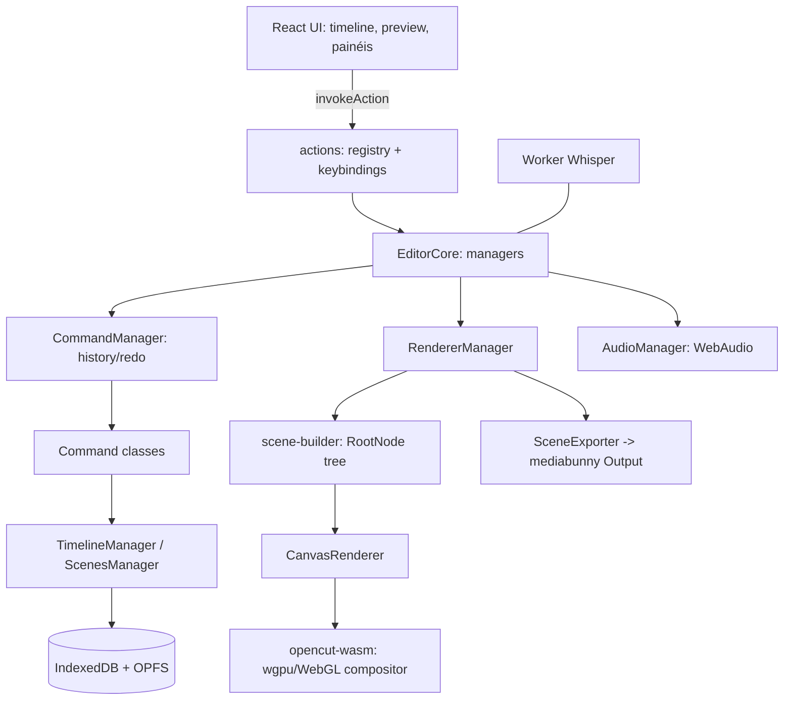

# Technical profile: OpenCut

> **Status of this file.** Project profile delivered by a research agent on 2026-11-14 and reviewed by the architect. Its "lessons" are input to the design, not decisions; the decisions are in `../../brainstorming.md` and `../../adrs/`. Code excerpts and diagrams are quoted from the project as found and are not translated.

All sources accessed 2026-11-14. Legend: FACT (read in the source), INFERENCE (with reasoning), OPINION.

## 0. Critical finding: the repository changed nature

- FACT: `https://github.com/opencut-app/opencut` redirects to `https://github.com/OpenCut-app/OpenCut` (API: `full_name: OpenCut-app/OpenCut`, MIT, 98,347 stars, not archived; accessed 2026-11-14).
- FACT: the current `main` **no longer contains the editor**. The README says "OpenCut is being rewritten from the ground up" and points the old code to `https://github.com/OpenCut-app/opencut-classic` ("the one to reach for today") ([README](https://github.com/OpenCut-app/OpenCut/blob/main/README.md)). The `main` only has: `apps/web` (TanStack Start + shadcn stub), `apps/desktop` (GPUI window; "Very early. Right now this is just a window that opens", [apps/desktop/README.md](https://github.com/OpenCut-app/OpenCut/blob/main/apps/desktop/README.md)), `apps/api` (Cloudflare Worker), `crates/media/setup` (downloads LGPL FFmpeg) and `changelog/`.
- FACT: `opencut-classic` is **archived** (`archived: true`), created on 2026-05-16, last push 2026-05-17, 298 stars, no releases ([repo](https://github.com/OpenCut-app/opencut-classic)). Commit read: `cf5e79e919144200294fb9fed22a222592a0aeea` (2026-05-17).
- Consequence: everything in sections 1 to 9 comes from **classic** (real code, in production at opencut.app). The rewrite (which promises an Editor API, MCP and headless mode) **has nothing implemented beyond scaffolding**.
- Link base of classic: `https://github.com/OpenCut-app/opencut-classic/blob/cf5e79e919144200294fb9fed22a222592a0aeea/` (abbreviated `C/` in the text; the full links are in the references).

## 1. Stack

Classic monorepo (FACT: [package.json](https://github.com/OpenCut-app/opencut-classic/blob/cf5e79e919144200294fb9fed22a222592a0aeea/package.json), [apps/web/package.json](https://github.com/OpenCut-app/opencut-classic/blob/cf5e79e919144200294fb9fed22a222592a0aeea/apps/web/package.json), [Cargo.toml](https://github.com/OpenCut-app/opencut-classic/blob/cf5e79e919144200294fb9fed22a222592a0aeea/Cargo.toml)):

| Layer | Technology (manifest version) |
|---|---|
| Package manager/monorepo | Bun 1.2.18 + Turborepo ^2.8.20 (classic); Moon + proto on the new `main` |
| Web | Next.js 16.1.3, React ^19, Tailwind ^4.2.1, Radix, Zustand ^5.0.2, zod 4.3.6 |
| Media (TS) | **mediabunny ^1.29.1** (demux/decode/encode/mux over WebCodecs), soundtouchjs ^0.3.0, wavesurfer.js ^7.9.8 |
| Transcription | @huggingface/transformers ^3.8.1 (Whisper ONNX in the browser) |
| Rust core | crates `time`, `bridge`, `effects`, `gpu`, `masks`, `compositor` + `rust/wasm` (crate `opencut-wasm` 0.2.10, published on npm); `wgpu = "29.0.1"` with feature `webgl`; wasm-bindgen 0.2.116, tsify ([gpu/Cargo.toml](https://github.com/OpenCut-app/opencut-classic/blob/cf5e79e919144200294fb9fed22a222592a0aeea/rust/crates/gpu/Cargo.toml), [wasm/Cargo.toml](https://github.com/OpenCut-app/opencut-classic/blob/cf5e79e919144200294fb9fed22a222592a0aeea/rust/wasm/Cargo.toml)) |
| Desktop | GPUI (Zed) `gpui = "0.2.2"`, Rust edition 2024; **only an empty window** (41 lines in `apps/desktop/src/main.rs` in classic; panel scaffold on the new `main`) |
| Backend | Postgres + drizzle-orm ^0.44.2, better-auth, Upstash Redis (rate limit), Cloudflare Workers deploy via OpenNext. The editor itself is local. |

- FACT: there is real Rust/WASM: wgpu→WebGL compositor, effects, masks with JFA feathering, time ([changelog 0.3.0](https://github.com/OpenCut-app/OpenCut/blob/main/changelog/0.3.0.md)). Shaders in `rust/crates/*/src/shaders`.
- FACT: Rust is compiled only as WASM for the web; the desktop does not yet consume the crates in a functional way.
- Note (FACT, apps/web/package.json): `"@types/bun": "latest"` and `typescript ^5.8.3` versus `^6.0.2` at the root: a manifest without version discipline.

## 2. Architecture

FACT: [AGENTS.md](https://github.com/OpenCut-app/opencut-classic/blob/cf5e79e919144200294fb9fed22a222592a0aeea/AGENTS.md) declares an ongoing migration: "moving all business logic into `rust/`. Each app under `apps/` is a UI shell". FACT: in the current code the logic is still almost all TypeScript; only time, compositor, effects and masks are in Rust.



- State: managers instantiated in `EditorCore` ([core/managers](https://github.com/OpenCut-app/opencut-classic/tree/cf5e79e919144200294fb9fed22a222592a0aeea/apps/web/src/core/managers)): `commands`, `timeline`, `scenes`, `media`, `project`, `playback`, `selection`, `renderer`, `audio`, `save`, `clipboard`, `diagnostics`. Zustand stores for UI/transient state (`timeline-store`, `preview-store`, `editor-store`). The rewrite proposal issue says that in classic "managers hold state in Zustand stores" and the logic is intertwined with React ([#867](https://github.com/OpenCut-app/OpenCut/issues/867)).
- UI ↔ engine: the UI calls `invokeAction(...)` ([docs/actions.md](https://github.com/OpenCut-app/opencut-classic/blob/cf5e79e919144200294fb9fed22a222592a0aeea/docs/actions.md)), which triggers handlers in `use-editor-actions.ts`, which call `editor.timeline.*`, which build a `Command` and pass it to the `CommandManager`. **In-process, same thread, no serializable boundary.**
- Workers: a Web Worker only for Whisper ([worker.ts](https://github.com/OpenCut-app/opencut-classic/blob/cf5e79e919144200294fb9fed22a222592a0aeea/apps/web/src/services/transcription/worker.ts)). INFERENCE: render and export run on the main thread (`CanvasRenderer` is instantiated in `renderer-manager.ts`; I did not see a render worker).
- OPINION: [notes/primitives-vs-domains.md](https://github.com/OpenCut-app/opencut-classic/blob/cf5e79e919144200294fb9fed22a222592a0aeea/notes/primitives-vs-domains.md) shows that the TS dependency graph became confusing (`Transform` living in `rendering/`).

## 3. Timeline data model

### Time (FACT; the project's best decision)

`MediaTime` = integer `i64` of ticks, `TICKS_PER_SECOND = 120_000`; `FrameRate` is a rational `{numerator, denominator}`; 23.976 = 5005 ticks/frame, 29.97 = 4004, 30 = 4000 ([media_time.rs](https://github.com/OpenCut-app/opencut-classic/blob/cf5e79e919144200294fb9fed22a222592a0aeea/rust/crates/time/src/media_time.rs), [frame_rate.rs](https://github.com/OpenCut-app/opencut-classic/blob/cf5e79e919144200294fb9fed22a222592a0aeea/rust/crates/time/src/frame_rate.rs)). Official justification: "Previously, floating-point seconds were used throughout, which accumulated rounding errors" ([changelog 0.3.0](https://github.com/OpenCut-app/OpenCut/blob/main/changelog/0.3.0.md)). Caveat (FACT, test in the file): `FrameRate::new(7,3).ticks_per_frame()` returns `None`; rates without exact division are not supported.
INFERENCE: the migration to `MediaTime` is not complete: `VideoCache.getFrameAt` receives `time: number` (seconds) and `buildCaptionChunks` uses float seconds.

### Real types ([timeline/types.ts](https://github.com/OpenCut-app/opencut-classic/blob/cf5e79e919144200294fb9fed22a222592a0aeea/apps/web/src/timeline/types.ts))

```ts
export type TrackType = "video" | "text" | "audio" | "graphic" | "effect";
export interface SceneTracks {
	overlay: OverlayTrack[];   // video|text|graphic|effect
	main: VideoTrack;          // singleton
	audio: AudioTrack[];
}
export interface TScene { id; name; isMain; tracks: SceneTracks; bookmarks: Bookmark[]; createdAt: Date; updatedAt: Date }

interface BaseTimelineElement {
	id: string; name: string;
	duration: MediaTime; startTime: MediaTime;
	trimStart: MediaTime; trimEnd: MediaTime;
	sourceDuration?: MediaTime;
	animations?: ElementAnimations;
	params: ParamValues;              // Record<string, number|string|boolean>
}
export interface VideoElement extends BaseTimelineElement {
	type: "video"; mediaId: string; isSourceAudioEnabled?: boolean; hidden?: boolean;
	retime?: RetimeConfig /* {rate, maintainPitch?} */; effects?: Effect[]; masks?: Mask[];
}
// ImageElement, TextElement (sem campos próprios), StickerElement,
// GraphicElement {definitionId}, EffectElement {effectType}, AudioElement (upload|library)
```

`TextElement` does not declare content/font/color: everything lives in `params: ParamValues` (FACT). Weak typing for text/captions.

### Project ([project/types.ts](https://github.com/OpenCut-app/opencut-classic/blob/cf5e79e919144200294fb9fed22a222592a0aeea/apps/web/src/project/types.ts))

`TProject { metadata; scenes: TScene[]; currentSceneId; settings: {fps: FrameRate; canvasSize; background: color|blur; ...}; version: number; timelineViewState? }`.

### Keyframes ([animation/types.ts](https://github.com/OpenCut-app/opencut-classic/blob/cf5e79e919144200294fb9fed22a222592a0aeea/apps/web/src/animation/types.ts))

```ts
export interface ScalarAnimationKey { id; time: MediaTime /* relativo ao início do elemento */; value: number;
	leftHandle?: CurveHandle; rightHandle?: CurveHandle;
	segmentToNext: "step"|"linear"|"bezier"; tangentMode: "auto"|"aligned"|"broken"|"flat" }
export interface ScalarChannel { keys: ScalarAnimationKey[]; extrapolation?: {before; after: "hold"|"linear"} }
export interface ElementAnimations { [propertyPath: string]: ChannelData | undefined }
```

Animatable paths: `transform.positionX/Y`, `transform.scaleX/Y`, `transform.rotate`, `opacity`, `volume`, `color`, `background.*`, plus `params.*` of graphics and `effects.<id>.params.*` (FACT).

### Transitions

FACT: **there is no transition type in the model** (a grep for "transition" only finds UI/roadmap). The rewrite roadmap says "Transitions and filters are coming" ([#811](https://github.com/OpenCut-app/OpenCut/issues/811)). Effects: only `blur` in `effects/definitions` (directory listing).

### Text/captions

- Captions are regular `TextElement`s created from `CaptionChunk[]`, with chunking by number of words ([caption.ts](https://github.com/OpenCut-app/opencut-classic/blob/cf5e79e919144200294fb9fed22a222592a0aeea/apps/web/src/transcription/caption.ts)). SRT/ASS import in `subtitles/`.
- FACT: there is no grouping/karaoke in the core; a production user reported this (#898, section 12).

### Migration/format version

FACT: `CURRENT_PROJECT_VERSION = 31`, 31 chained migrations `v0-to-v1` ... `v30-to-v31`, with tests and fixtures ([index.ts](https://github.com/OpenCut-app/opencut-classic/blob/cf5e79e919144200294fb9fed22a222592a0aeea/apps/web/src/services/storage/migrations/index.ts), [runner.ts](https://github.com/OpenCut-app/opencut-classic/blob/cf5e79e919144200294fb9fed22a222592a0aeea/apps/web/src/services/storage/migrations/runner.ts)). Policy: "Migrations are additive only. Do not delete, rename, or replace persisted data" to allow down-migrations ([migrations AGENTS.md](https://github.com/OpenCut-app/opencut-classic/blob/cf5e79e919144200294fb9fed22a222592a0aeea/apps/web/src/services/storage/migrations/AGENTS.md)). Keybindings have their own versioning.
INFERENCE: 31 versions in about 11 months (original repo created 2025-06-22) indicates an unstable schema; the rewrite goes for a "canonical NLE EDL Compositor JSON" (#867, third-party proposal).

### Persistence

FACT: project in **IndexedDB**, media in **OPFS** (`media-files-<projectId>`), with a request for persistent storage ([service.ts](https://github.com/OpenCut-app/opencut-classic/blob/cf5e79e919144200294fb9fed22a222592a0aeea/apps/web/src/services/storage/service.ts), [types.ts](https://github.com/OpenCut-app/opencut-classic/blob/cf5e79e919144200294fb9fed22a222592a0aeea/apps/web/src/services/storage/types.ts)). There is no portable project file (#719 asks for one). There is a server with Postgres, but it is for auth/account; INFERENCE: I did not see project sync.

## 4. Preview and export

- Decoding: mediabunny `CanvasSink` per media, with current + next frame (prefetch), a per-media promise chain, and a "seek generation" to discard obsolete seeks ([video-cache/service.ts](https://github.com/OpenCut-app/opencut-classic/blob/cf5e79e919144200294fb9fed22a222592a0aeea/apps/web/src/services/video-cache/service.ts)). No proxies (no proxy structure found).
- Composition: `scene-builder` builds a node tree (`RootNode`, `video-node`, `text-node`, `effect-layer-node`...); `CanvasRenderer.render` → `resolveRenderTree` → `buildFrameDescriptor` → WASM compositor (wgpu/WebGL) that draws to an output canvas ([canvas-renderer.ts](https://github.com/OpenCut-app/opencut-classic/blob/cf5e79e919144200294fb9fed22a222592a0aeea/apps/web/src/services/renderer/canvas-renderer.ts), [wasm-compositor.ts](https://github.com/OpenCut-app/opencut-classic/blob/cf5e79e919144200294fb9fed22a222592a0aeea/apps/web/src/services/renderer/compositor/wasm-compositor.ts)). Text/stickers are rasterized in Canvas2D and sent as a texture (cache `RenderedCacheEntry` keyed by `contentHash`). The graphics backend is WebGL via wgpu (feature `wgpu/webgl`), not WebGPU. The changelog mentions a warning when the browser does not support GPU.
- Export: **mediabunny** `Output` + `CanvasSource` (H.264 "avc" in MP4 or VP9 in WebM) + `AudioBufferSource` (AAC with Opus fallback via `AudioEncoder.isConfigSupported`), `BufferTarget` (**everything in memory**) ([scene-exporter.ts](https://github.com/OpenCut-app/opencut-classic/blob/cf5e79e919144200294fb9fed22a222592a0aeea/apps/web/src/services/renderer/scene-exporter.ts)). Loop by `frameCount = floor(duration/ticksPerFrame)`. No ffmpeg.wasm, no server.
- Same render path? FACT: **yes for video** (preview uses `renderToCanvas` over `getRenderTree`; export uses `buildScene` + `CanvasRenderer`; both go through the WASM compositor). **No for audio**: preview plays via `AudioManager` with `AudioBufferSink`/`AudioBufferSourceNode` scheduled with lookahead; export mixes offline in `createTimelineAudioBuffer` ([media/audio.ts](https://github.com/OpenCut-app/opencut-classic/blob/cf5e79e919144200294fb9fed22a222592a0aeea/apps/web/src/media/audio.ts), [audio-manager.ts](https://github.com/OpenCut-app/opencut-classic/blob/cf5e79e919144200294fb9fed22a222592a0aeea/apps/web/src/core/managers/audio-manager.ts)).
- INFERENCE: rendering depends on the browser's `HTMLCanvasElement`/WebGL, `AudioContext` and `window`; that is why there is no headless mode in classic.

## 5. Audio

- Decoding via mediabunny `AudioBufferSink`; the export rate is fixed at **44100 Hz** (`EXPORT_SAMPLE_RATE`), max 2 channels (`MAX_AUDIO_CHANNELS`) (FACT, media/audio.ts).
- Resample: `OfflineAudioContext` to the target rate (code comment: "high-quality resampling"). Retime with `soundtouchjs` and `maintainPitch` (changelog 0.3.0, `retime/`).
- Mix: a single project buffer assembled per element (volume, mute, animated volume, mastering in `audio-mastering.ts`) and delivered whole to the `AudioBufferSource` (FACT).
- Waveform: RMS per buckets, renders only the visible part ([waveform-summary.ts](https://github.com/OpenCut-app/opencut-classic/blob/cf5e79e919144200294fb9fed22a222592a0aeea/apps/web/src/media/waveform-summary.ts), changelog 0.3.0).
- Playback sync: the `AudioContext.currentTime` clock as master (`playbackStartContextTime`, FACT).
- INFERENCE: the whole project's AudioBuffer in memory (stereo Float32 at 44.1k) scales poorly on long videos (see #915/#812).

## 6. Undo/redo, commands, MCP/CLI/API

- Undo/redo: **Command** pattern, with `history`/`redoStack` in `CommandManager`; abstract `Command` with `execute()`, `undo()`, `redo()`; `BatchCommand` groups them; selection saved per entry ([commands.ts](https://github.com/OpenCut-app/opencut-classic/blob/cf5e79e919144200294fb9fed22a222592a0aeea/apps/web/src/core/managers/commands.ts), [base-command.ts](https://github.com/OpenCut-app/opencut-classic/blob/cf5e79e919144200294fb9fed22a222592a0aeea/apps/web/src/commands/base-command.ts), [batch-command.ts](https://github.com/OpenCut-app/opencut-classic/blob/cf5e79e919144200294fb9fed22a222592a0aeea/apps/web/src/commands/batch-command.ts)). Ripple is applied as a post-command reactor.
- Reusable layer for an agent? FACT: **not serializable**. Commands are TS class instances; "actions" (`definitions.ts`) are shortcut/UI triggers with typed `args`, but the handler calls `editor.xxx()` directly. There is no command log and no operation JSON.
- MCP/CLI/API/AI: FACT: **nothing implemented** in classic or in the new `main` (a grep for `mcp` in the source finds no implementation). Only promises and proposals:
  - [#811 Tracking: OpenCut rewrite](https://github.com/OpenCut-app/OpenCut/issues/811) (maintainer): Editor API, plugins, MCP, headless, scripting; "separating the engine from the UI" with a Rust core.
  - [#867](https://github.com/OpenCut-app/OpenCut/issues/867) (CLOSED, author `halfinamoon`, 0 comments; not from the maintainer): proposal "M1: Engine Core + Editor API + Plugin API + MCP Server + Headless Runtime", state in Rust, "typed operations", "canonical NLE EDL Compositor JSON". Third-party design document, not code.
  - [#868 RFC local-first agent bridge](https://github.com/OpenCut-app/OpenCut/issues/868) (third party, doc-only; external PRs limited to collaborators), [#827](https://github.com/OpenCut-app/OpenCut/issues/827) (request for API/CLI/headless for agents), [#719](https://github.com/OpenCut-app/OpenCut/issues/719) (project JSON for programmatic workflows), [#778](https://github.com/OpenCut-app/OpenCut/issues/778) (headless render SDK).
- The existing `AGENTS.md` serves coding agents that develop the repo, not agents that operate the editor.

## 7. What they do well (OPINION based on the FACTS above)

1. Integer time (120,000 ticks/s) + rational `FrameRate` in Rust, exposed via WASM, with tests. Eliminates float drift.
2. Versioned project migrations, tested with fixtures, additive policy (allows rollback).
3. Same compositor for video preview and export; typed `SceneTracks {overlay, main, audio}`.
4. mediabunny for WebCodecs I/O without ffmpeg.wasm: smaller bundle, hardware acceleration.
5. Keyframes with bezier/tangents and registered property paths.
6. Ripple as a snapshot diff, independent of the command and testable.
7. Local-first persistence (OPFS + IndexedDB) with no mandatory backend.
8. Documented internal conventions (`docs/`, `AGENTS.md`).

## 8. What to avoid

1. An engine tied to the UI/React/Zustand: that was the reason for the rewrite (#867/#811).
2. Commands as classes with closures: no serialization, reproducible log or external API.
3. `params: Record<string, number|string|boolean>` as a property bag, including all text.
4. Export into `BufferTarget` (RAM) + the whole audio in a single `AudioBuffer`: fails on large videos.
5. Audio with distinct paths between preview (WebAudio streaming) and export (offline mix): risk of divergence.
6. Rendering that depends on the browser's DOM/WebGL: prevents headless/CI.
7. A full rewrite on the main repo with no editor: a project with 98k stars and ~97 contributors, stalled, with external PRs closed.
8. Persistence without a portable project format and without save ordering (#873).

## 9. Features present (classic v0.3.0, [changelog](https://github.com/OpenCut-app/OpenCut/blob/main/changelog/0.3.0.md) + code)

- Editing: multi-tracks (video/text/audio/graphic/effect), scenes, trim/split/move, multi-selection with group move/resize, snapping, ripple, bookmarks, clipboard, undo/redo.
- Animation: keyframes (independent X/Y position, X/Y scale, rotation, opacity, volume, color, effect params), bezier curve editor, copy/paste keyframes.
- Visual: masks (split, rectangle, ellipse, star, heart, diamond, cinematic bars; feather, stroke), blur effect, stickers (flags, shapes), text with Google/system fonts and background, background (color, blur, gradient), custom canvas size, zoom/pan in the preview.
- Audio: volume, speed with pitch maintained, waveform.
- Captions: in-browser Whisper auto-transcription (tiny, small, medium, large-v3-turbo; WebGPU optional), SRT/ASS/transcript import.
- Export: MP4 (H.264/AAC) and WebM (VP9/Opus), 4 quality levels, chosen FPS; PNG snapshot.
- Persistent local projects.
- Missing (FACT): transitions, filters/LUT, element grouping, headless export, API, MCP, plugins, motion templates, CJK/RTL (requested in #817, #826).

## 10. Maintenance status

- FACT (GitHub API, 2026-11-14): `OpenCut-app/OpenCut`: created 2025-06-22, 98,347 stars, ~97 contributors, ~1,599 commits in history, **last commit 2026-09-24** (`ci(media): add the workflow that builds FFmpeg for every platform`), 289 open issues (search `is:issue is:open`), not archived. Releases: `v0.1.0` (2026-02-23), `v0.2.0` (2026-03-02), **`v0.3.0` (2026-04-15, "Latest")**, plus the pre-release `ffmpeg-8.1.3-1` (2026-09-24).
- Direction (FACT): 2026-05-17 classic archived; 2026-05-26 the maintainer opens the rewrite tracking (#811); `main` restarted in Jul/2026 (commits `feat(web): add editor route stub` and `feat(desktop): scaffold shell...` from 2026-07-24; `feat(desktop): add foundational GPUI primitives` from 2026-08-01). After that, only the FFmpeg CI commit on 2026-09-24.
- INFERENCE: ~7 weeks without a commit on the query date, and the rewrite is at scaffold stage; the project is at a very low pace or on hiatus. README: "not set up to take outside contributions yet". #902 reports `new.opencut.app` as down.
- Sponsor: fal.ai (README). Organization change: `opencut/opencut` (cited in the wasm Cargo.toml) → `OpenCut-app/OpenCut`.

## 11. License

- Repo: MIT, "Copyright 2025-2026 OpenCut" ([LICENSE](https://github.com/OpenCut-app/OpenCut/blob/main/LICENSE); API returns `MIT`).
- **mediabunny: MPL-2.0** (FACT: `package.json` of the upstream `Vanilagy/mediabunny`, `license` field, version 1.66.0 read on the upstream `main`). Per-file copyleft: modifications to mediabunny files must be published; using it as a dependency is free.
- **FFmpeg of the rewrite: LGPL-2.1-or-later** (`lgpl-shared` build, [ffmpeg.json](https://github.com/OpenCut-app/OpenCut/blob/main/crates/media/setup/ffmpeg.json)): requires dynamic linking.
- Others (React, Next, wgpu, Zustand): permissive licenses from general knowledge, not verified one by one. GPUI: not verified. License of the Whisper ONNX models (`onnx-community`): not verified.

## 12. Real pain points (open issues on 2026-11-14)

1. [#628 Out of memory](https://github.com/OpenCut-app/OpenCut/issues/628): Chrome crash when opening a video on Windows (14 comments).
2. [#594 Excessive RAM/CPU on large file](https://github.com/OpenCut-app/OpenCut/issues/594): a 50 min 2K video crashes the tab.
3. [#812 Exporting large videos kills process](https://github.com/OpenCut-app/OpenCut/issues/812): a 3 GB video uses ~3 GB of RAM on export (Firefox/Linux); consistent with `BufferTarget`.
4. [#915 Sound export issue](https://github.com/OpenCut-app/OpenCut/issues/915) and [#912](https://github.com/OpenCut-app/OpenCut/issues/912): clip audio disappears on export; then "Array buffer allocation failed"; consistent with the whole mix in one AudioBuffer.
5. [#637 Cannot import plain mp4 from Clipchamp](https://github.com/OpenCut-app/OpenCut/issues/637): WebCodecs codec/container limit.
6. [#873 Rename/delete races can lose data](https://github.com/OpenCut-app/OpenCut/issues/873): autosave, rename and delete without ordering; a persistence failure is reported as success.
7. [#822](https://github.com/OpenCut-app/OpenCut/issues/822) (does not change the text's source/content), [#817 CJK](https://github.com/OpenCut-app/OpenCut/issues/817), [#485 custom fonts](https://github.com/OpenCut-app/OpenCut/issues/485), [#826 RTL](https://github.com/OpenCut-app/OpenCut/issues/826): text/fonts.
8. [#898 captions + karaoke data model](https://github.com/OpenCut-app/OpenCut/issues/898): a production product (FrameOS) lists 5 points where captions as "common elements" clash with split/drag/replace; it argues for captions as a core primitive.
9. [#881 Dip web, focus on desktop](https://github.com/OpenCut-app/OpenCut/issues/881): browser limits (4 GB of WASM, WebGPU limits, codecs, large-file I/O, GC).
10. [#719 Import/Export .json project](https://github.com/OpenCut-app/OpenCut/issues/719): no portable project format for automation.
- I did not find a specific VFR issue nor a "preview ≠ export" issue (searches with no results).

## 13. Lessons for our project (agent-first)

Copy:
- Time as an integer in ticks + rational `FrameRate`, in a single tested module, used by every layer; no float-seconds API. Extend it to audio samples.
- Chained, versioned, additive migrations, with fixtures and tests.
- `SceneTracks` typed by role; animatable properties via registered paths; keyframes with `segmentToNext`.
- A single compositor for video preview and export, shared between WASM and native.
- mediabunny/WebCodecs in the browser, without ffmpeg.wasm (watch the MPL-2.0).
- Ripple as a pure snapshot-diff function.

Avoid (and how the agent-first differentiator changes the design):
- Inverting OpenCut's order: **build the serializable command core first** (discriminated JSON, validated by schema, structured result/error, stable ids) and make the UI, MCP, CLI and API thin clients of it. OpenCut promised this after 11 months and had to rewrite everything.
- Undo/redo over a log of serializable commands (command + inverse or patch), not classes with closures. The same log serves agents, replay, tests and collaboration.
- A versioned, portable JSON project document from day 1 (#719 shows the demand); text, caption and transition with their own typed schema, not a generic `params`.
- Captions and karaoke as a core primitive (word with time, group, style), given the 9:16 case. Transitions and motion design in the model from the start (OpenCut does not have them).
- Deterministic, DOM-free rendering (document + media as input), for headless, CI and verification frames an agent can inspect.
- Streaming export (muxer with a file/stream target, audio in blocks) and the same mixer for preview and export.
- A serial write queue per project to avoid losing data (#873).

## Gaps in this profile

- `--depth 1` clone: I did not read the pre-rewrite git history; dates come from commits via the API.
- I did not measure real preview/scrubbing quality (I did not run the project, per the rule).
- Licenses of transitive dependencies and of the Whisper ONNX models are not verified.
- Only the default branch was cloned; #873 cites a `dev` branch that may have more content.
- WGSL effects, `docs/effects-renderer.md` and `retime/` were viewed only through a directory listing.
