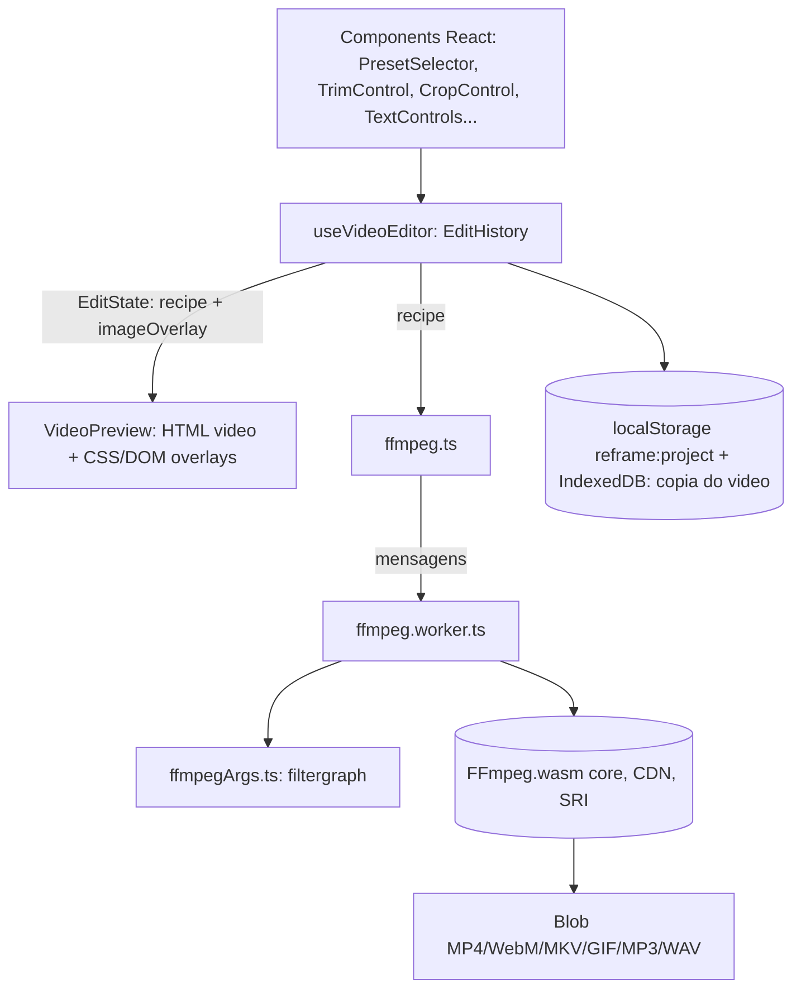

# Profile: reframe-oss/reframe (Reframe)

> **Status of this file.** Project profile delivered by a research agent on 2026-11-14 and reviewed by the architect. Its "lessons" are input to the design, not decisions; the decisions are in `../../brainstorming.md` and `../../adrs/`. Code excerpts and diagrams are quoted from the project as found and are not translated.

Accessed 2026-11-14. Shallow clone at commit `375a9f3` (2026-11-06T20:36:53+05:30). Base of the links: `https://github.com/reframe-oss/reframe/blob/375a9f3/`. Marking: FACT, INFERENCE, OPINION.

## 0. Existence and identity

- FACT: the repo exists, is public, not archived, TypeScript, created 2026-02-28 ("Free, open-source video editor that runs in your browser. No login, no uploads, no ads.") (`gh api repos/reframe-oss/reframe`, accessed 2026-11-14).
- FACT: although the GitHub description says "video editor", the README defines it as "Resize, trim and convert videos in your browser" ([README.md](https://github.com/reframe-oss/reframe/blob/375a9f3/README.md)). **It is not a timeline editor.** It is a converter/reframer of **one clip** with an editing "recipe", and it was an official project of GirlScript Summer of Code 2026 (GSSoC'26), with a beginner-contributor profile.
- OPINION: it is the most relevant of the three for our 9:16 use case (social format presets, fit/fill, SRT captions as text overlay), but it offers no timeline model, only a "recipe".

## 1. Stack

Summary: **web only**, no backend (static Next.js export hosted on Netlify), no native Rust; WASM = FFmpeg.wasm. No desktop (no Electron/Tauri packager observed).

- FACT ([package.json](https://github.com/reframe-oss/reframe/blob/375a9f3/package.json)): `next 16.4.1` (build with `--webpack`), `react 19.3.1`, `@ffmpeg/ffmpeg ^0.12.10`, `@ffmpeg/util ^0.12.2`, `lottie-web ^5.12.2`, `jszip ^3.10.1`, `tailwindcss ^3.4.17`, `lucide-react ^0.577.0`, `wasm-feature-detect ^1.8.0`, `typescript ^5`; observability `@datadog/browser-rum ^7.10.0`. Tests: `vitest ^4.1.12`, `@playwright/test 1.64.1`, Storybook `^10.6.6`, Chromatic. Bun as package manager (`bun.lock`; the repo's `CLAUDE.md` requires keeping `bun.lock`). `version: 0.1.0`, `private: true`.
- FACT: the FFmpeg cores are downloaded from a CDN at runtime (`https://cdn.jsdelivr.net/npm/@ffmpeg/core@0.12.10/dist/umd` and `@ffmpeg/core-mt@0.12.10`) with SRI verification ([src/lib/engineUrls.ts](https://github.com/reframe-oss/reframe/blob/375a9f3/src/lib/engineUrls.ts) lines 8-24). ~30 MB on first load.
- FACT: the encoder is `libx264` (`-preset ultrafast`) ([src/lib/ffmpegArgs.ts](https://github.com/reframe-oss/reframe/blob/375a9f3/src/lib/ffmpegArgs.ts) lines 460-463).
- Docs divergence: `docs/ARCHITECTURE.md` still says "Next.js 15" and "single-threaded FFmpeg", but the README and the code (`engineFileUrls(isolated)`, `MT_CORE_BASE_URL`) already use Next 16 and the multi-thread core when the page is cross-origin isolated ([docs/ARCHITECTURE.md](https://github.com/reframe-oss/reframe/blob/375a9f3/docs/ARCHITECTURE.md) vs [src/lib/ffmpeg.ts](https://github.com/reframe-oss/reframe/blob/375a9f3/src/lib/ffmpeg.ts) lines 353-356). FACT: outdated documentation in a project with a high PR pace.

## 2. Architecture

FACT: React UI -> hook `useVideoEditor` (state) -> `ffmpeg.ts` (loads WASM, orchestrates) -> `ffmpeg.worker.ts` (Web Worker running FFmpeg) -> `ffmpegArgs.ts` (the only command-line builder) -> Blob/download.



- FACT: state in a single `EditState` (`recipe` without the sound preference + image overlay settings) inside a history with a limit (`src/lib/editHistory.ts`); "preview, export and undo/redo read the same state" ([docs/ARCHITECTURE.md](https://github.com/reframe-oss/reframe/blob/375a9f3/docs/ARCHITECTURE.md) State Management section; [docs/PROJECTS.md](https://github.com/reframe-oss/reframe/blob/375a9f3/docs/PROJECTS.md)).
- FACT: UI <-> engine via messages to the Worker (`ffmpeg.worker.ts`, 744 lines). A comment in `ffmpegArgs.ts` documents a real architecture bug: there used to be **two** copies of the command builder (one in `ffmpeg.ts` exercised by the tests and another in the worker), and fixes (sharpness, volume, `-t`) fell into the copy that never ran ([src/lib/ffmpegArgs.ts](https://github.com/reframe-oss/reframe/blob/375a9f3/src/lib/ffmpegArgs.ts) lines 5-11).

## 3. Timeline data model

**FACT: there is no timeline in the active path.** The active model is `EditRecipe`, a single recipe for a single source video.

`EditRecipe` real ([src/lib/types.ts](https://github.com/reframe-oss/reframe/blob/375a9f3/src/lib/types.ts) lines 1-60):

```ts
export const RECIPE_VERSION = 1;
export type VideoFormat = "mp4" | "webm" | "mkv" | "gif";
export type AudioFormat = "mp3" | "wav";

export interface TextOverlay {
  id: string; text: string;
  x: number; y: number;            // porcentagem 0-100
  fontSize: number; color: string; // hex
  fontWeight: "normal" | "bold" | "900";
  fontFamily?: string; fontPath?: string;
  start?: number; end?: number;    // segundos do video de origem; ausentes = inicio/fim
  box?: boolean;                   // caixa translucida, para legendas
}

export interface EditRecipe {
  preset: string; customWidth: number; customHeight: number;
  framing: "fit" | "fill";
  trimStart: number; trimEnd: number | null;
  rotate: 0 | 90 | 180 | 270;
  keepAudio: boolean; normalizeAudio: boolean;
  speed: number; volume: number; quality: number;
  format: OutputFormat;
  stabilization: boolean; denoise: boolean;
  brightness: number; contrast: number; saturation: number; sharpness: number;
  textOverlays: TextOverlay[];
  crop?: CropRect | null;
  version: number;
}
```

- FACT: time representation: **seconds as float (`number`)**, in the source video's time (`trimStart`, `trimEnd`, `start`, `end`). No frames, no rational.
- FACT: no keyframes, no transitions, no tracks in the active pipeline. Overlays (text, image, background music) are recipe fields, not clips.
- FACT (dead/semi-active code): there is `TimelineTrack` and `MultiTrackEditorState` in [src/lib/types.ts](https://github.com/reframe-oss/reframe/blob/375a9f3/src/lib/types.ts) lines 100-140 ("Phase 1 MVP ... maximum of 2 video tracks due to FFmpeg.wasm limitation"), with `startTime`/`duration` in seconds, `zIndex`, `opacity` 0-100, `position`, `scale`, `rotation`. `docs/PROJECTS.md` states that this multi-track state "is not yet connected to the UI or to export" ([docs/PROJECTS.md](https://github.com/reframe-oss/reframe/blob/375a9f3/docs/PROJECTS.md)), although `useVideoEditor.ts` calls `createTimelineTrack` (line 424) and `overlayGraph.ts` imports from `timeline.ts`. INFERENCE: there is partial multi-track integration behind "join clips"/overlay features; I did not verify whether it is reachable from the UI.
- Captions: FACT: SRT and WebVTT become `TextOverlay[]` (one `drawtext` per cue; maximum 500) in [src/lib/captions.ts](https://github.com/reframe-oss/reframe/blob/375a9f3/src/lib/captions.ts): white text, dark box, y=88%, `fontSize = round(outputHeight*0.045)` limited to 12-120. No per-word styling, no animation.

### Versioning and persistence

- FACT: project document: `{ format: "reframe-project", schemaVersion: 1, savedAt, source: SourceInfo|null, edit: EditState }`. The project **never contains media**; the source is identified by name+size+duration to match when the user reopens the file ([src/lib/project.ts](https://github.com/reframe-oss/reframe/blob/375a9f3/src/lib/project.ts) lines 1-60).
- FACT: migration: `MIGRATIONS: Record<number, Migration> = {}` (empty, schema v1) "keyed by the version a migration upgrades from"; "every document, stored or imported, is migrated and then fully validated" (same file, lines 9-12, 58-60). Manual validation (`isValidRecipe`, no Zod in the code read) with hard limits (`MAX_PROJECT_FILE_BYTES = 512 KiB`, `MAX_TEXT_OVERLAYS = 500`).
- FACT: browser persistence: `reframe:project` in localStorage (500 ms after the last edit and on `pagehide`), copy of the source video in IndexedDB (only one, overwritten); recovery on reload; share link `?settings=`. The UI to save/open a project file was removed ("The editor no longer has a 'Saved on this device' panel") but the `buildProjectFile`/`importProjectFile` functions are still ready ([docs/PROJECTS.md](https://github.com/reframe-oss/reframe/blob/375a9f3/docs/PROJECTS.md)).

## 4. Preview and export

- FACT: **preview and export do NOT share the render path.** Preview = HTML `<video>` with DOM/CSS overlays (`VideoPreview.tsx`, positions in %, `transform: translate(-50%,-50%)`); export = FFmpeg filtergraph (`trim -> transpose -> scale/crop -> setpts/atempo`, `drawtext`, `overlay`) in [src/lib/ffmpegArgs.ts](https://github.com/reframe-oss/reframe/blob/375a9f3/src/lib/ffmpegArgs.ts). What is shared is only the `EditState`, and `resolveOutputSize()` ("the worker, the UI and all the tests use this, so what the editor shows is what FFmpeg receives").
- FACT: documented consequence in the issues: [#1498](https://github.com/reframe-oss/reframe/issues/1498) "Preview vs. Export Coordinate Mismatch for Text Overlays"; [#1510](https://github.com/reframe-oss/reframe/issues/1510) "Add real-time preview for video operations" (the preview does not really show brightness/contrast/rotation like the export does); [#1203](https://github.com/reframe-oss/reframe/issues/1203) request for accelerated WebGL/WebGPU preview.
- FACT: export: the filtergraph is generated by `ffmpegArgs.ts`, run in the worker, with multi-thread only if `crossOriginIsolated` (otherwise single-thread). `MT_THREAD_CAP = 4`: a code comment describes a real deadlock at 0% when x264/libvpx/decoder ask for more threads than the core-mt's 32-pthread pool (measured on an M3 Pro 11-core, Chrome 155) ([src/lib/ffmpegArgs.ts](https://github.com/reframe-oss/reframe/blob/375a9f3/src/lib/ffmpegArgs.ts) lines 38-60).
- FACT: times reported by the docs: 1080p/30 s ~30-60 s; 4K/30 s ~2-5 min ([docs/ARCHITECTURE.md](https://github.com/reframe-oss/reframe/blob/375a9f3/docs/ARCHITECTURE.md)). Limits: `MAX_FILE_SIZE` 2 GiB, warning at 500 MB, whole video in memory.
- Source of the preview frame/thumbnails: `useTimelineFrames.ts`, `frameCache.ts` and `frame-export.ts` (capture via canvas `drawImage` of the `<video>`).

## 5. Audio

- FACT: on export, `keepAudio`, `normalizeAudio`, `volume`, speed with `atempo`, background music (`BackgroundMusicOptions`: music volume, original volume, `loopMusic`, `replaceAudio`), audio-only output (mp3/wav). Waveform for UI via `useAudioWaveform`/`WaveformCanvas`.
- FACT: bugs: [#1579](https://github.com/reframe-oss/reframe/issues/1579) mutating the video drops the background music; [#1493](https://github.com/reframe-oss/reframe/issues/1493) export can hang indefinitely without audio + looped music; [#1501](https://github.com/reframe-oss/reframe/issues/1501), [#1450](https://github.com/reframe-oss/reframe/issues/1450) OOM/freeze when generating waveform on large videos.
- FACT: no dedicated audio clock: preview uses the `<video>` element.

## 6. Undo/redo, commands, MCP/CLI/API, agents

- FACT: undo/redo = immutable snapshots of `EditState` (~1 KB), limit 100, coalescing of continuous changes within 600 ms (sliders, trim drag, overlay typing), no duplicates, a "reset" is one step ([src/lib/editHistory.ts](https://github.com/reframe-oss/reframe/blob/375a9f3/src/lib/editHistory.ts) lines 1-60; [docs/PROJECTS.md](https://github.com/reframe-oss/reframe/blob/375a9f3/docs/PROJECTS.md)). Undo disabled during export.
- FACT: **there is no serializable command layer.** Mutation is done through hook calls; only the state is serializable.
- FACT: **no MCP, no CLI, no public API, no AI/agent integration in the product** (search for "MCP|agent|CLI|API" in the README and docs: only incidental hits; `gh issue list --search "MCP OR agent OR API"` found no relevant MCP issue). The repo's `CLAUDE.md` treats Claude as a **PR manager** (reviews, does not merge, does not apply labels), unrelated to editor automation ([CLAUDE.md](https://github.com/reframe-oss/reframe/blob/375a9f3/CLAUDE.md)).
- FACT: the only "API" point: a `?settings=` link with an encoded recipe (and issues [#1468](https://github.com/reframe-oss/reframe/issues/1468), [#1469](https://github.com/reframe-oss/reframe/issues/1469), [#1474](https://github.com/reframe-oss/reframe/issues/1474): breaks with non-ASCII/emoji text because of `btoa`).
- OPINION: the "recipe" format (small, validated, versioned JSON with no media) is, in fact, a natural surface for an agent, but it has not been explored.

## 7. What they do well

- FACT/OPINION: social presets (11, including 9:16) + fit/fill + safe-area guides ([docs/EXPORT_PROFILES.md](https://github.com/reframe-oss/reframe/blob/375a9f3/docs/EXPORT_PROFILES.md)) and a low-friction single-flow UX for "vertical in 3 clicks".
- FACT: project document without media + source matching by name/size/duration; migrations + full validation on read.
- FACT: history with coalescing of continuous gestures.
- FACT: a single source of truth for the FFmpeg command line (lesson documented in the code).
- FACT: cross-origin isolation detection with single-thread fallback; thread cap documented with measurement.
- FACT: privacy and security: SRI for the cores, CSP, dependency audit policy (`audit-policy.mjs`), Snyk, Storybook+Chromatic, accessibility tests (`jsx-a11y`).
- FACT: SRT/WebVTT captions -> timed overlays (cue by cue), reusable.

## 8. What to avoid

- FACT: preview (DOM/CSS) and export (FFmpeg) diverge, a direct cause of [#1498](https://github.com/reframe-oss/reframe/issues/1498).
- FACT: FFmpeg.wasm as the composition engine: whole video in memory, no cheap seek, thread deadlocks, 30 MB core, a 30 s export takes 30-60 s, 2 GiB limit; multi-track limited to 2 by memory (comment in `timeline.ts`).
- FACT: `drawtext` with one step per cue (max 500) for captions: does not scale, no word-by-word/animation; custom fonts need a file in the virtual FS ([#1449](https://github.com/reframe-oss/reframe/issues/1449): "text overlay export fails when using default built-in fonts").
- FACT: Datadog RUM telemetry in the editor (opt-out in settings); [#1575](https://github.com/reframe-oss/reframe/issues/1575) claims the SRI verification of the FFmpeg binaries is "completely bypassed" (issue claim, not verified by me).
- FACT: time as `number` of seconds; ids `Date.now()+Math.random()` in `generateTrackId`.
- FACT: documentation that diverges from the code (Next 15, single-thread).
- FACT: backlog with about 254 open issues and several trivial bugs generated by contributors from a mentorship program (GSSoC): high noise; many UI/theme issues.

## 9. Features present

Presets (Reels, TikTok, Shorts, Instagram, YouTube, custom), fit/fill, crop, trim, rotation, speed 0.25x-4x, mute/volume/normalize, background music, text and image overlays, brightness/contrast/saturation/sharpness, stabilization, denoise, export MP4/WebM/MKV/GIF/MP3/WAV with quality slider, export profiles, undo/redo, recovery after refresh, batch export (`BatchExport`), `JoinClips`, SRT/WebVTT import, shortcuts, PWA/offline (partial; `useOfflineSupport`), onboarding tour, themes.

## 10. Maintenance

- FACT: last commit `375a9f3`, 2026-11-06 (`docs(readme): official Snyk and Datadog logos (#1865)`); `pushed_at` 2026-11-06T15:09:50Z.
- FACT: no releases (`gh release list` empty) and `version` 0.1.0 in `package.json`: there is no published versioning.
- FACT: 178 stars, 356 forks, 1 subscriber; 333 `open_issues_count` (includes PRs; 254 open issues listed with `gh issue list --limit 400`); ~139 contributors (`Link` header, `page=139`); Discussions enabled. A forks/stars ratio of 2:1 is unusual. INFERENCE: forks from GSSoC participants, not from adoption.
- FACT: PRs numbered up to ~#1865 in ~8 months (created 2026-02-28): high PR pace, mostly from program contributions.

## 11. License

FACT: MIT (GitHub API `spdx_id: MIT`; `LICENSE` file). Gap: **I found no mention in the repo of the effective license of the `@ffmpeg/core` cores (which include libx264, typically GPL).** I did not verify the `LICENSE` of the npm package; it must be checked before any reuse, since distributing/linking x264 changes the obligations (INFERENCE to verify, not FACT).

## 12. Real pain points

- Preview != export: [#1498](https://github.com/reframe-oss/reframe/issues/1498), [#1510](https://github.com/reframe-oss/reframe/issues/1510), [#1203](https://github.com/reframe-oss/reframe/issues/1203).
- Memory/performance: [#1490](https://github.com/reframe-oss/reframe/issues/1490) blob URLs never revoked, [#1427](https://github.com/reframe-oss/reframe/issues/1427) Blob URL leak, [#1500](https://github.com/reframe-oss/reframe/issues/1500) leak in the thumbnail generator, [#1501](https://github.com/reframe-oss/reframe/issues/1501) OOM in waveform.
- Export/audio: [#1579](https://github.com/reframe-oss/reframe/issues/1579), [#1578](https://github.com/reframe-oss/reframe/issues/1578) (image overlays dropped in GIF), [#1493](https://github.com/reframe-oss/reframe/issues/1493), [#1472](https://github.com/reframe-oss/reframe/issues/1472) size estimate ignores presets.
- Text: [#1449](https://github.com/reframe-oss/reframe/issues/1449), [#1468](https://github.com/reframe-oss/reframe/issues/1468).
- Timeline requests: [#1512](https://github.com/reframe-oss/reframe/issues/1512) multi-track, [#1395](https://github.com/reframe-oss/reframe/issues/1395) multi-track render in a worker, [#1256](https://github.com/reframe-oss/reframe/issues/1256), [#1074](https://github.com/reframe-oss/reframe/issues/1074), [#1167](https://github.com/reframe-oss/reframe/issues/1167) AI automatic captions, [#1169](https://github.com/reframe-oss/reframe/issues/1169) silence/jump cut: evidence of demand for timeline and automatic captions.
- [#1539](https://github.com/reframe-oss/reframe/issues/1539) test suite breaks with `localStorage.clear is not a function` on Node 20+/Bun.
- Gap: I did not read the comments nor whether these bugs were fixed later; the issue numbers appear as open on 2026-11-14.

## 13. Lessons for our project

1. OPINION (high): **preview and export on the same render path**, otherwise #1498 repeats. The temptation of "preview in CSS, export in FFmpeg" creates permanent divergence.
2. OPINION: the "recipe" format is good for the simple 9:16 case, but it already runs into limits with captions (500 `drawtext`) and multi-track. We need a real timeline model (clips, tracks, keyframes) from the start; keep a "recipe" only as a derived *preset*.
3. OPINION: copy: a document without media + source identification by name/size/duration; `schemaVersion` + `MIGRATIONS` per source version + full validation; snapshot history with 600 ms coalescing.
4. OPINION: social presets (9:16, 1080x1920, safe areas) and export profiles as versioned data.
5. OPINION: do not depend on FFmpeg.wasm for interactive composition: acceptable as a fallback for export/transcoding, but WebCodecs + WebGPU/Canvas for preview+export is the path to latency and memory.
6. OPINION: time as float seconds is a source of rounding bugs (captions, cuts). Use exact integers.
7. OPINION: use the lesson from the `MT_CORE_BASE_URL`/`MT_THREAD_CAP` comments: if we use ffmpeg.wasm, require COOP/COEP and a thread cap, and test the hang at 0%.
8. OPINION: visible demand (issues #1167, #1169) for automatic captions and jump cuts confirms the use case; but Reframe does not deliver MCP/agent: the "agent-first for short vertical video" space is empty in this project.
9. OPINION: treat the codec core license from day 1 (x264 GPL vs encoders via WebCodecs).
