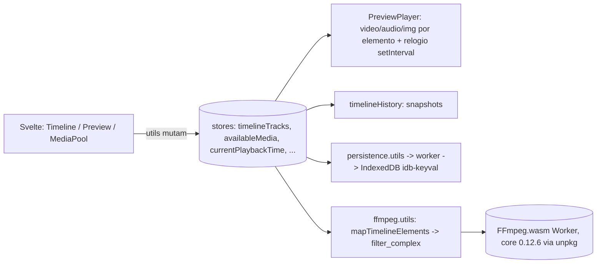

# Profile: timii/voidcut (voidcut)

> **Status of this file.** Project profile delivered by a research agent on 2026-11-14 and reviewed by the architect. Its "lessons" are input to the design, not decisions; the decisions are in `../../brainstorming.md` and `../../adrs/`. Code excerpts and diagrams are quoted from the project as found and are not translated.

Accessed 2026-11-14. Shallow clone at commit `815d596` (2026-08-23T09:14:43+02:00). Base of the links: `https://github.com/timii/voidcut/blob/815d596/`. Marking: FACT, INFERENCE, OPINION.

## 0. Existence and identity

- FACT: the repo exists, is public, not archived, TypeScript, created 2023-12-08, description "Free, open-source and non-linear video editor designed to run entirely in your web browser." (`gh api repos/timii/voidcut`, accessed 2026-11-14). Demo at `https://timii.github.io/voidcut/` (GitHub Pages).
- FACT: a personal project of a single author (Tim Thomas, MIT license 2025): "The goal ... was to have some fun creating a simple tool that I can use myself ... It's currently a work in progress and not finished." ([README.md](https://github.com/timii/voidcut/blob/815d596/README.md)).
- OPINION: by far the smallest of the three (18 stars), but it is the only one with a **real multi-track timeline in the web** with clear data and unit tests; it serves as a reference for a simple timeline model and for a well-made undo.

## 1. Stack

Summary: **web only**, no backend (SvelteKit `adapter-static`, deploy via `gh-pages`), no own Rust/WASM; WASM = FFmpeg.wasm. No desktop.

- FACT ([package.json](https://github.com/timii/voidcut/blob/815d596/package.json)): `@sveltejs/kit ^1.27.4`, `svelte ^4.2.7`, `vite ^4.4.2`, `typescript ^5.0.0`, `tailwindcss ^3.3.6`, `vitest ^0.34.6`; runtime dependencies: `@ffmpeg/ffmpeg ^0.12.10`, `@ffmpeg/util ^0.12.1`, `@neodrag/svelte ^2.0.6` (drag), `idb-keyval ^6.2.1` (IndexedDB). npm package-lock (not Bun). `version: 1.0.0`, `private: true`.
- OPINION: stack aged relative to the market (SvelteKit 1, Vite 4, Svelte 4 in 2026). No new dependency was added for the recent PRs (#6-#10), but major updates have fallen behind. I did not verify CVEs.
- FACT: the FFmpeg core is loaded from a CDN at runtime: `https://unpkg.com/@ffmpeg/core@0.12.6/dist/esm` (single-thread; no `core-mt`) ([src/lib/utils/ffmpeg.utils.ts](https://github.com/timii/voidcut/blob/815d596/src/lib/utils/ffmpeg.utils.ts) lines 85-90). The `vite.config.ts` sets COOP/COEP `same-origin`/`require-corp` only in the dev server (and GitHub Pages does not allow these headers; INFERENCE: in production the page is not cross-origin isolated).

## 2. Architecture

FACT: SvelteKit SPA; state in global Svelte **stores** (writable) in [src/stores/store.ts](https://github.com/timii/voidcut/blob/815d596/src/stores/store.ts); pure/semi-pure utility functions in `src/lib/utils/*.utils.ts` mutate the stores; components per region (`Header`, `Preview`, `Timeline`, `Workbench`).



- FACT: timeline state lives in `timelineTracks = writable<ITimelineTrack[]>([])`, together with dozens of UI/gesture stores (drag, hover, resize, scroll) in the same file. INFERENCE: the "persistable" state and the transient gesture state coexist without a formal boundary, mitigated by the history adapter that captures only `tracks` and `selection`.
- FACT: UI <-> engine: there is no separate "engine"; the preview reads the stores directly and the export (`callFfmpeg`) maps the stores into FFmpeg arguments. Media is loaded as **data URLs** kept in the state (`IMedia.src: string // dataUrl of media`, [src/lib/interfaces/Media.ts](https://github.com/timii/voidcut/blob/815d596/src/lib/interfaces/Media.ts)).
- FACT: the author keeps `sketches/*.excalidraw` with architecture drawings (including `undo-redo-architecture.excalidraw`) as design documentation.

## 3. Timeline data model

Time representation: **integer/float milliseconds in `number`** (`duration`, `playbackStartTime`, `trimFromStart`, `trimFromEnd` "in milliseconds"). No frames, no rational. Zoom scale in px per second.

Real types ([src/lib/interfaces/Timeline.ts](https://github.com/timii/voidcut/blob/815d596/src/lib/interfaces/Timeline.ts) lines 5-62):

```ts
export interface ITimelineElement {
	elementId: string;
	mediaId: string;
	mediaName: string;
	mediaImage: string;
	timelineImage?: string;
	timelineFrames?: string[];        // filmstrip (data URLs)
	type: MediaType;                  // 'VIDEO' | 'AUDIO' | 'IMAGE'
	duration: number;                 // ms, pode mudar ao redimensionar
	maxDuration: number | undefined;  // ms; undefined = sem limite (imagens)
	playbackStartTime: number;        // ms: onde o elemento inicia na timeline
	trimFromStart: number;            // ms
	trimFromEnd: number;              // ms
	settings: TimelineElementSettings;
}
export interface IAudioTimelineElementSettings { volume: number; fadeInMs: number; fadeOutMs: number; speed: TimelineElementSpeed; }
export interface IVideoTimelineElementSettings {
	flipHorizontal: boolean; flipVertical: boolean; volume: number; speed: TimelineElementSpeed;
	opacity: number; scaleMode: 'fit' | 'fill' | 'crop'; cropAspectRatio?: PreviewAspectRatio;
}
export type TimelineElementSpeed = 0.5 | 0.75 | 1 | 1.25 | 1.5 | 2;
export interface ITimelineTrack { trackId: string; elements: ITimelineElement[]; }
```

- FACT: the timeline is `ITimelineTrack[]`; each track is a list of elements; lower/upper tracks define the overlap order (the export draws from the last row). There is no separate track type (video/audio): any track accepts any element.
- FACT: **no keyframes, no transitions, no text** (text is in the README's "planned features"). Effects = flip, opacity, scale/crop, speed, volume, audio fade in/out.
- FACT: project aspect ratios: `E21_9`, `E16_9`, `E9_16`, `E4_3`, `E1_1` (9:16 -> `1080x1920`) ([src/lib/interfaces/Player.ts](https://github.com/timii/voidcut/blob/815d596/src/lib/interfaces/Player.ts), [src/lib/utils/export.utils.ts](https://github.com/timii/voidcut/blob/815d596/src/lib/utils/export.utils.ts)).
- FACT: versioning: **there is no `schema_version` nor format migration**. The state is serialized directly from the stores into IndexedDB and "normalized" on load by `normalizeTimelineTracks` / `normalizeTimelineElementSettings` (fills defaults and clamps value ranges: `clampNumber`, `clampFade`, `normalizeSpeed`) ([src/lib/utils/timeline-settings.utils.ts](https://github.com/timii/voidcut/blob/815d596/src/lib/utils/timeline-settings.utils.ts) lines ~40-70). INFERENCE: tolerant normalization is the compatibility strategy, without an explicit version.
- FACT: persistence: keys per store (`tracksStorageKey`, `mediaStorageKey`, `timelineScaleStorageKey`, `previewAspectRatioStorageKey`, `lastSaveStorageKey`) written to IndexedDB by a Web Worker (`persistence.worker.js`, `idb-keyval`) at a backup interval; does not write during a restore overlay or export; on reopening, shows `RestoreStateDialog` ([src/lib/utils/persistence/persistence.utils.ts](https://github.com/timii/voidcut/blob/815d596/src/lib/utils/persistence/persistence.utils.ts)). **There is no exportable project file** (only local backup). Since `IMedia.src` is a data URL kept in the state, the media goes along in IndexedDB (INFERENCE: high storage and memory cost).

## 4. Preview and export

- FACT: **preview and export do NOT share the render path.** Preview = HTML `<video>`, `<audio>`, `` elements per timeline element, with CSS (`object-fit`, `opacity`, `transform` for flip) in `PreviewPlayer.svelte`; clock = `adjustingInterval` (setInterval with drift correction, `CONSTS.playbackIntervalTimer`) that increments `currentPlaybackTime` ([src/lib/utils/playback.utils.ts](https://github.com/timii/voidcut/blob/815d596/src/lib/utils/playback.utils.ts)); volume gain above 100% via Web Audio `GainNode` in the preview.
- FACT: export = `callFfmpeg`: (1) creates a black base video with `-f lavfi -i color=size=<WxH>:rate=60:color=black` with the timeline's maximum duration; (2) writes each media to the virtual FS; (3) builds a `-filter_complex` that does `trim`/`setpts`/scale/crop per element and `overlay=(W-w)/2:(H-h)/2:enable='between(t,start,end)'` from the last track to the first; (4) audio: `atrim`, `atempo`, `afade`, `adelay=<offset>:all=1` per element and `amix=inputs=N` ([src/lib/utils/ffmpeg.utils.ts](https://github.com/timii/voidcut/blob/815d596/src/lib/utils/ffmpeg.utils.ts) lines ~206-614).
- INFERENCE: the `ITimelineElement` model is the "common source" that both paths interpret separately (HTMLMediaElement vs filtergraph), so fidelity depends on keeping two interpretations in sync; the repo mitigates this with tests (`playback-media.utils.test.ts`, `media-transform.utils.test.ts`) and a shared transform function `media-transform.utils.ts`.
- FACT: export formats MP4, GIF, PNG (one frame), MP3; resolutions AUTO/480p/720p/1080p; compression slider; file name ([src/lib/utils/export.utils.ts](https://github.com/timii/voidcut/blob/815d596/src/lib/utils/export.utils.ts)). Progress, elapsed time and cancellation (`terminateFfmpegExecution`).

## 5. Audio

- FACT: audio elements or the audio of videos enter the timeline; volume, fade in/out, speed (0.5-2x); SVG waveform generation via `AudioContext` + ffmpeg (`generateAudioWaveform` with `-filter_complex`, [src/lib/utils/waveform.utils.ts](https://github.com/timii/voidcut/blob/815d596/src/lib/utils/waveform.utils.ts) and `ffmpeg.utils.ts` line 704).
- FACT: preview with Web Audio `GainNode` per element (volume above 100%).
- INFERENCE: the playback clock is `setInterval`, not the audio clock: possible drift between audio and video (mitigated by `adjustingInterval`; not measured).
- FACT: no mixer, no EQ, no loudness normalization, no ducking.

## 6. Undo/redo, commands, MCP/CLI/API, agents

- FACT: undo/redo by **snapshots + transactions**: `createHistory<TSnapshot>(adapter, {limit})` with `HistoryAdapter { capture, restore, equals }`, `run(change)`, `begin/update/commit/cancel` for gestures, `undo/redo/reset`, limit 100 ([src/lib/utils/history.utils.ts](https://github.com/timii/voidcut/blob/815d596/src/lib/utils/history.utils.ts) lines 1-60). Snapshot = `{ tracks, selection }`; equality ignores selection; restore uses a `restoring` flag to avoid re-entry. Test coverage (`history.utils.test.ts`, `timeline-history.utils.test.ts`). Introduced by PR #7 ("Add undo and redo history for timeline edits").
- FACT: keyboard shortcuts in data definitions (`keyboardShortcutGroups`, named actions) and tested (`keyboard-shortcuts.utils.test.ts`), PR #6.
- FACT: **there is no serializable command layer**: actions are utility functions that mutate stores (`timeline-actions.utils.ts`, `media-actions.utils.ts`). INFERENCE: the set of named shortcut actions (`KeyboardShortcutAction`) is the closest thing to a command registry, but without parameters or serialization.
- FACT: **no MCP, no CLI, no API, no AI/agent integration** (`rg` in README/code; no relevant occurrence).

## 7. What they do well

- FACT: generic, small history (`createHistory`) with transactions for gestures (drag/resize = one step) and a capture/restore adapter: 208 lines of code, well tested, decoupled from Svelte except for `writable` for `canUndo/canRedo`. Good reference.
- FACT: timeline logic (drop, hover, resize, neighbors, limits) in testable utility functions with unit tests (13 test files in `__tests__`).
- FACT: non-blocking persistence (worker + IndexedDB) with a restore dialog.
- FACT: a single export filtergraph generated from timeline data (black base + timed overlays + `amix`), conceptually simple.
- FACT: design diagrams versioned in the repo (`sketches/`).
- OPINION: timeline UX with filmstrip and dragging between tracks (dividers between rows), in small code (~4.5k lines of `utils`).

## 8. What to avoid

- FACT: media as data URL in the state/IndexedDB (`IMedia.src` dataUrl, `FileReader.readAsDataURL` in `file.utils.ts` lines 442 and 512): uses 33% more memory than bytes and does not scale to large videos. Avoid: keep `Blob`/`File`/OPFS and reference by id.
- FACT: no versioned schema and no exportable project file.
- FACT: a single store file mixing persistent state and transient gesture state (~50 global stores).
- FACT: time in ms as `number` without guaranteed integer/rational; no notion of frame (preview at a fixed interval, export at fixed 60 fps: `rate=60` in the base `color=`).
- FACT: preview via HTMLMediaElement in multiple simultaneous `<video>` tags: fragile synchronization and memory cost; clock via `setInterval`.
- FACT: FFmpeg.wasm single-thread, core loaded from a third-party CDN (unpkg) with no SRI seen in the excerpt read; export concatenates all files in the in-memory virtual FS.
- FACT: no text/captions, no keyframes, no transitions, no color filters: not directly useful for 9:16 with captions.
- FACT: old dependencies (SvelteKit 1, Vite 4, Svelte 4, vitest 0.34).
- OPINION: the author cannot sustain the scope: single maintainer; high commit pace until August 2026 and stopped since then (see section 10).

## 9. Features present

Multi-track timeline with drag/drop, split/cut, duplicate, resize (trim), move forward/backward, zoom/fit, ruler, filmstrip, thumbnails, waveform, import video/audio/image, media pool, preview with play/pause/frame-by-frame/go to start/end, aspect ratios (21:9, 16:9, 9:16, 4:3, 1:1), opacity, flip H/V, scale fit/fill/crop, speed, volume, audio fade in/out, undo/redo, keyboard shortcuts, local backup and restore, export MP4/GIF/PNG/MP3 with resolution and compression. Planned and **not implemented**: effects/filters, text, project management, responsive layout (README).

## 10. Maintenance

- FACT: last commit `815d596` ("Update README.md"), 2026-08-23; `pushed_at` 2026-08-23T07:14:44Z: **83 days without a push** as of 2026-11-14 (INFERENCE: stalled since August, not archived).
- FACT: 486 commits (via the `Link` header of the commits API, `page=486`), 1 contributor (`timii`, 486 contributions), 0 releases, 18 stars, 2 forks, 0 open issues and 0 issues in total (`gh issue list --state all` returned an empty list), 10 merged PRs, all by the author (PR #10 "Add media scaling and crop controls" on 2026-08-22; #7 undo/redo; #6 shortcuts; #8 "Automate versioned deployments").
- FACT: the repository was created in 2023-12 and had major progress only in 2026 (refactorings with tests and PRs numbered #6-#10 in August 2026). INFERENCE: resumption of an old project, possibly with the help of a code assistant (messages like "Combine consecutive early-return guards"), not verified.

## 11. License

FACT: MIT, "Copyright (c) 2025 Tim Thomas" ([LICENSE](https://github.com/timii/voidcut/blob/815d596/LICENSE)). Same caveat as the others: `@ffmpeg/core` (x264) has its own license.

## 12. Real pain points

- FACT: **the repo has no issues** (0 in total), so there are no pain points documented by users; there are no discussions (`has_discussions: false`). Any "pain point" below is INFERENCE from me based on the code/README, not feedback:
  - Limitations listed by the author himself: no text, no effects, no project management, no responsive layout (README "Planned features").
  - Memory scalability: data URLs + single-thread FFmpeg.wasm (INFERENCE).
  - Depends on a third-party CDN at runtime (unpkg) to export (INFERENCE from `initializeFfmpeg`).

## 13. Lessons for our project

1. OPINION: copy the design of `createHistory` (capture/restore/equals adapter + begin/update/commit/cancel transactions + per-gesture coalescing + restore flag). Simpler than FilmCraft and suited to our size; combine with named commands in the registry.
2. OPINION: separate document state (persistable, versioned) from UI/gesture state right away; voidcut mixes everything into a single store file.
3. OPINION: **do not** keep media as data URL; use `File`/`Blob` + OPFS and reference by id in the document.
4. OPINION: a minimal element model (`start`, `duration`, `trimFromStart`, `trimFromEnd`, `settings` per type) is enough for the timeline MVP, but include from the start: `schema_version`, track types (video/audio/text), keyframes and frame as the unit (see FilmCraft/Reframe for the reasons).
5. OPINION: preview with multiple `<video>` tags plus a `setInterval` clock is the pattern we do not want: prefer WebCodecs/canvas with an audio clock. Voidcut and Reframe fail together on "preview != export".
6. OPINION: the "black base + overlays with `enable='between(t,...)'` + `amix` with `adelay`" filtergraph is a good **mental model for a fallback timeline export** in FFmpeg, but it would only be a fallback.
7. OPINION: no MCP/CLI/API here: the agent-first space stays empty; only FilmCraft (and our project) occupies it.
8. OPINION: single-maintainer risk and abandonment (83 days without a push): do not depend on its code, only on its ideas.
