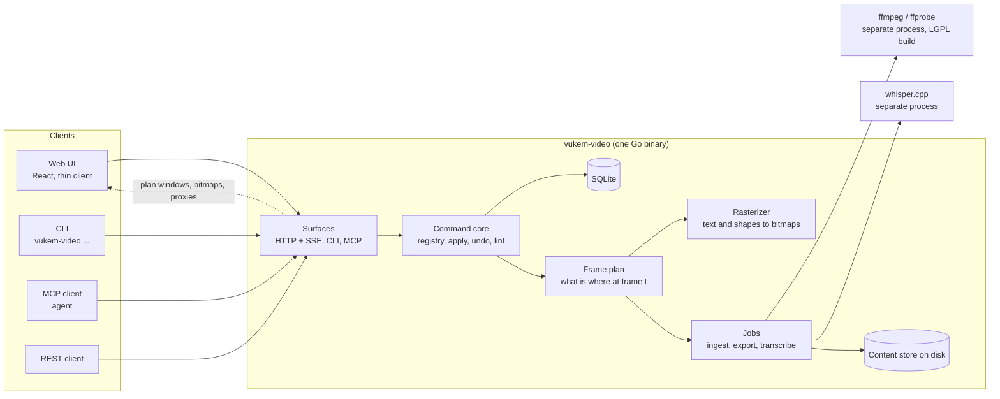

# Stack trade-offs: every item of the stack draft, kept, replaced or cut

> Stage 1, research. All sources accessed 2026-11-14.
> Marking: **FACT** (verified at the source), **INFERENCE**, **OPINION** (the architect's judgement), **NOT VERIFIED**.
> Evidence: [`notes/stack-browser.md`](notes/stack-browser.md), [`notes/stack-backend-desktop.md`](notes/stack-backend-desktop.md), [`notes/vukem.md`](notes/vukem.md), [`notes/licensing.md`](notes/licensing.md). Versions rechecked by the architect: [`notes/architect-verifications.md`](notes/architect-verifications.md).
> The author's decisions this document builds on are D-001 to D-016 in [`../brainstorming.md`](../brainstorming.md).

## Contents

1. [The shape that the decisions produce](#1-the-shape-that-the-decisions-produce)
2. [Verdict on every item of the stack draft](#2-verdict-on-every-item-of-the-stack-draft)
3. [Libraries adopted or under evaluation](#3-libraries-adopted-or-under-evaluation)
4. [The render path: options and the one chosen](#4-the-render-path-options-and-the-one-chosen)
5. [Sharing the command core with the UI](#5-sharing-the-command-core-with-the-ui)
6. [What vukem already gives and what it does not](#6-what-vukem-already-gives-and-what-it-does-not)
7. [Desktop shell](#7-desktop-shell)
8. [Alternatives the author did not list](#8-alternatives-the-author-did-not-list)
9. [Cost of supporting Safari and Firefox later](#9-cost-of-supporting-safari-and-firefox-later)
10. [Gaps](#10-gaps)

## 1. The shape that the decisions produce

The stack draft was written for a cloud product with a heavy browser engine. The author's decisions (Go core with FFmpeg export, local and self-host first, web first) and what vukem already contains remove most of it. OPINION: what remains is deliberately small.

## 2. Verdict on every item of the stack draft

| Draft item | Verdict | Reason |
| --- | --- | --- |
| Go + vukem | **Keep** | D-001; the project is also the field test of vukem |
| gonertia | **Cut** | vukem has its own Inertia v3 adapter in the core (`inertia/`). FACT, `notes/vukem.md` §3.2 |
| Inertia for ordinary pages, editor as a separate SPA | **Keep** | Inertia serves the project list and settings; the editor is a client-rendered page that talks JSON and SSE. vukem documents no SPA fallback (VF-004), so the editor route is written by hand |
| React 19, TypeScript, Vite | **Keep** | Already in the Studio at React 19.3.1, Vite 8.3.4, TypeScript 7.0.2 |
| Tailwind + shadcn/ui | **Keep** | Already in the Studio (Tailwind 4.3.3, shadcn 4.23.0) |
| Zustand | **Keep, for UI state only** | The project state lives in the core; the browser holds a read model |
| Immer | **Cut** | Its value is patches for undo; undo is in the core (see [`engine.md`](engine.md) §4) |
| Timeline with Pointer Events + dnd-kit, or canvas | **Pointer Events on DOM; cut dnd-kit** | The classic dnd-kit line has had no release since 2024-12 and a new 0.x line is in progress. A timeline of a 5 minute video has tens of items, which the DOM handles |
| Preview with `<video>` + proxies, evolving to WebCodecs | **Keep `<video>` + proxies; defer WebCodecs** | See section 4. WebCodecs is an optimisation for scrubbing, not a requirement, once export is on the server |
| PixiJS (optional) | **Adopt for the preview compositor** | MIT, `8.23.0` (2026-11-11), abstracts WebGL2 and WebGPU. A canvas compositor behind one interface is what keeps the preview from being a DOM/CSS renderer, the cause of the FreeCut and Reframe divergences |
| mediabunny / mp4box.js | **Defer** | Needed only if WebCodecs scrubbing is adopted. mediabunny (MPL-2.0, `1.66.0`) would be the choice; `mp4-muxer` and `webm-muxer` are deprecated in its favour |
| wavesurfer.js or precomputed peaks | **Precomputed peaks, own drawing** | Peaks are computed once at ingest by the core; drawing them is a few lines of canvas. wavesurfer decodes the whole audio in the browser by default |
| Web Workers + OPFS | **Cut from the MVP** | Media and caches live on the server's disk (D-003). The browser stores nothing |
| WebSocket / SSE | **SSE only** | vukem has SSE in the core with a hub and `Last-Event-ID`; WebSocket is a separate module at `drivers/websocket/v0.1.6`. Edits go up as HTTP requests, events come down by SSE |
| PostgreSQL | **Defer** | D-003. vukem supports it as a module when a SaaS exists |
| SQLite | **Keep** | In the vukem core through `modernc.org/sqlite` (pure Go, no cgo) |
| sqlc + pgx + goose | **Cut** | vukem brings its ORM, query builder and Go migrations (`schema/`, `vukem migrate`) |
| river or asynq | **Cut** | vukem brings a queue with a `database` driver. It lacks progress and cancellation (VF-002), which the product adds in its own job table |
| tusd | **Cut** | Local-first imports by path. vukem has `upload.Tus` for the day uploads matter |
| S3 or disk | **Disk; S3 deferred** | D-003. vukem has `storage.Disk` with a local driver and an S3 module |
| FFmpeg + ffprobe | **Keep, as separate processes** | D-001, D-006. Run through vukem's `contrib/engine` (clean environment, pinned temp directory, bounded output, process-tree cancellation) |
| whisper.cpp or API | **Both, local by default** | D-010 |
| Official MCP SDK for Go | **Keep** | `modelcontextprotocol/go-sdk` `v1.8.0`, negotiates up to revision `2026-07-28` |
| cobra | **Cut** | vukem has a command registry (`vukem.Command`, standard `flag`) and exit codes through `ExitError`. One binary, one command mechanism |
| REST + OpenAPI | **Keep** | vukem generates OpenAPI and typed clients (`openapi/`) |
| Shared schema: JSON Schema or Protobuf | **JSON Schema** | MCP `inputSchema` is JSON Schema 2020-12, OpenAPI 3.1 embeds it, and the timeline is a JSON document. Protobuf would add a toolchain for no consumer |
| Sessions + API keys with scopes | **Keep** | In the vukem core (`auth.Tokens` with abilities). Policy in D-012 |
| go test, Vitest, Playwright | **Keep go test and Playwright; Vitest only where TS has logic** | The browser holds little logic by design |
| Docker, Caddy | **Keep** | Image with a pinned LGPL FFmpeg |
| Railway | **Cut** | D-015 |
| OpenTelemetry | **Optional, off by default** | D-016; vukem has `drivers/otel` |
| Sentry | **Cut** | D-016 |
| Desktop: Wails or Electron | **Decide before BETA** | D-004; section 7 |
| Desktop: same React UI without Inertia | **Keep** | Follows from the editor being a client-rendered page |
| Desktop: Go core as sidecar, same binary | **Keep** | It is already the same binary |
| Desktop: Rust renderer with wgpu, ffmpeg-next or GStreamer, cpal/symphonia/rubato, cosmic-text/glyphon | **Cut** | A third renderer triples the risk of preview and export diverging. No requirement justifies it |
| IPC with gRPC, Protobuf (buf) | **Cut** | The UI already talks HTTP to the core; a desktop shell opens the same address |
| Hardware acceleration with fallback | **Keep** | It is the H.264 policy itself (D-006) |
| goreleaser | **Keep** | vukem's release pattern uses it (`notes/vukem.md` §1.4) |
| cargo-dist | **Cut** | No Rust |
| Signing, notarization, auto-update, three-OS CI matrix | **Keep, in BETA** | With the desktop shell |
| Golden frames | **Keep** | They are how the tolerance between preview and export is enforced |

## 3. Libraries adopted or under evaluation

| Name | Function | Latest release | Last commit | Licence | Maturity signals | Risks | Verdict | Source, date |
| --- | --- | --- | --- | --- | --- | --- | --- | --- |
| vukem | web framework, queue, ORM, SSE, tokens, OpenAPI, CLI | `v0.43.0`, 2026-11-12 | 2026-11-14 | MIT | 58 core releases in a month; BETA phase; same author | pre-1.0, breaking changes in recent releases | adopt | `gh release list -R AlexGalhardo/vukem`, 2026-11-14 |
| vukem `contrib/engine` | run external binaries safely | `contrib/engine/v0.1.1` (tag only) | 2026-11-14 | MIT | new module | version 0.1; resource limits are Linux-only | adopt | `git tag -l 'contrib/engine/*'`, 2026-11-14 |
| modelcontextprotocol/go-sdk | MCP server | `v1.8.0`, 2026-09-14 | 2026-11-13 | MIT moving to Apache-2.0 | 5,346 stars; official | support for the tasks extension NOT VERIFIED | adopt | `gh release list`, 2026-11-14 |
| santhosh-tekuri/jsonschema | validate JSON against JSON Schema | `v6.0.3`, 2026-08-06 | 2026-11-12 | Apache-2.0 | 1.3k stars | validation only | adopt | `gh api`, 2026-11-14 |
| FFmpeg, BtbN `lgpl` build | decode, composite, encode | daily builds on release branches 8.1 and 9.0 | 2026-11-14 | LGPL 3 | 12k stars on the build repository | OpenH264 compiled in (see [`licensing.md`](licensing.md) §8) | adopt, pinned | <https://github.com/BtbN/FFmpeg-Builds>, 2026-11-14 |
| whisper.cpp | local transcription | `v1.9.5`, 2026-10-06 | 2026-11-13 | MIT | 55k stars | speed on CPU and word timing quality unmeasured before the spike | adopt | `gh api`, 2026-11-14 |
| PixiJS | preview compositor | `8.23.0`, 2026-11-11 | 2026-11-11 | MIT | 48,712 stars | large API for a small need | adopt | `npm view`, 2026-11-14 |
| React | UI | `19.3.1`, 2026-11-12 | n/a | MIT | standard | none | adopt | `npm view`, 2026-11-14 |
| Vite | build | `8.3.8`, 2026-11-11 | n/a | MIT | standard | recent major | adopt | `npm view`, 2026-11-14 |
| Tailwind CSS | styles | `4.3.5`, 2026-11-11 | n/a | MIT | standard | none | adopt | `npm view`, 2026-11-14 |
| shadcn/ui | components copied into the repository | `4.23.0`, 2026-10-27 | 2026-11-13 | MIT | 128k stars | copied code is ours to maintain | adopt | `gh api`, 2026-11-14 |
| Zustand | UI state | `5.1.0`, 2026-11-06 | 2026-11-06 | MIT | 58,922 stars | none | adopt | `npm view`, 2026-11-14 |
| GoReleaser | release binaries | `v2.20.2`, 2026-11-12 | 2026-11-14 | MIT | 16k stars | none | adopt | `gh api`, 2026-11-14 |
| mediabunny | demux, mux, WebCodecs wrapper | `1.66.0`, 2026-11-13 | 2026-11-14 | MPL-2.0 | 7,498 stars; base of Remotion's client renderer | one maintainer | evaluate later | <https://github.com/Vanilagy/mediabunny>, 2026-11-14 |
| Wails v3 | desktop shell, system webview | `v3.1.0`, 2026-11-01 | 2026-11-13 | MIT | stable for three weeks after four years of alpha | system webview | evaluate before BETA | `gh release list -R wailsapp/wails`, 2026-11-14 |
| Electron | desktop shell, bundled Chromium | `v45.3.2`, 2026-11-13 | 2026-11-14 | MIT | 124k stars | size, Node in the desktop | evaluate before BETA | `gh release list -R electron/electron`, 2026-11-14 |
| go-text/typesetting | text shaping in pure Go: HarfBuzz port, bidi, line segmenter, font loading | `v0.3.5`, 2026-09-04 | 2026-11-10 | Unlicense OR BSD-3-Clause | 162 stars; shared by the Fyne, Gio and Ebitengine toolkits; three maintainers from different projects | version 0.x, "still evolves rapidly" by its own README; colour emoji support NOT VERIFIED | adopt, pinned, behind our rasterizer interface | `gh api repos/go-text/typesetting`, LICENSE and README, 2026-11-14 |
| golang.org/x/image (`vector`, `font/opentype`) | rasterize glyph outlines to bitmaps | Go sub-repository, no tagged releases checked | 2026-11-09 | BSD-3-Clause | 552 stars on the mirror; maintained by the Go team | no shaping by itself | adopt for rasterization | `gh api repos/golang/image`, 2026-11-14 |
| go-text/render | small rasterizer on top of go-text | tags up to `v0.2.1` | 2026-04-17 | Unlicense OR BSD-3-Clause (same organisation; LICENSE not opened) | 16 stars | very small adoption | evaluate against `x/image/vector` | `gh api repos/go-text/render`, 2026-11-14 |
| tdewolff/canvas | vector graphics and text in Go | releases not listed by the API | 2026-09-23 | MIT | 1,846 stars | broader than needed | fallback candidate | `gh api repos/tdewolff/canvas`, 2026-11-14 |

## 4. The render path: options and the one chosen

D-001 fixes that FFmpeg, driven by Go, produces the export and is the truth. What remained open is how the browser previews without becoming a second renderer with its own opinions.

| Option | How it works | Verdict |
| --- | --- | --- |
| A. FFmpeg graph for export, a separate browser renderer for preview | Two independent implementations of layout, text and effects | Rejected. This is the design behind the preview and export divergences of FreeCut and Reframe ([`post-mortems.md`](post-mortems.md) §1) |
| B. Browser renderer as the single renderer, headless Chrome for export | One code path for pixels | Rejected by D-001. The Remotion documentation itself lists differences between its server and client renderers |
| C. Everything rendered by the engine and streamed to the browser | Exact, but every interaction waits for a render | Rejected as the only mode; kept for the paused frame |
| **D. One plan, two executors, truth on pause** | See below | **Chosen** |

**Option D in detail (OPINION).**

1. **One plan.** The core has a single function that, for a frame number, returns the frame plan: the ordered list of layers with source frame, crop, transform, opacity and the bitmaps to draw. Keyframe interpolation, transition timing and source frame selection exist only there.
2. **One rasterizer.** Text and shapes are turned into bitmaps by Go code using bundled fonts. Both executors draw those same bitmaps. FFmpeg's `drawtext` and libass are not used, so there is one text layout.
3. **Export executor.** FFmpeg decodes the normalized media into raw frames; a compositor written in Go places the layers and bitmaps as the plan says; FFmpeg encodes the result. FFmpeg places nothing (ADR-0003, SDD-004).
4. **Preview executor.** The browser plays the normalized proxies with `<video>` elements and composites them with the same bitmaps on a canvas, following plan windows fetched from the core. It interpolates nothing itself.
5. **Truth on pause.** When playback stops on a frame, the UI replaces the approximate picture with that frame rendered by the export executor at preview resolution. An agent's `view` tool uses the same endpoint. So whatever a person inspects while paused, and whatever an agent sees, is what will be exported.
6. **Tolerance.** The difference that can exist is only between the two pixel executors while playing: scaling filter, colour conversion, blend rounding. It is a number checked by reference-frame tests, defined in the render specification.

What this costs: text effects and motion are limited to what our rasterizer and the plan can express, which the author accepted in D-001. What it avoids: a browser engine in the server, WebCodecs as a requirement, and a second implementation of layout.

The spike [`spikes/export-pipeline`](../../spikes/export-pipeline/README.md) measures whether Go can feed overlay bitmaps to FFmpeg fast enough and whether the LGPL build has the filters needed. See [`spikes.md`](spikes.md).

## 5. Sharing the command core with the UI

| Option | Verdict |
| --- | --- |
| Core only in the Go process; the UI sends commands and renders the returned state | **Chosen** |
| Go core compiled to WebAssembly and also run in the browser | Rejected for now: multi-megabyte binary and awkward JavaScript interop (sizes NOT VERIFIED), for a latency problem that local-first does not have |
| Core in TypeScript, run in the browser and in a bundled runtime | Rejected by D-001 |
| Core in Rust, native and WebAssembly | Rejected by D-001 |

**INFERENCE.** With D-003 the server is on the same machine or a self-hosted one, so a command round trip is a few milliseconds. The UI needs no copy of the editing logic. While a person drags an item, the UI moves it visually as an ephemeral, uncommitted preview; on release it sends the command and replaces the visual with the core's answer. That ephemeral move is presentation, not editing logic, and the rule in the specifications must be that the browser never computes a resulting timeline.

## 6. What vukem already gives and what it does not

FACT, from reading vukem `v0.43.0` ([`notes/vukem.md`](notes/vukem.md) §3.3). Friction entries are in `vukem-feedback.md` at the workspace root.

| Need | vukem | Consequence |
| --- | --- | --- |
| Inertia + React + Vite | core, own adapter | use it for ordinary pages |
| Serve a client-rendered SPA route | no documented fallback (VF-004) | hand-written route |
| SQLite, migrations, ORM | core | use it |
| Background jobs | core, `database` driver, at-least-once | use it; own job table for progress and cancel (VF-002) |
| Server-sent events | core, hub with topics | use it for the real-time protocol |
| WebSocket | separate module `v0.1.6` | not used |
| Tokens with scopes, sessions | core | use it |
| OpenAPI and client generation | core | use it |
| CLI commands inside the app binary | core, `vukem.Command`, `ExitError` | use it instead of cobra |
| Run FFmpeg safely | `contrib/engine` `v0.1.1` | use it |
| File serving with Range | core (`http.ServeContent`) | serves proxies to `<video>` |
| Large request bodies | default limit 10 MiB; `upload.Tus` available | explicit rules when upload exists |
| MCP server for the application | none (VF-003) | official Go SDK |
| Single binary with embedded assets | core | the distribution model |
| Stability | pre-1.0; `BREAKING` entries in `v0.41.0` and `v0.43.0` | pin the version; budget upgrade work in every phase |

## 7. Desktop shell

- **FACT.** Wails v3 is stable (`v3.1.0`), needs Go 1.26 or later, has a server mode, an updater and installers, and uses the system webview: WebView2 on Windows, WKWebView on macOS, WebKitGTK 6.0 on Linux.
- **FACT.** WebView2 is Chromium. For WKWebView and WebKitGTK no evidence was found of usable WebCodecs or WebGPU; WebKitGTK 2.52 release notes mention neither. NOT VERIFIED on real machines.
- **FACT.** Tauri v3 is in alpha with a Chromium runtime (`tauri-runtime-cef v3.0.0-alpha.7`). Electron `v45.3.2` bundles Chromium.

**INFERENCE.** Option D of section 4 changes this question. The preview needs only `<video>`, a WebGL2 canvas and server-sent events, not WebCodecs, WebGPU or OPFS. That is a floor the system webviews are far more likely to meet, which makes Wails v3 the natural candidate: same language, and its server mode is the architecture already chosen. It still has to be proved by a feature-detection test on real macOS and Linux machines before BETA, as D-004 says.

## 8. Alternatives the author did not list

| Alternative | Verdict | One-line reason |
| --- | --- | --- |
| Tauri (Rust + system webview) | Rejected | Adds Rust for a shell; same webview limits as Wails |
| Remotion | Rejected | Source-available licence with paid tiers; cannot be a dependency of an MIT product |
| Revideo | Rejected | MIT, but no release since 2026-07 and a "scene as code" model, not a document |
| Motion Canvas | Rejected | No release since 2024-12 |
| ffmpeg.wasm | Rejected | GPL core, 2 GB ceiling, maintainers "bandwidth limited" |
| MLT Framework (`melt`) | Rejected | LGPL core with GPL modules, native dependencies, no Go binding; would replace our plan with its own model |
| GStreamer Editing Services | Rejected | Plugin distribution is complex; GitHub mirror idle since 2018 |
| OpenTimelineIO | Later, as export and import only | Good interchange format, not a native format |
| WebGPU directly | Rejected | Much own code; partial on Linux; PixiJS covers it if ever needed |
| HyperFrames | Rejected as an engine | Apache-2.0 and active, but it renders HTML in headless Chrome, which D-001 excludes |
| Chrome headless as the render path | Rejected | D-001 |

## 9. Cost of supporting Safari and Firefox later

OPINION, low because of option D. The browser needs `<video>` playback of H.264 proxies, WebGL2, server-sent events and Pointer Events, all broadly available. The File System Access API, OPFS, WebCodecs and WebGPU, which are where browsers differ most, are not used. The expected cost is testing, proxy codec compatibility and input quirks, not a second media pipeline.

## 10. Gaps

- The Go text stack (`go-text/typesetting` for shaping, `x/image/vector` for rasterizing) was checked for existence, licence and activity, not for output quality. Colour emoji, complex scripts and rendering speed need a measurement in the Prototype before the text contract is frozen.
- Go to WebAssembly sizes were not measured, because the option was rejected on other grounds.
- WKWebView and WebKitGTK capabilities are unverified on real machines.
- Seek precision of `<video>` on short-GOP proxies has no primary source; it needs a measurement in the Prototype.
- Which parts of MCP revision `2026-07-28` the Go SDK implements is unverified.
